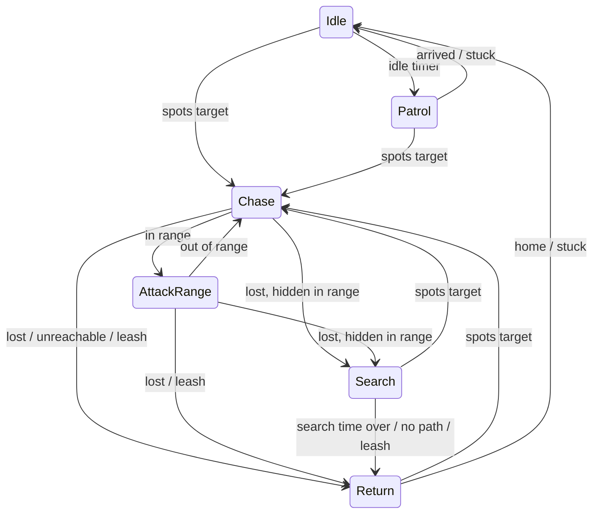
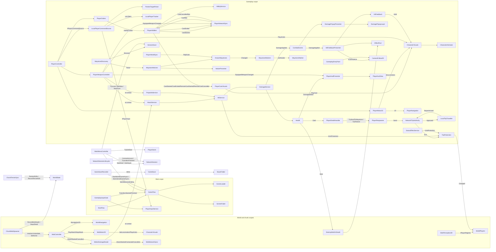

# Architecture

Code map for orienting quickly in the project. One section per system; keep headings stable and update the section that matches the code you change. Conventions and rules live in [CLAUDE.md](../CLAUDE.md); this file describes what exists.

All C# types are in the global namespace (no `namespace` declarations). Paths below are relative to this file.

## Overview

A Unity 6 (URP 2D) top-down action RPG prototype. The player boots into a main menu, starts a new game, and is placed in a seamless world, a grid of chunk scenes streamed around the players (Testlands, the hand-painted test world, at its `start` entry), where they walk in 8 directions and fight with a sword, a greatsword or a longbow (switched with a dev key for now). Weasel mobs idle, patrol around their spawn, spot the player with line-of-sight checks, path around walls on their world's navigation, crowd around the player without overlapping, and melee attack with a telegraphed windup a player can step out of. Damage shows floating numbers and a HUD health bar, and every hit flashes, holds and nudges the struck unit with an impact where it lands, kicking the camera of the player who landed or took it. Mobs target whichever player of their world they spot (nearest visible). A dead player respawns on its own after a delay at the nearest waystone it discovered in its world, whatever the other players do: nothing restarts when every player is dead. Offline and online play (host and join) run in seamless worlds, each player in its own world and travelling between worlds through exits (see Networking and Worlds and streaming). A dev-only stress world spawns hundreds of mobs on a procedurally generated map to profile AI and pathfinding.

## Packages

Notable entries in [Packages/manifest.json](../Packages/manifest.json):

| Package | Used for |
|---|---|
| `jp.hadashikick.vcontainer` (git, pinned to tag `1.19.0`) | Dependency injection, `LifetimeScope`s, entry points |
| `com.unity.inputsystem` | `InputSystem_Actions.inputactions`, `PlayerInputService`, `InputBindings` (rebinding), UI input module |
| `com.unity.render-pipelines.universal` | URP 2D renderer, `Light2D` |
| `com.unity.2d.tilemap` / `.extras` | Tilemaps for terrain, collision and navigation data; `RuleTile` base of the dual-grid walls tile |
| `com.unity.2d.aseprite`, `com.unity.2d.animation` | Sprite import and animation |
| `com.unity.ugui` + TextMesh Pro | Menu, HUD, damage popups |
| `com.unity.test-framework` | EditMode and PlayMode tests |
| `com.unity.netcode.gameobjects` 2.13.3 | Netcode for GameObjects: `NetworkManager`, host/client sessions, network prefab handlers |
| `com.unity.transport` 2.6.0 | `UnityTransport`. Pinned to the version Netcode declares: 2.7.x throws a Burst `NullReferenceException` from its `AnalyticsLayer` job every network update in this editor version. |
| `com.unity.multiplayer.playmode` 2.0.2 | Multiplayer Play Mode (up to 3 extra virtual players in the editor) |
| `com.unity.multiplayer.tools` 2.2.12 | Network Simulator (latency, jitter, packet loss) and network profiling. Simulation only runs in the editor and development builds. |
| `com.coplaydev.unity-mcp` (git) | UnityMCP editor automation |

## Assemblies

| Assembly | Folder | References | Notes |
|---|---|---|---|
| `TopDownRPG.Core` | `Assets/Scripts/Core` | VContainer, Unity.InputSystem, UnityEngine.UI (for the `EventSystem` pointer-over-UI check), Unity.Netcode.Runtime, Unity.Networking.Transport | Boot, scene flow, input, clock, randomness, network session, camera follow, screen fader. Must not reference Gameplay. |
| `TopDownRPG.Gameplay` | `Assets/Scripts` (everything outside `Core` and `Dev`) | Core, VContainer, Unity.InputSystem, Unity.TextMeshPro, Unity.Netcode.Runtime, Unity.2D.Tilemap.Extras, Unity.RenderPipelines.Universal.2D.Runtime (the spell lights' `Light2D`) | AI, navigation, combat, player, character animation, UI, effects, world (including the dual-grid walls and the blended terrain renderer), composition roots. |
| `TopDownRPG.DevTools` | `Assets/Scripts/Dev` | Gameplay, Core, VContainer, Unity.2D.Tilemap.Extras | `defineConstraints: UNITY_EDITOR \|\| DEVELOPMENT_BUILD`; not auto-referenced. Its editor-only code sits behind `#if UNITY_EDITOR`. |
| `TopDownRPG.Editor` | `Assets/Editor` | Core, Gameplay, VContainer, Unity.2D.Tilemap.Editor, Unity.2D.Tilemap.Extras, Unity.2D.Tilemap.Extras.Editor, Unity.2D.Sprite.Editor (slicing the walls sheet), Unity.2D.Aseprite.Editor (reading hand-drawn characters', effects' and projectiles' files), Unity.RenderPipelines.Universal.2D.Runtime (the stress scene's Global Light 2D), Unity.TextMeshPro (the UI's font assets and the theme's fonts) | Editor-only platform. Includes the dual-grid tooling, the terrain brush and material tools, the walls sheet generator, the character baker, the effect and weapon sprite recipes, the Aseprite character, effect and projectile recipes, the prop placement tool and the scene generator. |
| `TopDownRPG.Editor.Testing` | `Assets/Editor/Testing` | UnityEditor.TestRunner, UnityEngine.TestRunner | Editor-only, not auto-referenced: `ProjectTestRun`, the test runner for tools that drive the editor (see Tests). |
| `TopDownRPG.EditModeTests` | `Assets/Tests/Editor` | Gameplay, Core, Editor (for the prop snapping rule, the scene generator and the terrain tools), DevTools (for the stress map), VContainer, Unity.InputSystem, Unity.InputSystem.TestFramework, Unity.TextMeshPro, Unity.Netcode.Runtime, Unity.2D.Tilemap.Extras, Unity.2D.Tilemap.Editor (for the grid brushes), Unity.2D.Aseprite.Editor (to read back the `.aseprite` files tests write), Unity.RenderPipelines.Universal.2D.Runtime (for the 2D lights the light render tests make) | Editor-only test assembly. |
| `TopDownRPG.PlayModeTests` | `Assets/Tests/PlayMode` | Gameplay, Core, DevTools, VContainer, Unity.InputSystem, Unity.TextMeshPro, Unity.Netcode.Runtime, Unity.RenderPipelines.Universal.2D.Runtime (for a copy's cast light) | Needs DevTools for the stress-scene test. |

Dependency direction: `Core <- Gameplay <- DevTools`, with `Editor` and both test assemblies on top. Core and Gameplay each have an `AssemblyInfo.cs` ([Core](../Assets/Scripts/Core/AssemblyInfo.cs), [Gameplay](../Assets/Scripts/AssemblyInfo.cs)) granting `InternalsVisibleTo` to both test assemblies; `internal` members are test seams. Gameplay also grants it to `TopDownRPG.Editor`, whose dual-grid tools set `internal` members of the dual-grid types and whose terrain brush calls the terrain renderer's `internal` preview API, and to `TopDownRPG.DevTools`, whose lighting panel drives the lighting's `internal` dev seams (see Dev tools); Gameplay still references nothing of DevTools. Editor's own [AssemblyInfo.cs](../Assets/Editor/AssemblyInfo.cs) grants it to the EditMode tests.

## Scenes and boot flow

### Scenes

| Scene | Role | Key contents |
|---|---|---|
| [Main.unity](../Assets/Scenes/Main.unity) | Persistent root, never unloaded. First scene in the build. | `MainLifetimeScope`, Main Camera (`CameraFollow2D`), `EventSystem`, `TransitionCanvas/Fade` (`ScreenFader`) |
| [MainMenu.unity](../Assets/Scenes/MainMenu.unity) | Title screen, loaded additively. | `MenuLifetimeScope`, `MainMenuCanvas` with `MainMenuController`; `Buttons` holds Continue, New game, Host game, the join address field, Join game, Options, Quit and a status line, every text, image and control themed (DesignSystem.md's Phase 4); an `OptionsMenu` prefab instance draws over them while open |
| [Gameplay.unity](../Assets/Scenes/Gameplay.unity) | Session scene, loaded additively for a play session. | `GameplayLifetimeScope` (references the `Player` prefab, spawned at runtime), `PlayerHudCanvas` prefab, `DamagePopupCanvas` (`DamagePopupLayer`), `GameMenuCanvas` prefab (in-game menu and options screen, sort order 10000: above the popups, below the fader) |
| [Worlds/Sandbox/World_Sandbox.unity](../Assets/Worlds/Sandbox/World_Sandbox.unity) and its four chunks under `Chunks/` | The Sandbox, a seamless test world of 2 x 2 chunks at origin (2048, 0), listed in `GameScenes.worlds` and the build; nothing in the menu leads to it, so it is played by opening one of its scenes and pressing Play (see Worlds and streaming). | Root scene: `WorldLifetimeScope`, `Lighting` (`WorldLighting`) holding a white Global Light 2D at 0.85. Each chunk scene: `ChunkLifetimeScope`, a `Grid` at the world's origin with its `WorldChunk`, a `TerrainBlendRenderer` drawing the chunk's ground layers (each list covering its neighbours' border materials) and a `NavigationGrid2D` its navigation page is built from (blocked by the walls and the `Obstacles` layer, reading the cliff of its raised tilemap; `WorldAuthoring.SetUpNavigation` gave every chunk of both test worlds theirs), the walls' `CollisionTilemap` (copied from the area template), and `MobSpawns` holding three `MobSpawnPoint`s of the Weasel (nothing spawns them yet). Painted by script: grass over all 128 x 128 cells, a stone road across the south (rows 40 to 43), a gravel trail up the east (columns 90 and 91), a pond of water in the north-west with a sandy shore, a patch of dirt over the corner where the four chunks meet, a meadow across the border at row 64 in the west and tall grass across the border at column 64 in the north; walls: a line along row 20 and a block across the border at column 64 in the south, a ring around the corner where the four chunks meet and a 2 x 2 block on that corner; a plateau of raised ground (columns 100 to 118, rows 52 to 76) with a ramp in its southern edge across the border at row 64 (WorldStreaming.md's Phase 2); entry `start` (a waystone) on the road at (30.5, 42), and entry `fromInterior` at (33.5, 42), where the interior's exit leads, two and a half cells west of the world exit `Exit_SandboxInterior` (under `Exits` in chunk (0, 0): cells (36, 41) and (36, 42) of the road, leading to the SandboxInterior's `start`); entry `fromTestlands` at (5.5, 42), two and a half cells east of the world exit `Exit_Testlands` (cells (3, 41) and (3, 42) of the road, leading to Testlands' `fromSandbox`). Every chunk has an `AreaTerrain` (its grass layer and walls). The lighting showcase (Lighting.md, laid out with `WorldAuthoring.Paint` and the Prop Placement window's placement, under each chunk's `Props` root): seven `LampPost_0`s on the road's north edge (row 44) at columns 8, 20, 32 (the `start` waystone's, two cells east of it and up), 44, 56, 68 and 80, the road east of the gravel trail left dark to compare, broadleaf trees between them at row 45 so their shadows cross the road, and bushes and rocks on its south edge; a campsite on a patch of dirt round (20, 28) in chunk (0, 0), `Campfire_0` with three `Stump_Oak` seats, a `Log_Oak`, five broadleaf trees, a bush, a fern and mushrooms; a pool of lava in a ring of dirt (the scorched earth) round (106, 18) in chunk (1, 0), more than 4 cells from every chunk border so only that chunk draws lava, with `Campfire_1` and a charred seat west of it, charred trees and stumps and basalt rocks, a boulder and a spire, and since Lighting.md's Phase 6 a `Brazier_1` on cell (99, 16) and a `Torch_0` on cell (106, 23) at the pool's edge, so the campfire, the brazier, the torch and the charred props' embers show in one view; trees, bushes and grey rocks west, south and east of the plateau in chunk (1, 0), the ramp and stretches of its foot kept open so its cliffs' shadows show; and open grass round the gravel trail at (91, 88) for spells, away from the lamps and the lava. Since Lighting.md's Phase 7, a `LampPost_0` where it meets a wall and trees in chunk (1, 0): on cell (71, 23), a cell above the wall along row 20 and two from its spur up column 74, among a `Tree_Broadleaf_0`, a `Tree_Broadleaf_2`, a `Tree_BroadleafSmall_1`, a `Bush_Green_1` and a `Boulder_Grey_1`, so the lamp's light stops at the wall and the props' feet. Entries `campsite` (23.5, 30.5), `lava` (99.5, 19.5), `plateau` (108, 50), `spells` (91, 88) and `walls` (67.5, 23.5) after the first three, the lighting panel's teleport spots. At most 6 ground layers in a chunk (chunk (1, 0) draws grass, dirt, gravel, stone and lava) |
| [Worlds/SandboxInterior/World_SandboxInterior.unity](../Assets/Worlds/SandboxInterior/World_SandboxInterior.unity) and its chunk | A one-chunk test world at origin (4096, 0), standing in for an interior; listed and built like the Sandbox. | Set up like the Sandbox: a 24 x 16 room of dirt with a square of plaza in its middle, its grass layer empty (the room covers cells (20, 24) to (43, 39)); entry `start` at (32, 32), and the world exit `Exit_Sandbox` on the room's bottom row (cells (31, 24) and (32, 24)), leading back to the Sandbox's `fromInterior`. Lit indoors, it shows the lighting showcase's indoor case: two `LampPost_0`s either side of the plaza (cells (25, 32) and (38, 32)) and a hearth north of it, `Campfire_2` between two `Stump_Oak`s, burning at full by day and night with no sun. Since Lighting.md's Phase 7 walls ring the room (columns 19 to 44, rows 23 to 40), six one-cell pillars stand two by the hearth (cells (30, 35) and (35, 35)) and two by each lamp post (cells (23, 29), (23, 35), (40, 29) and (40, 35)), so its lights' shadows fall across the plaza and the dirt, and its global light is a dim indoor sky, (0.28, 0.26, 0.32) at 1 |
| [Worlds/Testlands/World_Testlands.unity](../Assets/Worlds/Testlands/World_Testlands.unity) and its four chunks under `Chunks/` | Testlands, the hand-painted test world of 2 x 2 chunks at origin (6144, 0), the first free slot of the layout when it was made; listed in `GameScenes.worlds` and the build. It was `GameScenes`' starting world until WorldGeneration.md's Phase 5 and stays the PlayMode tests' own: `SceneBootTestHelper` gives every boot a copy of `GameScenes` starting at its `start`, so New Game, Host Game and a joining player the host does not know start there in every test. The PlayMode tests that need a session boot into it (`SceneBootTestHelper.BootIntoTestlands`). | Made with the World Editor's steps (`WorldAuthoring.CreateWorld` and `CreateChunk`, `ListInGameScenes`) and painted with the Terrain Brush's strokes, each written across the chunk borders it crossed (WorldStreaming.md's Phase 5): grass over all 128 x 128 cells, a stone road across the world (rows 38 to 41) crossing the border at column 64, a gravel trail up the east (columns 88 and 89, rows 42 to 127) crossing the border at row 64, a meadow across row 64 in the west, tall grass across column 64 in the south, a patch of dirt on the corner where the four chunks meet, and a pond of water in a sandy shore across column 64 in the north; walls (`WorldAuthoring.AddWalls` on chunk (0, 0), then the brush): a line along row 24 from column 56 to 72 across the border and a short spur up column 56; a plateau of raised ground (columns 100 to 115, rows 56 to 72) across the border at row 64 with a ramp in its southern edge (columns 106 to 108). Each chunk's `MobSpawns` holds two Weasel `MobSpawnPoint`s with their `PersistentId`, all at least 23 cells from the entry. Entry `start` (a waystone) on the road at (24.5, 40.5): every cell within 6 of it is open ground, with room for the seven-cell wall `PlayerControlsPlayModeTests` builds two cells to its right (Docs/SceneGeneration.md's "What the PlayMode tests rely on"). Entry `fromSandbox` at (117.5, 40), two and a half cells west of the world exit `Exit_Sandbox` (under `Exits` in chunk (1, 0): cells (120, 39) and (120, 40) of the road, leading to the Sandbox's `fromTestlands`), so a hosted game reaches the Sandbox and its interior. Entry `north` (a waystone) on the grass of chunk (0, 1) at (30.5, 90.5), 50 cells from `start` and 19 from the nearest Weasel spawn point, for the respawn tests and the Multiplayer Play Mode steps (WorldStreaming.md's Phase 9). Every chunk has an `AreaTerrain` (its grass layer, and its walls where it has them). No sea, so no coast maps. |
| [Worlds/Overworld/World_Overworld.unity](../Assets/Worlds/Overworld/World_Overworld.unity) and its twenty chunks under `Chunks/` | The Overworld, the first generated world ([WorldGeneration.md](WorldGeneration.md)), 5 x 4 chunks at origin (8192, 0), the first free slot of the layout when it was made; listed in `GameScenes.worlds` and the build, and `GameScenes`' starting world since WorldGeneration.md's Phase 5: New Game and Host Game with no save start at its `clearing`, and so does every player the host does not know. Six regions, the six area generators' seed 1 layouts with their props, on an island in the sea, joined by stone and gravel roads through the wilds' grass and its forest; a waystone per region on a plaza at its spawn cell, `clearing` the default entry, and a gate on each linked port. | Made with the World Editor's steps (`WorldAuthoring.CreateWorld`, `CreateChunk` for every chunk, `ListInGameScenes`) and written through the World Generator's code path (`WorldGeneratorSession`) from `WorldGenerator_Overworld.asset`, then synced, baked, repaired and validated: every chunk 5 to 14 layers in the style's order, all eighteen materials laid, the Coast region's plateau of raised ground with its ramp, 48 spawn points of the Weasel under the chunk grids' `GeneratedMobSpawns` (28 in the regions, 20 in the wilds) with derived ids, 5102 props under the chunk grids' `GeneratedProps` (2117 the regions', 2985 the wilds'; PropGeneration.md's Phase 6), 14 baked coast maps beside the chunk scenes, a `ChunkSky` on the grids of the 16 chunks a region's sky reaches (Lighting.md's Phase 8), no walls; 19 entries, the six waystones then the 13 gates. Regenerate it from its generator asset only (WorldGeneration.md: Generating a world), locking a chunk there before painting it by hand. |
| [Dev/Worlds/StressTest/World_StressTest.unity](../Assets/Dev/Worlds/StressTest/World_StressTest.unity) and its four chunks under `Chunks/` | The stress world, a dev-only world of 2 x 2 chunks at origin (0, 0), the first free slot of the layout when it was made. Not listed in `GameScenes` and not in the build list: its `SceneDefinition`s lie under `Assets/Dev/`, which `SceneBuildValidator` skips and `WorldAuthoring` keeps out of the build. Played by opening one of its scenes and pressing Play. | Made with the World Editor's steps (`WorldAuthoring.CreateWorld` into `Assets/Dev/Worlds`, `CreateChunk`, `AddWalls`). Root scene: `WorldLifetimeScope`, whose auto-inject objects list `StressTest` (at the world's middle, (64.5, 64.5)) holding `StressTestSpawner` and `StressTestOverlay`, and the lighting. Each chunk's grid has an empty `GrassTilemap` layer, walls and a `StressTestMap`, which paints the chunk's part of the 128 x 128 map at runtime. Entry `start` (a waystone) at the world's middle. No mob spawn points: the spawner makes the mobs. |

Chunks get their walls from [Walls.prefab](../Assets/Prefabs/World/Walls.prefab) (`WorldAuthoring.AddWalls`, the World Editor's Add walls): an empty `CollisionTilemap` on the `Obstacles` layer with its dual-grid walls module (`walls_DualGridRuleTile`) and grid colliders, and its `RenderTilemap` at order 10 on the `Terrain` sorting layer, saved from the area template as the areas went, and since Lighting.md's Phase 7 a Shadow Caster 2D on the `CollisionTilemap`, shaped by its grid colliders through URP's collider shape, untrimmed, on the ground's sorting layers alone since KnownGaps.md's Phase 7, so the walls stop the prop lights and units and props read the walls' shadows at their feet (`WorldAuthoring.AddWallShadows` gave the walls already in the worlds theirs, and brought them onto the ground's sorting layers) (WorldStreaming.md's Phase 9). The Scene Generator writes into standalone scratch scenes (`WorldAuthoring.CreateScratchScene`, see Editor tools), never into a world's chunk.

Scene identity is data, not strings: [SceneDefinition](../Assets/Scripts/Core/Scenes/SceneDefinition.cs) assets under `Assets/Data/Scenes` (and beside each world's scenes under `Assets/Worlds`) hold a scene GUID + path, and [GameScenes](../Assets/Scripts/Core/Scenes/GameScenes.cs) (`Assets/Data/Scenes/GameScenes.asset`) lists MainMenu, Gameplay, the seamless worlds (`worlds`, `FindWorldOwning(scenePath)`: the listed world whose root or chunk scene that is; `FindWorldById`), and the starting world and entry (`StartingWorld`, `StartingWorldEntry`: the Overworld's `clearing`), where New Game and Host Game start and where a joining player the host does not know arrives. Its internal `CopyStartingAt(source, world, entry)` makes a copy of the asset starting elsewhere (a `GameScenesCopy`, every serialized field copied through `JsonUtility`, `DontSave`; a type of its own, since VContainer refuses a second singleton of the same concrete type), which `SceneBootTestHelper` registers into the Main scope for every PlayMode boot, so the tests start at Testlands' `start`; the asset itself is never written at runtime or by a test.

Composition roots find a scene's own objects with [SceneQuery](../Assets/Scripts/Core/Scenes/SceneQuery.cs) (`FindFirst<T>(scene)`, `FindAll<T>(scene)`, inactive objects included), which reads the scene's root objects into an array of its own on every call, so it keeps no state between calls.

### Load hierarchy

```
Main (MainLifetimeScope)
├── MainMenu (MenuLifetimeScope, parent = Main)            -- while in the menu
└── Gameplay (GameplayLifetimeScope, parent = Main)        -- while in a session
    └── World_* (WorldLifetimeScope, parent = Gameplay)    -- each world with a player in it
        └── World_*_x_y (ChunkLifetimeScope, parent = its world) -- the chunks streamed around the players
```

Every session runs in seamless worlds (see Worlds and streaming). The area path (one area scene at a time under Gameplay) went in WorldStreaming.md's Phase 9.

### Boot sequence

1. Play (or a build) starts in `Main`. In the editor, [PlayModeBootstrapper](../Assets/Editor/Scenes/PlayModeBootstrapper.cs) forces `playModeStartScene = Main` (toggle: `Tools/TopDownRPG/Boot From Main`) and stores the scenes that were open via [EditorBootRequest](../Assets/Scripts/Core/Scenes/EditorBootRequest.cs) (`SessionState`). Test Runner sessions are detected by their `InitTestScene*` scene and left alone: the runner raises its `RunStarted` callback only after play mode has started, too late to skip the start scene, which is still read after the play mode change, so the bootstrapper clears the start scene and the boot request for that session and applies them again on the return to Edit Mode. Play loads scenes from disk, so it saves the modified scenes first (cancelling Play when the user declines); without that, unsaved edits would silently be missing.
2. `MainLifetimeScope` builds; its entry point [BootFlow](../Assets/Scripts/Core/Boot/BootFlow.cs) (`IAsyncStartable`) runs.
3. Editor only: `BootFlow` consumes the boot request. If a world's root or chunk scene was open (a world `GameScenes` lists, else any `WorldDefinition` asset in the project, such as the dev stress world), it starts a new game there (`SessionSave.StartThrowaway`, then `GameFlow.StartWorldGameAsync(world)` at the world's default entry); if only Gameplay was open, a new game in the starting world at its entry; either is a throwaway session, logged as one, which never writes the save file (KnownGaps.md's Phase 2): only a game started from the main menu saves. If MainMenu was open, the menu. Any other scene is no world's: it warns and shows the menu.
4. Otherwise `GameFlow.ShowMainMenuAsync()`.
5. Every session from the menu runs in seamless worlds (see Save data). Menu "New game" -> `MainMenuController.StartNewGame()`: `SessionSave.StartNew()`, then `GameFlow.StartWorldGameAsync` offline in the starting world at its entry (`GameScenes.StartingWorld`, `StartingWorldEntry`: the Overworld's `clearing`). "Continue" loads the save into the `SessionSave` and starts offline with the local player at its saved world and position (`PlayerStarts`), moved on to walkable ground once the chunks there are up when the player can no longer stand there (`WalkablePlaces`, see Save data). "Host Game" starts hosting first, then continues the save the same way when there is one, or starts a new game. "Join Game" connects to the address in the field and then starts `GameFlow.StartJoinedGameAsync`, which waits for the host to place this player in a world (see Networking).

### GameFlow

[GameFlow](../Assets/Scripts/Core/Scenes/GameFlow.cs) (singleton in Main scope) owns all scene transitions. Uses [SceneLoader](../Assets/Scripts/Core/Scenes/SceneLoader.cs) (additive load/unload, `Resources.UnloadUnusedAssets`) and [ScreenFader](../Assets/Scripts/Core/UI/ScreenFader.cs).

- Every transition: reject if one is running -> `TransitionStarted` -> fade out -> work -> fade in -> `TransitionFinished`. Cancelled with `Application.exitCancellationToken`. A trip between worlds is a transition too (`IsTravelling`), so it never runs beside another one, either way round.
- `ShowMainMenuAsync`: leave any world session, unload gameplay and unused assets, load MainMenu under Main.
- `StartWorldGameAsync(world, position)` (and `StartWorldGameAsync(world, entryName)`, which starts at that entry's position, `WorldDefinition.EntryPosition`): unload menu, leave any world session, unload gameplay and unused assets, load Gameplay under Main (made the active scene), set `CurrentWorld`, then await the Gameplay scope's [IWorldSession](../Assets/Scripts/Core/Worlds/IWorldSession.cs) `EnterAsync(world, position)`, which completes once the ground around the players is loaded, before the fade in. Logs an error and enters nothing when the scope provides no `IWorldSession`. Leaving a world session first raises `WorldSessionEnding` (the session's last save), then (`LeaveAsync`, awaited before anything unloads) unloads its chunks and worlds one at a time.
- `StartJoinedGameAsync()`: a joined client's session. Like `StartWorldGameAsync` up to the Gameplay scene, then awaits the Gameplay scope's `IWorldSession.JoinAsync()`: the host spawns this machine's player in a world, which the client loads around it before the fade in, and that world becomes `CurrentWorld`. When the session ends first it warns and leaves the Gameplay scene without a world; `NetworkSessionLifecycle` then takes the game back to the menu. Leaving a world session also leaves one that is still joining (the world session is active though no world is recorded yet).
- `TravelAsync(world, entryName)`: the local player's trip to another world (WorldStreaming.md's Travelling between worlds), run by `LocalTripTraveller` once the trip's authority has approved it and put the player in that world. A transition flagged `IsTravelling`: fade out, set `CurrentWorld`, await the Gameplay scope's `IWorldSession.ArriveAsync(world, entryName)` (the local player moved to the entry, then the ground around it loaded), fade in. It loads and unloads nothing itself, and `TransitionTimeFreeze` leaves game time running. Logs an error outside a world session.
- `WorldSessionEnding` event: raised as a world session is about to end (the menu, a new session), with its players still in their worlds; `GameSaveRecorder` saves then.
- State: `IsTransitioning`, `IsTravelling` (the transition running is a trip), `IsInMenu`, `IsInGame` (Gameplay loaded and a world recorded), `CurrentWorld` (the local player's world: the one the session started in, then each one it travelled to), `GameplayScene`.

## Composition / DI

VContainer scopes live one per scene. Each Gameplay-assembly scope logs an error and registers nothing if it has no parent (i.e. the scene was opened without booting through Main).

### MainLifetimeScope ([MainLifetimeScope.cs](../Assets/Scripts/Core/Boot/MainLifetimeScope.cs), Core)

| Registration | Kind |
|---|---|
| `GameScenes` | instance (inspector) |
| `Camera` (main camera), `ScreenFader`, `CameraFollow2D` (+ as `ICameraKick`) | components (inspector) |
| `IClock` -> `UnityClock` | singleton |
| `IRandom` -> `new SystemRandom()` (time-seeded) | instance |
| `SceneLoader`, `GameFlow` (gets this scope as `LifetimeScope` parameter) | singletons |
| `UISelection` (with the inspector's `EventSystem`) | singleton |
| `RuntimeInputActions` (the inspector's `InputActionAsset` and `EventSystem`) | singleton |
| `PlayerInputService` as `IPlayerInput`, `IMenuInput` + self (gets the `RuntimeInputActions` copy and the scene's `EventSystem`; a missing `EventSystem` logs an error) | singleton |
| `GameplayInputGate` (+ self), `TransitionTimeFreeze` (with `ISessionStatus`, so it freezes offline only) | entry points |
| `TimeFreeze` (owns `Time.timeScale`, back to 1 on dispose) | singleton |
| `MenuStack` (+ self) | entry point |
| `BootFlow` | entry point |
| `NetworkSession` as `IGameAuthority`, `INetworkObjectSpawner`, `IClientReadiness`, `IChunkHandshake`, `IChunkHolds`, `ISessionStatus`, `IPlayerIdSource`, `INetworkClock`, `IHostLink` + self (gets the inspector's `NetworkManager` prefab and `NetworkSettings`, and `UserSettings` for the player id) | singleton; logs an error and is skipped if either is missing |
| `NetworkSessionLifecycle` | entry point |
| `ISaveFolder` -> `FileSaveFolder` at `Application.persistentDataPath/Saves` (`Saves.Player2` and so on for a Multiplayer Play Mode virtual player, `InstanceFiles`), with the earlier builds' `save.json` beside it (a virtual player's own) | instance |
| `IWallClock` -> `SystemWallClock` | singleton |
| `GameSave`, `SessionSave`, `PlayerStarts` | singletons |
| `ISaveStore` -> `FileSaveStore` at `Application.persistentDataPath/settings.json` (a virtual player's own, as above), keyed `UserSettings.FileName` | instance |
| `UserSettings` (takes the keyed store) | singleton |
| `UiScaleSettings` (inspector, `Assets/Data/UI/UiScale.asset`; a missing one logs an error and the defaults from `UiScaleSettings.Create` stand in) | instance |
| `UiScale` (+ self) | entry point |
| `InputBindings` as `IInputBindingLabels` + self (gets the `RuntimeInputActions` copy and the inspector's `RebindableActionList`; a missing list logs an error) | entry point |

### MenuLifetimeScope ([MenuLifetimeScope.cs](../Assets/Scripts/Composition/MenuLifetimeScope.cs))

- `OptionsMenuView` via `RegisterComponentInHierarchy`, and `OptionsMenuController` as an entry point + self.
- `MainMenuController` via `RegisterComponentInHierarchy` (injected with `GameFlow`, `NetworkSession`, `GameSave`, `SessionSave`, `PlayerStarts`, `OptionsMenuController` and `UISelection`).
- Auto-inject objects: `MainMenuCanvas`, for its `UiPixelScale`.

### GameplayLifetimeScope ([GameplayLifetimeScope.cs](../Assets/Scripts/Composition/GameplayLifetimeScope.cs))

| Registration | Kind |
|---|---|
| `PlayerRegistry` as `IPlayerRegistry` + self | singleton |
| `PlayerControlSettings` (the player prefab's own asset, so there is one source of truth; a prefab without one logs an error and registers nothing) | instance |
| `LocalPlayerTracker`, `PointerTargetPicker`, `LocalPlayerCommandSource`, `PlayerNavigation`, `PlayerBinder`, `PlayerRespawner` | singletons |
| `PlayerSpawner` (with the inspector's player prefab and the Gameplay scene as parameters; places a joining player on a free entry slot with `GameplaySettings`) | singleton |
| `GameplayPlayers` | entry point (spawns players in `Start`, see Player) |
| `DamagePopupLayer` | component |
| `PointerFeedbackLayer` (inspector; a missing one logs an error and skips `PointerFeedbackPresenter`) | component |
| `GameplaySettings` | instance |
| `CombatSettings` (inspector; a missing one logs an error and registers nothing, like a missing player prefab) | instance |
| `HudSettings` (inspector; a missing one logs an error and registers nothing, like a missing player prefab; UiRevamp.md's Phase 1) | instance |
| `PlayerHudView`, `AbilityBarView`, `StatusBarView`, `NoticeView`, `OptionsMenuView`, `GameMenuView` | components in hierarchy |
| `CombatEvents`, `DamageService`, `HitService`, `AbilityService`, `AttackService` | singletons |
| `EffectPool` (with the Gameplay scene) | singleton (disposed with the scope) |
| `ProjectileVisualPool` (with the Gameplay scene) | singleton (disposed with the scope) |
| `ProjectileService` (+ self) | entry point (`ITickable`; disposed with the scope) |
| `StatusVisualPool` (with the Gameplay scene) | singleton (disposed with the scope) |
| `StatusEffectService` (+ self) | entry point (`ITickable`) |
| `PropFadeSettings` (inspector) and `PropFading` (+ self) | instance and entry point (`ITickable`); without the settings an error is logged and `PropFading` is registered without them, so the chunks' props still have it to go to and nothing fades |
| `HitFeedbackSettings` (inspector) and `HitFeedbackPresenter` (+ self) | instance and entry point; both skipped, with an error, when the settings are missing |
| `DamagePopupPresenter`, `GameplayEntryPoint`, `PlayerDeathHandler` (`ITickable`), `PlayerHudPresenter` (`ITickable`), `AbilityBarPresenter`, `StatusBarPresenter`, `NoticePresenter` (+ self, `ITickable`), `PointerFeedbackPresenter`, `OptionsMenuController` (+ self), `GameMenuController` (+ self) | entry points |
| `Worlds`, `PlayerWorlds`, `ChunkNetworkPrefabs` | singletons |
| `CharacterOutfits` (the players' composed outfits, PlayerCharacter.md's Phases 6 and 7; the spares kept and the sprites built a frame from `GameplaySettings`' Outfits) | singleton (disposed with the scope, destroying the outfits) |
| `NavigationPagePool` (`DefaultSlots`: 24 chunk pages, shared by every loaded world's `WorldNavigation`) | instance |
| `SharedTerrainArrays` (the texture arrays of each terrain style, shared by every chunk's `TerrainBlendRenderer`) | singleton (disposed with the scope, destroying the arrays) |
| `RegionSkies` (the region skies of the loaded chunks, Lighting.md's Phase 8) | singleton |
| `TripArrivals`, `WorldExits`, `LocalTripAuthority`, `NetworkTripAuthority` as `ITripAuthority` + self, `PlayerIds`, `WalkablePlaces`, `WaystoneNotices`, `KnownWaystones` | singletons (outside the settings check below: every player's `PlayerWorldSync` takes the trip authority, the notices and the known waystones, and the respawns go through the trip authority) |
| `TripProtection` as `IUnitProtection` + self | entry point (`ITickable`, its time limit; disposed with the scope): the travellers kept out of play, which `LocalTripAuthority`, every world's `WorldPlayers`, `HitService` and `StatusEffectService` take |
| `WaystoneDiscovery`, `WaystoneMarkers` (+ self) | entry points (see Worlds and streaming, UI) |
| `GameSaveRecorder` (+ self), `HostSessionSync` (+ self) | entry points (see Save data) |
| `WorldStreaming` as `IWorldSession` + self (with the inspector's `WorldStreamingSettings`, this scope as the `LifetimeScope` parent of every world, `GameplaySettings` for the entry slots, and `WalkablePlaces` and `PlayerIds` for saved places no longer walkable), `LocalWorldPresentation` (with the same settings) | entry points; both skipped, with an error, when the settings are missing, and so is every trip registration below |
| `LocalTripTraveller` (+ self) | entry point |
| `DayNightSettings` (inspector), `DayClock`, `DayClockSync` (+ self), `DayNightPresenter` (+ self, with `RegionSkies` and `LocalPlayerTracker`), `PropLighting` (+ self) and `JoinedSaveRecorder` (+ self) | instance, singleton and entry points; all but `PropLighting` and `JoinedSaveRecorder` skipped, with an error, when the settings are missing, and the worlds keep their authored light; those two are then registered without a day clock, so the chunks' lights still have it to go to, burning at full without flicker, and a client's copy of its place keeps the time zero |
| `LightWarmUp` (+ self) | entry point (LightingGaps.md's Phase 5): runs URP's 2D light and shadow code once as the session starts |

Auto-inject objects: `PlayerHudCanvas`, `DamagePopupCanvas` and `GameMenuCanvas`, for their `UiPixelScale` (DesignSystem.md's Phase 3) and, since UiRevamp.md's Phase 3, the health text's `PixelTextScale`.

[GameplayEntryPoint](../Assets/Scripts/Composition/GameplayEntryPoint.cs): points `CameraFollow2D` at the local player and snaps whenever `LocalPlayerTracker` assigns one (on a client that happens when the host's spawn arrives); clears the target on dispose.

### WorldLifetimeScope and ChunkLifetimeScope ([WorldLifetimeScope.cs](../Assets/Scripts/Composition/WorldLifetimeScope.cs), [ChunkLifetimeScope.cs](../Assets/Scripts/Composition/ChunkLifetimeScope.cs))

- A world's root scene holds a `WorldLifetimeScope`, built under the Gameplay scope with the world's `WorldDefinition` enqueued by `WorldStreaming`; each chunk scene holds a `ChunkLifetimeScope`, built under its world's scope with a `ChunkIdentity` (world, chunk coordinates) enqueued. Both log an error without a parent scope and then register nothing; the chunk scope also logs one for every `MobController` placed in the chunk: mobs come from spawn points. Other scene objects needing injection go in a scope's `autoInjectGameObjects` (the stress world's root scene lists its `StressTest` object).
- `WorldLifetimeScope` registers the world's `WorldNavigation` (as itself and `INavigation2D`, with the Gameplay scope's `NavigationPagePool`), disposed with the scope, which frees its pages' slots. `WorldStreaming` resolves it into the world's `LoadedWorld`. It also registers the world's `WorldPlayers` (as itself and `IPlayerRegistry`, built by a factory from the Gameplay scope's registry, `PlayerWorlds` and the world's definition, since a constructor taking `IPlayerRegistry` would resolve itself), disposed with the scope: everything injected in the world's scope and its chunks' scopes, the mobs above all, sees only the players in that world. And it registers the world's `WorldState`, from the Main scope's `SessionSave` (`WorldOf(world id)`), which outlives the scope, so what its chunks record survives the world unloading.
- `ChunkLifetimeScope` registers, when the chunk has props (any `PropFade` in its scene), the `ChunkPropFading` entry point with them: in `Start` it hands them to the Gameplay scope's `PropFading`, and when the scope is disposed it takes them out again (see World, Props). It registers the `ChunkNavigation` entry point with the chunk's `NavigationGrid2D` (an error when the chunk has none, and then nothing below either): in `Start` it adds the chunk's page to its world's navigation, and when the scope is disposed (the chunk unloading) it takes it out. It also registers the `ChunkMobSpawner` entry point, resolvable as itself (with every `MobSpawnPoint` of the chunk and the chunk's scene; its `WorldState` and `SessionSave` come from the parent scopes), plus a build callback that calls its `RegisterNetworkPrefabs`. When the chunk has an `AreaTerrain` (every chunk of the worlds; `WorldAuthoring.SetUpTerrainEdits` gives one) it registers it as a component and the `ChunkTerrainSync` entry point, resolvable as itself (with the chunk's scene), plus a build callback that calls its `RegisterNetworkPrefab`; these come before the grid check. When the chunk has a `TerrainBlendRenderer` it registers that as a component too, so it is injected with the Gameplay scope's `SharedTerrainArrays` before it first builds (its `WorldChunk` keeps it disabled until the presentation shows it). When the chunk has prop lights (any `PropLight` in its scene), props' light shadow casters (`ChunkPropLights.CastersOf` its props, Lighting.md's Phase 7) or a renderer, it registers the `ChunkPropLights` entry point with them and the renderer (null without one): in `Start` it hands them, the casters, the renderer's ground glow and the chunk's world (its `ChunkIdentity`) to the Gameplay scope's `PropLighting`, and when the scope is disposed it takes them back (see Lighting). When the chunk has a `ChunkSky` (written by the world generator where a region's sky reaches it) it registers the `ChunkRegionSky` entry point with it: in `Start` it hands it, with the chunk's world and coordinates, to the Gameplay scope's `RegionSkies`, and when the scope is disposed it takes it back (see Lighting).

### How components get injected

- Plain classes: constructor injection (`GameFlow`, `BootFlow`, presenters, spawners, `WorldStreaming`).
- MonoBehaviours: `[Inject] public void Construct(...)`, reached via `InjectGameObject` build callbacks or `IObjectResolver.Instantiate`.

| Component | `Construct` parameters | Injected by |
|---|---|---|
| `PlayerWeaponController` | `AttackService`, `ProjectileService`, `IClock` | `PlayerSpawner` (`resolver.Instantiate`), or `InjectingNetworkPrefabHandler` on clients |
| `PlayerNetworkSync` | `PlayerBinder` | same as `PlayerWeaponController` |
| `PlayerWorldSync` | `PlayerWorlds`, `GameScenes`, `NetworkTripAuthority`, `IClientReadiness`, `WaystoneNotices` | same as `PlayerWeaponController` |
| `PlayerController` | `IClock` | same as `PlayerWeaponController` |
| `PlayerMotor2D` | `PlayerNavigation` | same as `PlayerWeaponController` |
| `PlayerAbilities` | `IClock`, `AbilityService` | same as `PlayerWeaponController` |
| `CharacterVisuals` | `IClock` | same as `PlayerWeaponController` (on the player's `Visuals` child) |
| `MainMenuController` | `GameFlow`, `NetworkSession`, `GameSave`, `SessionSave`, `PlayerStarts`, `OptionsMenuController`, `UISelection` | Menu scope |
| `MobController` | `INavigation2D`, `IPlayerRegistry`, `IRandom` | `ChunkMobSpawner` or `StressTestSpawner` (`resolver.Instantiate` through a chunk's or the stress world's scope), or `InjectingNetworkPrefabHandler` on clients (through `ChunkNetworkPrefabs`). The navigation is its world's `WorldNavigation` and the players its world's `WorldPlayers` |
| `MeleeDamageDealer` | `IClock`, `AttackService` | same as `MobController` |
| `CharacterVisuals` (a mob's) | `IClock` | same as `MobController` (on the mob's `Visuals` child) |
| `DestroyMobOnDeath` | `EffectPool`, `IGameAuthority` | same as `MobController` |
| `NetworkHealth` | `DamageService` | player: same as `PlayerWeaponController`; mob: same as `MobController` |
| `NetworkStatusEffects` | `CombatSettings`, `StatusEffectService`, `IClientReadiness` | same as `NetworkHealth` |
| `StressTestSpawner` | `IObjectResolver`, `WorldNavigation`, `WorldDefinition`, `LocalPlayerTracker` | The stress world's `WorldLifetimeScope` `autoInjectGameObjects` |
| `AreaTerrain` | `IGameAuthority` | Chunk scope `RegisterComponent` |
| `TerrainBlendRenderer` | `SharedTerrainArrays` | Chunk scope `RegisterComponent`; in edit mode `EditModeTerrainArrays` hands one editor-wide set to the renderer of every world chunk opened (KnownGaps.md's Phase 5); elsewhere (tests that build renderers, scratch scenes) nothing does and it builds its own arrays |
| `NetworkAreaTerrain` | `AreaTerrain` | `ChunkTerrainSync` (`resolver.Instantiate`) on the host, or a client's chunk handler through `ChunkNetworkPrefabs` |

`MeleeDamageDealer`, `PlayerController`, `PlayerAbilities`, `PlayerWeaponController` and `CharacterVisuals` have no clock until one is injected, and each logs an error from `Start` when none was (`CharacterVisuals` then animates nothing); every scope that builds them registers an `IClock`, and tests construct them with a `ManualClock`. A `PlayerMotor2D` that was never injected has no navigation and moves in straight lines.

## Networking

Netcode for GameObjects, host-and-play. See [Multiplayer.md](Multiplayer.md) for the plan and [WorldStreaming.md](WorldStreaming.md#networking) for worlds online; this section describes what exists. Players, mobs, health and runtime terrain edits are replicated. The host runs all game logic (mob AI, damage, deaths, respawns, trips between worlds); clients move their own player and mirror the rest. Sessions run in seamless worlds: each player is in one world at a time, every machine knows each player's world, the host streams for every player and a client for itself, and what a client receives follows the chunks it holds.

| Type | Role |
|---|---|
| [NetworkSettings](../Assets/Scripts/Core/Network/NetworkSettings.cs) | ScriptableObject (`Assets/Data/NetworkSettings.asset`): default join address (`127.0.0.1`), host listen address (`0.0.0.0`), port (7777), client connect timeout (10 s), max players per session including the host (4, range 1–4). |
| [NetworkSession](../Assets/Scripts/Core/Network/NetworkSession.cs) | Main-scope singleton that owns the `NetworkManager`: instantiates it from `Assets/Prefabs/Network/NetworkManager.prefab` (`NetworkManager` + `UnityTransport`, scene management off, no player prefab) and destroys it on dispose, so it never outlives the Main scope despite Netcode moving it to `DontDestroyOnLoad`. `StartHost()`, `JoinAsync(address, timeout, token)` (connects with this build's version and `LocalPlayerId`, the install's player id from `UserSettings`, waits for the connection, shuts down and returns false on failure/timeout), `Shutdown()`, `RegisterPrefab`/`UnregisterPrefab`, `JoinRefusal` (the host's reason when it refused the last join, else null), `IsActive`/`IsHost`/`IsServer`/`IsConnectedClient`/`LocalClientId`, event `ConnectionLost` (local client stopped without `Shutdown` being called). Makes its `NetworkManager` the Netcode singleton before starting, since Netcode falls back to the singleton when spawning. Implements `IGameAuthority` (`IsAuthoritative` = server, or offline when not following a host: a client whose connection dropped stays non-authoritative until `Shutdown()`, which `NetworkSessionLifecycle` calls once it is back in the menu, so a stranded client never saves a session or runs the game on its own) and [IHostLink](../Assets/Scripts/Core/Network/IHostLink.cs) (`IsFollowingHost`: joined, connected or not; `IsHostLost`: following a host whose connection dropped without this machine leaving, until `Shutdown()`), which a client's copy of its place reads (`JoinedSaveRecorder`, see Save data). Player ids: the host keys every approved client by the id in its join payload (`PlayerIdOf(clientId)`; the host's own is `LocalPlayerId`); a client without one, or with one already in the session (a copied `settings.json`; Multiplayer Play Mode's virtual players have files of their own, `InstanceFiles`), gets a new id for the session, with a warning. Readiness (`ClientChunkReadiness`, below, with this session as its `IClientVisibility`), over named messages on `MessageDelivery` (`ReliableFragmentedSequenced`, the channel Netcode creates and destroys objects on, so an acknowledgement arrives after the hides before it): a client's `NotifyJoined()` (`ClientJoinedMessage`) once its Gameplay scope is up; host `JoinedClients`, `IsClientJoined`, event `ClientJoined`; a client's `ReportChunkReady(trip, chunk)` (`ChunkReadyMessage`) and `ReleaseChunkAsync(chunk)` (`ChunkReleasingMessage`, then waits for `ChunkReleasedMessage` or the session's end); host `IsClientReady(clientId)` (settled in its current trip), `IsClientReady(clientId, chunk)` (reported during its current trip), `BeginTrip(clientId, trip, worldId)`, `IsChunkHeld(chunk)`, all true for the host's own client where they ask about one; `Readiness` (internal, for tests). Spawning, all destroyed with their scene: `SpawnPlayerObject(instance, owner)` and `Spawn(instance)` are visible to every joined client; `Spawn(instance, homeChunk)` to the clients that hold that chunk, whichever trip they reported it in, and, when the prefab's handler here is a `NetworkPrefabInstanceHandlerWithData<NetworkChunkId>` (the chunks register theirs on the host too), it sets the chunk as the instantiation data. `ShowNowVisible`/`HideNoLongerVisible` walk the spawned objects with a visibility check and `NetworkShow`/`NetworkHide` the ones whose check changed for that client. `Despawn(instance)` (host) despawns and destroys one object, destroying it when it is not spawned. `RegisterPrefab(prefab, handler)` installs a handler of the caller's own (`ChunkNetworkPrefabs`' routers), with an error when the prefab already has one. `HasPlayerObject(clientId)`. Also implements `INetworkObjectSpawner`, `IChunkHandshake`, [ISessionStatus](../Assets/Scripts/Core/Network/ISessionStatus.cs) (`IsActive`, `IsHost`) for the in-game menu, the trips and the time freeze, and [IPlayerIdSource](../Assets/Scripts/Core/Network/IPlayerIdSource.cs) (`LocalPlayerId`, `PlayerIdOf`) for `PlayerIds`. A client stopping while the application quits or the editor leaves Play Mode is not reported as `ConnectionLost`. |
| [JoinApproval](../Assets/Scripts/Core/Network/JoinApproval.cs) | Static admission rule, free of Netcode types. `CreatePayload(version, playerId)` is the connection data a client sends (its `Application.version`, a line break, its player id; line breaks inside either are dropped) and `ReadPayload` reads both back (a payload with only a version has no player id); `Evaluate(payload, hostVersion, playerCount, maxPlayers)` returns null to approve, or a reason: another or missing version first, then a full party. `EncodeRefusal`/`TryDecodeRefusal` tag the reason so a client can tell it from Netcode's own disconnect text. |
| [ClientChunkReadiness](../Assets/Scripts/Core/Network/ClientChunkReadiness.cs) | Plain C#, the host's per-client readiness and the release handshake (WorldStreaming.md's Networking). `Join(client)` (shows it what it may see: the players), `Leave`, `Clear`, `JoinedClients`, `IsJoined`; `BeginTrip(client, trip, worldId)` (a newer trip only: reports tagged with an earlier one are ignored from then on, and the client is unsettled until it reports a chunk for the trip; the chunks it holds in other worlds are released at once, what it may no longer see hidden from it, while those of the trip's world stay held but are ready for the trip only once reported during it; KnownGaps.md's Phase 4), `TripOf`; `ReportReady(client, trip, chunk)` (ignored before joining, for another trip or no chunk; else the chunk is held and ready for the trip, the client settled and, for a chunk it did not hold, shown what it may now see); `Release(client, chunk)` (forgets the chunk, hides what the client may no longer see, then acknowledges, held or not); `Holds(client, chunk)` (held, whichever trip reported it: what it may see), `IsReady(client, chunk)` (reported during its current trip), `IsSettled(client)`, `IsHeld(chunk)` (by any client). Showing, hiding and acknowledging go through an [IClientVisibility](../Assets/Scripts/Core/Network/IClientVisibility.cs), so `ClientChunkReadinessTests` runs it without Netcode. |
| [ChunkId](../Assets/Scripts/Core/Worlds/ChunkId.cs), [NetworkChunkId](../Assets/Scripts/Core/Network/NetworkChunkId.cs) | A chunk as every machine names it: its world's `WorldId` and its coordinates (`Of(world, coords)`, `IsValid`, value equality), and its wire form (`INetworkSerializable`, the id a `FixedString64Bytes`), which the chunk messages and chunk objects' instantiation data carry. |
| [IChunkHolds](../Assets/Scripts/Core/Network/IChunkHolds.cs), [IChunkHandshake](../Assets/Scripts/Core/Network/IChunkHandshake.cs) | The handshake as the world streaming sees it: `IsChunkHeld(chunk)` (host: some client holds it, so the streamer keeps it), `ReportChunkReady(trip, chunk)` and `ReleaseChunkAsync(chunk)` (client only; nothing offline or on the host). |
| [PlayerWorldState](../Assets/Scripts/Core/Network/PlayerWorldState.cs) | A player's world as `PlayerWorldSync` replicates it: `WorldId` (empty for none), `Trip` (its trip count) and `Entry` (where its latest trip leads), fixed strings and value equality. |
| [NetworkWaystone](../Assets/Scripts/Core/Network/NetworkWaystone.cs) | A waystone a client's player discovered as `PlayerWorldSync` replicates it to its owner (KnownGaps.md's Phase 3): its world's place in `GameScenes.Worlds` and its entry's in that world's entries, the same on every machine of one build, two ints so the list's element is unmanaged without the Gameplay assembly seeing fixed strings; `TryFrom(scenes, worldId, entryName)`, `TryResolve(scenes, out worldId, out entryName)` (false for a world or entry the build lacks), value equality. |
| [INetworkObjectSpawner](../Assets/Scripts/Core/Network/INetworkObjectSpawner.cs) | `IsActive`, `IsServer`, `RegisterPrefab` (with a resolver and a target scene, or with a handler of one's own, which `NetworkSession` installs and refuses with an error when the prefab already has one, since Netcode keeps one handler per prefab), `UnregisterPrefab`, `Spawn` (visible to joined clients) and `Spawn(instance, homeChunk)` (visible to the clients holding that chunk), `Despawn` (host: despawns and destroys; destroys an object that is not spawned): the slice of `NetworkSession` chunk code needs, so EditMode tests can fake it. |
| [IGameAuthority](../Assets/Scripts/Core/Network/IGameAuthority.cs) | `IsAuthoritative`: whether this machine decides game state. Implemented by `NetworkSession`; tests use a fixed fake. |
| [INetworkClock](../Assets/Scripts/Core/Network/INetworkClock.cs) | `ServerTime`: the host's network time in seconds, which every machine of a session reads alike (a client's estimate of it), zero outside a session. Implemented by `NetworkSession` (`NetworkManager.ServerTime`); the day clock counts a client's time of day on with it. |
| [IClientReadiness](../Assets/Scripts/Core/Network/IClientReadiness.cs) | `IsClientReady(clientId)`: whether a client reported a chunk ready since its player's latest trip began (the host's own client always has); `IsClientReady(clientId, chunk)`: whether it reported that chunk ready during its player's current trip (a respawn waits for it); `BeginTrip(clientId, trip, worldId)` (host: the trip's world, so the client's holds of every other world are released). Implemented by `NetworkSession`; `NetworkStatusEffects` holds a client's player until it is ready, and `PlayerWorldSync` begins its trips. |
| [InjectingNetworkPrefabHandler](../Assets/Scripts/Core/Network/InjectingNetworkPrefabHandler.cs) | `INetworkPrefabInstanceHandler` that creates network prefab instances through an `IObjectResolver` so their `[Inject]` methods run, moves them into a target scene when one is given (players into Gameplay, a chunk's objects into their home chunk through `ChunkNetworkPrefabs`), and destroys them on despawn. Netcode only calls it on clients; the host must create its instances with `resolver.Instantiate` itself before spawning. |
| [NetworkSessionLifecycle](../Assets/Scripts/Core/Network/NetworkSessionLifecycle.cs) | Main-scope entry point: shuts the session down whenever a transition ends in the menu, and returns to the menu (with a warning) when the connection is lost anywhere but the idle menu. A loss during a transition (a client still joining, mid-trip, or loading) is remembered and acted on when that transition finishes, since `GameFlow` ignores a second transition. A loss in the idle menu just ends the session. |

- `Assets/DefaultNetworkPrefabs.asset` is Netcode's auto-maintained network prefab list, referenced by the NetworkManager prefab: the player, the Weasel, the stress-test mob and `AreaTerrainSync` (the prefab of `NetworkAreaTerrain`).
- Runtime terrain edits, per chunk: only the host (or an offline game) changes a chunk's editable tilemaps, through its `AreaTerrain.TrySetCells`. Each changed cell is kept in a per-chunk list (last write per cell wins) that the host's `NetworkAreaTerrain` of that chunk mirrors into a `NetworkList<TerrainEdit>`; a client applies the whole list when the object reaches it (once it holds the chunk, so a client arriving there catches up as a late joiner does) and each change after that. Every machine's navigation follows the tile changes on its own. A client moves its own player, so between an edit and its arrival that player can still walk where the host just built a wall.
- Scene management is disabled: each machine loads its own worlds and chunks (`WorldStreaming`), so nothing networked is placed in a scene and nothing networked moves between scenes (players live in Gameplay, a chunk's objects in their home chunk).
- Netcode sets `Application.runInBackground` while a `NetworkManager` exists.
- Connection approval is on in the NetworkManager prefab (`NetworkSession` logs an error if it is off). The host approves itself, and approves a client through `JoinApproval` against `Application.version` and `NetworkSettings.MaxPlayers`, counting connected clients plus clients approved this frame but not yet connected. A refused client gets the reason as its disconnect reason; `JoinAsync` exposes it as `JoinRefusal` and the menu shows it. Approval is part of Netcode's config hash, so every build that should connect must have it on. Bump the Version in Player Settings whenever a change breaks compatibility between builds.
- Join order on a client: connect (version and player id), load Gameplay (its scope registers the player prefab in a build callback) and send joined (`GameplayPlayers.Start`); the host spawns its player where `PlayerStarts` places it (its saved place by player id, else the starting world's entry), once its own streaming has loaded that world and the chunks around the place (`IWorldSession.PrepareAsync`, which returns the place moved on to walkable ground when the player can no longer stand there, `WalkablePlaces`: the host alone decides, so the client, a late joiner included, gets the corrected place with its player's spawn and never corrects it itself), with its world set, and shows it every player, whatever their world; the client's `PlayerWorldSync` puts its player in that world, `WorldStreaming` loads the world and the chunks around it, registering each chunk's mob and terrain sync prefabs (`ChunkNetworkPrefabs`), and reports each chunk ready once it is up; only then does the host show it that chunk's mobs and terrain edits, and stop holding its player. As the client's joined message arrives the host also tells it the id of its session (`HostSessionSync`, a named message the client takes from the host only), under which the client keeps a copy of its own place (see Save data). A late joiner goes the same way.
- Walking and trips: a client releases each chunk before unloading it (`WorldStreaming`), and the host hides that chunk's objects from it before acknowledging; the host never unloads a chunk a client holds (its streamer's `IChunkHolds`), except when the session ends. A trip ends what the client held before it (KnownGaps.md's Phase 4): as the host begins a client's trip it releases the client's chunks of every other world, hiding their objects from it, and keeps those of the trip's world held, their objects shown, but ready for the trip only once the client reports them during it. A client's trip is an RPC naming the exit (`PlayerWorldSync.RequestTripRpc`, with the client's own position); the host checks it (`LocalTripAuthority`), streams the entry, and puts the player in the target world for its next trip, which reaches the client as its player's networked world: the client fades, moves its own player there (a teleport snaps on the other machines), reports the new world's chunks for that trip and fades in, then tells the host so (`PlayerWorldSync.TripArrivedRpc`, naming the trip), which ends the protection the host gave the player for it (`TripProtection`: from the approval on, no mob sees it, no hit lands and its statuses stand still). Nobody else fades. No session ever restarts when every player is dead: each player respawns on its own, and a respawn is a trip within the player's own world to its waystone, decided by the host and run by the player's own machine like any trip; the host restores the player's health once it sees it there with the waystone's chunk reported by its client during that trip (see Player), as its own respawn waits for its own streaming to have the chunk loaded. A discovery of a waystone by a client's player reaches its owner as `PlayerWorldSync.WaystoneDiscoveredRpc`, for its popup. The protocol gained that RPC in WorldStreaming.md's Phase 9, so the build version went from 1.3 to 1.4. World content is part of the build too, a host and its clients loading the same chunk scenes: WorldGeneration.md's Phase 5 made the Overworld the starting world and took the version to 1.5. Animation.md's Phase 2 changed what a player's replicated move means (the actual speed over the base move speed, where it was a share of the slowed speed) and took it to 1.6. Its Phase 3 replaced a player's swing message (`AttackRpc`) with an attack's start, contact and early end (`PlayerNetworkSync`), and took it to 1.7. Its Phase 4 added a player's equipped weapon (a network variable), the weapon to the attack and cast messages and the target to the contact, and took it to 1.8. Its Phase 6 added the hit's source unit to `NetworkHealth.HitRpc`, and took it to 1.9. Its Phase 5 added the cast cancel (`PlayerNetworkSync.CastCancelledRpc`), and took it to 1.10. Its Phase 7 replaced a mob's attack message (`MobNetworkSync.AttackRpc`) with an attack's start, contact and early end, and its moving flag with its move (its actual velocity over its move speed), and took it to 1.11. PropGeneration.md's Phase 6 wrote the props into the Overworld's chunks, moving its regions' mobs and some of their late terrain, and took it to 1.12. Lighting.md's Phase 3 added the host's day clock message (`DayClockSync`) and took it to 1.13, its Phase 5 rewrote the Overworld for its light props and took it to 1.14, and the Sandbox's lighting showcase took it to 1.15. On 2026-11-01 it became the pre-alpha `0.1.0-prealpha`: the game is pre-alpha, real multiplayer tests with another client wait for the first playable vertical slice, and until then the version changes only when the user asks (CLAUDE.md), so it no longer follows protocol or world changes (Known gaps): KnownGaps.md's Phase 2 added the trip's fade-in report (`TripArrivedRpc`) and a player's saved weapon (a server network variable on `PlayerNetworkSync`), its Phase 3 a client's discoveries (a network list on `PlayerWorldSync`), and its Phase 4 the point a hit came from (`NetworkHealth.HitRpc`) and a cast's completion to every machine but its owner (`PlayerNetworkSync.CastCompletedRpc`, which went to the host alone), and its Phase 5 the host's session id sent to each joining client (`HostSessionSync`, a named message), and PlayerCharacter.md's Phase 5 a player's colours (an owner network variable on `PlayerNetworkSync`), each with the version unchanged.
- Unity Transport timeouts on the NetworkManager prefab: heartbeat 500 ms, disconnect 10 s (down from the 30 s default). The disconnect timeout is how long a client waits before giving up on a host that vanished without a clean disconnect (a crash, or it dropping off the virtual LAN), and the same for the host about a client. 10 s still rides out short Wi-Fi or Tailscale hiccups; a heartbeat counts as traffic, so an idle but live connection never times out.
- The NetworkManager prefab carries a `NetworkSimulator` set to the `None` preset. It drives every transport in the process, so only one should be enabled (the in-process test clients remove theirs). Unity Transport's simulator stage, which it drives, delays and drops what a driver sends and what it receives alike, so with two drivers in one process (the in-process tests) each way goes through it twice: a 150 ms preset gives a round trip of about 600 ms. The PlayMode tests delay their connections with `NetworkDelay` instead (see Tests), which applies each driver's stage to what it sends only.

### Transform smoothing

Networked transforms use `LegacyLerp` position interpolation with unreliable deltas and the default buffer (`NetworkTransform.InterpolationBufferTickOffset` 0, tick rate 30). This was chosen by measurement, not by the package docs' suggestion: the explicit benchmark `NetworkSmoothnessPlayModeTests.Benchmark_RemotePlayerSmoothness_UnderStress` moves an in-process client's player for 2 s at a time under 150 ms latency, 20 ms jitter and 4% loss and records, per rendered frame of the host's copy, how far the speed strays from the owner's, the longest freeze and visible backward jumps. Results on this machine (6 runs per setting, run in both orders):

| Setting | Start lag | Mean speed error | Runs with a freeze over 150 ms |
|---|---|---|---|
| `LegacyLerp`, unreliable deltas, offset 0 or 1 | ~390 ms | 22–26% | 0–2 of 6 |
| `Lerp`, unreliable deltas, offset 1 or 2 | ~380 ms | 57–63% | 0–2 of 6 |
| `SmoothDampening`, unreliable deltas | ~350 ms | ~100% | up to 3 of 6 |
| Any type with reliable deltas | 450–550 ms | 60–150%, with backward jumps for `Lerp`/`SmoothDampening` | frequent |

Unreliable deltas are the biggest win (a lost update is replaced by the next one instead of resent behind it). Rerun the benchmark by name after changing tick rate, speeds, movement code or transform settings.

Rerun after click-to-move replaced WASD (the client's player now walks on far-away move orders, with the mobs despawned): `LegacyLerp` unreliable offset 0 gave 385 ms start lag, 21% mean speed error and no stall over 150 ms in 6 runs; offset 1 26%; `Lerp` 59–67%; `SmoothDampening` ~106%; reliable deltas 76% with stalls in 5 of 6 runs. The ranking and the shipped setting are unchanged. The 3-run regression test is noisier than the 6-run benchmark (38% in the same session).

These runs set the Network Simulator's preset, which in one process applies on both drivers, sending and receiving (see Networking): each way had about 300 ms of delay, up to 40 ms of jitter and about 8% loss, a 609 ms round trip as KnownGaps.md's Phase 4 measured it, rather than the 150 ms the preset names. The numbers stand as measured under those conditions; newer tests delay with `NetworkDelay`.

## Save data

A save file per session in a folder, written by the machine that decides game state (offline or the host), holding the world sessions (WorldStreaming.md's Persistence, Phase 8; KnownGaps.md's Phase 5), and on a joined client a copy of its own place per host session, which it plays on alone once that host is gone. See [Multiplayer.md](Multiplayer.md#phase-6-services-and-persistence) for the decisions. Per-machine preferences live in a separate settings file (see Settings below).

| Type | Role |
|---|---|
| [ISaveStore](../Assets/Scripts/Core/Save/ISaveStore.cs) | `TryRead`/`Write` of one file's text, so save logic is tested without the disk, and `KeepCopy(out copy)`, a copy of what is stored, readable or not, under a name of its own before something replaces it. |
| [FileSaveStore](../Assets/Scripts/Core/Save/FileSaveStore.cs) | Writes `<path>.tmp`, then swaps it in (`File.Replace`, or a move for the first save) so a crash never leaves half a save; logs IO failures as errors and returns false. `KeepCopy` copies the file to `<path>.bak` (`.bak2`, `.bak3` and on when those exist). |
| [ISaveFolder](../Assets/Scripts/Core/Save/ISaveFolder.cs), [FileSaveFolder](../Assets/Scripts/Core/Save/FileSaveFolder.cs) | The save files, one per session: `Names()` (the `.json` files of the folder, sorted; not the `.bak` copies or `.tmp` files), `Open(name)` (a file's `ISaveStore`, a `FileSaveStore` in the folder, made at its first write), `Legacy` (the single `save.json` of earlier builds, beside the folder) and `RetireLegacy(out moved)` (renames it `save.json.imported`, numbered after the first, once imported). The Main scope's is `Saves` in the persistent data folder (`Saves.Player2` for a Multiplayer Play Mode virtual player, `InstanceFiles`). |
| [GameSaveData](../Assets/Scripts/Core/Save/GameSaveData.cs) | Serialized form (`JsonUtility`), version 4 (`CurrentVersion`; `IsReadable` takes only it): `id` (the session's), `savedAt` (when it was written, UTC in the round-trip format, `Stamp`, `SavedAtUtc`), `host` and `hostGone` (set on a joined client's copy of its place, `SetHost(hostSessionId, gone)`, `IsCopy`; `SetSession(id)` makes it a session's), `time` (the world clock, game seconds played on the session, which the time of day follows, see Lighting), `players` (per player id: `worldId`, `position`, `waystones` (the waystones it discovered, world id and entry name each; the world's default entry counts as discovered without one), `weapon` (the id of the catalog weapon it holds, its asset's GUID, `WeaponCatalog.IdOf`; empty for none, the starting weapon)) and `worlds` (per world id visited: its `chunks`, each with `coords`, `deadMobs` (spawn point id and `diedAt` on the world clock) and `terrainEdits` (the layer named by what it draws, `AreaTerrain.KeyOf`: its material's id or `walls`; cell; filled)). Nested records `Player`, `Waystone`, `World`, `Chunk`, `MobDeath`, `CellEdit`. `TryParse` returns false on malformed JSON. `IsImportable`: versions 2 and 3, the single save file of earlier builds. |
| [GameSave](../Assets/Scripts/Core/Save/GameSave.cs) | Main-scope singleton over the `ISaveFolder` and an `IWallClock` ([SystemWallClock](../Assets/Scripts/Core/Clock/SystemWallClock.cs) in play). A session's file is `session-<id>.json`, a joined client's copy of its place `joined-<host session id>.json` (`FileNameOf`, `CopyNameOf`). `TryLoadLatest(out data)`: of the readable files, the sessions and the copies whose host is gone, the one saved last by its `savedAt` (a tie to the name that sorts last); a copy whose host may still be there is never loaded, being used only while joined to it. `HasSave` (whether there is one), `TryLoadCopy(hostSessionId, out copy)`, `Write(data)` (stamped with the time, into its file; refuses data naming no session or host). A malformed file or a format version this build does not read is ignored with a warning (once a run), and kept (`ISaveStore.KeepCopy`, with a warning naming the copy) before anything writes over it; when the copy cannot be made nothing is written. Once a run, before anything else, the earlier builds' `save.json` is imported: a version 2 or 3 file becomes a session of its own (a new id), its players, waystones, weapons and dead mobs kept and its terrain edits, which named layers by index, dropped with a warning (`Import`), and is renamed; any other version is ignored with its warning and left alone. Writing a copy whose host is gone leaves the menu a notice (`TakeHostGoneNotice`). |
| [SessionSave](../Assets/Scripts/Core/Save/SessionSave.cs) | Main-scope singleton: the running session's saved state in memory, used offline and on the host. `Id`, the session's, which names its file and which a host tells its clients; a new one from the moment it is made, so a session started without the menu (a test hosting from code) saves into a file of its own too. `IsThrowaway`, set by `StartThrowaway()` (an editor boot straight into a world: a new game whose state nothing writes to a file) and cleared by `StartNew()` and `StartFrom`. `StartNew()` (New Game and a joining client, which writes no session of its own; a new id) or `StartFrom(data)` (Continue, Host Game with a save; the save's id, or a new one for a joined client's copy, which goes on as a session of its own, the copy kept). The world clock `Time`: the saved time plus the game time (`IClock`) since the session started, so a death time from one session means the same in the next. Places by player id (`TryGetPlace`, `SetPlace`) and, apart from them, the waystones each player id discovered (`Discover(playerId, worldId, entry)`, once each, true when new; `WaystonesOf`), and the id of the weapon each holds (`SetWeapon(playerId, weapon)`, an empty id forgetting it; `WeaponOf`, empty for none), which a new place keeps and `ToData` writes into each player's record (a player with discoveries or a weapon but no place yet is left out; every player in a world has its place recorded before each save), the `WorldState` of every world visited (`WorldOf(worldId)`, made empty on first visit; `TryGetWorld`), `ToData()` (under its id). It outlives the Gameplay scope. |
| [WorldState](../Assets/Scripts/Core/Save/WorldState.cs), [ChunkState](../Assets/Scripts/Core/Save/ChunkState.cs) | What persists of a world: a `ChunkState` per chunk coordinates (`Chunk(coords)`, made on first use; `TryGetChunk`; empty ones are not saved), `ToData`/`FromData`. A chunk's record: killed mobs by spawn point persistent id (`RecordMobDeath(id, time)`, `TryGetMobDeath`, `ForgetMobDeath`, `StaysDead(id, now, respawns, delay)`, which forgets a death whose delay has passed so the mob spawns again; the world's `RecordMobDeath(coords, id, time)` records it in the home chunk's record and drops the same id from any other, and `TryFindMobDeath(id, home, out holder)` finds it in any chunk's, home first, since regenerating a world can move a spawn point with its id to another chunk) and terrain edits, the last write per layer (named by what it draws) and cell kept in place (`RecordTerrainEdit`, `TerrainEdits`). |
| [PlayerStarts](../Assets/Scripts/Core/Worlds/PlayerStarts.cs) | Main-scope singleton: where a player starts. `TryGetStart(playerId, out world, out position)`: its saved place in the `SessionSave` when its world is listed (`GameScenes.FindWorldById`) and the position lies on one of that world's chunks (`WorldDefinition.HasChunkAt`), else, with a warning for a place gone, `GameScenes.StartingWorld` at `StartingWorldEntry` (an error and false without a starting world). The menu asks it for the local player, the host for each joining one. A place on its world's chunks that the player can no longer stand on, or cannot leave, is moved later, once the chunks around it are up (`WalkablePlaces`). |
| [WalkablePlaces](../Assets/Scripts/World/Persistence/WalkablePlaces.cs) | Gameplay-scope check of the place a player starts at (WorldGeneration.md's Phase 5, KnownGaps.md's Phase 5), run by `WorldStreaming` offline and on the host only, once the chunks around the place are up: `EnterAsync` for the local player's start (an offline Continue, the host's own place), `PrepareAsync` before the host spawns a joining player. `TryMove(world, place, playerId, out moved)`: a place on a cell its world's navigation lets the players' movement profile (`PlayerControlSettings`) stand on and leave stays; one on a cell it does not (the ground there changed since it was saved: water, a wall, the face of raised ground, or ground cut off from the world's entries) moves to the centre of the nearest such cell by Manhattan distance within `GameplaySettings.SavedPlaceSearchCells` (16), in rings as `INavigation2D.TryGetNearestWalkableCell` searches, or else to the player's nearest discovered waystone of that world (`WaystoneRules.TryFindNearest`, the default entry counting), with one warning naming the world, the old and the new place (world-local) and whether the old one was unwalkable or cut off; a world with no entry keeps it, with a warning. A cell is one a player can leave (`IsReachable`, internal) when its region, joined across the loaded chunks, holds one of the world's entries (its default, waystones and gates) or runs on into a chunk of the world not loaded (`INavigation2D.RunsBeyondLoadedPages`); a region doing neither is a pocket (an islet in a lake, a plateau with no ramp, a walled yard), whose cells are skipped, each pocket checked once. A pocket larger than the loaded chunks cannot be told from the rest of the world and counts as reachable; in a world with no entry every walkable cell does. A place whose chunk has no navigation page loaded is kept. The rule itself is `Find` (internal, static, over any `INavigation2D`, for `WalkablePlacesTests`). The corrected place is the player's place from then on, so the save keeps it at its next write. |
| [GameSaveRecorder](../Assets/Scripts/World/Persistence/GameSaveRecorder.cs) | Gameplay-scope entry point (`IStartable`, `ITickable`). Writes the `SessionSave` through `GameSave`, into the session's own file, only while `IGameAuthority.IsAuthoritative`, a world session runs (`GameFlow.CurrentWorld`) and the session is no throwaway (`SessionSave.IsThrowaway`: an editor boot straight into a world writes nothing): once a frame at most after any player enters a world (`PlayerWorlds.Changed`: the session's start, a trip, a player joining), every `GameplaySettings.AutosaveIntervalSeconds` (60) of game time, and at once on `GameFlow.WorldSessionEnding` (the menu, the host leaving, a new game) and `Application.quitting` (in the editor, leaving Play Mode). `Save()` first records each registered player's place under its player id (`PlayerIds`): where it stands, or the entry of its trip while `TripArrivals` holds one it has not reached, since a traveller is put in the target world before it moves (`TryGetPlace`, internal), or, for a dead player on no trip, the waystone it will respawn at (`TryGetRespawnPlace`, internal: `WaystoneRules.TryFindNearest`), so leaving or quitting while dead neither skips the respawn nor brings it back beside its killer; nothing when it stands on none of its world's chunks. With it the id of the catalog weapon the player holds (`WeaponCatalog.IdOf`), as this machine sees it (a client's player's copy follows its owner's switches). A player leaving the registry (a client disconnecting) has its place and weapon recorded as it goes, for its next join. |
| [HostSessionSync](../Assets/Scripts/World/Persistence/HostSessionSync.cs) | Gameplay-scope entry point (`IInitializable`), in a session only: the host sends its `SessionSave.Id` to each client as it joins (`NetworkSession.ClientJoined`, a late joiner included; the named message `TopDownRPG.HostSession` on `MessageDelivery`), and a client keeps the id it hears from the host, any other sender ignored (`HostSessionId`, null before). `Send` and `Listen` are internal statics, which `InProcessHost` sends with. |
| [JoinedSaveRecorder](../Assets/Scripts/World/Persistence/JoinedSaveRecorder.cs) | Gameplay-scope entry point (`IStartable`, `ITickable`), on a joined client that knows its host's session (`HostSessionSync`) only: writes the client's copy of its own place in that session through `GameSave` (`joined-<host session id>.json`): its own player's record alone (its world, place, the waystones it knows it discovered, `KnownWaystones`, and its weapon) and the host's world clock (`DayClock.WorldTime`, the time of day; zero without a day clock), no world's state, which is the host's. It keeps its player, and the world and trip entry `PlayerWorlds` last gave it, itself, since the tracker and `PlayerWorlds` forget them before it hears the player leave. Its place is where its player stands, the entry of the trip it is on while `GameFlow.IsTravelling`, or, while dead, the waystone it will respawn at (`TryGetPlace`, internal; `GameSaveRecorder.TryGetRespawnPlace`). It writes when its player enters a world, every autosave interval while the host is there, on `GameFlow.WorldSessionEnding` and on `Application.quitting`, the copy saying whether the host is gone (`IHostLink.IsHostLost`): its player's last record is taken as the player leaves the registry, since Netcode destroys a client's copies as its connection drops, and the copy written as the session then ends (`NetworkSessionLifecycle` returning to the menu) says the host is gone; a client whose player never stood in a world this session rewrites an earlier copy for that host, if any, only to say so. Joining that host session again writes it with the host there. |
| [InstanceFiles](../Assets/Scripts/Core/Save/InstanceFiles.cs) | Static: `NameFor(fileName)`, the save folder's and the settings file's names of this instance. In the editor a Multiplayer Play Mode virtual player (launched with `-name Player2` to `-name Player4`, per the package's FAQ) gets its own (`Saves.Player2`, `settings.Player2.json`), so it keeps its own player id, key bindings and saves, as a separate install would; the main editor and builds keep the plain names. |

Worlds are saved by world id (their asset GUID), never by path, and terrain edits name their layer by its material's id (`TerrainMaterial.MaterialId`, the asset's GUID, kept by the editor as a weapon's is), never by its index, so a chunk's layers can be reordered or pruned between builds. Each session has a file of its own: New Game starts one (written at its first save), Continue loads the latest (a session, or a joined client's copy of its place whose host is gone, which goes on as a new session of its own), and Host Game continues the latest or starts one; the menu shows no slot list, and old sessions are kept. Booting the editor straight into a world (or the Gameplay scene) starts a throwaway new game there: its state lives in the `SessionSave` like any session's, but nothing writes it, so the save files stay as the last game started from the main menu left them. A joined client writes nothing but its copy of its own place in the host's session, which it uses only once that host is gone: losing the connection while joined (the host left, stopped, crashed or timed out) returns it to the menu, whose status line says the host is gone and that Continue carries on alone from where it was, Continue selected; leaving by choice leaves the copy saying the host is there, so Continue does not take it. A killed mob comes back after its config's `RespawnDelaySeconds` of world-clock time, and only as its chunk loads again: chunks load outside every player's view (the interest rectangle is the view plus the load margin), or behind a fade (a session's start, a trip, a join), so a mob never appears in front of a player. Multiplayer Play Mode virtual players share the main editor's data folder; `InstanceFiles` gives each its own files.

### Settings

The local machine's preferences, in `settings.json` beside the save folder (a Multiplayer Play Mode virtual player's own `settings.Player2.json` and so on, see `InstanceFiles`). Every machine reads and writes its own, clients included; nothing is replicated. Starting a new game never touches it. Specified in [KeyBindings.md](KeyBindings.md#saving).

| Type | Role |
|---|---|
| [UserSettingsData](../Assets/Scripts/Core/Settings/UserSettingsData.cs) | Serialized form (`JsonUtility`): `version` (`CurrentVersion` 1), `inputBindingOverrides` (the Input System's override JSON as a string), `playerId` (the install's player id), `characterLook` (the name of the look the local player is drawn with, AsepriteCharacters.md's Phase 2), `characterColours` (a [UserColourPick](../Assets/Scripts/Core/Settings/UserSettingsData.cs) per colour choice picked, the choice's and the swatch's names, PlayerCharacter.md's Phase 5) and `characterParts` (a [UserPartPick](../Assets/Scripts/Core/Settings/UserSettingsData.cs) per part slot picked, the slot's and the option's names, PlayerCharacter.md's Phase 6) `uiSizeStep` (the UI size step above Normal, DesignSystem.md's Phase 3), `reduceFlashing` and `reduceMotion` (the display preferences, DesignSystem.md's Phase 6), and `allyPopups` (how allies' popups show, an `AllyPopups` value: `Shown`, `Smaller` or `Hidden`, UiRevamp.md's Phase 3; a value this build does not know reads as `Shown`); a file from before any of them reads with an empty one (the step at Normal, the preferences off, allies' popups shown), so the format version stayed 1. `TryParse` returns false on malformed JSON. |
| [UserSettings](../Assets/Scripts/Core/Settings/UserSettings.cs) | Reads the file once when created, through the `ISaveStore` registered under the `UserSettings.FileName` key (so tests swap it as they swap the save folder); a malformed file or an older format version is ignored with a warning and replaced on the next change, while a file from a newer build is ignored with a warning and never overwritten (`IsReadOnly`: changes stay in memory for the session). `InputBindingOverrides`, and `SetInputBindingOverrides`, which writes the file unless it is read-only and returns whether it did. `CharacterLook` (empty for the player's own) and `SetCharacterLook(name)`, which on a change writes the file (unless read-only) and raises `CharacterLookChanged`. `CharacterColour(choice)` (the swatch's name, empty for the choice's own) and `SetCharacterColour(choice, swatch)` (an empty swatch forgets the pick), which on a change writes the file (unless read-only) and raises `CharacterColoursChanged`. `CharacterPart(slot)` (the option's name, empty for the slot's first) and `SetCharacterPart(slot, part)` (an empty name forgets the pick), which on a change writes the file (unless read-only) and raises `CharacterPartsChanged`. `UiSizeStep` (0, Normal, by default) and `SetUiSizeStep(step)` (never below 0), which on a change writes the file (unless read-only) and raises `UiSizeStepChanged`. `ReduceFlashing` and `ReduceMotion` (off by default; DesignSystem.md's Phase 6) and `SetReduceFlashing(on)` and `SetReduceMotion(on)`, which on a change write the file (unless read-only) and raise `ReduceFlashingChanged` and `ReduceMotionChanged`; they change only what this machine shows (Effects, Lighting, Damage popups). `AllyPopups` (`Shown` by default; UiRevamp.md's Phase 3) and `SetAllyPopups(value)`, which on a change writes the file (unless read-only) and raises `AllyPopupsChanged`; only this machine's `DamagePopupPresenter` reads it. `PlayerId`: this install's player id (WorldStreaming.md's Player identity), a GUID made the first time it is read and written to the file with the other settings (kept for the session only when the file is read-only). |

## Input

Click-to-move, specified in [PlayerControls.md](PlayerControls.md). Mouse only for gameplay; the gamepad still works in menus. Every gameplay control but the pointer can be rebound ([KeyBindings.md](KeyBindings.md)); these are the defaults.

| Input | Action (`Player` map) |
|---|---|
| Right mouse button | `MoveClick`: pressed gives an order at the cursor, held re-evaluates it |
| A | `AttackMove`: an attack move to the cursor's point at once (no confirm click) |
| Pointer position | `Point` (`<Pointer>/position`, pass-through) |
| S | `Stop` |
| Q W E R, 1 2 | `Ability1`…`Ability6`: cast the ability in that slot toward the cursor (quick cast) |

- [IPlayerInput](../Assets/Scripts/Core/Input/IPlayerInput.cs): `GameplayEnabled`, `PointerScreenPosition`, `IsPointerOverUI`, `MovePressedThisFrame`, `MoveHeld`, `AttackMovePressedThisFrame`, `StopPressedThisFrame`, `WasAbilityPressedThisFrame(slot)`. The local device seam; gameplay reaches it only through `LocalPlayerCommandSource` (see Player). [AbilitySlots](../Assets/Scripts/Core/Input/AbilitySlots.cs)`.Count` is 6.
- [PlayerInputService](../Assets/Scripts/Core/Input/PlayerInputService.cs): wraps the `Player` action map of [InputSystem_Actions.inputactions](../Assets/InputSystem_Actions.inputactions) (action names are public constants; `AbilityActionName(slot)`). Returns neutral input while the map is disabled. `IsPointerOverUI` asks the injected Main-scope `EventSystem` (`IsPointerOverGameObject`, so only graphics with `raycastTarget` block clicks: the ability bar's slot frames, and `ScreenFader` while visible; every other HUD graphic has it off). Logs an error if the map or any action is missing. The `Player` map holds only `MoveClick`, `AttackMove`, `Point`, `Stop` and `Ability1`…`Ability6`, one `Keyboard&Mouse` binding each. A `Menus` map holds `Menu` (Escape, gamepad Start) for the in-game menu; `SetMenusEnabled`/`MenusEnabled` (the gate drives it).
- [GameplayInputGate](../Assets/Scripts/Core/Input/GameplayInputGate.cs): Main-scope entry point (+ self) that enables the `Player` map only when `GameFlow.IsInGame && !IsTransitioning` and nothing holds a block (`Block(owner)`/`Unblock(owner)`, `IsBlocked`; the in-game menu blocks it while open), and the `Menus` map whenever in game outside transitions; listens to `TransitionStarted`/`TransitionFinished`.
- [RuntimeInputActions](../Assets/Scripts/Core/Input/RuntimeInputActions.cs): Main-scope singleton holding this session's `Instantiate` copy of the project input asset (ids kept), which `PlayerInputService`, `InputBindings` and the `EventSystem`'s `InputSystemUIInputModule` use (it disables the module, points it at the copy and enables it again, so the module enables the copy's UI actions). The project asset is never changed at runtime; the copy is destroyed on dispose.
- [InputBindings](../Assets/Scripts/Core/Input/InputBindings.cs): Main-scope entry point that owns the binding overrides on the session's copy, for the actions listed in [RebindableActionList](../Assets/Scripts/Core/Input/RebindableActionList.cs) (`Assets/Data/Input/RebindableActions.asset`: `MoveClick`, `AttackMove`, `Stop` and `Ability1`…`Ability6`, each with the name and section the options screen shows; actions are matched by id, so a copy of the asset works too). On `Initialize` it loads the overrides from `UserSettings`, drops any on other actions or on forbidden inputs and both sides of a duplicate (with one warning, then rewrites the file); malformed overrides are ignored with a warning, and two actions sharing a default input are logged as one error. `TryAssign(action, path, out swappedWith)` binds any key but Escape, or a mouse button (left, right, middle, back, forward), swapping with the rebindable action that had the input, removing the override when the path is the default, saving and raising `BindingsChanged` once. `Reset(action, out swappedWith)` assigns the default the same way; `ResetAll`. `GetShortLabel` (the layout's key name, or LMB, RMB, MMB, M4, M5), `GetAbilityKeyLabel(slot)` (the same for an ability slot's action, found once at construction) and `GetLabel` (mouse buttons spelled out); `GetDisplayName` and `GetSection` from the list. A keyboard layout change raises `BindingsChanged`. `StartRebind(action, finished)` listens for the next key or allowed mouse button (`PerformInteractiveRebinding` restricted to `<Keyboard>` and the five mouse buttons, any-key excluded, Escape cancelling) and routes it through `TryAssign`; `finished` gets `RebindOutcome.Assigned` with the swapped action, or `Cancelled` (also for a refused input). One rebind at a time, never on an enabled action (logged as an error); `CancelRebind`, `IsRebinding`. `Dispose` cancels a running rebind. It only ever changes the session's `RuntimeInputActions` copy.
- [IInputBindingLabels](../Assets/Scripts/Core/Input/IInputBindingLabels.cs): `BindingsChanged` and `GetAbilityKeyLabel(slot)`, the seam the HUD uses.
- [IMenuInput](../Assets/Scripts/Core/Input/IMenuInput.cs): `BackPressedThisFrame`, the `UI` map's Cancel (Escape, gamepad East) while that map is enabled, and `MenuPressedThisFrame`, the `Menus` map's Menu (Escape, gamepad Start) while that map is enabled; `PlayerInputService` implements it and logs the missing action with the others.
- UI input uses the `UI` map through the `EventSystem` in Main.

## Clock

- [IClock](../Assets/Scripts/Core/Clock/IClock.cs): `float Time`. Used for cooldowns and gameplay timers.
- [UnityClock](../Assets/Scripts/Core/Clock/UnityClock.cs): `Time.time`; the Main scope registers one as the `IClock` singleton, and the in-process test client registers its own.
- Clock consumers: `MeleeDamageDealer` (a mob's attack timeline and cooldown, `AttackState`), `PlayerWeaponController` (the attack timeline and cooldown, `AttackState`), `PlayerController` (order timing: hold re-evaluation, chase repaths, cast times, the cast buffer window), `PlayerAbilities` (cooldowns), `ProjectileService` (projectiles' flight, by the clock's delta each frame), `CharacterVisuals` (the player's and the mobs' character animation, which so holds still while game time is frozen and runs on a `ManualClock` in tests). Mob AI timers are driven by the `dt` passed to `MobController.TickStateMachine`, which tests control. Purely visual, per-client animations (pooled effects (`EffectPlayer`), damage popups, the hit flash and nudge (`HitFeedback`), the camera kick) advance with `Time.deltaTime` on purpose; a character's hit-stop holds on its animator's game clock. `StatusEffectService` ticks statuses with the clock's delta each frame.
- [TimeFreeze](../Assets/Scripts/Core/Clock/TimeFreeze.cs) (Main-scope singleton): the only writer of `Time.timeScale`: 0 while any owner holds it (`Hold`/`Release`, `IsFrozen`, on a [HoldSet](../Assets/Scripts/Core/HoldSet.cs), the owner set `GameplayInputGate` blocks with too), 1 after the last release and on dispose. Holders: `TransitionTimeFreeze`, and `GameMenuController` in solo play.
- [TransitionTimeFreeze](../Assets/Scripts/Core/Scenes/TransitionTimeFreeze.cs) (Main-scope entry point): offline, holds the `TimeFreeze` from `GameFlow.TransitionStarted` to `TransitionFinished` (and releases it on dispose), except during a trip (`GameFlow.IsTravelling`), which is a local fade only, so nothing on the game clock, `Time.deltaTime`, physics or `Awaitable.WaitForSecondsAsync` advances behind the fade of a new game, Continue or the menu. In a session (`ISessionStatus.IsActive`) it never holds (`Freezes(transitioning, travelling, inSession)`): a machine's own start, join or leave stops nobody's game (WorldStreaming.md's Simulation and presentation). `ScreenFader` uses unscaled time.
- [IRandom](../Assets/Scripts/Core/Random/IRandom.cs): `Range(min, max)`, `InsideUnitCircle()`. [SystemRandom](../Assets/Scripts/Core/Random/SystemRandom.cs) wraps `System.Random`, time-seeded or with an explicit seed (tests). Gameplay code never uses `UnityEngine.Random`.
- Randomness consumers: `MobPatrolAnchor` (roam destinations, idle durations via `MobConfig.NextIdleDuration(IRandom)`), passed down from `MobController`.

## Camera and sprite sorting

- [CameraFollow2D](../Assets/Scripts/Core/Camera/CameraFollow2D.cs) (Core, on Main Camera): `LateUpdate` SmoothDamp follow of the target's Rigidbody2D position, separate smooth times for moving/idle, can snap to the pixel grid (32 PPU; `snapToPixelGrid` is off in `Main`, see Known gaps). `SetTarget`, `SnapToTarget`. The camera's kick ([ICameraKick](../Assets/Scripts/Core/Camera/ICameraKick.cs), Animation.md's Phase 6): `Kick(offset, seconds)` knocks it `offset` off the followed position, whole on the frame it starts and falling as the cube of the time left (`Time.deltaTime`), ignored while a larger kick still runs (`KickOffset`; internal `AdvanceKick` for tests); the smoothing runs from the followed position, so a kick never moves where the camera settles.
- The Main Camera's Pixel Perfect Camera (32 assets PPU, reference resolution 640 x 360) uses no crop frame: it picks the largest whole zoom that fits the 640 x 360 reference and shows the rest of the screen as more of the world, instead of drawing the reference into a centred box with a black border. At 1280 x 720 and 1920 x 1080 that is exactly the reference view. With a crop frame it renders into an offscreen texture blitted into the box, and Unity draws the Game view's gizmos as if the camera filled the whole window, so the spawn points' gizmos landed up to about 1.6 times farther from the screen centre than the world under them. The Pixel Perfect Camera warns in the Game view when the window has an odd width or height.
- Sprites sort by the 2D renderer's custom axis ([WorldScale.md](WorldScale.md), Phase 1): `Assets/Settings/Renderer2D.asset` sorts with Transparency Sort Mode Custom Axis along (0, 1, 0), so within a sorting layer and order a lower sprite draws in front, by its height in floats, with no range to run out of. Nothing writes an order per object: within the `Entities` layer everything draws at order 0, but a carried lantern's layer, at order 1 inside the character's sorting group so it draws over the body (Lighting.md's Phase 9; the group itself sorts at 0; no character carries one since the player's was removed). Units, the arrow and the effects sort as a `SortingGroup` on their root, which Unity sorts at the root's position: the player and the Weasel at their feet, so a hit's nudge of the sprite on `Visuals` never changes their sorting; the arrow at its point on the ground under its sprite; an effect at the ground height it is played at (`EffectPlayer`), an impact nudged 0.05 toward the camera so it draws over the unit it hits. A prop's `Visuals` sprite sorts at its pivot (Sprite Sort Point Pivot), its base on the root, with no script on it, so nothing runs when a chunk's props start. The Weasel's `HealthBar` has a group of its own on the `Overlay` layer that sorts at the root (`sortAtRoot`), since a renderer inside a unit's group draws on the group's layer, so each unit's bar draws over every unit and over the other bars as one. A group just made in the editor sorts only once the editor updates its groups (`SortingGroup.UpdateAllSortingGroups`), which a test rendering one at once calls first.
- Sorting layers, back to front: `Default`, `Terrain` (ground: the blended terrain's chunks at order 0, the walls' render tilemap at 10; the markers also use order 10), `Entities` (units, projectiles, effects and props, all at order 0, sorted by the custom axis at their feet or base; a weapon is drawn into its character's frames), `Overlay` (world-space bars that draw over every unit).
- The camera culls the `Obstacles` layer, so the collision tilemap itself is never drawn in the game; in the editor `CollisionTileGizmo` (see Editor tools) shows its cells. It is the data tilemap of a DualGrid walls module (`walls_DualGridRuleTile`): the module's `RenderTilemap` child, on the Default layer and the Terrain sorting layer at order 10 (above the ground), draws the 32 px wall art, while the data tiles carry `Grid` colliders, so physics, navigation and the art all follow the same cells.

## Lighting

Lighting is presentation each machine draws on its own ([Lighting.md](Lighting.md), Phases 1 to 11 so far): URP's 2D lights, read by our own shaders once per art pixel, so the light changes only from one whole art pixel to the next and the art stays crisp, spells that light the world around them, a day and night every player of a session sees alike, the sun's shadows, which swing and lengthen with it, the shadows of clouds drifting over the ground by day, a sky of each region's own, and campfires, lamp posts, torches, braziers and lava that light the night, their flames and glass glowing, the flames moving, embers glowing in the charred wood, water that reflects the lights, and cobbles and props whose relief answers where each light comes from.

- Lights: each world's root scene holds one Global Light 2D under its `WorldLighting`, authored white at 0.85 (an outdoor world's then follows the day, below), on the `Default`, `Terrain`, `Entities` and `Overlay` sorting layers (`LocalWorldPresentation` shows the lights of the world on screen and hides the others'). The only other lights are the spell lights, the lights that are not spells, the light props' and the glowing ground's. The 2D renderer (`Assets/Settings/Renderer2D.asset`) draws the light textures at the screen's resolution (LightingGaps.md's Phase 4: at half of it a light's shadow edge flickered by an art pixel as the camera moved at one screen pixel an art pixel, the smallest window the Pixel Perfect Camera allows), with an HDR emulation scale of 1.
- [PixelLight.hlsl](../Assets/Shaders/Include/PixelLight.hlsl): `PixelLit(colour, worldPosition)` reads the light texture of blend style 0 (`_ShapeLightTexture0`) once, the texel holding the screen position of that world position (not a blend of four, Lighting.md's Phase 7, so a light's shadow reaches each art pixel whole) (`PixelLightScreenUV`, as `Lit2DCommon` computes a sprite's), and combines it as URP's `CombinedShapeLightShared` does, `_HDREmulationScale * (colour * modulate + additive)` by the style's blend factors; `PixelLightAt(worldPosition)` is that texel's light as it is, the lights' colours times their intensities (black without the keyword), which water's reflections read too; `PixelLitShadowed(colour, worldPosition, shadowed)` first takes the sun's light (`_SunColour`) away from it by the share a sun shadow covers, leaving the sky and the spells' light (`PixelLit` is it with none); without `USE_SHAPE_LIGHT_TYPE_0` (no light reaches the sorting layer) the colour is left as it is, as URP leaves it. `PixelGlowColour(colour, glow, tint, texel)` is a sprite pixel's colour before it is lit, from its glow (alpha how much it glows, colour the one it flickers to, black for none): its flicker colour, tinted as the sprite is, at the steps of the global `_GlowFlicker` (x the step, y the share of flickering pixels shown, z 1 to draw no pixel glowing, which the sprite shader applies to the glow it reads; zero, as in the editor, shows no flicker and every glow) a hash of its texel and the step picks (`PixelLightHash(pixel, step)`, the hash `PropLighting` uses too), its own otherwise; `PixelGlowLit(lit, colour, glow)` is the lit colour, no less than the colour times its glow. `PixelFlameFrame(uv, origin, frames)` (Lighting.md's Phase 6) moves a moving flame's texture coordinates up to the frame it shows: its sheet holds `frames` frames in rows over the sliced first, and a sprite standing at `origin` shows the frame the flicker's step has reached from the one a hash of the art pixel it stands on starts it at (`PropLighting.FlameFrameAt`), the first while nothing flickers (the editor) and for a still sprite. `PixelLightTexelCentre(uv, texels, worldPosition)` is the world position of the centre of the texel a sprite's fragment draws, from the screen-space derivatives of its texel coordinates and its position, so flipped, scaled, rotated and atlas-packed sprites find it too. A lit pass declares the keyword itself (`#pragma multi_compile _ USE_SHAPE_LIGHT_TYPE_0`): the sprite shader's 2D lit pass, and `TerrainBlend.hlsl` under `#if SHADERPASS == SHADERPASS_SPRITELIT`, so no other pass has light variants. Only blend style 0 (Multiply, URP's default for a new light) is read, so every light uses it: one light keyword instead of URP's four, two light variants of a lit pass instead of sixteen. Sprite masks and normal maps are not read.
- The ground: the terrain graph is on the Sprite Custom Lit target, and `TerrainBlend_float` lights its composite, and the debug view's colours, at the centre of the art pixel it snapped to (see World), the composite without the sun where the sun shadow mask covers that art pixel (`SunShadowAt`); where its topmost layer shows, raised ground drawing nothing over it, that layer adds the lights it reflects (below).
- Water's reflections (Lighting.md's Phase 10): water, the shallows and the sea reflect the lights (`TerrainMaterial.Reflection`: 1, 0.5 and 1, nothing else), in [TerrainBlendReflection.hlsl](../Assets/Shaders/Terrain/TerrainBlendReflection.hlsl)'s `TBReflection`: each row of art pixels sways sideways by a whole art pixel at 8 frames a second, and from there a pixel looks up the screen, north, over 20 art-pixel centres from 0.2 to 8 units for the brightest light other than the sky (the light texture less `_TerrainReflection.xyz`), fading to 0.3 of it at the far end; it reflects that light only as far as it is stronger than at the pixel itself, so a light's glitter path runs from it down the screen toward the camera, as a reflection does in this view; sharpened to its bright core (full at 0.7, cubed), in the light's own hue, at 0.7, and broken into dashes of 4 pixels, 30 % of them hidden by a hash of the dash and the step 4 times a second. Its glints and highlights (unlit colours brighter than 0.3) also catch the light falling on them, 3 times their colour, so the sea's surf lights up by a light on the beach. A pixel finds no light on 5 points over the reach and at itself before it reads all 20, which leaves out only a pool too faint there to show. Every light reflects, spells too, whole art pixels at once. `DayNightPresenter` hands the shaders `_TerrainReflection`: the light the world shown's global light puts in the light texture (its sky and sun outdoors, its own light indoors, `WorldLighting.GlobalLight`) and how strongly water reflects, fully at night and indoors, `DayNightSettings.DayReflection` (0.5) by day, between by the night lights' share; none in the editor, so water draws as before there.
- Relief under the lights (Lighting.md's Phase 11): [PixelRelief.hlsl](../Assets/Shaders/Include/PixelRelief.hlsl) reads where a local light comes from without URP's normals pass. `PixelLocalLight` is the light texture less `_LightRelief.xyz`, the light the world shown's global light puts there; `PixelLocalLightReaches` counts it only above 0.02 in its brightest channel, which leaves out the light texture's rounding of the sky; `PixelLocalLightDirection` is the way it grows, from its brightest channel 8 art pixels to either side, divided by its brightness there, with z 1, so a light shines from the side at the edge of its pool and from above at its middle. The cobbles and the plaza (`TerrainMaterial.Relief`) turn their bevels in [TerrainBlendRelief.hlsl](../Assets/Shaders/Terrain/TerrainBlendRelief.hlsl): `TBInterior` hands up, with a layer's colour, the bevels its stone pixel shows (`TBRelief`: the stone's own, `TBStoneBevel`, which way it faces from the height texture's alpha, how strongly from its distance to its stone's edge and centre in the cell field and the material's settings in the lookup texture's relief columns; and where the stone is cut along a rim the cut's), and `TBReliefLight` takes the painted bevel away and draws it again in each light's share: the sky keeps it, the sun draws it from its own side where no sun shadow falls, the local lights from where they come, 3 times the painted strength from the side (`TB_RELIEF_LOCAL`) and none from straight above, all by the share of the pixel's colour the stones' layer makes. The afternoon, whose sun shines within a few degrees of the painted side, draws today's pixels within a few steps, and the night away from the lamps exactly. Gravel's chips and the planks keep their painted bevels. A sprite's normals (`_NormalTex`, the props', below) light it under the local lights alone (`PixelSpriteRelief`): as much more as its normal faces where a light comes from, up to twice that light, and as much less as it faces away, to none; the sky and the sun keep its painted light, and a sprite without normals (the units, the effects) draws as before. `DayNightPresenter` hands the shaders `_LightRelief`: the same light as the reflections' and 1 while relief is drawn; none in the editor, so nothing changes there.
- Lamps' shadows on the casters (LightingGaps.md's Phase 2): the props' Shadow Caster 2Ds, and since KnownGaps.md's Phase 7 the walls', shadow only the ground's sorting layers, so URP draws the `Entities` layer's light in a batch of its own without their shadows, and a sprite there darkened by screen pixel would take patches where it overlaps a shadow on the ground behind it. Instead `LampShadowPass` hands the sprite shader the ground's light texture, and [LampShadow.hlsl](../Assets/Shaders/Include/LampShadow.hlsl) keeps of a caster's lights other than the sky (`_LightRelief.xyz`) the share the ground keeps half an art pixel above its feet (`LampShadowKept`: the ground's local light over the caster's own there, brightest channels, all of it where no local light reaches): a unit (the units' rendering layers) under each column of the sprite, so a trunk's narrow shadow crosses it, and a prop (the props') under its middle, whole, since by column a crown read the trunk's own shadow beside it. `LampShadowLit` lights it as `PixelLitShadowed` does, with only that share of the local lights, exactly as before where it keeps them all; its relief by its normals takes the same share. So a unit south of a wall, in its shadow, darkens whole, its head drawn over the wall's top, which the wall leaves lit, too (KnownGaps.md's Phase 7). Every other sprite of the `Entities` layer (the flat props, the small stones and the doormats, on neither caster layer; the arrow; the death puff) keeps at each art pixel it draws the share the ground keeps there, as the ground does, so none shines through a wall's or a prop's lamp shadow. Every sprite where no caster near a burning light is in view (URP then draws every sorting layer in one batch, the light handed over being the sprite's own) draws as before.
- [SpritePixelLit.shader](../Assets/Shaders/Sprites/SpritePixelLit.shader) (`TopDownRPG/Sprite Pixel Lit`), the one lit sprite shader: its 2D lit pass (`Universal2D`) lights each fragment at the centre of the texel it draws (the texture's size read from `_MainTex` itself), without the sun where a sun shadow falls (a renderer on the casters' rendering layers, `_SunShadowFeetLayers`, a prop reads it once in the vertex stage two art pixels toward the sun from its feet, so it darkens whole or not at all, and a unit under each of its columns on its feet' row, from the mask without the units' shadows (`SunShadowColumn`, LightingGaps.md's Phase 3); any other reads it at each art pixel it draws, as the ground does: the walls' tilemaps, the markers, the auras, the arrow, the puff), keeping of the local lights the share a lamp's shadow at its feet leaves a caster, or at the art pixel it draws any other sprite of the `Entities` layer (`LampShadowKept`, `LampShadowLit`, above; the vertex stage hands the fragment its origin and how it reads them, `CasterReading`: none, a prop, a unit, which reads its sun shadows by column too, `CasterReadsByColumn`, or any other sprite), its relief under the local lights by its normals (the sprite's secondary texture `_NormalTex`, x right, y up the screen and z toward the camera as 0 to 255, clear for a sprite without one: `PixelSpriteRelief`), a glowing pixel at no less than its own colour (its glow, the sprite's secondary texture `_GlowTex`, black for a sprite without one: `PixelGlowColour`, `PixelGlowLit`), a player's colours before the light (PlayerCharacter.md's Phase 5, [CharacterPalette.hlsl](../Assets/Shaders/Include/CharacterPalette.hlsl), `CharacterPaletteColour`: where the sprite's secondary texture `_PaletteMap`, black for a sprite without one, names a dye and tone, the colour of the material's palette `_PaletteTex` there, tinted as the sprite is, where the palette is opaque; the sprite's own colour elsewhere, and under a material without a palette, so only a player's `CharacterPalette` copy recolours), then mixes in the flash colour by the flash amount (`_FlashColor`, `_FlashAmount`, in its per-material buffer, set by `HitFeedback` through a property block); its vertex stage picks a moving flame's frame (`_FlameFrames`, in the per-material buffer, 1 for a still sprite: `PixelFlameFrame` at the renderer's origin); its unlit pass (`UniversalForward`) draws the same unlit, in the palette's colours too, on its first frame. SRP Batcher compatible. Both passes compile synchronously in the editor (`#pragma editor_sync_compilation`, LightingGaps.md's Phase 5), so the first sprites drawn with it in a session draw at once. Its material, [SpritePixelLit.mat](../Assets/Materials/SpritePixelLit.mat), draws the player's and the Weasel's bodies, every prop (`Prop.prefab`'s `Visuals`, which every prop prefab inherits), the arrow, the death puff, the status aura, the markers and the walls' render tilemap (`Walls.prefab` and the copies in the chunks); it is also the 2D renderer's default material (Default Material Type Custom), which a new sprite or tilemap renderer gets, so one a tool makes lights the same way. [SpritePixelLitFlames.mat](../Assets/Materials/SpritePixelLitFlames.mat), the same shader with `_FlameFrames` 6 (`LightRecipe.FlameFrames`), made by the prop writer, draws the campfires, torches and braziers, whose flames move (Lighting.md's Phase 6). Unlit on purpose: the impact (`Sprite-Unlit-Default`) and the world-space bars on `Overlay`.
- Under the global light alone the ground and every sprite draw exactly the pixels URP's Sprite Lit target and `Sprite-Lit-Default` drew (Lighting.md's Phase 1 notes).
- Spell lights (Lighting.md's Phase 2): point lights on blend style 0 and the `Default`, `Terrain` and `Entities` sorting layers (not the bars' `Overlay`), without shadows, off until they show. Each machine plays them from what it already plays, so nothing about them is sent and nothing in the game reads them.
  - A cast's light: `CharacterVisuals`' cast light, the player's `Visuals/CastLight` at 1.2 and radius 3, shows the light of the frame each update shows (`CharacterAnimator.Light`). The character baker writes each frame's light into the animation set (`CharacterFrameLight`): from where it drew the glow, at the strength it drew it (0.5, 0.75 and 1 over the gather, 1 on the release, 0.5 on the ring and 0.25 on the sparks), in the cast's rim tone (Bolt (90, 180, 240), Mend (90, 210, 110), Smite (240, 170, 60)). It holds with its sprite through a hit-stop, follows the legs under a cast drawn over the run, and plays on a copy from its owner's cast messages as the copy animates. Only the class casts Bolt, Mend and Smite glow.
  - An impact's light: `EffectPlayer`'s, the `Light` under `Impact.prefab`'s `Sprite`, at 1.2 and radius 2, in the middle colour of the Fire, Frost, Lightning and Poison sparks (`EffectSprites.LightColour`, written by the effect writer), fading to nothing over the impact's 0.16 s and off in the pool. Physical and True impacts, so every weapon and Weasel hit, cast none.
  - At 1.2 nothing burns to white by day; 32 lights on screen add about 0.04 ms to a frame in a player (Lighting.md's Phase 2 notes).
- A lantern in hand (Lighting.md's Phase 9): removed from the player on 2026-11-05, with its key, `PlayerLantern` and its replicated state. What carried it stays for a character that carries one later: the baker's and the Aseprite recipes' lantern layer and light per frame (see Character animation and Editor tools, Characters/), and `CharacterVisuals`' lantern renderer and light, drawn and lit only while `ShowLantern` has it burning.
- Day and night (Lighting.md's Phase 3), cosmetic: nothing in the game's rules reads the time of day. The code is under `Assets/Scripts/Lighting`.

| Type | Role |
|---|---|
| [DayNightSettings](../Assets/Scripts/Lighting/DayNightSettings.cs) | ScriptableObject (`Assets/Data/Lighting/DayNight.asset`): the day's and the night's length on the world clock (1200 and 300 s), the start time a new game begins at (0.16, the morning), the light keys ([DayLightKey](../Assets/Scripts/Lighting/DayNightTypes.cs): a time of the cycle, the sky's colour and the sun's, and the night lights' share, how strongly the lights that burn at night shine (none from sunrise through the evening at 0.7, 0.7 at sunset, full from dusk at 0.84 to before dawn at 0.96, Lighting.md's Phase 5); ten, from sunrise at 0 through the afternoon at 0.56, exactly today's 0.85 white together, and sunset at 0.8, to the night sky (0.13, 0.16, 0.30) at 0.88), the sun's shadow (0.5 per unit of height at noon, at most 2, leaning toward the camera by half its way across at either end, Lighting.md's Phase 4) how often the night's lights and glowing pixels flicker (`FlickerSteps`, 8 a second) and the share of flickering pixels shown at a step (`GlowFlickerShare`, 0.36), Lighting.md's Phase 5, the clouds (Phase 8: `CloudSize` 14 units, the most cover `CloudCover` 0.45, `CloudSpellSeconds` 240, `CloudShade` 0.75 of the sun, `CloudEdge` 0.03 of the noise, `Wind` (0.6, -0.15) units a second), how strongly water reflects the lights by day (`DayReflection`, 0.5 of at night, Phase 10), and how often the host resends its clock (60 s). The cycle runs from 0 at sunrise to 1; `CycleSeconds`, `DayShare` (where sunset lies). `PhaseAt(worldSeconds)`: the start time plus the cycles played, in [0, 1). `LightAt(phase)`: a [DayLight](../Assets/Scripts/Lighting/DayNightTypes.cs) (`Sky`, `Sun`, `Total` the two together, opaque, and `NightLights`, the night lights' share), each colour and the share blended linearly between the keys either side, round past the last to the first, exactly a key's at its time. `SunAt(phase)`: a [SunState](../Assets/Scripts/Lighting/DayNightTypes.cs) (`IsUp`; `Elevation`, the sine of the day's progress; `Shadow`, where a point one unit up lands on the ground on the screen: away from the sun, to the left at sunrise and the right at sunset, as long as the noon length over the elevation up to the longest; none at night), which the sun's shadows follow. `OnValidate` warns about keys out of order. `Create` for tests, without clouds, and `WithClouds` to give a test's settings some. |
| [DayClock](../Assets/Scripts/Lighting/DayClock.cs) | Gameplay-scope singleton over the settings, the Main scope's `SessionSave`, `IGameAuthority` and `INetworkClock`. `WorldTime`: `SessionSave.Time` where game state is decided (offline, the host), so the time of day is saved with the world clock and a loaded save resumes it; on a client the host's world clock last heard (`Anchor(worldTime, serverTime)`, `IsAnchored`) plus the network time since, and its own before it hears it. `SessionPhase` (the settings' phase at the world time), `Phase` (with this machine's `LocalOffset`, a share of the cycle, wrapped, and its local rate), `Light`, `Sun`, `Settings`. The dev panels' seams: `internal` `LocalRate` (how fast this machine's time of day runs against the world clock: 1 with it, 0 held, more ahead; changing it keeps the time shown, and the time is worked out when read, so nothing runs per frame), `ShowPhase(phase)` (this machine's time of day there, running on at the local rate) and `FollowSession()` (no offset, rate 1). |
| [DayClockSync](../Assets/Scripts/Lighting/DayClockSync.cs) | Gameplay-scope entry point (`IInitializable`, `ITickable`, `IDisposable`) over the clock and `NetworkSession`. In a session, on `Initialize` (before any entry point tells the host a client joined), the host follows `ClientJoined` and sends that client its world clock and the network time it read it at (`MessageName`, two doubles, on `NetworkSession.MessageDelivery`), and every joined client again each `ResyncSeconds` of its world clock; a client listens (internal static `Listen(manager, clock)`, also used by tests on an in-process client's manager) and anchors its clock on messages from the host only. Offline it does nothing. |
| [DayNightPresenter](../Assets/Scripts/Lighting/DayNightPresenter.cs) | Gameplay-scope entry point (`IStartable`, `ITickable`, `IDisposable`) over the clock, `Worlds`, `RegionSkies` and `LocalPlayerTracker` (the last two may be null: the day's own sky): writes the clock's `Light.Total`, the sky and the sun together, the light where no sun shadow falls, tinted by the region skies at the local player in the world shown (`Sky`, a `RegionSkyBlend`, Lighting.md's Phase 8), to every loaded world's `WorldLighting.ApplySky` once it has moved by 1/512 in a channel, and to a world as it loads (`WorldLoaded`); `Shown`, the light last written. It hands the sun to the shaders (`SunShadowGlobals.Set`: its light, in the same tint, and shadow vector, casting while the sun is up and the world shown, `WorldLighting.IsShown`, is outdoors) once it has moved by 1/512 in a channel or 1/1024 of its shadow vector, or started or stopped casting (`Casting`), and takes it away when disposed. While the sun casts it hands the clouds (`Clouds`, its `SunClouds`) to the shaders every frame (`SunShadowGlobals.SetClouds`): drifted by the clock's world time, at the level of the day's cover then times the region skies' (`CloudCover`), and clears them once when it stops casting or no cloud would show. `internal` `SunShadowsOverride` (a `LightingOverride`, `DayNightTypes.cs`: `Follow`, `On` or `Off`; the lighting panel's): off, the sun casts nothing on this machine while the world keeps the sky and the sun together; forced on it follows the day, since there is nothing to cast with while the sun is down or indoors. `internal` `CloudsOverride`: forced on, the clouds cover the most the day and the region allow; off, none. It hands water's reflections (Lighting.md's Phase 10) the global `_TerrainReflection` (`ReflectionId`): the light of the world shown (outdoors the light it writes the world, indoors `WorldLighting.GlobalLight`) and how strongly to reflect (outdoors `DayNightSettings.DayReflection` eased to 1 by the night lights' share, indoors 1) once either has moved by 1/512, and zero when disposed; `internal` `ReflectionsOverride`: forced on, as at night; off, none. It hands relief under the lights (Lighting.md's Phase 11) the global `_LightRelief` (`ReliefId`): the same light of the world shown and 1 while relief is drawn, once either has moved by 1/512, and zero when disposed; `internal` `ReliefOverride`: off, none; on, as when it follows. Allocates nothing as it ticks. |

- Sun shadows (Lighting.md's Phase 4): by day outdoors the props, the units and raised ground's cliffs cast the sun's shadow, each caster's own silhouette laid on the ground away from the sun, and the lit shaders take the sun's light away where one falls, so a shadow takes the sky's colour and two never darken each other. An outdoor world's global light keeps the sky and the sun together (`DayNightPresenter`): the light textures hold 10- and 11-bit floats, so this is what keeps the afternoon's unshadowed pixels exactly today's. Casters are found by their rendering layers, defined in the project's tags and layers: `Sun Shadow Props` (`Prop.prefab`'s `Visuals`, so every prop but those lying flat), `Sun Shadow Units` (the player's and the Weasel's `Visuals`) and `Sun Shadow Cliffs` (the terrain chunks of a grid with raised ground, `TerrainStyle.CliffShadowLayers`). Nothing runs per prop. Shadows know the ground's height (Lighting.md's Phase 11): raised ground's top stands the cliff's height above the level ground in front of it and is drawn that height up the screen, so a caster on a top casts into the mask apart from one on level ground, a shadow running off a top drops to the level ground below (`SunShadowDrop`: the cliff's height times the sun's shadow vector further and that height lower on the screen), a level caster's shadow stops at a plateau's side but for its parts higher than the cliff, which fall on the top, and a cliff face, which faces away from the sun in this view, takes only the clouds'; every lit shader reads its shadow that way (`SunShadowAt`), the ground and the sprites alike.

| Type / asset | Role |
|---|---|
| [SunShadowFeature](../Assets/Scripts/Lighting/SunShadowFeature.cs) | The 2D renderer's feature (`Assets/Settings/Renderer2D.asset`'s `SunShadows`): the caster material, the props', units' and cliffs' rendering layers, the cliffs' shader, the tallest caster's height above its feet (5 units, `TallestCaster`), the margin the mask reaches past the view (4 units), how far the tallest shadow's tip may move before the props' shadows are drawn again (1 art pixel) and the clouds' shader (Lighting.md's Phase 8), whose material it makes the first time (`CloudMaterial`) and destroys with itself. It keeps a `SunShadowMask` per game or scene camera, readied in `RenderPipelineManager.beginCameraRendering` (culling needs the render context), and released once its camera is destroyed; a scene loading or unloading marks every mask's props' shadows out of date. It enqueues its `SunShadowPass` for those cameras, and does nothing while the sun casts nothing. For the lamps' shadows on the casters (LightingGaps.md's Phase 2) it also holds the casters' sorting layer (`Entities`), enqueues its two `LampShadowPass`es for those cameras day or night, and clears `_CasterLayers` as each camera begins, so a camera without them reads no lamp shadows and its units read the sun's whole, as props do. `InvalidateAll` marks every mask's props' shadows out of date (a scene loading or unloading, and `SunShadowGlobals.RedrawPropShadows`). |
| [LampShadowPass](../Assets/Scripts/Lighting/LampShadowPass.cs) | `ScriptableRenderPass2D` on the casters' sorting layer, through the render graph (LightingGaps.md's Phase 2), two of them: before that layer's sprites (`RenderPassEvent2D.BeforeRenderingSprites`), it reads blend style 0's light texture of the first batch (`Universal2DResourceData.lightTextures[0][0]`: the ground's sorting layers, `Default` and `Terrain`, come first and every light lights both, so URP draws their light, with the props' and the walls' shadows, in the first batch) and sets it as `_LampShadowGround` after the pass, with `_CasterLayers` (the props' and units' rendering layers, which read it at their feet, every other sprite of the layer reading it at each art pixel; zero before the layer, as each camera begins, reads none) and `_CasterUnitLayers` (the units', which read the lamps' and, since LightingGaps.md's Phase 3, the sun's shadows by column) set in its render function; after them (`AfterRenderingSprites`) it only reads the texture, so the render graph keeps it alive until the sprites have drawn. |
| [SunShadowPass](../Assets/Scripts/Lighting/SunShadowPass.cs) | `ScriptableRenderPass2D` at `RenderPassEvent2D.BeforeRendering`, through the render graph: when the camera's mask is out of date, clears the ground's texture and draws into it the terrain chunks on the cliffs' layers with the cliffs' shader's second pass (Lighting.md's Phase 11), then clears the props' texture and draws into it the culled sprites on the props' layers with the caster material and the terrain chunks on the cliffs' layers with the cliffs' shader over their own material (`overrideShader`); then every frame copies it into the frame's texture and draws the units over it, and the clouds over the whole mask while any cloud takes the sun away (`SunShadowGlobals.Cloudy`), each texel keeping the most shadow of either. It sets `_SunShadowMask`, `_SunShadowProps` (the props' texture, which the units read by column, LightingGaps.md's Phase 3), `_SunShadowGround`, `_SunShadowRect`, `_SunShadowMaskMatrix`, `_SunShadowTallest` (the tallest caster's height) and `_SunShadowFeetLayers` (the props' and units' layers) as globals, and an empty `_SunShadowRect` when no mask is drawn. |
| [SunShadowMask](../Assets/Scripts/Lighting/SunShadowMask.cs) | Plain C# (`IDisposable`), one camera's mask: two RGBA8 textures (`RTHandle`s, point filtered: the props' and the frame's, red the shadows on level ground, green those on raised ground's tops, blue those of level casters' parts higher than a cliff, alpha the clouds alone; Lighting.md's Phase 11) and an RG8 one (`Ground`: what the ground is, and the cliff's height near raised ground) of one texel per art pixel over `Area`, in whole art pixels of the world, so it never moves against the ground. `Prepare(context, shadow, casts, tallest, margin, redrawPixels)`: `Follow` (internal) centres the area again, with the margin and sizes rounded up to 64 texels, once the view needs more than it covers (the view, the feet of casters up to the tallest's height below it, and the art pixels sprites read at), and marks the props' shadows out of date (`PropsCurrent`) when it moved or the sun's shadow vector moved by the redraw distance at the tallest caster's tip (`MarkPropsDrawn`, `Invalidate`); then it culls the renderers standing where their shadows can reach the area (the area and the area moved toward the sun by the tallest shadow, `Culling`). Nothing while the sun casts nothing or the camera is not orthographic (`IsCasting`). `DrawMatrix`, `ShaderRect`. |
| [SunShadowGlobals](../Assets/Scripts/Lighting/SunShadowGlobals.cs) | Static: the global shader properties' IDs; `Set(sun, shadow, casts)` sets the sun's light (`_SunColour`) and its shadow vector with whether it casts (`_SunShadow`), both zero while it casts nothing; `Shadow(out casts)` reads them back for the feature. `GroundId` and `TallestId` name the mask's ground and the tallest caster's height (Phase 11). `SetClouds(drift, level, shade, size, edge)` sets the clouds (`_SunClouds`: the drift and the level above which the field is a cloud, and the share of the sun a cloud takes away, none for no cloud; `_SunCloudShape`: the size, the edge's fade and the tile's cells), `Cloudy()` whether any cloud takes the sun away. `RedrawPropShadows()` marks the props' shadows of every camera out of date in each `SunShadowFeature` of the active pipeline's renderers (LightingGaps.md's Phase 3), and `PropsMaskId` names `_SunShadowProps`. |
| [SunShadow.hlsl](../Assets/Shaders/Include/SunShadow.hlsl) | The globals, `SunShadowMaskAt` and `SunShadowGroundAt` (the mask's and the ground's texels at an art pixel, zero outside them or while the sun casts nothing), `SunShadowDrop(cliff)` (how far a shadow drops off a top, in whole art pixels), `SunShadowAt(worldPixel)` (1 where a shadow covers that art pixel, 0 outside the mask or while the sun casts nothing, by the ground there, Lighting.md's Phase 11: level ground its red and, near raised ground, the tops' shadows one drop up the screen unless that lies on a top; a top its green and the level casters' high parts' blue one drop down the screen; a cliff face its alpha, the clouds) and `SunShadowUnder(feet)` (read two art pixels toward the sun from a caster's feet, past where its own shadow starts, for a prop). `SunShadowFrom(worldPixel, props)` is `SunShadowAt` from the mask or, with props, from `_SunShadowProps`, the props' texture, which holds the props' and cliffs' shadows but neither the units' nor the clouds (`SunShadowTexelAt`); `SunShadowColumn(worldPosition)`, a unit's (LightingGaps.md's Phase 3), reads that on its feet' row under each of its columns, with the clouds from the mask's alpha, so a unit never darkens itself and a shadow's edge sweeps across it as it walks. |
| [SunShadowCaster.shader](../Assets/Shaders/Sprites/SunShadowCaster.shader), [SunShadowCaster.mat](../Assets/Materials/SunShadowCaster.mat) | `TopDownRPG/Sun Shadow Caster`: lays a sprite on the ground from its feet, its object's origin: a point as high above the feet as `h` lands at its own distance across plus `h` times the shadow vector, from the feet's height, so the silhouette is flipped at its base, stretched and leaned; the part below the feet, which lies on the ground already, is discarded rather than folded, so it is exact for any sprite mesh. Writes 1 where the sprite is opaque, blending by the maximum, by the ground under its feet (`SunShadowGroundAt`, read in its vertex stage; Lighting.md's Phase 11): into green for a caster on raised ground's top, else into red, and into blue too for its parts higher than a cliff near it. |
| [SunShadowCliffs.shader](../Assets/Shaders/Terrain/SunShadowCliffs.shader) | `TopDownRPG/Terrain/Sun Shadow Cliffs`, drawn with a terrain chunk's own material: grows the chunk's quad toward where the cliffs' shadows fall (the cliff's height times the shadow vector) and marks a level art pixel where, looking toward the sun up to that far, it finds ground under raised ground's top (raised ground with raised ground the cliff's height above it), searched by cells every 4 pixels and then pixel by pixel; ramps cast none, and raised ground, its faces included, takes none from its own cliffs. Crisp shapes only. Its second pass (`SunShadowGround`, Lighting.md's Phase 11) draws the ground into the mask's ground, blending by the maximum, over the chunk's quad grown on every side by the tallest caster's shadow and a shadow's drop: raised ground's top where it lies more than the cliff's height above its foot (its ledge and outline included), its cliff face within that height but on a ramp's slope, which counts as level ground, and level ground elsewhere, with the cliff's height beside it. |
| [SunShadowClouds.shader](../Assets/Shaders/Lighting/SunShadowClouds.shader) | `Hidden/TopDownRPG/Sun Shadow Clouds` (Lighting.md's Phase 8), drawn by the pass as one triangle over the whole mask, blending by the maximum (`BlendOp Max`): at the centre of each texel's art pixel the clouds' field, four octaves of gradient noise over cells of the clouds' size, the lattice wrapped by a mask to the tile (a power of two), drifted; it writes the share of the sun a cloud takes away times how far the field lies above the level, eased over the edge's fade, into the mask's red, green and alpha, so the level ground, the tops and the cliff faces take it alike (Phase 11). |
| [SunClouds](../Assets/Scripts/Lighting/SunClouds.cs) | Plain C#, the presenter's (Lighting.md's Phase 8): the clouds worked out from the world clock, so every machine of a session sees the same. `DriftAt(worldSeconds)` (against the wind, wrapped in doubles to the tile of `TileCells`, 16, cells of the clouds' size, `TileUnits`), `CoverAt(worldSeconds)` (the most cover times a level eased between those of the spells either side, each spell's hashed from its number), `LevelFor(cover)` (the field's level leaving that share of it above, from its values at 96 x 96 points of one tile, sorted, worked out once), `FieldAt(world, drift)` and `Field(point)`, the field as the shader works it out. |

- Lights that are not spells (Lighting.md's Phases 5 and 6): the light props, campfires, lamp posts, torches and braziers the prop baker draws (see World, Props, and Editor tools, Props/), each carrying a point Light 2D, off, and the ground of a glowing material (lava), whose terrain renderer draws its glow through a Sprite Light 2D (`TerrainBlendRenderer.GlowLight`, `TerrainGlowMap`, see World), burn by the night lights' share of the time of day: off by day, so the afternoon draws today's pixels, rising at sunset, full at night, and at full in an indoor world. The light props' flames, coals and glass glow and their flames flicker in the sprite shader (above), and a campfire's, torch's and brazier's flame moves through its six frames there at the flicker's steps, by day too, each prop from the frame its place picks (Phase 6); the charred trees and stumps glow steady with embers, with no light of their own. On blend style 0 and the `Default`, `Terrain` and `Entities` sorting layers, a prop light casting hard shadows at full that walls and blocking props stop (below), lava's glow none; a prop light stands on the ground under its flame or lantern. Every machine burns them from the chunks it has loaded and the shared time of day, flickering on its own clock as its water moves; nothing about them is sent and nothing in the game reads them.

| Type | Role |
|---|---|
| [PropLight](../Assets/Scripts/World/Props/PropLight.cs) | On a light prop's `Light` child, which the prop writer makes: its Light 2D (`LightSource`, off as written), its full strength at night (`Intensity`) and how far its strength flickers either way (`Flicker`, a share); `Configure` for the writer and tests; `Reset` points it at the Light 2D beside it, and `OnValidate` warns without one. It runs nothing. |
| [LightWarmUp](../Assets/Scripts/Lighting/LightWarmUp.cs) | Gameplay-scope entry point (`IStartable`, `ITickable`, `IDisposable`, LightingGaps.md's Phase 5): as the session starts, behind its load, makes far from any world a hidden camera, a point light casting hard shadows and a Shadow Caster 2D that leaves itself lit, as the prop lights and the props' casters are written; on its second tick, once both have built their meshes, draws them into a 32 x 32 texture through a render request (`Rendered`), and destroys everything on the next (`Running`), or when disposed. Mono compiles URP's 2D light and shadow code the first time it runs, which a development player otherwise did in the frames the night's lights first burnt near casters. |
| [PropLighting](../Assets/Scripts/Lighting/PropLighting.cs) | Gameplay-scope entry point (`IStartable`, `ITickable`, `IDisposable`) over the `DayClock` (none: full, no flicker), `IClock` and `Worlds`. `Add(lights, ground, world)` takes a chunk's prop lights, its renderer's ground glow and its world (indoor ones burn at full, by `WorldLighting.Profile`), burning them at once; `Remove(lights)` lets them go. Each update it reads the clock's night lights' share and the flicker's step (`IClock.Time` times the settings' `FlickerSteps`) and writes only when the share moved by 1/512 or a step passed: each prop light on and at `StrengthAt(full, flicker, share, step, seed)` (its strength times the share times one plus its flicker share times a hash of the step and its seed, `SeedOf` its position's art pixel, between -1 and 1) while the share is above none, off otherwise, lights already off left alone; each renderer's `GlowLight` at its `GlowStrength` times the share; and at each step `_GlowFlicker` (the step, the settings' `GlowFlickerShare`) for the shaders, by day too, so moving flames step through their frames, zeroed when disposed; `FlameFrameAt(position, step, frames)` is the frame the sprite shader shows a moving flame standing there at that step (Lighting.md's Phase 6). Allocates nothing as it flickers. `Shown`, `GroupCount`. The lighting panel's `internal` overrides (`LightingOverride`), each writing every light at the next update when it changes: `PropLightsOverride` and `GroundGlowOverride` burn the prop lights and the ground's glow by the share, at full or not at all (each group remembers whether its lights and its glow were left on); `FlickerOverride` off holds the step at 0, the lights at their steady strength, no pixel flickering (`_GlowFlicker.y` 0) and every moving flame on its first frame; this machine's `UserSettings.ReduceFlashing` (DesignSystem.md's Phase 6), read at each update, stills the flicker the same way from the update it changes, without ever writing the override, which stays the panel's: the flicker stands still while either asks (`Flickers`, false while one does); `GlowingPixelsOverride` off sets `_GlowFlicker.z` to 1. Walls and props stopping the lights (Lighting.md's Phase 7): `Add(lights, casters, ground, world)` also takes the chunk's props' Shadow Caster 2Ds, written off; each prop light that casts (its Light 2D's `shadowsEnabled` as written) reaches the casters within its radius of where it stands, of every loaded chunk, found as chunks come and go, and while it burns and casts it holds them awake, a caster enabled while at least one light holds it (`AwakeCasters`) and disabled when the last lets go, its chunk is removed or the lights go out, so a caster's script runs only near a burning light. `LightShadowsOverride` off sets the casting lights' `shadowsEnabled` false and lets every caster sleep. |
| [ChunkPropLights](../Assets/Scripts/World/Props/ChunkPropLights.cs) | Chunk-scope entry point (`IStartable`, `IDisposable`): hands the chunk's `PropLight`s, its props' shadow casters (`CastersOf(props)`: the Shadow Caster 2D on each `PropFade`'s visuals, Lighting.md's Phase 7), its `TerrainBlendRenderer` and its `ChunkIdentity`'s world to `PropLighting` in `Start` and takes them back when disposed (see Composition / DI). |

- Light shadows (Lighting.md's Phase 7): walls and blocking props stop the prop lights through URP's Shadow Caster 2D, which takes a casting light's shadow out of what it draws into blend style 0's light texture, so every lit shader shows it with nothing more. A blocking prop's caster lies on its `Visuals` over its footprint (see World, Props), asleep until `PropLighting` wakes it, casting onto the `Default` and `Terrain` sorting layers only, so no sprite darkens by screen pixel in a prop's shadow; the walls' caster lies on their `CollisionTilemap`, shaped by its colliders, always awake and, since KnownGaps.md's Phase 7, casting onto those sorting layers only too, so units and props read the walls' shadows at their feet as they read the props' (Lamps' shadows on the casters, above). A light's own prop casts nothing, and spell lights, lava's glow and the global lights cast nothing (`WorldLighting` turns its global lights' shadows off as its world loads, since URP would still draw a shadow texture for one near a caster). Shadows are hard and stay on the art grid as the camera moves.

| Type / asset | Role |
|---|---|
| [LightShadowProjected.shader](../Assets/Shaders/Lighting/LightShadowProjected.shader) | `Hidden/TopDownRPG/Light Shadow Projected`, our copy of URP's projected shadow shader (`Shadow2D-Projected.shader`), which the 2D renderer draws each casting light's shadow into its shadow texture with: URP's projection of each caster edge away from the light, its hard shadow widened by an art pixel along its sides and toward the light, keeping a texel only when the centre of the art pixel it lies in is behind the edge seen from the light (the edge's ends from the triangle's provoking vertex, `nointerpolation`), so the shadow changes only at whole art pixels and holds still against them as the camera moves; a soft shadow's penumbra drawn as URP draws it. Its two passes write the shadow and the caster's own unshadowing as URP's do. |
| [LightShadowResources](../Assets/Editor/Lighting/LightShadowResources.cs) | Editor-only, static: the 2D renderer reads its projected shadow shader from URP's 2D renderer resources in `Assets/UniversalRenderPipelineGlobalSettings.asset`, internal and hidden from the inspector, which point at `LightShadowProjected.shader` (`ShaderPath`). `Current` reads it (by reflection); `Apply()`, `Tools/TopDownRPG/Lighting/Use Art-Grid Light Shadows`, points them at ours again after a URP upgrade resets them, and saves the settings (Known gaps). `[InitializeOnLoad]` (LightingGaps.md's Phase 5): once the editor has loaded its scripts (`EditorApplication.delayCall`), `RestoreIfLost()` applies ours with a warning whenever the resources hold another shader, so an upgrade fixes itself on its next load. |
| [NightPreview](../Assets/Editor/Lighting/NightPreview.cs) | Editor-only `ScriptableSingleton` (LightingGaps.md's Phase 6): a time of day previewed in the open scenes, `Show(phase)` and `Hide()` (`Shown`, `Phase`). Showing lights them at that phase of `Assets/Data/Lighting/DayNight.asset` as play does: an outdoor `WorldLighting`'s global lights take the sky and the sun (`ApplySky`), an indoor one keeps its own and burns its lights at full; every `PropLight`'s light burns at its strength times the night lights' share and every terrain renderer's glow light at its glow strength times it, without flicker; the sun's shadow vector and colour while it is up outdoors (`SunShadowGlobals.Set`), no clouds, and `_TerrainReflection` and `_LightRelief` as `DayNightPresenter` writes them. The props' casters stay asleep. It records each Light 2D's whole serialized state first (`EditorJsonUtility`) and puts it back when hidden, before any scene saves (showing again once it has), and before play starts (showing again after it), and lights a scene that opens; hidden, the shader globals go back to none. Its state outlives script reloads. |
| [TimeOfDayOverlay](../Assets/Editor/Lighting/TimeOfDayOverlay.cs) | The Scene view's Time of Day overlay (LightingGaps.md's Phase 6, shown by default): a Preview toggle, a Phase slider (0 to 1) and the phase with the night lights' share at it, driving `NightPreview`. |
| [PropShadowRedraw](../Assets/Editor/Lighting/PropShadowRedraw.cs) | Editor-only, `[InitializeOnLoad]` (LightingGaps.md's Phase 3): whenever the editor publishes changes to the open scenes (`ObjectChangeEvents.changesPublished`), marks the props' sun shadows out of date (`SunShadowGlobals.RedrawPropShadows`), so a prop moved, added or removed by hand in play mode casts from where it stands at once rather than when the sun or the view next moves enough. |
| [ShadowCasterSceneSaving](../Assets/Editor/Lighting/ShadowCasterSceneSaving.cs) | Editor-only, `[InitializeOnLoad]`: before a scene saves (`EditorSceneManager.sceneSaving`), marks the shadow meshes its Shadow Caster 2Ds made in the editor not to be saved (`KeepMeshesOut(scene)`), since saving wrote each as an unreferenced object of its own (Known gaps). |

- Region skies (Lighting.md's Phase 8): each region of a generated world has a sky of its own, a tint the day's sky and sun take and how much of the day's cloud cover it has, which the world generator writes into the chunks it reaches (see Editor tools, World generation) and each machine blends at its own local player's place, so the whole screen takes the sky of where its player stands. Nothing about it is sent and nothing in the game reads it. Other worlds have no regions and keep the day's own sky.

| Type / asset | Role |
|---|---|
| [RegionSky](../Assets/Scripts/Lighting/RegionSky.cs) | ScriptableObject (create menu `TopDownRPG/Lighting/Region Sky`, `Assets/Data/Lighting/Skies/Sky_<region>.asset`): `Tint` (white for the day's own) and `CloudCover` (1 for the day's). The Village Forest's (0.96, 1, 0.88), the Lakeside's (0.93, 1, 1.05), the Snowfield's (0.90, 0.96, 1.10) at 1.3 cover, the Coast's (1.05, 1.02, 0.94) at 0.7, the Lava Fields' (1.04, 0.86, 0.74) at 1.3; the Clearing has none. `Create` for tests. |
| [ChunkSky](../Assets/Scripts/Lighting/ChunkSky.cs) | On a generated chunk's grid, written by the world generator: the skies of the regions in or near the chunk (`Skies`) and each one's weight, 0 to 255, at every `Spacing` (4) cells of the chunk, its edges included (`Samples`, 17 a side), so two chunks share the samples along their border (`Weights`, a byte array, sky by sky and row by row). `WeightAt(sky, cell)` blends a sky's weight between the four samples around a place in cells from the chunk's corner. `Configure` for the writer and tests; `OnValidate` warns when the weights and the skies disagree. |
| [RegionSkies](../Assets/Scripts/Lighting/RegionSkies.cs) | Gameplay-scope singleton: the loaded chunks' `ChunkSky`s by world and coordinates (`Add`, `Remove`, `Count`); `At(world, localPosition)` blends the skies reaching a place into a `RegionSkyBlend` (`DayNightTypes.cs`: `Tint` and `CloudCover`; `None`, white and 1): each sky's tint and cover by its weight, the day's own by what is left, the weights scaled down where they add up to more than one; the day's own in a chunk not held or without skies. Allocates nothing. |
| [ChunkRegionSky](../Assets/Scripts/Lighting/ChunkRegionSky.cs) | Chunk-scope entry point (`IStartable`, `IDisposable`): hands the chunk's `ChunkSky` with its `ChunkIdentity`'s world and coordinates to `RegionSkies` in `Start` and takes it back when disposed (see Composition / DI). |

- The dev panels move this machine's time of day, and the lighting panel forces parts of the lighting on or off, on this machine alone (see Dev tools); the Sandbox holds a lighting showcase (see Scenes).

## UI

| Type | Role |
|---|---|
| [MenuStack](../Assets/Scripts/Core/UI/MenuStack.cs) / [IMenuLayer](../Assets/Scripts/Core/UI/IMenuLayer.cs) | Main-scope entry point (`ITickable`) and the only reader of `IMenuInput`: the open menus, newest on top (`Push`, `Remove`, `Top`, `Count`). Each tick it handles at most one press: Back or the Menu key goes to the top layer's `HandleBack`, and the Menu key with nothing open raises `MenuRequested`. Escape is both keys and still counts once, so no menu needs its own frame bookkeeping. |
| [UISelection](../Assets/Scripts/Core/UI/UISelection.cs) | Main-scope singleton over the scene's `EventSystem`: `Select(selectable)` (null clears). The menus move focus only through it, never through `EventSystem.current`. |
| [UiScale](../Assets/Scripts/Core/UI/UiScale.cs) / [UiScaleSettings](../Assets/Scripts/Core/UI/UiScaleSettings.cs) | The UI zoom (DesignSystem.md's Phase 3): how many display pixels one UI px is drawn as. Static `ReadableZoom(height)` (the display height divided by `LinesPerZoom`, 390, rounded up: the smallest zoom at which Caption text has an 18 px body per 1080 display lines), `FittingZoom(width, height)` (the largest at which `MinimumLayout`, 480 x 270, fits), `StepsFor(width, height)` (the fitting zoom above the readable one, up to `MaxSizeStep`, 2) and `ZoomFor(width, height, step)` (the readable zoom lowered to fit, plus the step where it fits): x2 at 720p, x3 at 900p and 1080p (x4 Large), x4 at 1440p, x6 at 4K. A Main-scope entry point: each tick compares `Screen.width`, `Screen.height` and `UserSettings.UiSizeStep` with the last ones and applies them (`Apply`, internal for tests), raising `Changed` when `Factor` or `StepsThatFit` changes. Local, never replicated. The settings asset is `Assets/Data/UI/UiScale.asset`; `Create` for tests. |
| [UiPixelScale](../Assets/Scripts/Core/UI/UiPixelScale.cs) | On each UI canvas: `PlayerHudCanvas`, `DamagePopupCanvas` and `GameMenuCanvas` (the Gameplay scope's auto-inject objects) and `MainMenuCanvas` (the Menu scope's). Once injected with `UiScale` (`Construct`), and on every `Changed`, sets its `CanvasScaler` to a constant pixel size at 32 reference pixels per unit (`ReferencePixelsPerUnit`, so one sprite pixel is one UI px) and the zoom; logs an error from `Start` when never injected, keeping the scaler as saved (constant pixel size, 3, 32). The transition fader's canvas keeps its own constant pixel size. |
| [ScreenFader](../Assets/Scripts/Core/UI/ScreenFader.cs) | `CanvasGroup` fade used by `GameFlow` (unscaled time); blocks raycasts while visible; starts opaque. |
| [MainMenuController](../Assets/Scripts/UI/MainMenuController.cs) | Button handlers `ContinueGame` (`SessionSave.StartFrom` the latest save, `GameSave.TryLoadLatest`: a session's, or a joined client's copy of its place whose host is gone, which goes on as a session of its own (KnownGaps.md's Phase 5), then an offline world session with the local player at `PlayerStarts`' place for this install's player id; the button is only interactable, and selected first, when `GameSave.HasSave`), `StartNewGame` (`SessionSave.StartNew`, then the starting world at its entry, offline), `HostGame` (start hosting, then from the latest save when there is one, else new, as Continue and New Game do; an error and a status line when `GameScenes` has no starting world), `JoinGame` (join the address in `joinAddressField`, prefilled with the default; once connected it empties the `SessionSave` and starts `GameFlow.StartJoinedGameAsync`, ignores repeat clicks while connecting, and shows the host's reason when it refuses the join) and `QuitGame`; the four start handlers do nothing while a `GameFlow` transition runs (the fader blocks clicks, but keyboard and gamepad Submit still reach the selected button, and a session started then would be shut down when the menu finishes fading in) or while a join is connecting; writes progress and failures to `statusText` (`Status`, internal), and on `Start` says the host is gone (`HostGoneStatus`) when a client's copy was just written with its host gone (`GameSave.TakeHostGoneNotice`) and a save is there to continue; selects Continue, or else `firstSelected`, for gamepad/keyboard navigation; logs an error in `Awake` when `continueButton` is unassigned. `OpenOptions` (the Options button) hides the `Buttons` panel and opens the options screen, unless a transition runs; closing it shows the buttons again with Options selected. Logs an error in `Awake` when the buttons panel or Options button is unassigned. |
| [OptionsMenuView](../Assets/Scripts/UI/OptionsMenuView.cs) / [KeyBindingRowView](../Assets/Scripts/UI/KeyBindingRowView.cs) | Passive options screen on the [OptionsMenu](../Assets/Prefabs/UI/OptionsMenu.prefab) prefab, built from the UI components (DesignSystem.md's Phase 5): a full-screen `Panel` (a `PanelRaised`, hidden by default) with the "Options" title, a scroll list (`List`, a `ScrollList`: a `ScrollRect` with a `RectMask2D` viewport, a scrollbar shown when the rows overflow, and its `Rows` content, a vertical layout sized by a `ContentSizeFitter`, between the title and the footer, so it fits 480 x 270 UI px; DesignSystem.md's Phase 3) filled from the `SectionHeader`, `Row`, `RowSwatch` and `RowToggle` prefabs (`AddSectionHeader`, `AddRow`, `AddSwatchRow`, `AddToggleRow`; a row: a label, a primary button showing the key or value and a secondary Reset, both buttons with a [ScrollIntoView](../Assets/Scripts/UI/ScrollIntoView.cs); a swatch row also shows its swatch in a chip before the button, `SetSwatch`; a toggle row a 12 UI px box there, holding the skin's check mark while it is on, `SetToggle`, its button reading On or Off, DesignSystem.md's Phase 6), a `NoticeLine`, a secondary Reset all and a primary Back, a listening panel (a `ScrimModal` with a raised box) that blocks clicks, and a Reset all confirmation (a `Dialog`: Reset / Cancel). `Looks`: the catalog of looks the Character section offers (the prefab names `CharacterLooks.asset`; none hides the section). `Colours`: the colours its colour rows offer (the prefab names `CharacterColours.asset`; none shows no colour rows; PlayerCharacter.md's Phase 5). Logs an error in `Awake` for missing references. |
| [ScrollIntoView](../Assets/Scripts/UI/ScrollIntoView.cs) | On a selectable in a `ScrollRect`'s content (the key-binding row's buttons): `OnSelect` (keyboard, gamepad, mouse or code) moves the content by the least that shows it whole in the viewport, top first when taller (`Reveal(list, target)`). Finds its list in `Awake`. |
| [OptionsMenuController](../Assets/Scripts/UI/OptionsMenuController.cs) | Entry point (`IStartable`, `ITickable`) and `IMenuLayer`: in `Start` builds, when the view names a catalog of more than one look, a "Character" section with a "Look" row (`LookRow`) whose button shows the look `UserSettings` names (the first for an empty or unknown name) and keeps the next one (after the last the first), its Reset the first, following `CharacterLookChanged` (AsepriteCharacters.md's Phase 2), then a part row per slot of more than one option of the first look that wears parts (`CharacterLook.Parts`; eight for the adventurer, labelled by the slot, PlayerCharacter.md's Phases 6 and 7, none for the weapon's slot, `CharacterPartSlot.FollowsWeapon`; `PartRowCount`, `GetPartRow`), its button showing the option `UserSettings` picks (the first for an empty or unknown name) and keeping the next (after the last the first, kept as no pick), its Reset the first, following `CharacterPartsChanged`, and when the view names `CharacterColours`, a colour row per choice whose dyes a look of the catalog carries or its parts do (`CharacterAnimationSet.Dyes`, `CharacterParts.Dyes`; fifteen for the adventurer, PlayerCharacter.md's Phases 5 to 7; `ColourRowCount`, `GetColourRow`), its button showing the swatch `UserSettings` picks (the choice's own for an empty or unknown name) and keeping the next of the choice's list (after the last the first, the choice's own kept as no pick), its Reset the choice's own, following `CharacterColoursChanged`; then a "Display" section with the "UI size" row (`UiSizeRow`, DesignSystem.md's Phase 3), its button showing the size the display shows (`UiSizeNames`: Normal, Large, Larger; the settings' `UiSizeStep` lowered to `UiScale.StepsThatFit`) and keeping the next that fits (after the largest Normal), its Reset Normal, following `UiSizeStepChanged` and `UiScale.Changed`, and the "Reduce flashing" and "Reduce motion" toggle rows (`ReduceFlashingRow`, `ReduceMotionRow`, DesignSystem.md's Phase 6), each button reading On or Off (`OnName`, `OffName`) with its box marked while on and turning its preference the other way, its Reset off, following `ReduceFlashingChanged` and `ReduceMotionChanged`, and the "Allies' damage numbers" row (`AllyPopupsRow`, UiRevamp.md's Phase 3), its button showing `Shown`, `Smaller` or `Hidden` (`AllyPopupsNames`) and keeping the next (after `Hidden` `Shown`), its Reset `Shown`, following `AllyPopupsChanged`; then a row per `InputBindings` action under its section header, and wires the buttons. `Open(closed)` clears the notice, selects the first row (the Look row, else the first part, colour, UI size, Reduce flashing or binding row) and pushes it on the `MenuStack`; `Close()` cancels a listening rebind, takes it off the stack and runs `closed` once. Selecting a binding starts `StartRebind` on the next tick (the click is never captured), shows the listening prompt and clears the selection; when it ends the row is reselected and a swap names the action that moved ("Class ability 1 moved to S."). A row's Reset resets that action (same notice on a swap); Reset all asks first. `HandleBack` closes the confirmation, or else the screen, and does nothing while a rebind is pending or listening (the rebind consumes Escape as its cancel). Rows follow `BindingsChanged`. |
| [GameMenuView](../Assets/Scripts/UI/GameMenuView.cs) | Passive in-game menu on the [GameMenuCanvas](../Assets/Prefabs/UI/GameMenuCanvas.prefab) prefab (which also holds an `OptionsMenu` instance), built from the UI components: a dimming full-screen `Panel` (a `Scrim`, hidden by default) with a `PanelRaised` box of four `Button`s, Resume, Options, Leave game and Quit, and a confirmation (a `Dialog`: question, a danger confirm button whose label it sets, a secondary Cancel). Logs an error in `Awake` for missing references. |
| [GameMenuController](../Assets/Scripts/UI/GameMenuController.cs) | Gameplay-scope entry point (`IStartable`) and `IMenuLayer`. `MenuStack.MenuRequested` opens it (`Open()`: Resume selected, pushed on the stack, a `GameplayInputGate` block, and a `TimeFreeze` hold when `ISessionStatus.IsActive` is false, so solo play pauses and online play, a lone host included, never does). `HandleBack` closes the confirmation or else the menu; nothing opens or reacts during a transition or once leaving. `Close()` also closes the options screen, takes it off the stack and gives back input and time; `Dispose` does the same, so leaving or a session restart never strands them. Options opens the options screen on top of it, whose close shows the menu again with Options selected. Leave game runs `GameFlow.ShowMainMenuAsync` (`NetworkSessionLifecycle` then ends the session) and Quit runs `ApplicationExit.Quit`, each behind a confirmation for an online host ("Leaving ends the game for everyone in it."). `IsOpen`, `IsPaused`, `IsLeaving`. |
| [PlayerHudView](../Assets/Scripts/UI/PlayerHudView.cs) | Passive view on `PlayerHudCanvas`, laid out in UI px and built from the UI components. Since UiRevamp.md's Phase 2 everything sits in one `CommandBar`, 378 x 60 UI px at the bottom centre, 8 above the bottom edge (DesignSystem.md's Screen regions): the ability row (Q W E R, an 8 px gap, the weapon slot, 1 and 2: seven 32 UI px slots 2 apart, 242 wide), the 242 x 13 health bar (a `Bar`; 12 until UiRevamp.md's Phase 3, which made its inside odd so the text centres) 2 above it, the `MessageLine` 1 above that, and the two status groups at its sides; one `Tooltip`, drawn last on the canvas. The slots keep the key at the top left, the cooldown seconds at the top right (swapped in UiRevamp.md's Phase 3) and the name at the bottom in Caption text, its two lines 10 UI px apart. It passes the health to its `HealthBarView` (`SetHealth(current, max, tickHealth)`, `ShowLoss`, `HideLoss`, `SetLow`, `ClearHealth`) and the weapon to its `WeaponSlotView` (`SetWeapon`). `HealthBar`, `HealthFill`, `HealthText`, `WeaponSlot` and `WeaponIcon` (internal) for tests. |
| [AbilityBarView](../Assets/Scripts/UI/AbilityBarView.cs) / [AbilitySlotView](../Assets/Scripts/UI/AbilitySlotView.cs) | Passive ability row of the command bar: six slots (four class, a gap, then, after the weapon slot that sits in the row since UiRevamp.md's Phase 2, two weapon), each labelled with its bound key (`SetKey`), and the message line where a failed press says why (`ShowMessage`, `HideMessage`, `MessageText` and `IsMessageShown` internal; a `MessageLine` over the health bar, hidden until a failure; Phase 1). Each slot (a `SlotAbility`) shows the ability's icon, or its name when it has none (all blanks today), or an empty state (its fill in `SurfaceEmpty` rather than `Surface`); a radial cooldown fill (from the top, counter-clockwise) with whole seconds remaining in its top right corner (its key in the top left), clear of the name (cached strings, no per-frame allocation); a failure flash in `Danger` at `flashOpacity` (0.6) at its strongest, its image enabled only while it shows; and the slot states of UiRevamp.md's Phase 1 (`SetCasting`, `SetQueued`, `SetDisabled`, read back as `IsCasting`, `IsQueued`, `IsDisabled`): its 1 px frame in `Accent` while its cast runs (`Border` otherwise), the skin's `SlotCorners` in `Accent` 1 UI px outside it while its cast waits in the buffer, and the skin's `Hatch` tiled in `ControlDisabled` inside the frame and under the name while crowd control blocks it; the brackets and the hatch are hidden images that never take the pointer. `SetAbility` resets the cooldown, the flash and the three states. The slot reads its five roles from its `UiTheme` when it wakes. Slot frames block clicks. As an `ITooltipSource` a slot gives its ability's name, numbers (`TooltipDetails`, built when it shows another ability) and description to its `TooltipTrigger`, raising `TooltipChanged` when it shows another. |
| [StatusBarView](../Assets/Scripts/UI/StatusBarView.cs) / [StatusIconView](../Assets/Scripts/UI/StatusIconView.cs) | Passive status groups of the command bar (UiRevamp.md's Phase 2): six `StatusIcon`s for buffs left of the abilities and six `StatusIconDebuff`s for debuffs right of them, each group a `GridLayoutGroup` of 3 x 2 20 UI px cells 2 apart (64 x 42), starting at the corner nearest the abilities, bottom row first, so the first icon of each kind sits beside the slots and they fill outwards (`Show(kind, index, definition, stacks)`, `ShowMore`, `SetElapsed`, `HideFrom(kind, index)`, `GroupCapacity(kind)`, `Icon(kind, index)` internal; the buffs' array was `icons`, `FormerlySerializedAs`). Each icon: a frame in the status colour, its icon sprite (or its two-letter abbreviation when it has none, as every test status does today), a radial fill darkening as it runs out, a frame in `Border` (in `Danger` with the skin's `Notch` in `Danger` in its top right corner on a debuff), and a stack count above 1; the letters and the count are white Caption text outlined in `Outline`, so they read on any status colour and on its darkened part. `ShowMore(count, names)` makes an icon "+n" on its theme's `Surface` (`More`), its tooltip "n more" with the names of the statuses that do not fit (cached labels and titles to 99). A shown icon's frame blocks clicks, as the ability bar's do (DesignSystem.md's Phase 5), and nothing else in it; unused icons are inactive and take no cell. As an `ITooltipSource` an icon gives its status's name and description to its `TooltipTrigger`. |
| [StatusBarPresenter](../Assets/Scripts/UI/StatusBarPresenter.cs) | Entry point (`IStartable`, `ITickable`): binds to the local player's `StatusEffects` through `LocalPlayerTracker` (rebinding when it changes, clearing both groups without one); on `Changed` shows each distinct active status in its kind's group in the order the statuses list them, with its stacks (independent instances counted together); a kind with more statuses than its group has icons shows all but the last that fit and "+n" on the last icon for the rest, naming them (UiRevamp.md's Phase 2; the names built only on a change). Each frame it pushes each status icon's elapsed fill (from its longest remaining instance) only when it moved. On a client the remaining times come from the mirror's countdown. |
| [WorldStatusIcons](../Assets/Scripts/UI/WorldStatusIcons.cs) | On the `WorldBar` component, the Weasel's `HealthBar`: four 5 px pips above the health bar, 1 px apart from its left end (`Overlay` layer, unlit, hidden until used), showing the unit's distinct debuffs in landing order, each in its status colour with its icon sprite or the skin's pip (each renderer a `ThemedGraphic` in `Icon` until a debuff colours it). Refreshed on `StatusEffects.Changed`, so it works on every machine. Players have no world bar, so no world icons. |
| [AbilityBarPresenter](../Assets/Scripts/UI/AbilityBarPresenter.cs) | Entry point (`IStartable`, `ITickable`): binds to the local player through `LocalPlayerTracker` (its `PlayerAbilities`, `PlayerController` and `StatusEffects`; rebinding when it changes, clearing the bar and hiding the message without one), refreshes slots on `SlotsChanged` (weapon changes), and pushes cooldown fill and seconds each frame only when they change. It answers every press (UiRevamp.md's Phase 1): `CastFailed` flashes the slot (fading over 0.35 s on `IClock`) and shows the outcome's words from `CastFailureMessages` on the message line for `HudSettings.MessageSeconds` (1.2 s; a newer failure restarts it), none for an empty slot, a dead player, or a buffered cast that expired or was dropped; `CastStarted` and `CastEnded` frame the slot whose cast runs; `PlayerController.BufferedCastChanged` moves the brackets to the buffered slot or takes them off; and `StatusEffects.Changed` hatches the slots the player's `Controls` block: every slot with an ability while stunned or silenced, those whose cast moves the caster (`CastMovement.Ability`) while rooted, never an empty one. Binding a player shows its running cast (`RunningSlot`), buffered slot (`BufferedSlot`) and controls at once. The orders and abilities run on the machine that owns the player, a joined client's own included, and its statuses are mirrored there, so all of it works on a client with nothing sent; the host's simulation reads none of it. Labels the slots from `IInputBindingLabels` at start and on `BindingsChanged`. `Tick` allocates nothing. |
| [PointerFeedbackPresenter](../Assets/Scripts/UI/PointerFeedbackPresenter.cs) | Entry point (`ITickable`), local only: each frame picks under the pointer with `PointerTargetPicker` and, over a living enemy, shows the hover marker under it and the attack cursor; a move press that is not on an enemy drops a move marker at the cursor, and an attack-move press drops an attack-move marker there, over an enemy too. Nothing shows while gameplay input is off, the pointer is over UI, or the local player is missing or dead. |
| [PointerFeedbackLayer](../Assets/Scripts/UI/PointerFeedbackLayer.cs) | On `PointerFeedback` in the Gameplay scene: an `ObjectPool<MoveMarker>` per marker prefab, `MarkerMove` and `MarkerAttackMove` (each prewarmed with 4; `SpawnMarker(position, attackMove)` takes from the kind's pool and `Tick` returns a finished one to it), the `HoverMarker` (a `MarkerHover` instance, its renderer off until shown) and the attack cursor (`AttackCursor.png`, hotspot at its centre, set with `Cursor.SetCursor` only when it changes and reset on disable). |
| [WorldHealthBar](../Assets/Scripts/UI/WorldHealthBar.cs) | Thin world-space bar above a unit, like League of Legends minion bars, on the [WorldBar](../Assets/Prefabs/UI/Components/WorldBar.prefab) component (DesignSystem.md's Phase 5): the skin's bar frame, 22 x 4 art px, and its bar fill, 20 x 2 inside it, which empties from the right, `ThemedGraphic`s in `HealthTrack` and `Health`. Both are 9-sliced `SpriteRenderer`s on the `Overlay` sorting layer with URP's `Sprite-Unlit-Default` material, because the areas' 2D lights do not light `Overlay` and a lit material would draw black. The fill is resized through `SpriteRenderer.size`, so its corners keep. The Weasel's bar sits 44 art px above its feet, on whole art px. Polls `Health.CurrentHealth` in `LateUpdate` with one integer compare (network syncs set health silently, so events would miss them) and hides while the unit is dead. On the Weasel prefab (and its stress-test variant), so it shows on every machine. |
| [MoveMarker](../Assets/Scripts/UI/MoveMarker.cs) | On the pooled marker prefabs (DesignSystem.md's Phase 5): `MarkerMove`, four chevrons pointing in, in `Positive`, and its variant `MarkerAttackMove`, the ring crossed by four ticks, in `Danger` (the skin's sprites on `Terrain` order 10, variants of `Marker`, as `MarkerHover` is). `Show(position)` restarts it: it shrinks and fades over 0.45 s in its own role (`Role`), read from its `UiTheme` when it wakes, or on its first show for a copy that never woke. |
| [PlayerHudPresenter](../Assets/Scripts/UI/PlayerHudPresenter.cs) | Entry point (`IStartable`, `ITickable`, since UiRevamp.md's Phase 2); binds to whichever player `LocalPlayerTracker` holds (rebinding when it changes) and listens to its `Health.Damaged`/`Healed`/`Died`/`Restored` and `PlayerWeaponController.EquippedWeaponChanged`, pushing the health and the equipped weapon into the view, and each tick compares the health with what it showed (two integer compares), so a change a network sync made silently (`Health.SyncTo`) shows too. With `HudSettings`: a tick every `TickHealth` HP (0 since UiRevamp.md's Phase 3: none); a drop shows the part just lost from the health before it, for `RecentLossSeconds` (0.4), a second drop within that keeping the highest start and restarting the time, and a rise past it hiding it; at or under `LowHealthShare` (30%) the frame is `Danger` at a strength easing from full to `LowPulseFloor` (35%) and back every `LowPulseSeconds` (1 s), held full while `UserSettings.ReduceFlashing` is on. Clears the health display while there is no local player. On this machine only; `Tick` allocates nothing. |
| [HealthBarView](../Assets/Scripts/UI/HealthBarView.cs) | On the `Bar` component (UiRevamp.md's Phase 2): the fill (`HealthPlayer`), the part just lost under it (`Lost`, `HealthLost`, hidden until shown), the frame (`Border`, or `Danger` at a given strength while low), the text ("72 / 100", outlined, drawn smaller by `PixelTextScale` since UiRevamp.md's Phase 3, built only when the numbers change; "-- / --" cleared) and the ticks, copies of a hidden `TickTemplate` (the skin's `BarTick` in `HealthTrack`, 1 x 3 UI px from the top of the fill) anchored at each multiple of the tick spacing below the maximum (none for a spacing of 0, the command bar's since UiRevamp.md's Phase 3), laid out only when the maximum or the spacing changes and kept for reuse. Reads `Border` and `Danger` from its `UiTheme` when it wakes. `Fill`, `Lost`, `Frame`, `Text`, `TickCount`, `Tick(i)` and `IsLow` (internal) for tests. |
| [WeaponSlotView](../Assets/Scripts/UI/WeaponSlotView.cs) | The HUD's weapon slot (UiRevamp.md's Phase 1): the equipped weapon's icon in the theme's `Icon` role, or `IconMissing` without a weapon or icon (both read from its `UiTheme` when it wakes), moved here from `PlayerHudView`; as an `ITooltipSource` it gives the weapon's name and its damage, type and range (`TooltipDetails`), with no description, to the `TooltipTrigger` beside it on `WeaponSlot`, whose image now takes the pointer. |
| [HudSettings](../Assets/Scripts/UI/HudSettings.cs) | ScriptableObject (`Assets/Data/UI/HudSettings.asset`, UiRevamp.md's Phase 1): how long a failed press's reason shows on the message line (`MessageSeconds`, 1.2 s), and since Phase 2 the health bar's tick (`TickHealth`: 10 HP, one Weasel hit, until Phase 3 set it to 0, which draws none), recent loss (`RecentLossSeconds`, 0.4) and low state (`LowHealthShare`, 0.3; `LowPulseSeconds`, 1; `LowPulseFloor`, 0.35), and since Phase 3 how long a notice shows on the notice line (`NoticeSeconds`, 3 s of game time). Getters only; `Create` for tests. |
| [CastFailureMessages](../Assets/Scripts/UI/CastFailureMessages.cs) | Static, the one table of failure words keyed by `CastOutcome` (UiRevamp.md's Phase 1): `For(outcome)` gives "On cooldown", "Already casting", "No target", "Stunned", "Silenced" or "Rooted", constants so showing one never allocates, and null for `EmptySlot`, `Dead`, `Expired` and `Cancelled`. |
| [TooltipDetails](../Assets/Scripts/UI/TooltipDetails.cs) | Static (UiRevamp.md's Phase 1): the numbers a tooltip shows under its title, read from the definitions. `For(ability)`: "Cooldown 2 s · Cast 0.25 s" ("Instant" for no cast time), and "Range 6" on a second line for an ability aimed at a point, a unit, or along a line of some length (not for `None` targeting or a 0-long line). `For(weapon)`: "20 Physical · Melee", or "24 Physical · Range 5" (the attack range) for a weapon that fires a projectile. Invariant culture, up to two decimals. |
| [NoticeView](../Assets/Scripts/UI/NoticeView.cs) | The HUD's notice line (UiRevamp.md's Phase 3): `Notice` on `PlayerHudCanvas`, a `Panel` (its image never taking the pointer) anchored at the top centre, 8 UI px below the top edge, in the notice band, holding a `NoticeLine` in `Accent` read against the panel's `Surface`, centred, wrapping, ending in an ellipsis past what fits; drawn before the tooltip, hidden until shown. `Show(notice)` lays the text out at the widest panel (`MaxWidth`, 240 UI px, less 4 UI px of side padding), then shrinks the panel to its widest line, an even number of UI px so it stays centred, and to its lines (at most `MaxLines`, 2) at the font's line height (11 UI px for Galmuri7) plus 2 UI px above and below, at most `MaxHeight` (24, the band's height, which two lines take whole): 15 UI px tall for one line. Showing the text it already shows (the same string) does nothing; `Hide()`. `IsShown`, `Text`, `Label` (internal) for tests. |
| [NoticePresenter](../Assets/Scripts/UI/NoticePresenter.cs) | Gameplay-scope entry point (`IStartable`, `ITickable`, + self; UiRevamp.md's Phase 3), on this machine only, the HUD's notice queue on its `NoticeView`: `Show(notice)` shows a notice at once when none shows, restarts its time when it already shows, and queues it once otherwise; each shows for `HudSettings.NoticeSeconds` of game time (`IClock`), then the next, and the time stands still while `GameFlow.IsTransitioning`, behind the fade. From state this machine already has, nothing sent: `GameplaySettings.WaystoneDiscoveredText` ("Waystone discovered") on `WaystoneNotices.Discovered` for the local player, as the waystone's stone wakes (`WaystoneMarkers`, KnownGaps.md's Phase 3); "Entering the" and the world's display name (`EnteringFormat`, the asset's name without one, built once per world) when `PlayerWorlds` puts the local player in another world than the one announced last (a session's start, a join, a trip to another world; a trip within the world, a respawn's included, announces nothing), or binds it already in one; and while the local player is dead, from its `Health.Died` on this machine (a client's from the host's replicated hit), "You fell. Respawning in 3" (`FellFormat`) counting whole seconds of game time down from `GameplaySettings.RespawnDelaySeconds` since that death, then "Respawning..." (`Respawning`; at once for a player bound dead) until `Health.Restored`; the death notice holds the line, the shown notice's time standing still and the queue waiting behind it. The countdown's texts are built once at start, so `Tick` allocates nothing. `Shown`, `WaitingCount`, `Holds(notice)` and `Announce(world)` (internal) for tests. |

| [UiTheme](../Assets/Scripts/UI/UiTheme.cs) / [UiColour](../Assets/Scripts/UI/UiColour.cs) / [UiTextSize](../Assets/Scripts/UI/UiTextSize.cs) | The UI theme (DesignSystem.md's Phase 4), a ScriptableObject in Gameplay (`Assets/Data/UI/UiTheme.asset`, getters only): a colour per `UiColour` role (`Colours`, each role once; `Colour(role)`) and, per `UiTextSize`, a `TextStyle` (`Style(size)`): its Galmuri font asset, its size in whole UI px and that font's outlined material. Both enums are append-only, since prefabs store them by value. A missing role or size logs an error and gives magenta or an empty style. `Create(roles, sizes)` for tests. [UiTheme.md](Generated/UiTheme.md) has the values. |
| [ThemedText](../Assets/Scripts/UI/ThemedText.cs) | On every UI text: its theme, its colour role, the role it is read against (`background`, for contrast; `Outline` outlines it) and its size. When it wakes it sets the text's font, size, colour and material (the size's outlined preset when the background is `Outline`, so outlines share materials rather than make one per text). `SetSize(size)` and `ResetSize()` for views that change it (the periodic popups). Each time TMP builds the text's mesh (`OnPreRenderText`, subscribed while enabled), `SnapToPixels` moves each glyph by what is left of its origin under a whole UI px counted from the root canvas's corner, so the pixel font's pixels cover whole display pixels wherever the rect lands; a text drawn at another scale than its canvas (`PixelTextScale`) snaps to whole display pixels instead (UiRevamp.md's Phase 3). No `Update`. |
| [PixelTextScale](../Assets/Scripts/UI/PixelTextScale.cs) | UiRevamp.md's Phase 3, on the `Bar` component's text (the command bar's health numbers): draws its text smaller than the zoom while its pixel font stays crisp. Each font pixel covers the whole number of display pixels nearest `TargetScale` (0.75) of the zoom's, rounded half up, at least two unless the zoom is smaller and at most the zoom's (`ScaleFor(zoom, target)`): its scale is 2/3 at x3, 3/4 at x4, 4/5 at x5, 5/6 at x6 and 1 at x2. Injected with `UiScale` through the Gameplay scope's auto-inject objects (`PlayerHudCanvas`), it follows `Changed` while enabled and rebuilds its text, whose `ThemedText` then snaps to whole display pixels; without a zoom it keeps its saved scale. `Apply(zoom)` (internal) for tests. |
| [ThemedGraphic](../Assets/Scripts/UI/ThemedGraphic.cs) | On every UI Image and RawImage that is not a control's target, and on the world UI's sprites (the world bar, its status pips, the markers): its theme and role; when it wakes it sets the colour of its Image, RawImage or SpriteRenderer. Views that recolour at runtime (the status frames, the slot frames) do so after. A bar's fill names its `Track`, the themed graphic it is read against (the `Bar` component's fill its root, the `WorldBar`'s fill its frame), so `UiThemeUsage` measures the pair (UiRevamp.md's Phase 1); empty for every other graphic. |
| [ThemedSelectable](../Assets/Scripts/UI/ThemedSelectable.cs) | On every Selectable: when it wakes it sets its colour block from the control roles: its own normal role (`Normal`: `ControlNormal` for a primary button, `ControlSecondary` for a secondary one, `Danger` for a danger one; DesignSystem.md's Phase 5), and the shared `ControlHighlighted`, `ControlPressed`, `ControlDisabled`, and `Accent` for selected (`ControlColours(theme, block, normal)`), its target graphic left white so the block's colours show as they are. |
| [HudTooltip](../Assets/Scripts/UI/HudTooltip.cs) / [TooltipTrigger](../Assets/Scripts/UI/TooltipTrigger.cs) / [ITooltipSource](../Assets/Scripts/UI/ITooltipSource.cs) | The HUD's tooltips (DesignSystem.md's Phase 5), local to this machine. `HudTooltip`, on the `Tooltip` component (one on `PlayerHudCanvas`, drawn last, hidden until shown): a raised panel with a title (`Accent`), a line of numbers (`Text`, since UiRevamp.md's Phase 1) and a description (`TextMuted`), the last two wrapped at 150 UI px and hidden when empty, laid out at its content's size; `Show(target, title, details, description)` puts it 2 UI px above the middle of the target's top edge, and since UiRevamp.md's Phase 2 above the top of the rect its trigger keeps clear (`clearOf`: the `CommandBar`, for every trigger in it, so the health bar stays in view), or below the target's bottom edge when there is no room above, moved inside its canvas, on whole UI px; `Hide(target)` hides it only when it shows that target's. None of its graphics is a raycast target. `TooltipTrigger`, on the `SlotAbility` and `StatusIcon` components (`StatusIconDebuff` included) and the HUD's weapon slot (the HUD's instances name its tooltip): shows the tooltip for the `ITooltipSource` on its object (`AbilitySlotView`, `WeaponSlotView`, `StatusIconView`: `TryGetTooltip(out title, out details, out description)`, false with nothing to show; a status has no numbers) while the pointer is over it (`IPointerEnterHandler`, `IPointerExitHandler`) or it is selected (`ISelectHandler`, `IDeselectHandler`; nothing selects a HUD element yet), follows the source's `TooltipChanged` while enabled, and hides it when disabled. |

The themed components and the views reference the theme asset directly, so pooled prefabs that are never injected work too, and read it once when they wake; nothing reads it per frame and no tool writes it into prefabs or scenes, which keep the values they were converted with for the editor's sake. The transition fader in `Main` is not themed: it fades to black, in Core. Every UI text is in Galmuri, a pixel font (SIL OFL 1.1, Lee Minseo): `Assets/Fonts` holds Latin subsets of its 7, 9, 11 and 14 sizes (printable ASCII, Latin-1, dashes, curly quotes, the bullet and the ellipsis, made with fontTools from Galmuri 2.40.4, with a zero-width space added for TMP's empty input field; `Galmuri - OFL.txt` beside them), a static SDF font asset of each (`<name> SDF.asset`) and an outlined material preset of each (`<name> SDF Outline.mat`), all written by `UiFonts` (Editor tools). `LiberationSans SDF` stays TMP's default for new text and is no longer used by the UI; a character outside the Galmuri atlases falls back through TMP's settings to LiberationSans and its dynamic fallback, which then gains glyphs (and a git diff); nothing should reference the fallback directly.

The UI's art is the skin `UiSkinRecipe` writes into `Assets/Sprites/UI/Skin` (Editor tools), and its screens are built from the component prefabs in `Assets/Prefabs/UI/Components` (DesignSystem.md's Phase 5; its Components table lists them): `Panel`, `PanelRaised`, `Scrim` and `ScrimModal`; `Button`, `ButtonSecondary`, `ButtonDanger` and `ButtonLarge`; `Dialog`; `SectionHeader`; `Row`, `RowSwatch` and `RowToggle` (Phase 6); `ScrollList`; `NoticeLine` (wrapping since UiRevamp.md's Phase 3) and its variant `MessageLine` (UiRevamp.md's Phase 1); `Slot` and `SlotAbility`; `StatusIcon` and `StatusIconDebuff` (UiRevamp.md's Phase 2); `Tooltip`; `Bar` and `WorldBar`; `PopupText`; `Marker`, `MarkerMove`, `MarkerAttackMove` and `MarkerHover`. A component carries its themed components, text size and font, so one change to it reaches every use.

Damage popups are under Combat.

## Player

Prefab: [Player.prefab](../Assets/Prefabs/Player/Player.prefab) (`PlayerController` with `PlayerControlSettings`, `PlayerMotor2D`, `PlayerWeaponController` (the `WeaponCatalog`, starting with the sword), `PlayerAbilities` with `Class_Placeholder`, `PlayerCastVisuals` (its casts on its visuals), `PlayerLook` (`CharacterLooks.asset`, whose adventurer wears its parts, and `CharacterColours.asset` over its visuals and palette, showing the gear of its `PlayerWeaponController`'s weapon), `Health` (100 HP), `DamageReceiver` (`Profile_Player`, popups 1.56 above the feet), `DisableOnDeath`, `StatusEffects`, `StatusVisuals`, `NetworkObject`, `NetworkTransform` with owner authority syncing x/y position only (`LegacyLerp`, unreliable deltas, see Transform smoothing), `PlayerNetworkSync`, `NetworkHealth`, `NetworkStatusEffects`, `PlayerWorldSync`, `HitFeedback` (height 0.62, the adventurer's middle, holding through its character visuals), and a `Visuals` child on the feet holding the `SpriteRenderer` (`SpritePixelLit.mat`; nothing in it is scaled, so its pixels are the terrain's), its `CharacterPalette` (the player's colours), and `CharacterVisuals` with the adventurer's set and `Locomotion_Player`, which the motor and the weapon controller feed, see Character animation, with a `CastLight` child, the Light 2D of its casts' glow, and no lantern renderer or light since the player's lantern was removed; no Mecanim animator), referenced by `GameplayLifetimeScope`, spawned at runtime by `PlayerSpawner`, and listed in `Assets/DefaultNetworkPrefabs.asset`. Offline the networking components stay unspawned and do nothing.

| Type | Role |
|---|---|
| [PlayerController](../Assets/Scripts/Player/PlayerController.cs) | Wires the command source, `PlayerOrders`, `PlayerMotor2D` and the weapon. Each `Update` (internal `Tick`): read a `PlayerCommand`, tick the orders (which start casts on its `PlayerAbilities`) with the motor's state, the clock, the equipped weapon's `AttackRange` and the radius its attack sweeps toward a target (`AttackSightRadius`: its projectile's for a ranged weapon, 0 for a melee one), then apply the output (`MoveTo`/`Stop` on the motor, `SetAim`) and drive the weapon's attack: a stun, a running cast or a cast that started on the tick (`PlayerOrderOutput.CastStarted`: an instant cast is already over by then) cancels it (`CancelAttack`); otherwise the order the command gave (`PlayerOrderOutput.Issued`), or the orders asking the motor to move (a chase), reaches it as `Order(move)`, a move order or Stop counting as a move; a swing request calls `TryAttack(aim, the order's target)`; and `Tick` moves the attack on, after the swing so a hit can land on the tick it starts. It passes its `StatusEffects` controls into the order context, and after the tick their `MovementScale` (slow; 0 while stunned or rooted) to the motor's `SetSpeedScale`, or 0 while an attack runs, so the motor holds still without stalling (as under a root) and a move or chase given meanwhile waits for the attack to end; on a client the statuses are the owner's mirror of the host's. Remote copies (`SetSimulatesMovement(false)`) do nothing in `Tick` and only show replicated movement. Death (`OnDisable`, through `DisableOnDeath`) and `Teleport` clear the orders and cancel the attack (`ClearOrders`), so a respawn starts Idle. No source on a simulated player = idle, with an error logged in `Start`. Keeps `SetCommandSource`, `CurrentMove`, `FacingDirection`, `SimulatesMovement`, `Face`, `Teleport`; adds `ShowRemoteMovement`, `ClearOrders`, `CurrentOrder`, `ControlSettings`, and for the HUD `BufferedSlot` and `BufferedCastChanged`, which subscribes to the orders' event (UiRevamp.md's Phase 1). Gizmos (Debug toggle) for the ability side of its orders: a line and box to the target a CastWhenInRange is approaching, labelled with the slot number and ability, and a "buffered" label under the player. |
| [PlayerOrders](../Assets/Scripts/Player/PlayerOrders.cs) | Plain class: the order state machine (Idle, Move, Attack, AttackMove, CastWhenInRange, Casting, plus a paused order and a buffered cast), see Player orders below. [PlayerOrderTypes.cs](../Assets/Scripts/Player/PlayerOrderTypes.cs) holds `PlayerOrderKind`, `PlayerMotorRequest`, `PlayerOrderIssue`, the `PlayerOrderContext` input and the `PlayerOrderOutput` (motor request + destination, aim, swing, the order the command gave, and whether a cast started on the tick). |
| [PlayerMotor2D](../Assets/Scripts/Player/PlayerMotor2D.cs) | Owns a `PathFollower2D` (configured from `PlayerControlSettings`, straight-line shortcut on). `MoveTo(point)` paths on its own navigation, `PlayerNavigation.Of(transform)` (its world's `WorldNavigation`; the follower is reconfigured when that changes), with partial paths allowed (an unwalkable point ends at the nearest walkable cell; a point beyond the loaded chunks ends at the loaded edge; on a standalone grid, as in tests, a point with no walkable cell within the grid's own nearest-cell search radius is walked back along the line toward the player until a walkable cell); without navigation (a player in no world) it goes in a straight line. `FixedUpdate` sets `Rigidbody2D.linearVelocity` from the follower (`Time.fixedDeltaTime`) at the settings' move speed times a speed scale (`SetSpeedScale`; the follower gets the scaled speed, so at 0 the body holds still, stall time stays 0 and the path is kept), facing follows movement. `Update`, and `Stop` (so a stopped or dead player stands), feed its `CharacterVisuals` the velocity (`Velocity`, units per second) and facing. `Stop`, `Face`, `SetAim(aiming, direction)` (while aiming the player faces the aim and movement does not turn it), `Teleport`, `ReachedDestination`, `StalledTime`, `CurrentMove` (the move as a share of the settings' move speed: the actual speed over the base speed, 0.6 when chilled), `Velocity`, `FacingDirection`; `ShowRemoteMovement(move, facing)` for remote copies, whose body it never moves. Sets up the body (no gravity, frozen rotation, interpolation) in `Awake`. |
| [PlayerControlSettings](../Assets/Scripts/Player/PlayerControlSettings.cs) | ScriptableObject (`Assets/Data/PlayerControlSettings.asset`): move speed 5, waypoint reach and arrival 0.1, terrain profile `TerrainMovement_Default`, stuck timeout 0.75 s, hold re-evaluation 0.15 s, chase repath 0.5 s or when the target moved 0.5, cast buffer window 0.4 s, attack-move acquire range 3, pick radius 0.35, enemy layers `Enemy`, ally layers `Player`, obstacle layers `Obstacles` (the walls, which block an attack's line of sight; a test checks every asset keeps them). `FollowerSettings` builds the path follower settings. |
| [PlayerCommand](../Assets/Scripts/Player/PlayerCommand.cs) / [IPlayerCommandSource](../Assets/Scripts/Player/IPlayerCommandSource.cs) | One frame of intent in world space (`PointerWorld`, `Target` under the pointer for the move button, `AbilityTarget` under it for the ability pressed (picked with that ability's unit filter; `Target` when none is given), `MovePressed`, `MoveHeld`, `StopPressed`, `HasAbility`/`AbilitySlot` (the lowest slot pressed this frame), `AttackMovePressed`; `default` is "nothing") and where the local player gets it from. Only the local player reads commands. |
| [LocalPlayerCommandSource](../Assets/Scripts/Player/LocalPlayerCommandSource.cs) | Builds commands from `IPlayerInput` with the Main-scope `Camera` (screen to world) and `PointerTargetPicker`: while the move button is pressed or held, the closest unit of either team as the `Target`; on an ability press, the closest unit the unit filter of the local player's ability in that slot accepts (`LocalPlayerTracker`, its `Abilities`; either team for an ability not aimed at a unit, an empty slot or no local player) as the `AbilityTarget`, so an ally-only cast picks the ally under the cursor over a closer enemy. A press over UI is dropped along with the hold that follows it; a hold that started on the world keeps steering over UI. The attack-move key, like the ability keys, are passed on wherever the pointer is. Nothing while gameplay input is disabled. `PlayerBinder` gives it to the local player only. |
| [PointerTargetPicker](../Assets/Scripts/Player/PointerTargetPicker.cs) | `Pick(worldPoint, filter)`: non-allocating `Physics2D.OverlapCircle` within the pick radius on the layers of the teams the `AbilityUnitFilter` accepts (`Any`, the default: the enemy and ally layers; `Enemy` or `Ally`: that team's), returning the living unit of those teams whose collider centre is closest. Enemies need a `DamageReceiver` (alive `Health`); allies must be registered, living players. No line-of-sight test. The collider to `Health` lookup for enemies is cached by an [EnemyHealthLookup](../Assets/Scripts/Player/EnemyHealthLookup.cs) (up to 64 colliders, cleared when full; destroyed entries are looked up again), so the hover pick every frame does no component lookups once warm. |
| [UnitTarget](../Assets/Scripts/Player/UnitTarget.cs) | A picked or ordered unit: `Health` (identity), `Collider`, `UnitTeam` (`None`, `Enemy`, `Ally`). |
| [IUnitQueries](../Assets/Scripts/Player/IUnitQueries.cs) / [PlayerUnitQueries](../Assets/Scripts/Player/PlayerUnitQueries.cs) | What orders ask about a target: alive, position, and collider-to-collider distance from the player (`Collider2D.Distance`, zero when overlapping or when the target is the player's own collider, as for an ally cast on oneself, which Unity refuses to measure; centre distance when a collider is missing or disabled); `InSight(target, radius)`, whether an attack reaches the target past the walls: a `Physics2D.CircleCast` of the radius (a ray for 0) on the settings' obstacle layers from the player's feet toward the middle of the target's collider, as an arrow flies, up to where it first touches that collider (true without obstacle layers, for the player's own body and for a target it touches); and `NearestEnemyInRange(point, range)` for attack moves: a non-allocating `Physics2D.OverlapCircle` around the player's collider on the settings' enemy layers (no triggers), keeping living enemies (through its own `EnemyHealthLookup`) within `range` by collider distance, and returning the one whose position is closest to `point`. |
| [PlayerWeaponController](../Assets/Scripts/Player/PlayerWeaponController.cs) | Holds the equipped `PlayerWeapon`, the `WeaponCatalog` that names weapons on the wire (`Catalog`, `WeaponIndex`: the equipped weapon's index, -1 outside it; `WeaponFor(index)`: the catalog's weapon, or the equipped one for an index outside it; `StartingWeapon`, which must be in the catalog: an error in `Awake` otherwise), its `AttackState` on the injected `IClock` (internal `State`), the injected `IRandom` that picks its next attack, and the character's `CharacterVisuals` (`visuals`, found under the player when unassigned). `Equip(weapon)` ends any attack (and any attack a copy plays), looks the clips of the weapon's attacks up in the visuals' set (an error when the set lacks the first attack's; an attack whose clip the set lacks plays the first's, as the Bandit's set holds each weapon's first attack only; the equipped and the catalog weapons' clips are looked up once and kept) and starts the weapon's attacks over from its first; the weapon is in hand only in those clips, and the player's `PlayerLook` shows its gear otherwise (PlayerCharacter.md's Phase 7). `EquipOnCopy(weapon)`, the owner's switch reaching a copy, does the same but leaves the attack the copy shows alone: the owner already sent the cancel of the attack its switch ended, and an attack it made after the switch, whose message names its weapon, can arrive before the switch. Internal `EquipFromCatalog(index)` (tests). `TryAttack(direction, target)`, a swing request toward the direction (the facing when it is zero) at an optional target unit (`AttackTarget` while the attack runs), starts the weapon's next attack when the state allows: its first after it was equipped, then one of the attacks other than the last at random (the next in order without a random source), never the same twice in a row, so a weapon's two attacks alternate (PlayerCharacter.md's Phase 4). The attack runs on the weapon's timeline and cooldown divided by `AttackSpeed` (1 until statuses scale it), plays its clip on the visuals and raises `AttackStarted(attack, direction, attackSpeed)` with its index. `Tick`, which `PlayerController` drives after the orders, moves the attack on: at contact a melee weapon's hit resolves through `AttackService.Resolve` around where the player stands, and a ranged weapon's projectile leaves through `ProjectileService.Launch` toward the middle of a living target's collider (along the attack without one); on a client a melee weapon's hit is also predicted there (`AttackService.Predict`), so the owner's contact frame holds at once (KnownGaps.md's Phase 4); `AttackContacted(attack, direction, position, target)` is raised with that direction and the attack's target (even when the same update also ended the attack, when `AttackTarget` is already none); a recovery an earlier order cut short stops showing. `Order(move)` passes an order to the cancel rules and `CancelAttack()` ends the attack (a stun, a cast, a teleport, death, another weapon); either, when it ends one early, stops the visuals and raises `AttackCancelled`, which a chained attack does not. `OnDisable` (death) cancels and stops the visuals' attack. It only ever stops its attack (`StopAction(CharacterActionKind.Attack)`), so a cast showing on the same visuals plays on. On other machines: `PlayRemoteAttack(weaponIndex, attack, direction, speed)` plays the clip of the attack the owner made with that weapon (nothing for an index past its attacks), its windup held until contact, at most the character's contact wait past it (`CharacterLocomotionSettings.ContactWaitSeconds`), after which the copy goes back to its locomotion and a later contact still lands its hit, `PlayRemoteContact`, `StopRemoteAttack` (visual only: no state, cooldown, hit or event), and `ResolveRemoteContact(weaponIndex, attack, direction, position, target)` lands the contact around where the owner stood: a melee hit resolves only on the host (`AttackService` checks authority), and a projectile is flown on every machine, hitting only on the host, every attack of a weapon landing alike; ignored for an attack the weapon lacks and while this machine sees the player dead. `IsAttacking`, `AttackPhase`, `AttackSpeed`, event `EquippedWeaponChanged`. |
| [PlayerHandle](../Assets/Scripts/Player/PlayerHandle.cs) | One player as other systems see it: `Transform`, `Health`, `IsAlive`. |
| [IPlayerRegistry](../Assets/Scripts/Player/IPlayerRegistry.cs) / [PlayerRegistry](../Assets/Scripts/Player/PlayerRegistry.cs) | Every player in the session: `Players`, `Contains`, `AnyAlive`, events `PlayerAdded`/`PlayerRemoved`. `Add`/`Remove` (ignore null and duplicates) are on the concrete class only. Used by mobs and death handling. |
| [PlayerSpawner](../Assets/Scripts/Player/PlayerSpawner.cs) | Instantiates the player prefab through `IObjectResolver` (injecting its components) and moves it into the Gameplay scene so it survives trips. `SpawnLocalPlayer`: offline binds it as the local player directly; when hosting, spawns it as the host's network player object. `SpawnRemotePlayer(clientId, world, position, savedWeapon, discovered)` (host only): places a player owned by that client on a free entry slot at the position (`EntrySlots`, so players joining at one entry stand apart), gives its `PlayerWorldSync` the world to start in and the waystones its player discovered (`SetSpawnWaystones`), has it equip its saved weapon and spawns it, unless the client already has one. `PlayerNetworkPrefab`, `PlayersScene`. |
| [GameplayPlayers](../Assets/Scripts/Player/GameplayPlayers.cs) | Gameplay entry point. Offline: spawns the local player. Online: `RegisterNetworkPrefabs` (build callback) registers the player prefab with the session so client copies are injected from this scope and placed in the Gameplay scene; in `Start` the host spawns its own player, one for every joined client and then each newly joined client, where `PlayerStarts` places it by its player id, with the weapon and the waystones the `SessionSave` has for that id, once the world session has loaded that world around the place (`IWorldSession.PrepareAsync`, at once when it already is; one wait per client, dropped when the client leaves or the scope goes); a client sends joined (`NetworkSession.NotifyJoined`). Unregisters on dispose. |
| [PlayerBinder](../Assets/Scripts/Player/PlayerBinder.cs) | `BindLocal(controller)`: local command source, movement on, its `PlayerLook` following the local settings (offline and online alike), registers, assigns it to `LocalPlayerTracker`. `BindRemote(controller)`: no command source, movement off, registers. `Unbind(handle)`. It places nobody: the world session does (its start, trips, respawns). |
| [LocalPlayerTracker](../Assets/Scripts/Player/LocalPlayerTracker.cs) | The current `LocalPlayer` (null until this machine's player exists) and a `Changed` event. |
| [PlayerNetworkSync](../Assets/Scripts/Player/PlayerNetworkSync.cs) | `NetworkBehaviour` on the player. On spawn every machine seeds the player's `CharacterVisuals` idle animations with its network id (`SeedIdleAnimations`, PlayerCharacter.md's Phase 3: the same picks everywhere, nothing on the wire), and the owner binds as local and forwards its weapon's attacks (Animation.md's Networking; owner-invoked, run on everyone else), each naming the weapon it was made with by its catalog index, so a message that overtakes a weapon switch still plays and lands with it: `AttackStarted` as `AttackStartedRpc(weapon, attack, direction, attackSpeed)` (the copy plays the windup, held until contact), `AttackContacted` as `AttackContactRpc(weapon, attack, direction, attackerPosition, target, hasTarget)` (the target the contact event names; the copy plays the contact and lands it with `ResolveRemoteContact` around where the owner stood, as casts do: the host resolves a melee hit, and every machine flies a projectile toward the target, a `NetworkObjectReference` of the attack's target, hitting only on the host; so only the host resolves hits, each attack at most once, and copies' attacks are visual only; the host's own player resolves locally) and `AttackCancelled` as `AttackCancelledRpc` (the copy stops). The owner also writes its equipped weapon's catalog index to an owner-written `NetworkVariable<int>` when it switches (nothing while it still holds its starting weapon, which the unwritten -1 stands for, and nothing for a weapon outside the catalog); every other machine equips that weapon on its copy (`EquipOnCopy`, which leaves the attack the copy shows alone: the variable goes out on the next network tick while the attack messages go at once, so an attack made on the frame of a switch can arrive first), at spawn too, so a late joiner sees the current weapon, and the copy's abilities follow; the host writes the weapon a client's player holds in the save (`SetSavedWeapon`, given before the spawn) to a server-written `NetworkVariable<int>` as it spawns, which the owner equips (at its spawn, or when the value arrives) and every copy shows until the owner writes one of its own; likewise the owner writes the catalog index of the look its `PlayerLook` shows (`PlayerLook.Chosen`; the unwritten -1 keeps a copy's own) to an owner-written `NetworkVariable<int>`, which every other machine shows on its copy (`PlayerLook.Show`), at spawn too, and its colours (`PlayerLook.ColoursChosen`, a `CharacterColourPicks`; the unwritten default is the look's own colours) to an owner-written `NetworkVariable<CharacterColourPicks>`, which every other machine shows on its copy (`PlayerLook.ShowColours`), at spawn too, so a late joiner sees them (PlayerCharacter.md's Phase 5), and its parts (`PlayerLook.PartsChosen`, a `CharacterPartPicks`; the unwritten default is the look's own parts) to an owner-written `NetworkVariable<CharacterPartPicks>`, which every other machine shows on its copy (`PlayerLook.ShowParts`, before the look), at spawn too (PlayerCharacter.md's Phase 6); its weapon's gear needs nothing of its own on the wire: every machine's `PlayerLook` shows the gear of the weapon its copy equips (Phase 7), the picks' weapon slot left alone; other machines bind it as remote, make its body kinematic without interpolation, and every frame pass the owner-written `move`/`facing` `NetworkVariable`s to `PlayerController.ShowRemoteMovement`, which the copy's `CharacterVisuals` animate (owner updates them when they change by more than 0.01; `move` is the motor's `CurrentMove`, the actual speed over the base speed, so a slowed or hasted copy picks the owner's gait and playback rate). The owner also forwards `PlayerAbilities.CastStarted` as `CastRpc(slot, weapon, point, direction, target, hasTarget)` (owner-invoked, runs on everyone else; the target is a `NetworkObjectReference` resolved with this object's `NetworkManager`, an ally when it has a `PlayerController`, otherwise an enemy). Receivers call `PlayerAbilities.PlayRemoteCast` with the weapon the cast was made with, which only the host's `AbilityService` applies. When the owner's cast completes, it sends `CastCompletedRpc(slot, weapon, point, direction, target, hasTarget, casterPosition)` to every other machine (owner-invoked; KnownGaps.md's Phase 4, where a client's went to the host alone), with the weapon the cast started with (a running cast keeps its ability across a weapon switch) and the owner's own position at completion: each copy shows the cast's release on the update it arrives (`PlayerAbilities.CompleteRemoteCast`), and then the host calls `PlayerAbilities.ResolveRemoteCast` with that weapon, so its `AbilityService` resolves the effect around where the owner was rather than around the host's lagging copy, and the release shows on the update the cast lands; the host's own player resolves directly and sends the completion for the clients' copies. An interrupted cast (its `CastEnded` not completed: a stun, a silence, death, a teleport) sends `CastCancelledRpc` to everyone else instead, whose copy stops it (`PlayerAbilities.StopRemoteCast`); it never lands. The copy's facing comes from the replicated `facing` (the owner aims during the cast), as it does for attacks. The owner's teleports (`PlayerController.Teleported`: arriving at an entry, a session's start) go through `NetworkTransform.Teleport`, so the other machines snap the copy there instead of interpolating, which across worlds would slide it thousands of units. `Handle` (internal): the player's registry handle once bound. Unbinds on despawn. |
| [PlayerWorldSync](../Assets/Scripts/Player/PlayerWorldSync.cs) | `NetworkBehaviour` on the player, its `ITripLink` and `IWaystoneLink`. In `OnNetworkPostSpawn` (once `PlayerNetworkSync` bound the player): the host puts the player in the world `SetSpawnWorld` gave it (a client's player) and writes a server-only `NetworkVariable<PlayerWorldState>` (world id, trip count, trip entry) from `PlayerWorlds` now and on every change, telling `IClientReadiness.BeginTrip` about a client's player with the trip's world; every client applies it to its own `PlayerWorlds` (`Apply`; an unlisted world id logs an error), and the owner hands a new trip to `NetworkTripAuthority.Deliver` with the entry's position. `SendTripRequest(exitId, position)` (owner) sends `RequestTripRpc` to the host, which checks it through `NetworkTripAuthority.Approve`. `SendTripArrived(trip)` (owner, once it faded in at the end of a trip) sends `TripArrivedRpc(trip)` to the host, which ends the trip's protection (`NetworkTripAuthority.ReportArrived`). `SendWaystoneDiscovered(worldId, entry)` (host, for a client's player) adds the waystone to the player's discoveries and sends `WaystoneDiscoveredRpc` to the owner, which raises it on its `WaystoneNotices` for the popup. The discoveries (KnownGaps.md's Phase 3) are a `NetworkList<NetworkWaystone>` read by the owner only and written by the host: filled in `OnNetworkSpawn` from what `SetSpawnWaystones` gave it (the save's, before the spawn), each waystone by its world's place in Game Scenes and its entry's in that world, a world or entry the build lacks left out; the owner, a client, hands it to its `KnownWaystones` (`Replicate`, as world ids and names) at its spawn and on every change. A respawn reaches the owner as a trip like any other. `State`, `ReplicatedWaystoneCount` (internal). |
| [LocalPlayer](../Assets/Scripts/Player/LocalPlayer.cs) | The player this machine controls: `Controller`, `Weapon`, `Abilities`, `Handle`, `Transform`. Reached through `LocalPlayerTracker` by the camera, HUD, the stress spawner and the local command source. |
| [PlayerDeathHandler](../Assets/Scripts/Player/PlayerDeathHandler.cs) | Entry point (`IStartable`, `ITickable`); does nothing on a client (`IGameAuthority`). Listens to `Health.Died` of every registered player (follows `PlayerAdded`/`PlayerRemoved`) and runs each dead player's respawn on its own (WorldStreaming.md's Death and respawn): `GameplaySettings.RespawnDelaySeconds` of game time (`IClock`) after the death, and once a trip the player was on has arrived, `PlayerRespawner` sends it to its waystone; while it travels there it stays dead, and once it stands there it is restored. A player in no world, or in a world without entries, is restored where it stands. No rule looks at the other players: nothing restarts when every player is dead at once. A player leaving the registry, or alive again, is forgotten; `PendingCount` and `IsTravellingToWaystone` (internal) for tests. |
| [PlayerRespawner](../Assets/Scripts/Player/PlayerRespawner.cs) | What a respawn does, where game state is decided. `TryFindWaystone(player)`: the player's world and the waystone it respawns at (`WaystoneRules.TryFindNearest` from where it stands, among the waystones its player id discovered in the `SessionSave`, `PlayerIds`). `TrySendToWaystone(player, out respawn)`: a trip within its world to that waystone through `NetworkTripAuthority.Send` (the arrival held, so this machine streams the waystone's chunks at once in whatever world, the player put in the world for one more trip, `Approved` raised: the host's own player travels through `LocalTripTraveller`, a client's hears of it through its networked world and fades, moves itself, waits for the chunks and reports them with the new trip count). `HasArrived(player, respawn)`: in that world within two cells of the entry (`TripArrivals.HasArrived`), the entry's chunk loaded here and, for a client's player, reported by its client during that trip (`IClientReadiness.IsClientReady(owner, chunk)`: a chunk it held before the trip counts only once reported again, KnownGaps.md's Phase 4). `TryRestore(player)`: `Health.Restore()` for a dead registered player, which re-enables it through `DisableOnDeath` and reaches every machine through `NetworkHealth`; it moves nobody. `IsTravelling(player)`: a trip under way (`TripArrivals.IsHeld`). |

Config: [GameplaySettings](../Assets/Scripts/Composition/GameplaySettings.cs) (`Assets/Data/GameplaySettings.asset`): respawn delay (3 s of game time), entry slot spacing (0.6, `EntrySlots`), autosave interval (60 s of game time, `GameSaveRecorder`), under Trips the trip protection's time limit (10 s of game time, `TripProtection`, also how long a respawn's arrival waits for the player to come back before its fade in), under Waystones the discovery reach (2 cells along each axis, `WaystoneDiscovery`) and the discovery notice's text ("Waystone discovered", `NoticePresenter`; its popup colour went with the popup in UiRevamp.md's Phase 3), and under Outfits the composed outfits nobody wears that `CharacterOutfits` keeps (2) and the outfit sprites it makes a frame (500; PlayerCharacter.md's Phase 7).

### Player orders

[PlayerOrders](../Assets/Scripts/Player/PlayerOrders.cs) runs on the machine that moves the player (the owner). It holds one current order, at most one paused order while a cast runs, and at most one buffered cast. Each tick: Stop; a move press (or a held button every `HoldReevaluateInterval`) issues an order; an attack-move press issues an attack move (after a move press on the same tick, so it wins); an ability press is handled; a buffered cast older than `CastBufferWindow` is dropped; then the current order runs. A held button only keeps steering a move or attack: unlike a press, it never replaces a CastWhenInRange approach or drops a buffered cast (the camera follows the player, so the cursor's world point changes at every re-evaluation). One `fresh` flag marks the order that has not started yet (so a move ignores the motor's stale arrival); it is set for new orders, for the order resumed after a cast, and for the paused order when a buffered cast fires, so a buffered `Continue` cast restarts the paused move instead of reading the stopped motor as arrived. The output's aim is zero whenever there is no aim, so a swing at a target on top of the player falls back to the facing. The output also reports the order the tick's command gave (`Issued`), which the weapon's cancel rules read: `Move` for a move order (a press, or a held button steering to a new point) or Stop, `Other` for an attack order on another unit, an attack move or an ability press that starts a cast or an approach, and `None` for anything else (clicking or holding over the unit already attacked, an empty command, a failed press). The orders keep asking for swings; the weapon's attack state decides whether one starts (see Player weapon and attacks).

| Order | Issued by | Runs | Ends |
|---|---|---|---|
| Idle | Stop, or an order ending | Nothing | Any new order |
| Move(point) | Press (or hold) on the ground, an ally, or a dead enemy | `MoveTo(point)` once; the arrival check is skipped on the tick it is issued, because the motor still reports the previous path | Motor reached its destination, or stalled for `StuckTimeout` |
| Attack(target) | Press (or hold) on a living enemy; re-issuing the same target keeps the chase as it is | In `AttackRange` (collider distance) and in sight (`IUnitQueries.InSight` with the attack's sweep radius: no wall between): `Stop` once, aim at the target, request a swing every tick (the weapon cooldown decides). Out of range or behind a wall: `MoveTo(target)` when the chase starts, every `RepathInterval`, or once the target moved `TargetMoveRepathDistance` from the last goal, so a bow walks round a wall before it shoots. Walls and distance never cancel it. | The target dies or is destroyed |
| AttackMove(point) | The attack-move key, at the cursor's point | Without a target, every tick it takes the living enemy within `AttackMoveAcquireRange` of the player, or the weapon's `AttackRange` when that is longer (a bow's 5; collider distance), that is closest to the point (`IUnitQueries.NearestEnemyInRange`); with none, it walks to the point like a Move. With a target it engages it exactly like Attack (chase, stop once in range, aim, swing). Taking a target or losing it restarts the movement (the order is fresh again), so after a kill it walks on at once, ignoring the motor's stale arrival, or takes the next enemy in range. Paused during a `Continue` cast it walks, takes targets and chases, but never swings. | Arrived at the point, or stalled for `StuckTimeout`, with nothing in range |
| CastWhenInRange(slot, target) | A `Unit` cast whose target is beyond the ability's range | Chases the target like Attack | In range: the cast starts (and this order is gone, so the cast resumes into Idle). Target lost: Idle, reported as `NoTarget`. Another order replaces it. |
| Casting(slot, aim) | A cast that started | Faces the aim (unless the ability targets `None`). `Stop`/`Ability` movement: the motor is stopped at the start. `Continue`: the paused order keeps running its movement (a paused attack chases but never swings). | After `CastTime` (instant casts end on the tick they start): a buffered cast fires if it is still valid, keeping the paused order paused; otherwise the paused order resumes as a fresh order (a move repaths, an attack re-chases). |

Ability presses (`PressAbility`):
1. The caster's `CanCast` fails (`EmptySlot`, `OnCooldown`, `Dead`), or crowd control blocks the ability (`Silenced`; `Rooted` for `CastMovement.Ability`): reported, nothing else happens. The same control check runs again whenever a cast is about to start (an approach in range, a buffered cast).
2. The aim is built from the command: `None` ignores it; `Direction` aims at the cursor; `Point` clamps the cursor to the range; `Unit` needs the command's `AbilityTarget`, the unit under the cursor picked with the ability's unit filter, to be alive and accepted by that filter (`Enemy`, `Ally` (registered players, the caster included) or `Any`), otherwise `NoTarget`.
3. During a cast: a non-bufferable ability fails with `CastInProgress`; a bufferable one becomes the buffered cast with that aim, replacing (and reporting as `Cancelled`) an older one.
4. Otherwise the cast starts at once (`IAbilityCaster.TryCast`), pausing the current order, or turns into CastWhenInRange when a unit is out of range.

`BufferedCastChanged` (UiRevamp.md's Phase 1) is raised with the slot when a cast is buffered and with -1 whenever the buffer clears: replaced by a newer press (-1, then the new slot), dropped, expired, or fired when the running cast ends; the ability bar draws its brackets from it.

Rules: a new order replaces the current one, except during a cast, when it replaces the paused order instead; a click (not a hold) drops the buffered cast (`Cancelled`). Stop drops the buffered cast and, during a cast, the paused order; the started cast itself runs to its end, then the player is Idle. A buffered cast is re-checked when it fires (cooldown, a dead unit target: reported and dropped, and the paused order resumes); a buffered unit cast whose target moved out of range becomes CastWhenInRange, replacing the paused order. An empty command (gameplay input disabled during transitions) makes no new order and lets the current one run on. Crowd control arrives in `PlayerOrderContext.Controls`: when a stun starts the orders `Clear` and ask the motor to stop once, and while it lasts commands are ignored, ability presses report `Stunned` and nothing swings (the player is Idle afterwards); when a silence starts a running cast is cancelled (its cooldown stays spent, its effect never lands), the buffered cast is dropped (`Cancelled`) and the paused order resumes; a root changes nothing in the orders, since the motor holds still without stalling, so a move or chase waits for it to end. A cast whose cast time runs out completes (`IAbilityCaster.CompleteCast`); one that is stopped early is cancelled (`CancelCast`). `Clear` (death, teleports, becoming a remote copy) cancels a running cast, drops the buffered one and every order without a motor request; the controller stops the motor itself.

## Character animation

The player is drawn by the adventurer's baked clips (PlayerCharacter.md's base body, the default look since its Phase 1), in the colours and parts its player picks in the options (its Phases 5 and 6), carrying the gear of the weapon it has equipped (its Phase 7), or by another look its player picks there (the Bandit, a stand-in for a character drawn by hand in Aseprite, AsepriteCharacters.md's Phase 2), and the Weasel by the Weasel's ([Animation.md](Animation.md)'s Runtime; Phase 2 built the locomotion, Phase 3 the action layer that plays attacks, Phase 5 the casts, Phase 7 the mobs). Animation is never replicated and nothing in gameplay reads it: each machine animates every player from its motor's velocity and facing, simulated on the owner and replicated on a remote copy (`PlayerNetworkSync`), and plays its attacks from the weapon's attack state on the owner and from the owner's attack messages on a copy, and its casts from its abilities' cast events on the owner and the owner's cast messages on a copy (`PlayerCastVisuals`). A mob is animated from its motor's velocity and facing on the host and the replicated move and facing on a client, and plays its attacks from its damage dealer's attack state on the host and the host's attack messages on a client (`MobNetworkSync`). The code is under `Assets/Scripts/Characters`.

| Type | Role |
|---|---|
| [CharacterAnimationSet](../Assets/Scripts/Characters/CharacterAnimationSet.cs) | ScriptableObject the character baker writes beside the sheets (`Assets/Sprites/Characters/Adventurer/Adventurer_AnimationSet.asset`, `Assets/Sprites/Characters/Rogue/Rogue_AnimationSet.asset`, `Assets/Sprites/Characters/Weasel/Weasel_AnimationSet.asset`, see Editor tools), or an Aseprite character recipe for a character drawn by hand (AsepriteCharacters.md; none in the game yet); runtime code only reads it and cannot tell the two apart. `Clips`: every clip of the recipe in order. `Locomotion(gait)`: the first clip of that gait drawn without a weapon. `Find(name)`: the first clip of that name (a weapon's attack, looked up when it is equipped, an ability's cast clip, on its first cast, or a mob's attack, when its motor initialises). Its idle animations are the clips flagged `IsIdleAnimation` (the adventurer's five, PlayerCharacter.md's Phase 3). `Dyes`: the dyes its sheets' palette maps name, a bit per `CharacterDye` (the adventurer's: the skin to the buckle; 0 for a set without maps, the rogue's, the Weasel's and the Bandit's), `Carries(dye)` (PlayerCharacter.md's Phase 5); an outfit's set, composed at runtime (`CharacterComposer.Build`, PlayerCharacter.md's Phase 6), names its parts' dyes too. `SameClipsAs(other)`: the other holds these clips drawn by other sprites, in order (an outfit of the same look, Phase 7), and `Matching(clip, other)` and `SpriteMatching(sprite, other)` find a clip's and a sprite's counterpart there. `Create(clips, dyes)` for the baker, the composer and tests. |
| [CharacterAnimationClip](../Assets/Scripts/Characters/CharacterAnimationClip.cs) | One baked clip: `Name`, `Gait` ([CharacterGait](../Assets/Scripts/Characters/CharacterGait.cs): `None` for an attack, `Idle`, `Walk`, `Run`, `Sprint`), `Armed` (drawn with a weapon), `FrameCount`, `FrameSeconds(frame)` at natural speed, `Duration`, `NaturalSpeed` (how fast a gait's planted feet travel over the ground at its natural rate, east or west, in units per second; 0 for the others), `ContactFrame` (the frame an attack lands on or a cast releases on, from its keyed motion; -1 for the others) with `HasContact`, `WindupSeconds` and `RecoverySeconds` (the natural length of the frames before and after it), `SpriteAt(direction, frame)` (a row of frames per direction), `GaitFrames` (how many gait frames a cast drawn over a gait has under each of its frames; 0 for the others) and `SpriteAt(direction, frame, gaitFrame)`, `IsComplete`. A cast whose frames glow (Lighting.md's Phase 2) has `LightColour` and a light per sprite, `LightAt(direction, frame, gaitFrame)` found as its sprite is (none without, `HasLights`). A clip of a character carrying a lantern (Lighting.md's Phase 9) has, per sprite, the lantern's layer, `LanternAt(direction, frame, gaitFrame)` (null where the body hides the whole lantern), and its light, `LanternLightAt`, found as the sprite is (`HasLantern`). `IsIdleAnimation`: an idle animation, played once at its natural pace after the character has stood still a while (PlayerCharacter.md's Phase 3), from its keyed motion. `WithSprites(sprites)`: a copy drawn by other sprites in the same order, keeping its timing, contact, gait frames and lights (an outfit's clips, PlayerCharacter.md's Phase 6); `SameFramesAs(other)` tells such a copy (the same name, frames, timing, contact and gait frames, a sprite for each), and `SpriteMatching(sprite, other)` its sprite where this clip draws one (Phase 7). `Create` for the baker and tests. |
| [CharacterFrameLight](../Assets/Scripts/Characters/CharacterFrameLight.cs) | Serializable struct, the light a frame's glow casts (Lighting.md's Phase 2), or its carried lantern (Phase 9): `Offset`, where it shines from in units from the feet on the screen, and `Strength`, 0 (none, `IsLit` false) to 1. The character baker writes it. |
| [CharacterDirections](../Assets/Scripts/Characters/CharacterDirections.cs) | The eight directions, counterclockwise from east (`East` 0, `North` 2, `West` 4, `South` 6): `Angle`, `Name` (E, NE, ..., the slices' names), `Nearest(facing)` (south for none), `Keep(current, facing, margin)`: the current direction while the facing lies within 22.5 degrees plus the margin of it, else the nearest. The baker uses it too. |
| [CharacterLocomotionSettings](../Assets/Scripts/Characters/CharacterLocomotionSettings.cs) | ScriptableObject: the speeds from which the character walks, runs and sprints, the hysteresis share around each boundary, the range a gait's playback rate is clamped to, the direction margin, and under Copies the contact wait (`ContactWaitSeconds`, KnownGaps.md's Phase 4): how long past its windup an action played until its contact (a copy of another machine's attack or cast) holds its last windup frame waiting for the owner's contact or completion before it ends and the character goes back to its locomotion, and under Idle animations how long the character stands still before its first (`IdleAnimationAfter`) and the fewest and most seconds from the end of one to the start of the next (`IdleAnimationGapMin`, `IdleAnimationGapMax`; PlayerCharacter.md's Phase 3). `Assets/Data/Characters/Locomotion_Player.asset`: walk from 0.1, run from 1.9, sprint from 5.6 units per second, 8%, 0.45 to 1.9, 8 degrees, a 0.25 s wait, the first idle animation after 8 s and the next 10 to 16 s after one ends; `Locomotion_Weasel.asset`: walk from 0.1, run from 1.6, sprint from 100 (never: the Weasel has no sprint), 8%, 0.5 to 1.5, 8 degrees, 0.25 s. `From(gait)`; `Create` for tests. |
| [CharacterLocomotionLayer](../Assets/Scripts/Characters/CharacterLocomotionLayer.cs) | Plain class over a set's unarmed idle and gait clips (complete ones; a missing gait shows the nearest slower clip, else the nearest faster). `Advance(speed, deltaTime)`: picks the gait (`Pick`: a boundary below the current gait holds until the speed drops the hysteresis share under it, one above is crossed only a share over it, and standing still is idle), sets the playback rate (speed over the clip's natural speed, clamped; idle plays at 1) and moves the normalised phase on. A switch between gaits keeps the phase, so the stride goes on where it was (every gait starts with the left foot planted in front); starting to move or stopping starts the new clip at its first frame. `WouldMove(speed)` (whether the speed picks a gait from the current one: the character moves). `Gait`, `Phase`, `PlaybackRate`, `Frame`, `Clip`, `SpriteFacing(direction)`. Allocates nothing once built. |
| [CharacterActionLayer](../Assets/Scripts/Characters/CharacterActionLayer.cs) | Plain class, the action layer: an attack's or a cast's clip on its timeline (an `AttackTimeline`; a cast's gather is its windup, its release its contact, its follow-through its recovery) from a start time, in one direction, its `Kind` a [CharacterActionKind](../Assets/Scripts/Characters/CharacterActionKind.cs) (`Attack` or `Cast`). Each phase plays its frames stretched to that phase's duration in their natural proportions (the frames before the contact frame over the windup, the contact frame for the contact, the frames after it over the recovery), reading phases with `AttackTimeline.PhaseAt` from the same start time as the attack state, so the contact frame shows on exactly the update the hit resolves, at any attack speed; the first update past the windup always shows the contact frame, even one that jumps past the whole contact. `Play(clip, direction, timeline, now, untilContact)` for an attack (refused for a clip without a contact frame); `PlayCast(clip, movingClip, direction, followsFacing, timeline, now, beat, untilRelease)` for a cast: the moving clip (the cast drawn over a gait) kept when it is complete with the clip's frames and release frame, `FollowsFacing` for a cast aimed nowhere (`Turn` sets its direction), and with a positive beat a cast longer than its clip's natural gather channels (the gather at its natural pace, then its last two gather frames in turn, a beat each, until the release). `PhaseAt(now)`, the phase its next advance shows; `ContactEndsAt`, when the contact (a cast's release) stops showing; played until contact (a copy of another machine's attack or cast, or the owner's cast) the windup holds its last frame past its end until `ReachContact(now)`, at most the `wait` that `Play` and `PlayCast` take past the windup, after which the action ends (`PhaseAt` none, `Advance` false) and a later contact shows nothing (KnownGaps.md's Phase 4), which plays the contact and the recovery from that moment, timed from it rather than from a start moved back by the windup (late in a session that subtraction rounds and could leave the action a hair short of its contact); an early one cuts the windup short; once reached it changes nothing. `Stop`, `Advance(now)` (false once the recovery is over), `IsPlaying`, `Clip`, `MovingClip`, `ContactShown`, `Direction`, `Frame`, `Phase`, `Sprite`, `MovingSpriteAt(direction, frame, gaitFrame)`, and the lights of those frames, `Light` and `MovingLightAt(direction, frame, gaitFrame)`. Allocates nothing. |
| [CharacterIdleAnimations](../Assets/Scripts/Characters/CharacterIdleAnimations.cs) | Plain class, a `CharacterAnimator`'s idle animations (PlayerCharacter.md's Phase 3): the set's complete clips flagged `IsIdleAnimation`, timed by the locomotion settings and picked by an `IRandom`. `Advance(now)` for a character standing still: the first call since a stop starts the wait; once it is over, an idle animation plays once from its first frame at its frames' natural durations (`IsPlaying`, `Clip`, `Frame`); while the character keeps standing, the next starts a gap picked between the settings' fewest and most seconds after it ended, never the one before. `Stop` cuts the one playing and starts the wait over. A set without idle animations, or no source, plays none (`Count`). No allocation once built. |
| [CharacterAnimator](../Assets/Scripts/Characters/CharacterAnimator.cs) | Plain class on an injected `IClock`. `Update(velocity, facing)`, on the clock's time since the last update: while an action plays, the action layer's sprite in its direction (a cast aimed nowhere turning with the facing, `CharacterDirections.Keep`), the locomotion layer waiting where it was; otherwise the direction kept or changed (the first update snaps to the nearest) and the locomotion layer advanced at the velocity's speed, by nothing on the first update after a standing action, so it resumes where it was. A cast with a moving clip shows it while the character moves (`CharacterLocomotionLayer.WouldMove`): the locomotion layer advances underneath and picks the gait frame from its phase, so the legs keep their gait and stride (`ShowsMovingCast`); a cast without one ends as soon as the character moves after its release frame showed, cutting the follow-through. `PlayAction(clip, direction, timeline, holdUntilContact)` (nearest of eight to the direction; held until contact at most the settings' contact wait past the windup, as is a cast played until its release), `PlayCast(clip, movingClip, direction, followsFacing, timeline, channelBeat, untilRelease)` (the current direction when the direction is zero), `ReachContact` (a copy's contact, or the owner's cast completing), `StopAction(kind)` (only an action of that kind, so ending an attack never stops a cast). A cast started while another cast's release is due or showing (a buffered cast, which fires as the running one completes) waits (`HasQueuedCast`) until that release has shown for its own time (KnownGaps.md's Phase 7), a hit-stop holding it on, then starts with its gather shortened by the wait, so its release still shows on the update it completes; one completed meanwhile (an instant cast) shows its release as it starts; moving while it waits starts it at once, as moving would cut the release; a newer cast replaces it, and a stop or an attack drops it. The hit-stop: `Hold(seconds)` keeps the sprite its next update shows on screen for that long on the clock (longer when a hold already runs that long) while the action keeps its time underneath and the locomotion layer stands still (under a moving cast the held frame stays over legs that run on); when it ends the action shows the frame for the real time. Reaching the action's contact ends a hold early, so a unit hit in its own windup still shows its contact frame on the update its hit lands, and playing or stopping an action, or moving cutting a cast, ends it. `HoldContact(seconds)` holds only when the action shows its contact (a cast's release) on the next update (an attacker or caster whose hit just landed; `CharacterActionLayer.PhaseAt`); a hold already running (the unit was struck in its windup) then takes the contact frame on that update and holds it, rather than ending as the action reaches contact. Standing still with no action or hold showing, the idle animations (`CharacterIdleAnimations`, built from the set, the settings and the random source the constructor takes, none without one) show in the direction faced (`ShowsIdleAnimation`); moving, playing an action or a hold stops one and starts the wait over, and a hold shows the character standing. `Direction`, `Gait`, `Phase`, `PlaybackRate`, `IsActing`, `ActionKind`, `ActionPhase`, `IsHolding`, `Frame` and `Clip` (the action's while it plays, its moving clip while it shows that, an idle animation's while one shows), `Sprite`, and `Light` and `LightColour`, the light of the sprite the last update showed and its clip's light colour (none for locomotion), and `Lantern` and `LanternLight`, its lantern layer and the lantern's light, all set with the sprite and so held with it. No allocation per update. `Rebind(from, to)` goes on with a set of the same clips drawn by other sprites (another outfit of the same look, PlayerCharacter.md's Phase 7): each layer takes the new set's clips where it held the old one's (`CharacterLocomotionLayer.Rebind`, `CharacterActionLayer.Rebind`, `CharacterIdleAnimations.Rebind`, a cast waiting too), so the action, the gait and its phase, an idle animation and a hold carry on, the held sprite taking the new set's; false, changing nothing, for a set of other clips. |
| [CharacterVisuals](../Assets/Scripts/Characters/CharacterVisuals.cs) | On the player's and the Weasel's `Visuals` child beside its `SpriteRenderer`: the set and the locomotion settings (an error in `Awake` when either is missing), swapped by `SetLook(set, locomotion)` (a player's look: a set of the same clips at the same settings, another outfit of the same look, goes on with the animator (`CharacterAnimator.Rebind`, PlayerCharacter.md's Phase 7), the action, the gait and a hold carrying on in the new sprites; any other set builds the animator again on its next use, so an action showing stops; the weapon and the cast visuals notice the new set and look their clips up again, a cast whose clip over the run the set lacks playing standing). `SetLocomotion(velocity, facing)` from the motor; `PlayAction`, `ReachContact` and `StopAction(kind)` from the weapon (a mob's from its motor); `PlayCast`, `ReachContact` and `StopAction(kind)` from `PlayerCastVisuals`; `Hold` and `HoldContact` from its unit's `HitFeedback`; in `LateUpdate` (internal `Tick`) it asks its animator, built on first use on the injected clock with a `SystemRandom` seeded by `SeedIdleAnimations(seed)` (0 until then; a new seed builds the animator again) for its idle animations, for the sprite and sets it on the renderer when it changed. `PlayerNetworkSync` seeds a player's with its network id on every machine, so a standing player's copies pick the idle animations its owner does for the same stops. With a cast light (`CastLight`, a Light 2D on a child, and its intensity at full strength, Lighting.md's Phase 2), each `Tick` shows the animator's light on it: at the frame light's offset, its strength times that intensity, in the clip's light colour, and off for a frame without one; it writes only what changed and turns the light off in `OnDisable`. The Weasel's has none. A character carrying a lantern (Lighting.md's Phase 9) has a lantern renderer (`LanternRenderer`, on a child, drawn over the body at order 1 inside the character's sorting group) and light (`LanternLight`, on a child): while `ShowLantern(lit, intensity)` has it burning, each `Tick` puts the animator's lantern layer on the renderer and its light at the frame's offset, at that intensity; out, the renderer shows no sprite and the light is off, as it is in `OnDisable` (`LanternLit`). `AnimationSet`, `Locomotion`; `Animator` (internal), `Configure(light, intensity)` and `ConfigureLantern(renderer, light)` for tests. |
| [CharacterLookCatalog](../Assets/Scripts/Characters/CharacterLookCatalog.cs) | ScriptableObject (`Assets/Data/Characters/CharacterLooks.asset`): every look a player can be drawn with, in a fixed order, the first the default (a look's index goes on the wire, safe since join approval refuses other builds; the local settings name it, a removed look's name falling back to the first): each a [CharacterLook](../Assets/Scripts/Characters/CharacterLookCatalog.cs) (`Name`, kept in the local settings; `AnimationSet`, baked or imported from Aseprite; `Locomotion`; `Parts`, the `CharacterParts` its character can wear, none for a look whose parts are its own, PlayerCharacter.md's Phase 6). The adventurer (`Adventurer_AnimationSet` on `Locomotion_Player`, wearing `Adventurer_Parts`) first, then the Bandit (`Bandit_AnimationSet`, the hand-drawn stand-in, AsepriteCharacters.md's Phase 2, on `Locomotion_Bandit`). The rogue was a look until PlayerCharacter.md's Phase 1 retired it; its recipe and sheets stay as the baker's test bed. `Get(index)`, `IndexOf(name)`, `Count`; `Create` for tests. |
| [PlayerLook](../Assets/Scripts/Player/PlayerLook.cs) | On the player's root: the look catalog and the character visuals (an error in `Awake` when either is missing), the colours and the palette (found under it when unassigned), `UserSettings` and `CharacterOutfits` injected. `Show(index)` puts a look on the visuals in the parts shown (`Index`; -1 while the prefab's own shows; false for an index the catalog lacks). `ShowParts(picks)` puts a player's parts on (`ShownParts`; PlayerCharacter.md's Phase 6), its weapon's slot showing the equipped weapon's gear whatever the picks say (`WornParts`): the look's own set at once for its own parts (`CharacterParts.IsOwn`), a look without parts or no outfits, else the outfit `CharacterOutfits.Wear` composes, the set shown before staying until it is ready (the look's own when the look changed); it lets go of the outfit worn before, and of its own when destroyed. `Parts`: the shown look's (the first while the prefab's own shows). `LocalParts()`: per slot of those parts the option the settings name, the first for an empty or unknown name, the weapon's slot left to the weapon. `ShowWeapon(weapon)` shows that weapon's gear in the weapon's slot (`PlayerWeapon.Gear`, `CharacterPartSlot.GearOption`: the option it names, else the one drawing nothing; PlayerCharacter.md's Phase 7), wearing the outfit again only when the gear changed; the `PlayerWeaponController` on the root (`weapon`, found there when unassigned) calls it through `EquippedWeaponChanged`, subscribed while enabled, on every machine alike, the owner's `Equip` and a copy's `EquipOnCopy`, and once as it is enabled. `ShowColours(picks)` puts a player's colours on the palette (`ShownColours`). `LocalColours()`: the picks the settings name, a choice's own for an empty or unknown swatch. `FollowLocalChoice()` (the local player, from `PlayerBinder.BindLocal`): shows the look the settings name, the first for an empty or unknown name or without settings, raising `Chosen(index)`, then the parts they pick, raising `PartsChosen(picks)`, and the colours they pick, raising `ColoursChosen(picks)`, and again on every `CharacterLookChanged`, `CharacterPartsChanged` or `CharacterColoursChanged` while enabled, until `StopFollowing()`. `Configure` for tests, the weapon too. Visual only. |
| [ColourRamp](../Assets/Scripts/Characters/ColourRamp.cs) | The four colours a material is drawn in, darkest first: `Outline`, `Shadow`, `Middle`, `Light`, `Tone(index)` (0 the outline to 3 the light), value equality. The editor's recipes draw with them (it moved to the runtime assembly in PlayerCharacter.md's Phase 5), and a player's colours are made of them. |
| [CharacterDye](../Assets/Scripts/Characters/CharacterDye.cs) | A ramp a player can colour, with fixed values a palette map names (PlayerCharacter.md's Phase 5): `None` (the sheet's colour stays), `Skin`, `Mouth`, `Blush`, `Hair`, `Brows`, `Eyes`, `EyeGlint`, `Tunic`, `Shirt`, `Trousers`, `Boots`, `Belt`, `Buckle`, `Gloves`, `Strap`, `Pouch`, and the parts' `Headwear`, `Cape` and `CapeLining` (Phase 6). |
| [CharacterPaletteMap](../Assets/Scripts/Characters/CharacterPaletteMap.cs) | How a sheet names the colour of each pixel a player colours: its palette map (`MapTextureName`, `_PaletteMap`, the sheet's secondary texture) holds a byte a pixel, the dye times four plus the tone (`Code`, `DyeOf`, `ToneOf`), 0 where the sheet's colour stays, which is also the pixel's index in a palette (`PaletteTextureName`, `_PaletteTex`: 4 tones a row by `Rows` 32 dyes, `PaletteSize`). |
| [CharacterColours](../Assets/Scripts/Characters/CharacterColours.cs) | ScriptableObject (`Assets/Data/Characters/CharacterColours.asset`), the colours a player can give its character (PlayerCharacter.md's Phase 5): swatch lists ([CharacterSwatchList](../Assets/Scripts/Characters/CharacterColours.cs), a name and its [CharacterSwatch](../Assets/Scripts/Characters/CharacterColours.cs)es, each a name and a ramp a dye) and the choices a player makes, in a fixed order (a choice's index goes on the wire, safe since join approval refuses other builds; the local settings name its swatch): each a [CharacterColourChoice](../Assets/Scripts/Characters/CharacterColours.cs) (`Name`, the options row's label and the settings' key; `List`; `Own`, the swatch the look was baked in; `Dyes`, which the swatch's ramps colour in order). `Count`, `Get(index)`, `IndexOf(name)`, `Swatches(choice)`, `OwnIndex(choice)`, `IndexOfSwatch(choice, name)`, `Pick(picks, choice, name)` (none for the choice's own or an unknown name, so picks of the look's own colours are the default), `Shown(picks, choice)`, `Colours(choice, dyes)` (whether it colours a dye of a set's mask), `WritePalette(picks, pixels)` (each choice's dyes in the ramps of the swatch it shows, opaque; a dye no choice colours clear). `OnValidate` warns about more choices than picks carry, a choice whose list lacks its own swatch, a swatch with too few ramps and a dye two choices colour. `Create` for tests. |
| [CharacterColourPicks](../Assets/Scripts/Characters/CharacterColourPicks.cs) | A player's colours as every machine names them: a byte per choice (up to `MaxChoices` 16), the swatch picked or none for the choice's own (`Get(choice)` -1, `With(choice, swatch)`, `IsDefault`), value equality, `INetworkSerializeByMemcpy` so a network variable carries it as it is. |
| [CharacterSlot](../Assets/Scripts/Characters/CharacterSlot.cs) | The slots a player's parts fill (PlayerCharacter.md's Phase 6): `Hair`, `Headwear`, `Top`, `Cape`, `Legs`, `Boots`, and since its Phase 7 `Hands`, `Bag` and `Weapon`, the last the gear of the weapon equipped rather than a player's pick. |
| [CharacterPartPicks](../Assets/Scripts/Characters/CharacterPartPicks.cs) | A player's parts as every machine names them: a byte per slot (up to `MaxSlots` 16 in two 64-bit words, raised from 8 by PlayerCharacter.md's Phase 7; `MaxOptions` 256), the option shown, 0 the slot's first, the look's own (`Get(slot)`, `With(slot, option)`, `IsDefault`), value equality, `INetworkSerializeByMemcpy`. |
| [CharacterParts](../Assets/Scripts/Characters/CharacterParts.cs) | ScriptableObject the character baker writes beside a look's sheets (`Assets/Sprites/Characters/Adventurer/Parts/Adventurer_Parts.asset`, PlayerCharacter.md's Phase 6): the parts a look's character can wear. `Look`, the set it was baked with (its own parts); `Body`, the body's layer file; `InnerLineGap`, the recipe's; `Slots`, each a [CharacterPartSlot](../Assets/Scripts/Characters/CharacterParts.cs) (`Slot`; `VariesWith`, the slot whose option its layers are drawn under, as the hair under the headwear, -1 for none; `Options`, the first the look's own, `IndexOf(name)`), each option a [CharacterPartOption](../Assets/Scripts/Characters/CharacterParts.cs) (`Name`, kept in the local settings; `Dyes` its layers carry; `Layers`, its layer files, one per option of the slot it varies with, null for an option drawing nothing). `Get(slot)`, `Shown(picks, slot)` (an option the slot lacks shows its first), `IsOwn(picks)` (every slot showing its first), `LayerOf(picks, slot)`, `DyesOf(picks)`, `Dyes` (every option's). A slot's `FollowsWeapon` (the weapon's: no options row, nothing in the settings or a pick) and `GearOption(gear)` (the option a weapon's gear names, else the first whose `DrawsNothing`, else the first; PlayerCharacter.md's Phase 7). `Create` for the writer and tests. |
| [CharacterLayer](../Assets/Scripts/Characters/CharacterLayer.cs) | One layer of a character (its body, or one option of a slot) for every frame of every clip, before shading (PlayerCharacter.md's Phase 6): `Clips`, each a [CharacterLayerClip](../Assets/Scripts/Characters/CharacterLayer.cs) (`FrameSize`, `Feet`, `Frames` direction by direction and within each frame by frame, and `Materials`, a [CharacterLayerMaterial](../Assets/Scripts/Characters/CharacterLayer.cs) per material id: `Outlined`, `Dye`, `Ramp`; every clip of the body's layer has one, and a weapon's gear one for each clip it draws its weapon stowed in, giving the weapon's materials its ramps, PlayerCharacter.md's Phase 7; null otherwise), each frame a [CharacterLayerFrame](../Assets/Scripts/Characters/CharacterLayer.cs) (`Box`, around what it draws, and per pixel of the box `Material` (`Empty` 255 for none), `Part`, `Tone` before any line, `Step`, the drawing step that drew it, and `Depth`). `Write()` gzips it (version 4: a table, or none, per clip), each frame's bytes by plane and its depths as 16-bit steps of 1/`DepthSteps` (512) of a pixel past the frame's nearest whole pixel; `Read(bytes)` reads it back, refusing other bytes (`InvalidDataException`); `Quantize(material, depth)` puts depths on those steps, as the baker does before writing, so a file holds them exactly. |
| [CharacterComposer](../Assets/Scripts/Characters/CharacterComposer.cs) | Plain class, thread-safe per instance, that composes an outfit from its layers as one canvas drawn with them all would (PlayerCharacter.md's Phase 6): `ComposeFrame(width, height, layers, materials, gap, pixels, codes)` keeps per pixel the nearest layer's (a tie in depth to the earlier drawing step), colours it in its material's ramp, draws the inner lines where another outlined part lies nearer by more than the gap and the outline beside each empty pixel, as `ArtCanvas.Shade` does, and names each dyed pixel's palette code; `MaterialsOf(layers)`: the table a clip is coloured with, the last of its layers' that has one, else the body's (PlayerCharacter.md's Phase 7); `ComposeAll(body, parts, gap)` composes every frame of every clip with it, cropped ([CharacterOutfitFrames](../Assets/Scripts/Characters/CharacterComposer.cs), [CharacterOutfitFrame](../Assets/Scripts/Characters/CharacterComposer.cs)), off the main thread; `Build(frames, look, dyes, name)`, on the main thread, packs them into one RGBA32 sheet `AtlasWidth` (2048) wide and its R8 palette map, point filtered and no longer readable, with a sprite per frame on the feet at 32 px per unit holding the map as its `_PaletteMap`, and the look's clips over them (`WithSprites`) in a new set naming the look's and the parts' dyes: a [CharacterOutfit](../Assets/Scripts/Characters/CharacterComposer.cs) (`Set`, `Sheet`, `PaletteMap`; `Destroy()` destroys them all). Since Phase 7 `Build` is `Pack(frames)`, which lays the frames out and copies them into an atlas off the main thread ([CharacterOutfitAtlas](../Assets/Scripts/Characters/CharacterComposer.cs)), then `BeginBuild(atlas, look, dyes, name)`, which makes the textures, and a [CharacterOutfitBuild](../Assets/Scripts/Characters/CharacterComposer.cs)'s `Step(count)`, which makes that many more sprites (`IsDone`), `Finish()`, the outfit, and `Abort()`, which destroys what it made. |
| [CharacterOutfits](../Assets/Scripts/Characters/CharacterOutfits.cs) | Plain class, Gameplay scope (`IDisposable`), PlayerCharacter.md's Phases 6 and 7, made with how many outfits nobody wears it keeps and how many sprites it makes a frame (`GameplaySettings`' Outfits): the outfits players wear, one per look's parts and picks. `Wear(parts, picks, ready)` gives a [CharacterOutfitLease](../Assets/Scripts/Characters/CharacterOutfits.cs): for the look's own parts its set at once, no outfit made; else the outfit worn by another lease at once, or composed the first time: the layer files' bytes read on the main thread, read and composed on a worker thread (`Awaitable.BackgroundThreadAsync`), built back on the main thread, then handed to every lease waiting (`ready`, `Set`). `Release()` lets go once; when the last wearer lets go, a composed outfit becomes the newest spare (`SpareCount`), worn again at once by the next `Wear` of its picks, and the oldest spare past the most kept is destroyed with its textures, sprites and set; a composition under way is dropped. In play a composition starts on the frame after the `Wear`, only if it is still worn then, packs its atlas off the main thread too, and builds its sprites a frame's worth at a time (Phase 7). A failed composition logs its exception and hands nothing. `Dispose` destroys every outfit; a composition finishing after it builds nothing. |
| [CharacterPalette](../Assets/Scripts/Characters/CharacterPalette.cs) | On the player's `Visuals` beside its body's `SpriteRenderer` (PlayerCharacter.md's Phase 5): `Show(colours, picks)` writes the picks' palette (`CharacterColours.WritePalette`) into a 4 x 32 sRGB, point-filtered texture of its own and draws the renderer with a copy of its own material holding it as `_PaletteTex`, both made on first use and kept (a property block would take the renderer out of the SRP Batcher, and `HitFeedback` clears its block when a flash ends); the default picks, or no colours, put the renderer's own material back (`Clear`). `IsShown`. Both are destroyed with it. A look whose sheets carry no palette map shows its own colours under it. |

- Layout: the sprites pivot on the feet, so the player's `Visuals` sits on its root, where the old centred sheet had it half a unit up. The feet collider, the camera (which follows the body) and the sorting (the root's group, at the feet) line up with where the player stands; the drawn body's middle is now about 0.7 above the feet instead of 0.5. The 80 px attack frames pivot on the feet like the 64 px locomotion frames ((40, 22) and (32, 12)), so they line up on the same `Visuals`: in every direction the first attack frame puts the hood's top at the idle's height and the boots within a pixel (`CharacterPrefabTests`).
- Attacks: each weapon's attack shows its baked clip, the sword's `SwordSlash` and the greatsword's `GreatswordCleave` with their smears drawn into their frames, the longbow's `BowShot` with the release's flash; nothing else is drawn for a swing (the old rotated slash sprite is gone), and the bow's arrow flies as a projectile from its contact (see Projectiles). A weapon is in hand only in its attack, appearing there on the attack's first windup frame (Animation.md's Phase 3 notes); standing, walking, running and sprinting the adventurer carries it stowed, its gear (PlayerCharacter.md's Phase 7: the sword in its scabbard at the left hip, the greatsword and the longbow with its quiver on the back), which its own attacks and casts keep without the weapon (an empty scabbard, the sling, the quiver); the Bandit shows nothing outside its attacks. A copy plays the clip of the weapon the owner attacked with.
- Casts (Animation.md's Phase 5): each ability names its clip (`AbilityDefinition.CastClip`), eight frames with the release on frame 4 (the instant Leap's five, the release first), played on the ability's cast timeline: the gather as long as the cast time, the release for 60 ms from the moment the cast completes, a 240 ms follow-through (Leap's 300 ms), Smite channelling. The class casts (`CastBolt`, `CastLeap`, `CastMend`, `CastSmite`) are unarmed, Bolt, Mend and Smite with a light baked at the casting hand; the weapon casts (`CastWhirl`, `CastLunge`, `CastSweep`, `CastCharge`, `CastVolley`, `CastRoll`) show their weapon. The Continue casts also name a clip drawn over the run (`CastWhirlRun`, `CastSmiteRun`), shown while the player moves; moving cuts other casts' follow-through once their release has shown. A buffered cast, which fires as the running one completes, waits for that cast's release to show its 60 ms before its own gather, which fills what is left of its cast time, so neither release is lost and no hit moves (KnownGaps.md's Phase 7). A copy plays the owner's casts from `CastRpc`, its gather held until the owner's completion (`CastCompletedRpc`) shows its release, as the host resolves it (KnownGaps.md's Phase 4; at most the contact wait past the cast time), and stops them on `CastCancelledRpc`.
- Parts (PlayerCharacter.md's Phase 6): a player's outfit is its look's set for the look's own parts, and otherwise a set composed at runtime from the parts' layer files, one sheet of 2048 x 1559 and its palette map (15.2 MiB together, 2616 sprites) for the adventurer, about a second the first time its picks are worn and shared by every player wearing them. Its pixels are what the editor bakes for the same picks, and its palette map takes the player's colours as the baked sheets' do. Since PlayerCharacter.md's Phase 7 the hands (bare or gloved) and a bag (the satchel) are parts too, and the weapon's slot shows the equipped weapon's gear, the sword's the look's own, so a player with the sword in its own parts composes nothing; an outfit is 14.5 to 16.7 MiB, built off the main thread but for its textures and its sprites, 500 a frame; the two most recent nobody wears are kept; and putting an outfit on keeps the action showing.
- The lantern (Lighting.md's Phase 9): removed from the player on 2026-11-05, so no set the game ships carries one (the rogue's recipe names none, and the Bandit's files lost their lantern layers). A character carrying one would have each clip's lantern layer and light per frame, from the baker or its Aseprite files' lantern layers (AsepriteCharacters.md's Phase 4), and the visuals draw them while `ShowLantern` has it burning.
- Speeds: at the base move speed (5 units per second) the player runs at 1.33 times the adventurer's run's rate, and chilled (3) at 0.80, so its feet keep up going east or west; nothing in play reaches the walk or the sprint yet (see Known gaps). Animation.md's Phase 2 notes have the measurements behind the bands, PlayerCharacter.md's Phase 2 notes the adventurer's.
- The Weasel (Animation.md's Phase 7): its idle, walk (natural speed 1.20), run (2.00, its move speed, played at its natural rate) and `DaggerSlash` (8 frames: the windup on frames 0 to 3, the contact on 4, the recovery on 5 to 7; the dagger only in it), all 64 px frames on the feet at (32, 12). Chilled (1.2) it walks at its natural rate. Its attack plays on its config's timeline (0.45, 0.05 and 0.25 s); a copy plays it held on the windup's last frame until the host's contact arrives, at most the 0.25 s contact wait past its windup.

## Abilities

Abilities that go through the whole pipeline (cooldown, cast time, movement during the cast, buffering, networking, animation). Six have real effects, which land when their cast completes (see below); the four movement abilities are still blanks. Cooldowns, orders and cast state live on the owner only and are never replicated. The class is the prefab default on every machine and a cast's messages name the weapon it was cast with (its catalog index), so a slot index and that weapon identify an ability on the wire, even before a weapon switch reaches a machine.

| Type | Role |
|---|---|
| [AbilityDefinition](../Assets/Scripts/Abilities/AbilityDefinition.cs) | ScriptableObject: display name, icon, description (what its HUD tooltip shows; DesignSystem.md's Phase 5), cooldown (from cast start), cast time (0 = instant), `AbilityTargeting` (`None`, `Direction`, `Point`, `Unit`), `AbilityUnitFilter` (`Enemy`, `Ally`, `Any`; `Accepts(team)`), range, `CastMovement` (`Stop`, `Continue`, `Ability`, which stands still until abilities can move the caster), bufferable, and an effect: a `Hit` (damage, type, statuses), a heal amount (`HasEffect`) and an area radius (`None`: around the caster, 0 = the caster only; `Point`: around the point; `Direction`: half-width of a line `range` long; unused for `Unit`). And how its cast looks (Animation.md's Phase 5): `CastClip` and `MovingCastClip` (clip names in the character's set, standing and drawn over the run), the release and follow-through lengths (0.06 and 0.24 s by default) and `ChannelBeat` (0: the gather stretches over the cast time), with `CastTimeline` (the gather as long as the cast time, the release, the follow-through). `Create(...)` for tests. |
| [AbilityTypes.cs](../Assets/Scripts/Abilities/AbilityTypes.cs) | The enums above, `CastOutcome` (`Started`, `EmptySlot`, `OnCooldown`, `CastInProgress`, `NoTarget`, `Dead`, `Expired`, `Cancelled`, `Stunned`, `Silenced`, `Rooted`), `CastAim` (point, direction, optional `UnitTarget`) and `AbilityCast` (slot, ability, aim). |
| [PlayerClass](../Assets/Scripts/Abilities/PlayerClass.cs) | ScriptableObject: exactly four abilities (slots 1–4). [AbilitySlotArrays](../Assets/Scripts/Abilities/AbilitySlotArrays.cs) keeps class and weapon lists at their fixed size. |
| [AbilityCooldowns](../Assets/Scripts/Abilities/AbilityCooldowns.cs) | Plain class: per-slot ready times on the clock, `IsReady`, `Remaining`, `Start`. |
| [IAbilityCaster](../Assets/Scripts/Abilities/IAbilityCaster.cs) | What orders need: `GetAbility`, `CanCast` (empty, cooldown, dead), `TryCast`, `CompleteCast` (the cast time ran out), `CancelCast` (stopped early), `ReportFailure`. Whether a cast is already running is decided by the orders. |
| [PlayerAbilities](../Assets/Scripts/Abilities/PlayerAbilities.cs) | Component (implements `IAbilityCaster`): builds the six slots from its `PlayerClass` and the equipped weapon's two abilities (`AbilityFor(slot, weapon)`), rebuilding on `EquippedWeaponChanged` and in `OnEnable`; a weapon ability keeps its own cooldown across weapon switches (the weapon slots' ready times are kept per ability and restored when it comes back), so a switch never readies an ability early nor holds the new weapon's. `TryCast(slot, aim)` fails without side effects (raising `CastFailed`) when the slot is empty, on cooldown, dead or another cast runs; otherwise starts the cooldown, raises `CastStarted` and hands the cast to `AbilityService.Apply`. `CompleteCast` raises `CastEnded(slot, true)` and `CastCompleted` (with the cast as started) and has `AbilityService.Resolve` apply its effect; `CancelCast` only raises `CastEnded(slot, false)`. `ResolveRemoteCast(slot, aim, casterPosition, weapon)` resolves a cast a client completed, under the `PlayRemoteCast` rules. `CompleteRemoteCast()` (the owner's completion) raises `RemoteCastCompleted`; `StopRemoteCast()` (the owner's cancel) raises `RemoteCastCancelled`. `RemainingCooldown(slot)` feeds the HUD, `SlotsChanged`. `PlayRemoteCast(slot, aim, weapon)` (the weapon the owner cast with; without one, the equipped weapon) replays another machine's cast into `AbilityService` with no cooldown or cast events, first raising `RemoteCastStarted` for its visuals (whatever its unit target; not for a caster seen as dead), ignoring it when this machine sees the caster as dead or a `Unit` cast's target as missing (it despawned or did not resolve) or dead. Logs an error in `Start` without an injected service. Gizmos (Debug toggles): the last 8 casts, local and remote, are kept in a fixed ring; each shows its aim while its cast time runs and fades over `castGizmoSeconds` (1 s) after, in a per-slot colour (`None`: a circle round the caster; `Direction`: a 2-unit ray; `Point`: a line to the point; `Unit`: a line to the target), dimmer for remote casts, with a label stack above the head (slot number 1–6, name, cast time left, "(remote)"). When selected, the range of every `Point` and `Unit` ability is a circle labelled with its slot number on its right edge. |
| [PlayerCastVisuals](../Assets/Scripts/Abilities/PlayerCastVisuals.cs) | Component on the player (Animation.md's Phase 5), on every machine: plays casts on the player's `CharacterVisuals` from its `PlayerAbilities`' events, the owner's (`CastStarted`, its release waiting for `CastEnded` with completed, which reaches the release on that update; a cancel stops the clip) and a copy's (`RemoteCastStarted`, its release waiting for `RemoteCastCompleted`, the owner's completion arriving, which reaches the release on that update, at most the contact wait past the cast time; `RemoteCastCancelled` stops it). A cast plays its ability's `CastClip` and `MovingCastClip` on its `CastTimeline` with its `ChannelBeat`, toward its aim, or turning with the facing for an ability aimed nowhere; nothing for an ability without a clip. Clips are looked up by name in the set on an ability's first cast and kept (an error for a missing one). `OnDisable` (death, despawn) stops any cast showing. Visual only. Internal `Configure` for tests. |
| [AbilityService](../Assets/Scripts/Abilities/AbilityService.cs) | Gameplay-scope singleton mirroring `DamageService`: `Apply(caster, cast)` (cast started) and `Resolve(caster, cast, casterPosition)` (cast completed; the position is where circles around the caster and lines from it start) act only where `IGameAuthority.IsAuthoritative`. `Apply` raises the internal `CastApplied` (tests) and nothing else. `Resolve` picks the affected units by targeting: the `Unit` target; the caster (`None` with radius 0) or every unit in a circle around it; every unit in a circle around the aimed `Point`; or every unit in a capsule from the caster along the aim `Direction`, `range` long (none without a direction). Areas use non-allocating `Physics2D` overlaps on `CombatSettings.UnitLayers` (no triggers), each unit counted once. Each unit is healed through `DamageService.ApplyHeal` and hit through `HitService`, with the caster as the source and the caster position as the hit's origin, so damage and debuffs only land on enemies and heals and buffs on allies. Then it raises the internal `CastResolved` (tests). Offline and host-owned casts reach both from `PlayerAbilities`; a client's cast reaches `Apply` through `CastRpc` and `Resolve` through `CastCompletedRpc` (which every other machine's copy also releases on), so each cast is applied once and resolved at most once, on the host. |

Blanks (`Assets/Data/Abilities`, used by `Assets/Data/Classes/Class_Placeholder.asset` and the weapons): [Abilities.md](Generated/Abilities.md) lists each with its slot, targeting, range, area, timings, movement, effect and cast clips (DesignSystem.md's Phase 1). Blank Bolt, Blank Whirl, Blank Sweep, Blank Volley, Blank Smite and Blank Mend have real effects, which land when their cast completes; Blank Leap, Blank Lunge, Blank Charge and Blank Roll stay blank until abilities can move the caster. The asset and display names still say "Blank". Leap's clip is a 0.3 s flourish, and Smite's channels every 0.1 s (Animation.md's Phase 5).

## Combat

### Health and damage

| Type | Role |
|---|---|
| [Health](../Assets/Scripts/Combat/Health.cs) | Int HP; `ApplyDamage(amount, source, type, flags, origin)` clamps, returns applied amount; events `Damaged(Health.DamageEvent)` (amount, source, HP before and after, type, flags, and `Origin`, the point the hit came from as the machine that resolved it saw it, null for none; KnownGaps.md's Phase 4) and `Died(Health)` (once per death). `Heal(amount)` adds up to max HP, never revives a dead unit, and raises `Healed(Health, added)`. `Restore()` refills to max and raises `Restored(Health)` (no-op at full health); a restored `Health` can die again. `SyncTo(value)` sets HP (clamped) for network sync without `Damaged`, but raises `Died` when it takes a living unit to 0, so death reactions (`DisableOnDeath`, `DestroyMobOnDeath`) also run on machines that only learn the result. Coming back to life always goes through `Restore`. |
| [NetworkHealth](../Assets/Scripts/Combat/NetworkHealth.cs) | `NetworkBehaviour` on players and mobs. Host: mirrors HP into a server-written `NetworkVariable` and sends `HitRpc(amount, type, flags, healthAfter, source, hasSource, origin, hasOrigin)` on `Health.Damaged`, naming the hit's source unit (a `NetworkObjectReference` of the spawned network object of its `DamageReceiver`, when it has one) and the point it came from (when it has one), and on `DamageReceiver.ImmuneHit` (amount 0, its source unit when it has one, no point), `HealedRpc(amount, healthAfter, source, hasSource)` on `Health.Healed`, naming the heal's source unit when it has one (UiRevamp.md's Phase 3, so a client's popups tell its own heals and immune hits apart) and `RestoredRpc` on `Restored`, all three server-invoked only (`InvokePermission`), so a client cannot fake a hit to the others through the host's relay. It forwards `Health.Damaged` rather than a service event because that fires before `Died`, so the RPC leaves before a dying mob despawns. Clients: sync HP from the variable on spawn (a unit that arrives dead, e.g. a teammate awaiting respawn when someone joins, dies there through `SyncTo`), replay hits and heals through `DamageService.ApplyReplicatedHit`/`ApplyReplicatedHeal` (so `Damaged`/`Died`, HUD, popups and hit feedback work as on the host; a hit carries this client's copy of its source, or none when it does not have it, and the host's point) and correct to `healthAfter`, and `Restore` on `RestoredRpc`. |
| [DamageReceiver](../Assets/Scripts/Combat/DamageReceiver.cs) | Marks something as hittable: `FindFor(transform)` walks up parents; exposes its `Health`, `PopupWorldPosition`, its `CombatProfile`, `Faction` (`None` without a profile), `StatusImmunities`, `Statuses` (its `StatusEffects`, or null), `GetDefense(type)` (profile resistance and immunity combined with its statuses' resistance deltas, granted immunities and damage-taken multiplier) and `DamageDealtMultiplier` (from its statuses). Event `ImmuneHit(type, flags)`, raised by `DamageService` on the authority for hits it was immune to. Applies nothing itself. |
| [DamageService](../Assets/Scripts/Combat/DamageService.cs) | Gameplay-scope singleton (with `CombatSettings`) and the only gameplay path that changes HP. `ApplyDamage(receiver, amount, type, source, flags, origin)` returns a `DamageResult`; it rejects (`default`) null or dead targets, non-positive amounts, every hit on a machine without `IGameAuthority` (a client) and a source of the target's own faction (found with `GetComponentInParent<DamageReceiver>` on the source; no faction on either side means no rule). Otherwise it resolves through `DamageMath` with the source unit's damage-dealt multiplier and the target's defence, raises `ImmuneHit` for immune hits (with the hit's source), applies to `Health` and publishes a `DamageReport` (immune hits included, with amount 0). The result's amount is the HP actually lost. `ApplyPeriodicDamage(receiver, amount, type, source, dealtMultiplier)` does the same for a damage-over-time tick, with the multiplier captured when its status landed and the `Periodic` flag. `ApplyHeal(receiver, amount, source)` heals a living target unless the source is of another faction and publishes a `HealReport`. Attacks play on every machine but only the host (or the offline game) resolves their hits (`AttackService`). `ApplyReplicatedHit(receiver, amount, type, flags, source, origin)`/`ApplyReplicatedHeal` apply and publish what the host already decided, regardless of authority, a hit or a heal with this machine's copy of its source (the hit with the host's point) (used by `NetworkHealth` on clients). A hit's `origin` goes into `Health.Damaged` and the `DamageReport`; a tick has none. Tests still call `Health.ApplyDamage` directly to set up state. |
| [DamageReport](../Assets/Scripts/Combat/DamageReport.cs) | Target, amount (HP lost), type, flags, source (on a client its copy of the source the host named; none for an immune hit), popup world position, `Origin` (where the hit came from as the host resolved it: an arrow's shot, where an attacker or caster stood; null for a tick, an immune hit or a hit applied directly); `IsImmune`. [HealReport](../Assets/Scripts/Combat/HealReport.cs): target, amount added, source, popup world position. |
| [CombatEvents](../Assets/Scripts/Combat/CombatEvents.cs) | Gameplay-scope event bus: `DamageApplied(DamageReport)`, `HealApplied(HealReport)`, `StatusBlocked(StatusReport)` (`PublishBlocked`), and `HitPredicted(attacker)` (`PublishPredicted`), a client's own melee hit it predicts at its contact, for its hit feedback (KnownGaps.md's Phase 4). |
| [Hit](../Assets/Scripts/Combat/Hit.cs) | Serializable struct: amount, damage type and the statuses it applies (`StatusCount`, `GetStatus`). |
| [IUnitProtection](../Assets/Scripts/Combat/IUnitProtection.cs) | `IsProtected(receiver)`: which units are out of play for a while, their hits ignored and their statuses held; `TripProtection` in play, fakes in tests. |
| [HitService](../Assets/Scripts/Combat/HitService.cs) | Gameplay-scope singleton: `ApplyHit(receiver, hit, source, origin)` (its damage coming from `origin`, the point it came from) ignores a hit on a unit out of play (`IUnitProtection`: a travelling player), returning false; otherwise it applies the damage through `DamageService` and then, if the target survived, each status through `StatusEffectService`, each under its own faction rule (so a damaging hit's buffs still land on allies whose damage is refused, and its debuffs only on enemies). Returns whether the hit reached the target: its damage resolved (an immune hit included) or a status landed, stacked, refreshed or was blocked by an immunity. Used by `AttackService` (players' weapons' and mobs' melee hits) and `AbilityService`; it keeps the two services independent. |
| [CombatFactions](../Assets/Scripts/Combat/CombatFactions.cs) | Static: `UnitOf(source)` (the `DamageReceiver` on it or a parent), `SameFaction` (blocks hostile effects; also from a faction captured earlier, a projectile's shooter's), `OtherFaction` (blocks helpful ones); a side without a faction is exempt. |
| [DamageTypes.cs](../Assets/Scripts/Combat/DamageTypes.cs) | `DamageType` (`Physical`, `Fire`, `Frost`, `Lightning`, `Poison`, `True`; serialized, append-only), `DamageTypeMask` (flags, `Includes(type)`), `DamageFlags` (`Immune`, `Resisted`, `Weakness`, `Periodic`), `Faction` (`None`, `Players`, `Mobs`). |
| [DamageMath](../Assets/Scripts/Combat/DamageMath.cs) | Static, pure: `Resolve(raw, type, dealt, DefenseSnapshot, CombatSettings, flags)`. Immune: 0 with `Immune`. Otherwise resistance clamped to the settings' floor and cap (0 for `True`), `raw x dealt x (1 - resistance/100) x taken`, rounded half away from zero, at least the minimum damage; `Resisted`/`Weakness` by the resistance's sign. See [DamageAndStatusEffects.md](DamageAndStatusEffects.md#resolving-a-hit). |
| [DefenseSnapshot](../Assets/Scripts/Combat/DefenseSnapshot.cs) / [DamageResult](../Assets/Scripts/Combat/DamageResult.cs) | A unit's defence against one type (resistance, immunity, damage-taken multiplier); a resolved hit (type, raw amount, amount, flags, `IsImmune`, `Resolved` = dealt damage or immune; `default` = rejected). |
| [CombatProfile](../Assets/Scripts/Combat/CombatProfile.cs) | ScriptableObject: faction, [DamageResistance](../Assets/Scripts/Combat/DamageResistance.cs) entries (type, percent in [-100, 100]; entries for one type add up), damage immunities, status immunity tags. `Create(...)` for tests. Assets `Assets/Data/Combat/Profile_Player.asset` (`Players`) and `Profile_Weasel.asset` (`Mobs`), no resistances yet. |
| [CombatSettings](../Assets/Scripts/Combat/CombatSettings.cs) | ScriptableObject (`Assets/Data/Combat/CombatSettings.asset`): the resistance floor and cap, the minimum damage, the unit layers area effects search (`Player` and `Enemy`), the layers whose colliders stop projectiles (`ProjectileWallLayers`: `Obstacles`), the `StatusEffectCatalog`, the text size of periodic popups (`PeriodicPopupSize`, Caption) and of allies' popups shown smaller (`AllyPopupSize`, Caption; UiRevamp.md's Phase 3), a popup colour per damage type, heal and immune colours, the immune text. [DamageTypes.md](Generated/DamageTypes.md) has the values. |
| [MeleeDamageDealer](../Assets/Scripts/Combat/MeleeDamageDealer.cs) | A mob's melee attack on a timeline (Animation.md's Phase 7), an `AttackState` on the injected `IClock`: damage, interval, timeline, area, damage type and statuses (`AttackDamageType`, `AttackStatuses`; none on `Mob_Default`) taken from `MobConfig` (the statuses copied into the component's own array); the component serializes none of them. `TryStartAttack(target)`: when the cooldown allows and no attack runs, an attack on the unit the target belongs to (none without damage or a receiver; an error without an `AttackService`), its direction locked toward the target's feet, the cooldown (the interval) from now; raises `AttackStarted(direction)`. `Tick()` (the brain's, each frame): at contact the `Hit` lands through `AttackService` on every unit then in the area (`AreaCentre(direction)`: from the middle of the mob's collider past its edge along the direction by half the area's depth; the area's width across, depth along), the mob the source and where it stands the hit's origin, so the faction rules spare its allies; raises `AttackContacted`. A dead mob's attack is cancelled on its next tick or as it dies. `CancelAttack()` (a stun, death, a rebuild): before contact nothing lands and the cooldown is given back; raises `AttackCancelled`. `IsAttacking`, `Phase`, `AttackDirection`, `ReadyTime`, `Timeline`, `Area`; internal `State` and `Clock` for tests. Allocates nothing once built. |

### Player weapon and attacks

An auto attack is a gameplay timeline that the animation follows ([Animation.md](Animation.md)'s Attack timeline, Phase 3): a windup, a contact, when the hit resolves, and a recovery, their durations on the weapon divided by the attack speed, with cancel rules as data on the weapon. The cooldown runs from the attack's start. The owner's `PlayerWeaponController` (see Player) runs it; the host resolves every hit. A melee weapon's hit searches its area at contact; a ranged weapon's leaves as a projectile then (Animation.md's Phase 4, see Projectiles below). Weapons: the sword, the greatsword and the longbow, in the `WeaponCatalog`; the dev panel switches the local player's (see Dev tools).

| Type | Role |
|---|---|
| [PlayerWeapon](../Assets/Scripts/Combat/PlayerWeapon.cs) | ScriptableObject: its id in saves (`WeaponId`, the asset's GUID, which `OnValidate` keeps in the editor as `WorldDefinition` keeps its world id; `test-` and the name for `Create`), name, damage, damage type, on-hit statuses (none yet) and `Hit` built from them. Attack: the cooldown at attack speed 1, the attack range for auto attacks (collider-to-collider), the windup, contact (at least 0.01 s) and recovery at attack speed 1 (`Timeline`) and the cancel rules `WindupCancelledByMove` (a move order or Stop during the windup aborts the attack: nothing lands and the cooldown is given back) and `RecoveryCancellable` (any order during the recovery ends it at once, and the next attack may start in it), both on for every weapon, as in League of Legends. Hit: `Delivery` ([AttackDelivery](../Assets/Scripts/Combat/PlayerWeapon.cs): `Melee` or `Projectile`, `FiresProjectile`). A melee hit's area: `HitDistance`, per-direction offsets from the feet (Down, Up, Left, Right: (0, 0.4), (0, 0.5), (-0.1, 0.5), (0.1, 0.5) on every weapon, half a unit above the feet; `HitOffset(direction)`) and `HitSize`, the area's width across the attack and depth along it: `HitCentre(position, direction)` is the position plus the direction's offset plus the distance along it, where the old slash's hitbox was. The hit fields kept their old serialized names (`slashSpawnDistance`, `slashSpawnOffsets`) through `FormerlySerializedAs`. A projectile (`Projectile`, a `ProjectileSpec`): speed, range from the feet, the radius it sweeps, how far ahead of the feet it leaves, whether it homes on the attack's target, and its `ProjectileVisual` prefab. Animation: the names of its attacks' clips in the character's set, the only frames that draw it in hand: the first attack's (`AttackClip`) and the others' in order (`otherAttackClips`, none by default; `AttackCount`; `AttackClipOf(attack)`, the first's for an index outside them), and the gear it is carried in outside them (`Gear`, an option of a look's weapon part slot: Sword, Greatsword and Longbow for the three; none by default, which shows no gear; PlayerCharacter.md's Phase 7). HUD icon, exactly two abilities (the A and S slots). `Create(...)` for tests (with a `ProjectileSpec` it fires that projectile, with other attack clips it has those attacks, and with a gear name that gear). Assets under `Assets/Data/Weapons`, their numbers in [Weapons.md](Generated/Weapons.md) (Animation.md's Phase 3 and 4 notes have how each was chosen): `Sword.asset` (`SwordSlash` then `SwordBackhand`), `Greatsword.asset` (`GreatswordCleave` then `GreatswordSweep`) and `Longbow.asset` (a homing arrow leaving 0.5 ahead of the feet, where the bow is at the release, drawn by `Arrow.prefab`; `BowShot` then `BowCantedShot`); each with its generated icon (`Icon_Sword`, `Icon_Greatsword`, `Icon_Longbow`). |
| [WeaponCatalog](../Assets/Scripts/Combat/WeaponCatalog.cs) | ScriptableObject: every weapon a player can equip, in a fixed order; a weapon's index is its id on the wire (the equipped weapon, and the weapon an attack or a cast was made with), safe since join approval refuses other build versions. `Count`, `Get(index)` (null out of range), `IndexOf(weapon)` (-1 when it does not list it), `Next(weapon)` (wrapping round; the first for a weapon it does not list), `Create` for tests. A save names a weapon by its id instead (`PlayerWeapon.WeaponId`, its asset's GUID), which survives a reordered catalog and a renamed or moved asset: `IdOf(weapon)` (empty for one it does not list) and `FindById(id)` (null for an unknown id, a removed weapon's: the player keeps its starting weapon). `Assets/Data/Weapons/WeaponCatalog.asset`: Sword 0, Greatsword 1, Longbow 2; append only. Referenced by the player prefab's `PlayerWeaponController`. |
| [AttackTimeline](../Assets/Scripts/Combat/AttackTimeline.cs) | `AttackPhase` (`None`, `Windup`, `Contact`, `Recovery`) and the timeline: the windup, contact and recovery durations, `Duration`, `At(attackSpeed)` (each divided by it; a speed that is not positive keeps them) and `PhaseAt(elapsed)` (the windup before contact, then the contact and the recovery for their durations, then none). The attack state and the animator's action layer both read phases with it. |
| [AttackState](../Assets/Scripts/Combat/AttackState.cs) | Plain class on an injected `IClock`, owned by the weapon controller. `TryStart(attack, direction, timeline, cooldown, windupCancelledByMove, recoveryCancellable)` when `CanStart`: the cooldown is over and no attack runs, or the running one is in a recovery that orders may cut short, which the next attack then ends (attacks chain). `Advance()` returns the [AttackStep](../Assets/Scripts/Combat/AttackState.cs) flags it passed: `Contact` once, on the call that reaches the end of the windup (before any end in the same call), `Ended` after the recovery, with `CutShort` when an order given earlier in the attack ends a recovery that may be cut short as it begins. `Order(move)`: during the windup a move aborts the attack under `windupCancelledByMove`; during a recovery that may be cut short any order ends it at once; otherwise the order is remembered for that recovery (the contact always plays out). `Cancel()` ends it in any phase. An attack that ends before contact gives its cooldown back. `Phase`, `IsBusy`, `Attack`, `Direction`, `Timeline`, `StartTime`, `ReadyTime`, `IsReady`. Allocates nothing. |
| [AttackService](../Assets/Scripts/Combat/AttackService.cs) | Gameplay-scope singleton mirroring `AbilityService`, acting only where `IGameAuthority.IsAuthoritative`: `Resolve(attacker, weapon, direction, attackerPosition)` searches the weapon's hit area once, a box at `HitCentre` turned to the direction (its depth along it), with a non-allocating `Physics2D.OverlapBox` on `CombatSettings.UnitLayers` (no triggers), and hits every unit in it but the attacker (and its children) once through `HitService` with the attacker as the source and the attacker's position as the hit's origin, so the faction rules decide who is affected. Returns how many units the hit reached (0 off the authority). Offline and on the host's own player it runs at the owner's contact; a client's contact reaches it on the host through `AttackContactRpc`. Only melee weapons go through it; a ranged weapon's contact launches a projectile. `Resolve(attacker, hit, centre, size, direction, origin)` searches any such box with any hit, the hit coming from `origin`: the weapons' goes through it (from the attacker's position), and a mob's attack at its contact (`MeleeDamageDealer`, from where the mob stands). `Predict(attacker, weapon, direction, attackerPosition)` (KnownGaps.md's Phase 4), off the authority only and for a weapon that fires no projectile, searches the same area as this machine shows the units, applying nothing: a living unit in it that is not the attacker, not of its faction and not immune to the weapon's damage type raises `CombatEvents.HitPredicted` with the attacker and returns true, so a client's own contact frame holds without waiting a round trip for the host's hit; the owner's `PlayerWeaponController.Tick` calls it at contact. |

### Projectiles

A ranged weapon's hit is a projectile that leaves at contact (Animation.md's Phase 4): flown on every machine, from the owner's contact there and from the owner's contact message elsewhere, and resolved only by the host when it reaches a unit. Projectiles are never networked objects.

| Type | Role |
|---|---|
| [ProjectileSpec](../Assets/Scripts/Combat/Projectiles/ProjectileSpec.cs) | How a projectile flies: speed, range (from the shooter's feet), the radius it sweeps, the launch distance ahead of the feet (clamped to the range), whether it homes, and its `ProjectileVisual` prefab (none in tests). Built by `PlayerWeapon.Projectile`. |
| [ProjectileFlight](../Assets/Scripts/Combat/Projectiles/ProjectileFlight.cs) | Plain class, one projectile in flight, free of engine lookups: `Launch(source, sourceUnit, spec, hit, origin, direction, target)` and `Advance(distance, queries, contacts)`, which turns a homing projectile toward the middle of its target's collider and steps it along its direction, stopping it at the nearest wall or unit it can hit within the step (`ProjectileOutcome`: `Flying`, `Wall`, `Unit` with `Struck`, `Expired` once it has flown its range). It never hits its shooter or a part of it, a dead unit, or a unit of the faction the shooter had at launch (it flies through teammates, even once its shooter is gone, a player who left); while it homes on a living, enabled target it hits only that target; without a target, or once its target dies or is gone, it flies straight and hits the first unit it can. `Position`, `Origin` (the point it was shot from, its shooter's feet at the shot, which its hit comes from), `Direction`, `Flown`, `IsHoming`, `Visual`; `Clear` for its pool. |
| [IProjectileQueries](../Assets/Scripts/Combat/Projectiles/IProjectileQueries.cs) / [PhysicsProjectileQueries](../Assets/Scripts/Combat/Projectiles/PhysicsProjectileQueries.cs) | What a flight asks of the world: `Cast(origin, direction, distance, radius, results)` fills [ProjectileContact](../Assets/Scripts/Combat/Projectiles/IProjectileQueries.cs)s (the distance along the step and the unit, none for a wall), in no particular order. The physics one is a non-allocating `Physics2D.CircleCast` against the unit and wall layers (no triggers): a collider on a wall layer is a wall, any other the unit of its `DamageReceiver`, looked up once per collider (up to 128, cleared when full) and left out without one. EditMode tests stand fakes in. |
| [ProjectileService](../Assets/Scripts/Combat/Projectiles/ProjectileService.cs) | Gameplay-scope entry point (`ITickable`, `IDisposable`) over `IGameAuthority`, `HitService`, the physics queries on `CombatSettings`' unit and projectile wall layers, `IClock` and the `ProjectileVisualPool`. `Launch(shooter, spec, hit, origin, direction, target)` takes a pooled flight, covers the launch distance at once (a wall or unit within it stops the projectile there) and shows it through a pooled visual; `Tick` flies every projectile by its speed over the clock's time since the last frame (internal `Advance(deltaTime)`), moving its visual; a projectile that stops at a unit hits it through `HitService` with the shooter as the source and the point it was shot from as the hit's origin, so every machine turns the hit's feedback from the shot (KnownGaps.md's Phase 4), only where `IsAuthoritative` (offline or the host), and raises the internal `UnitStruck(unit, resolved, shooter)` (tests). `FlyingCount`, internal `Flying(index)`. Flights and visuals are pooled: launching, flying and landing allocate nothing once warm. `Dispose` releases every visual. |
| [ProjectileVisual](../Assets/Scripts/Combat/Projectiles/ProjectileVisual.cs) | On a projectile's prefab: its root stands where the projectile flies on the ground (so it sorts by that point) and its sprite child sits at the height it flies at. `Show(position, direction)`, `Move` (the sprite of the direction nearest its flight from its `DirectionalSprites`, set only when that direction changes; nothing rotates or scales it), `Hide`. Logs an error in `Awake` without its sprites or renderer. Prefab: [Arrow.prefab](../Assets/Prefabs/Combat/Arrow.prefab) (`Arrow_Directions`; a `Sprite` child 0.76 up, the bow's height at the release, with `SpritePixelLit` on the `Entities` sorting layer; a `SortingGroup` on the root sorts it there; unscaled, like the player). |
| [ProjectileVisualPool](../Assets/Scripts/Combat/Projectiles/ProjectileVisualPool.cs) | Gameplay-scope pool of projectile visuals, one free list per prefab, as `StatusVisualPool` is for status visuals; new instances move into the Gameplay scene; all destroyed on dispose. |
| [DirectionalSprites](../Assets/Scripts/Combat/Projectiles/DirectionalSprites.cs) | ScriptableObject the weapon sprite writer writes (`WeaponSpriteWriter.WriteDirections`), from a weapon sprite recipe's baked arrow or an Aseprite projectile recipe's file: a sprite per direction, counterclockwise from east, evenly spaced; `IndexOf(direction)` (the nearest; east for none), `Get`, `Facing`, `Count`, `Create`. `Assets/Sprites/Weapons/Arrow_Directions.asset`: the arrow in 32 directions. |

### Death

| Type | Role |
|---|---|
| [DisableOnDeath](../Assets/Scripts/Combat/DisableOnDeath.cs) | Player: on death disables every other enabled MonoBehaviour except `Health`/`DamageReceiver` and networking components, then `DeathPhysics.Disable`; on `Health.Restored` re-enables exactly the behaviours and colliders it turned off and restores the Rigidbody2D's `simulated` flag. |
| [DestroyMobOnDeath](../Assets/Scripts/Combat/DestroyMobOnDeath.cs) | Mobs: disables physics and plays its death effect (`DeathEffect`, an `EffectPlayer` prefab: the Weasel's `DeathPuff.prefab`) from the `EffectPool` on every machine, its feet where the mob stood and sorted there. With authority it despawns the mob (destroying it everywhere) or, offline, destroys it; on a client it only hides the mob's renderers until the host's despawn arrives. |
| [DeathPhysics](../Assets/Scripts/Combat/DeathPhysics.cs) | Static helper: disable colliders, zero and unsimulate the Rigidbody2D. |

### Damage popups

| Type | Role |
|---|---|
| [DamagePopupPresenter](../Assets/Scripts/Combat/DamagePopupPresenter.cs) | Entry point: `CombatEvents.DamageApplied` -> `DamagePopupLayer.Spawn` with the amount in the type's colour, or the immune text in the immune colour; `HealApplied` -> "+amount" in the heal colour; damage-over-time hits at `CombatSettings.PeriodicPopupSize`, the others at the popup's own size; `StatusBlocked` -> the immune text (colours from `CombatSettings`); `Tick` advances popups, `PostLateTick` re-projects them after the camera moved. Allies' popups (UiRevamp.md's Phase 3): a hit, tick, heal or block that involves another registered player but not the local one (`IsAllies(target, source)`: neither the target nor the source's unit is the local player, and one of them is a player of the `IPlayerRegistry`) shows as this machine's `UserSettings.AllyPopups` asks: like the others (`Shown`, the default), at `CombatSettings.AllyPopupSize` (`Smaller`; Galmuri has nothing under Caption, so it is the ticks' size), or not at all (`Hidden`); the local player's own (dealt or taken, a heal it gave an ally included) and those no player is part of always show. A client tells them apart with nothing new decided there: hits, immune hits, heals and blocks name their source unit on the wire. On this machine only. |
| [DamagePopupLayer](../Assets/Scripts/Combat/DamagePopupLayer.cs) | On `DamagePopupCanvas`; `ObjectPool<FloatingDamageText>` with prewarm; `Spawn(message, colour, position, camera, size)` (a text size, or null for the popup's own), the popup rising unless this machine's `UserSettings.ReduceMotion` is on as it spawns (`[Inject] Construct(UserSettings)`, through the Gameplay scope's `RegisterComponent`; without settings popups rise; DesignSystem.md's Phase 6); releases popups past their lifetime. |
| [FloatingDamageText](../Assets/Scripts/Combat/FloatingDamageText.cs) | TMP text (message and colour given by the caller) that rises and fades, or fades in place when shown without rising (`Rises`); world-to-canvas projection, placed on the nearest whole UI px from the canvas's corner so its pixel font stays crisp. Its `ThemedText` (Heading, read against `Outline`, so outlined) takes the size each show asks for, or its own. Prefab: the `PopupText` component, `Assets/Prefabs/UI/Components/PopupText.prefab`. |

## Status effects

Specified in [DamageAndStatusEffects.md](DamageAndStatusEffects.md). The host applies, ticks, expires and removes statuses; clients mirror them. Nothing applies statuses in play yet (Phase 5 adds a dev tool and the first ability effects). Crowd control reaches players through `PlayerController` (orders and motor speed scale) and mobs through `MobController`.

| Type | Role |
|---|---|
| [StatusTypes.cs](../Assets/Scripts/StatusEffects/StatusTypes.cs) | `StatusTags` (flags: `Stun`, `Root`, `Silence`, `Slow`, `Burn`, `Chill`, `Poison`, `Bleed`; append-only), `StatusControls` (flags: `Stun`, `Root`, `Silence`), `StatusKind` (`Buff`, `Debuff`), `StatusStacking` (`Refresh`, `AddStack`, `Independent`), `StatusPeriodic` (`None`, `Damage`, `Heal`), `StatusApplyOutcome` (`Landed`, `Refreshed`, `Stacked`, `Immune`, `WrongFaction`, `TargetDead`, `NoAuthority`, `Invalid`). |
| [StatusEffectDefinition](../Assets/Scripts/StatusEffects/StatusEffectDefinition.cs) | ScriptableObject: display name, icon, description, colour (HUD frame, world icon and visual tint), optional `StatusVisual` prefab, `Abbreviation` (first two letters of the name, cached), kind, tags, duration, stacking and max stacks, periodic effect (amount per tick and stack, damage type, tick interval), move speed, damage dealt and taken multipliers, controls, resistance deltas, granted damage immunities and status immunities. `Create(...)` for tests. |
| [StatusEffectCatalog](../Assets/Scripts/StatusEffects/StatusEffectCatalog.cs) | ScriptableObject listing every definition; `Get(index)`, `IndexOf(definition)`. The index is a status's id on the wire. Referenced by `CombatSettings`. |
| [StatusEffectSet](../Assets/Scripts/StatusEffects/StatusEffectSet.cs) | Plain class: one unit's instances (definition, id, stacks, remaining, tick timer, source, captured damage-dealt multiplier). `Apply` (blocked by base or granted status immunity; refresh, add a stack, or add an independent instance; at the cap the instance closest to expiring is renewed, keeping its tick phase so spamming cannot stall ticks; a granted status immunity removes the active statuses it now blocks), `Remove`, `Clear`, `Tick(deltaTime, dueTicks)` (first tick one interval after landing, a tick on the expiry instant, refreshing keeps the tick phase), `SyncFrom(snapshots)` and `CountDown(deltaTime)` (runs remaining times down without ticking or expiring) for mirrors, `GetRemaining(definition)` (longest instance), `GetSnapshot`, `GetStacks`, and combined values recomputed only on change: move speed, damage dealt and taken (products, multipliers raised to the stack count), controls (OR), resistance deltas (times stacks), granted immunities. Event `Changed`. No allocation once warm. [StatusTick](../Assets/Scripts/StatusEffects/StatusTick.cs) and [StatusSnapshot](../Assets/Scripts/StatusEffects/StatusSnapshot.cs) are its outputs. |
| [StatusEffects](../Assets/Scripts/StatusEffects/StatusEffects.cs) | Component on players and mobs: owns the set; `Changed`, `Blocked`, `Count`, `GetSnapshot`, `GetStacks`, `GetRemaining` (longest instance), damage and move speed multipliers, `Controls`, `MovementScale` (0 while stunned or rooted, otherwise the move speed multiplier), `IsHeld` (from an [IStatusHold](../Assets/Scripts/StatusEffects/IStatusHold.cs)). No injection. |
| [StatusEffectService](../Assets/Scripts/StatusEffects/StatusEffectService.cs) | Gameplay-scope entry point (`ITickable`), authority only. `Apply(target, definition, source)`: rejects without authority, unknown or unit-less targets, dead targets, and the wrong faction (debuffs only across factions, buffs only within one); captures the source's damage-dealt multiplier; an immune target raises `StatusEffects.Blocked` and publishes `CombatEvents.StatusBlocked`. Tracks every unit a status landed on (subscribing to its `Health.Died` to clear its statuses on death) and drops it once its set is empty or it is destroyed. `Tick` advances every tracked unit neither held nor out of play (`IUnitProtection`; `IsHeld(receiver)` tells either) by the `IClock` delta, then turns the due ticks into `DamageService.ApplyPeriodicDamage` or `ApplyHeal`. `Remove`, `ClearAll`, `PublishReplicatedBlock` (clients). |
| [NetworkStatusEffects](../Assets/Scripts/StatusEffects/NetworkStatusEffects.cs) | `NetworkBehaviour` on players and mobs. Host: rewrites a server-written `NetworkList<StatusEntry>` whenever the set changes and on the frame its statuses run again after a hold (`StatusEffectService.IsHeld`, the clients having counted them down through it), sends `BlockedRpc(catalogIndex, source, hasSource)` for blocked statuses, naming the status's source unit when it is spawned (UiRevamp.md's Phase 3; server-invoked only), and is the unit's `IStatusHold` (held while the owner is a client that `IClientReadiness` says is not ready: joined but with no chunk reported, or travelling until it reports a chunk for its trip). Clients: rebuild their mirror with `SyncFrom` on spawn and once per frame after list changes, subtracting the server time elapsed since each write from its remaining time. Logs an error when spawned without a catalog, and for a status missing from it. [StatusEntry](../Assets/Scripts/StatusEffects/StatusEntry.cs): instance id, catalog index, stacks, remaining, server write time. |
| [StatusVisual](../Assets/Scripts/StatusEffects/StatusVisual.cs) | On a visual prefab: tints its sprite with the status colour and pulses its alpha (`Time.deltaTime`, visual only); `SetLayer(i)` draws the i-th visual on a unit 20% larger per layer so stacked rings stay visible; `Follow`, `Show`, `Hide`. The only prefab is [StatusAura.prefab](../Assets/Prefabs/Effects/StatusAura.prefab): the `GroundRing` sprite under the unit (`Terrain` layer, order 9, just below the markers), scale 0.9. |
| [StatusVisualPool](../Assets/Scripts/StatusEffects/StatusVisualPool.cs) | Gameplay-scope pool, one free list per visual prefab; new instances move into the Gameplay scene; all destroyed on dispose. |
| [StatusVisuals](../Assets/Scripts/StatusEffects/StatusVisuals.cs) | Component on players and mobs, injected with the pool (logs an error in `Start` without one): on `Changed` it returns the visuals of ended statuses and shows one for each active status with a visual, re-layering them; keeps them at the unit's feet in `LateUpdate`; returns them all in `OnDisable` (death through `DisableOnDeath`, despawn). Runs on every machine. |
| [StatusReport](../Assets/Scripts/StatusEffects/StatusReport.cs) | A blocked status: target, definition, source, popup position. |

Statuses survive trips between worlds, since players live in the Gameplay scene, and stand still during them though trips never stop time: the host holds a traveller's statuses until its machine has faded in (`TripProtection`). Test statuses in `Assets/Data/StatusEffects`, all in `StatusEffectCatalog.asset`: [StatusEffects.md](Generated/StatusEffects.md) lists each with its kind, tags, duration, stacking, periodic effect and totals, modifiers, controls, immunities and description (DesignSystem.md's Phase 1).

## Effects

Hit feedback and one-shot effects (Animation.md's Phase 6). Every machine shows the hits it learns of, the host its own and a client the host's through `NetworkHealth`; nothing here is networked, and nothing in gameplay reads it. The code is under `Assets/Scripts/Effects`.

| Type | Role |
|---|---|
| [HitFeedbackPresenter](../Assets/Scripts/Effects/HitFeedbackPresenter.cs) | Gameplay-scope entry point on `CombatEvents.DamageApplied`. A direct hit: the struck unit's `HitFeedback` flashes white (50 ms), holds (80 ms) and is nudged away from the source; the source unit (its `DamageReceiver`'s object) holds its contact frame when the hit lands as it shows (`HoldContact`); the local player's camera kicks along the hit (`ICameraKick`) when it took the hit or is its source; then the impact of the hit's damage type plays from the `EffectPool`, facing along the hit, where the line from the source to the middle of the struck unit's collider enters it (`HitFeedback.ImpactGround`), raised to its impact height and sorted with its feet. An immune hit, an immune tick included, only flashes the unit in `CombatSettings.ImmuneColor` (50 ms), as its popup reads the immune text; a damage-over-time tick only washes it 40% toward its type's `CombatSettings.GetColor` (80 ms). Directions come from the point the hit came from as the host resolved it (`DamageReport.Origin`: where an arrow was shot from, where an attacker or caster stood; KnownGaps.md's Phase 4), the same on every machine, to where this machine shows the target; a hit without one comes from where this machine shows its source, and a hit with neither does not nudge or kick. A client's own melee hit it predicts at its contact (`CombatEvents.HitPredicted`, from `AttackService.Predict`) holds its attacker's contact frame there and then, as a landed hit does (internal `ShowPredicted`); the flash, nudge, impact and kick wait for the host's hit, which a round trip later holds nothing more. This machine's display preferences (`UserSettings`, DesignSystem.md's Phase 6), read at each hit: with `ReduceFlashing` every flash (a direct hit's, an immune hit's and a tick's wash) shows at the settings' `ReducedFlashShare` of its strength, and with `ReduceMotion` the camera does not kick; the hold, the nudge and the impact stay. Internal `Show(report)` for tests. Allocates nothing once its effects are warm. |
| [HitFeedback](../Assets/Scripts/Effects/HitFeedback.cs) | On a unit's root (the player and the Weasel): its body renderer, the transform holding it, its `CharacterVisuals`, its body collider and impact height. `Flash(colour, amount, seconds)`: a property block mixing the lit sprite that far toward the colour after lighting (the `TopDownRPG/Sprite Pixel Lit` shader's `_FlashColor`/`_FlashAmount`), cleared when it ends so unflashed sprites keep batching. `Hold(seconds)` and `HoldContact(seconds)`: through the character visuals. `Nudge(direction, stepPixels, stepSeconds, pixelsPerUnit)`: the sprite's transform off its rest place by each step's whole pixels in turn (each axis rounded), then back; the root, the body and its colliders never move. `ImpactGround(source, hasSource)`. Timed on `Time.deltaTime` in `LateUpdate` (internal `Tick`), each whole on the frame it starts; nothing shows while it is disabled (a dead player), and disabling puts the sprite, its place and its material back. Logs an error in `Awake` without its renderer, transform or character visuals, or when the body's material cannot flash. Internal counters (`FlashCount`, `HoldCount`, `NudgeCount`, `LastNudgeDirection`, `NudgeOffset`, `IsFlashing`, `IsHolding`) and `Configure` for tests. |
| [HitFeedbackSettings](../Assets/Scripts/Effects/HitFeedbackSettings.cs) | ScriptableObject (`Assets/Data/Combat/HitFeedbackSettings.asset`): the hit flash's colour and length (white, 0.05 s), the immune flash's length (0.05 s), a tick's wash (0.4 for 0.08 s), the hold (0.08 s, the attacker too), the nudge's steps (2 px then 1 px, 0.04 s each, at 32 px per unit), the impact effect (`Impact.prefab`), the camera kick (2 px over 0.12 s) and `ReducedFlashShare`, how much of its strength each flash keeps when the player reduces flashing (a third; DesignSystem.md's Phase 6). `Create` for tests. |
| [EffectSprites](../Assets/Scripts/Effects/EffectSprites.cs) | ScriptableObject the effect writer writes (`EffectSheetWriter.Write`), from a baked effect recipe or an Aseprite effect recipe's files: the frames of a one-shot effect per variant (an impact's damage type, in `DamageType`'s order) and direction (evenly spaced counterclockwise from east), each shown `FrameSeconds`, and each variant's light colour (`LightColour(variant)`, clear for one that casts no light, Lighting.md's Phase 2); `Get(variant, direction, frame)`, `DirectionOf(direction)` (the nearest), `Duration`, `Create`. Runtime code only reads it. |
| [EffectPlayer](../Assets/Scripts/Effects/EffectPlayer.cs) | On an effect prefab's root, with a `SortingGroup` (`[RequireComponent]`) and its sprite renderer on a `Sprite` child: `Play(variant, direction, position, sortingY, pool)` stands the root at `sortingY` less its `sortNudge` (toward the camera), where the group sorts it, moves the child to `position`, shows the first frame there, then each frame on `Time.deltaTime` (internal `Tick`), and goes back to its pool after the last. With a light (`EffectLight`, on its sprite child, and its `lightIntensity`, Lighting.md's Phase 2), a variant its frames give a light colour turns it on at that intensity in that colour as it starts, fading it linearly to nothing over its frames; other variants leave it off. A pooled effect stays active with its renderer and light off (`Hide`). `IsPlaying`, `Variant`, `Direction`, `Frame`, `Sprites`. Logs an error in `Awake` without its frames or renderer, or with the renderer not on a child. Nothing rotates or scales it. |
| [EffectPool](../Assets/Scripts/Effects/EffectPool.cs) | Gameplay-scope pool of `EffectPlayer`s, one free list per prefab, as `ProjectileVisualPool` is for projectiles: `Play(prefab, variant, direction, position, sortingY)` on a free instance or a new one moved into the Gameplay scene, `Release`; every instance is destroyed on dispose. Internal `Played` event and `CreatedCount` for tests. Playing allocates nothing once warm, but for turning an effect's Light 2D on and off in the editor (its sorting layer callbacks, under `UNITY_EDITOR`). Users: the presenter's impacts and `DestroyMobOnDeath`. |

Prefabs: [Impact.prefab](../Assets/Prefabs/Effects/Impact.prefab) (`Impact_Spark_Sprites`, URP's `Sprite-Unlit-Default`, so it shows bright whatever the light, on the `Entities` layer, sorting 0.05 in front of what stands at its sorting height; a `Light` under its `Sprite`, a point light of radius 2 at 1.2, see Lighting) and [DeathPuff.prefab](../Assets/Prefabs/Effects/DeathPuff.prefab) (`DeathPuff_Smoke_Sprites`, `SpritePixelLit`, `Entities`, no nudge), both unscaled. The flash is the pixel-lit sprite shader's, mixed in after lighting in its lit and unlit passes (see Lighting). In the editor it compiles on first use, so the first sprites drawing with it show nothing for a frame or two there.

## Mob AI: components

Prefab: [Weasel.prefab](../Assets/Prefabs/Mobs/Weasel.prefab): `MobController`, `MobMotor2D`, `MobPerception2D`, `MobPathAgent2D`, `MobPatrolAnchor`, `MeleeDamageDealer`, `Health` (its health in [Units.md](Generated/Units.md)), `DamageReceiver` (`Profile_Weasel`), `StatusEffects`, `StatusVisuals`, `DestroyMobOnDeath`, `NetworkObject`, `NetworkTransform` (server authority, x/y only, `LegacyLerp`, unreliable deltas), `NetworkHealth`, `NetworkStatusEffects`, `MobNetworkSync`, `HitFeedback` (height 0.65, holding through its character visuals), `CharacterVisuals` (the Weasel's set and `Locomotion_Weasel`) on `Visuals` (on the root, the feet; its renderer on `SpritePixelLit.mat`), a `SortingGroup` on the root sorting it at its feet, `WorldHealthBar` and `WorldStatusIcons` (on the `HealthBar` child, 1.39 above the feet, clear of the ears, with an `Overlay` sorting group of its own sorting at the root); config `Mob_Default`, death effect `DeathPuff.prefab`. No Mecanim animator.

| Type | Role |
|---|---|
| [MobController](../Assets/Scripts/AI/Core/MobController.cs) | The brain. Initializes all mob components from `MobConfig` and its `INavigation2D` (its world's `WorldNavigation`, or a standalone `NavigationGrid2D` in tests), builds a standalone grid if needed, prewarms regions, creates the six states and `MobSeparation2D`. `Update` -> `TickStateMachine(dt)`; `FixedUpdate` -> `FixedTickStateMachine()`. While enabled it plays its `MeleeDamageDealer`'s attacks on the motor (`AttackStarted` -> `MobMotor2D.PlayAttack` on the dealer's timeline, `AttackCancelled` -> `StopAttack`). Exposes components to states, `ChangeState`, attack-range checks (collider distance), gizmos + state label. `Configure(...)` is a non-DI setup path used by tests. `SetHome(rect)` gives a mob of a world its home chunk's area (`ChunkMobSpawner` calls it; see `MobPatrolAnchor`). Logs an error in `Start` if it was never given its grid, players and random source. Reads its `StatusEffects` (when it has one): while stunned (`IsStunned`) perception still ticks but a running attack is cancelled (its cooldown given back), the state neither ticks nor fixed-ticks and the motor is stopped, so the mob resumes in the same state; every fixed tick it sets the motor's speed scale to 0 while an attack runs (the mob holds still through it), else to the statuses' `MovementScale` (0 while stunned or rooted, so a rooted mob keeps deciding and attacking in range but cannot move). |
| [MobMotor2D](../Assets/Scripts/AI/Core/MobMotor2D.cs) | Rigidbody2D movement: `desiredVelocity` (path) + `steeringVelocity` (separation), clamped to `CurrentMoveSpeed` (move speed times the speed scale set by `SetSpeedScale`), accelerated with `MoveTowards` in `FixedTick`; a speed scale of 0 stops the body at once. The move speed and acceleration are the config's, taken in `Initialize`; the component serializes neither. Faces the intended direction, not drift. Feeds the mob's `CharacterVisuals` (Animation.md's Phase 7; `Visuals`, found in the children when empty): every fixed tick `SetLocomotion` with the velocity it moves at on purpose (zero while only separation drifts it) and its facing; `PlayAttack(direction, timeline, untilContact)` plays its config's attack clip (`MobConfig.AttackClip`, looked up in `Initialize`, an error when the set lacks it) toward the direction, `ShowAttackContact` and `StopAttack`. `IsMoving`, `FacingDirection`, `CurrentMove` (its actual velocity over its move speed while it moves on purpose, zero standing). `ShowRemoteMovement(move, facing)` (a client) shows the replicated move at the copy's own move speed instead of its body. |
| [MobNetworkSync](../Assets/Scripts/AI/Core/MobNetworkSync.cs) | `NetworkBehaviour` on mobs (Animation.md's Phase 7). Host: writes the motor's `CurrentMove` and `FacingDirection` into server-written `NetworkVariable`s when either changed past 0.01, and relays its `MeleeDamageDealer`'s attacks to the clients: `AttackStartedRpc(attack, direction)` (attack 0, the mob's only one), `AttackContactRpc` and `AttackEndedRpc` (an early end: a stun, death), which only the server may invoke (`InvokePermission`; Netcode's default would let any client make every other client's copies swing). Clients: disable the `MobController` (no AI), make the body kinematic without interpolation, feed the replicated move and facing into `MobMotor2D.ShowRemoteMovement`, and play each attack on the copy (`MobMotor2D.PlayAttack` on the copy's own config's timeline, held on the windup's last frame until the contact arrives, `ShowAttackContact`, `StopAttack`). Only the host resolves hits. A late joiner sees attacks from their next start; a contact or end without a start does nothing. |
| [MobPerception2D](../Assets/Scripts/AI/Core/MobPerception2D.cs) | Picks its target from its `IPlayerRegistry`: its world's `WorldPlayers`, so a mob of a world considers only the players in it and drops a target that leaves it. Range hysteresis (`detectionRadius` to acquire, `loseTargetDistance` to keep), throttled `Physics2D.Linecast` against `obstacleLayerMask`, logging an error from `Initialize` when the config sets no obstacle layers (it would see through walls). Keeps its current target while it stays detected; while it is not detected (hidden or outside detection range) it switches to the nearest other alive player inside `detectionRadius` with line of sight. Drops the target when it dies, leaves the registry or goes beyond `loseTargetDistance`. Exposes `CurrentTarget`, `CurrentTargetPlayer`, `HasDetectedTarget`, `HasLineOfSight`, `LastKnownTargetPosition`, `IsTargetHiddenInRange`. |
| [MobPathAgent2D](../Assets/Scripts/AI/Core/MobPathAgent2D.cs) | Mob wrapper around `PathFollower2D`: configures it from `MobConfig` (movement profile, `waypointReachDistance`, `arrivalDistance`; the nearest-cell search radius is its navigation's; shortcut off), builds from `MobMotor2D.Position`, ticks the follower at `MobMotor2D.CurrentMoveSpeed` (so a rooted mob does not stall) and feeds the returned velocity to the motor (`Stop` when there is no path). Public API: `BuildPathToWorld`, `CanReachWorldTarget`, `FixedTick`, `ClearPath`, path flags, `StalledTime`, `Navigation`. Keeps the `MobPathAgent2D.BuildPathToWorld` profiler marker and the path gizmos. See Navigation. |
| [MobPatrolAnchor](../Assets/Scripts/AI/Core/MobPatrolAnchor.cs) | Remembers spawn position; samples reachable roam destinations within `patrolRoamRadius` and idle durations from the injected `IRandom` (no roaming without one). A mob of a world has a home (`SetHome`, `HasHome`, `HomeArea`: its home chunk's 64 x 64 cells in world units, kept across rebuilds): roam destinations lie inside it (`IsInHome`), and `IsWithinLeash(position)` and `IsPathWithinLeash(waypoints)` tell whether points lie within `MobConfig.LeashCells` of it, always true without a home. `IsLeashed` (`SetLeashed`) records that the mob gave up at its leash and is going home; `Initialize` clears it. An area's mob has no home and no leash. |
| [MobSeparation2D](../Assets/Scripts/AI/Core/MobSeparation2D.cs) | Plain class for crowd steering. See Crowd separation. |
| [IMobState](../Assets/Scripts/AI/Core/IMobState.cs), [MobStateId](../Assets/Scripts/AI/Core/MobStateId.cs) | State contract (`Enter`/`Tick`/`FixedTick`/`Exit`) and ids. |
| [MobConfig](../Assets/Scripts/AI/Core/MobConfig.cs) | ScriptableObject with movement, perception, search, combat, crowd, patrol, leash (`LeashCells`, 8: how far beyond its home chunk's edge a mob of a world chases; see Worlds and streaming for the rule it must keep) and navigation tuning, read-only at runtime: private serialized fields behind PascalCase properties (`MoveSpeed`, `DetectionRadius`, `AttackStatuses` as a read-only list, ...), with the design notes as inspector tooltips. Its obstacle mask has no default in code: each asset sets it in the inspector (the `Obstacles` layer). The Combat header holds the attack (Animation.md's Phase 7): its reach to start (`AttackStopDistance`, collider to collider) and the exit buffer, damage, type and statuses, the interval (the cooldown from the start), the timeline (`AttackTimeline` from the windup, contact (at least 0.01) and recovery), its area (`AttackArea`: width across, depth along, from the collider's edge) and its clip in the mob's animation set (`AttackClip`). Tests build theirs with `MobConfig.Create(...)`, whose named values left out keep the defaults, but for the obstacle mask, which defaults to the `Obstacles` layer. Assets: `Assets/Settings/AI/Mob_Default.asset` (10 Physical, interval 0.75, 0.45/0.05/0.25 s, a 1 by 0.75 area, `DaggerSlash`), `Assets/Dev/StressTest/Mob_StressTest.asset` (the same with no damage, so it never attacks). |

Per-frame order: `Update`: perception tick, then the damage dealer's `Tick` (the running attack moves on, its hit landing at contact; while stunned a running attack is cancelled instead), then state `Tick` (decisions, repath, starting attacks; skipped while stunned). `LateUpdate`: the character visuals show the frame. `FixedUpdate`: motor speed scale (0 while an attack runs, else from statuses), separation sense, state `FixedTick` (path following sets desired velocity; skipped and the motor stopped while stunned), motor applies desired + steering.

## Mob AI: state machine

States are plain classes deriving from [MobStateBase](../Assets/Scripts/AI/StateMachine/MobStateBase.cs), which exposes the brain's components and config. "Spots target" below (`SpotsTarget`) means the mob is not leashed, `HasDetectedTarget`, the target and the mob both lie within the leash (`IsWithinLeash`), and `PathAgent.CanReachWorldTarget(target)`. "Gives up at the leash" (`GiveUpAtLeash`) marks the mob leashed and goes to Return; while leashed it spots no target, until Idle's timer runs out. Only a mob of a world (with a home chunk) has a leash; for an area's mob every leash check passes.

| State | Enter | Tick transitions | FixedTick |
|---|---|---|---|
| [IdleState](../Assets/Scripts/AI/StateMachine/IdleState.cs) | Clear path, stop, roll idle duration | Spots target -> Chase; timer done -> no longer leashed, Patrol | Stop |
| [PatrolRoamState](../Assets/Scripts/AI/StateMachine/PatrolRoamState.cs) | Pick reachable roam point (inside the home chunk for a mob of a world), build path; fail -> Idle | Spots target -> Chase; arrived or stalled `stuckTimeout` -> Idle | Follow path |
| [ChaseState](../Assets/Scripts/AI/StateMachine/ChaseState.cs) | Clear path | Lost target -> Search if hidden within lose range, else Return; target or mob beyond the leash -> gives up at the leash; in attack range -> AttackRange; every `repathInterval` repath, and unreachable / partial / goal-adjusted -> Return, a waypoint beyond the leash -> gives up at the leash | Wait (stop, face target) if an ally is directly ahead near the target (with release hysteresis), else follow path |
| [AttackRangeState](../Assets/Scripts/AI/StateMachine/AttackRangeState.cs) | Clear path, stop, attack | While an attack runs, nothing (it plays out, the mob holding still); then lost target -> Search/Return; target or mob beyond the leash -> gives up at the leash; beyond `attackStopDistance + attackExitBuffer` -> Chase; else face + `TryStartAttack` | Stop; `Exit` cancels an attack still running (a rebuild) |
| [SearchState](../Assets/Scripts/AI/StateMachine/SearchState.cs) | Last known position beyond the leash -> gives up at the leash; strict path to it; fail -> Return | Spots target -> Chase; once arrived or stalled, count down `searchDuration` -> Return | Follow path |
| [ReturnToSpawnState](../Assets/Scripts/AI/StateMachine/ReturnToSpawnState.cs) | Resolve spawn cell (or nearest walkable), build path; fail -> Idle | Spots target -> Chase; in spawn cell, arrived or stalled -> Idle | Follow path |



## Crowd separation

[MobSeparation2D](../Assets/Scripts/AI/Core/MobSeparation2D.cs), owned by each `MobController`:

- `Sense(position)` each fixed tick: `Physics2D.OverlapCircle` (non-allocating, `ContactFilter2D` on the mob's own layer, no triggers) within `separationRadius * SenseRadiusFactor`; push away from neighbours closer than `separationRadius`, weighted by overlap; exactly coincident mobs get opposite deterministic directions from instance ids.
- Velocity = push * `separationStrength`, clamped per axis so it never points into an unwalkable cell or across the cliff of raised ground (look-ahead on the mob's navigation, `CrossesCliff`).
- `HasNeighborToward(target, maxDistance)`: used by `ChaseState` to wait behind allies within `crowdWaitDistance` of the target instead of pushing into them.
- The motor adds this steering velocity to the path velocity.

Config: `MobConfig` Crowd header (`separationRadius`, `separationStrength`, `crowdWaitDistance`).

## Navigation and pathfinding

| Type | Role |
|---|---|
| [NavigationGrid2D](../Assets/Scripts/AI/Navigation/NavigationGrid2D.cs) | MonoBehaviour on each chunk's grid, and on a standalone grid (a Scene Generator scratch scene, tests): what a navigation page reads, and a standalone grid's navigation (`INavigation2D`). On a standalone grid, `BuildGrid` (in `Awake`) collects cells from each terrain source's tilemap (row z = 0), tagged with the source's `TerrainType2D`, then removes every cell that has a tile on one of its `blockingTilemaps` (the collision tilemap), so a wall blocks all terrain layers, and every cell that a collider on its `obstacleLayers` overlaps (`Obstacles` on every grid: the footprints of blocking props). Those come from one `Physics2D.OverlapArea` over the collected cells at build time, each collider's bounds shrunk by 0.01 so one ending on a cell edge leaves the next cell free; triggers and colliders on tilemaps are skipped, since blocking tilemaps already cover theirs. The obstacle cells are kept for the cell refreshes below, so a tile edit never unblocks a prop's cell; a prop moved, added or removed at runtime needs a `BuildGrid` (`ConfigureObstacleLayers` sets the mask in code). Sources on a dual-grid render tilemap are skipped with an error, and so are blocking tilemaps that are dual-grid render tilemaps. The cells are then baked into a `NavigationPage` over `WalkableBounds` (the smallest rectangle holding every walkable cell; `GetCell`), in a `NavigationMap2D` of that one page and a pool of one slot of its own, made again on every `BuildGrid`; the grid passes every query to that map. On a chunk's grid (one with a `WorldChunk`) `Awake` builds nothing: `WorldNavigation.AddChunk` builds its page over the chunk's 64 x 64 cells into the world's map (`PlaceIn`), `RemoveChunk` takes it out (`Unbuild`), and outside Play Mode `BuildGrid` builds that page on its own for the gizmos. Each `TerrainMovementProfile2D` (and the null profile) gets a cost field on first use (`NavigationCostField`, see `NavigationPagePool`): per-cell traversal cost (0 = blocked; where terrain layers overlap, the highest `NavigationTerrainSource2D.Priority` decides and equal priorities combine as most restrictive walkability, highest cost; plus the profile's `EdgeCost` on cells touching a blocked one), diagonal cost, and 4-connected region, rebaked lazily, page by page, when a page changes or the profile's `Version` does. The grid's `Version` changes on every build and every change to its page (its own cells, or a neighbouring chunk's page loading or unloading). Live updates: while enabled the grid listens to `Tilemap.tilemapPositionsChanged` and, for its source and blocking tilemaps, re-reads just the changed cells (`RefreshCells`, also public) and bumps `Version`; a changed cell outside a standalone grid's `WalkableBounds` that gained terrain triggers a full `BuildGrid` (a chunk ignores cells outside its chunk). World/cell conversion, octile heuristic, Bresenham line cost, nearest-walkable search, O(1) `AreCellsConnected` and the `GridAStarPathfinder2D` are its map's. With a raised tilemap (`ConfigureRaisedTilemap`, `RaisedTilemap`; the scene writer and Convert Ground set the grid's) it also bakes the cliff of raised ground, a line along the sides between raised cells (ramps included) and level ones that blocks no cell (`RaisedGround.CanCross`; TerrainTypes.md's Phase 13): a byte per cell with a bit per side (`LeftSide`, `RightSide`, `DownSide`, `UpSide`; `GetCliffSides`), kept in the pool, which A* (a straight step across a cliff side, a diagonal one when either way round its corner crosses one), `TryGetLineCost`, `MovementCost` (a blocked step's cost), the region flood fill and `CrossesCliff(from, to)` (public, along the Bresenham line, for movement off the paths) respect, so units cross between raised and level ground only at a ramp's foot. The profile's edge cost counts a cell with a cliff side, on either side of the cliff. A changed cell of that tilemap re-reads the sides of the cell and its 4 neighbours. The cliff face rises the style's cliff height over `TerrainStyle.PixelsPerCell` (read at each build, before blocked cells are removed, from the `TerrainBlendRenderer` on the grid's object that draws the same raised tilemap; none without one) from the bottom of the lowest raised cell that is no ramp with level ground below, through the raised cells above it. The rows it covers whole (`RaisedGround.RowsCovered`: two at the project's 64 px, none for a face under a cell) are removed like walls (`RaisedGround.IsOnFace`, over the raised ground of every loaded page through `RaisedGround.IKinds`), except above a ramp, where the ramp's slope rises instead (TerrainTypes.md's Phase 14), and a changed cell of the raised tilemap also re-reads the cells above it up to that many rows (`RefreshFaceColumn`). `MoveOffCliffFace(point)` moves a point on the face, a covered cell included, straight up to its top (`RaisedGround.OffTheFace`); `PathFollower2D.BuildPath` applies it to every goal. `GetBlocker(cell, profile)` (internal, for `MovementBlockerGizmo`) tells what keeps a profile off a cell (`Blocker`: `None`, `NoGround` (no terrain, also outside the bounds), `Terrain` the profile cannot walk, `Wall` (a blocking tilemap), `Obstacle`, `CliffFace` (a cell the cliff face covers whole); the cliff's line blocks no cell). Outside Play Mode its gizmos build it on demand (`BuildGizmoGridIfStale`: when stale, or when unbuilt unless the last such build failed, so a broken setup logs its error once rather than on every repaint). |
| [NavigationTerrainSource2D](../Assets/Scripts/AI/Navigation/NavigationTerrainSource2D.cs) | Sits on a tilemap (`[RequireComponent(typeof(Tilemap))]`) and marks its cells as one `TerrainType2D`, with a `Priority` for layers stacked over others (a road or bridge). On dual-grid terrain it goes on the data tilemap; `IsDualGridRenderTilemap` flags a misplaced one. On a ground layer of a `TerrainBlendRenderer` (`TerrainBlendRenderer.FindLayerDrawing`) the priority is the layer's index there, its draw order (see World): `Reset` gives a source added there that priority, its inspector (`NavigationTerrainSource2DEditor`) shows it read-only, and in the editor `OnValidate` tells that renderer, which rebuilds and checks it, so sources added after the renderer built are followed too. |
| [INavigation2D](../Assets/Scripts/AI/Navigation/INavigation2D.cs) | What paths, players and mobs use: `IsBuilt`, `Version`, `Pathfinder`, world/cell conversion, `IsCellWalkable`, `TryGetNearestWalkableCell`, `MovementCost`, `HeuristicCost`, `AreCellsConnected`, `RunsBeyondLoadedPages` (whether a cell's region runs on into ground the navigation could load but has not, so what it connects to is not all known; KnownGaps.md's Phase 5), `TryGetLineCost`, `CrossesCliff`, `MoveOffCliffFace`, `PrewarmRegions`. A world's `WorldNavigation` and a standalone `NavigationGrid2D` both provide it. |
| [NavigationPage](../Assets/Scripts/AI/Navigation/NavigationPage.cs) | Internal. One rectangle of cells read from a `NavigationGrid2D`'s configuration (its terrain layers, at most 64, usable blocking tilemaps, raised tilemap, obstacle cells and cliff face height): per cell, in flat arrays allocated once, the terrain layer bits of the highest priority there (0 = blocked or no ground; the cost bake reads a layer's `TerrainType2D` by its bit) and the kind of raised ground. `ReadTerrainBlock` reads each layer and blocking tilemap in one `GetTilesBlockNonAlloc`. Its `Slot`, `Base` (its first index in the pool), `Around` (the 3 x 3 pages around it in its map, itself in the middle), `IndexAt(x, y)` (a local cell, or one a step beyond its edge in a neighbouring page), and a `Stamp` renewed on every change, its own or a neighbour's. |
| [NavigationPagePool](../Assets/Scripts/AI/Navigation/NavigationPagePool.cs) | Slots for pages, shared by every map placed in it: a cell's index is `slot * SlotSize + local index`. Holds the cliff sides, each profile's `NavigationCostField` and the A* `SearchState`, all flat arrays sized to the pool and reused. The Gameplay scope's pool (24 slots of 4096 cells: the host holds at most 16 chunks in interest, plus those waiting out their hysteresis) is shared by every loaded world; a standalone grid has one of a single slot. A page placed when every slot is taken grows it (doubling, with a warning). `GetCostField(profile)` bakes again only the pages whose stamp changed (traversal cost from the layer bits, the edge cost, diagonal costs, and the page's own 4-connected regions, labelled from its base), then, after any change, joins the regions meeting along the right and upper borders of loaded neighbouring pages where no cliff runs between them (a union-find over the labels, flattened so `AreCellsConnected` is one read). A cell beside one where no page is loaded counts as beside a blocked cell for the edge cost. `UsedSlots`, `SlotCount`. |
| [NavigationCostField](../Assets/Scripts/AI/Navigation/NavigationCostField.cs) | Internal. One profile's view of a pool: `Costs` (0 = blocked), `DiagonalCosts`, `Regions` (-1 = blocked), `Roots` (each region's joined root), the stamp each slot was baked at and its region count. |
| [NavigationMap2D](../Assets/Scripts/AI/Navigation/NavigationMap2D.cs) | `INavigation2D` over pages of one size on a page grid, in a pool: the queries above, reading across the borders of loaded neighbouring pages, a cell where no page is loaded blocked. `AddPage` places a page, links it with its loaded neighbours, reads its cells (the cliff face's rows reading the page below) and then reads again what its neighbours read across their shared borders (their border cliff sides, and the face rows of the page above), stamping them; `RemovePage` does the same the other way. `RefreshCell` and `RefreshRaisedCell` follow tile edits in whichever pages the cells touch, stamping a neighbour when the cell is on its border. Every change bumps `Version`. `RunsBeyondLoadedPages(cell, profile)`: whether the cell's region, joined across the loaded pages, holds a border cell (no cliff across it) of a loaded page whose neighbour across that border is a page the map could load but has not (`CouldLoadPage`, every place of the page grid here; a world's navigation only its world's chunks); a single area's region never does. It walks the loaded pages' borders, so it is for occasional checks (a saved place), not paths. `MaxSearchCells` (4096) and `NearestCellSearchRadius` (8) by default (`WorldDefinition.DefaultMaxSearchCells` and `DefaultNearestCellSearchRadius`, the one source); a standalone grid sets its own, a world's navigation its world's. The radius is the only one: mobs pass none, so they search as far as their navigation does. A single-grid map (a standalone grid's) also reads its tilemaps outside its page, as a standalone grid always did; a world's map knows nothing outside its pages. |
| [WorldNavigation](../Assets/Scripts/AI/Navigation/WorldNavigation.cs) | A world's navigation, in the world's scope: a `NavigationMap2D` with a page per loaded chunk on a 16 x 16 grid of 64-cell pages from the world's cell (0, 0), its pages in the Gameplay scope's pool, with its world's search limits (`WorldDefinition.MaxSearchCells`, `NearestCellSearchRadius`; the defaults with no world, as the edit-mode navigation of tests has). A chunk the world lacks is no page it could load, so a region at the world's edge runs on nowhere (`CouldLoadPage`). `AddChunk(grid, coords)` builds the chunk grid's page over the chunk's cells and joins it (false, with an error, for a chunk outside the world or added twice), `RemoveChunk(coords)`, `HasChunk`; `Dispose` takes every page out. A Sandbox chunk's page builds in 1 to 3 ms in the editor (WorldStreaming.md's Phase 3 notes). |
| [ChunkNavigation](../Assets/Scripts/World/Streaming/ChunkNavigation.cs) | Chunk-scope entry point: adds the chunk's page to its world's `WorldNavigation` in `Start` (once every collider of the scene is in the physics world) and takes it out when the chunk's scope is disposed. |
| [IPathfinder2D](../Assets/Scripts/AI/Navigation/IPathfinder2D.cs) | `FindPath(request[, cellsBuffer])`. |
| [GridAStarPathfinder2D](../Assets/Scripts/AI/Navigation/GridAStarPathfinder2D.cs) | A* over a `NavigationMap2D`'s cost field: 8 neighbours without corner cutting or a step across the cliff of raised ground (not checked on a map without raised ground, `HasCliffSides`), a step off a page's edge reading the loaded neighbouring page directly (`NavigationPage.IndexAt`), binary heap, search state (`SearchState`) in flat arrays indexed like the pool, shared by every map in it and stamped per search (no clearing and no allocations once warm). Expands exactly the cells the earlier dictionary-based version did, about 7x faster in `PathfindingBenchmarkTests`. Strict requests fail fast when the goal is unwalkable or in another region. Partial requests adjust an unwalkable goal to the nearest walkable cell, and toward an unreachable goal return the path to the closest expanded cell, capped by `MaxSearchCells`; on a world's map a partial request toward a goal where no page is loaded, with no walkable cell near it, heads for it the same way, so the path ends at the loaded edge. `ProfilerMarker` `GridAStarPathfinder2D.FindPath`. |
| [PathTypes.cs](../Assets/Scripts/AI/Navigation/PathTypes.cs) | `PathRequest` (start, goal, allowPartial, profile), `PathResult` (success, partial, goal adjusted, reached resolved goal, cells). |
| [TerrainType2D](../Assets/Scripts/AI/Navigation/TerrainType2D.cs) | Terrain tag asset (`Assets/Settings/AI/Terrain_Grass.asset`, `Terrain_DryGrass.asset`, `Terrain_Weeds.asset`, `Terrain_Meadow.asset`, `Terrain_TallGrass.asset`, `Terrain_Snow.asset`, `Terrain_Dirt.asset`, `Terrain_Sand.asset`, `Terrain_Mud.asset`, `Terrain_Ice.asset`, `Terrain_Gravel.asset`, `Terrain_Plaza.asset`, `Terrain_Stone.asset`, `Terrain_Shallows.asset`, `Terrain_Water.asset`, `Terrain_Ocean.asset`, `Terrain_Lava.asset`, `Terrain_Planks.asset`): the asset itself is the tag, holding no data; tests build theirs with `Create(name)`. |
| [TerrainMovementProfile2D](../Assets/Scripts/AI/Navigation/TerrainMovementProfile2D.cs) | Per-mob rules: default walkable/cost + per-terrain `TerrainRule`s (read-only properties) + `EdgeCost`, extra cost for entering a walkable cell whose 8 neighbours include one the profile cannot walk (keeps paths off ground edges and wall corners; 0 = off), read-only at runtime; `Version` bumps when the asset is edited (`OnValidate`) so cost fields rebake. Tests build theirs with `Create(defaultWalkable, defaultCost, [edgeCost,] rules)`. Asset: `Assets/Settings/AI/TerrainMovement_Default.asset`. |
| [PathFollower2D](../Assets/Scripts/AI/Navigation/PathFollower2D.cs) | Plain class shared by mobs (through `MobPathAgent2D`) and, from Phase 2 of [PlayerControls.md](PlayerControls.md), players. `Configure(navigation, profile, settings)` (any `INavigation2D`), `BuildPath(start, goal, allowPartial)`, `CanReach(start, goal)`, `Tick(position, moveSpeed, deltaTime)` returning the desired velocity (zero once there is no path; after the navigation changes, a path that can no longer be walked is rebuilt, or dropped when it cannot be, no route or no navigation left), `Clear`, path flags, `StalledTime`, `Waypoints`. No engine lookups, no motor or `MobConfig` dependency, no allocations once its buffers are warm. |
| [PathFollowerSettings2D](../Assets/Scripts/AI/Navigation/PathFollowerSettings2D.cs) | Waypoint reach distance, arrival distance, nearest-cell search radius (-1 = the grid's) and `UseStraightLineShortcut`. |
| [PlayerNavigation](../Assets/Scripts/World/PlayerNavigation.cs) | Gameplay-scope lookup of the navigation a player paths on, since players live in the Gameplay scope and cannot inject a world's. `Of(transform)`: for a registered player in a world (`PlayerWorlds`), that world's `LoadedWorld.Navigation` through `Worlds`; null while the world is not loaded and for a player in no world. Read by `PlayerMotor2D` on every `MoveTo`. It replaced `ActiveNavigationGrid` (WorldStreaming.md's Phase 3); its area half went with the areas in Phase 9. |

Path follower flow ([PathFollower2D](../Assets/Scripts/AI/Navigation/PathFollower2D.cs)): world goal (moved off the cliff face, `MoveOffCliffFace`) -> cells -> `FindPath` into a reused buffer -> smooth (skip intermediate cells only when the straight line is traversable and no more expensive than the route) -> waypoints (last one is the exact goal unless partial; the first is dropped when already within the reach distance) -> `Tick` steers toward the next waypoint, using the arrival distance for the final one, and grows `StalledTime` while the body covers less than 20% of `moveSpeed`. A failed build clears the path and the goal cell. When the navigation's `Version` has moved on since the path was built (a tile edit, a build, or in a world a chunk's page loading or unloading), the next `Tick` checks the remaining segments once (`TryGetLineCost` from the current cell through each waypoint) and, if one is blocked, rebuilds toward the same goal with the same `allowPartial`; with no route left the path clears and `Tick` returns zero. Changes that open a shorter route are left to the owner's own repaths. `CanReach` = goal walkable + same region as the nearest walkable cell to the start. `MobPathAgent2D` calls it with `Time.fixedDeltaTime` and the motor's speed.

Straight-line shortcut (`UseStraightLineShortcut`): when the Bresenham line from the start cell to the goal cell is traversable and its cost is no more than the octile heuristic (so no route can be cheaper), the follower skips A* and uses the exact goal as its only waypoint. It is off for mobs: on random grids about 9% of the queries where it applies gave different waypoints than A* plus smoothing (smoothing stops at the first intermediate cell it cannot see, and A* breaks ties between equal-cost routes differently from the line), so turning it on would change mob paths. It is meant for player clicks.

Costs: 10 per straight step by default, diagonals x1.4.

## World

- A world's chunk scenes (see Worlds and streaming below) each hold a `Grid` at the world's origin with ground layers (plain data tilemaps, only those of the materials the chunk and its neighbours' borders use, in the shared draw order of `TerrainStyle.LayerOrder`: grass first, then dry grass, meadow, tall grass, snow, dirt, sand, mud, ice, the path layers (gravel, plaza, stone), then shallows, water, the ocean and lava over them, and planks over everything, each with a `NavigationTerrainSource2D` whose priority is its draw order) drawn by a `TerrainBlendRenderer` on the `Grid` (see Blended terrain below), optionally a `CollisionTilemap` on the `Obstacles` layer (a DualGrid walls data tilemap from `Walls.prefab`; paint it with the Terrain Brush, which is the Dual Grid Brush there, with the Dual Grid Brush itself, or through `AreaTerrain`), `NavigationGrid2D` (with the `CollisionTilemap` as its blocking tilemap), optionally a `RaisedTilemap` of raised ground and ramps (`RaisedGroundTile`s, [TerrainTypes.md](TerrainTypes.md)'s Phase 10) that the terrain renderer draws as plateaus with cliffs and the navigation reads for their cliff, an `AreaTerrain` for runtime edits, [MobSpawnPoint](../Assets/Scripts/World/MobSpawnPoint.cs)s (mob prefab, gizmo, `PersistentId`) and a `ChunkLifetimeScope`. A world's entries are data on its `WorldDefinition`, not scene objects. A standalone grid (a Scene Generator scratch scene) is set up the same way without a `WorldChunk`.
- [MobSpawning](../Assets/Scripts/World/MobSpawning.cs): static, what `ChunkMobSpawner` spawns with: `HasAuthority` (offline or host) and `IsClient`, `CollectNetworkPrefabs` (the distinct networked mob prefabs of a set of spawn points), `Instantiate` (one spawn point's mob through a resolver, named after its prefab, moved into a scene; null with an error without a prefab), `NetworkSpawn` (in a session) and `Despawn` (network-despawned in a session, destroyed offline, nothing for a mob already gone).
- [EntrySlots](../Assets/Scripts/World/EntrySlots.cs): static, where players arriving at one place of a world stand so they do not stand on each other: slot 0 on the place, then alternately right and left, `GameplaySettings.EntrySlotSpacing` (0.6) apart (`SlotPosition`); `FreeSlot` gives the first slot no other registered player of that world stands within half a spacing of, whatever the players' order in the registry. `WorldStreaming.EnterAsync` and `ArriveAsync` (the session's start, trips) and `PlayerSpawner.SpawnRemotePlayer` (a joining player) place players with it.
- Project layers include `Obstacles` (collision tilemaps; `MobConfig.obstacleLayerMask` uses it for line of sight), `Player` and `Enemy`. Separation only senses colliders on the mob's own layer. `Player` vs `Player` collisions are off in the 2D physics matrix, so players walk through each other; everything else collides.
- Blended terrain ([Assets/Scripts/World/Terrain](../Assets/Scripts/World/Terrain), shaders in [Assets/Shaders](../Assets/Shaders), spec and phases in [TerrainBlending.md](TerrainBlending.md)): one shader draws a grid's ground layers at 32 px per unit, in one of two looks: crisp (designed rounded edges with rims, outlines, shadows and tufts) or soft (shapes blended from the cells' weights and the materials' heights), switched by a developer toggle on the renderer. Every chunk's ground is drawn this way, each chunk listing only the layers it and its neighbours' borders use, a subsequence of the style's layer order (Phase 2 of [TerrainTypes.md](TerrainTypes.md)), with `TerrainStyle.asset`: Testlands' and the Sandbox's chunks draw grass, meadow, tall grass, dirt, sand, gravel, stone and water among them, the SandboxInterior's dirt and plaza, and the stress world's its `GrassTilemap` only, all saved in the crisp look. Water and the shallows are animated (their glints, sparkles and the swell of their shore rims) in the shader, from each machine's own clock, and so are snow (sparkles only), ice (glints and sparkles) and the ocean (its wave crests travelling towards the shore, sparkles and the swell of its surf); no world lists snow, ice or the ocean yet (the generated areas that did went in WorldStreaming.md's Phase 9; their generators still lay them, TerrainTypes.md's Phases 7 and 8). Raised ground, plateaus with a cliff face, a ledge and ramps, is drawn over the layers from the grid's raised tilemap; the Sandbox and Testlands have a plateau each (Phase 10). The ground layers are plain data tilemaps (no `TilemapRenderer`) holding their material's plain tile (`Tile_Grass` and so on), written by the scene generator, the Terrain Brush, `AreaTerrain` and `StressTestMap`; the dual-grid ground (modules, rule tiles, 64 px tilesets and render tilemaps) went in Phase 4. The Terrain Brush, the Tile Palette's default, previews a stroke on these layers through the renderer (see Editor tools).

  | Type / asset | Role |
  |---|---|
  | [TerrainBlendRenderer](../Assets/Scripts/World/Terrain/TerrainBlendRenderer.cs) | `[ExecuteAlways]` on a chunk's (or a standalone) `Grid`. Lists its ground layers bottom first (data tilemap and `TerrainMaterial` asset, at most 32 (`TerrainControlMap.MaxLayers`), drawn in the shader's slower wide variant past 16; several layers may draw the same material; the order is the draw order and also the navigation priority: each layer's navigation source, `NavigationSourceOf` (the `NavigationTerrainSource2D` on its tilemap, when `FindLayerDrawing` finds this renderer and layer for the tilemap, that is the nearest renderer above it listing it, at its first listing), must have its index as priority, `NavigationPriorityOf`; `HasNavigationPrioritiesInStep` tells, its inspector keeps them in step, and a mismatch is logged as an error at each build while the ground is still drawn, since the drawing never reads the priority), its `TerrainStyle`, the chunk size (16), the sorting layer and order (`Terrain`, 0) and its `mode` (`TerrainBlendRenderer.BlendMode`: `Crisp` or `Soft`, serialized, a developer toggle that is not saved per machine; chunks are saved as `Crisp`). When enabled it builds a `TerrainControlMap` (narrow, `R16`; wide, `RGBA32`, when it lists more than `TerrainControlMap.NarrowLayers` (16) layers, or whenever the `internal` seam `SetAlwaysWide(true)` asks, so tests and checks can compare the wide path with the narrow one on the same layers; `IsWide` tells which; see [TerrainLayers32.md](TerrainLayers32.md)), an albedo, a cell field and a height `Texture2DArray` (a `TerrainMaterialArrays`: those of its style's layer order, shared with every other renderer of the style, when it was given `SharedTerrainArrays` (`Construct`, which its chunk's scope injects, see below) holding every material it draws, else its own, a slice per layer; `SharesArrays` tells which), the lookup texture of the style and the layers' materials with each layer's slice of the arrays, a `TerrainCoastMap` for its first layer whose material has waves (built again whenever the control map uploads, with the bridge layers' bits as a `uint`; a chunk with a baked coast map uses that instead, see below), a runtime material of the style's shader with the `_TERRAIN_SOFT` keyword set from the mode and `_TERRAIN_WIDE` when built wide (both in `ApplyMode`), and a `MeshRenderer` quad per chunk of a fixed 16-cell grid over the control map's bounds (a world chunk's: over its own cells only), each a child object flagged `HideAndDontSave`, so nothing is saved into the scene and the Scene view never picks the ground, on the default rendering layer and, built with raised ground, the style's `CliffShadowLayers`, so its cliffs cast the sun's shadow (Lighting.md's Phase 4); chunks the bounds no longer reach (after an undo shrinks them) are destroyed. The arrays keep no copy in memory (uploaded empty and made unreadable before the copies). Draws nothing where no layer is filled. Subscribes to `Tilemap.tilemapPositionsChanged` (and, in the editor, `Undo.undoRedoPerformed`, since an undo restores tilemaps without reporting the cells) in `OnEnable`: a change patches the control map at once, adds chunks when its bounds grow, and subscribes once to `RenderPipelineManager.beginContextRendering`, which uploads the texture and unsubscribes, so nothing runs per frame while no cell changes. The `Mode` property switches the keyword on the runtime material at once, in edit and play mode, rebuilding nothing and allocating nothing (the keyword is looked up on every switch, since one kept across a reimport of the shader stops working); set from code it marks nothing changed. Inspector changes to it switch the keyword too and rebuild it after the editor's current update (`EditorApplication.delayCall`) only when something the build reads changed since the last build (its style, its layers' tilemaps and materials, the chunk size, the sorting), so flipping the mode in the inspector rebuilds nothing; changes to its style or to one of its layers' materials (their editor-only `Validated` events), and to one of its layers' navigation sources (which call its `HandleNavigationSourceChanged`), always rebuild it; it follows its style and materials even when it could not build, so fixing one rebuilds it. The chunks are a `TerrainChunkSet`, the build's checks `TerrainBlendChecks` and the editor's rebuild decisions `TerrainBlendRebuilds` (rows below); the renderer keeps the layers and their navigation rules, the build, following tile changes and undo, previews and the seams. A chunk of a seamless world (WorldStreaming.md's Phase 2; its `WorldChunk` sets this up) is drawn through `internal` `SetChunk(cells, skirtWidth, coastMap, glowMap, glowArea)` and `SetSkirt(sources)`, neither saved: its control map covers a fixed area, `ChunkControlArea(cells, skirt)` (its cells and the skirt around them plus the margin, 74 x 74 cells for a 64-cell chunk and a 4-cell skirt), its quads only its own cells, and it also reads `TerrainSkirtSource`s, its loaded neighbours' ground layers and raised ground in a strip along each border, each ground source counted for its first layer of the same material. A material a skirt source shows (with a tile in its strip) that none of its layers draws adds a built layer at its place in the style's order (`BuiltMaterials`; its own layer list is untouched), and a tile landing in such a source's strip, or raised ground in a raised source's while it draws none, rebuilds it; a skirt that changes nothing else only reads the control map and elevation map again. The skirt never touches its tilemaps, so navigation never reads it. With a wave layer and a baked coast map of the control map's size (`IsCoastBaked`, `CoastTexture`) it draws that map and builds no `TerrainCoastMap`; with a glowing layer and a baked glow map fitting its area inside its cells (`SetChunk(cells, skirtWidth, coastMap, glowMap, glowArea)`, `IsGlowBaked`, LightingGaps.md's Phase 5) its glow light draws that map and builds none, nor again as its skirt changes; a map of another size is warned about and one is built instead. It builds only once its own `OnEnable` ran (another component enabled before it in the same load, a `WorldChunk`, only stores its settings), so a scene load or domain reload never builds it twice or leaks chunk quads. `OnDisable` unsubscribes and destroys the chunks, meshes, material and textures, releasing shared arrays instead of destroying them. `Construct(shared)` on a built renderer rebuilds it onto the shared arrays, or onto its own with null. When a layer's material glows (`TerrainMaterial.Glows`: lava, Lighting.md's Phase 5) it builds a `TerrainGlowMap` of every glowing layer's cells over its cells (a world chunk's own, else the control map's bounds), its skirt included, within the first glowing material's reach, again whenever the control map uploads, and draws it through a Sprite Light 2D on a child object flagged `HideAndDontSave` (`GlowLight`, null when nothing glows: off and at no strength until `PropLighting` burns it at `GlowStrength`, the material's; blend style 0, the `Default`, `Terrain` and `Entities` sorting layers, no shadows, its cookie the map's sprite, its corner on the map's first cell, in the material's glow colour), destroyed when nothing glows any more; seam `GlowMap`. The build, each of its parts (`TerrainBlendRenderer.ControlMap`, `.CoastMap`, `.GlowMap`, `.Arrays`, `.ElevationMap`, `.Lut`, `.Material`, `.Chunks`), the skirt's re-read in `SetSkirt` (`.Skirt`) and the teardown (`.Teardown`) each have a profiler marker, which the streaming benchmark records (WorldScale.md's Phase 2). A brush's hover preview goes through `internal` `IsDrawing(tilemap)` (built, and built with that tilemap among its layers), `SetPreview(tilemap, cells, filled)` and `ClearPreview()`. They set or clear the control map's preview bits without touching the tilemaps, navigation or anything saved, add chunks when filled preview cells grow the bounds, and schedule the upload before the next render like a tile change (one helper, `FollowControlMapChange`, does this bookkeeping for tile changes, undos and previews). `SetPreview` replaces any earlier preview and finds the layer among the tilemaps the renderer was built from, returning false and changing nothing for a tilemap it is not drawing (one added in the inspector before the rebuild). A preview lasts until cleared or rebuilt. The bounds a preview grew stay while previews replace each other, and `ClearPreview` shrinks them and the chunks back by reading the layers again. Moving a preview inside the bounds allocates nothing. Logs an error for each problem that stops it (no style or shader, no layers or more than 32, a graphics device that cannot sample the format of the control map it builds, `R16_UNorm` or, wide, `R8G8B8A8_UNorm` (`TerrainControlMap.IsFormatSupported(wide)`, the message naming `TerrainControlMap.FormatOf(wide)`), a wide build for a shader without `_TERRAIN_WIDE`, a layer without a tilemap, a tilemap listed twice, a layer without a material, a material without an albedo or without the cell field its cell mode needs, a texture (the height included) that is not repeat x 32 px RGBA32 with sRGB off, an unknown sorting layer; a missing height is not an error, the soft look moves that material's edges by nothing), and warns when the mode is soft and the shader has no `_TERRAIN_SOFT` keyword, when it is built wide and the shader (reimported since) has no `_TERRAIN_WIDE`, and when a layer's tilemap has an enabled `TilemapRenderer` (it would draw its tiles' sprites, the palette swatches, beside the ground), except when completely unconfigured outside play mode; a material several layers draw is checked, and reported, once. `LayerIndexOf(tilemap)` gives the layer drawing a tilemap. Animated materials move in the shader from the frame's time (URP's `_TimeParameters`), with nothing done per frame here; `SetFixedTime(seconds)` draws them at a fixed time instead, through `_TerrainInfo`'s last two values, for repeatable checks, and null goes back to the frame's time (not saved). `internal` seams for tests and the probe: `ControlMap`, `IsWide`, `SetAlwaysWide` (rebuilds when it changes; not saved), `RuntimeMaterial`, the arrays (`AlbedoArray`, `FieldArray`, `HeightArray`), `Lut`, `Chunks`, `FlushPendingChanges`, `SetFixedTime`, `AnimationFramesPerSecond` (the fastest animated material it built from, 0 for none), `SetDebugView` (topmost visible layer as a pure colour, `TB_DEBUG_COLOURS` in the HLSL: each channel off, at a quarter, half, three quarters or full with at least one full, so the 32 colours differ whatever the lights' intensity; layers 0 to 6 light red, green and blue fully by the bits of the layer plus one, layers 7 to 12 one channel full and another at half, layers 13 to 15 two full and the third at half, and in the wide variant layers 16 to 21 and 22 to 27 are layers 7 to 12 with the second channel at a quarter and at three quarters, 28 to 30 one channel full and the others at half, 31 blue full and the others at three quarters, so the first 16 keep their colours), `IsFlushScheduled`, `HandledChangeCount`, `RenderCallbackCount`, and in the editor `HandledUndoCount`, `IsRebuildScheduled` and `RunScheduledRebuild`. Its optional raised tilemap (`raisedTilemap`, `RaisedTilemap`, `Configure(style, raised, layers)`), whose cells are raised ground or ramps, is read into a `TerrainElevationMap` (`_TerrainRaised`; seam `ElevationMap`) at each build, again when the control map's bounds change and after an undo, and when one of its tiles changes, before the next render as for a layer's; with one, the lookup texture holds the style's cliff settings and the runtime material has the `_TERRAIN_RAISED` keyword, set with the look's keyword (TerrainTypes.md's Phase 10 notes). A change of it in the inspector rebuilds. Its build when it is enabled runs under the `TerrainBlendRenderer.Build` profiler marker, which the streaming benchmark records. For its layers whose material turns to its runs it builds a `TerrainTurnMap` (`_TerrainTurns`, `TurnMap`), rebuilt with the control map and whenever such a layer's tiles change, a facing changed in a filled cell included though no control bit changes. `SetRaisedPreview` and `ClearRaisedPreview` show a brush's raised ground through its elevation map before the next render, and `IsDrawingRaised` says whether it reads a tilemap as raised ground. In the editor a switch to soft keeps the crisp keyword until the soft look's variants are compiled (`SoftWarmUp`, a `TerrainBlendSoftWarmUp`), and `CompileModeNow` compiles them at once for a check that renders right away (KnownGaps.md's Phase 6). |
  | [TerrainMaterialArrays](../Assets/Scripts/World/Terrain/TerrainMaterialArrays.cs) | Plain C# (`IDisposable`). The albedo, cell field and height `Texture2DArray`s of a list of materials, a slice per material in its order (`SliceOf`, `HoldsAll`), each as large as the largest material, uploaded empty, made unreadable and filled on the GPU with `Graphics.CopyTexture` (a material without a cell field or height leaves its slice empty), `DontSave`. `Dispose` destroys them (`IsDisposed`). A renderer builds them over its own layers' materials, or draws with those `SharedTerrainArrays` built over its style's layer order. |
  | [SharedTerrainArrays](../Assets/Scripts/World/Terrain/SharedTerrainArrays.cs) | Plain C# (`IDisposable`), a Gameplay scope singleton handed to each chunk's renderer (WorldScale.md's Phase 2). `Acquire(style)` returns the `TerrainMaterialArrays` of the style's layer order (its non-null materials, each once), built on the first call and counted per user; null without a style, for a style with no layer order, or once disposed. `Release(arrays)` counts a user less and destroys them with the last. `Dispose` (the scope's) destroys every set. In the editor it follows the `Validated` events of the style and its order's materials: a change retires the style's set, so the renderers rebuilding after it (they follow the same events) get a new one, and the old goes with its last user. `AliveCount` is the number of sets alive. The project's style orders 18 materials, so each of its arrays holds 18 slices of 512 px (its largest material's repeat). |
  | [TerrainChunkSet](../Assets/Scripts/World/Terrain/TerrainChunkSet.cs) | Plain C# (`internal`), the renderer's chunk quads: `Fit(bounds, empty, material, sortingLayerId, sortingOrder, renderingLayerMask)` destroys the chunks the bounds no longer reach (all of them when empty), creates those it needs on a fixed grid of `ChunkSize` cells (child objects of the renderer, `HideAndDontSave`, a `MeshRenderer` with shadows, probes and occlusion off, named after the renderer and on its layer, meshes `DontSave`) and fits each quad to the bounds, every chunk on the rendering layers given; `Clear` destroys them all; `Renderers` lists them. The renderer makes one at each build with its chunk size and calls `Fit` when the control map's bounds move. |
  | [TerrainBlendChecks](../Assets/Scripts/World/Terrain/TerrainBlendChecks.cs) | Static (`internal`): `IsUsable(renderer, grid, sortingLayerName, wide)`, the checks a renderer runs before it builds a narrow or wide control map, with the errors and warnings listed under `TerrainBlendRenderer` above, each logged against the renderer or the material or texture at fault. It also warns, once a build, when the layers leave the style's `LayerOrder`: a material the order does not list, or a layer listed above one whose material the order puts above its own (`WarnOffLayerOrder`); a style with no order checks nothing (KnownGaps.md's Phase 6). |
  | [TerrainBlendRebuilds](../Assets/Scripts/World/Terrain/TerrainBlendRebuilds.cs) | Editor only (`#if UNITY_EDITOR`, plain C#): when an inspector change rebuilds a renderer. `Remember` what a build read (style, layers' tilemaps and materials, chunk size, sorting) and `Changed` against it; `Follow` the style's and the layers' materials' `Validated` events (once per material) and `StopFollowing`; `Schedule` the rebuild on `EditorApplication.delayCall`, once however often asked, and `RunScheduled` (the renderer's `RunScheduledRebuild`), which rebuilds through the renderer unless it was destroyed or disabled since. |
  | [TerrainControlMap](../Assets/Scripts/World/Terrain/TerrainControlMap.cs) | Plain C# (`IDisposable`). A point-filtered texture with a texel per cell over the layers' filled cells plus a margin of one empty cell (so edge bands stay on the chunks), bit i for layer i, built narrow or wide by an explicit choice (the constructor's `wide`, `IsWide`): narrow an `R16` (`R16_UNorm`) texel, up to `NarrowLayers` (16), which the shader reads as `round(r * 65535)`; wide an `RGBA32` (`R8G8B8A8_UNorm`, linear) texel, up to `WideLayers` (32), its four bytes the bits from red up, which the shader's `_TERRAIN_WIDE` variant reads as `r | g << 8 | b << 16 | a << 24`, each channel `round(c * 255)`; more layers than its format holds throw. `MaxLayers` (32) is the most a renderer draws, the wide variant's cap. Cells, `GetCell`, `GetShownCell` and the preview bits are `uint` either way, and `Apply` writes each texel's bytes lowest first. `FormatOf(wide)` gives the format and `IsFormatSupported(wide)` tells whether the device can sample it (the format and its layout are checked against Unity's, D3D's and Vulkan's docs in TerrainLayers32.md's Decisions). `Rebuild` reads every layer (tight bounds, whatever the tilemaps' own bounds; z = 0 only); `Refresh(layer, positions)` reads changed cells (ignoring z other than 0), growing the bounds first (by the cells needed plus 8 more on each growing side) when a filled cell lands outside them or in the margin; changed cells wait for `Apply`, which writes them into the texture's data and uploads once (`UploadCount`), allocating nothing inside the bounds. Preview bits (`SetPreview`, `ClearPreview`, `HasPreview`; the Terrain Brush's hover, through the renderer) show in the texture without touching the real bits (`GetCell` vs `GetShownCell`); a filled preview cell outside the bounds or in the margin grows them like a filled tile. A layer may also read `Source`s (tilemap, layer, cells; `SetSources`, `Sources`, `Reads`), extra tilemaps counted only inside their cells, so a cell is filled for a layer when its own tilemap or a source covering it holds a tile; `Refresh(tilemap, positions)` reads changed cells for every layer that has the tilemap as its own or a source. Built over a fixed area (the constructor's `fixedArea`, `HasArea`, `Area`; a world chunk's), the bounds are that area while any cell in it is filled and nothing outside it is read. |
  | [TerrainGlowMap](../Assets/Scripts/World/Terrain/TerrainGlowMap.cs) | Plain C# (`IDisposable`), Lighting.md's Phase 5. How strongly each spot near glowing ground is lit by it, the cookie of a renderer's glow light: `TexelsPerCell` (4) texels per cell side over `Area`, the cells within the reach of a glowing cell inside the area it is built for, each texel (1 - distance / reach) squared in its colour channels (alpha 1), 1 on the glowing cells and 0 from the reach on, an RGBA32 texture (linear, bilinear, clamped) and a sprite of it at `TexelsPerCell` pixels per unit, pivoted on its corner. `Build(controlMap, glowLayers, area, reach)` (a bit per glowing layer) works out the exact distance from each texel's centre to the nearest texel centre of a glowing cell over the area grown by the reach (a distance transform along rows then columns), so glowing cells in a chunk's skirt light into it and two chunks' maps meet without a seam; returns whether anything glows (`IsEmpty` otherwise), reallocating only when its size changes; `Build(glows, bounds, area, reach)` does the same from any cells (a predicate over the cells inside `bounds`), which the world's glow bake reads from the whole world. `UseBaked(texture, area)` takes a map baked beside a world's chunk instead (LightingGaps.md's Phase 5): its sprite is made over the asset, which it does not own or destroy. `EncodedAt(x, y)` reads a texel of the last build. |
| [TerrainCoastMap](../Assets/Scripts/World/Terrain/TerrainCoastMap.cs) | Plain C# (`IDisposable`). How far each spot of a renderer's area lies from the coast of its layer with waves: a bilinear `R16` texture, `TexelsPerCell` (8) texels per cell side over the control map's bounds, holding the signed distance in pixels (positive at sea) as (distance - `MinDistance`) / `DistanceRange`; 1 x 1 without a layer with waves. A cell is the sea's where that layer or one above it that is no bridge is filled, or where it is empty, so the map's edge is no coast. `Build(controlMap, waveLayer, bridges)` (`bridges` a `uint`, a bit per bridge layer, so a narrow or wide map's layers all count) takes chamfer distances both ways, blurs them three times over 3 texels and, blending in from 8 px out over 50 px, over 8 texels, so waves following it bend gently near the coast and forget its steps out at sea; it works them out again only when a cell changed sides since the last build (about 70 ms for the Coast in the editor's debug code). `ComputeFromCells(sea, width, height)` works the distances out from a sea flag per cell of a window instead, with no texture and touching no Unity object, so on any thread, and `EncodedAt(x, y)` reads a texel, clamped at the edge: the editor's coast bake (`WorldCoastBake`), which encodes many chunks at once on worker threads (WorldGeneration.md's Phase 6). The blur's running sums are doubles, so a texel does not depend on where its line starts and a window of the world gives the texels a map of the whole world gives. See TerrainTypes.md's Phase 8 notes. A build of the same size after the coast moved works the distances out in full (two chamfer passes) but blurs and encodes again only the texels whose signed distance changed, widened by `Reach` (the far blur's 3 passes of 8 texels), from a window twice as wide whose inner edges' errors stop short of them, every other texel keeping what a whole build gives it (`LastRebuilt`; KnownGaps.md's Phase 6): on a 72-cell map in the editor a whole build takes 116 ms and a cell of coast moved 39 ms. |
  | [TerrainElevationMap](../Assets/Scripts/World/Terrain/TerrainElevationMap.cs) | Plain C# (`IDisposable`). Which cells of a renderer's area are raised ground: a point-filtered `R8` texel per cell over the control map's bounds holding what the cell of the raised tilemap is (`RaisedGround.KindOf`: 0 level, 1 raised, 2 a ramp), 1 x 1 and level without a raised tilemap or with an empty control map. `Build(controlMap, raised)` reads the tilemap again, and `Build(controlMap, raised, skirt)` also the raised `TerrainSkirtSource`s where the cell is level on its own tilemap, picked out once per build so a cell looks only at them (looking at every source for every cell took the Overworld's chunk (3, 3) 11 ms in a player, WorldScale.md's Phase 2); `GetCell` reads the last build. About 3 KiB for the Coast. A brush's preview (`SetPreview`, `ClearPreview`) overrides the cells it shows, from the next build (KnownGaps.md's Phase 6). |
  | [TerrainTile](../Assets/Scripts/World/Terrain/TerrainTile.cs) | A ground layer's tile, a `Tile` keeping a reference to the `TerrainMaterial` it paints, so the editor finds a material's tile and a tile's material by reference however either is named (`TerrainTileWriter.TileOf`, `MaterialOf`), and its `Facing` (`Direction`): automatic, or for a material that turns to its runs fixed east to west or north to south (`FacingOf` for any tile). Its sprite is a palette swatch, never drawn (KnownGaps.md's Phase 6). |
  | [TerrainTurnMap](../Assets/Scripts/World/Terrain/TerrainTurnMap.cs) | Plain C# (`IDisposable`): an R8 texel per cell over the control map's bounds holding the `TerrainTile.Facing` of the tile on the highest layer that turns to its runs filled there, read from its own tilemap or, past the chunk's cells, from that layer's skirt source; automatic where none is, so the runs decide; 1 x 1 without such a layer (KnownGaps.md's Phase 6). `GetCell` reads the last build. |
  | [TerrainBlendSoftWarmUp](../Assets/Scripts/World/Terrain/TerrainBlendSoftWarmUp.cs) | Editor only (`#if UNITY_EDITOR`, internal): keeps a renderer switched to soft drawing crisp until a copy of its material with the soft keyword has every pass compiled, unlit and lit, compiling what is missing in the background (`ShaderUtil.CompilePass`) and calling the renderer back from the editor's update (`Poll`); `CompileNow` waits for them; once found compiled for a material it answers without checking. `IsCompiled` is a seam for tests (KnownGaps.md's Phase 6). |
  | [TerrainSkirtSource](../Assets/Scripts/World/Terrain/TerrainSkirtSource.cs) | Readonly struct: one tilemap of a neighbouring chunk a renderer also reads, only in `Cells` (the strip along the border): a ground layer drawing `Material`, or raised ground (`Raised(tilemap, cells)`, `IsRaised`); `Contains`, `HasAnyTile`. |
| [RaisedGround](../Assets/Scripts/World/Terrain/RaisedGround.cs) | Static: the rules of raised ground the renderer, navigation and the scene generator share. `KindOf(tile)` (`Level` without a tile, `Ramp` for a `RaisedGroundTile` that is a ramp, else `Raised`), `KindAt(raised, cell)`, `CanCross(from, to, step)` (a step between level ground and raised ground, ramps included, is refused, except between a ramp and the level cell right below it; navigation bakes it into cliff sides), `RowsCovered(faceHeight)` and `RowsReached(faceHeight)` (how many rows of cells a face that many cells tall covers whole, and reaches into at all), `IsOnFace(raised, cell, rows)` and its twin over a layout's cell sets (a raised cell at most `rows` cells above level ground, raised all the way down, whose lowest raised cell, the face's foot, is no ramp: above a ramp the slope rises instead), `OffTheFace(raised, point, faceHeight)` (a point on the cliff face moved straight up to the face's top, `faceHeight` cells above its foot); `IsOnFace` and `OffTheFace` also take any `IKinds` (a raised tilemap's is `TilemapKinds`), through which navigation reads raised ground across chunk borders; and `IsCliff` over a layout's cell sets: the plateau's rim, a raised cell that is no ramp with level ground among its 8 neighbours, which the generator keeps mobs and props off and counts as blocked when it checks what the spawn reaches. |
| [RaisedGroundTile](../Assets/Scripts/World/Terrain/RaisedGroundTile.cs) | A `Tile` for a raised tilemap: raised ground, or a ramp (`IsRamp`), raised ground that slopes down to the ground below along its bottom edge and can be walked up there. Its sprite is a palette swatch only. `internal static Create(isRamp)` for tests. |
| [TerrainMaterial](../Assets/Scripts/World/Terrain/TerrainMaterial.cs) | ScriptableObject, one per ground material, read-only at runtime; its asset name is its name, and `MaterialId` its stable id in saves (its asset's GUID, kept by the editor's `OnValidate` and `EnsureId`, `test-<name>` for one built by `Create`), which saved terrain edits name their layer by (KnownGaps.md's Phase 5). Albedo, optional cell field and height textures, repeat in cells, outer and inner corner radii, cell mode (`TerrainMaterial.CellMode`: none / whole chips / cut stones) with base colour, keep margin (whole chips: how far clear of the rim all of a kept chip must lie; cut stones: how far inside the rim a kept stone's centre must lie), cut gap and cut bevel, the soft look's height scale (how many pixels the height texture moves its edges either way, and each whole stone's centre; at most `MaxHeightScale`, 2.5 px, which the inspector's range and the `HeightScale` getter hold to, and `OnValidate` warns about an edited asset holding more; see TerrainBlending.md's Phase 2 notes for the bound), its animation (frames per second, 0 for a still material, `IsAnimated` above it; glint colour, period and duty; sparkle colour, period and duty; rim swell in pixels and swell period; swash, up to `MaxSwash` (12 px), how far past its edge it washes up what it meets as each of its waves arrives; see TerrainBlending.md's Phase 5 notes), its waves, under a header of their own (spacing in pixels, 0 for none, up to `MaxWaveSpacing`; period; width; angle in degrees; the distance from the coast within which they run whole; stretch, how much of each shows further out; wave, crest and trough colours; the swash's foam, foam shade, film and film back colours and how wet it leaves the shore; `HasWaves` when animated with a spacing; see TerrainTypes.md's Phase 8 notes), its sinking (sink depth in pixels, 0 for a material level with the ground, up to `MaxSinkDepth`; bank shadow), its bank colour (the face it shows where a sunken material cuts into it), its sway, under a header of its own in the inspector (amplitude up to `MaxSwayAmplitude`, period, gust length in cells; `Sways` when animated with an amplitude; `WholeClumps`, off by default: each weed takes its gust at the cell of its foot and only its own pixels lean, the ground inside its box staying still), its reflection, under a header of its own (`Reflection`, 0 to 1, how strongly it reflects the lights; `SetReflection` for tests; Lighting.md's Phase 10), its relief, under a header of its own (`Relief`, a `TerrainMaterial.BevelRelief`: the bevel and its width, the rounded look and its radius, the shaded side and from how far it faces away, the mortar's width, as its stone recipe paints them, all zero for none; `HasRelief` with cut stones and a height texture, whose alpha holds which way each stone pixel's bevel faces; `SetRelief` for tests; Lighting.md's Phase 11), its glow, under a header of its own (strength, 0 for none, reach in cells up to `MaxGlowReach` (4, a chunk's skirt) and colour; `Glows` when both are above 0; `SetGlow` for tests; Lighting.md's Phase 5), its placement (`Bridge`: it lies on what is painted under it, so the layers under it count its cells only where they are painted there instead of going on beneath it; `TurnsToRuns`: its textures turn a quarter in cells where its layer runs further left and right than up and down; see TerrainTypes.md's Phase 5 notes), and a default `TerrainStyle.EdgeSettings`. The textures, repeat, cell mode, base colour and relief, and an animated recipe's glint and sparkle colours, are written by its terrain material recipe (see Editor tools). `internal static Create` builds one in memory for tests. In the editor its `OnValidate` and `NotifyChanged` (which the recipe writer calls after rewriting the textures) raise `Validated` for the renderers drawing it. |
  | [TerrainStyle](../Assets/Scripts/World/Terrain/TerrainStyle.cs) | ScriptableObject, read-only at runtime: the shader; shared edge noise (px), pair margin (1.5 px) and pair blend (1.5 px); the layer order (`LayerOrder`, `LayerOrderIndexOf`): every ground material, bottom first, the project-wide draw order each grid's layers follow as a subsequence, so a pair is always drawn the same way up (TerrainTypes.md's Decisions; the scene generator's writer and Convert Ground enforce it, the renderer draws whatever it lists); and pair overrides, each an upper `TerrainMaterial` over a lower one or over nothing (no lower material) with its `EdgeSettings`. `EdgeSettings`: rim width and rim `Gradient` (colours from the edge inwards, alpha how much of the interior it covers), outline colour and whether it is drawn, shadow colour, alpha and width, tuft height; for the soft look a band (width up to 4 px and colour) that replaces the outline and the rim, and whole stones (over a material with cut stones, each stone drawn whole or left out, decided at its centre moved by its own height). `GetEdge(upper, lower)` (upper required) returns the override for that pair of material assets or the upper material's default edge; overrides are keyed by asset, so another material of the same name and settings does not match. An override whose lower material is missing (`PairOverride.HasMissingLower`: set, but its asset deleted or the object destroyed, which Unity's `==` calls null) never applies, so it cannot pass for one over nothing. `internal static Create` builds one in memory for tests, with or without a layer order. In the editor its `OnValidate` warns about overrides without an upper material or with a missing lower one and about empty or repeated entries in the layer order, and raises `Validated` for the renderers using it. Its Raised ground settings are raised ground's look, the same for every material, whose bank colour the face takes: the cliff's height (inside the raised cells), fringe, outer and inner radius, band rows, band shade, depth shade, pebble chance and light, foot and outline shades, rim light and ledge width, and the ramp's shade (TerrainTypes.md's Phase 10 notes); the cliff casts the sun's shadow, from the chunks on `CliffShadowLayers` (`Sun Shadow Cliffs`), which replaced the shadow it painted below its face (Lighting.md's Phase 4). |
  | [TerrainBlendLut](../Assets/Scripts/World/Terrain/TerrainBlendLut.cs) | Static: the style and the layers' materials as shader data for both looks, an RGBA float texture read with `Load`, 37 texels wide (`Width`). Its layout has one name per column and row type, in C# constants and in the `#define`s of [TerrainBlendLut.hlsl](../Assets/Shaders/Terrain/TerrainBlendLut.hlsl) (`TB_` and the constant's name in capitals with underscores: `LayerBankColourColumn` is `TB_LAYER_BANK_COLOUR_COLUMN`), which `TerrainBlendLutTests` checks agree; the shader reads no column by number. Row `SharedRow` (0) the shared settings at `SharedColumn` (edge noise, pair margin, pair blend, and the low 16 bits of the bridge layers, `BridgeBits`, a `uint`: bit i for a layer i drawing a bridge material) and at `SharedHighBridgesColumn` the high 16 bits in its first value (empty for 16 layers or fewer, so a narrow renderer's lookup texture is as before; each half is a whole number a float holds exactly, and the shader reads the high half only with `_TERRAIN_WIDE`); a row per layer (`LayerRow`, the shader's `TBLayerRow`): `LayerShapeColumn` (radii, repeat in pixels, cell mode), `LayerChipsColumn` (keep margin, cut gap, cut bevel, 1 when the material has cut stones and one of the layer's pairs shows them whole), `LayerBaseColumn` (base colour), `LayerHeightColumn` (height scale, 0 without a height texture; 1 when the material turns to its runs), for an animated material `LayerAnimationColumn` (frames per second, glint period, glint duty, rim swell), `LayerGlintColumn` (glint colour, swell period), `LayerSparkleColumn` (sparkle colour, sparkle period) and `LayerSparkleTimingColumn` (sparkle duty, swash), zero for a still one; `LayerBankColumn` (sink depth, bank shadow), zero for a level one; `LayerBankColourColumn` its bank colour; `LayerSwayColumn` (sway amplitude, sway period, gust length, 1 when its clumps lean whole) for a swaying one, zero otherwise; for a material with waves `LayerWavesColumn` (spacing, period, width, tangent of the angle), `LayerWaveColourColumn` (wave colour, whole within), `LayerWaveCrestColumn` (crest colour, stretch), `LayerWaveTroughColumn` (trough colour), `LayerWashFoamColumn` (foam colour, wet), `LayerWashFoamShadeColumn`, `LayerWashFilmColumn` and `LayerWashFilmBackColumn` (their colours), zero otherwise; `LayerSliceColumn` the slice of the texture arrays holding the layer's material in its first value (`BuildTexels(…, slices)`, `Create(…, slices)`; the layer's own index without them); `LayerReflectionColumn` its material's reflection in its first value (Lighting.md's Phase 10), `LayerReliefColumn` (bevel, bevel width, radial, radial radius) and `LayerReliefShadeColumn` (shaded side, shaded side from, mortar width) its material's relief, zero without (Phase 11); a row per pair of an upper layer over a lower one or over nothing (`PairRow`; the shader's `TBFirstPairRow` is a layer's pair over nothing, the others following): `PairShadowColumn` (shadow colour, alpha), `PairOutlineColumn` (outline colour, drawn), `PairWidthsColumn` (shadow width, rim width, tuft height, whole stones, only over cut stones), `PairFillColumn` (the rim's outer colour; alpha 0 when the edge is seamless), `PairBandColumn` (the soft band's colour, its width), then from `PairRampColumn` the rim sampled every `RampStep` (half a pixel), `RampTexels` (32) texels. For layers drawn over raised ground (`BuildTexels(…, raised)`, `Create(…, raised)`), row 0 also holds the style's cliff settings at `SharedCliffColumn` (height, fringe, outer and inner radius), `SharedCliffFaceColumn` (band rows, band shade, depth shade, pebble chance), `SharedCliffEdgeColumn` (foot shade, outline shade, rim light, pebble light), `SharedRampColumn` (ramp shade) and `SharedCliffRimColumn` (ledge width); they are empty otherwise, and the shader then draws no cliffs. |
  | [TerrainBlend.shadergraph](../Assets/Shaders/Terrain/TerrainBlend.shadergraph), [TerrainBlend.hlsl](../Assets/Shaders/Terrain/TerrainBlend.hlsl) | Sprite Custom Lit graph (`TopDownRPG/Terrain/TerrainBlend`, Disable Color Tint on; Lighting.md's Phase 1) whose file-mode Custom Function (Use Pragmas on, so the light keyword `TerrainBlend.hlsl` declares under `#if SHADERPASS == SHADERPASS_SPRITELIT` reaches the lit pass, and only it) calls `TerrainBlend_float` with the world position, the control map, the lookup texture, the three arrays (each layer read at its slice from the lookup texture, `TBSlice`, since shared arrays hold the style's materials in its order), `_ControlRect` (world origin and size of the control map) and `_TerrainInfo` (the layer count the renderer was built with, debug view). Its keyword "Terrain Soft" (`_TERRAIN_SOFT`) is a local, fragment-only `multi_compile`, so builds keep both looks although only code ever enables it; so is "Terrain Raised" (`_TERRAIN_RAISED`), which the renderer enables when it has a raised tilemap, so a grid without raised ground runs a variant without its code (TerrainTypes.md's Phase 10 notes), and so is "Terrain Wide" (`_TERRAIN_WIDE`), which the renderer enables when it builds a wide control map: under it `TBCell` decodes the RGBA32 texel, `TerrainBlend_float` adds the bridge bits' high half from `TB_SHARED_HIGH_BRIDGES_COLUMN`, and `TBNearBridgeEdge` builds its mask of the bridges from two layers up as `2u << min(m + 1, 31)`, never shifting by 32 or more (without it, `1u << min(m + 2, 31)` as before). `TB_MAX_LAYERS` is 32 with it and 16 without it, and so are the debug colours, so without the keyword every variant compiles to the same code as before the keyword and grids of 16 layers or fewer draw exactly as they did. In the wide variant the per-pixel arrays, every layer's distance `d` and the pair weights `w`, are static variables every function reads in place, where the narrow variant passes them as parameters, which FXC copies into each function; the macros `TB_D_PARAM`, `TB_D_OUT_PARAM`, `TB_W_PARAM`, `TB_W_OUT_PARAM`, `TB_D_ARG` and `TB_W_ARG` of `TerrainBlendInputs.hlsl` name those parameters and arguments, expanding to nothing in the wide variant. The wide variant draws the 16-layer stress scene about twice as long as the narrow one in crisp and 1.35 times in soft, and 32 layers 2.1 and 1.65 times (TerrainLayers32.md's Phase 2 and 3 notes). The HLSL is split by concern (TerrainTypes.md's Phase 11): `TerrainBlend.hlsl`, the file the graph calls, holds `TerrainBlend_float` (the composite) and includes, in order, `TerrainBlendInputs.hlsl` (the lookup texture's named columns from `TerrainBlendLut.hlsl`, the row functions `TBLayerRow` and `TBFirstPairRow`, the other defines and the shared structs `TBInputs`, `TBCorner`, `TBEdge`, `TBCentre`; `TBLut`, `TBShape`, `TBToOutput`), `TerrainBlendShape.hlsl` (control map cells, masks and bridges, `TBLayersAt`), `TerrainBlendLook.hlsl`, which includes one look by the keyword: `TerrainBlendCrisp.hlsl` or `TerrainBlendSoft.hlsl`, each defining the same look functions (`TBDistanceTerms`, `TBLayerDistance`, `TBOutward`, `TBEdgeDirection` for banks and tufts, `TBAddPairEdge` and `TBRampTexel` for a pair's part of the edge and the rim, `TBAddCentrePair`, `TBCentreOutward` and `TBChipNearest` for chips and stones, `TBOpaqueInside`; crisp also `TBGradient`, soft also `TBCellHeights`, `TBSoftDistance` and `TBDepthAt`), `TerrainBlendCoverage.hlsl` (every layer's distance, `TBVisible`, the bridge checks), `TerrainBlendRuns.hlsl` (turning to runs), `TerrainBlendEdges.hlsl` (pair weights, edge settings, rims, `TBSeamlessBelow`, tufts), `TerrainBlendCells.hlsl` (`TBCentreAt`: what a chip or stone sees at its centre), `TerrainBlendAnimation.hlsl` (animation time, glints and sparkles, rim swell), `TerrainBlendSway.hlsl` (sway and the clump border check), `TerrainBlendBanks.hlsl` (sunken banks), `TerrainBlendInterior.hlsl` (`TBInterior`; `TBLayerInterior`, which works the interior out once per layer for the edge pixel and the inside; `TBSeamlessEdge`, `TBInside`, which draws a layer's waves over its inside), `TerrainBlendWaves.hlsl` (`TBCoastDistance`, which samples the coast map, `_TerrainCoast`, a texture the runtime material sets and the include declares, the graph listing it as the hidden property "Terrain Coast" (`_TerrainCoast`) with its HLSL declaration overridden to "Do Not Declare", like "Terrain Raised" (`_TerrainRaised`): a texture a material sets that its shader's Properties do not list is not bound per material by the SRP Batcher, so with several chunk renderers every chunk read one material's elevation and coast maps (WorldStreaming.md's Phase 2 notes); `TBWaves`, a layer's waves, measured along the coast from each pixel's foot on it (`TBCoastFoot`, `TBWaveTurn`; LightingGaps.md's Phase 1); `TBWash`, its swash past its edge, which each look draws there, over the pair's shadow in crisp and where it covers at least half a pixel in soft, the swash and the shadow both held back where a sunken layer's bank stands, so the sea never washes over the top of its bank; TerrainTypes.md's ocean notes), `TerrainBlendLayer.hlsl`, which includes `TerrainBlendLayerCrisp.hlsl` or `TerrainBlendLayerSoft.hlsl` (each look's `TBLayer`) by the keyword, `TerrainBlendDebug.hlsl` (the debug colours) and `TerrainBlendReflection.hlsl` (water's reflections, see Lighting), with `TerrainBlendRelief.hlsl` (the stones' relief, see Lighting) included by the interior, then `Assets/Shaders/Include/PixelLight.hlsl`, whose `PixelLit` lights the composite and the debug colours once at the art pixel's centre (see Lighting); each includes what it uses, and only the two selector files name the look's keyword (`_TERRAIN_WIDE` is named where it changes the code: `TerrainBlendShape.hlsl`, `TerrainBlend.hlsl` and `TerrainBlendCoverage.hlsl`). The HLSL (`TB_MAX_LAYERS` 16, or 32 with `_TERRAIN_WIDE`) snaps to the 32 px grid, reads the four cells around the nearest corner (each a 16-bit texel read as `round(r * 65535)`, or with `_TERRAIN_WIDE` an RGBA32 texel read byte by byte), computes the signed distance of each layer up to the highest one filled in those four cells (`TBLayersAt`; the layers above cover none of them, so a grid pays per pixel only for the layers painted there) with cumulative masks, in which a cell counts for a layer when it or a layer above it is filled, except a bridge layer above it (`TBCounted`, from row 0's bridge bits), which lies on what is painted under it (crisp: the rounded shape distance pushed by the shared edge noise; soft: the bilinear weight of the four cells, less a bump on diagonal pairs, plus the heights of the cells' top materials mixed by the same weights, as a distance whose 0.5 is where the weight passes one half), chooses which lower layers show (a lower layer only where its edge lies the pair margin beyond the next layer up that covers the corner patch: `TBNextPresent` over `TBPresentLayers`, the layers up to the highest one filled there that is no bridge and the bridges filled there, so empty layers listed between a bridge and what it lies on change nothing, and neither do they in the pair weights, the chips' centres or the sway's rooting, KnownGaps.md's Phase 6); where a bridge ends on the edge of a layer painted under it, which the next layer up does not then hide, that layer draws its edge pixel and its inside but neither its shadow nor its tufts (`TBBridgesAt`, `TBNearBridgeEdge`), blends each edge's pair settings over the pair blend width, and composites bottom up: shadow, outline, rim gradient over the interior, chips and stones decided at their centre with the pair found there (a whole chip kept only where its reach, read from the cell field and stretched by the edge noise's steepest slope, keeps all of it clear of the rim; stones left out or cut along the rim and bevelled to the light), and attached tufts on straight edges. An animated layer (its layer row's frames per second above 0) lights its glint and sparkle pixels, those whose height texel's blue channel holds a glint phase (1 to 127) or a sparkle phase (128 to 255), with its glint or sparkle colour for that one's duty fraction of each of its periods (half strength over its first and last quarter), and reads its rims up to its rim swell further in, swelling in and out over its swell period at a phase that drifts along the edge with the edge noise's pattern; its time is `_TimeParameters.x` (or `_TerrainInfo.w` when `_TerrainInfo.z` is set), stepped to its frames per second. A swaying layer (sway amplitude above 0) reads its albedo from a texel moved left by its sway (`TBSwayTexel`: a 0-to-1 gust rolling over the cells picks a pose, the tips' lean in whole pixels up to the amplitude, and a pixel leans by the pose times the square of its weight in the height's blue channel, rounded, at the frames per second), and its blue channel then holds no glints; where its clumps lean whole (its sway row's last value) the gust is taken at the cell of the clump's foot (the pixel's row less its box row from the height's green channel), and a leaning pixel that would show a texel the cell field holds unchanged (the ground) shows the field under itself instead, so only the clump's own pixels move. A pixel of a clump's box (the height's green channel above 0: its row from the row under the clump's base, plus one) shows the cell field's colour, the ground under the clumps, unless the clump's foot and its top (the field's alpha: the box's rows above its base) both lie on the layer where it shows (`TBOpenOn`: inside the layer past its edge pixel, with no layer above covering it), so a clump rooted under a path or beyond its layer's edge leaves no tip above it and one growing up under a path is not cut by it. A seamless pair (its rim's outer colour with alpha 0) draws the edge pixel with the layer's own interior under the rim's first texel (`TBSeamlessEdge`), so a seamless pair with a rim (deep water over shallows) starts its rim at the edge. A sunken layer (`TBInside`) draws its bank inside its edge, the sink depth times how much the edge faces up the screen (the bare shape's direction in crisp, so the bank keeps its height along a straight edge) and how much of it lies over another layer along a pair that is not seamless (`TBSeamlessBelow`), so none over nothing or over a layer of the same surface (shallows), in the bank colours of the layers it meets blended by their pair weights (`TBBankFace`, leaving out seamless pairs), its lowest pixel darker, from the edge pixel in (`TBEdgeColour`, in place of the outline or the rim's outer colour); the rim starts below the bank, and the bank's shadow darkens the layer over as many pixels again. In soft every pixel is opaque or clear: the edge pixel is opaque, no shadow is drawn, a pair's band replaces its outline and rim, whole chips are kept by the depth where they come nearest the edge, and over a pair with whole stones (where the stone's centre lies 10 px inside the lower layer) each stone is drawn whole or left clear, inside or outside the shape. A layer that turns to its runs (`TBTurned`) lies as the tile painted in the pixel's cell fixes it (`TBFacingCell`, the renderer's turn map `_TerrainTurns`: east to west unturned, north to south turned, KnownGaps.md's Phase 6), and where the tile leaves it automatic reads its albedo, cell field and height turned a quarter (`TBSampled`: the texture's x up the world, its top to the left) in a cell where its layer runs further left and right than up and down, counting up to `TB_RUN_REACH` (3) cells each way with a loop over control map reads, ties left as they are, and turns the offsets it reads back into the world (`TBUnturn`). Colours are treated as sRGB and converted for the target. After the layer loop, with `_TERRAIN_RAISED` and when row 0's cliff height is above 0, `TerrainBlendRaised.hlsl` draws raised ground over the composite (`TBRaisedOver`, `TBRaised`): it reads `_TerrainRaised` (the elevation map, a texture the runtime material sets and the include declares; the graph lists it as the hidden property "Terrain Raised" with "Do Not Declare", see below), the raised ground's distance at the pixel's corner patch with each look's `TBRaisedDistance` (crisp the rounded shape with the cliff's radii and no edge noise, soft the cells' bilinear weight), and how many rows a pixel lies above the cliff's foot by halving the cliff's height (`TBRowsAboveFoot`); within the cliff's height of the foot it draws the cliff face (`TBCliffFace`: the ground hanging over it, banded earth in the bank colour of the composite's top layer, a dark foot) or, where the foot lies in a ramp's cell, the ramp's slope over the face's whole height, up through the raised cells above the ramp (`TBRampFace`), elsewhere on raised ground the outline and the ledge along the sides and back (`TBCliffRim`); the cliff's shadow is the sun's (`SunShadowCliffs.shader`, Lighting.md's Phase 4). The debug view does not draw it. |
  | [Assets/Shaders/Include](../Assets/Shaders/Include) | Shared helpers: `PixelSnap.hlsl` (`SnapToArtPixel`, `WrapPixel`), `PeriodicNoise.hlsl` (`PeriodicEdgeNoise`: three waves repeating every 128 px, slope under 0.33 per pixel at amplitude 1), `RoundedCorners.hlsl` (`CornerShapeDistance`: the exact distance to the filled cells around a corner, outer corners rounded, inner ones filleted), `PixelLight.hlsl`, `PixelRelief.hlsl` and `SunShadow.hlsl` (see Lighting). |
  | [TerrainStyle.asset](../Assets/Settings/Terrain/TerrainStyle.asset) | The terrain shader and the shared settings (edge noise 1 px, pair margin and pair blend 1.5 px). Its layer order: `Grass`, `DryGrass`, `Weeds`, `Meadow`, `TallGrass`, `Snow`, `Dirt`, `Sand`, `Mud`, `Ice`, `Gravel`, `Plaza`, `Stone`, `Shallows`, `Water`, `Ocean`, `Lava`, `Planks`. Pair overrides: stone over gravel: in crisp a 0.75 px rim of mortar (98, 88, 76), no outline, a neutral shadow (46, 40, 32) at 0.28 over a pixel, so the cobbles look set into the gravel; in soft whole stones. Plaza over gravel and stone over plaza: the same edge, so the street looks laid into the square. Water over sand: water's shore rim without its outline, and a wet sand shadow (150, 118, 76) at 0.5 over 2.5 px. Dry grass over grass: seamless, no outline, rim or shadow, with 3 px tufts in straw (164, 145, 98). Sand, mud, gravel and stone over dirt: their own default edges with an earth shadow (66, 46, 28) instead of a green one. See TerrainTypes.md's Phase 3 notes. Shallows over sand: their shore with the wet sand shadow (150, 118, 76) at 0.45 over 2 px. Water over shallows: seamless, no outline or shadow, a 4 px rim of two opaque steps, (56, 126, 172) then (48, 114, 166), so the lake steps down from the shallows into deep water (TerrainTypes.md's Phase 4 notes). The layer order ends with `Planks`, after the water. Planks over water and over shallows: their outline with a shadow cast on the water, (12, 30, 48) at 0.5 over 2.5 px (TerrainTypes.md's Phase 5 notes). Meadow over grass: seamless, with no outline, rim, shadow or tufts, since the meadow's ground is the grass's; meadow over dry grass: seamless with 3 px green tufts (52, 128, 50) (TerrainTypes.md's Phase 6 notes). Weeds over grass and the meadow over weeds: seamless the same way, all three sharing the grass's ground; weeds over dry grass: seamless with the same green tufts (TerrainTypes.md's Phase 12 notes). Dirt, gravel, stone and ice over snow: their own edges with a soft blue shade (150, 172, 210) at 0.35 over 3.5 px instead of their shadow, so the snow looks banked against them, dirt's without its straw tufts and with a 1.5 px rim of wet earth (118, 96, 72) under an outline (92, 72, 50); water over ice takes its default edge (TerrainTypes.md's Phase 7 notes). The ocean comes after the water: ocean over sand draws its surf without an outline and a wet sand shadow (150, 118, 76) at 0.5 over 3 px; ocean over nothing (the map's edge, where the sea goes on) draws no outline, rim or shadow (TerrainTypes.md's Phase 8 notes). Lava comes after the ocean, with no overrides: its default edge reads the same over every ground it meets (TerrainTypes.md's Phase 9 notes). Raised ground: a 64 px cliff, two cells (TerrainTypes.md's Phase 14), with a fringe of up to 3 px, radii 14 and 11 px, bands of 3 rows every other one at 0.82, darkening by 0.3 to a foot at 0.6, pebbles at 1.25 on 1.2 % of the face, an outline at 0.55, a rim light of 0.2, a 3 px ledge, a ramp shade of 0.18, and a shadow of 0.4 over 4 px (TerrainTypes.md's Phase 10 notes). |
  | [Assets/Settings/Terrain/Materials](../Assets/Settings/Terrain/Materials) | `Grass`, `DryGrass`, `Weeds`, `Meadow`, `TallGrass`, `Snow`, `Dirt`, `Sand`, `Mud`, `Ice`, `Gravel`, `Plaza`, `Stone`, `Shallows`, `Water`, `Ocean`, `Lava` and `Planks`. Dry grass is grass's edge in straw colours (rim (192, 175, 128) to (154, 133, 89), outline (95, 79, 51)) and level with it. Dirt: a 3 px rim from straw (190, 168, 92) fading into the earth, an outline (112, 94, 50), a green shadow (34, 70, 30) at 0.3 and 4.5 px tufts, so it meets grass with a fringe of dry blades, kept in soft (no band); a height scale of 2 px; bank colour (100, 76, 52). The plaza has stone's settings (radii, cut stones, keep margin, cut gap and bevel, height scale, edge). See TerrainTypes.md's Phase 3 notes. The grass is still (not animated, no clumps, no cell field); weeds and dry grass sway (8 frames per second, 2 px, 2.5 s, gusts 12 cells long): the clumps of weeds and stalks their recipes draw lean in the wind. Weeds are the grass's edge, radii, height scale and bank colour with the clumps (merged into the grass in TerrainTypes.md's Phase 3, separated again in Phase 12). Sand and mud have gravel's kind of edge in their own colours (a 1.5 px rim fading in, an outline, a green shadow, a 1.5 px band in soft) and a height scale of 2 px; water an outline, an 8 px shore rim in fixed steps from foam to shallows and a faint shadow, no soft band, a height scale of 1.5 px, and its animation (8 frames per second; glints in the strokes' highlight (140, 196, 228) every 3 s for 35 % of it; sparkles (226, 246, 242) every 4 s for a fifth of it; a 1.5 px rim swell over 4.5 s), and it is sunken 4.5 px under a bank with a 0.35 shadow; bank colours: grass (96, 74, 50), the dirt under it, sand (178, 146, 96), mud (82, 60, 40), gravel (118, 94, 64), stone (86, 76, 64), shallows (140, 118, 82); see TerrainBlending.md's Phase 5 notes. The shallows are lighter water over a sandy bed with the water's radii: a soft shore (no outline, a pixel of foam (214, 236, 232), two of pale water (156, 206, 214) at half cover, a faint wet shadow (24, 44, 30) at 0.25), a height scale of 1.5 px, animated like the water (8 frames per second; glints (168, 218, 236) every 2.5 s for 35 % of it; sparkles (232, 250, 246) every 4 s for a fifth of it; a 1 px rim swell over 3.5 s) and sunken 1.5 px under a bank with a 0.25 shadow; see TerrainTypes.md's Phase 4 notes. Grass, gravel and stone have today's pair rules as their default edges: grass over nothing (outline, the light fringe bands as a fixed-mode rim gradient 9 px deep, a green fringe shadow, 4.5 px tufts), gravel over grass (darker dirt rim fading over 1.75 px, outline, green shadow; whole chips kept only where all of them lies clear of the rim), stone over grass (earthy rim fading into mortar over 1.5 px, outline, green shadow; stones left out only where their centre lies more than 0.5 px into the rim, the rest cut along it). Base colours (35, 114, 40), (146, 122, 88) and (98, 88, 76). Soft: height scales 2.5, 2 and 1.5 px; grass over nothing keeps its outline and fringe, gravel draws a 1.5 px band of dirt (126, 104, 76), stone a 1.5 px band of mortar (98, 88, 76). The planks are boards cut along the rim (cut stones, keep margin -0.5 px, no cut gap, bevel 18), with 2 px corner radii, level (no sink), a bridge that turns to its runs; their edge: no rim, an outline (50, 35, 24) and an earthy shadow (28, 20, 12) at 0.35 over 1.5 px, no soft band; a height scale of 0, so their edges stay straight in the soft look; see TerrainTypes.md's Phase 5 notes. The meadow is the grass with flowers: the grass's edge, radii, height scale and bank colour, still (no animation, since Phase 12), so its flowers stand still. Tall grass sways in the same wind 3 px (`MaxSwayAmplitude`), its clumps leaning whole, and draws an edge of its own over every material and nothing: a 2 px rim from (104, 162, 58) into its blades, an outline (26, 62, 18), a shadow (22, 54, 18) at 0.35 over 1.5 px and 5 px tufts, a fringe of blades, kept in soft (no band); see TerrainTypes.md's Phase 6 notes. Snow has the water's radii, a height scale of 2 px and sparkles only (8 frames per second; white sparkles every 4.5 s for a quarter of it), level, bank colour (182, 198, 222); its edge over everything: no outline, a 2.5 px rim fading from (196, 212, 236) and a white frost shadow (240, 245, 252) at 0.35 over 1.5 px. Ice has the water's radii, a height scale of 1.5 px, glints (244, 252, 255) every 3.5 s for 30 % of it and white sparkles every 5 s for a fifth of it, level, bank colour (136, 178, 208); its edge over everything: an outline (84, 128, 166), a 2 px bright bevel from (220, 238, 250) and a shadow (36, 56, 78) at 0.3 over a pixel; see TerrainTypes.md's Phase 7 notes. The ocean has the water's radii and height scale and its recipe's dark tones with no glints or sparkles lit (both duties 0); its waves (8 frames per second; 48 px apart, rolling in every 3.2 s at 8.5 degrees, 10 px wide in (44, 94, 150) with a crest (140, 184, 218) and a trough (14, 40, 80), whole within 40 px of the coast, in stretches further out at a stretch of 0.05), its swash up to 10 px (foam (240, 244, 248) and its shade (214, 226, 238), the film (150, 192, 222) and its back (112, 166, 204), the shore 15 % darker as it dries), no rim swell, sunk 6 px (`MaxSinkDepth`) under a bank that casts no shadow (0, since TerrainTypes.md's swash note of 2026-11-03), bank colour (140, 118, 82); its edge over grass and every other material without an override: an outline (36, 62, 64), an 8 px pale band in fixed steps ((126, 180, 212), (100, 158, 200), (74, 132, 182), (50, 104, 160), 2 px each) and a faint shadow (18, 40, 30) at 0.25 over a pixel, no soft band; see TerrainTypes.md's Phase 8 notes. Lava has the water's radii and a height scale of 1.5 px; its bubbles glint (250, 160, 60) and their rims sparkle (130, 26, 18), both every 4 s for a fifth of it, so each bubble swells, opens into a ring and goes out (8 frames per second); a 1 px rim swell over 3 s; sunk 1.5 px under a bank with a 0.35 shadow, bank colour (70, 34, 28); its edge over every material and nothing: an outline (48, 20, 18), a 4.5 px molten rim in fixed steps (yellow (255, 214, 110) to 2 px, orange (240, 132, 40) to 3 px, then (220, 70, 26) at 0.6 to 4.5 px, the first pixel under the outline) and a warm glow (150, 52, 24) at 0.4 over 4 px on what it meets, no soft band; see TerrainTypes.md's Phase 9 notes. Lava glows at night (Lighting.md's Phase 5): strength 1, reach 2.5 cells, colour (255, 130, 50). |
  | [Assets/Textures/Terrain](../Assets/Textures/Terrain) | A folder per material, named after it: `Grass/`, `DryGrass/`, `Weeds/`, `Meadow/`, `TallGrass/`, `Snow/`, `Dirt/`, `Sand/`, `Mud/`, `Ice/`, `Shallows/`, `Water/`, `Ocean/` and `Lava/` (albedo and height each), `Gravel/`, `Plaza/`, `Stone/` and `Planks/` (albedo, height and cell field each; dry grass's, the weeds', the meadow's and tall grass's field is the ground under their clumps; the grass has none). 128 px textures (4 cells; grass's, dry grass's, the weeds', the meadow's and tall grass's 256 px, 8 cells; water's, the shallows' and the planks' 256 px, 8 cells; mud's, sand's, snow's, ice's, the ocean's and lava's 512 px, 16 cells), written by their recipes in `Assets/Settings/Terrain/Recipes` through `TerrainMaterialWriter` and imported by `TerrainTextureDefaults`. The renderer copies the heights into its height array for the soft look, which reads R to move the edges and G to move whole stones. The cell field's contract, which the shader reads, per texel: R and G the offset in whole pixels (x right, y up) to the centre pixel of the texel's chip or stone (its pixel nearest its seed, which points at itself), plus 128; B 128 plus the amount added to the material's base colour to give the base under the chip or stone (dirt or mortar), which is exactly what the albedo shows wherever no chip or stone covers it; A times 16, at least 1, for whole chips the chip's reach (the distance from its centre pixel to its farthest pixel, its shadow included, the same over the whole chip) and for cut stones the texel's distance to its stone's cell edge; A 0 marks a texel of no chip. The planks point every pixel straight across its board, at the board's middle row in its own column, since a board can be longer than a dock is wide (its centre pixel then points at itself as the contract asks). Height: R a smooth height whose slope stays under 0.2 per pixel (the recipes keep it under 0.1, as `materials.py` did; the soft look's height scale bound of 2.5 px holds for slopes up to 0.1, see TerrainBlending.md's Phase 2 notes), G one random value per chip or stone (0.5 where there is none, and for grass), B an animated material's glint or sparkle (0 for neither, 1 plus 127 times a glint's phase, or 128 plus 128 times a sparkle's; only the water highlights, ocean waves and lava bubbles recipes write any, snow's only sparkles). |
  | [Assets/Tiles/Ground](../Assets/Tiles/Ground) | `Tile_Grass`, `Tile_DryGrass`, `Tile_Weeds`, `Tile_Meadow`, `Tile_TallGrass`, `Tile_Snow`, `Tile_Dirt`, `Tile_Sand`, `Tile_Mud`, `Tile_Ice`, `Tile_Gravel`, `Tile_Plaza`, `Tile_Stone`, `Tile_Shallows`, `Tile_Water`, `Tile_Ocean`, `Tile_Lava` and `Tile_Planks`: the plain `Tile` of each ground material, without a collider, held by the palette of the same name in `Assets/Tiles/Palettes` (`Grass_Palette` and so on) (`Walls_Palette` holds the walls' data tile). Each tile's sprite is its material's swatch in [Assets/Sprites/Terrain](../Assets/Sprites/Terrain) (`grass_swatch.png` and so on: the albedo's bottom-left 32 px cell, a single 32 PPU sprite), seen only in the Tile Palette, since ground layers are data tilemaps without a `TilemapRenderer`. Written by `TerrainTileWriter` (see Editor tools). The ground layers hold them: the scene generator, the brushes, `StressTestMap` and `AreaTerrain` (as the ground layers' fill tile) write them. `Assets/Tiles/Raised` holds `Tile_Raised` and `Tile_Ramp`, the `RaisedGroundTile`s of raised ground and of a ramp (swatches `raised_swatch.png` and `ramp_swatch.png`, generated), held by `Raised_Palette`; the scene generator writes them on a grid's `RaisedTilemap`. |
- Dual-grid walls ([Assets/Scripts/World/DualGrid](../Assets/Scripts/World/DualGrid), editor tools in [Assets/Editor/DualGrid](../Assets/Editor/DualGrid)): a `DualGridTilemapModule` on the painted data tilemap keeps a half-cell-offset render tilemap of `DualGridRuleTile`s in sync, each render cell picking its sprite from the four data cells around its corner. Since Phase 4 of TerrainBlending.md only the walls use it (`walls_DualGridRuleTile`, whose 32 px sheet `WallSheetRecipe` generates; see Editor tools). Adopted from skner's DualGrid 2.1.0 (MIT, license kept beside the code). On a chunk of a seamless world its `WorldChunk` gives the module its cells and its loaded neighbours' wall modules (`internal SetChunk(cells, neighbours)`, `HasChunk`, `ChunkCells`): its rules read a neighbour's data cells past its border (`DataTileForRules`, which `DualGridRuleTile` reads through the module), it draws the render tiles on its own cells, and those along its upper and right border only while the chunk owning them is not loaded (`OwnsRenderTile`), refreshes its border when a neighbour comes or goes, and follows a neighbour's data changes along it (in edit mode `DualGridTilemapPersistentListener` forwards them, `ReadsNeighbourData`). So a wall across a border shows the same sprites as on one grid, each drawn once. Full description, authoring steps and editor behaviour in [DualGrid.md](DualGrid.md).
- Runtime terrain: [AreaTerrain](../Assets/Scripts/World/AreaTerrain.cs) on a world chunk's `Grid` lists the tilemaps gameplay may change (a dual-grid data tilemap, painted through its module, or a plain tilemap with a fill tile) and its sync prefab (`AssignSyncPrefabIfMissing`, editor only, for the authoring tools). Internal `TrySetCells(layer, cells, filled)` (the editor's dev menu and tests; nothing in gameplay edits terrain yet) works only with authority, writes the tiles in bulk and records a [TerrainEdit](../Assets/Scripts/World/TerrainEdit.cs) per cell (layer index, cell, filled; `INetworkSerializable`), raising `EditRecorded(index)`; `ApplyReplicated(edits)` applies the host's edits on a client without recording them; `RestoreEdits(saved)` applies saved edits (`GameSaveData.CellEdit`), each on the layer its name finds, and records them as just made (skipping, with a warning, names it has no layer of). `KeyOf(index)` names a layer as saves do (KnownGaps.md's Phase 5): a ground layer by the id of the material the grid's `TerrainBlendRenderer` draws on its tilemap (`TerrainMaterial.MaterialId`), the walls (a dual-grid data tilemap) as `walls` (`WallsKey`), any other tilemap by its name after `tilemap:`; `IndexOfKey(key)` finds a layer back. [NetworkAreaTerrain](../Assets/Scripts/World/NetworkAreaTerrain.cs) (on [AreaTerrainSync.prefab](../Assets/Prefabs/Network/AreaTerrainSync.prefab)) replicates a chunk's; `ChunkTerrainSync` (see Worlds and streaming) spawns it. Every chunk of the worlds lists its own ground layer (the one `CreateChunk` made it with, grass by default) and its walls when it has them (`WorldAuthoring.SetUpTerrainEdits`, which `CreateChunk`, `AddWalls` and the brush's walls copy run), and a generated chunk the base grounds it lays. On the wire a layer is its index in `AreaTerrain`'s own list, not in the terrain renderer, which every machine of a build loads alike and so agrees on; in saves it is named by `KeyOf`, so the world generation writer and Sync layer lists may take a ground layer a chunk no longer lays out of the list, its layer then removed, and saved edits of the other layers still land on theirs (KnownGaps.md's Phase 5). The scene generator's writer and Convert Ground never remove a tilemap `AreaTerrain` lists. A chunk's edits persist in its world's `WorldState`: `ChunkTerrainSync` restores them as the chunk loads, before its sync object spawns, and records each new one. Nothing in gameplay edits terrain yet; in play mode the editor menu `Tools/TopDownRPG/Dev/Toggle Terrain Cell At View Centre` (`AreaTerrainDevMenu`) makes edits by hand (see [Multiplayer.md](Multiplayer.md#checking-runtime-terrain-edits)).
- Props ([PropGeneration.md](PropGeneration.md)): natural props generated in the editor from recipes (see Editor tools, Props/), each look a sheet `Assets/Sprites/Props/<name>.png` and a prefab per variant, `Assets/Prefabs/Props/<Trees|Bushes|Rocks|Wood|Plants>/<name>_<variant>.prefab`. So far the 32 looks of PropGeneration.md's Phases 1 to 3, four variants each: the woods', the forest floor's and the shores', the Snowfield's and the Lava Fields' (see ScriptableObject configs); and the light props of Lighting.md's Phases 5 and 6 in `Assets/Prefabs/Props/Lights`, `Campfire` (four variants), `LampPost` (one), `Torch` and `Brazier` (two each); and the markers of KnownGaps.md's Phase 3 in `Assets/Prefabs/Props/Markers`, `Waystone_0` (one prefab for the waystone's two states, see Worlds and streaming), `Doorway_0`, `Signpost_0` and `Signpost_1` (pointing west and east) and `Doormat_0` to `Doormat_2` (across two cells, along two, on one), which the World Editor's Place markers step places (`WorldMarkers`, Editor tools). Every sheet with a glow (the light props' and, since Lighting.md's Phase 6, the charred trees' and stumps', whose embers glow) lies in `Assets/Sprites/GlowingProps`, outside the atlas (its sprites would have a secondary texture the others lack), with its glow in `Assets/Textures/Props/<name>_Glow.png`, the sheet's secondary texture `_GlowTex`; a campfire's, torch's and brazier's sheet and glow hold six frames of its moving flame in rows over the sliced first, its sprites meshed as full rectangles, and its prefabs draw with `SpritePixelLitFlames.mat` (see Lighting). Every other sheet is packed in one Sprite Atlas, `Assets/Sprites/Props/Props.spriteatlasv2` (the whole folder, a single 1024 px page, point filtered and uncompressed). The six area generators place them through their scatter layers (PropGeneration.md's Phase 5, SceneGeneration.md), the Lakeside and the Village Forest drying the bushes that stand on their dry grass and tall grass, and world generation writes the regions' props and the wilds' forest into the Overworld's chunks, under each chunk grid's `GeneratedProps` (that plan's Phase 6); The Clearing, the Snowfield, the Coast and the Lava Fields lay a campsite of a campfire and seats from their own stumps, the Village Forest lamp posts along its street, and world generation a lamp post on each waystone's plaza (Lighting.md's Phase 5); the Lava Fields a brazier at either end of its causeway, the Coast one on its plateau, the Lakeside a torch at its dock's foot and the Snowfield one at its trail's end, and world generation a pair of torches at each gate and lamp posts along the stone roads near the gates (Phase 6). Testlands' chunk (0, 0) shows the woods' variants on the grass south of the road by its `start` entry, under its `Props` root. A prop is laid out like the player and mob prefabs: the root stands at the prop's base, and a `Visuals` child on the root holds the `SpriteRenderer` (on the `Entities` sorting layer, its sprite pivoted on the prop's base pixel at 32 PPU like the characters, so roots, a rock's front and the outline reach below the root) sorting at its pivot, the root (Sprite Sort Point Pivot), as units sort at their feet, so props and units sort against each other by where they stand; a tall sprite is not sorted by its centre, which would draw a tree over a player standing behind it. Its `Visuals` is on the `Sun Shadow Props` rendering layer, so its sprite casts the sun's shadow (Lighting.md's Phase 4); a prop lying flat that casts none (`Stones_Small`) draws on the default layer alone. A light prop also has a `Light` child on the ground under its flame or lantern, holding its point Light 2D, off, and the [PropLight](../Assets/Scripts/World/Props/PropLight.cs) that `PropLighting` burns it by (see Lighting); nothing runs on it. Every prop is a variant of one of two bases:
  - [Prop.prefab](../Assets/Prefabs/Props/Prop.prefab): the root on `Default` with nothing on it, for walk-through props (grass, flowers, mushrooms).
  - [BlockingProp.prefab](../Assets/Prefabs/Props/BlockingProp.prefab): the root on the `Obstacles` layer with a solid `BoxCollider2D` lying under the sprite (in the base, standing on the root). Each variant sets its size and offset, and, unless it is a light prop, carries on its `Visuals` a Shadow Caster 2D over that footprint, off, which `PropLighting` wakes while a burning light reaches it (Lighting.md's Phase 7). It is the prop's equivalent of the feet collider on a unit's root. The `Visuals` child stays on `Default`, because the camera culls `Obstacles`; this is the same split as the collision tilemap and its render tilemap. Bodies collide with the footprint, mobs cannot see through it (their line of sight uses `Obstacles`), and the chunk's `NavigationGrid2D` blocks every cell it overlaps, so paths go around it. Place props with the prop placement tool (see Editor tools), which snaps each footprint onto exactly the cells it needs; Snap Selected Props To Grid fixes props moved by hand.

  A generated variant's footprint is measured from its drawing (`PropBaker`): around the base, the columns and rows the ground-touching pixels reach (a tree's trunk foot and roots, the lower body of a bush, rock or stump), widened to lie evenly about the base, so the root lands on whole pixels when `PropGridSnapping` centres the footprint on its cells.

  A prop's sprite sorts by the custom axis at its pivot, its base, with no script running on it (a blocking prop's light shadow caster, its only script, is off until a burning light wakes it), so no prop does anything when it starts or per frame. Each has a [PropFade](../Assets/Scripts/World/Props/PropFade.cs) on its root: the renderer that fades (its `Visuals`) and the box its drawing covers around the root, which the prop writer measures from the drawing for the looks that fade (trees and spires) and leaves empty for the others. [PropFading](../Assets/Scripts/World/Props/PropFading.cs) (Gameplay scope, `ITickable`, with [PropFadeSettings](../Assets/Scripts/World/Props/PropFadeSettings.cs)) fades the props hiding this machine's local player, on this machine only: each loaded chunk hands it its props as it loads and takes them out as it unloads ([ChunkPropFading](../Assets/Scripts/World/Props/ChunkPropFading.cs)), and it keeps them in buckets of 4 units by where they stand, so each frame it looks only at the few just in front of the player. A prop hides the player when it stands lower (so it draws over the player) and its drawing covers at least the settings' share of the player's body (a box above its feet); it fades toward the settings' opacity over their fade time, by `Time.deltaTime` since it is only how it looks, and back once it no longer hides the player, after which it is forgotten. Its shadow does not fade, since the caster shader reads its sprite's pixels, not its colour. Other machines' players never fade anything. `Add`, `Remove` (destroyed props included, by entity id), `Shown`, and an internal `Fade(viewer, feet, deltaTime)` that `Tick` calls with the local player, for tests.

  Props are static scenery placed in chunk scenes, identical on every machine, so nothing about them is networked; fading is local.
- Adding a world: with the World Editor (`Tools/TopDownRPG/World/World Editor`, see Editor tools); the steps are in [WorldStreaming.md](WorldStreaming.md#authoring-a-world).

### Worlds and streaming

Seamless worlds, specified in [WorldStreaming.md](WorldStreaming.md) (Phases 1 to 8 so far: worlds and chunks streaming offline, terrain and walls drawn across chunk borders, navigation across chunks, authoring (the World Editor, the Terrain Brush across chunk borders, ownership validation and persistent ids), mobs per chunk, world exits with trips between worlds offline, multiplayer: each player's world replicated, trips by RPC, per-chunk readiness and release, home-chunk routing and per-chunk terrain sync, persistence: world states, mob respawns, terrain edits and players' places saved and continued, see Save data; and death and respawn: waystones discovered per player, a dead player sent to the nearest one on a trip within its world, nothing restarting, and the area path gone, every session in worlds). A world is a root scene and up to 16 x 16 chunk scenes of 64 x 64 cells, at a fixed origin in one global layout; chunk scenes hold their content at world positions (each chunk's `Grid` sits at the world's origin, its tilemaps in cells counted from it). Code in `Assets/Scripts/Core/Worlds` and `Assets/Scripts/World/Streaming`. The worlds (Scenes, above): Testlands, the PlayMode tests' starting world, the Sandbox and its interior, the dev stress world, all painted by hand, and the Overworld, the starting world, generated in the editor ([WorldGeneration.md](WorldGeneration.md)) into chunk scenes that stream, draw, navigate, spawn and save as the painted ones do.

| Type | Role |
|---|---|
| [WorldDefinition](../Assets/Scripts/Core/Worlds/WorldDefinition.cs) | ScriptableObject (Core): `WorldId` (its asset GUID, set by the editor), `DisplayName` (the name players see, without an article: "Entering the Overworld"; UiRevamp.md's Phase 3, content rule 5), the root scene's `SceneDefinition`, `Origin` (world units of its cell (0, 0)), `SizeInChunks` (at most `MaxChunksPerSide`, 16), `Chunks` (coordinates and `SceneDefinition` each; a missing chunk has no scene and loads nothing), `Entries` (name, display name, unique within the world's entries, position from the origin, waystone; the first is `DefaultEntry`), and under Navigation its search limits, `MaxSearchCells` (4096, `DefaultMaxSearchCells`) and `NearestCellSearchRadius` (8, `DefaultNearestCellSearchRadius`), which its `WorldNavigation` takes (KnownGaps.md's Phase 5; `SetSearchLimits` for tests). `TryGetChunkScene`, `HasChunk`, `HasChunkAt(worldPosition)`, `FindEntry` (the default, with a warning, for an unknown name), `EntryPosition(entryName)` (that entry's world position, or the world's middle without entries), `OwnsScene(path)`, `ToWorld`/`ToLocal`, `LocalBounds`. Editor-only `Configure`, `SetChunk`, `SetEntries`; `internal static Create` builds one with transient scenes for tests. |
| [ChunkCoords](../Assets/Scripts/Core/Worlds/ChunkCoords.cs) | Static (Core): `Size` (64), `ChunkOf(cell)` (rounding down, below zero too), `CellOf(position)`, `Bounds(chunk)`, `Around(cell, extents)`, `AddOverlapping`, `Overlaps`, `SquaredDistance(cell, chunk)`. |
| [IWorldSession](../Assets/Scripts/Core/Worlds/IWorldSession.cs) | Core interface `GameFlow` enters and leaves worlds through: `IsActive`, `EnterAsync(world, position)`, `PrepareAsync(world, position, playerId)` (loads a world around a place for this machine's simulation without moving anyone, the host before spawning a joining player there, and returns where to place that player: the position, or walkable ground near it when the player can no longer stand there), `JoinAsync()` (a joined client's start, returning the world the host put its player in, or null when the session ended first), `ArriveAsync(world, entryName)` (the end of a local player's trip), `LeaveAsync()`. |
| [ChunkStreamer](../Assets/Scripts/World/Streaming/ChunkStreamer.cs) | Plain C#, the decisions. Interests ([StreamInterest](../Assets/Scripts/World/Streaming/StreamInterest.cs): a world and a world position) come in with the game time (`SetInterests`); `TryNext` gives one [StreamAction](../Assets/Scripts/World/Streaming/StreamAction.cs) at a time (`LoadWorld`, `LoadChunk`, `UnloadChunk`, `UnloadWorld`) and `Complete(success)` records how it ended (a failed world or chunk is not tried again). Order: a world a player is in; the missing chunk nearest a player within the view plus the load margin; a loaded chunk no player keeps within the view plus the margin plus the unload hysteresis (only in worlds someone is in); then, for a world nobody has been in for the empty-world grace, its chunks and itself. A chunk its `IChunkHolds` (the host's session) says a client holds never unloads, so neither does its world, until it is released or `ReleaseAll` (the session ending) lets everything go. `ReleaseAll` lets everything go (`Resume` streams again); `IsSettled(interest)` (the world and every chunk around loaded, none of them being unloaded; a chunk that failed counts as done, and so does a world whose root scene failed, whose chunks are never tried, so nothing waits on it for ever), `IsWorldLoaded`, `IsChunkLoaded`, `IsBusy`, `IsEmpty`; static `ExtentsOf(viewCells, margin)`, the cells a rectangle reaches around a player's cell. |
| [WorldStreaming](../Assets/Scripts/World/Streaming/WorldStreaming.cs) | Gameplay-scope entry point (`IStartable`, `ITickable`) and `IWorldSession`. Each frame, while a session runs, it gives the streamer (made with the session as its `IChunkHolds`) the players it streams for (every registered player in a world with `IGameAuthority`, so the host streams for every player in every world; else the local one; their world from `PlayerWorlds`) and runs its next action: a world's root scene loaded additively under the Gameplay scope with the `WorldDefinition` enqueued, a chunk under its world's scope with a `ChunkIdentity` enqueued, recorded in `Worlds`; unloads remove them from `Worlds` first. A failure is logged and completes the action as failed. The client's half of the handshake (`IChunkHandshake`, nothing offline or on the host): a loaded chunk is reported ready with the local player's trip count; when that count changes, every loaded chunk of the player's new world is reported again (a chunk kept from an earlier visit is up, and its report from before the trip may have been ignored), but not one whose release waits for the host, which unloads and is reported as it loads again; and an unload first releases the chunk and waits for the host's acknowledgement. `EnterAsync` waits for the local player (up to 600 frames), puts every player this machine simulates in the world and teleports it to a free slot (`EntrySlots`) at the start position (an entry's or a saved place), snaps the camera, and waits until `IsSettled` there, then, with authority, when the local player cannot stand there (`WalkablePlaces.TryMove`, by its `PlayerIds` id), moves them all on to the place it gives and waits until settled there too; `PrepareAsync` streams a place as an interest of its own (`preparations`) until `IsSettled` there, then drops it (at once when no session streams), and with authority asks `WalkablePlaces` about the joining player's id, streaming the moved place the same way and returning it; `JoinAsync` waits (up to 60 s of real time, or until the session ends) for the host to spawn the local player in a world, snaps the camera and waits until `IsSettled` around the player; `LeaveAsync` releases everything, forgets the trips' arrivals, waits until the streamer is empty and takes the players out of their worlds. It also streams each held trip arrival (`TripArrivals.AddInterests`) as an interest of its own, so a trip's target world and the chunks around its entry load while the traveller's screen fades out. `ArriveAsync`, the end of the local player's trip, teleports the local player (already in the target world, put there by the trip's authority) to a free slot at the entry, snaps the camera and waits until `IsSettled` there, and, for a dead player (a respawn's trip), until it is alive again, which the host decides once it stands there, at most `GameplaySettings.TripProtectionSeconds`, so its screen fades in on the living player; the world it left is untouched and waits out the empty-world grace like any world nobody is in. `IsSettled(world, position)` tells whether a world and the chunks around a position in it are loaded (the streaming benchmark waits on it). |
| [Worlds](../Assets/Scripts/World/Streaming/Worlds.cs), [LoadedWorld](../Assets/Scripts/World/Streaming/LoadedWorld.cs) | Gameplay-scope registry of the loaded worlds: each `LoadedWorld` has its definition, root scene, scope, `WorldLighting`, `Navigation` (the `WorldNavigation` its scope registers, resolved by `WorldStreaming` as the root scene loads) and the scenes of its loaded chunks. `TryGet`, events `WorldLoaded`, `WorldUnloading`, `ChunkLoaded`, `ChunkUnloading`. |
| [PlayerWorlds](../Assets/Scripts/World/Streaming/PlayerWorlds.cs) | Gameplay-scope record of the world each registered player is in, with its trip count and its latest trip's entry (`Get`, `TripOf`, `EntryOf`, `Changed` when the world or the trip count changes): `Set` (no trip; taking a player out of every world forgets its trips), `Travel(player, world, entry)` (an approved trip: one more, even back into the same world), `Apply(player, world, trip, entry)` (a client following the host, through `PlayerWorldSync`); forgets a player that leaves the registry. |
| [ChunkIdentity](../Assets/Scripts/World/Streaming/ChunkIdentity.cs) | Which chunk a chunk scene is (world, coordinates), registered into its scope. |
| [WorldLighting](../Assets/Scripts/World/Streaming/WorldLighting.cs) | Marker on the object of a world's root scene that holds its global lights (`SetShown`). In play mode it hides its object in `Awake` (execution order -1000, before the lights under it are enabled), since URP logs an error whenever a second global light is enabled, as when a trip's target world loads beside the one on screen; `LocalWorldPresentation` shows the world on screen. `IsShown` while its object is active. Its `Profile` ([WorldLightingProfile](../Assets/Scripts/World/Streaming/WorldLighting.cs), Lighting.md's Phase 3): `Outdoor` (the default, every world but one), whose global lights under it take the day's sky at an intensity of 1 (`ApplySky`, from `DayNightPresenter`; the lights found the first time and kept), or `Indoor` (`SandboxInterior`), whose keep their authored light. `GlobalLight`: the light its global lights give as the light texture holds it, the first one's colour times its intensity (black without one), which water's reflections take for the sky indoors (Lighting.md's Phase 10). As its world loads it turns its global lights' shadows off (Lighting.md's Phase 7): URP draws no global light's shadow, but would still draw a shadow texture for one near a caster. Internal `Configure(profile)` for tests. |
| [LocalWorldPresentation](../Assets/Scripts/World/Streaming/LocalWorldPresentation.cs) | Gameplay-scope entry point (`IStartable`, `ITickable`, with the `WorldStreamingSettings`): shows the lighting of the presented world and hides every other loaded world's, as a world loads (at once, so two global lights never draw together) and whenever the local player, its world or its cell change. The presented world (`PresentedWorld`) is the local player's world once the player stands on that world's cells: a trip puts the player in its target world before moving it there, so the world being left stays lit and drawn behind the fade out until the player arrives. URP warns about two global lights on a sorting layer and lights everything with one of them, whatever world it is in (WorldStreaming.md's Phase 0). Only the local world draws: it records each loaded chunk's `WorldChunk` (`ChunkLoaded`, `ChunkUnloading`) and enables a chunk's terrain once the local player's interest rectangle (`LoadExtents`) overlaps it, keeping it until it leaves the rectangle widened by the hysteresis (`KeepExtents`), and disables every chunk of another world (`ShouldDraw`), so the host builds no ground for chunks it loads for other players. Each frame it only compares the local player's cell with the last one. |
| [WorldChunk](../Assets/Scripts/World/Streaming/WorldChunk.cs) | `[ExecuteAlways]`, `[DefaultExecutionOrder(-100)]` on a chunk scene's `Grid`: its `World`, `Coords` (`Cells`), the `CoastMap` baked for it and `CoastSource`, what that map was baked from (`WorldCoastBake.SourceOf`; serialized; `Configure`), and the `GlowMap` baked for it, the cells it covers (`GlowArea`) and `GlowSource` (`WorldGlowBake.SourceOf`, LightingGaps.md's Phase 5). When enabled it makes the grid's terrain renderer a chunk with a `SkirtCells` (4) skirt, its coast map and its glow map and its wall modules chunk modules, then links with each of its eight neighbours of the same world whose scene is open (`SceneManager.GetSceneByPath` of the world's chunk scene, so at runtime and in the editor alike): each gives the other its ground layers and raised ground in the strip along their border and its wall modules of the same rule tile. Disabled or unloaded, it unlinks and its neighbours draw their own edges again. `Link`, `Unlink` (`internal`), `Neighbours`, `RefreshLinks` (after an editor tool changes its layers or walls). In play mode its terrain starts disabled (`IsDrawn`, `SetDrawn`) until `LocalWorldPresentation` shows it. |
| [WorldStreamingSettings](../Assets/Scripts/World/Streaming/WorldStreamingSettings.cs) | ScriptableObject: `ViewCells` (20 x 12), `LoadMargin` (12), `UnloadHysteresis` (8), `EmptyWorldGraceSeconds` (10); `LoadExtents` and `KeepExtents` (`ChunkStreamer.ExtentsOf`: 22 x 18 and 30 x 26 cells each side), `CreateStreamer`. The margins come from WorldStreaming.md's Phase 2 load times. `KeepsHomeChunkLoaded(config, out problem)` is the leash rule: a mob's `LeashCells` plus its `DetectionRadius` under the load extents' smaller side (18), so any player it can detect has its home chunk in its interest rectangle, and plus its `LoseTargetDistance` under the keep extents' smaller side (26), so that chunk never unloads under it while it chases. `MobLeashConstraintTests` checks every `MobConfig` asset against the project's settings (the Weasel's 8 + 6 and 8 + 8). |
| [ChunkMobSpawner](../Assets/Scripts/World/Streaming/ChunkMobSpawner.cs) | Chunk-scope entry point (`IPostStartable`, so it runs after `ChunkNavigation.Start` added the chunk's page). Offline or on the host, `PostStart` spawns one mob per spawn point of the chunk through the chunk's scope (`MobSpawning`) into the chunk's scene, gives it the chunk's area as its home (`HomeArea`, `MobController.SetHome`) and network-spawns it in a session as an object of its chunk (`Spawn(instance, homeChunk)`: visible to the clients holding the chunk; `Mobs` lists them). It despawns them when `Worlds.ChunkUnloading` names its chunk, before the scene unloads, and anything left when its scope is disposed. A mob stays in its home chunk's scene its whole life, wherever it walks, so it goes with that chunk. In a session `RegisterNetworkPrefabs` (the scope's build callback) registers each distinct mob prefab for its chunk with `ChunkNetworkPrefabs`, on a client so the host's mobs arrive in this chunk's scope, on the host so its spawns carry their home chunk, and `Dispose` unregisters them. On a client it spawns nothing. Persistence, offline and on the host: it follows each mob's `Health.Died` and records the death in its chunk's record of the world's `WorldState` by the spawn point's `PersistentId`, at `SessionSave.Time` (`WorldState.RecordMobDeath`; a spawn point without an id warns, and its mob comes back at every load); `ShouldSpawn` (private) skips a spawn point whose mob `StaysDead` by its `MobConfig` (`Respawns`, `RespawnDelaySeconds`), whichever chunk's record holds the death (`TryFindMobDeath`: a regenerated world can move a spawn point to another chunk). |
| [ChunkNetworkPrefabs](../Assets/Scripts/World/Streaming/ChunkNetworkPrefabs.cs) | Gameplay-scope registry of the network prefabs the loaded chunks of this machine's worlds register in a session (`Register(prefab, chunk, resolver, scene)`, `Unregister`, `IsRegistered`). Netcode keeps one handler per prefab while several chunks list the same mob, so it installs one routing handler per prefab through `INetworkObjectSpawner` when the first chunk registers it and removes it when the last one unregisters. The handler is a `NetworkPrefabInstanceHandlerWithData<NetworkChunkId>`: the host's spawns carry their home chunk as instantiation data, and a client's copy is created through the `InjectingNetworkPrefabHandler` of that chunk, wherever the object stands (a mob that walked into a neighbour still lands in its home chunk's scene); a copy without one, or whose chunk is not registered (with a warning), goes to the registered chunk holding its spawn position, or the nearest. The host registers too, since Netcode sets instantiation data only for a prefab with such a handler; it never instantiates through it. `Dispose` removes every handler. |
| [ChunkTerrainSync](../Assets/Scripts/World/Streaming/ChunkTerrainSync.cs) | Chunk-scope entry point for a chunk with an `AreaTerrain`, per-chunk terrain sync. In a session `RegisterNetworkPrefab` (the scope's build callback) registers the terrain's sync prefab for the chunk with `ChunkNetworkPrefabs`, so a client's copy is injected with this chunk's terrain. Offline and on the host `Start` restores the chunk's edits from its record in the world's `WorldState` (`AreaTerrain.RestoreEdits`, so they are the terrain's own and replicate) and records every later edit there, its layer named by `AreaTerrain.KeyOf` (`EditRecorded`, until disposed). On the host it then instantiates the sync prefab through the chunk's scope into the chunk's scene and spawns it as an object of the chunk (`Spawned`), and despawns it when `Worlds.ChunkUnloading` names the chunk or the scope is disposed. On a client it restores and records nothing. |
| [WorldPlayers](../Assets/Scripts/World/Streaming/WorldPlayers.cs) | The players in one world that its mobs consider, an `IPlayerRegistry` (its `World`): the Gameplay scope's registry narrowed by `PlayerWorlds`, leaving out the travellers `TripProtection` keeps out of play, following players into and out of the world and of play (`PlayerAdded`, `PlayerRemoved`) without allocating per frame. The world's scope registers it as its `IPlayerRegistry`, so the chunks' mobs consider only the players in their world, and never a traveller before its machine has faded in. |
| [PersistentId](../Assets/Scripts/World/PersistentId.cs) | A stable id for a placed object whose state persists (`Id`, `HasId`): a GUID string the editor assigns once and keeps unique within the world (`PersistentIds`, `PersistentIdWatcher`). Every `MobSpawnPoint` and `WorldExit` in a chunk scene has one (the Sandbox's twelve spawn points got theirs in Phase 5). A trip request names its exit by it (`WorldExits.TryFind`), and the world state keys killed mobs by it. |
| [WorldExit](../Assets/Scripts/World/Trips/WorldExit.cs) | A marker in a chunk scene (`[RequireComponent(typeof(PersistentId))]`, a cyan gizmo): `TargetWorld`, `TargetEntry` (empty for the default entry), `SizeInCells`, `Id` (its persistent id), `CellsIn(world)` (its lower-left cell holds its position), and `Marker`, what shows it in game (`ExitMarker`: `Signpost`, the default, for a road's exit to another world, `Door` for an exit into an interior, `Doormat` for one out of an interior, or `None`; KnownGaps.md's Phase 3), whose prop the World Editor's Place markers step places. Placed under an `Exits` root by `WorldAuthoring.AddExit`; validated as owned by its chunk. The Sandbox's exit into its interior shows a doorway, the interior's a doormat, the road exits between Testlands and the Sandbox signposts. |
| [WorldExits](../Assets/Scripts/World/Trips/WorldExits.cs) | Gameplay-scope registry of the exits in the loaded chunks of every loaded world: it reads a chunk's exits (`SceneQuery`) on `Worlds.ChunkLoaded` and forgets them on `ChunkUnloading`. `TryFind(world, id)`, `TryFindAt(world, cell)`, `Add` (tests), `Count`. |
| [TripRequest](../Assets/Scripts/World/Trips/TripRequest.cs), [TripApproval](../Assets/Scripts/World/Trips/TripApproval.cs) | Plain data: a player, an exit id and, for a client's request, the position its own machine has for the player (`HasPosition`); a player, its target world, the entry's name and its position. |
| [ITripAuthority](../Assets/Scripts/World/Trips/ITripAuthority.cs), [LocalTripAuthority](../Assets/Scripts/World/Trips/LocalTripAuthority.cs) | Where a player's machine sends trip requests (`Request`) and hears back which trips go (`Approved`). `LocalTripAuthority` is the checks, offline and on the host: `TryApprove` refuses a dead player (its machine may not know yet; it travels only to its respawn's waystone, through `Send`), checks that the exit is loaded in the player's world, that the player stands within `ReachCells` (1) of its cells (at the request's position when it has one, else its body's), that it leads to a world `GameScenes` lists, and that the world has the entry (an unknown name falls back to the default, with `FindEntry`'s warning), and refuses a player whose trip is under way; then it holds the arrival in `TripArrivals` (so the target loads), puts the player in the target world for one more trip (`PlayerWorlds.Travel`), protects it on that trip (`TripProtection.Protect`) and gives the approval with the resolved entry, through `Send(player, world, entry)` (internal), which does that last part without any check for a trip the authority starts itself (a respawn). Its own `Request` (tests) logs a refusal with the reason. `ReportArrived(player, trip)`: the player's machine faded in at the end of that trip, which ends its protection (`TripProtection.End`). |
| [NetworkTripAuthority](../Assets/Scripts/World/Trips/NetworkTripAuthority.cs), [ITripLink](../Assets/Scripts/World/Trips/ITripLink.cs) | The Gameplay scope's `ITripAuthority`. Offline and on the host `Request` goes to `Approve`: `LocalTripAuthority.TryApprove`, then `Approved` (a refusal is a warning); a client's player hears of its trip through its networked world instead. On a client (`SendsToHost`: in a session, not hosting) `Request` goes through the player's `ITripLink` (`PlayerWorldSync`; `LinkFinder`, internal, swaps the lookup in tests) with the position this machine has for the player, a warning without one; `Deliver(approval)`, from `PlayerWorldSync`, holds the arrival in `TripArrivals` and raises `Approved`. `Send(player, world, entry)` (offline or the host): a trip no request asked for, a dead player's to its waystone (`PlayerRespawner`), through `LocalTripAuthority.Send`, then `Approved`; a client's player hears of it through its networked world, as of any trip. `ReportArrived(player, trip)`, the player's machine faded in at the end of a trip: on a client it goes to the host through the player's `ITripLink` (`SendTripArrived`; a warning without one), offline and on the host it ends the trip's protection (`LocalTripAuthority.ReportArrived`). |
| [TripProtection](../Assets/Scripts/World/Trips/TripProtection.cs) | Gameplay-scope entry point (`ITickable`), the `IUnitProtection` (KnownGaps.md's Phase 2): the travellers kept out of play where game state is decided. `LocalTripAuthority` protects a player as it sends it on a trip (`Protect`, for the trip `PlayerWorlds` has it on, from then until `GameplaySettings.TripProtectionSeconds` of game time later; a new trip replaces it), and its machine's fade-in report ends it (`End(player, trip)`, nothing for an earlier trip's report); `Tick` ends those past their time limit with a warning, and a player leaving the registry leaves its protection. Out of play, a player is no player of its world for the mobs (`WorldPlayers`), `HitService` ignores hits on it and `StatusEffectService` holds its statuses still. `IsProtected(player)`, `IsProtected(receiver)` (by its `Health`), `Changed`, `Count`. Nothing is protected on a client. |
| [TripArrivals](../Assets/Scripts/World/Trips/TripArrivals.cs) | Gameplay-scope record of the trips under way: per player, the target world and entry position (`Hold`, `IsHeld`, `TryGet`, `Release`, `Clear`). `AddInterests(interests, playerWorlds)` adds each to the streamed interests and drops it once the player stands within two cells of the entry in that world (`HasArrived`), or is gone; allocates nothing once warm. |
| [WaystoneRules](../Assets/Scripts/Core/Worlds/WaystoneRules.cs) | Static (Core), the waystone rules over a player's discoveries (a list of `GameSaveData.Waystone`): `IsDiscovered` (the world's default entry always, a waystone entry once the list names it in that world, a plain entry never), `Contains`, `TryFindNearest(world, position, discovered)` (the discovered entry nearest in a straight line, the first listed on a tie; false without entries), `TryFindDiscovery(world, position, reach, discovered)` (the first undiscovered waystone, in list order, whose cell lies within `reach` cells of the position's along each axis). |
| [WaystoneDiscovery](../Assets/Scripts/World/Waystones/WaystoneDiscovery.cs) | Gameplay-scope entry point (`IStartable`, `ITickable`), offline and on the host only (it has every player's position): each frame it compares every living player's cell in its world with the last one, allocating nothing once warm, and on a new cell asks `WaystoneRules.TryFindDiscovery` with `GameplaySettings.WaystoneReachCells` (2). A discovery is recorded in the `SessionSave` under the player's id (`PlayerIds`), raised on `WaystoneNotices`, and sent to the player's machine through its `IWaystoneLink` (`PlayerWorldSync`; `LinkFinder`, internal, swaps the lookup in tests). |
| [WaystoneNotices](../Assets/Scripts/World/Waystones/WaystoneNotices.cs), [IWaystoneLink](../Assets/Scripts/World/Waystones/IWaystoneLink.cs) | Gameplay-scope news of discoveries on this machine (`Discovered(player, entryName)`, `Raise`): every player's offline and on the host, its own player's on a client (raised by `PlayerWorldSync` from the host's RPC); and how the host tells a client's machine (`SendWaystoneDiscovered(worldId, entryName)`). |
| [KnownWaystones](../Assets/Scripts/World/Waystones/KnownWaystones.cs) | Gameplay-scope record of the waystones this machine's own player discovered (KnownGaps.md's Phase 3), which the stones show: where game state is decided, the `SessionSave`'s under this install's player id (`IPlayerIdSource.LocalPlayerId`), `Changed` raised on each discovery (`WaystoneNotices`); on a client, the list the host replicates on its player (`Replicate`, from `PlayerWorldSync`, each waystone once), `Changed` raised on each list. `Discovered`, `IsDiscovered(world, entry)` (`WaystoneRules.IsDiscovered`: the default entry always). |
| [WaystoneMarker](../Assets/Scripts/World/Waystones/WaystoneMarker.cs) | On a waystone's stone (`Waystone_0`, a `BlockingProp` variant the prop writer makes from the `Waystone` marker recipe; KnownGaps.md's Phase 3): the entry it names (`EntryName`, set by Place markers), its renderer and the sleeping and awake slices of its one sheet (so switching keeps the sheet's glow and normals), and its `Light` child, inactive as written. `SetAwake(awake)` shows the awake slice, whose runes glow, and sets the light active, or the sleeping slice and the light inactive; the light's `PropLight` reaches `PropLighting` with its chunk's (found inactive too), which writes it while it is inactive, so it burns at the night's share as soon as it wakes. `IsAwake`; `Configure` (the writer, tests), `SetEntry` (tests). Runs nothing. |
| [WaystoneMarkers](../Assets/Scripts/World/Waystones/WaystoneMarkers.cs) | Gameplay-scope entry point (`IStartable`, `IDisposable`): shows each loaded chunk's stones (`SceneQuery` on `Worlds.ChunkLoaded`, forgotten on `ChunkUnloading`) as `KnownWaystones` has them, awake once discovered, and looks at all of them again on its `Changed`; a stone naming a plain entry or none sleeps. So the host and every client each show their own player's discoveries. `Add(world, chunk, marker)` (tests), `ShowsAwake(world, entryName)`, `Count`. Nothing per frame, nothing sent. |
| [PlayerIds](../Assets/Scripts/World/Persistence/PlayerIds.cs) | Gameplay-scope record of each registered player's player id (`IdOf`): its owner's on the host while it is a spawned network object, this install's otherwise (`IPlayerIdSource`), learned as it registers, while its owner is still known, and kept until another player registers after it leaves, so it stays readable while the registry announces the removal. `GameSaveRecorder`, `WaystoneDiscovery` and `PlayerRespawner` key a player's place and waystones by it. |
| [ExitTriggerGuard](../Assets/Scripts/World/Trips/ExitTriggerGuard.cs) | Plain re-trigger protection: `Step(onExit)` fires once when the player steps onto an exit from a cell that is none; it starts unarmed and `Disarm` (after a trip) waits for the player to stand on no exit again. |
| [LocalTripTraveller](../Assets/Scripts/World/Trips/LocalTripTraveller.cs) | Gameplay-scope entry point (`IStartable`, `ITickable`), the local player's side of trips. Each frame outside transitions it compares the local player's cell with the last one; on a new cell it asks `WorldExits.TryFindAt` and the guard, and requests a trip through `ITripAuthority` when the guard fires (on a client, an RPC to the host). On an approval for the local player it waits for any running transition, stops the player (`ClearOrders`) and runs `GameFlow.TravelAsync`, then, faded in, reports the trip's end (`ITripAuthority.ReportArrived` with the trip count it was approved on), which ends the player's protection; a session that ended meanwhile releases the arrival instead. `IsTravelling`. |

Online (Phase 7) every machine knows each player's world, a client streams only its own player's world and the host every player's, and a client sees a chunk's mobs and terrain edits only while it holds that chunk (see Networking). A player walking into a world exit travels to another world (Phase 6): the trip is a local transition (`GameFlow.TravelAsync`) with gameplay input off and game time running, through which the host keeps the traveller out of play (`TripProtection`: no mob sees it, no hit lands, its statuses stand still) until its machine reports the fade in, and the world left behind stays loaded for the empty-world grace (10 s), so a trip straight back reloads nothing. A player in a world paths on its world's `WorldNavigation` (Phase 3): each loaded chunk's page joined to its loaded neighbours', so steps, costs, the cliff and regions run across borders and a path ends at the edge of the loaded chunks. Each chunk spawns its mobs as it loads and takes them out before it unloads (Phase 4): they path on the same navigation, consider only the players in their world, patrol inside their home chunk and give up on a target or a path more than their leash (8 cells) beyond it. Ground, raised ground and walls draw across chunk borders (Phase 2): each chunk's `WorldChunk` links its renderer and walls with its loaded neighbours', and each chunk's coast map is baked from the whole world by `WorldAuthoring.BakeCoastMaps` (`WorldCoastBake`).
- Scene generation: `Tools/TopDownRPG/World/Scene Generator` fills the active scene's standalone grid (a scratch scene its New scratch scene button makes, `WorldAuthoring.CreateScratchScene`) from an `AreaGenerator` asset; it refuses a world chunk's grid, since writing layouts into worlds belongs to the world generation plan (WorldStreaming.md's Later). It repaints the terrain layers as plain data tilemaps (creating the missing ones), keeps any other layer the grid draws that is painted, at its place in the style's layer order, and removes the empty ones, sets up the grid's terrain renderer and `AreaTerrain`'s fill tiles for them, and replaces the props under `Props` and every mob spawn point, as one undo step. Its Convert Ground sets a grid's ground layers up as the generator's without repainting them, creating the ones the grid lacks and keeping or removing the others the same way (`GroundLayerMigration`). Generation runs in the editor and its result is saved in the scene. The six generated areas (the Clearing, the Village Forest, the Lakeside, the Snowfield, the Coast and the Lava Fields) were made this way and went with the area path in WorldStreaming.md's Phase 9; their generator assets and seeds stay, for world generation to bring them back as regions of the first world. See [SceneGeneration.md](SceneGeneration.md).

## Dev tools

### Status panel

[StatusDebugPanel](../Assets/Scripts/Dev/Statuses/StatusDebugPanel.cs) (`TopDownRPG.DevTools`, so editor and development builds only): created once per play session by `[RuntimeInitializeOnLoadMethod]` and kept in `DontDestroyOnLoad`. F2 toggles an IMGUI list of the status catalog (buffs `+`, debuffs `-`); F3 applies the selected status to the unit under the cursor (`PointerTargetPicker` rules) and F4 to the local player; a button clears the local player's statuses; the last outcome is shown. Statuses go through `StatusEffectService` without a source, so faction rules do not apply, and only with authority (offline or host; a client gets `NoAuthority`). Because the Gameplay scope cannot reference DevTools, the panel finds the `GameplayLifetimeScope` itself (cached; accepted, see Known gaps and oddities) and resolves `StatusEffectService`, `CombatSettings`, `LocalPlayerTracker`, `PointerTargetPicker` and `Camera` from its container when used. `ApplyToSelf(definition)` and `ApplyToUnitAt(screenPoint, definition)` are public for tests.

### Day and night panel

[DayNightDebugPanel](../Assets/Scripts/Dev/Lighting/DayNightDebugPanel.cs) (`TopDownRPG.DevTools`): created once per play session like the status panel. F7 toggles an IMGUI panel at the bottom left with a slider over the cycle (where the day is, in minutes after sunrise, and whether the sun is up) and a button to follow the session's time again. It moves the Gameplay scope's `DayClock` through `ShowPhase` and `FollowSession`, so this machine's sky alone changes and nothing is saved or sent. `ShowTimeOfDay(phase)` is public for tests. It finds the Gameplay scope itself (cached) and resolves the clock from it.

### Lighting panel

[LightingDebugPanel](../Assets/Scripts/Dev/Lighting/LightingDebugPanel.cs) (`TopDownRPG.DevTools`): created once per play session like the status panel; while closed its `OnGUI` only watches for F8, and nothing in Gameplay runs for it. F8 toggles an IMGUI panel at the top right, under the HUD's weapon, with a readout and the key map, the overrides' states in it. Its keys, none that gameplay binds by default (Docs/KeyBindings.md) nor the other panels' F2 to F7: `3` to `0`, `-` and `=` jump to the settings' ten light keys in order (sunrise, early morning, morning, noon, afternoon, evening, sunset, dusk, night, before dawn); `,` and `.` step the time of day by 1/100 of the cycle (15 s of the shipped 25 minutes), 1/1000 with Shift; `P` holds it or lets it run; `F` runs it 1, 10 or 60 times the session's; Backspace follows the session again; `Z` keeps the sun's shadows off or follows the day; `M` cycles the clouds through following the world clock, covering the most the day and the region allow, and none (Lighting.md's Phase 8); `G` cycles water's reflections through following the day, as at night, and none (Phase 10); `H` keeps relief under the lights off or draws it (Phase 11); `X` and `C` cycle the prop lights and the lava's glow through following the day, on and off; `V` and `B` keep the flicker and the glowing pixels off or follow (the flicker following the player's Reduce flashing too, which stills it whatever the panel says, DesignSystem.md's Phase 6); `N` keeps the prop lights' shadows off or follows; `T` and Shift+`T` teleport the local player to the next and previous entry of its world (the Sandbox's showcase spots, see Scenes). Everything is local to this machine and nothing is saved or sent. Its logic is [LightingDebugControls](../Assets/Scripts/Dev/Lighting/LightingDebugControls.cs), plain C# over the Gameplay scope's `DayClock`, `DayNightPresenter` and `PropLighting` (each optional), the current world (`GameFlow.CurrentWorld`) and a teleport (`PlayerController.Teleport` on the `LocalPlayerTracker`'s player), through their `internal` seams (Gameplay grants DevTools its internals): `ShowKey(index)`, `StepTime(steps, fine)`, `ToggleHold` (back to the rate it ran at), `NextRate`, `FollowSession`, `CycleSunShadows`, `CycleClouds`, `CycleReflections`, `CycleRelief`, `CyclePropLights`, `CycleGroundGlow`, `CycleFlicker`, `CycleGlowingPixels`, `CycleLightShadows`, `Teleport(steps)` (from the last entry it sent the player to, round either way), `SpotText`, `RateText`, `KeyName`, `StateText` and `Readout(fps)`: the frame rate, the time of day by its keys, how it runs, whether the sun is up and casts, the sky's and the sun's colours, the region skies' tint at the local player, the clouds' cover and the region's share of it, the night lights' share, how many chunks' lights `PropLighting` holds and how many props' casters they keep awake, and the spot. The panel's public `Controls()` makes them for each Gameplay scope it finds (cached, as the other panels find theirs), so tests drive it without input.

### Weapon panel

[WeaponDebugPanel](../Assets/Scripts/Dev/Weapons/WeaponDebugPanel.cs) (`TopDownRPG.DevTools`): created once per play session like the status panel. F5 equips the next weapon of the local player's catalog (`EquipNext`, wrapping round); F6 toggles an IMGUI list of the catalog at the top right with a button per weapon, the equipped one marked. It switches through the player's own `PlayerWeaponController.Equip`, so the switch reaches the other machines as any would. It finds the Gameplay scope itself (cached) and resolves `LocalPlayerTracker` from it.

### Stress test

Assembly `TopDownRPG.DevTools`, the dev-only stress world `Assets/Dev/Worlds/StressTest` (see Scenes), mob variant `Weasel_StressTest.prefab` (a variant of the Weasel, drawn by its baked set) using `Mob_StressTest` (zero attack damage, so it never attacks), in `Assets/Dev/StressTest`.

| Type | Role |
|---|---|
| [StressTestMap](../Assets/Scripts/Dev/StressTest/StressTestMap.cs) | `[DefaultExecutionOrder(-1000)]`; in `Awake` generates a seeded map of `width` x `height` cells (128 x 128, the whole stress world) from its grid's cell (0, 0), walled along its outer ring and inside in an Open, Scattered or Corridors layout, its middle kept clear: it fills the plain ground tilemap (`groundTilemap`, the chunk's `GrassTilemap`, a layer of its `TerrainBlendRenderer`) with the ground tile (`groundTile`, `Tile_Grass`) in one batch and paints the walls through the collision tilemap's module (`DualGridTilemapModule.SetDataTiles`). On a chunk's grid (with a `WorldChunk`) it paints only that chunk's cells, every chunk laying the map out alike from the seed so walls run on across borders, and leaves the navigation page to `ChunkNavigation`, which builds it in `Start`; on a standalone grid it rebuilds the `NavigationGrid2D`. Logs an error and generates nothing when a reference is missing. |
| [StressTestSpawner](../Assets/Scripts/Dev/StressTest/StressTestSpawner.cs) | In the stress world's root scene, injected from its world scope (listed in the `WorldLifetimeScope`'s auto-inject objects). Once every chunk of the world has its page in the `WorldNavigation`, a seeded spawn of its initial mobs through the world's scope (so they path on its navigation and see its players) on reachable cells near itself and across the world, then it stops updating; `SpawnNearPlayer`, `SpawnAcrossMap`, `Mobs`, `MobCount`, `ClearMobs`. Its mobs have no home chunk, so no leash holds them. |
| [StressTestOverlay](../Assets/Scripts/Dev/StressTest/StressTestOverlay.cs) | IMGUI overlay: FPS, mob counts per state, `ProfilerRecorder` stats for FindPath/BuildPath and GC alloc per frame, spawn/clear buttons. |

Play it by opening `World_StressTest.unity` (or one of its chunks) and pressing Play: Boot From Main boots into any world asset, listed in `GameScenes` or not.

### Streaming benchmark

In `Assets/Scripts/Dev/Benchmark` ([WorldScale.md](WorldScale.md)'s Phase 0), shared by the editor's PlayMode benchmark and a development player.

| Type | Role |
|---|---|
| [StreamingBenchmark](../Assets/Scripts/Dev/Benchmark/StreamingBenchmark.cs) | Plain class over a world, its `LoadedWorld`, `WorldStreaming` and the local `PlayerController`. `Run()` places the player on the Clearing's entry, waits for the chunks around it (`WorldStreaming.IsSettled`) and 120 warm frames, then carries it a quarter of a cell a frame along `Route` (the Clearing, the Village Forest, the Coast, the Snowfield, the Clearing, the Lakeside, the Lava Fields), deactivating the mobs each frame. `Line` holds the frame and main-thread times (mean, 99th percentile, worst), each chunk load's worst frame of it and the 3 after it with the scene activation (`Application.LoadLevelAsync Integrate`) and ground build (`TerrainBlendRenderer.Build`, every build, rebuilds for a neighbour's skirt included) in them, the mean over the loads of each of the build's parts and of the neighbours' skirt re-reads and teardowns (their `TerrainBlendRenderer.` markers, WorldScale.md's Phase 2), the memory allocated a frame, the draw calls, the most chunks and props loaded, and the memory used once warm and at most. `LoadDetails` holds each load's chunk, props and times, its ground's parts included, and `Failure` why a run stopped. `Mean`, `Max` and `Percentile` are its statistics. |
| [StreamingBenchmarkRunner](../Assets/Scripts/Dev/Benchmark/StreamingBenchmarkRunner.cs) | Created before the first scene loads when the command line holds `-streamingBenchmark <file>` (and optionally `-streamingBenchmarkLabel <label>`). It enqueues `BenchmarkSaveStore`s as the save and settings stores for the Main scope, waits for the main menu and its transition, reads the memory used there, presses New Game, runs the benchmark, appends its lines to the file and quits (exit code 1 on a failure). It finds the Main and Gameplay scopes when it needs them, like the debug panels. |
| [BenchmarkSaveStore](../Assets/Scripts/Dev/Benchmark/BenchmarkSaveStore.cs), [BenchmarkSaveFolder](../Assets/Scripts/Dev/Benchmark/BenchmarkSaveFolder.cs) | In-memory `ISaveStore` and `ISaveFolder` (with no earlier build's save file) a run starts empty with, so it touches no save or settings file. |

Run it in a Windows development build in batchmode (no window, CPU only), with `-batchmode -logFile <log> -streamingBenchmark <file>`. First add `player-connection-listen-address=127.0.0.1` and `player-connection-multicast=false` to the build's `boot.config`, so the development player raises no firewall prompt.

## Editor tools

Menu root: `Tools/TopDownRPG/`.

| Type | Role |
|---|---|
| [PlayModeBootstrapper](../Assets/Editor/Scenes/PlayModeBootstrapper.cs) | Boot From Main toggle (EditorPrefs), saves modified scenes before Play, records open scenes as an `EditorBootRequest`, skips Test Runner sessions. |
| [ProjectScenes](../Assets/Editor/Scenes/ProjectScenes.cs) | Constants for Main scene path, GameScenes asset path, menu root. |
| [SceneSetMenu](../Assets/Editor/Scenes/SceneSetMenu.cs) | `Open Scenes/` menu: Main; Main + Main Menu; Main + Gameplay + Starting World (its root scene). |
| [SceneBuildValidator](../Assets/Editor/Scenes/SceneBuildValidator.cs) | Pre-build check (and `Validate Build Scenes` menu): Main first in build list, every `SceneDefinition` assigned and enabled in the build, but those under `DevFolder` (`Assets/Dev/`: the stress world's, played from the editor only). |
| [SceneDefinitionEditor](../Assets/Editor/Scenes/SceneDefinitionEditor.cs) | Inspector with a `SceneAsset` picker + build-list warning. |
| [SceneDefinitionPathSync](../Assets/Editor/Scenes/SceneDefinitionPathSync.cs) | `AssetPostprocessor` refreshing every `SceneDefinition`'s path when scenes move. |
| [VContainerDiagnosticsBuildGuard](../Assets/Editor/VContainerDiagnosticsBuildGuard.cs) | Turns off VContainer diagnostics for non-development builds (VContainer honours `EnableDiagnostics` in players too) and restores it afterwards: in its postprocess callback, and, since Unity skips postprocess callbacks when a build fails, also from an `EditorApplication.delayCall` that re-queues itself until no player build runs. |
| [DesignTables](../Assets/Editor/Design/DesignTables.cs) | Static (DesignSystem.md's Phase 1): `Tools/TopDownRPG/Design/Write Design Tables`. `Build()` returns one [DesignTable](../Assets/Editor/Design/DesignTable.cs) (a file name and its Markdown) per kind, built from [DesignContent](../Assets/Editor/Design/DesignContent.cs) (`FromProject`: `CombatSettings.asset` and its status catalog, `WeaponCatalog.asset`, every ability and class under `Assets/Data`, a [DesignUnit](../Assets/Editor/Design/DesignUnit.cs) per unit prefab in `Assets/Prefabs/Player` and `Assets/Prefabs/Mobs`, and `UiTheme.asset` with every themed text and bar fill, `UiThemeUsage.Collect()` and `CollectFills()`); `Build(content)` takes content tests build from `Create`; `Write()` writes them into `Docs/Generated` (LF, no byte order mark): `DamageTypes.md` (popup colours and their contrast on the theme's `Outline`, the resolution rules), `Weapons.md` (each weapon's attack, period and damage per second, then hits and time to kill against each mob), `Abilities.md`, `StatusEffects.md` (rules and periodic totals, then how each shows) `Units.md` (players and mobs, then each mob's hits and time to kill against each player) and `UiTheme.md` (DesignSystem.md's Phase 4: each colour role with its opacity, each text size with its font, UI px and body height at 1080p, each pair of text and background roles a themed text uses with its contrast and threshold, from `UiThemeUsage.Measure`, and, since UiRevamp.md's Phase 1, each pair of a bar's fill and track roles against 3:1, from `UiThemeUsage.MeasureFills`). Invariant culture, rows in catalog order or by name. [DesignMath](../Assets/Editor/Design/DesignMath.cs) holds the derived columns: `AttackPeriod` (the cooldown, or the time until the attack may be cut short when longer; a mob's recovery always plays out), `HitsToKill`, `TimeToKill` ((hits - 1) x period + windup), `PeriodicTicks` (as `StatusEffectSet` ticks), `Resolve` (a hit through `DamageMath` against a profile's base defence) and `ContrastRatio` (WCAG 2). |
| [UiFonts](../Assets/Editor/UI/UiFonts.cs) | Static (DesignSystem.md's Phase 4): `Tools/TopDownRPG/UI/Write Fonts` writes, from each Galmuri TTF in `Assets/Fonts`, a static SDF font asset (sampled at 6 atlas pixels per font pixel, the font's em in UI px times 6, with 12 pixels of padding; 1024 x 1024 for Galmuri7 and Galmuri9, 2048 x 1024 for Galmuri11 and Galmuri14) holding `Characters`, and an outlined material preset beside it (`OUTLINE_ON`, black, width and face dilation 0.25, which puts the outline one font pixel outside a whole face: it reaches 2 x width x padding atlas pixels, measured on previews). Rewrites existing assets in place, keeping their GUIDs and references; a second run writes the same bytes. |
| [UiSkinRecipe](../Assets/Editor/UI/UiSkinRecipe.cs) / [UiSkinWriter](../Assets/Editor/UI/UiSkinWriter.cs) / [UiSkinRecipeEditor](../Assets/Editor/UI/UiSkinRecipeEditor.cs) | The UI skin (DesignSystem.md's Phase 5), generated like the terrain materials and the walls: `UiSkinRecipe` (editor-only ScriptableObject, `Assets/Settings/UI/Recipe_UiSkin.asset`: the corner cut, the raised panel's lip height and grey, the slot frame's inner line, the markers' half-axes, line, arms, outline and the hover brackets' share) draws each `UiSkinPiece` without touching an asset (`Generate(piece)`, a `SkinSprite`: its size, greyscale pixels and 9-slice border), the same settings always giving the same pixels: `Panel`, `PanelFrame` and `PanelRaised` (6 px, 2 px borders, square corners since UiRevamp.md's Phase 3, where they were cut by 1 px and 8 px; the raised one 2 px taller, its lip at 0.6 grey), `SlotFrame` (with a black line at 40% inside it), `BarFrame` (3 px, 1 px borders) and `BarFill` (3 px), `MarkerMove`, `MarkerAttackMove` and `MarkerHover` (43 x 23, one canvas, 2 px lines outlined in black at 50%) `Pip` (5 px), `Check` (8 x 5, a check mark in 2 px strokes, a toggle row's mark; DesignSystem.md's Phase 6), and since UiRevamp.md's Phase 1 `SlotCorners` (11 px: an L of 5 px arms, 1 px thick, in each corner, sliced at the arm, a queued slot's brackets) and `Hatch` (a 4 px tile with one diagonal rising to the right, shown tiled, a blocked slot's hatch); the recipe's Slot states settings hold the arm, the line and the hatch spacing; and since Phase 2 `BarTick` (1 x 3) and `Notch` (a 5 px right triangle filling its top row and right column), shown whole, from the Health and statuses settings. `UiSkinWriter.Generate(recipe)` writes each PNG into `Assets/Sprites/UI/Skin` when its bytes changed and sets it as a single sprite with a centred pivot, a full-rect mesh and the piece's border, which `PixelArtTextureDefaults` imports at 32 PPU with point filtering; an unchanged sprite is not reimported. Its inspector previews every piece and has Generate. |
| [UiThemeUsage](../Assets/Editor/UI/UiThemeUsage.cs) | Static: `Collect()` reads every `ThemedText` in the prefabs under `Assets/Prefabs` and in `MainMenu.unity` and `Gameplay.unity` (opened beside the open scenes and closed again when they were not open); `Measure(theme, uses)` gives the contrast of each pair of text and background roles at the smallest size it is used at, a translucent background counted over white and over black (the lower), a text on `ControlNormal` read in the normal, highlighted, selected and disabled states (a placeholder not in the last), against `Threshold` (4.5:1 below Title, 3:1 at Title and above and for disabled text); `CollectFills()` reads every `ThemedGraphic` that names a track in the same prefabs and scenes, and `MeasureFills(theme, uses)` gives each pair of fill and track roles once against `FillContrast` (3:1, a large shape that carries meaning), the fill drawn over the track and a translucent track over white and over black (`FillRatio`, the lower; UiRevamp.md's Phase 1); `BodyHeight(style)`, the top of a d to the bottom of a p in UI px. Used by `DesignTables` and `UiThemeTests`. |
| [DesignSearches](../Assets/Editor/Design/DesignSearches.cs) | Static (DesignSystem.md's Phase 2): the tuning views, `Tools/TopDownRPG/Design/Tune/` Weapons, Abilities, Statuses and Mob Configs. Each opens the Search window (`SearchService.ShowWindow`) on `ViewState(kind)`: the asset provider's query `t=<Type>` (`QueryFor`; `t:` would also find prefabs holding a component whose name starts with it) in the table view, with `Table(context, kind)`: the name column, then a column per serialized field of the assets found but the script (`SearchColumn.Enumerate`), editable in place. No saved search assets: `SearchQueryAsset` is internal in Unity 6.4. |
| [PixelArtTextureDefaults](../Assets/Editor/PixelArtTextureDefaults.cs) | `AssetPostprocessor` for `Assets/Sprites/`: sprite, 32 PPU, point filter, no mips, uncompressed RGBA32, each platform override's maximum size at least the default one's (so a sheet the writer raised past 2048 px keeps its size); menu `Tools/Textures/Apply Pixel Art Defaults To Sprites`. |
| [PixelArtEditorSnapSettings](../Assets/Editor/PixelArtEditorSnapSettings.cs) | Sets editor move snap to 1/32; menu `Tools/Pixel Art/Apply Move Snap (1/32)`. |
| [TerrainBlendRendererEditor](../Assets/Editor/World/Terrain/TerrainBlendRendererEditor.cs) | Inspector of `TerrainBlendRenderer`: its settings, with each layer's navigation priority kept equal to its index, the draw order. Whenever the inspector changes the renderer (reordering, adding or removing layers), it sets the priority of each layer's navigation source (`TerrainBlendRenderer.NavigationSourceOf`) in the same undo step (`SyncNavigationPriorities`); when they disagree anyway (`HasNavigationPrioritiesInStep`), an error box and Set Navigation Priorities From Draw Order fix them. |
| [NavigationTerrainSource2DEditor](../Assets/Editor/Navigation/NavigationTerrainSource2DEditor.cs) | Inspector of `NavigationTerrainSource2D`: its settings, with the priority read-only and a note when a `TerrainBlendRenderer` draws its tilemap as a ground layer (`TerrainBlendRenderer.FindLayerDrawing`), since that layer's place sets it. |
| [TerrainMaterialRecipe](../Assets/Editor/World/Terrain/TerrainMaterialRecipe.cs) and its kinds | Editor-only ScriptableObjects that generate a `TerrainMaterial`'s textures, like `AreaGenerator` generates an area. The abstract recipe holds the material it fills, a seed, the repeat in cells (32 px each, up to 16) and the waves of the smooth height (normalised into 0-1, and scaled down when the red channel's slope could reach 0.1 per pixel); `Generate(seed)` draws every random value from one `System.Random` seeded with it and returns a [TerrainTextures](../Assets/Editor/World/Terrain/TerrainTextures.cs): plain pixel arrays, rows from the bottom (y up), with the base colour and cell mode, touching no asset. Waves count whole periods across the texture, so everything repeats with it. Kinds (each a material's look; see TerrainBlending.md's Phase 1b and Phase 5 notes): [SandRipplesRecipe](../Assets/Editor/World/Terrain/SandRipplesRecipe.cs) (sand colour, tint waves and grit; ripples, whole across the texture along x and y, bent by wobble waves and shown where cover waves rise above a level, each a shaded trough under a lit crest of a band width; specks on a jittered grid, light or dark; clumps, none by default: low bumps on another jittered grid, each kept at a chance, an ellipse of a height between two values and a stretch times as wide, its middle in the middle colour and its outer half lit where it faces the light and shaded where it faces away, kept apart; sparkles, none by default: pixels off the clumps' shade on a third grid, each with a sparkle phase, the sparkle colour handed to the material; the Snow material is this recipe with both), [MudPuddlesRecipe](../Assets/Editor/World/Terrain/MudPuddlesRecipe.cs) (mud colour, tint waves and grit; puddles where puddle waves (many short ones, set for 16 cells) rise above a level, in wetter mud above a lower level, both levels lowered and the mud darkened by cluster waves scaled by a cluster amount and shade, their pool, bank shade on the top-left edge, wet rim on the bottom-right one and two-pixel reflections; ridges on a jittered grid, each kept at a chance with a length between the shortest and longest, a lit row over a shaded row a pixel to its right; lumps two pixels square on another, lit from the top left; ridges and lumps off the puddles and never touching another mark; cracks, none by default, on a third jittered grid, each kept at a chance with a length between the fewest and most pixels, each pixel a step from the last that turns an eighth of a turn left or right at a chance, in a crack colour with a lit lip on the pixel below and right of each crack pixel, also off the puddles and clear of other marks; the Dirt material is this recipe with no puddles or wet patches), [WeedsRecipe](../Assets/Editor/World/Terrain/WeedsRecipe.cs) (the grass recipe's textures repeated over its own repeat, or the grass colour with grit without one; `Recipe_Grass`, `Recipe_DryGrass`, `Recipe_Meadow` and `Recipe_TallGrass` are this kind: weed clumps over `Recipe_GrassGround`, dry stalks over `Recipe_DryGrassGround`, weeds and flowers over `Recipe_GrassGround` and tall blades over `Recipe_TallGrassGround`, grass recipes of hatched blades that write no material; weed spots on a jittered grid kept at a chance plus density waves, each a clump of blades with feet, heights, curves and seed heads, in stem, two leaf colours and tip over a shadow; flowers, none by default (their random draws are made only with a flower chance): at the flower chance plus the density waves times the flower drift a kept spot is a flower cluster instead, stems between the fewest and most, of a stem height, spread and curve, each topped by one flower head glyph ('o' petal, 'c' heart) in one petal and heart colour, picked by slow colour waves whose middle half is cut into even bands (or at the mix chance any colour), so clusters of one colour gather in drifts, a cluster's sway weight reaching its top at its lowest head so every head leans whole; every pixel of a weed's box, sway margin included, given its row's weight in the height's blue channel and its row from the shadow row under the base, plus one, in the green, boxes inside one cell column and a pixel apart; the cell field is the ground without the weeds, its alpha a box's height in rows above its base, 255 outside the boxes), [WaterHighlightsRecipe](../Assets/Editor/World/Terrain/WaterHighlightsRecipe.cs) (pond and lake water, and the ice made with it: the water, darker and lighter tones, cut from tone waves at the darker and lighter shares; for shallow water, none by default, a bed tone where bed waves are highest, at the bed share, under the strokes, and pebbles on another jittered grid, each kept at a chance, on plain water off the strokes and sparkles; the Shallows material is this recipe with both; stroke spots per world cell on a jittered grid, each kept at a chance plus density waves scaled by a density amount, with a length between the shortest and longest, a glint phase, and at a chance a companion half as long a row above, shifted a third of its length to one side and glinting a twentieth of a period after it; a stroke left out when it would touch another, bowed up a pixel in its middle from a length on (off by default), in the resting colour, its glint phases falling by the spread from its middle to its ends; sparkle spots off the strokes at a chance, each with a sparkle phase; a slant, 0 by default, that has each stroke climb that many rows per pixel, rounded (1 for the Ice material's diagonal glare); shines, none by default: shine spots on another jittered grid, each kept at a chance with a half-width between two values, a squat ellipse the shine squash times as tall in the edge colour round a core in the shine colour, the pixels within half of it from a point a quarter of the way towards the light whose four neighbours are in the shine, left out where it would lie on a stroke or beside one, on a sparkle or on or beside another shine, as the Ice material's are; the highlight and sparkle colours handed to the material as its glint and sparkle colours; with no strokes it writes only sparkle phases, as snow's), [OceanWavesRecipe](../Assets/Editor/World/Terrain/OceanWavesRecipe.cs) (the Ocean material's: dark water in three flat tones cut from a tone field at shares, as the water highlights recipe's; crest patches in families, each with a smooth mask, a pixel in the patches of the family whose mask is highest and above the crest level (below the crest level plus the fade, only at a chance that grows with the mask, so a patch's ends break up); a few sparkles outside the patches; the crests' and the sparkles' colours handed to the material. The crests' glint phases, which the material no longer lights (its glint duty is 0), and the settings that shaped only them (bend, arch, crests across) were dropped in KnownGaps.md's Phase 6, the bend's random draws still made (`BendDraws`) so the height and sparkles stay as they were: the ocean's height lost only its blue channel's glint phases, and renders of the Overworld's chunk (4, 0) came out the same, pixel for pixel, in both looks at two times), [LavaBubblesRecipe](../Assets/Editor/World/Terrain/LavaBubblesRecipe.cs) (the Lava material's: a surface in a red and a darker red where a slow tint noise is highest, at the darker share; hot patches where a patch noise roughened by a finer one is highest, at the hot share, with hotter cores at the core share, each connected patch (wrapping) in its own orange, its hue and brightness moved by up to the hue and value ranges; dark specks where a speck noise is highest, on the cooler half of the surface only; the noises are tileable value noise with no direction; bubbles per cell, each a disc of a radius between two values placed a pixel clear of the others, its pixels' glint phases falling behind by the swell delay per pixel from its middle, so it swells from a point and opens into a ring as its middle goes out first, the outermost pixel of a bubble of two pixels' radius or more a sparkle phase on the same timing, its dark rim; the bubble and rim colours handed to the material as its glint and sparkle colours, which needs the material's sparkle period and duty to match its glint's), [PlankBoardsRecipe](../Assets/Editor/World/Terrain/PlankBoardsRecipe.cs) (planks: rows of boards along x, boards per cell (a gap row under each), joists per cell (nail heads), butt joints on the cell borders at lengths of whole cells between the shortest and longest, each kept off the two rows below's where a redraw allows; a palette colour and tint per board; a bevel lighter along the top row and left end and darker along the bottom row and right end; grain streaks per board per cell, dark at a chance, else light; knots at a chance; a nail on the middle row over each joist at a chance; the cell field points each pixel straight across its board at its middle row in the same column, alpha its distance to the board's edge, the gap colour the base; the Planks material), [GrassTuftsRecipe](../Assets/Editor/World/Terrain/GrassTuftsRecipe.cs) (grass colour, tint waves and grit; tuft spots on a jittered grid, their chance plus density waves, blade and tip colours and the tuft glyphs, top row drawn highest; colour patches, none by default: slow waves that shift the ground, blades and tips together towards a low and a high colour by up to an amount, so the hue varies as well as the lightness, as the DryGrass material's straw does), [GravelChipsRecipe](../Assets/Editor/World/Terrain/GravelChipsRecipe.cs) (dirt colour, tint waves and grit; chip spots, chance and density waves, the light, grey and dark chip colours with the dark chance, colour jitter, radius and stretch ranges, chip grit, bevel and where it starts, the one-pixel shadow; overlapping chips give a pixel to the chip it lies deepest in), [StoneCobblesRecipe](../Assets/Editor/World/Terrain/StoneCobblesRecipe.cs) (mortar colour, width and grit; stones per cell and jitter, a seed offset in pixels (0 by default; with no jitter, half a pixel puts the cell edges on pixel centres for one-pixel mortar, as the Plaza material's square slabs have), the palette, bevel and its width, the rounded look, the shaded side, which it hands its material as its relief, writing in the height's alpha which way each stone pixel's bevel faces from its seed (`TerrainArt.FacingByte`: 1 plus the direction in 255 steps of a turn, 0 on the mortar; Lighting.md's Phase 11); each pixel's nearest seed and exact distance to its stone's cell edge, found by searching the seed grid ring by ring around the pixel until no farther ring can hold a nearer seed or edge, so a pixel's cost does not grow with the number of stones: about 30 ms at 128 px, 110 ms at 256 px). A chip's or stone's centre pixel is its pixel nearest its seed. Shared maths in [TerrainArt](../Assets/Editor/World/Terrain/TerrainArt.cs): periodic noise, tileable value noise (`PeriodicValueNoise`, a lattice read with a cubic B-spline), the value below which a share of a field lies (`Level`), jittered seeds, the per-pixel hash, shading with halves rounded up, wrapping, light from the top left as in the shader, waves' total amplitude, the height texture's pixels (with optional glint and sparkle phases, `GlintByte` and `SparkleByte`), and cracks (`CrackSteps`, `CrackDirections` drawing a crack's length and turns, `CrackPixels` its groove and its lip below and right), the mud recipe's. Ported from `tools/terrain-art/materials.py`, which is gone: same parameters and look, other random draws. |
| [TerrainMaterialWriter](../Assets/Editor/World/Terrain/TerrainMaterialWriter.cs) | Static. `Generate(recipe)` writes the recipe's textures for its seed into the material's folder under `Assets/Textures/Terrain`, at `TargetPaths`: for each texture the PNG the material already uses there (so a renamed material keeps its files and GUIDs), else `<material name in lower case>_albedo.png`, `_height.png` and, with chips, stones or clumps, `_field.png` (`PathsIn`) in `FolderOf(material)`: the folder of the material's textures already there, so they stay together and a renamed material keeps its folder, else a new folder named after the material, which `EnsureFolder` creates (the tile writer uses it too). It refuses, with an error and without writing, a path that is another material's texture (`MaterialUsingTexture`, which searches every `TerrainMaterial` asset) or one file for two textures. `WriteFiles` encodes every PNG before touching a file and writes all of them or none: when one write fails, the files already written get their previous bytes back (new ones are deleted) and the error is rethrown. Then the files are reimported so `TerrainTextureDefaults` applies, and `Apply` points the material at them and writes the base colour, repeat and cell mode they were made for through its serialized data, without undo, and calls its `NotifyChanged`, so the renderers drawing it rebuild even when nothing on it changed; the material is saved. Last, `TerrainTileWriter.RefreshSwatch` rewrites the swatch of the material's ground tile when it has one. `EncodePng` gives the bytes, of a square or of a width and height (the character sheets'); the same seed writes byte-identical files. `Generate(recipe, textures)` writes textures already generated for the recipe's seed (the inspector's preview) the same way. |
| [TerrainTileWriter](../Assets/Editor/World/Terrain/TerrainTileWriter.cs) | Static. A ground material's tiles are `TerrainTile`s keeping a reference to it, found by it: `TileOf(material, facing)` is the first `TerrainTile` of the project, by path, of that material and facing, wherever it lies and however it is named, and `MaterialOf(tile)` the material a `TerrainTile` keeps (null for any other tile). `Write(material)` writes a ground material's swatches from its albedo PNG, then its tiles (`FacingsOf`: automatic, and for a material that turns to its runs east to west and north to south): each tile found by reference is pointed at its swatch, rewritten where its sprite is, without a collider; a missing one is created at `TilePath` (`Assets/Tiles/Ground/Tile_<material name>.asset`, then `_EastWest` or `_NorthSouth` for a fixed facing) with its swatch at `SwatchPath` (`Assets/Sprites/Terrain/<texture base name>[_eastwest or _northsouth]_swatch.png`, imported by `PixelArtTextureDefaults` and made a single sprite), and a plain `Tile` already at its path is turned into a `TerrainTile` in place (`Convert`, the script field set as the inspector sets it, the GUID kept, so scenes and palettes keep it). A swatch is `SwatchPixels(size, albedo, facing)`: the albedo's bottom-left 32 px cell, for north to south that cell turned a quarter as the shader turns it, and for a fixed facing a two-headed arrow along the boards drawn over it (`DrawArrow`, light and outlined). A material that turns to its runs then has its palette (`PalettePath`, `Assets/Tiles/Palettes/<material name>_Palette.prefab`) hold its fixed tiles in the cells right of its automatic one, saved only when a cell changed. It refuses, with an error, a material outside `Assets/Settings/Terrain/Materials` (new tiles and swatches are named after materials, whose names are unique only there), a material without a square albedo PNG of at least a cell, and a missing tile's path holding anything but a tile. `RefreshSwatch(material, textures)` rewrites the swatches of a material that has a tile and points its tiles at them again (the material writer's Generate calls it). A swatch whose file already holds the same bytes is neither rewritten nor reimported. Menu `Tools/TopDownRPG/World/Terrain/Write Ground Tiles` writes the tiles of every material in the folder. A material renamed keeps its tile and swatch (KnownGaps.md's Phase 6). |
| [TerrainBrush](../Assets/Editor/World/Terrain/TerrainBrush.cs) | The Tile Palette's default brush, `[CustomGridBrush(true, true, true, "Terrain Brush")]`, which also hides Unity's default brush. A `DualGridBrush`: on a tilemap with a `DualGridTilemapModule` (the walls) it writes the module's data tile into every cell of a stroke (flood fill included), and on a plain tilemap (the ground layers) the palette's tile, as the grid brush does. What it adds is its editor's preview on ground layers and, on a chunk of a world, strokes across chunk borders: its `BoxFill`, `BoxErase` (so paint and erase, which the grid brush runs through them) and `FloodFill` hand a target under a `WorldChunk` to `WorldBrushStroke`, and leave any other target (a standalone area) to the Dual Grid Brush as before, but for a flood fill of a plain ground layer or raised ground there, which it fills by itself (`FloodCells`: the start cell and every cell joined to it, 4-connected, holding the same tile, within the tilemap's cell bounds with the start cell taken in, as Unity's flood fill goes), so its editor's preview shows exactly what it fills, and for walls box filled there, under which it then paints the ground beside them (`WallGround.FillUnder`; KnownGaps.md's Phase 6). The Dual Grid Brush stays in the brush list. |
| [TerrainBrushEditor](../Assets/Editor/World/Terrain/TerrainBrushEditor.cs) | Editor of `TerrainBrush`, a `DualGridBrushEditor`. A ground layer here is a target tilemap that the renderer `TerrainBlendRenderer.FindLayerDrawing` finds is drawing right now (`IsDrawing`). On one, `PaintPreview`, `ErasePreview` and `BoxFillPreview` replace the last preview with the stroke's cells, filled or empty, through the renderer's `SetPreview`, never touching the tilemap. On a ground layer of a chunk the preview shows on the renderer of each chunk it covers, the target's and its linked neighbours' (`ShowOnChunk`), on their layer of the same material, each given the cells within its own cells and skirt so the preview blends across the border; a chunk that lacks the layer shows none until the stroke adds it. A paint with the Paint tool or a box shows empty while shift is held, since the click then erases (`PaintPreview(…, erasing)`, `BoxPreview`). Pressing or releasing shift redoes a hovered paint or box preview, which Unity's refresh would not (`FollowShift`). Only the cells the click writes are shown: z = 0, and on a plain layer when filling only the cells whose brush cell holds a tile. A flood fill shows the cells it would fill (`TryShowFloodPreview`: `WorldBrushStroke.FloodCells` on a chunk, `TerrainBrush.FloodCells` elsewhere, the cells the brush then fills). On raised ground (a tilemap a renderer reads as its raised ground, `IsDrawingRaised`) a paint, an erase, a box or a flood fill previews through the renderer's elevation map (`SetRaisedPreview`), each cell raised as the brush's tile there would raise it, or level for an erase, on the chunk's renderer and its linked neighbours' on a seamless world. On the walls of a chunk the paint, erase, box and flood fill previews use the walls of every open linked chunk the stroke covers (`ShowWalls`): each cell's editor preview tile on the data tilemap of the chunk owning it, each render cell around them on the module drawing it (`OwnsRenderTile`), whose rule reads the preview tiles of both chunks, so the corners along a border come out right (KnownGaps.md's Phase 6). The previews (ground, raised and walls, `ClearAllPreviews`) clear on commit (`RegisterUndo`), on stroke end (`FollowStroke`: the mouse released), pointer leave, tool deactivation, undo or redo, brush or paint target change (`GridPaintingState` events), scene closing, before an assembly reload, and when the editor is disabled. During `OnPaintSceneGUI` a clear waits for its end and is dropped when a new preview replaced the old one first, so a hover refresh uploads once and never shrinks a grown map in between. A clear that happens, or a preview that added chunks, has the Scene view repaint. A hover update allocates nothing. On every other tilemap, including the layers of a renderer that is off or has not built, it is the Dual Grid Brush's editor. In the Tile Palette (`OnPaintInspectorGUI`) it warns when a picked tile is a ground material's (`TerrainTileWriter.MaterialOf`) that the target layer is not drawn with (`PaletteProblem`): it names the area's layer for that material, or, when the area has none (`MissingMaterial`), says so and shows a button, "Add the <material> layer", which adds it (`AddMissingLayer`: `GroundLayerMigration.AddLayer`, one undo step, then on a chunk `WorldChunk.RefreshLinks`, so its neighbours' skirts read the new layer) and makes it the paint target, since each area lists only the layers it uses and Unity's palette list cannot be filtered (TerrainLayers32.md's Phase 4). See TerrainBlending.md's Phase 3 notes and TerrainTypes.md's Phase 2 notes. |
| [TerrainMaterialRecipeEditor](../Assets/Editor/World/Terrain/TerrainMaterialRecipeEditor.cs) | Inspector of every recipe: its settings; previews of the albedo, the cell field (each chip or stone in its own hue, brighter where its alpha is larger, its centre pixel white, texels of no chip dark) and the height's red channel (glint pixels in a hue by their phase, sparkle pixels white), regenerated after every change and after an undo or redo that changed the recipe (its serialized settings are compared, so undos elsewhere cost nothing); a line with the size, base colour and cell mode; and Generate, disabled without a material, which runs `TerrainMaterialWriter.Generate` once the inspector is drawn and names the files it writes. Beside it Auto Generate (`AutoGenerate`, an editor preference, off by default; turning it on generates once): the textures are written `AutoGenerateDelay` (0.4 s) after the last change or undo, each change pushing it back, from the preview when it matches the current settings (else rebuilt first), so the ground in the open scenes follows the settings while they are tuned; one still waiting when the inspector closes is written right after. `ScheduleAutoGenerate`, `IsAutoGenerateScheduled` and `FollowAutoGenerate(now)` are internal hooks. |
| [TerrainSceneViewAnimation](../Assets/Editor/World/Terrain/TerrainSceneViewAnimation.cs) | `[InitializeOnLoad]`: outside play mode, while an enabled `TerrainBlendRenderer` draws an animated material, repaints every Scene view at twice the fastest one's frames per second (`FramesPerSecond(renderers)`, from their `AnimationFramesPerSecond`), whichever window has focus, so water keeps moving there; otherwise it looks twice a second. Menu `Tools/TopDownRPG/World/Terrain/Animate In Scene View` turns it off and on (an editor preference, on by default). Unity throttles editor updates while it is in the background, which slows it there. |
| [TilePaletteFollower](../Assets/Editor/World/Terrain/TilePaletteFollower.cs) | `[InitializeOnLoad]`: when the Tile Palette's paint target changes (`GridPaintingState.scenePaintTargetChanged`), selects the palette holding a tile the target paints: a dual-grid layer's data tile, then the tile of the material a `TerrainBlendRenderer` draws the layer with (`TerrainTileWriter.TilePath`, so an empty layer finds its palette), then the tiles painted on it; with none it leaves the palette alone. `PaletteFor(target, palettes)` is the choice; it works with any set of layers an area lists. Tools/TopDownRPG/World/Terrain/Match Palette To Tilemap turns it off (an editor preference, on by default). |
| [TerrainTextureDefaults](../Assets/Editor/World/Terrain/TerrainTextureDefaults.cs) | `AssetPostprocessor` for `Assets/Textures/Terrain/` and its material folders (the files `TerrainMaterialWriter` writes): default texture type, sRGB off, point filtering, repeat wrapping, no mipmaps or NPOT scaling, uncompressed RGBA32, so `TerrainBlendRenderer` can copy the textures into its arrays as they are. It also gives a chunk's baked coast and glow maps (`WorldAuthoring.IsCoastMapPath`, `IsGlowMapPath`) their import settings (`ApplyCoastImport`, `ApplyGlowImport`) as they first import, so a new map imports once, not first as a compressed sprite (WorldGeneration.md's Phase 6). |
| [TerrainBlendProbe](../Assets/Editor/World/Terrain/TerrainBlendProbe.cs) | Editor checks for a `TerrainBlendRenderer`, ported from the Phase 0 spike's probe. `Render` draws a world rectangle through a temporary camera (`RenderPipeline.SubmitRenderRequest`) at whole screen pixels per art pixel, with shaders compiled synchronously (`ShaderUtil.allowAsyncCompilation` off; every material it draws and the terrain's compiled first, unlit and with the global light keyword `USE_SHAPE_LIGHT_TYPE_0`, which `CompilePass` alone leaves out) and props, or every renderer in the open scenes but the chunks (other areas' chunks included, found with `Resources.FindObjectsOfTypeAll`), hidden through `Renderer.forceRenderingOff`; it clears the dirty mark that leaves on each renderer, so it leaves the scene as it found it. `Capture` writes a PNG; `CheckBlobs` renders the debug view over the control map, where its grid places it, at a fixed time, and lists per layer (named after its material) detached blobs under a size and holes, telling up to 32 layers apart by `DebugClass` (each channel read as the nearest quarter of the brightest one and looked up in `DebugColours`, the HLSL's `TB_DEBUG_COLOURS` in quarters; a colour that is no layer's counts as "unknown colour"), or says that nothing is built or that nothing was drawn yet (menu `Tools/TopDownRPG/World/Terrain/Check Blobs In Open Areas`, which checks every renderer in both looks); `MeasureShimmer` and `MeasureCost` repeat Phase 0's measurements; `MeasureRebuildAndModeSwitch` times a full rebuild and a switch of the look. `BuildStressScene(layers)` builds the scene those measurements share into the active scene, so every session measures the same ground ([TerrainLayers32.md](TerrainLayers32.md)'s Decisions), and returns its renderer: a white Global Light 2D at 0.85, as in the areas, and a grid at the origin whose renderer draws that many layers of `TerrainStyle.asset` in the crisp look, grass over 72 x 48 cells and above it the style's later materials in turn, starting over after the last, each painted as four discs of radius 2 to 5 cells inside the grass at spots drawn from a `System.Random` seeded with the layer's index, so a scene of more layers is one of fewer with more on top (16 layers reach the ocean; planks, a bridge, fall at layer 17); the caller opens an empty scene first and saves nothing. `InMode(renderer, mode, check)` runs any of them in a given look and puts the renderer's mode back afterwards, through the `Mode` property, so checks leave no scene diff. Chunks created or rebuilt in the current editor update are not drawn until the next one, so render in a later call after (re)building. |
| [NavigationGridEditModeRefresh](../Assets/Editor/Navigation/NavigationGridEditModeRefresh.cs) | `[InitializeOnLoad]`: outside Play Mode, forwards tile changes to every built `NavigationGrid2D` (`HandleTilemapPositionsChanged`), so painting updates the walkable-cell gizmo and `MovementBlockerGizmo` cell by cell (a raised cell on a chunk's border reaches the page across it when both are in one map). The grid also rebuilds before its next gizmo draw after an inspector change to it or one of its terrain sources (`OnValidate` -> `MarkGizmoGridStale`). |
| [MovementBlockerGizmo](../Assets/Editor/Navigation/MovementBlockerGizmo.cs) | Static `[DrawGizmo]` drawer for every enabled `NavigationGrid2D`, selected or not, in edit and play mode (the Scene view, and the Game view with gizmos on): what keeps players off each cell of the grid's walkable bounds (a chunk's cells on a chunk's grid, a page per chunk), under the movement profile of the project's `PlayerControlSettings` (the first found; mobs use the same profile today). Blocked cells are filled by `NavigationGrid2D.Blocker`: terrain the profile cannot walk (water, ocean, lava) magenta, walls red, blocking props orange, cells the cliff face of raised ground covers whole yellow, no ground grey; a white line runs along every side where a walkable cell meets a blocked one, the cell beyond the bounds read from the grid's navigation (nothing outside an area or in a chunk not loaded, the neighbouring chunk's page when it is, so no line runs along a border the ground crosses: in play mode through the world's navigation, outside it through `EditModeWorldNavigation`), and a yellow one along the cliff of raised ground (`GetCliffSides`), which blocks steps rather than cells. Cells outside the bounds are not drawn (nothing there is walkable). `BlockerMap` caches each grid's fill as runs of neighbouring cells along a row with the same blocker (`BlockedRun`) plus the edge and cliff lines (`LineList`s, `Edges` and `Cliffs`), rebuilt when the grid's `Version` or the profile (or its `Version`) changes: on the Coast 62 runs, 220 edge lines and 40 cliff lines, built in about 4 ms. Toggle: `Tools/TopDownRPG/Gizmos/Movement Blockers` (EditorPrefs, on by default). |
| [PropGridSnapping](../Assets/Editor/World/PropGridSnapping.cs) | Static rule for where a prop's root goes on a `GridLayout`. A blocking prop's footprint (the solid `BoxCollider2D` on its root, `TryGetFootprint`) is centred on the fewest whole cells that hold it (`CellsSpanned`, allowing for `NavigationGrid2D`'s edge inset), on the run nearest to where it is now, and stands on the bottom edge of the cell its bottom falls in; snapping a snapped position changes nothing. A walk-through prop rounds to the 1/32 pixel grid. `BlockedCells` gives the cells the navigation grid will block, with the same inset rule. `RootOnCells` places a footprint on the cells starting at a given bottom-left cell (what `SnapBlocking` does once it has picked them), and `CellsCovered` gives how many columns and rows a snapped footprint blocks; the scene generator uses both. |
| [PropPlacementWindow](../Assets/Editor/World/PropPlacementWindow.cs) | `Tools/TopDownRPG/Props/Prop Placement`: a palette of the prefabs in `Assets/Prefabs/Props/<category>` (the generated props; the two base prefabs at its top are left out) with sprite thumbnails, a search field and a category filter. While one is picked, the Scene view keeps its clicks: a translucent preview follows the pointer at the snapped position, the cells it would block are drawn green, or red when a collider on the grid's obstacle layers (another prop, a wall) is already there, and a left click places it under the `Props` root object (created when missing) of the scene it goes in as one undo step. A red spot refuses the click. Escape or Stop ends placing. With world chunks open, a prop goes in the chunk whose cells hold the pointer (`OwningChunk`), and a footprint crossing that chunk's border, or a walk-through prop rooted past it, is red too (`FitsChunk`, the validation's rule); otherwise it targets the scene holding a `NavigationGrid2D` (the active scene first). It has the grid's gizmos rebuild after each change. While the selection holds props world generation wrote (under a grid's `GeneratedProps`, `GeneratedPropsIn`), a note says that moving or deleting them is hand work, which the next write refuses unless the chunk is locked or the write forced; props placed with the window are kept by the writer. `Tools/TopDownRPG/Props/Snap Selected Props To Grid`, also a button in the window, snaps the selected prop instances (or the props a selected child belongs to) with undo. |
| [Generation/](../Assets/Editor/World/Generation) | Scene generation: `AreaGenerator` (abstract `ScriptableObject` with a seed, its terrain layers (only those its areas use, a subsequence of the style's layer order), `Generate(seed)`, the `PropScatter` base of scatter layers (`Scatters` lists them), `PropSwap` (props swapped for others where terrain laid after them lies under them: the dry bushes) and the `WeedPatches` settings of `AreaLayoutBuilder.LayWeeds`, the weed patches the Clearing, the Village Forest, the Lakeside and the Coast lay last on their plain grass, along the band of trees and in the open; the project's generator assets list the generated natural props in every scatter layer and set the light props of Lighting.md's Phase 5 (a campfire and stump seats for the Clearing, the Snowfield, the Coast and the Lava Fields, a lamp post for the Village Forest) but no building, fence, fountain or town props, so they lay campsites and lamp posts but no buildings or square), `ClearingGenerator` (with a campsite: a campfire and seats on a patch of dirt), `VillageForestGenerator` (a village, a clearing and a forest in one area, with a plaza square, dirt along the trails near the village, tall grass across the forest's edge, drying the bushes on it (`DryBushes`), and flower meadows in the clearing, and last lamp posts along the street, from the detail stream, where no reservation, blocking prop or mob stands, taking the walk-through props off their cells (`AreaLayoutBuilder.TryPlaceLight`), so nothing else moves; `GenerateWithRegions` also returns each grass cell's region), `LakesideGenerator` (most terrain types around a lake: water, a beach, a marsh, mud and dry grass patches, small shallow ponds, a road, a trail to the beach, a dock from its end into the lake with a torch at its foot (`DockTorchPrefab`), tall grass along the trees and the marsh and flower meadows, drying the bushes on the dry grass and the tall grass (`DryBushes`)), `SnowfieldGenerator` (a field of snow, its ground, ringed by pines: a frozen lake of ice with a hole of open water, a road, a trail that stops short of the ice with a torch at its end (`TrailTorchPrefab`) and a campsite on trodden dirt), `CoastGenerator` (a beach along the northern edge giving onto the ocean out to the map's edge, the ocean meeting only the beach, a road, a trail onto the beach, a campsite on trodden dirt and a plateau of raised grass with a ramp and a brazier on its top as a beacon (`BeaconPrefab`)), `LavaFieldsGenerator` (scorched earth, its ground, crossed by a lava river with pools beside it that keep a cell of earth from the paths, a road crossing the river on earth, a brazier at either end of that causeway (`CausewayBraziers`, on the river's other bank where its own has no room), an unbroken trail that stops short of the lava and a campsite), `AreaLayoutBuilder` (internal: the state and steps the generators share, from the ground's outline (`LayGround`, `Ground`, `OrderedGround`: the base layer every other one lies on, grass, the Snowfield's snow or the Lava Fields' dirt) through painting and reservations to scatter (each prop recording its scatter layer, `AreaLayout.Prop.Scatter`), prop removal and swaps (`SwapProps`), mobs and reachability (around a layer that cannot be walked too), each ground cell's steps from a layer (`StepsFrom`, `StepsAt`), the path cells, where a trail leaves the road at no step (`TrailStart`), wobbly patches (`PaintPatch`, `PaintPatches` with a clearance around each centre, `RemoveFragments`, `CellsNear`, `AllWithin`) a campsite (`LayCampsite` with a `Campsite`: a campfire and seats on a patch of dirt, used by the Clearing, the Snowfield, the Coast and the Lava Fields) and the light props (Lighting.md's Phases 5 and 6: `TryPlaceLight`, a blocking light prop on ground that passes a rule and that no blocking prop or mob holds, the walk-through props on its cells taken off; `PlaceLightNear`, on the nearest cell within a reach of a point where one stands with walkable ground that no blocking prop holds all round it, so it closes no way, drawing from no stream), given the generator's ground, gravel and stone layers and any other path layers (the plaza) rather than fixed indices, with a second random stream seeded from the layout's seed, `StartDetailStream`, for terrain laid after the props and mobs so it moves none of them), `AreaLayout` (the result in cells, carrying the generator's layers, addressed by index, by layer or by material, and its props with the scatter layer that placed each), `CellComparer` (the comparer of every set and dictionary of cells in generation and its tests: `Vector3Int`'s equality with a hash that spreads small coordinates), `AreaLayoutWriter` (writes a layout into a scene with undo, its terrain layers as plain data tilemaps drawn by the area's `TerrainBlendRenderer`; on a standalone grid, a scratch scene's, an `AreaTerrain` entry of an empty ground layer the generator does not lay is pointed at the generator's lowest layer, its ground, so that layer goes instead of staying empty with a warning, KnownGaps.md's Phase 6), `GroundLayerMigration` (sets an area's ground layers up as a generator's without repainting them, as one undo step: the layers it lacks created empty, plain tiles in the same cells and no record of old tiles, no dual-grid parts or tilemaps under the layers, any other layer the renderer drew kept with a warning at its place in the style's layer order when painted or listed by `AreaTerrain` and removed when empty, the renderer and the navigation priorities from that order, `AreaTerrain`'s fill tiles; an area with none of the layers is refused, and a second run changes nothing; it and the writer refuse to run in play mode; `AddLayer(grid, material)` adds one material's layer, its tilemap `TilemapName` (the material's name and Tilemap), its tile and its terrain type `TerrainTypePath` (`Assets/Settings/AI/Terrain_<material>.asset`), and `AddLayer(grid, layer)` a generator's layer, at its material's place in the style's order through `AreaGroundSetup.InsertLayer`, keeping every layer the renderer draws, empty ones included, as one undo step (or, with `ownUndoStep` false, in the current undo group, so a brush stroke adding layers to several chunks stays one step), refused with an error during play, without a renderer and style, for a material the order does not list or the renderer draws, and past `TerrainControlMap.MaxLayers`), `AreaGroundSetup` (internal: the set-up steps the writer and the migration share: `Problem`, the check that a generator's layers can be set up, a subsequence of the style's layer order among them, and `SetUpLayers`, which merges the generator's layers with the ones kept, removes the empty ones and sets the children's order, the navigation priorities and the renderer, recorded in an order an undo can pass through) and `SceneGeneratorWindow` (`Tools/TopDownRPG/World/Scene Generator`: the generator's inspector, a live map of the layout in the materials' base colours with its counts and the props each scatter layer placed, Random Seed, and Generate and Convert Ground, both disabled in play mode and, with the reason shown, while `Problem` finds one or the active scene's grid is a world chunk's; New scratch scene, `WorldAuthoring.CreateScratchScene`). See [SceneGeneration.md](SceneGeneration.md). Raised ground: `AreaGenerator`'s raised and ramp tiles (`RaisedTile`, `RampTile`; none for a generator that lays none), `AreaLayout.Raised` and `Ramps`, `AreaLayoutBuilder.LayPlateau` with a `Plateau` (half size, ramp width, face rows: the rows its cliff face reaches into, whose props it clears, the Coast's from its style's cliff height; a mesa of blocks three cells thick everywhere, its ramp in a straight stretch of its bottom with cliff on either side; the Coast's), and the writer putting them on the grid's `RaisedTilemap` and Convert Ground keeping it, both through `AreaGroundSetup.SetUpRaised` (the tilemap created when missing and set on the terrain renderer and the navigation grid). Region skies (Lighting.md's Phase 8): `AreaGenerator.Sky`, the `RegionSky` of the regions a world places the generator's layouts as (none for the day's own; `SetSky` for tests), and `RegionSkyField` (internal: which sky each cell of a composition lies under, from its region's generator, and `Plan(chunk)`, each sky's weight at a chunk's samples, eased over the blend from the distances to the nearest cell centres under it and not, within half the blend and 2 cells; `Weight(sky, corner)`). World generation ([WorldGeneration.md](WorldGeneration.md), Phases 1 to 3: composing in memory, writing into chunk scenes and the World Generator window): `WorldGenerator` (`ScriptableObject`, create menu `TopDownRPG/World/World Generator`, editor-only data: the `WorldDefinition` it composes, a world seed, the terrain style, the movement profile, the world's own materials (`GroundMaterials`), the sea (depth, wobble, wavelengths, beach widths, corner radius, the ease beside a sea region), the `RegionPlacement`s (key, generator, seed, cell) and gaps, the plaza's radius, the `RoadLink`s (from a port to a port, to the road leaving a port, or to the nearest road; stone or gravel; width) and the roads' lead-in, spline spacing, margin, avoidance and wander, the gates' distance, the wilds' `Patches` and mobs per chunk, the wilds' props (`Groves`, `EdgeReach`, `PropPathClearance`, `PropEntryClearance` and the `WildsProps` scatter layers, each a `WildsScatter`: an area generator's `PropScatter` with a `WildsZone`, Edge, Grove or Open), the lights (Lighting.md's Phase 6: `GateTorches`, `RoadLamp`, `RoadLampSpacing` 12, `RoadLampReach` 30, `RoadLampEntryClearance` 5; `SetLights` for tests), the skies' blend across a region's outline (Lighting.md's Phase 8: `SkyBlend`, 16 cells), a `ChunkRecord` per chunk (written hash and the ids of the generated spawn points written, `MobIds`; locked, allowed wide, wilds seed) and the names of the entries the writer last set (`WrittenEntries`); `Compose()`; internal `Create` and `Set*`, `SetWrittenHash` among them, for tests and tools), `WorldComposition` (the result in world-local cells: a bit per material of the style's layer order, the owner (a region, the wilds or the sea) and the raised ground of every cell; the regions with their outlines, ports (`PortSide`) and gates, the roads, the mobs with derived ids, the entries, the waystones first, the terrain style, the base ground materials (`Grounds`: the wilds' grass and each region's ground), each chunk's material list with its neighbours' 4-cell strips, its region skies with their weights (`Skies`, `SkyWeights`, Lighting.md's Phase 8) and content hash, the warnings, those among them that stop a write (`BlockingWarnings`: layer lists past 16, reachability) and each step's time), `WorldComposer` (internal: the steps in order on dense arrays: regions laid with their props and moved cell for cell (a blocking prop whose footprint would cross a chunk's border left out, and the props a waystone's plaza covers), the waystone lamp (`WorldGenerator.WaystoneLamp`, `SetWaystoneLamp`) stood on each plaza at the first of a list of offsets from the waystone, two cells across and one up first, where it covers only the region's plaza off its roads, free of props and in one chunk (Lighting.md's Phase 5), the land with its rounded, wobbling coast and beach held at a sea region's own rows, the nubs of sand a cell or two wide that the region's outermost columns leave at its joins with the world's beach cut back to ocean (KnownGaps.md's Phase 5), the wilds' grass, the roads as A* routes pulled straight, wandering, through a spline, the waystones' plaza discs and the gates, the wilds' patches and mobs per chunk on its own stream, then its groves and props (edge trees beside the regions of grass, grove and open layers; each footprint a cell inside the chunk, clear of the roads, the beach, the entries, the mobs and other footprints), the lights after everything else (Lighting.md's Phase 6: a pair of the gate torches at each gate on the first cell off its road either side of it, and the road lamp along each stone road, its spacing apart within its reach of a gate and its entry clearance from every entry, on the first cell beside the road, alternating sides; each on the wilds' grass in one chunk, a cell from every mob, on no footprint and, a lamp, with none beside it, taking the walk-through prop off its cell, the mobs marked on the cells and the walk-through props listed by chunk first, WorldGeneration.md's Phase 6; scopes `gates` and `roads`), chunk lists, region skies (`RegionSkyField`) and hashes, and the checks: placement from one pass outwards from every outline, layer lists past 16, reachability by the movement profile and `RaisedGround.CanCross`, ids and links) `GeneratedIds` (`For(worldId, scope, kind, ordinal)`: the first 32 hex digits of a SHA-256, the format of `PersistentIds.NewId`), `ChunkContent` (internal: what a chunk holds in its written hash's terms, a bit per material for each of its cells, its raised ground, the spawn points under its generated root and, when it has any, the props under its `GeneratedProps` (prefab and place to the pixel, `RootOf`) and, when it has any, its region skies and their weights (its grid's `ChunkSky`), read from a composition, `Of`, given the chunk's own mobs and props, which the composer lists by chunk once (WorldGeneration.md's Phase 6), or from a chunk's grid, `Read`; `Hash`, the one hash the composition's content hashes and the writer's records share, which ignores empty layers, the walls and every other object) and `WorldGenerationWriter` (`WriteChunk(grid, composition, coords, leaveOut, tiles)` writes one open chunk, each material's ground tile from `tiles` when given (`Write` passes one for the whole write, so `TerrainTileWriter.TileOf`, which searches every ground tile, runs once a material, WorldGeneration.md's Phase 6; `Write` creates a missing chunk as it writes it, `WorldAuthoring.CreateFilledChunk`, saving its scene once, and holds the editor's shared texture arrays for the whole write, so no chunk it opens or creates builds them again), its grid inactive meanwhile and its scene active: its ground layers become its list's materials plus those its `AreaTerrain` lists that it lays on its own cells (an entry of one it no longer lays taken out first, so that layer goes; KnownGaps.md's Phase 5), in the style's order, set up through `AreaGroundSetup.SetUpLayers`, each cleared and filled in one batch in exactly the composed cells, a layer neither listed nor kept removed, its raised tilemap written or removed, its base ground layers appended to its `AreaTerrain`, and the spawn points under its grid's `GeneratedMobSpawns` made its mobs, reused in order, each with its prefab and derived `PersistentId`, but for the ids it is told to leave out (its hash then read back from the grid), and the prop instances under its grid's `GeneratedProps` made its props, in order, an instance of the same prefab standing at the same place reused, else one of the same prefab at the same index, so a prop added or removed in the middle of a chunk's list touches only its own object, and its grid's `ChunkSky` given the region skies reaching it, or removed when none does (Lighting.md's Phase 8), every object outside those roots kept; `Write(generator, composition, chunks, force, despiteWarnings)` creates the missing chunks (`WorldAuthoring.CreateChunk`), never opens a locked chunk, skips one whose composed hash equals its record without opening it, refuses one whose scene no longer hashes to its record (an empty chunk's hash when it has none) unless forced, and opens, writes, saves, records (the hash and the ids of the generated spawn points written, `ChunkRecord.MobIds`) and closes the others one at a time (a scene that cannot be saved fails and is not recorded); a composed mob whose id a chunk keeping its content (locked, not written, refused or failed) still holds by its record is left out of the chunk it moved to, and a chunk written before such a chunk was refused is written again without it, so the world never holds two mobs of one id; then it sets the generated entries first in the world's list and the hand-made ones after, each generated entry keeping the display name the world gave its name, since display names are written by hand (`MergeEntries`), an entry moving only once the chunk under its new place holds the composition's ground (otherwise it stays, with a warning), returning a `ChunkWrite` per chunk (outcome, time, line); it refuses play mode, a composition with blocking warnings unless asked, a world that is no asset and creating chunks over an untitled scene with unsaved changes; `ContentHash(grid, coords, layerOrder)` reads a chunk scene's hash; `RunWorldSteps(world)` runs Sync layer lists, Bake changed coasts, Bake changed glows (LightingGaps.md's Phase 5), Place markers (KnownGaps.md's Phase 3, so a moved waystone's stone follows it), Repair ids and Validate after a write, opening the world's chunks once for them all and closing them after the last, unsaved, each step having saved what it changed and a chunk left changed named in a warning (WorldGeneration.md's Phase 6)), `WorldGeneratorSession` (internal: what the World Generator window works on, kept out of its GUI so tests and tools drive every step with no dialog: one generator's composition, composed again `RecomposeDelay` (0.4 s) after the last change (`NoteChange`, `FollowRecompose`) to what it is made from (`SettingsKey`: the generator's serialized settings without its chunk records and written entries, the records' wide allowances and wilds seeds, the world's id, size and chunks, the region generators' settings), so a lock, a write's hashes and an undo elsewhere recompose nothing; each chunk's `ChunkState` (unchanged, changed, locked, missing) from its record and composed hash alone, never opening a scene; `Plan(scope, selection)`, a `WritePlan` per button (`Scope`: the changed and missing chunks, the selected ones forced, or every chunk forced, never a locked one): the chunks it covers (`Targets`, handed to the writer so each gets its line) and writes, those it creates, the warnings, its `Question`, and the problems that stop it whatever the answer (play mode, no world, a failed composition, a world that is no asset, the world's chunk scenes open with unsaved changes, chunks to create over an unsaved untitled scene); `Write(plan, confirm)`, which asks through the callback it is given (an `Answer`: cancel, write, write anyway, the last needed past `BlockingWarnings`), writes through `WorldGenerationWriter.Write`, runs `RunWorldSteps` when any chunk was written and returns the report, a line per chunk and per step with its time; `SetLocked` and `SetAllowWide` on the records through the generator's serialized object, a record made in row order where missing, one undo step each), `WorldGeneratorPreview` (internal, static: `Pixels(composition, generator)` and `Draw` into a point-filtered texture, one pixel per cell: the top material's base colour, a shade darker for each earlier material of that colour, the world's weeds and meadow tinted; raised ground darker, ramps lighter; chunk borders darker; locked chunks hatched; outlines lighter, ports magenta (orange unlinked); props' footprints dark green and plants light green; mobs red (the wilds' pink); waystones cyan and gates yellow crosses; each chunk's layer count by its top-left corner, `CountOrigin`, black, red past 16 and blue when allowed wide) and `WorldGeneratorWindow` (`Tools/TopDownRPG/World/World Generator`, a thin window over the session: the asset picker, Recompose and the world; the preview zoomed to fit or by whole pixels a cell, the selected chunks framed, the cell under the pointer described and a click selecting its chunk; the warnings, those that stop a write first; the chunk grid, north up, each button tinted by its state with its coordinates, layer count (red past 16 unless allowed wide), L, + and W; Locked and Allowed wide for the selection, mixed when they differ; Write changed chunks, Write selected chunks and Write every chunk, each run after the GUI pass and asking with `EditorUtility.DisplayDialog`, Write anyway past warnings that stop it; the last write's report; the generator's inspector. Its only standing work is following changes to the generator, its world and its region generators (inspector edits, undo, `ObjectChangeEvents`, gaining focus) and one editor update hook while a recompose waits; disabled in play mode). |
| [Walls/](../Assets/Editor/World/Walls) | The walls' 32 px sheet, generated like the terrain materials: [WallSheetRecipe](../Assets/Editor/World/Walls/WallSheetRecipe.cs) (editor-only ScriptableObject: the sheet texture, the walls rule tile, a seed, the piece size, outer and inner corner radii, outline width, face height, block size and colours; `Generate(seed)` returns the sheet's pixels without touching an asset, each piece's quadrants read from the rule tile's tiling rules by `PieceMasks`, the shape from the exact signed distance to them like the shader's `CornerShapeDistance`; `CanGenerate` tells whether the settings can make a sheet), [WallSheetWriter](../Assets/Editor/World/Walls/WallSheetWriter.cs) (`Generate(recipe)` logs and refuses settings or rules that cannot make a sheet, then writes the PNG over the recipe's sheet when its bytes changed, sets the import settings and slices it into `walls_0` to `walls_15` at `PieceRect` through the sprite editor's data provider, so existing slices keep their sprite IDs and the rule tile and palette references survive; an unchanged sheet is not reimported) and [WallSheetRecipeEditor](../Assets/Editor/World/Walls/WallSheetRecipeEditor.cs) (its inspector: the settings, a preview of the sheet regenerated on every change and undo and when the rule tile's rules change, and Generate). See [DualGrid.md](DualGrid.md#walls) and TerrainBlending.md's Phase 4 notes. |
| [Characters/](../Assets/Editor/Characters) | The character baker ([Animation.md](Animation.md), Phase 1): a character's clips drawn by a rig and written as sprite sheets, generated like the terrain materials and the walls. [CharacterRecipe](../Assets/Editor/Characters/CharacterRecipe.cs) (editor-only, abstract ScriptableObject shared by every body plan: the sheet name, the standing character's target height in pixels, the clips (`CharacterClip` in [CharacterArtTypes.cs](../Assets/Editor/Characters/CharacterArtTypes.cs): name, motion, optional weapon, frame size and the pivot pixel the feet stand on), the skeleton's sizes in rig units, the shading thresholds and inner line gap; `CanGenerate`; each kind gives a `ColourRamp` (outline, shadow, middle, light; a runtime type since PlayerCharacter.md's Phase 5, see Character animation) per material of its own (`Ramp`), the `CharacterDye` a player's colours give each material it lets them colour (`DyeOf`, none by default, so only the adventurer's sheets carry palette maps; `HasDyes`; PlayerCharacter.md's Phase 5), the parts a player can choose per `CharacterSlot` (`PartOptions(slot)`, `PartName(slot, option)`, `PartVariesWith(slot)`, `HasParts`; none by default, the adventurer's only, PlayerCharacter.md's Phase 6), the weapon a part carries stowed (`PartWeapon(slot, option)`, whose colours its layer draws it in where a clip holds no weapon; Phase 7), and makes its painter (`CreatePainter`), or one drawing a single layer of a character with parts (`CreatePainter(weapon, canvas, layer)`, a [CharacterLayerKey](../Assets/Editor/Characters/AdventurerParts.cs): `Base`, the body, or a slot's option and the option of the slot it varies with). Its kinds, a body plan each (Animation.md's Phase 7): [RogueRecipe](../Assets/Editor/Characters/RogueRecipe.cs) (the boots, the hood and face (size, point, the face's tilt toward the camera, and the opening, its shadowed rim, the bangs, the mask and the eyes as angles from the face's middle), the cape (strips, hem, lining) and the rogue's palette) and [WeaselRecipe](../Assets/Editor/Characters/WeaselRecipe.cs) (the paws; the head's face tilt, snout (length, radii, drop), nose and pale chin; the ears (length, radius, place, spread, lean, the share facing forward that shows their inside) and an earring; the band across the eyes (its heights, its tails) and the eyes; the pale belly (the torso's pixels facing forward), the wraps over the forearms and shins and their bands; the tail (length, root, middle and tip radii, droop, curl, sway, lift with the flow, a dark tip share); and the Weasel's palette) and [AdventurerRecipe](../Assets/Editor/Characters/AdventurerRecipe.cs) (the player's base body, [PlayerCharacter.md](PlayerCharacter.md)'s Phase 0; its parts (PlayerCharacter.md's Phases 6 and 7), a list per slot in [AdventurerParts.cs](../Assets/Editor/Characters/AdventurerParts.cs), the first of each the look's own: hair (`AdventurerHair`: the face's ellipse on the hair's ball, the fringe and the locks, [HairLock](../Assets/Editor/Characters/CharacterArtTypes.cs): a tapering capsule from a root placed by angle on the head to a tip placed in the face's frame), headwear (`AdventurerHeadwearPart`, an `AdventurerHeadwear`: none, a hood (its size, opening and point) or a cap (its crown and brim)), tops (`AdventurerTop`: a tunic over the shirt or the shirt alone, the sleeves (`AdventurerSleeves`: the shirt's long ones, the tunic's short ones over bare forearms, or both) and the skirt's length), capes (`AdventurerCape`: none or a cape, its strips, hem and lining), legs (`AdventurerLegs`: trousers or shorts), boots (`AdventurerBoots`: their size and the height of their tops), hands (`AdventurerHands`: bare or gloved), bags (`AdventurerBag`: none or a satchel, its pouch's place and size) and the gear of each weapon (`AdventurerCarry`: the `CharacterWeaponArt`, none drawing nothing; its `AdventurerCarryPlace`, a hip or the back; the side, place and angles; a scabbard, a sling or a quiver and its place; how much further out it sits over a cape), drawn under each cape; the head, its hair's size and face tilt and its ears; the face, the eyes' place, height, width and glint, the brows' gap, width and tilt, the mouth with its width and curve, and the blush; and its palette; drawn by [AdventurerPainter](../Assets/Editor/Characters/AdventurerPainter.cs), which paints a face feature only where it faces the camera, raises each lock's tip by the pose's `HairLift` times its length, and draws the pose's expressions: `HeadTilt` tips the face back, `EyesClosed` over 0.5 leaves each eye its lowest row without its glint, and `MouthOpen` opens the mouth that many rows below its line, in the brows' colour; it draws one layer at a time (PlayerCharacter.md's Phase 6), every layer taking the same drawing steps in the same order and drawing only its own: per leg the legs' then the boots', per side the top's then the belt, the buckle, per arm the sleeves then the hand (the hands' layer since Phase 7), the bag's strap and its pouch behind the right hip, the cape, the collar, the weapon, then the ears, the hair's ball (cleared inside the face's hairline), the bare head and face, the locks (but those whose roots the headwear covers) and the headwear, the cast's light, and last the weapon's gear (`DrawCarried`, PlayerCharacter.md's Phase 7): in a clip without a weapon the weapon stowed, the sword's hilt over its scabbard at the left hip, the greatsword and the longbow on the back with a sling or a quiver, further out over a cape; in its own clips only what stays on; in another weapon's nothing)), the motions ([CharacterMotion](../Assets/Editor/Characters/CharacterMotion.cs), abstract: a pose per frame, a frame's duration at natural speed, the gait it shows (`Gait`, a runtime `CharacterGait`, `None` by default), whether it is an idle animation (`IsIdleAnimation`, false by default) and its ground speed (how fast a planted foot moves back, in rig units per second, 0 by default), smears and effects, `GaitFrames` (how many gait frames it is drawn over, 0 by default), the colours of a cast's `Light` and `SmearPoseAt` (the pose a smear samples on a frame); [GaitMotion](../Assets/Editor/Characters/GaitMotion.cs): one parametric stride, each foot sliding back while planted and swinging forward along a cubic curve, the pelvis's bob, the lean, arm swing and pump, the shoulders' twist and the cape's flow, strides scaled by the recipe's legs and swings by its arms, frame 0 with the left foot planted in front; its style, all off by default ([PlayerCharacter.md](PlayerCharacter.md)'s Phase 2): `bounce` (the bob from a smooth wave to a bounce, round at its top and sharp at its bottom), `bobOffset` (the bob turning later than mid-stance, so its top and bottom land on frames), `headFollow` and `headLag`, `hairFollow` and `hairLag` (the head and the hair's tips following the bob late), `stretch` (the torso longer at the bob's top, shorter at its bottom) and `armArc` (the hands rising at both ends of their swing); `PoseAtPhase` the pose anywhere in the cycle; its gait (walk, run or sprint) and its ground speed, the stride over the time a foot is planted; [IdleMotion](../Assets/Editor/Characters/IdleMotion.cs): a breathing loop on the standing pose, the pelvis sinking and rising once, a slight lean and hand sway, the cape rippling a whole number of times, both feet planted, the left a little in front, gait `Idle`; one frame holds the standing pose still; [KeyedMotion](../Assets/Editor/Characters/KeyedMotion.cs): `MotionKey` poses (the adventurer's face's expressions among them: the chin tipped back, the eyes shut, the mouth open, PlayerCharacter.md's Phase 3) eased into each other (`Ease`: in-out, out, in, linear, step) and sampled at the frames' times, the contact frame, smears (`MotionSmear`, sampled `SmearSamples` times over a span of motion time) and effects (`MotionEffect`: dust, an arrow's release, and a cast's light at the hands it names (`CastHands`: right, left, both, between): a gathering glow sized by the share of the gather, a star on the release, a broken ring and sparks after it, in its `Light` colours), `idleAnimation` (an idle animation: no contact frame, written into its clip as `IsIdleAnimation`, PlayerCharacter.md's Phase 3), its style, off by default (PlayerCharacter.md's Phase 4): `headFollow` and `headLag`, `hairFollow` and `hairLag` (the head and the hair's tips following the head's own rise and fall late) and each key's `stretch` (the torso longer, or shorter when negative); a key's `spin` turns the whole character, weapon included, from the way it faces, in degrees counterclockwise seen from above (`CharacterPose.Spin`), and `PosedOn`, the body its keys were posed on: baked on a body of other sizes, `FitToBody` fits each pose to it (PlayerCharacter.md's Phase 1: the pelvis and feet scaled by the legs' length over the ankles and from the hips, the hands kept where they were from the shoulders, scaled by the arms' length; a body of the same sizes, or none named, keeps the pose); [OverGaitMotion](../Assets/Editor/Characters/OverGaitMotion.cs): a keyed motion drawn over a gait's frames (Animation.md's Phase 5), frame g * K + f its frame f over gait frame g, the gait's feet, pelvis and cape and the keyed motion's twist, arms and weapon (its hands kept relative to the shoulders, its lean plus a share of the gait's, the hips countering the gait's shoulders; the keyed motion's spin, and its stretch and head's and hair's lift added to the gait's, PlayerCharacter.md's Phase 4); its frame durations, release frame, smears, effects and light are the keyed motion's, smears sampled over the frame's gait frame), [CharacterWeaponArt](../Assets/Editor/Characters/CharacterWeaponArt.cs) (a blade, one- or two-handed, or a bow: its sizes (a bow's limb thickness at the grip and the tips, `LimbRadius`), its colours and its smears' and dust's, and `Carry`, how it changes a gait's pose, which no clip uses since Animation.md's Phase 3: the holding hand's place and swing, the blade's or bow's direction, the twist kept, the elbows' poles; `TakesLeftHand`, a bow or a two-handed blade), [CharacterLanternArt](../Assets/Editor/Characters/CharacterLanternArt.cs) (editor-only ScriptableObject, `Assets/Settings/Characters/Lantern.asset`, named by a recipe's `Lantern`, none for a character without one, Lighting.md's Phase 9: the carried lantern's sizes times `Size` (the bail, the roof and knob, the glass, the base, the corner bars, the wick), how far below the hand it hangs and the hip hook it hangs from while a weapon takes the left hand, its lean there, its swing with a gait's stride (`CharacterPose.LanternSwing`, which `GaitMotion` sets and `OverGaitMotion` takes from the legs), and its iron, brass, glass and wick colours (`Ramp`)), [CharacterRig](../Assets/Editor/Characters/CharacterRig.cs) (`Solve` turns a [CharacterPose](../Assets/Editor/Characters/CharacterPose.cs) into `CharacterJoints`: the spine's lean and twist, the torso stretched or squashed by the pose's `Stretch`, the head raised by its `HeadLift`, the hips following the keys or turning a third against the shoulders, legs and arms as two-bone chains (`Reach`), the left hand on a two-handed grip; `StandingPose`), [CharacterCanvas](../Assets/Editor/Characters/CharacterCanvas.cs) (the shared `ArtCanvas`, see Art/, in rig units, its material and part ids the characters' `CharacterMaterial` and `CharacterPart`, with typed overloads of the drawing calls and accessors (`MaterialAt`, `PartAt`, `SetMaterial`, `Count`) and `Shade(ramps, light, shadow, gap)`, which gives the canvas a table built from the ramps and `CharacterMaterials`; nothing is hidden under the ground, so every frame is byte for byte what it was before the canvas was shared; `CharacterMaterials` says which materials are flat, outlined, the weapon's, a cast's light (`LightRim`, `LightGlow`, `LightCore`, flat in the motion's light colours) or the lantern's (`LanternIron`, `LanternBrass`, and `LanternGlass` and `LanternWick`, flat, unlined and glowing, `Glows`), in parts of its own; `MarkLantern` records where the lantern's light shines from (`LanternCentre`, `HasLantern`); the Weasel's are `Fur`, `FurLight`, `FurDark`, `Nose`, `EarInside` (flat), `Wraps` and `WrapsBand`, its band and eyes the rogue's `Sash` and `Eye` in its own colours; the adventurer's are `Skin` and `Hair` (shaded and outlined), `Brow`, `Mouth`, `Blush`, `EyeGlint` and `MouthInside` (the inside of an open mouth, which the brows' material drew until PlayerCharacter.md's Phase 5; flat, unlined), `Strap` and `Pouch` (the satchel's, drawn as `Belt` until then), `Headwear` (the hood and the cap, in a part of its own, Phase 6), with the rogue's `Eye`, `Jerkin` (its tunic), `Shirt`, `Trousers`, `Boots`, `Belt`, `Fittings` and `Gloves` in its own colours), [CharacterPainter](../Assets/Editor/Characters/CharacterPainter.cs) (abstract: a body plan's body below the head, then the weapon with its smear and effects, the head, and last a cast's light, just in front of the hands it names, the weapon and the light each a drawing step of the body's layer (`PaintsShared`); `DrawCarried(pose, joints)`, a last drawing step for what a body plan carries outside its hands, nothing by default (PlayerCharacter.md's Phase 7); `PaintLantern(lantern, facing, pose, joints)` draws a carried lantern over a painted frame, hanging plumb from the left hand or from the hip hook while the weapon takes that hand, and marks its glass's middle; its kinds draw the body and the head: [RoguePainter](../Assets/Editor/Characters/RoguePainter.cs), the rogue's outfit: legs and boots, torso, belt with its buckle, sash, pouch and dagger, arms, mantle, the cape's strips (an outer layer and a red lining, the hem rising and streaming with the flow), the scarf, and the hood, whose face is laid out by angle so it lines up in every direction; [WeaselPainter](../Assets/Editor/Characters/WeaselPainter.cs), the Weasel: furred legs with wrapped shins and long paws, the tail, the torso and neck with the pale belly and throat, arms with wrapped forearms, and the head with its snout and nose, ears and the band's knot and tails, its band, chin and eyes laid out by angle like the rogue's face, the eyes only where the head's front shows), [CharacterBaker](../Assets/Editor/Characters/CharacterBaker.cs) (sets the scale so the standing character facing south is the target height, outline included: estimated from its height at one pixel per rig unit, then moved in steps of half a percent while rounding leaves it a pixel off (the rogue's needed none); `Bake(clip)` gives a `CharacterSheet` (each frame drawn facing its direction turned by its pose's spin, and a smear's samples turned by their own spin against the frame's, so a spin's smear is a ring while the light stays put): a row per direction (`CharacterDirections`, in Gameplay: E, NE, N, NW, W, SW, S, SE, counterclockwise from east, E in the top row), a column per frame, the frames whose drawing reaches their edge, and each frame's cast light (`LightCentres` in pixels from the feet and `LightStrengths`, from `CharacterCanvas.MarkLight`, which the painter calls where it draws a cast's light, at `MotionEffect.LightStrength`: a gathering glow its size, the release's star 1, the ring 0.5, the sparks 0.25); `Shade` colours a frame, a cast's light in its motion's colours and the lantern in its art's; for a recipe with a lantern, `Bake` shades each frame, paints the lantern over it (`DrawLantern`) and shades it again, the pixels that changed the sheet's `LanternPixels` (which of them glow in `LanternGlow`) and each frame's light `LanternCentres`, so the sheet itself stays as without; for a recipe with dyes, each frame's palette map (`PaletteMap(canvas)`: the frame shaded again with each material's four tones as its colours, so every pixel, outline and inner lines included, names the material and tone it was coloured with, turned into the recipe's dye times four plus the tone, 0 for a material without a dye) laid out as the sheet (`CharacterSheet.PaletteMap`) and the dyes it names (`Dyes`; PlayerCharacter.md's Phase 5); for a recipe with parts (PlayerCharacter.md's Phase 6), `Outfit` (the parts picked, the recipe's own until set) and `LayerKeys()` (the body's layer, then every option of every slot, the hair once per headwear: 32 for the adventurer), `BakeLayers(clip, keys)` draws each layer of every frame from one pose on a canvas of its own and keeps its pixels before shading, the depths quantized as a layer file keeps them (`CharacterLayer`), the body's with the material table, a weapon's gear with one of its weapon's colours for each clip without a weapon (PlayerCharacter.md's Phase 7), and `Bake` composes the outfit's layers with the runtime's `CharacterComposer`, so the sheet and its palette map for any outfit are what the game composes, the lights taken from the body's layer; `Render` merges the outfit's layers by depth (`ArtCanvas.MergeFrom`); `Render` gives one frame unshaded, `StandingHeight` the standing character's height; about 0.25 s a clip of 64 to 72 frames), [CharacterSheetWriter](../Assets/Editor/Characters/CharacterSheetWriter.cs) (`Generate(recipe)` logs and refuses a recipe that cannot bake, bakes every clip before writing, writes `Assets/Sprites/Characters/<name>/<name>_<clip>.png` when its bytes changed, imports it at 32 PPU (`PixelsPerUnit`) and slices it into `<name>_<clip>_<direction>_<frame>` at `CharacterSheet.FrameRect` with a custom pivot on the feet through the sprite editor's data provider, keeping existing slices' IDs and removing slices no longer baked; an unchanged sheet is not reimported, and a sheet larger than its import's maximum size gets the size it needs (`WriteSheet(sheetName, clipName, frameSize, feet, columns, pixels)`, shared with the Aseprite recipe, through `SpriteSheetFiles.WriteSheet`; `SheetSprites` finds a written sheet's slices by direction and frame; the paths and names also take a sheet and a clip name); for a recipe with a lantern, each clip's layer (`WriteLantern`, which also takes a clip's layer and glow as arrays for the Aseprite recipe and returns whether it wrote: `PackLantern` cuts every frame's layer to the box round its pixels into cells of the clip's largest box, the sheet's layout, a slice per frame where the lantern shows pivoted on the feet; written as `<name>_<clip>Lantern.png` with its packed glow `Assets/Textures/Characters/<name>/<name>_<clip>Lantern_Glow.png` (`GlowRoot`, `GlowPath`) as its `_GlowTex`; deleted for a recipe without); for a sheet with a palette map, the map (`WritePaletteMap`, through `SpriteSheetFiles.WritePaletteMap`) as `Assets/Textures/Characters/<name>/<name>_<clip>_Palette.png` (`PaletteMapPath`), the sheet's only secondary texture `_PaletteMap`, deleted and taken off the sheet for a sheet without (PlayerCharacter.md's Phase 5); for a recipe with parts, its parts (`WriteParts`, PlayerCharacter.md's Phase 6): every layer of `LayerKeys()` baked for every clip and written as `<sheets>/Parts/<name>_Body.bytes` and `<name>_<slot>_<option>[_Under<option>].bytes` (`LayerName`), one file for layers alike, none for an option drawing nothing, files no longer written deleted, and `<name>_Parts.asset`, the `CharacterParts` naming them over the set, each rewritten only when it changed; then the runtime `CharacterAnimationSet` `<name>_AnimationSet.asset` beside the sheets (`SetPath`; `BuildSet(recipe, baker, sheets)` without touching an asset: the dyes the sheets' palette maps carry, and per clip the slices by direction and frame, whether it is an idle animation, its light colour and each frame's light (`Lights(sheet)`: the motion's light colours' rim tone, `ColourRamp.Shadow`, and each frame's light in units, none for a motion without light colours or a clip drawing none), the lantern's layer per sprite and its light (`LanternLights(sheet)`: each frame's centre in units at full), its motion's frame durations, gait, contact frame (`CharacterMotion.ContactFrame`: a keyed motion's, -1 for the others), its gait frames (a motion drawn over a gait: its sheet's columns run gait frame by gait frame) and whether a weapon is drawn, and `NaturalSpeed`, the motion's ground speed at the baker's scale over 32, which holds east or west), created, or copied over the existing asset when it differs so its GUID stays (`WriteSet(path, set)`, shared too, through `SpriteSheetFiles.WriteAsset`, returning whether it wrote)) and [CharacterRecipeEditor](../Assets/Editor/Characters/CharacterRecipeEditor.cs) (the inspector of every kind of recipe: the settings, a picked clip's sheet and one picked direction playing at the motion's frame durations, baked again when the recipe, the clip's motion or its weapon changes (their serialized settings are compared on each layout), a cast drawn over the run playing over one picked run frame (`Gait frame`, the first by default, its frames `g * K` to `g * K + K - 1`, KnownGaps.md's Phase 7; `PlayingFrame`) rather than every column in a row, the scale and standing height, a warning listing the frames at their edge, and Generate, which writes the sheets and the set). The weapon a character holds is drawn by [WeaponPainter](../Assets/Editor/Characters/WeaponPainter.cs) (a blade with its smear and dust, or its hilt alone along a crossguard axis given (`DrawBladeAcross`, a blade stowed or sheathed), a bow with a nocked arrow and its release, an arrow on its own, in a space a caller's mapping turns into the canvas's world; `CharacterPainter` passes its facing), which also draws a weapon's other sprites (Animation.md's Phase 4): [WeaponSpriteRecipe](../Assets/Editor/Characters/WeaponSpriteRecipe.cs) (editor-only ScriptableObject: the weapon art and the character whose shading and scale it uses; the HUD icon's name, size, the angle the weapon points at in the screen's plane, its margin, an optional fixed scale (0 fits the icon), a bow's draw and arrow; for a bow, the arrow's sheet name, direction count, frame size and view, [ArrowView](../Assets/Editor/Characters/WeaponSpriteRecipe.cs) `ThreeQuarter` (flying level in the game's view, turned so it points at its direction's angle on the screen) or `ScreenPlane`), [WeaponSpriteWriter](../Assets/Editor/Characters/WeaponSpriteWriter.cs) (`BakeIcon` and `BakeArrow` touch no asset; `IconScaleOf` the largest scale inside the margin; `Generate` writes `Assets/Sprites/Weapons/<icon>.png`, one sprite pivoted on its middle, and a bow's `<arrow>.png`, a row of frames sliced into `<arrow>_<direction>` pivoted on the tip at each frame's middle, plus its `DirectionalSprites` `<arrow>_Directions.asset`, keeping slice IDs and the set's GUID, through `WriteDirections(sheetName, frameSize, pivot, count, pixels)` (a thing drawn in directions, one frame each in a row sliced into `<sheet>_<direction>` on the pivot, and its set; shared with the Aseprite projectile recipe; returns the paths it wrote; `SheetPath`, `DirectionSliceName`, `DirectionsPath` by sheet name), and every sheet through [SpriteSheetFiles](../Assets/Editor/SpriteSheetFiles.cs): `WriteSheet(path, width, height, pixels, slices)` writes a generated sheet when its bytes changed, imports it with `CharacterSheetWriter.ApplyImportSettings`, raises its import's maximum size to fit, and gives it exactly the slices asked for, each with its pivot, through the sprite editor's data provider (existing slices keeping their IDs by name, the others removed; a sheet already imported gets its new slices before its new pixels import, so one that lost frames never imports with slices past its edge), reimporting only when anything changed and returning whether it did; `WriteAsset(path, set)` creates the asset beside a sheet or copies a changed one over it, keeping its GUID, and returns whether it wrote; `SpritesByName(path)`; `Slice.PivotOn(pixel, frameSize)`, a pixel's bottom left corner as a share of the frame; `WriteGlow(path, width, height, pixels)` writes a glow beside a sheet when its bytes changed and imports it as a plain point-filtered, uncompressed texture without sprites, a new one first as one clear pixel with those settings, since the project's 2D import cuts a new file into sprites on its first import and its `.meta` would keep every cut sprite's ID; `WriteNormals(path, width, height, pixels)` writes a prop sheet's normals the same way, linear (Lighting.md's Phase 11); `WritePaletteMap(path, width, height, codes)` writes a character sheet's palette map the same way, its bytes as grey levels imported as a single channel, red (R8, linear), so the texture holds them exactly (PlayerCharacter.md's Phase 5); and `SetSecondaryTextures(sheet, textures)` gives the sheet exactly those secondary textures (`GlowTextureName`, `_GlowTex`; `NormalTextureName`, `_NormalTex`; `CharacterPaletteMap.MapTextureName`, `_PaletteMap`), for the props' glows, the lantern's and the characters' palette maps. Every generated sheet goes through it: the characters', the effects', the weapon sprites' and those drawn in Aseprite) and [WeaponSpriteRecipeEditor](../Assets/Editor/Characters/WeaponSpriteRecipeEditor.cs) (its inspector: the icon and the arrow's directions baked again when the recipe, the weapon or the character changes, and Generate). |
| [Characters/ (Aseprite)](../Assets/Editor/Characters) | Characters drawn by hand in Aseprite ([AsepriteCharacters.md](AsepriteCharacters.md), Phase 1), copied into sheets and a set exactly as the baker writes them, so the runtime plays them the same, and what the effect and projectile recipes drawn in Aseprite share with them (Phase 3; the effects' are under [Effects/](../Assets/Editor/Effects)). One so far: the Bandit, a stand-in until a character is drawn by hand ([AsepriteRecipe_Bandit](../Assets/Settings/Characters/AsepriteRecipe_Bandit.asset), drawn with the player prefab, its 17 files under `Assets/Art/Characters/Bandit`, the rogue's baked clips recoloured and written by the tests' `AsepriteFileWriter`, its sheets and set under `Assets/Sprites/Characters/Bandit`; AsepriteCharacters.md's Phase 2 notes). [AsepriteCharacterRecipe](../Assets/Editor/Characters/AsepriteCharacterRecipe.cs) (editor-only ScriptableObject: the character's name (letters and digits), the prefab drawn with the set (optional) and the clips, each an [AsepriteClip](../Assets/Editor/Characters/AsepriteCharacterRecipe.cs): an `.aseprite` file under `ArtRoot` (`Assets/Art/Characters`) named `<character>_<clip>.aseprite`, which names the clip (`ClipName`), the gait (`None` for an attack or a cast), whether it is armed, a walk's, run's or sprint's natural speed (`Moves`) and the feet pixel from the canvas's bottom left; `CanGenerate` refuses a bad name, no clips, a clip without such a file, outside `ArtRoot` or listed twice, a moving gait without its natural speed or negative feet; `Create` for tests), [AsepriteClipReader](../Assets/Editor/Characters/AsepriteClipReader.cs) (`Read(path, gait, feet)` reads a clip's file, `ReadEffect(path, directional, pivot)` an effect's (no mark, every frame as long as the first) and `ReadDirections(path, tip)` a projectile's (a frame per direction, durations not read, no mark), each with the importer's `AsepriteReader`, after checking its header so a file that is not one is reported without the parser's error, and gives an [AsepriteClipFrames](../Assets/Editor/Characters/AsepriteClipReader.cs): the canvas size, the directions (eight, or one for a file read whole) and frames a direction, a sheet a row per direction, the first on top (`FrameRect`; eight laid out as the baker's, from the tags named `E` to `SE`, other tags ignored; one row of every frame of the file, its tags ignored, for an effect facing one way and a projectile), the first direction's durations in seconds, the frame marked `contact` (on any cel, hidden or not, a linked cel carrying its target's user data) or -1, and the problems, each naming the file and where it has them the tag, the frame in it and the frame in the file, counted from 1 as Aseprite shows them (the frame in the file alone for a file read whole): a direction tag missing, doubled, not forward, past the frames or overlapping another; directions of different lengths or durations; a gait, an effect or a projectile with a mark, an action with none, several or one on another frame than `E`'s; an effect's frame not as long as its first; a file without frames; an empty frame; a layer drawing past the canvas; a drawn layer not blending normally, a group around one not normal at full opacity, a visible tilemap layer; the feet (pivot, tip) outside the canvas; for a clip's lantern, a layer of its names doubled or not an image layer, a `LanternGlow` or `LanternLight` layer without a `Lantern` one, a lantern without its light's layer, not blending normally or under a drawn layer, a frame whose `LanternLight` layer has no pixel or several; a file with any gives no sheet. A frame is its visible image layers in layer order, hidden layers, layers in a hidden group and reference layers left out, each cel drawn with Aseprite's normal blend (`rgba_blender_normal`, its integer arithmetic) at the cel's opacity times the layer's (pixman's `MUL_UN8`), a linked cel from the cel it links to; a cel's z-index is not read (the parser keeps it internal); transparent pixels are written clear. A clip's lantern (AsepriteCharacters.md's Phase 4) is read from three layers by name, shown or hidden, and never drawn into its frames: `Lantern` (`LanternLayer`), drawn as a frame is, as `LanternPixels` laid out as the sheet; `LanternGlow`, whose pixels over the lantern's mark them glowing in `LanternGlow`; `LanternLight`, one pixel a frame whose middle, from the feet, is the frame's `LanternCentres`; `HasLantern`, and `CarriedPixels()`, the sheet with the layer drawn over it, which the preview shows; an effect's or a projectile's file draws layers of those names as any other), [AsepriteCharacterWriter](../Assets/Editor/Characters/AsepriteCharacterWriter.cs) (`Generate(recipe)` returns an `AsepriteReport`: nothing when the recipe cannot generate; else each clip read, a clip with problems reported and left out, the others written through `CharacterSheetWriter.WriteSheet` (the slices pivoted on the clip's feet) and the set through `WriteSet` at `CharacterSheetWriter.SetPath(name)`, its clips the files' durations, gaits, armed flags, contact frames and natural speeds; a clip carrying a lantern also has its layer and glow written through `CharacterSheetWriter.WriteLantern` (`<name>_<clip>Lantern.png`, packed as the rogue's) and its lantern sprites and lights (`LanternLights(centres)`) in the set, and a clip without one loses those written before; then the clips the prefab plays and the set lacks; an unchanged sheet or set is not rewritten), [CharacterClipNeeds](../Assets/Editor/Characters/CharacterClipNeeds.cs) (`Of(prefab)`: each clip a prefab plays with what plays it: a player's class abilities' casts, each catalog weapon's first attack (a set without one of its other attacks' clips plays the first's) and abilities' casts, a mob config's attack; a Continue cast's clip over the run is not needed; `Missing(prefab, clips)` one line per lacking clip), [AsepriteImportSettings](../Assets/Editor/Characters/AsepriteImportSettings.cs) (`AssetPostprocessor` for `.aseprite` files under its `ArtRoot`, `Assets/Art` (`IsProjectArt`: the characters', effects' and projectiles' files), applied before each import and kept in the file's .meta: Animated Sprite mode, Merge Frame, hidden layers left out, 32 PPU, point filtering, no mipmaps, uncompressed for the active build target, no model prefab, no animation clips; the importer's texture and sprites only preview the file, so no pivot is set; other Aseprite files keep the importer's defaults), [AsepriteRegeneration](../Assets/Editor/Characters/AsepriteRegeneration.cs) (`AssetPostprocessor`: after an import of `.aseprite` files under `Assets/Art`, every Aseprite recipe asset (character, effect or projectile, found by type and read through `IAsepriteRecipe`) using one of them is queued (`Queued`), once however many of its files came in, and generated on the editor's next update (`Flush`, internal, returning the recipes generated), writing only what changed, logging what it wrote and the problems as a warning on the recipe; the queue is static, as Unity calls postprocessors statically; AsepriteCharacters.md's Phases 2 and 3), [IAsepriteRecipe](../Assets/Editor/Characters/IAsepriteRecipe.cs) (the three recipe kinds: `FilePaths` and `Generate()`, returning an `AsepriteReport`: `Problems`, each naming the file, tag and frame where it has them, `Written`, the paths that changed, and `LogGenerated(recipe)`, the inspectors' log of a run), [AsepritePreview](../Assets/Editor/Characters/AsepritePreview.cs) (internal, the three inspectors' preview: one file read as Generate reads it, read again only when the recipe's settings or the file (its write time and length) changed, its problems, or its sheet in a point-filtered texture: a frame drawn three times its size on the grass's colour with the pivot pixel's corner crossed, a clip's lantern over it (`DrawFrame`), a direction playing at the file's durations (`DrawPlaying`, `NeedsRepaint`) and the whole sheet (`DrawSheet`)), [AsepriteCharacterRecipeEditor](../Assets/Editor/Characters/AsepriteCharacterRecipeEditor.cs) (the recipe's inspector: the settings, a picked clip read from its file as Generate reads it, its problems or one direction playing with the feet crossed and its sheet, the recipe's own problem, and Generate, which logs what it wrote and shows the problems found until the next run), [AsepriteProjectileRecipe](../Assets/Editor/Characters/AsepriteProjectileRecipe.cs) (editor-only ScriptableObject, Phase 3: the sheet's name (letters, digits and underscores), its file `<sheet>.aseprite` under `ArtRoot` (`Assets/Art/Weapons`), the directions (32 by default), a frame each counterclockwise from east, and the tip pixel from the canvas's bottom left; `CanGenerate` refuses a bad name, a missing or misnamed file, one outside `ArtRoot`, no direction or a negative tip; `Create` for tests), [AsepriteProjectileWriter](../Assets/Editor/Characters/AsepriteProjectileWriter.cs) (`Generate(recipe)`: nothing when the recipe cannot generate or the file has a problem, a frame count other than the directions' among them (internal `Read`); else the row written with its `DirectionalSprites` through `WeaponSpriteWriter.WriteDirections`, pivoted on the tip, so a recipe of the baked arrow's name writes over it keeping its slices' IDs and its set's GUID) and [AsepriteProjectileRecipeEditor](../Assets/Editor/Characters/AsepriteProjectileRecipeEditor.cs) (its inspector: the file read as Generate reads it, a picked direction drawn large with the tip crossed and its angle, every direction in a row, and Generate). |
| [Art/](../Assets/Editor/Art) | The canvas the characters and the props share ([PropGeneration.md](PropGeneration.md), Phase 1). [ArtCanvas](../Assets/Editor/Art/ArtCanvas.cs): a frame drawn through the game's 3/4 view (pitched 30 degrees: `ViewPitch`, `SinPitch`, `CosPitch`, `ViewRight`, `ViewUp`, `ViewForward`, `ToView`, `ToWorld`) at a scale in pixels per unit, the world origin on the pivot pixel's bottom left corner. It draws, depth-tested, spheres (their normals optionally leaning toward an `ArtEnvelope`'s), capsules (chains of spheres), flat discs, single dots and triangles facing the camera, ellipsoids at any orientation, convex solids (where every plane of a list holds, each pixel shaded by the face its view ray enters) and fields marched along each pixel's view ray (below zero inside, refined by bisection, their gradient the normal, a material per pixel from its position and normal), a sphere or an ellipsoid optionally moved in the depth test alone by a depth offset (a crown's lower clumps drawn in front); each pixel keeps its depth, material id, part id, view and world normal and world position (`MaterialIdAt`, `PartIdAt`, `NormalAt`, `WorldNormalAt`, `WorldPositionAt`, `DepthAt`, `SetMaterialId`, `CountId`), and `HidesBelowGround` leaves out surfaces under z = 0 (props sink into the ground; the characters keep it off). A character drawn a layer at a time (PlayerCharacter.md's Phase 6) is drawn in steps (`BeginStep(draws)`, `Drawing`; every drawing call does nothing in a step it does not draw), each pixel keeping its step (`StepAt`), and `MergeFrom(layer)` takes a layer's pixels that lie nearer, or as near from an earlier step, so merging the layers gives what one canvas drawn with all of them would; `ClearPixel` empties a pixel and `BaseTone` gives a pixel's tone before lines as `Shade` would for a plain material. `Shade(materials, light, shadow, gap, noise offset)` colours it through a table of [ArtMaterial](../Assets/Editor/Art/ArtTypes.cs)s: a material's cover first (another id taken where the world normal's up component plus value noise passes a threshold), then flat materials in their middle tone and the others in the light tone above the light threshold facing the light (from (-0.6, 0.8) in the screen plane, as the terrain's), the shadow tone at or below the shadow threshold and the middle tone between (or by how high they lie, for a material with a tone height), moved by the material's tone offset and its `ArtPattern` (`Bark` grooves along the up axis, `Speckle`, `Rings` around it, a pine's needle `Streaks` running out from it, basalt's `Joints` across it) within the three tones, read in world positions or in the material's pattern frame (an axis through an origin taking the up axis's place: a fallen log's grooves along it, its rings around its axis); inner lines where another outlined part lies nearer by more than the gap; and an outline in the darkest colour of the nearest outlined part beside each empty pixel. A material may glow (`ArtMaterial.Glow`, the share of its own colour it is drawn at whatever the light) and flicker (`Flicker`, the colours its pixels may flicker to), which the canvas leaves to the prop baker's glow (Lighting.md's Phase 5). `ArtNoise`: a lattice hash and value noise. |
| [Props/](../Assets/Editor/Props) | The prop baker ([PropGeneration.md](PropGeneration.md), Phases 1 and 2): natural props drawn by code on the shared canvas and written as a sheet and prefabs. [PropRecipe](../Assets/Editor/Props/PropRecipe.cs) (editor-only, abstract ScriptableObject: the prop's name, its `PropCategory` (`Trees`, `Bushes`, `Rocks`, `Wood`, `Plants`, `Lights`, `Markers`: the prefabs' folder), a seed, the variant count, the frame size and base pixel, whether it blocks, the contact height (how high a drawn surface still counts as touching the ground, for the footprint), the characters' shading thresholds and inner line gap, whether it casts the sun's shadow (`CastsShadow`), whether it fades while it hides the local player (`Fades`) and the preview terrains; `Draw(drawing)` per kind; `CanGenerate`, with what a kind asks besides (`KindProblem`); `Frames`, how many frames each variant's sheet holds, 1 but for a moving flame; `PrefabCount`, how many prefabs it writes, every variant's but for a recipe whose variants are states of one prop; `StreamIndex(index)`, the variant whose random stream a variant draws from, its own but for variants sharing one shape) and its kinds: [TreeRecipe](../Assets/Editor/Props/TreeRecipe.cs) (a `TreeForm`: a round crown, a pine's tiers on a short trunk, or bare limbs; the tree's height, the crown's width (a pine's tiers'), height on screen and depth and how far its middle wanders over the trunk, the trunk's radius and taper, branches, roots, the round crown's clumps, the pine's tiers, the bare tree's limbs, grooved bark, leaves or needles with their streaks, an optional cover and, on a bare tree, embers (`PropEmbers`, the charred tree's)), [BushRecipe](../Assets/Editor/Props/BushRecipe.cs) (width, height, depth, how high its middle sits, its crown, flowers, twigs and hanging strands, its leaves with an optional pattern, its twigs' colours), [RockRecipe](../Assets/Editor/Props/RockRecipe.cs) (a `RockForm`: lumps, each a convex solid inside an octagon around its ellipsoid, cut by random planes leaning up and flattened on top, leaning on a body; the lumps scattered apart around a middle stone as small stones; or a crag, blocks with flat sides stacked into a spire, each narrower, a little off the one under it and its top tilted, the last pointed, with a smaller spire beside it that does not touch the ground for the footprint; the width with its lumps or smaller spire, height, depth, sink; speckled or jointed stone; an optional cover, moss by default), [WoodRecipe](../Assets/Editor/Props/WoodRecipe.cs) (a `WoodForm`: a stump, a field with a flared foot, lobes and a tilted jagged top, whose surfaces facing up are its cut end with rings, and roots; or a log, a field around an axis turned from lying east and west, bowed, tapering, knotted, with jagged broken ends where the surface faces along it, its bark grooved along it and its ends ringed around it, and branch stubs; bark and cut end colours; an optional cover on both, none by default; on a stump, embers in its bark and cut end (`PropEmbers`, the charred stumps')) and [PlantRecipe](../Assets/Editor/Props/PlantRecipe.cs) (a `PlantForm` with a section each: `PlantFronds`, a fern's arching fronds of unlined stems and flattened ellipsoid leaflets, each frond its own part; `PlantBlades`, a tuft of unlined blades toned by height, leaning out and drooping, with cattail heads on stiffer stems or none; `PlantCaps`, a cluster of mushrooms, each a stem and a cap marched as a field, its underside in the stems' colours as gills, with spots; and the main, second and spot colours; plants touch the ground only when made to block) and [LightRecipe](../Assets/Editor/Props/LightRecipe.cs) (Lighting.md's Phases 5 and 6; a `LightForm`: a campfire, a ring of ellipsoid stones round a bed of glowing coals, logs leaning together over it, charred where they meet, and tongues of flame in three flat, unlined, glowing layers, each drawn nearer the camera than the last and each layer's pixels flickering to the next layer's tone; a lamp post, an iron foot, a wooden post, an iron plate, a box of flat glowing glass between iron corner bars, an iron roof with a knob and the wick's glowing flame showing through the glass; a torch, a wooden pole staked among three stones, an iron collar and a wrapped head burning, its tongues moved sideways together to reach as far either side of the head; or a brazier, three splayed iron legs under a ten-sided iron bowl heaped with glowing coals, burning; the campfire's, torch's and brazier's tongues of flame drawn by one helper, which, while the flame moves (`flameMoves`, on but for a lamp post, whose `Frames` is then `FlameFrames`, 6), swells and sways each tongue round its loop at the drawing's phase from offsets of its own and has the tallest shed a lick of flame; the ring's, logs', flame's, post's, lantern's, pole's, head's, bowl's and legs' sizes; the light's colour, strength, radius and flicker share (`LightColour`, `LightIntensity`, `LightRadius`, `LightFlicker`); the colours; it marks its light at the flame's or the lantern's middle; `LightRecipe` and `MarkerRecipe` give the writer their light through [IPropLightSettings](../Assets/Editor/Props/IPropLightSettings.cs): colour, strength, radius, flicker and whether it casts) and [MarkerRecipe](../Assets/Editor/Props/MarkerRecipe.cs) (KnownGaps.md's Phase 3; a `MarkerForm`: a waystone, a slate standing stone 1.5 cells tall, tapering, its corners chamfered, hewn by a few random faces, each tilted up so it never narrows toward its foot, rounded on top and leaning, on an octagonal plinth that alone touches the ground, three diamond runes carved down its face, its two variants its states (`DormantVariant`, the runes flat and dark; `AwakeVariant`, the runes and a halo round them glowing), drawn from one stream (`StreamIndex` 0) and written as one prefab (`PrefabCount` 1), its light, (140, 205, 255) at 0.9, radius 3, casting nothing, marked at the runes in both; a doorway, a threshold, jambs and a lintel with a keystone round a studded plank door; a signpost, a capped post among three stones with an arrow board, `SignpostWest` then `SignpostEast`; or a doormat, a border round a speckled striped field with a fringe, `DoormatAcross` two cells wide, `DoormatAlong` two tall and `DoormatSingle` on one; `KindProblem` refuses fewer variants than its states, directions or sizes). [PropShapes](../Assets/Editor/Props/PropShapes.cs): the serializable `PropCrown` (a core ellipsoid one tone darker and clumps of three sizes on its surface where it faces the camera, each its own part, their normals leaning toward the crown's envelope, stretched taller than wide for a willow's, each recorded as a `PropClump` when asked; optionally each drawn in front of the clumps above it (`tilt`), picked from several places as the one farthest from the clumps already set (`candidates`) and sized from small at the crown's top to large at its foot (`taper`), as the broadleaf trees' are), `PropRoots` (capsules splayed from a trunk's foot into the ground, in the trunk's part), `PropFlowers` (a heart pixel and four petals in flat colours on pixels a clump shows, facing the camera, all of one `PropFlowerColour` a variant picks, the meadow's four by default, lined in the leaves' outline so they change no line), `PropTwigs` (bare unlined capsules poking out past a crown, some forking), `PropStrands` (unlined curves hanging from a crown's surface facing the camera to just above the ground, toned by height), `PropCover` (a cover of moss, snow or ash: whether it lies on the prop, its ramp, the facing past which it lies and its noise; `Add` puts its material in the drawing, `Under` builds a material that takes it), `PropPine` (a pine's tiers around the up axis, each a field marched in steps of half a pixel, its radius growing as a power of its depth below its apex, its lower edge cut in teeth hanging lower and reaching further, the radii shrinking to the pointier top tier, each tier its own part) and `PropEmbers` (embers smouldering in charred wood, Lighting.md's Phase 6: off unless enabled, a flat glowing material of their own in the ramp's middle tone, touching the ground as the wood did so the footprint stays, at a glow of 0.75 and steady by default, or flickering to the ramp's shadow and light tones; `Add` puts it in the drawing, `Apply` turns the pixels of the bark materials along cracks of value noise near its middle, inside coarser patches shrinking up to the embers' height (0.7 cells), and of the cut end materials in patches, into embers) and `PropLimbs` (bare branching: limbs of short capsule segments turned by a jitter and pulled back toward their aim, the trunk a share of the height leaning within a limit, forks of two or three at the end of each limb until its depth runs out, side branches on its upper part, each limb its own part, lined while thick and unlined as twigs). [PropDrawing](../Assets/Editor/Props/PropDrawing.cs): one variant being drawn: its canvas, its random stream, the material table (each marked as touching the ground or not), new part ids and random helpers, and where a light prop's light shines from and how strongly (`MarkLight`, `HasLight`, `LightAt`, `LightStrength`), the phase of a moving flame's loop it draws (`Phase`, 0 for the first frame) and the variant's index (`Variant`, which a waystone draws its state by). [PropBaker](../Assets/Editor/Props/PropBaker.cs) (static, touching no asset): `Bake(recipe, index)` seeds a `System.Random` from the seed and the index of the variant whose stream it shares (`VariantSeed`, `PropRecipe.StreamIndex`), draws the variant onto an `ArtCanvas` of the frame at 32 px a cell with the ground hiding what is under it (`Render`), shades it with cover noise moved by its stream, and returns a `PropVariant`: its pixels, its glow (`Glow`, `Glows`: each drawn pixel's alpha its material's glow and its colour one of the material's flicker colours, picked by a hash of where it lies, black where it does not flicker; all clear for a prop that does not glow), its footprint (around the base, the columns and rows the ground-touching pixels below the contact height reach, the rows mirrored above the base, widened to lie evenly about it), its drawing's bounds, whether it reaches the frame's edge, and a light prop's light (`HasLight`, `LightOffset`: on the ground under where the drawing marked it, in units from the base; `LightStrength`); a recipe of more than one frame bakes each frame from the same stream at its share of the loop, the variant holding them (`FramePixels`, `FrameGlow`, `FrameNormals`, the first being `Pixels`, `Glow` and `Normals`: each drawn pixel's normal, `NormalsOf`, x right, y up the screen and z toward the camera as 0 to 255, opaque, clear on the outlines; `AtEdge` for any frame), its footprint, drawing and light measured on the first; `BakeAll`. [PropWriter](../Assets/Editor/Props/PropWriter.cs) (static): `Generate(recipe)` bakes every variant first and refuses, logging why and writing nothing, a recipe that cannot bake, a drawing at its frame's edge, a blocking variant touching no ground, a prefab left of a variant past the count, or an existing prefab of the other base (`Refusal`); then writes `Assets/Sprites/Props/<name>.png` through `SpriteSheetFiles` (the variants in a row, sliced into `<name>_<variant>` pivoted on the base pixel, slice IDs kept) and `Assets/Prefabs/Props/<category>/<name>_<variant>.prefab`, a variant of `BlockingProp` or `Prop` whose `Visuals` draw its slice on the base's rendering layers, or on the default one alone when the recipe casts no shadow, whose `PropFade` covers its drawing when the recipe fades (`PropRecipe.Fades`: trees and spires) and whose collider is its footprint and whose `Visuals`, for a blocking prop that is no light prop, carry a Shadow Caster 2D shaped by URP's shape editor as the footprint's box, off, without URP's edge clipping or trim, casting onto the `Default` and `Terrain` sorting layers only (`ApplyCaster`, Lighting.md's Phase 7), created once and updated in place only when it differs, so GUIDs and placed instances stay; for a prop that glows (any variant's glow: the light props, the charred wood) the sheet goes in `Assets/Sprites/GlowingProps` (`GlowingSpritesFolder`), outside the atlas, moved there with its slices and GUID from the props' folder when it was written there (and back once it stops glowing), its glow, laid out as the sheet, in `Assets/Textures/Props/<name>_Glow.png` (`GlowFolder`, `GlowPath`; a plain texture, sRGB, point filtered, clamped, without mipmaps or compression) as the sheet's secondary texture `_GlowTex` (both removed when no variant glows any more); every sheet's normals, laid out as it (`PropVariant.FrameNormals`), in `Assets/Textures/Props/<name>_Normal.png` (`NormalsPath`; the same, but linear, `SpriteSheetFiles.WriteNormals`) as its secondary texture `_NormalTex`, after the glow (Lighting.md's Phase 11), so every sheet in the atlas has one and the atlas packs them into a page of their own, linear; a moving flame's sheet and glow hold its frames in rows over the first, which alone is sliced, its sprites meshed as full rectangles so a frame reaching past the first's outline draws (tight otherwise), and its prefabs' `Visuals` draw with the flames material (`FlamesMaterialPath`, `SpritePixelLitFlames.mat`, a copy of the base's material made when missing, its `_FlameFrames`, `FlameFramesName`, kept at the recipe's frames), every other prefab with the base's; a light prop's prefabs (a recipe with `IPropLightSettings` whose drawing marked a light) get a `Light` child (`LightName`) where its light stands, a point Light 2D on blend style 0 and the `Default`, `Terrain` and `Entities` sorting layers, casting hard shadows at full (Phase 7) when the recipe's light casts, off, in the recipe's colour, strength and radius, and its `PropLight`; it writes a prefab for each of the recipe's first `PrefabCount` variants, and a waystone's one gets a `WaystoneMarker` holding its sleeping and awake slices and its `Light` child, made inactive (`ApplyWaystone`), its `Visuals` a caster over its footprint like any blocking prop's since its light casts nothing; it returns the paths it wrote (none when nothing changed), and writing into the props' folder makes sure the props' Sprite Atlas is there (`AtlasPath`, `EnsureAtlas`: the folder packed with 2 px of padding, neither rotated nor tight, point filtered, no mipmaps, RGBA32 up to 4096 px); internal overloads write into other folders, for tests, one with a glowing sprites folder of its own. [PropRecipeEditor](../Assets/Editor/Props/PropRecipeEditor.cs): the inspector of every kind: the settings, then every variant on a strip of each preview terrain (the albedo read from its PNG and tiled, the variants with each footprint centred on its cells, the player's (the adventurer's) idle frame facing south, all at the worlds' 0.85 light) at 1x and at 3x with the cells, the blocked cells and the footprints drawn over, baked again when the recipe changes; a line per variant with its size and footprint, the bake time, why it cannot be written, and Generate. |
| [Lighting/](../Assets/Editor/Lighting) | `LightShadowResources` (the 2D renderer's projected shadow shader, ours, set again on the editor's load when lost and by `Tools/TopDownRPG/Lighting/Use Art-Grid Light Shadows`), `NightPreview` and `TimeOfDayOverlay` (a time of day previewed in the Scene view), `PropShadowRedraw` (the props' sun shadows drawn again on each change in the editor) and `ShadowCasterSceneSaving` (keeping the Shadow Caster 2Ds' editor meshes out of saved scenes); see Lighting. |
| [Effects/](../Assets/Editor/Effects) | The effect recipes (Animation.md's Phase 6): one-shot effects drawn by code straight onto the pixel grid and baked into sheets, as the weapon sprites are. [EffectRecipe](../Assets/Editor/Effects/EffectRecipe.cs) (abstract editor-only ScriptableObject: the sheet's name and frame time; the frame size, frame, variant and direction counts and the pivot; `BakeFrame(variant, direction, frame)`, `CanGenerate`); [ImpactEffectRecipe](../Assets/Editor/Effects/ImpactEffectRecipe.cs) (the spark star: frame size, directions, rays (every other one long, one along the hit), scale, outline shade, an `ImpactStarFrame` per frame (core radius, where rays start, the long and short rays' tips, how much of each ray is drawn back from its tip, its hot middle, its shade) and an `ImpactPalette` per damage type in `DamageType`'s order (hot, light, middle, dark, and `CastsLight`: Fire, Frost, Lightning and Poison light in their middle colour, `LightColour(variant)`), in [EffectArtTypes.cs](../Assets/Editor/Effects/EffectArtTypes.cs)); [PuffEffectRecipe](../Assets/Editor/Effects/PuffEffectRecipe.cs) (the death puff: frame size, the feet pixel corner it pivots on, frame count, a `ColourRamp`, the light's direction and the facings that take the light and shadow colours, a white pop on the first frame, `PuffBlob`s (place above the feet, radius, delay) that swell, grow, rise, spread and shrink at the recipe's rates, and an ordered dither dissolving it from a time on, its outline going partway); [EffectPainter](../Assets/Editor/Effects/EffectPainter.cs) (static and pure: `Star` draws a star frame, the core then each ray with its hot middle, outlined in the darkest colour darkened by the outline shade; `Puff` draws a puff frame, later blobs over earlier ones, each pixel shaded by how its blob's edge faces the light); [EffectSheetWriter](../Assets/Editor/Effects/EffectSheetWriter.cs) (`Bake` touches no asset: a row per variant and direction, the first at the top, a column per frame; `Generate` writes it through `Write(sheetName, frameSize, pivot, variants, directions, frames, frameSeconds, pixels, lightColours)`, with each variant's `EffectRecipe.LightColour` (clear by default), shared with the Aseprite effect recipe (which gives none): `Assets/Sprites/Effects/<sheet>.png` through `SpriteSheetFiles`, sliced into `<sheet>_<variant>_<direction>_<frame>` at the pivot, and the runtime `EffectSprites` `<sheet>_Sprites.asset` beside it, keeping its GUID, returning the paths that changed; `SheetPath`, `SpritesPath` and `SliceName` by sheet name) and [EffectRecipeEditor](../Assets/Editor/Effects/EffectRecipeEditor.cs) (the inspector of every effect recipe: the first variant's first direction frame by frame, baked again when the recipe changes, and Generate). Generated: `Impact_Spark` (6 variants, 8 directions, 4 frames of 40 px) and `DeathPuff_Smoke` (10 frames of 48 x 56 px). Effects drawn by hand in Aseprite ([AsepriteCharacters.md](AsepriteCharacters.md), Phase 3; none in the game yet): [AsepriteEffectRecipe](../Assets/Editor/Effects/AsepriteEffectRecipe.cs) (editor-only ScriptableObject: the sheet's name (letters, digits and underscores), its variants (`AsepriteEffectVariants`: `One`, or `DamageTypes`, one per damage type in `DamageType`'s order), whether it is drawn in the eight directions (tags `E` to `SE`) or facing one way (every frame of the file), the pivot pixel from the canvas's bottom left, and a file per variant under `ArtRoot` (`Assets/Art/Effects`) named `FileNameOf(variant)`: `<sheet>.aseprite`, or `<sheet>_<damage type>.aseprite`; `CanGenerate` refuses a bad name, a file count other than the variants', a file missing, misnamed (so out of order) or outside `ArtRoot`, or a negative pivot; `Create` for tests), [AsepriteEffectWriter](../Assets/Editor/Effects/AsepriteEffectWriter.cs) (`Generate(recipe)` returns an `AsepriteReport`: nothing when the recipe cannot generate or any variant's file has a problem or differs from the first in canvas, frames a direction or frame duration (internal `Read`, which gives the whole sheet); else the variants' rows stacked as `Bake` lays them, written through `EffectSheetWriter.Write` with the file's frame duration and the pivot, so a recipe of a baked effect's name writes over it keeping its slices' IDs and its set's GUID) and [AsepriteEffectRecipeEditor](../Assets/Editor/Effects/AsepriteEffectRecipeEditor.cs) (its inspector, through `AsepritePreview`: a picked variant read from its file as Generate reads it, its problems or one direction playing with the pivot crossed and the variant's sheet, the recipe's own problem, and Generate, which logs what it wrote and shows the problems found until the next run). |
| [CollisionTileGizmo](../Assets/Editor/World/CollisionTileGizmo.cs) | Static `[DrawGizmo]` drawer for every enabled `TilemapCollider2D`, selected or not, in edit and play mode (the Scene view, and the Game view with gizmos on): a translucent red fill and an outline on each cell whose tile has a collider (`CollectCollisionCells`: the filled cells of the tilemap's bounds whose collider type is not `None`), drawn whole even for a `Sprite` collider. Shows the walls' `CollisionTilemap`, which has no renderer and sits on the culled `Obstacles` layer. Reuses its buffers across repaints. Toggle: `Tools/TopDownRPG/Gizmos/Collision Tiles` (EditorPrefs, on by default). |
| [WorldAuthoring](../Assets/Editor/World/Worlds/WorldAuthoring.cs) | Static, the steps the World Editor runs. `NameProblem(name)`: letters and digits, starting with a letter, and no folder yet. `CreateWorld(name, origin, sizeInChunks, parentFolder)`: `Assets/Worlds/<name>/` (or another parent folder: the stress world's is `Assets/Dev/Worlds`) with the root scene `World_<name>.unity` (a `WorldLifetimeScope`, and `Lighting` with `WorldLighting` and a white Global Light 2D at 0.85), its `SceneDefinition` beside it, and the `WorldDefinition` `<name>.asset`. `CreateChunk(world, coords, ground)`: `Chunks/World_<name>_<x>_<y>.unity` with a `ChunkLifetimeScope` and a `Grid` at the world's origin whose `TerrainBlendRenderer` (the project's style) draws an empty layer of the chunk's own ground (grass when none is given; the world generation writer gives the chunk's, `WorldGenerationWriter.GroundOf`, KnownGaps.md's Phase 5), which its `AreaTerrain` lists (`SetUpTerrainEdits(grid, ground)`), its `SceneDefinition` (written with its scene, so it needs no save of its own), and its entry in the world. `CreateFilledChunk(world, coords, ground, fill)` (internal) creates it the same way but has `fill` write the grid, inactive and drawing with `EditModeTerrainArrays`' shared arrays, before the scene's one save, and saves no other asset, the caller saving the world: how `WorldGenerationWriter.Write` creates a missing chunk (WorldGeneration.md's Phase 6); it returns null, making no definition, when the scene cannot be saved. Every scene goes into the build list, but a dev world's (under `SceneBuildValidator.DevFolder`). The scenes are made beside the open ones, which keep their unsaved changes: a clean untitled scene, beside which Unity opens no new scene, is closed first (replaced when it is the only scene open), and both refuse, making nothing, while an untitled scene has unsaved changes. `CreateChunk` is also how the world generation writer makes a chunk the world lacks, and it also puts a `WorldChunk` on the grid and sets up its navigation (`SetUpNavigation(grid)`: a `NavigationGrid2D` reading the ground layers under the grid, blocked by the walls and the `Obstacles` layer, reading the raised tilemap the renderer draws; `AddWalls` adds the walls to it). `Paint(world, material, cells)` paints world-local cells into the open chunk scenes that own them, adding the material's layer where missing (`GroundLayerMigration.AddLayer`) and to each open neighbour whose skirt the cells reach; `PaintWalls(world, cells, filled)` through each chunk's wall module, adding the walls (`AddWalls`: an unlinked copy of `Walls.prefab`, `WallsPrefabPath`, an empty `CollisionTilemap` with its light shadow caster) where missing; `AddWallShadows(walls)` gives walls without one the walls prefab's Shadow Caster 2D, shaped by their own collider, untrimmed (Lighting.md's Phase 7), and brings one casting on other sorting layers onto the ground's alone (`PropWriter.ShadowedSortingLayerIds`, the props' casters' too, KnownGaps.md's Phase 7); `PaintRaised(world, cells, tile)` into each chunk's raised tilemap (`AreaGroundSetup.SetUpRaised` where missing). `AddRaised(grid)` sets up a chunk's raised tilemap on its own, as one undo step. Whole-world steps, opening the chunk scenes that are not open and saving the ones they change, together (`SaveScenes`: `EditorSceneManager.SaveScenes`, one asset refresh for them all, each scene marked changed first, WorldGeneration.md's Phase 6): `MarkChunks(world)` gives every chunk its `WorldChunk` (how the Sandbox's got theirs), `SetUpNavigation(world)` sets up every chunk's navigation (how both test worlds' chunks got theirs), `SyncLayerLists(world)` adds to each chunk a layer for every material within its skirt it lacks, in the style's order, and removes each layer holding no tile whose material nothing within its skirt shows any more, with its `AreaTerrain` entry, the layers left set up as they were (`AreaGroundSetup.SetUpLayers`; KnownGaps.md's Phase 5), a line per layer added or removed, and `BakeCoastMaps(world)` bakes each chunk's coast map (`WorldCoastBake`) into a 16-bit PNG beside its scene (`CoastMapPath`: `World_<name>_<x>_<y>_Coast.png`, imported linear, uncompressed `R16`, bilinear, clamped, unreadable), sets it on the chunk's `WorldChunk`, and removes the map of a chunk that shows no waves, reading each stale chunk's sea on the main thread and encoding them all at once on worker threads (`WorldCoastBake.Encode`), writing every map, then importing them in one batch of asset changes (a new map taking its settings from `TerrainTextureDefaults` as it first imports) and setting the import settings of any still lacking them in a second (`ImportMaps`, a map imported as anything but a texture an error, WorldGeneration.md's Phase 6), returning a line per chunk with its encoding's and its writing's times, one for the encoding and one for the import and the saves; with `onlyChanged` it bakes only the chunks whose `WorldChunk.CoastSource` differs from what they would be baked from now (`IsCoastStale`), and `StaleCoastMaps(world)` lists them without baking (opening the chunk scenes and closing them unchanged). `BakeGlowMaps(world, onlyChanged)` and `StaleGlowMaps(world)` do the same for each chunk's glow map (`WorldGlowBake`, LightingGaps.md's Phase 5): an RGBA32 PNG beside its scene (`GlowMapPath`: `World_<name>_<x>_<y>_Glow.png`, imported linear, uncompressed, bilinear, clamped, unreadable), set on its `WorldChunk` with the cells it covers, removed from a chunk with nothing glowing within reach, and stale (`IsGlowStale`) when its `GlowSource` differs from what it would be baked from now. `StaleMapProblems(world)` (KnownGaps.md's Phase 5): a problem line per chunk whose coast or glow map is out of date, reading the world's ground once, which `WorldValidation.ValidateWorld` adds, so a build stops on one. `MarkMapsStale(marker, coast, glow)`: what the map was baked from becomes `StaleSource` (`stale`), recorded for undo, so `IsCoastStale` and `IsGlowStale` find the map stale until the next bake records what it was baked from; the Terrain Brush marks its chunks so as it paints the sea, its shore or lava (`WorldBrushStroke`). `MarkedStale(world)`: the open chunks so marked, for the World Editor. Opening and closing: `OpenChunk(world, coords, withNeighbours)` opens a chunk's scene and its eight neighbours' beside the open scenes (closing an untitled scene without changes; opening beside the others keeps loaded assets alive) and makes it active, `OpenRoot`, `OpenChunkCoords`, `OpenScenesExcept` and `CloseChunks(world, keep, root)` (the caller asks to save first; the last scene open stays), `OpenChunkScenes`/`CloseScenes` (saving the changed scenes together first unless told not to, then hiding every chunk's terrain, `WorldChunk.SetDrawn(false)`, so a chunk still open whose neighbour closes draws no border again)/`SaveScenes` for whole-world steps; `IsCoastMapPath`/`IsGlowMapPath` tell a chunk's baked maps by their path. `ListInGameScenes(world)`. World exits and entries: `AddExit(world, cell, target, entryName, size)` places a `WorldExit` with a new `PersistentId` on a world cell of the open chunk owning it, under that scene's `Exits` root (`ExitsRootName`, made when missing), as one undo step; `ConfigureExit` sets where an exit leads, its size and its marker (a signpost unless given) through its serialized object; `OpenExits(world)` lists the exits of the open chunks; `SetEntry(world, name, position, waystone)` replaces (keeping its display name) or appends an entry and saves the world. `CreateScratchScene()`: after offering to save the open scenes, a new unsaved scene with a Global Light 2D and a standalone grid at the origin set up as a chunk's (an empty grass layer drawn by the terrain renderer, its navigation grid, its `AreaTerrain` listing it, the walls) without a `WorldChunk`, for the Scene Generator. `OpenChunkGrid`, `MaterialNamed`, `ChunkSceneName`. `PaintWalls` paints the ground of their neighbours under walls it fills beside ground (`WallGround.FillUnder`), and `SetUpGround`, which the scratch scene and a new chunk use, is internal for the tests (KnownGaps.md's Phase 6). |
| [WallGround](../Assets/Editor/World/Terrain/WallGround.cs) | Static, the ground under an area's walls (KnownGaps.md's Phase 6, chosen with the user over a wider fillet on the walls' inner corners): `FillUnder(cells, rendererOf)` paints, under each wall cell just painted with no ground on its renderer's layers, the ground most of its eight neighbours show on top (`GroundBeside`, the first in the style's order on a tie) with the tile a neighbour holds of it, read before anything is painted, on that renderer's layer of it (added when missing), each tilemap recorded for undo in the current group; `BareCells` lists the wall cells beside ground with none under them, for Validate; `TopAt` is a cell's top ground. The Terrain Brush (on a chunk through `WorldBrushStroke`, else after the Dual Grid Brush's box fill) and `WorldAuthoring.PaintWalls` call it. |
| [WorldGlowBake](../Assets/Editor/World/Worlds/WorldGlowBake.cs) | Static (LightingGaps.md's Phase 5): a chunk's glow map from the whole world's ground (`WorldCoastBake.WorldCells`). `BakeChunk(world, chunkMaterials, chunkCells, textureName, out area)` builds a `TerrainGlowMap` over the chunk's cells from the world's cells of the chunk's layers' glowing materials, within the reach of the first of them (`GlowingMaterialOf`), and returns it as a readable linear RGBA32 texture with the cells it covers, or null when nothing glows within reach: what the chunk's renderer builds with its neighbours loaded, whose skirt (4 cells) reaches past the glow's reach. `SourceOf` hashes the first glowing material, its reach and which cells glow within that reach of the chunk, or `NoGlow`. |
| [WorldCoastBake](../Assets/Editor/World/Worlds/WorldCoastBake.cs) | Static: a chunk's coast map from the whole world's ground. `WorldCells` holds a bit per material per cell of the world (`Add(tilemap, material, cells)`, `BitsAt`, `MaterialsIn`, `Covered`: the filled cells and the control map's margin, as one renderer over the world would cover them). `BakeChunk(world, style, chunkMaterials, chunkCells, out width, out height)` takes the first material with waves in the style's order among the chunk's layers and the ground within its skirt (null when none), flags each cell of a window `Reach` (40) cells around the chunk, clipped to `Covered`, as sea when it is empty or holds that material or a non-bridge one above it, builds a `TerrainCoastMap` over the window and crops it to the chunk's control map (clamping past the window's edge): the texels a renderer over the whole world gives those cells, exactly. It is `ReadSea` (the window's sea flags as a `ChunkSea`, on the main thread, since it reads the materials; null when the chunk shows no waves) then `Encode(sea)` (`TerrainCoastMap.ComputeFromCells`, touching no Unity object), which `WorldAuthoring.BakeCoastMaps` runs for every stale chunk at once on worker threads (WorldGeneration.md's Phase 6). `SourceOf` hashes what a chunk's map is baked from (the material with waves, the window and which of its cells are sea), or `NoWaves`, so equal sources bake equal maps; a change of ground that is no sea, under the waves' place in the order or past the reach leaves it as it was. `ToTexture` makes the R16 texture. About 220 ms per chunk of a 2 x 2 world in the editor (20 µs per cell of the window). |
| [WorldEditorWindow](../Assets/Editor/World/Worlds/WorldEditorWindow.cs) | `Tools/TopDownRPG/World/World Editor`. A picker of every world in the project; New world: a name (`NameProblem`), a size in chunks and the first free origin (`WorldLayout.TryFindFreeOrigin`, or one typed in, checked against the layout as it is typed), creating every chunk and listing it in `GameScenes` when asked; the picked world's origin and size with any layout problem, and a button listing it in `GameScenes` when it is not; a grid of its chunks, north up, each closed, open or missing, the selected one created, opened with its neighbours or alone, or kept while the others close (asking to save changed scenes first), and, while open, given walls (`AddWalls`) or raised ground (`AddRaised`) when it lacks them, the root scene opened and every chunk closed; the world's entries (name, position, waystone; the first is the default) edited in place, with a warning for one on no chunk; the exits of the open chunks, each with its target world, a popup of that world's entries (or its default entry), its size, its marker and a Select button, and Add exit, which places one in the selected open chunk at the Scene view's pivot when it lies on that chunk (its middle otherwise) and selects it; and the whole-world steps: Sync layer lists, Check maps, Bake changed maps, Bake every map (the coast maps and, since LightingGaps.md's Phase 5, the glow maps), Place markers (`WorldMarkers.Place`, KnownGaps.md's Phase 3), Repair ids and Validate, each reporting its lines under the window. Each exit's row also has its marker (`WorldExit.Marker`), a popup. Its only standing work is a flag set when a tile of an open chunk of the picked world changes (`Tilemap.tilemapTileChanged`), which shows a hint to check the coasts, and, once the stroke is done (a delay call), the list of open chunks the brush marked out of date (`WorldAuthoring.MarkedStale`), which a warning names until the maps are baked (KnownGaps.md's Phase 5). |
| [WorldBrushStroke](../Assets/Editor/World/Worlds/WorldBrushStroke.cs) | Static, the Terrain Brush's strokes on a chunk. `TryResolve(target)` gives a tilemap under a `WorldChunk` naming a world its `Target`: the chunk and a `Kind`, `Ground` (a layer the chunk's renderer draws, with its material), `Raised` (the renderer's raised tilemap), `Walls` (any other dual-grid tilemap) or `Other`. `Apply(target, changes)` splits the stroke's `TileChangeData` by the chunk owning each cell (chunks are found among the open scenes, `OpenChunks`) and writes each part to that chunk's tilemap of the same kind: the layer drawing the material, added where missing (`GroundLayerMigration.AddLayer` in the current undo group) and added also to each open neighbour whose skirt the painted cells reach; the walls of the same rule tile (`WallsLike`), an empty copy of the target's walls where missing, joined to the chunk's navigation; the raised tilemap (`AreaGroundSetup.SetUpRaised` where missing). Each part records its tilemaps, and for walls the open neighbours' render tilemaps, in the current undo group, so the stroke is one undo step across scenes. A part of a chunk not open or outside the world, or of another chunk for an `Other` target, is skipped and named in one warning; returns how many cells it skipped. `FloodFill(target, start, fill)` fills the 4-connected cells of the kind holding the start's tile across the open chunks of the world (a chunk lacking the tilemap counts as empty), warning when it stopped at the border of a chunk that is not open, and applies them as one stroke. A ground stroke that paints a material with waves, paints or erases a cell holding one, paints a cell holding no ground (sea to a coast map) or erases a cell's last ground marks the coast map of every open chunk whose bake reaches one of its cells (`WorldCoastBake.Reach`, 40 cells) out of date, and one that paints a glowing material (lava) or a cell holding one the glow map of every open chunk within the glow's reach (`TerrainMaterial.MaxGlowReach`), in the stroke's undo group (`WorldAuthoring.MarkMapsStale`, KnownGaps.md's Phase 5); a closed chunk is found by Check maps, Validate and the build. `LayerOf`, `WallsLike`. Walls it paints on cells with no ground beside ground get the ground of their neighbours under them (`WallGround.FillUnder`, in the same undo group), and `FloodCells` gives the cells a flood fill writes, which the brush's flood preview shows (KnownGaps.md's Phase 6). |
| [WorldLayout](../Assets/Editor/World/Worlds/WorldLayout.cs) | Static, the global layout (WorldStreaming.md's World origins): `RectOf` (a world's rectangle in units), `Gap` (the distance between two rectangles), `Problem(origin, size, others, self)` (a rectangle leaving `Extent`, 16 384 units around the origin, or within `MinimumGap`, 1024 units, of another world's, naming it), `Validate(worlds)` (every world leaving the layout and every pair too close), `TryFindFreeOrigin(size, worlds)` (the first slot of a grid `SlotSize`, 2048 units, apart, row by row from the origin's, where the world fits) and `AllWorlds()`. |
| [WorldValidation](../Assets/Editor/World/Worlds/WorldValidation.cs) | Static, the ownership checks, a line per problem naming the object (scene and hierarchy path). `ValidateChunk(chunk)`: every `SpawnPoint`, `MobSpawnPoint`, object with a `PersistentId` and walk-through prop (a child of the scene's `Props` root, or of the chunk grid's `GeneratedProps`) on one of the chunk's cells; every blocking prop's footprint (`PropGridSnapping.TryGetFootprint`) blocking only its cells (`FootprintInside`, with `PropGridSnapping.BlockedCells`, the navigation's rule); every mob spawn point with a `PersistentId`, and every id set; every `WorldExit` covering only the chunk's cells and leading to a world the listed worlds hold (`GameScenes`', or a list a test passes) at an entry it has (or its default entry for an empty name). `ValidateIds(ids)`: a line per shared id naming its holders. `ValidateWorld(world, allWorlds)`: the origin against the layout, each chunk scene's `WorldChunk` naming the world and its coordinates, `ValidateChunk` for each, ids unique across the world, every chunk's waystone and exit markers those Place markers would write (`WorldMarkers.Stale`), and every chunk's coast and glow maps up to date (`WorldAuthoring.StaleMapProblems`, KnownGaps.md's Phase 5), opening the chunk scenes that are not open and closing them unchanged. `ValidateChunk` checks the markers under a chunk grid's `Markers` root as props, their footprints inside its cells. `ValidateAll()` for every world. A chunk's wall cells beside ground with no ground under them, where the ground's corner leaves a gap at the wall, are a problem too (`CheckWallGround`, `WallGround.BareCells`, reading the neighbours' ground in the chunks open beside it; KnownGaps.md's Phase 6). |
| [WorldMarkers](../Assets/Editor/World/Worlds/WorldMarkers.cs) | Static, the World Editor's Place markers step (KnownGaps.md's Phase 3): what shows a world's waystones and exits, written from the world's data into every chunk scene (locked ones too: markers are world data) under its grid's `Markers` root (`RootName`). `Place(world)` opens the chunk scenes that are not open, writes, saves the ones it changed together (`WorldAuthoring.SaveScenes`) and closes them, a line per changed chunk and per marker with no free cell; `Plan(world, grids, report)` gives each chunk's `Placement`s (prefab, root position, name, entry, cell); `WriteChunk(grid, placements)` makes the root's instances the plan's in order, reusing one of the same name and prefab and changing it only where it differs, so a second run changes no file, and destroys the rest (the root too when nothing is left); `Differs` and `Stale(world)` (the chunks out of step, which Validate reports). A waystone entry gets `Waystone_0` (named `Waystone_<entry>`, its `WaystoneMarker` naming the entry) on the first free cell of `WaystoneOffsets` from its entry's cell, two north first, rooted as the props' snapping roots a blocking prop (`PropGridSnapping.RootOnCells`); an exit by its `WorldExit.Marker` (`PrefabFor`): a signpost on the first free cell of `SignpostRows` above, then below, its middle column, one row clear first, `Signpost_0` in the world's western half and `Signpost_1` in its eastern; a doorway on the middle of its bottom row; a doormat on its middle, across two cells, along two or on one by its shape. A cell is free when the navigation of the chunk owning it walks it for `TerrainMovement_Default` (built for the check when the editor's world navigation has not, and unbuilt after), counting a cell blocked only by markers' colliders as walked, and it lies on no exit, no mob spawn point and no entry's row of arrival slots (its cell and one either side). |
| [WorldBuildValidator](../Assets/Editor/World/Worlds/WorldBuildValidator.cs) | Pre-build check (`IPreprocessBuildWithReport`, after `SceneBuildValidator`) failing a build with any `WorldValidation.ValidateAll` problem, listed, a coast or glow map out of date among them (KnownGaps.md's Phase 5); also `Tools/TopDownRPG/World/Validate Worlds`, which logs each problem as an error. About 0.2 s for the three worlds before the maps were checked; their check takes 1.5 s for the four hand-made worlds together, and the Overworld's Validate 1.6 to 2.2 s. |
| [PersistentIds](../Assets/Editor/World/Worlds/PersistentIds.cs) | Static: `NewId` (a GUID without dashes), `SetId` (through the serialized object, with undo), `AddToSpawnPoints(roots)` (a `PersistentId` on every `MobSpawnPoint` lacking one), `MakeUnique(ids)` (an id for each without one and for each later holder of a shared one, the first keeping it), `RepairNew(fresh, existing)` (a new id for each fresh object whose id is missing or held by another, so a duplicate changes and its original keeps its own), `Duplicates`, `IsChunkScene`, `InWorld`, `Repair(world)` (the World Editor's Repair ids over every chunk scene, saving the ones it changed together, and only those: a chunk open with changes of its own stays unsaved; it keeps the derived ids the world generation writer sets, since they are set and unique), `PathOf`. |
| [PersistentIdWatcher](../Assets/Editor/World/Worlds/PersistentIdWatcher.cs) | `[InitializeOnLoad]`: outside play mode, on `ObjectChangeEvents` for a created hierarchy (a new object, a duplicate, a paste) or a changed object structure in a chunk scene, gives its mob spawn points their `PersistentId` and repairs its ids against every loaded one (`RepairNew`), logging each new id. Changes made by scripts without undo raise no event, so as a chunk scene saves (`EditorSceneManager.sceneSaving`, outside play mode) it also gives the scene's spawn points their ids and makes its ids set and unique within it, the first holder of an id keeping it (`RepairScene`, internal; `PersistentIds.MakeUnique`), logging each new id (KnownGaps.md's Phase 5); an id the scene shares with another chunk is left to Repair ids and Validate, since one scene cannot tell which holder is the original. The world generation writer sets each generated spawn point's derived id as it makes it, so the watcher, should it see one, keeps it. |
| [EditModeTerrainArrays](../Assets/Editor/World/Terrain/EditModeTerrainArrays.cs) | `[InitializeOnLoad]` (KnownGaps.md's Phase 5): outside Play Mode, hands the `TerrainBlendRenderer` of every world chunk opened in the editor (`EditorSceneManager.sceneOpened`: the World Editor, the World Generator's writes and whole-world steps, the tests, by hand) one editor-wide `SharedTerrainArrays` (`Arrays`, internal), as a chunk's scope hands it the Gameplay scope's in play; a renderer drawing with shared arrays already, one given its own by a caller and chunks built in memory are left alone. A renderer builds its own arrays as its scene opens and swaps to the shared ones at the end of that open, so at most one chunk's own are alive at a time. Every set goes before an assembly reload (`Dispose`), and the chunks open after a reload or back from Play Mode get the new set (a delay call). On the Overworld, the whole-world steps' peak above the editor's memory went from 0.90 GB to 0.27 GB, and the 20 chunks open from 0.97 GB to 0.14 GB, in the same time (KnownGaps.md's Phase 5 notes). |
| [EditModeWorldNavigation](../Assets/Editor/Navigation/EditModeWorldNavigation.cs) | `[InitializeOnLoad]`: outside Play Mode, joins the `NavigationGrid2D` pages of the open chunks of each world in a `WorldNavigation` of its own (one pool, up to `NavigationPagePool.DefaultSlots` chunks), as the world's navigation joins them in play, so the movement blocker gizmo draws no line along a border the ground crosses and a cliff across a border only where the game has one. A chunk takes part when its `WorldChunk` and grid are enabled in the scene its world lists for those coordinates (chunks built in memory by tests stand alone). `Sync` runs once per editor update at most after a scene opens or the hierarchy changes; a closing scene's pages leave first, and every page leaves before Play Mode and an assembly reload (`LeaveAll`). `IsJoined(grid)`, and `NavigationOf(world)`, the joined navigation of a world's open chunks (`OverworldTests` walks it). |
| [AreaTerrainDevMenu](../Assets/Editor/World/AreaTerrainDevMenu.cs) | `Tools/TopDownRPG/Dev/Toggle Terrain Cell At View Centre`: in play mode, toggles the cell at the Scene view's pivot (or the main camera's position when no Scene view is open) on the selected tilemap, at z = 0 (`CellAt`), through its area's `AreaTerrain` (`Toggle`), so a host's edit is recorded and replicated and a client is refused. For checking runtime terrain edits by hand (see [Multiplayer.md](Multiplayer.md#checking-runtime-terrain-edits)). |
| [DualGrid/](../Assets/Editor/DualGrid) | Dual-grid tooling: inspectors for the module, rule tile and data tile, the Dual Grid Brush (listed beside the default Terrain Brush, which derives from it), the rule tile preview, automatic tiling rules, `Assets/Create/2D/Tiles/Dual Grid Rule Tile` and `GameObject/2D Object/Tilemap/Dual Grid Tilemap`, and `DualGridTilemapPersistentListener` (edit-mode render refresh). `RestrictedTransformEditor`/`RestrictedTilemapEditor` replace every `Transform` and `Tilemap` inspector to lock render tilemaps. See [DualGrid.md](DualGrid.md). |

## ScriptableObject configs

| Type | Assets | Consumed by |
|---|---|---|
| `GameScenes` | `Assets/Data/Scenes/GameScenes.asset` (starting world the Overworld at `clearing`) | `MainLifetimeScope`, `GameFlow`, `BootFlow`, `PlayerStarts` (`FindWorldById`, the starting world and entry), `LocalTripAuthority` (the listed worlds), editor scene tools; `SceneBootTestHelper` registers a copy starting at Testlands' `start` (`CopyStartingAt`) |
| `NetworkSettings` | `Assets/Data/NetworkSettings.asset` | `MainLifetimeScope` -> `NetworkSession`, `MainMenuController` |
| `UiScaleSettings` | `Assets/Data/UI/UiScale.asset` (480 x 270 layout, 390 lines a zoom, 2 size steps) | `MainLifetimeScope` -> `UiScale` |
| `UiTheme` | `Assets/Data/UI/UiTheme.asset` ([UiTheme.md](Generated/UiTheme.md)) | Referenced directly by every `ThemedText`, `ThemedGraphic` and `ThemedSelectable` and by `AbilitySlotView`, `MoveMarker` and `WeaponSlotView`; not registered in a scope |
| `HudSettings` | `Assets/Data/UI/HudSettings.asset` (a failure's words show 1.2 s; a notice 3 s; no ticks (`TickHealth` 0), a loss shown 0.4 s, low at 30% pulsing once a second down to 35%) | Gameplay scope -> `AbilityBarPresenter`, `NoticePresenter`, `PlayerHudPresenter` |
| `SceneDefinition` | `Assets/Data/Scenes/Scene_*.asset`; each world's beside its scenes under `Assets/Worlds` | `GameScenes`, `WorldDefinition`, `GameFlow`, `WorldStreaming`, `SceneLoader` |
| `GameplaySettings` | `Assets/Data/GameplaySettings.asset` | `PlayerDeathHandler` (respawn delay), `WorldStreaming` and `PlayerSpawner` (entry slot spacing), `GameSaveRecorder` (autosave interval), `WaystoneDiscovery` (reach), `NoticePresenter` (the respawn delay it counts down, the waystone notice's text), `WalkablePlaces` (saved-place search radius, 16 cells) |
| `WorldStreamingSettings` | `Assets/Data/WorldStreamingSettings.asset` (view 20 x 12, load margin 12, unload hysteresis 8, grace 10 s) | Gameplay scope -> `WorldStreaming` (its `ChunkStreamer`) and `LocalWorldPresentation` |
| `WorldDefinition` | `Assets/Worlds/Sandbox/Sandbox.asset`, `Assets/Worlds/SandboxInterior/SandboxInterior.asset`, `Assets/Worlds/Testlands/Testlands.asset`, `Assets/Worlds/Overworld/Overworld.asset` | `GameScenes.worlds`, `GameFlow`, `BootFlow`, `WorldStreaming`, `ChunkStreamer`, `NoticePresenter` (display names) |
| `CombatSettings` | `Assets/Data/Combat/CombatSettings.asset` | Gameplay scope -> `DamageService`, `DamagePopupPresenter` (popup colours, the periodic and allies' popup sizes), `HitFeedbackPresenter` (the immune colour, a tick's type colour), `AttackService` and `AbilityService` (unit layers), `ProjectileService` (unit and projectile wall layers) |
| `HitFeedbackSettings` | `Assets/Data/Combat/HitFeedbackSettings.asset` | Gameplay scope -> `HitFeedbackPresenter` |
| `DayNightSettings` | `Assets/Data/Lighting/DayNight.asset` (a 20-minute day and a 5-minute night, a new game in the morning, ten light keys with the night lights' share, flickering 8 times a second with 36 % of flickering pixels shown, clouds 14 units across covering up to 45 %, see Lighting) | Gameplay scope -> `DayClock`, `DayClockSync`, `DayNightPresenter`, `PropLighting` |
| `RegionSky` | `Assets/Data/Lighting/Skies/Sky_<region>.asset`, one per region with a sky of its own: the Village Forest, the Lakeside, the Snowfield, the Coast and the Lava Fields (see Lighting) | the area generators (`AreaGenerator.Sky`) -> the world generator's writer -> each chunk's `ChunkSky` -> `RegionSkies` |
| `PropFadeSettings` | `Assets/Data/PropFadeSettings.asset` (fades to 45% over 0.15 s; a body 0.5 wide and 1.3 tall above the feet; a prop covering a quarter of it fades) | Gameplay scope -> `PropFading` |
| `CombatProfile` | `Assets/Data/Combat/Profile_*.asset` | Player and Weasel prefabs (`DamageReceiver`) -> `DamageService` |
| `PlayerWeapon` | `Assets/Data/Weapons/Sword.asset`, `Greatsword.asset`, `Longbow.asset` | `PlayerWeaponController` (the attack timeline, cooldown, cancel rules and clips), `PlayerController` (attack range), `AttackService` (a melee hit and its area), `ProjectileService` (a projectile), HUD |
| `WeaponCatalog` | `Assets/Data/Weapons/WeaponCatalog.asset` (Sword, Greatsword, Longbow) | Player prefab (`PlayerWeaponController`) -> `PlayerNetworkSync` (weapon ids on the wire), `WeaponDebugPanel` |
| `AbilityDefinition` | `Assets/Data/Abilities/Blank_*.asset` | `PlayerClass`, `PlayerWeapon`, `PlayerAbilities`, `PlayerOrders`, `PlayerCastVisuals` (its cast clips and timeline) |
| `PlayerClass` | `Assets/Data/Classes/Class_Placeholder.asset` | Player prefab (`PlayerAbilities`) |
| `StatusEffectDefinition` | `Assets/Data/StatusEffects/Status_*.asset` | `StatusEffectCatalog`, `PlayerWeapon` and `MobConfig` on-hit statuses (none yet) |
| `StatusEffectCatalog` | `Assets/Data/StatusEffects/StatusEffectCatalog.asset` | `CombatSettings` -> `NetworkStatusEffects` |
| `RebindableActionList` | `Assets/Data/Input/RebindableActions.asset` | `MainLifetimeScope` -> `InputBindings` |
| `PlayerControlSettings` | `Assets/Data/PlayerControlSettings.asset` | Player prefab (`PlayerController` -> `PlayerOrders`, `PlayerUnitQueries`, `PlayerMotor2D`), Gameplay scope -> `PointerTargetPicker` |
| `MobConfig` | `Assets/Settings/AI/Mob_Default.asset`, `Assets/Dev/StressTest/Mob_StressTest.asset` (both respawn after 300 s) | All mob components and states; `ChunkMobSpawner` (Respawn header: `respawns`, off for mobs that stay dead such as bosses, and `respawnDelaySeconds`) |
| `TerrainMovementProfile2D` | `Assets/Settings/AI/TerrainMovement_Default.asset` (grass walkable at 10, snow at 15, mud and shallows at 20, water, the ocean and lava not walkable, edge cost 5; sand, ice, gravel, stone and planks have no rule, so they are walkable at the default 10) | `MobConfig.movementProfile`, `PlayerControlSettings` -> navigation |
| `TerrainStyle` | `Assets/Settings/Terrain/TerrainStyle.asset` | `TerrainBlendRenderer` (every area's `Grid`), the `AreaGenerator` assets (their terrain style) |
| `TerrainMaterial` | `Assets/Settings/Terrain/Materials/Grass.asset`, `DryGrass.asset`, `Meadow.asset`, `TallGrass.asset`, `Snow.asset`, `Dirt.asset`, `Sand.asset`, `Mud.asset`, `Ice.asset`, `Gravel.asset`, `Plaza.asset`, `Stone.asset`, `Shallows.asset`, `Water.asset`, `Planks.asset` | `TerrainBlendRenderer` layers (every area's `Grid`), `AreaGenerator` terrain layers, `TerrainStyle` pair overrides; textures, base colour, repeat and cell mode written by its recipe |
| `GrassTuftsRecipe`, `GravelChipsRecipe`, `StoneCobblesRecipe`, `SandRipplesRecipe`, `MudPuddlesRecipe`, `WaterHighlightsRecipe`, `OceanWavesRecipe`, `LavaBubblesRecipe`, `WeedsRecipe`, `PlankBoardsRecipe` (`TerrainMaterialRecipe`s, editor-only) | `Assets/Settings/Terrain/Recipes/Recipe_GrassGround.asset` (`GrassTuftsRecipe`, 20261012, repeating over 8 cells: green blades and tufts, the grass's textures and the ground the weeds and the meadow draw over), `Recipe_Weeds.asset` (`WeedsRecipe`, 20261019, 8 cells, weed clumps over `Recipe_GrassGround.asset`; the grass's recipe until Phase 12), `Recipe_DryGrass.asset` (`WeedsRecipe`, 20261021, 8 cells, dry stalks over `Recipe_DryGrassGround.asset`, a `GrassTuftsRecipe` that writes no material), `Recipe_Meadow.asset` (`WeedsRecipe`, 20261024, 8 cells, flowers in four colours over `Recipe_GrassGround.asset`, every kept spot a flower), `Recipe_TallGrass.asset` (`WeedsRecipe`, 20261025, 8 cells, tall blades over `Recipe_TallGrassGround.asset`, a `GrassTuftsRecipe` of dense tall blades, seed 20261026, that writes no material), `Recipe_Dirt.asset` (`MudPuddlesRecipe`, 20261019), `Recipe_Plaza.asset` (`StoneCobblesRecipe`, 20261020), `Recipe_Gravel.asset` (20261013), `Recipe_Stone.asset` (20261014), `Recipe_Sand.asset` (20261016, repeating over 16 cells), `Recipe_Mud.asset` (20261017, repeating over 16 cells), `Recipe_Water.asset` (20261018, `WaterHighlightsRecipe`, repeating over 8 cells), `Recipe_Shallows.asset` (20261022, `WaterHighlightsRecipe` with a bed and pebbles and fewer strokes, 8 cells), `Recipe_Planks.asset` (`PlankBoardsRecipe`, 20261023, 8 cells), `Recipe_Snow.asset` (`SandRipplesRecipe`, 20261027, 16 cells: smooth snow, sparse curved wind streaks, low bumps and sparkles), `Recipe_Ice.asset` (`WaterHighlightsRecipe`, 20261028, 16 cells: pale sheets, diagonal glare, sparkles and shiny spots), `Recipe_Ocean.asset` (`OceanWavesRecipe`, 20261029, 16 cells: dark blue water with wave crests travelling south), `Recipe_Lava.asset` (`LavaBubblesRecipe`, 20261030, 16 cells: red lava with orange patches each in its own tone, dark specks and bubbles) | `TerrainMaterialRecipeEditor`, `TerrainMaterialWriter` |
| `WallSheetRecipe` (editor-only) | `Assets/Settings/Terrain/Recipes/Recipe_Walls.asset` (seed 20261015; `walls.png` and `walls_DualGridRuleTile`; 32 px pieces, radii 6 and 6.2 px, a 1.5 px outline, a 2.5 px face, 2 px blocks) | `WallSheetRecipeEditor`, `WallSheetWriter` |
| `TreeRecipe`, `BushRecipe`, `RockRecipe`, `WoodRecipe`, `PlantRecipe`, `LightRecipe`, `MarkerRecipe` (`PropRecipe`s, editor-only) | `Assets/Settings/Props/`: the woods' `Tree_Broadleaf.asset` (3.5 cells tall, 2.5 wide), `Tree_BroadleafSmall.asset` (2.6 tall, 1.8 wide), `Bush_Green.asset` (1.2 wide, its contact height 0.3), `Rock_Grey.asset` (1.1 wide with its lumps, moss past 0.8), `Boulder_Grey.asset` (1.8 wide, three lumps) and `Stump_Oak.asset` (Phase 1); the forest floor's `Fern`, `Mushrooms_Brown`, `Mushrooms_Red`, `Stones_Small` (scattered, walked through), `Bush_Flowering` (13 flowers) and `Log_Oak` (moss past 0.85), and the shores' `Reeds`, `Cattails`, `Bush_Willow` (48 strands), `BeachGrass`, `Driftwood`, `Rock_Sand` and `Bush_Dry` (10 twigs) (Phase 2; plants walked through); the Snowfield's `Pine_Snow` (4.1 tall), `PineSmall_Snow`, `Tree_DeadSnow`, `Rock_Snow`, `Boulder_Snow`, `Stump_Snow` and `StumpSmall_Snow` under snow, and the Lava Fields' `Tree_Charred` and `Stump_Charred` under ash, `StumpSmall_Charred`, `Spire_Basalt` (a crag 2.5 tall), `Boulder_Basalt` and `Rock_Basalt` (Phase 3; small stumps walked through); four variants each, previewed on their terrains, their palettes and sizes PropGeneration.md's phase notes'; the light props of Lighting.md's Phase 5: `Campfire.asset` (four variants, its light (255, 186, 104) at 1.2, radius 4, flickering by 0.12) and `LampPost.asset` (one variant, (255, 204, 110) at 1, radius 4.5, flickering by 0.04), in the `Lights` category; and the markers of KnownGaps.md's Phase 3 in the `Markers` category: `Waystone.asset` (two variants, its states; 40 x 72 px on base pixel (20, 12), blocking), `Doorway.asset` (one, 48 x 64 on (24, 10), walked through), `Signpost.asset` (two, west and east, 40 x 60 on (20, 8), blocking) and `Doormat.asset` (three sizes, 72 x 40 on (36, 20), walked through, casting no shadow) | `PropWriter`, `PropRecipeEditor`, `PropRecipeTests` |
| `CharacterParts` | `Assets/Sprites/Characters/Adventurer/Parts/Adventurer_Parts.asset` (PlayerCharacter.md's Phase 6, written by `CharacterSheetWriter.WriteParts` with the layer files beside it: 34 since Phase 7, the hands, the satchel and the weapons' gear added, 27.7 MiB in Git LFS) | `CharacterLooks.asset`'s adventurer -> `PlayerLook`, `CharacterOutfits`; `OptionsMenuController` (the part rows) |
| `RogueRecipe`, `WeaselRecipe`, `AdventurerRecipe` (`CharacterRecipe`s, editor-only) | `Assets/Settings/Characters/Recipe_Adventurer.asset` (`AdventurerRecipe`, PlayerCharacter.md's Phase 0: the player's base body, 40 px tall, the tousled hair, 2 x 2 eyes with a soft glint, the confident brows and a 2 px mouth, the default outfit; since Phase 1 the rogue's 19 clips on the new body, in the rogue's frames; since Phase 5 ramps for the inside of the mouth, the strap and the pouch, in the colours they were drawn in, and a dye for each of its materials but the inside of the mouth; since Phase 6 its parts, five hairstyles, three headwear, five tops, four capes, two legs and two boots, and ramps for the headwear (green cloth), the inside of the hood, the cape (red cloth) and its lining (the shirt's beige); since Phase 7 two hands (bare, gloves), two bags (none, the satchel) and four weapons' gear (the sword at the left hip, the greatsword and the longbow on the back, none), the pouch in tan leather, its gloves and strap settings gone into the parts); `Assets/Settings/Characters/Recipe_Weasel.asset` (`WeaselRecipe`, Animation.md's Phase 7: the stocky bandit, 42 px tall; clips Idle, Walk, Run and DaggerSlash in 64 px frames with the feet at (32, 12)); `Recipe_Rogue.asset` (`RogueRecipe`, the rogue, Animation.md's look; 46 px tall; clips Idle, Walk, Run and Sprint in 64 px frames with the feet at (32, 12), SwordSlash and BowShot in 80 px frames at (40, 22), GreatswordCleave in 96 px frames at (48, 28); the casts of Animation.md's Phase 5: CastBolt, CastLeap, CastMend, CastSmite and CastSmiteRun in 64 px frames, CastWhirl, CastWhirlRun, CastLunge, CastVolley and CastRoll in 80 px frames, CastSweep and CastCharge in 96 px frames; the carried runs went in Animation.md's Phase 3) | `CharacterRecipeEditor`, `CharacterSheetWriter` (writes `Assets/Sprites/Characters/Adventurer/`, `Assets/Sprites/Characters/Rogue/` and `Assets/Sprites/Characters/Weasel/`) |
| `CharacterLanternArt` (editor-only) | `Assets/Settings/Characters/Lantern.asset` (Lighting.md's Phase 9: size 1.4, glass in the lamp posts' (255, 204, 110), the hip hook at (-5.6, 0.6, 1), swinging 12 degrees, 60 % of that in the hand) | No recipe since the player's lantern was removed (a recipe's `Lantern`) -> `CharacterBaker`, `CharacterSheetWriter`; the lantern tests give it to the rogue's recipe in memory |
| `GaitMotion`, `IdleMotion`, `KeyedMotion`, `OverGaitMotion` (`CharacterMotion`s, editor-only) | `Assets/Settings/Characters/Motions/Motion_Idle.asset` (one frame at 4 fps: the standing pose held still, the breathing loop off for now; 8 frames bring back a breath under a pixel and a faint cape stir), `Motion_Walk`, `Motion_Run` and `Motion_Sprint` (the rogue's gaits, with the longer strides of Animation.md's Phase 2: natural speeds 1.02, 4.23 and 5.61 units per second), `Motion_AdventurerWalk`, `Motion_AdventurerRun` and `Motion_AdventurerSprint` (the adventurer's, copies of those with longer strides and the style of PlayerCharacter.md's Phase 2, the walk at 16 fps: natural speeds 1.11, 3.76 and 5.76 on the adventurer), `Motion_SwordSlash` (contact frame 4), `Motion_GreatswordCleave` (5) and `Motion_BowShot` (5), ported from the Phase 0 mockups, their first and last keys reposed in Animation.md's Phase 3 so the weapon shows at full length from the front; the adventurer's own attacks (PlayerCharacter.md's Phase 4), two a weapon, copies of those with new keys and the style, each ending in the pose the other starts from: `Motion_AdventurerSwordSlash` and `Motion_AdventurerSwordBackhand` (contact frame 4, 0.83 s), `Motion_AdventurerGreatswordCleave` and `Motion_AdventurerGreatswordSweep` (5, 0.97 s) and `Motion_AdventurerBowShot` and `Motion_AdventurerBowCantedShot` (5, 0.93 s); the casts of Animation.md's Phase 5, `Motion_CastBolt`, `Motion_CastLeap`, `Motion_CastMend`, `Motion_CastSmite`, `Motion_CastWhirl`, `Motion_CastLunge`, `Motion_CastSweep`, `Motion_CastCharge`, `Motion_CastVolley` and `Motion_CastRoll` (release frame 4, Leap's 0; Bolt, Mend and Smite with their light), `Motion_CastSmiteRun` and `Motion_CastWhirlRun` (over `Motion_Run`) and the adventurer's `Motion_AdventurerCastSmiteRun` and `Motion_AdventurerCastWhirlRun` (its own smite and whirl over `Motion_AdventurerRun`); the adventurer's own casts (PlayerCharacter.md's Phase 4), copies of the rogue's with new keys and the style: `Motion_AdventurerCastBolt`, `Motion_AdventurerCastLeap` (it jumps), `Motion_AdventurerCastMend`, `Motion_AdventurerCastSmite`, `Motion_AdventurerCastWhirl` and `Motion_AdventurerCastSweep` (each spinning a whole turn), `Motion_AdventurerCastLunge`, `Motion_AdventurerCastCharge` (a leap and a slam), `Motion_AdventurerCastVolley` (the upright shot tilted back) and `Motion_AdventurerCastRoll` (unarmed in the adventurer's recipe), the keyed ones posed on `Recipe_Rogue` (`posedOn`, PlayerCharacter.md's Phase 1); the adventurer's idle animations (PlayerCharacter.md's Phase 3), keyed on `Recipe_Adventurer`, each starting and ending on the idle's pose: `Motion_IdleLookAround` (7 frames, 1.65 s), `Motion_IdleStretch` (9, 1.36 s), `Motion_IdleScratch` (9, 1.2 s), `Motion_IdleTapFoot` (11, 1.62 s) and `Motion_IdleYawn` (9, 1.47 s, the eyes shut and the mouth open); the Weasel's (Animation.md's Phase 7): `Motion_WeaselIdle` (one frame, leaning 8 degrees), `Motion_WeaselWalk` (8 frames at 12 fps, natural 1.20 units per second), `Motion_WeaselRun` (a jog of 8 frames at 16 fps, both feet off the ground between steps, natural 2.00) and `Motion_DaggerSlash` (contact frame 4, posed on no body) | The adventurer's, the rogue's and the Weasel's recipes' clips |
| `CharacterAnimationSet` | `Assets/Sprites/Characters/Adventurer/Adventurer_AnimationSet.asset`, `Assets/Sprites/Characters/Rogue/Rogue_AnimationSet.asset` (in no look since PlayerCharacter.md's Phase 1) and `Assets/Sprites/Characters/Weasel/Weasel_AnimationSet.asset`, written by each recipe's Generate; `Assets/Sprites/Characters/Bandit/Bandit_AnimationSet.asset`, written by the Bandit's Aseprite recipe | Player and Weasel prefabs (`CharacterVisuals`) -> `CharacterAnimator`; a mob's attack clip by name (`MobMotor2D`); the look catalog |
| `CharacterLookCatalog` | `Assets/Data/Characters/CharacterLooks.asset` (Adventurer, wearing `Adventurer_Parts`; Bandit) | Player prefab (`PlayerLook`) -> `PlayerNetworkSync` (look index on the wire); `OptionsMenu` prefab (`OptionsMenuView`) -> `OptionsMenuController` |
| `CharacterColours` | `Assets/Data/Characters/CharacterColours.asset` (PlayerCharacter.md's Phase 5): the lists Skin (Fair, Rosy, Olive, Brown, Deep: skin, mouth and blush ramps), Hair (Brown, Blonde, Black, Ginger, Silver: hair and brows), Eyes (Dark, Blue, Green, Brown: eyes and glint), Cloth (Blue, Red, Green, Purple, Mustard, Teal, Navy, Charcoal, Beige, Linen, Grey, Umber), Leather (Brown, Saddle, Black, Tan, Oxblood) and Metal (Brass, Silver, Iron, Copper); the choices Skin, Hair, Eyes, Tunic, Shirt, Trousers, Boots, Belt, Buckle, Gloves, Strap, Pouch, and since Phase 6 Headwear (its own Green), Cape (Red) and Lining (Beige) from the cloth list, each's own swatch the adventurer's baked ramps | Player prefab (`PlayerLook`) -> `CharacterPalette`, `PlayerNetworkSync` (picks on the wire); `OptionsMenu` prefab (`OptionsMenuView`) -> `OptionsMenuController` |
| `DirectionalSprites` | `Assets/Sprites/Weapons/Arrow_Directions.asset`, written by the longbow's weapon sprite recipe (an Aseprite projectile recipe named `Arrow` would write the same asset) | `Arrow.prefab` (`ProjectileVisual`) |
| `AsepriteCharacterRecipe`, `AsepriteEffectRecipe`, `AsepriteProjectileRecipe` (`IAsepriteRecipe`s, editor-only) | `Assets/Settings/Characters/AsepriteRecipe_Bandit.asset` (the Bandit, AsepriteCharacters.md's Phase 2); no effect or projectile recipe yet: the impact, the death puff and the arrow are still baked (AsepriteCharacters.md's Phase 3; the tests build their own) | Their inspectors and writers (`AsepriteCharacterWriter`, `AsepriteEffectWriter`, `AsepriteProjectileWriter`); `AsepriteRegeneration` when a file they read is saved |
| `ImpactEffectRecipe`, `PuffEffectRecipe` (editor-only) | `Assets/Settings/Effects/Impact_Spark.asset` (the spark star: 40 px, 8 directions, 4 frames of 40 ms, a palette per damage type, the elemental ones casting light) and `DeathPuff_Smoke.asset` (48 x 56 px, feet at (24, 4), 10 frames of 70 ms, grey smoke) | `EffectRecipeEditor`, `EffectSheetWriter` (writes `Assets/Sprites/Effects/`) |
| `WeaponSpriteRecipe` (editor-only) | `Assets/Settings/Characters/WeaponSprites/WeaponSprites_Sword.asset`, `WeaponSprites_Greatsword.asset` (36 px icons at 45 degrees) and `WeaponSprites_Longbow.asset` (its icon at 135 degrees drawn to 0.6 with an arrow; the arrow in 32 directions in the 3/4 view, 56 px frames), each with a margin of 3 so a diagonal weapon stays inside the HUD slot's circle | `WeaponSpriteRecipeEditor`, `WeaponSpriteWriter` (writes `Assets/Sprites/Weapons/`) |
| `CharacterLocomotionSettings` | `Assets/Data/Characters/Locomotion_Player.asset` (the adventurer's: walk from 0.1, run from 1.9, sprint from 5.6 units per second, 8% hysteresis, rates 0.45 to 1.9, so no change of gait slides the feet (PlayerCharacter.md's Phase 2), an 8 degree direction margin, a copy's 0.25 s contact wait, the first idle animation after 8 s standing and the next 10 to 16 s after one ends), `Locomotion_Bandit.asset` (the Bandit's, the rogue's settings: run from 2.4, rates 0.5 to 1.5, the rest the same), `Locomotion_Weasel.asset` (walk from 0.1, run from 1.6, no sprint (from 100), 8%, 0.5 to 1.5, 8 degrees, 0.25 s) | Player and Weasel prefabs (`CharacterVisuals`), the look catalog -> `CharacterAnimator` |
| `CharacterWeaponArt` (editor-only) | `Assets/Settings/Characters/Weapons/WeaponArt_Sword.asset`, `WeaponArt_Greatsword` (two-handed) and `WeaponArt_Bow` (a longbow since Animation.md's Phase 3: half length 19, limbs 1.1 to 0.6 thick, yew with a red grip), `WeaponArt_Dagger` (the Weasel's: a blade of 8.5 with a brass guard, its smear from a quarter of the blade) | The rogue's and the Weasel's recipes' clips |
| `TerrainType2D` | `Assets/Settings/AI/Terrain_Grass.asset`, `Terrain_DryGrass.asset`, `Terrain_Weeds.asset`, `Terrain_Meadow.asset`, `Terrain_TallGrass.asset`, `Terrain_Snow.asset`, `Terrain_Dirt.asset`, `Terrain_Sand.asset`, `Terrain_Mud.asset`, `Terrain_Ice.asset`, `Terrain_Gravel.asset`, `Terrain_Plaza.asset`, `Terrain_Stone.asset`, `Terrain_Shallows.asset`, `Terrain_Water.asset`, `Terrain_Ocean.asset`, `Terrain_Lava.asset`, `Terrain_Planks.asset` (dry grass, weeds, the meadow, tall grass, dirt, ice, plaza and planks walked like grass: no rule in `TerrainMovement_Default`) | `NavigationTerrainSource2D`, profiles, `AreaGenerator` terrain layers |
| `ClearingGenerator` (an `AreaGenerator`, editor-only) | `Assets/Settings/Generation/Generator_Clearing.asset` (terrain layers grass, weeds, dirt, gravel and stone with `Tile_*` tiles and the project's materials; scatter layers of the woods' looks (a forest edge at a spacing of 1.3, trees, bushes and rocks, plants; PropGeneration.md's Phase 5 notes list the mixes), its campsite's campfire `Campfire_0` and the oak stumps for seats (Lighting.md's Phase 5); 4 edge and 3 open weed patches of 2 to 3.5 cells; `TerrainStyle.asset`) | `SceneGeneratorWindow` (Generate, Convert Ground), `AreaGenerationTests` |
| `VillageForestGenerator` (an `AreaGenerator`, editor-only) | `Assets/Settings/Generation/Generator_VillageForest.asset` (terrain layers grass, weeds, meadow, tall grass, dirt, gravel, plaza and stone; 10 edge and 6 open weed patches; the same style; 3 meadows of 3.5 to 6 cells, 8 tall grass patches of 2 to 3.5 cells within 3 cells of the forest's edge; scatter layers of the woods' looks for the village, the clearing and the forest, and dry bushes for its tall grass; no building, fence, fountain or town props, so no buildings or square; its lamp post `LampPost_0`, along the street, Lighting.md's Phase 5) | `SceneGeneratorWindow` (Generate, Convert Ground), `AreaGenerationTests` |
| `CoastGenerator` (an `AreaGenerator`, editor-only) | `Assets/Settings/Generation/Generator_Coast.asset` (terrain layers grass, weeds, dirt, sand, gravel, stone and ocean; 6 edge and 4 open weed patches; a 64 x 46 area of squareness 6, an ocean 9 rows deep give or take 2 and a beach 4 to 7 rows wide; the Lakeside's kinds of scatter layers with the woods' looks and beach grass, sand rocks and driftwood along the beach, its campsite's campfire `Campfire_2` and the oak stumps for seats (Lighting.md's Phase 5), and its mob; the same style) | `SceneGeneratorWindow` (Generate, Convert Ground), `AreaGenerationTests` |
| `LavaFieldsGenerator` (an `AreaGenerator`, editor-only) | `Assets/Settings/Generation/Generator_LavaFields.asset` (terrain layers dirt, gravel, stone and lava, all laid; a 64 x 46 area, a lava river 3 cells wide and five pools of 2 to 3.5 cells; scatter layers of the Lava Fields' looks (charred trees, basalt spires, boulders and rocks, charred stumps; a scorched edge at 1.3), its campsite's campfire `Campfire_3` and the charred stumps for seats (Lighting.md's Phase 5), and its mob; the same style) | `SceneGeneratorWindow` (Generate, Convert Ground), `AreaGenerationTests` |
| `SnowfieldGenerator` (an `AreaGenerator`, editor-only) | `Assets/Settings/Generation/Generator_Snowfield.asset` (terrain layers snow, dirt, ice, gravel, stone and water, all laid; a 60 x 44 area, a frozen lake of 24 x 12, one hole of 1.5 to 2.2 cells with two cells of ice round it, the Clearing's mob; scatter layers of the Snowfield's looks (pines, dead trees, snow rocks and boulders, stumps; an edge at 1.3) and its campsite's campfire `Campfire_1` and the snowy stumps for seats (Lighting.md's Phase 5); the same style) | `SceneGeneratorWindow` (Generate, Convert Ground), `AreaGenerationTests` |
| `LakesideGenerator` (an `AreaGenerator`, editor-only) | `Assets/Settings/Generation/Generator_Lakeside.asset` (terrain layers grass, dry grass, weeds, meadow, tall grass, sand, mud, gravel, stone, shallows, water and planks, all laid; 5 edge and 3 open weed patches, the edge ones also around the marsh; 2 meadows of 3 to 5 cells, 7 tall grass patches of 2 to 3.5 cells within 3 cells of the trees or the mud; the same style; the Clearing's kinds of scatter layers with the woods' looks and willows, sand rocks, reeds, cattails and beach grass along the shore, dry bushes for its dry grass and tall grass, and its mob) | `SceneGeneratorWindow` (Generate, Convert Ground), `AreaGenerationTests` |
| `WorldGenerator` (editor-only) | `Assets/Settings/Generation/WorldGenerator_Overworld.asset`: the Overworld's, Phase 0's settings of WorldGeneration.md (the six regions at their generators' seed 1 layouts in Behaviour: The Overworld's cells, the Clearing first, and the eight road links) and PropGeneration.md's Phase 6 wilds props (two edge and two open groves a chunk of 5 to 9 cells; edge trees within 3 cells of the regions of grass, up to 60 a chunk at 1.3; grove trees up to 200 at 2 and a grove floor of 50; lone trees, bushes and rocks and plants on the open wilds), every other setting at its default; its chunk records hold each chunk's written hash, none locked or allowed wide, and its written entries the 19 it set; a lamp post, `LampPost_0`, on each waystone's plaza (Lighting.md's Phase 5); the skies blending over 16 cells (Phase 8) | `WorldGeneratorWindow`, `WorldGeneratorSession`, `WorldGenerationWriter`, `OverworldTests` |

## Cross-system interactions



Events summary:

| Event | Publisher | Subscribers |
|---|---|---|
| `GameFlow.TransitionStarted` / `TransitionFinished` | `GameFlow` | `GameplayInputGate`, `TransitionTimeFreeze` (offline only, and not for trips, `IsTravelling`), `NetworkSessionLifecycle` (finished only) |
| `GameFlow.WorldSessionEnding` | `GameFlow` (leaving a world session) | `GameSaveRecorder` |
| `Application.quitting` | Unity | `NetworkSession`, `GameSaveRecorder` |
| `ITripAuthority.Approved` | `NetworkTripAuthority` (offline or on the host once `LocalTripAuthority` checked a request, held the arrival and set the player's world, or once it sent a dead player to its waystone, `Send`; on a client when the host's trip arrives through `PlayerWorldSync`) | `LocalTripTraveller` (the local player's trip: `GameFlow.TravelAsync`) |
| `WaystoneNotices.Discovered` | `WaystoneDiscovery` (offline or the host, every player's), `PlayerWorldSync.WaystoneDiscoveredRpc` (a client, its own player's) | `NoticePresenter` (the local player's), `KnownWaystones` (where game state is decided) |
| `KnownWaystones.Changed` | `KnownWaystones` (a discovery where game state is decided; a replicated list on a client) | `WaystoneMarkers` |
| `NetworkSession.ConnectionLost` | `NetworkSession` | `NetworkSessionLifecycle` |
| `NetworkSession.ClientJoined` | `NetworkSession` (host) | `GameplayPlayers` |
| `TripProtection.Changed` | `TripProtection` (a trip protecting a player; its machine's fade in, the time limit or the player leaving ending it) | `WorldPlayers` |
| `PlayerWorlds.Changed` | `PlayerWorlds` | `WorldPlayers`, `PlayerWorldSync` (host), `WorldStreaming` (the local player's trips, for its chunk reports), `GameSaveRecorder` (a player entering a world) |
| `PlayerController.Teleported` | `PlayerController.Teleport` | `PlayerNetworkSync` (owner) |
| `MeleeDamageDealer.AttackStarted`, `AttackContacted`, `AttackCancelled` | `MeleeDamageDealer.TryStartAttack`, `Tick` (contact), `CancelAttack` (a stun, death, a rebuild) | `MobController` (start and cancel, onto its motor), `MobNetworkSync` (host) |
| `LocalPlayerTracker.Changed` | `PlayerBinder` | `GameplayEntryPoint`, `PlayerHudPresenter` |
| `PlayerWeaponController.AttackStarted`, `AttackContacted`, `AttackCancelled` | `PlayerWeaponController.TryAttack`, `Tick` (contact, a recovery cut short), `Order`/`CancelAttack` (an early end) | `PlayerNetworkSync` (owner) |
| `Health.Damaged` | `Health` | `PlayerHudPresenter`, `NetworkHealth` (host) |
| `Health.Healed` | `Health.Heal` (via `DamageService`, with the heal's source) | `NetworkHealth` (host), `PlayerHudPresenter` |
| `DamageReceiver.ImmuneHit` | `DamageService.ApplyDamage` (authority) | `NetworkHealth` (host) |
| `Health.Died` | `Health` | `PlayerHudPresenter`, `PlayerDeathHandler`, `DisableOnDeath`, `DestroyMobOnDeath`, `ChunkMobSpawner` (its mobs, offline or on the host) |
| `Health.Restored` | `Health.Restore` (via `PlayerRespawner`, or `NetworkHealth` on clients) | `PlayerHudPresenter`, `DisableOnDeath`, `NetworkHealth` (host) |
| `CombatEvents.DamageApplied` / `HealApplied` | `DamageService` | `DamagePopupPresenter`, `HitFeedbackPresenter` (damage only) |
| `CombatEvents.HitPredicted` | `AttackService.Predict` (a client's own melee contact, KnownGaps.md's Phase 4) | `HitFeedbackPresenter` |
| `CombatEvents.StatusBlocked` | `StatusEffectService` (authority, or replicated on clients) | `DamagePopupPresenter` |
| `StatusEffects.Changed` | `StatusEffectSet` | `NetworkStatusEffects` (host), `StatusBarPresenter`, `StatusVisuals`, `WorldStatusIcons` |
| `StatusEffects.Blocked` | `StatusEffectService.Apply` (authority) | `NetworkStatusEffects` (host) |
| `PlayerRegistry.PlayerAdded` / `PlayerRemoved` | `PlayerRegistry` | `PlayerDeathHandler`, `PlayerIds` (added only: learning ids), `GameSaveRecorder` (removed only: a leaving player's place and weapon), `TripProtection` (removed only), `WaystoneDiscovery` (removed only) |
| `AreaTerrain.EditRecorded` | `AreaTerrain` (authority) | `NetworkAreaTerrain` (host), `ChunkTerrainSync` (offline or host, into the world state) |
| `PlayerWeaponController.EquippedWeaponChanged` | `PlayerWeaponController` | `PlayerHudPresenter`, `PlayerAbilities`, `PlayerNetworkSync` (owner) |
| `ProjectileService.UnitStruck` | `ProjectileService` (a projectile stopping at a unit, on every machine) | tests |
| `PlayerAbilities.CastStarted` | `PlayerAbilities.TryCast` | `PlayerNetworkSync` (owner) |
| `PlayerAbilities.CastFailed` / `SlotsChanged` | `PlayerAbilities` (failures come from `PlayerOrders` too) | `AbilityBarPresenter` |
| `InputBindings.BindingsChanged` | `InputBindings` (a change, a reset, or a keyboard layout change) | `AbilityBarPresenter`, `OptionsMenuController` |
| `PlayerAbilities.CastEnded` | `PlayerAbilities.CompleteCast` / `CancelCast` (called by `PlayerOrders`) | `PlayerCastVisuals`, `PlayerNetworkSync` (owner: a cancel) |
| `PlayerAbilities.CastCompleted` | `PlayerAbilities.CompleteCast` | `PlayerNetworkSync` (owner: the completion to every other machine) |
| `PlayerAbilities.RemoteCastStarted` / `RemoteCastCompleted` / `RemoteCastCancelled` | `PlayerAbilities.PlayRemoteCast` / `CompleteRemoteCast` / `StopRemoteCast` (a copy, from `PlayerNetworkSync`'s cast messages) | `PlayerCastVisuals` |
| `AbilityService.CastApplied` / `CastResolved` | `AbilityService.Apply` / `Resolve` (authority only) | tests |

## Tests

Tests build their own grids, tilemaps and GameObjects and destroy them in `TearDown`. When the editor is driven by a tool (UnityMCP), run them through [ProjectTestRun](../Assets/Editor/Testing/ProjectTestRun.cs) rather than UnityMCP's `run_tests`, so one call starts a run and one wait reads a short summary (see CLAUDE.md for when to run what):

- `ProjectTestRun.Start(mode, fixtures, categories, tests, slowest)`, from execute_code: `mode` is `EditMode` or `PlayMode`, and the other three are lists separated by semicolons, of test classes, categories and full test names, that narrow the run (all empty: the whole suite of that mode). It returns `started ...`, or `refused: ...` while the editor compiles, imports or plays, while a run is going, or while an open scene has unsaved changes, since it makes an empty scene active first (EditMode tests touch the active scene). It runs through the Test Framework's `TestRunnerApi`.
- When the run ends it writes `Temp/TestRunSummary.txt` (`SummaryPath`, written whole through a temporary file and deleted when a run starts): `PASSED` or `FAILED` with the filter, the counts and the run's length, the slowest test classes and tests with their times (`slowest` of each, 8 by default), and a `FAIL` line per failed test with the first line of its message; `ERROR` and the message when the run could not go. Its callbacks are registered on every domain load, so a PlayMode run writes it too.
- Waiting: a shell loop until the file exists, run in the background, which then prints it and `git status` of ProjectSettings and the scenes (a run can leave churn there).
- Checks that run for every cell or pixel (the area generation and terrain recipe tests) go through an `Expect(condition, message)` helper rather than `Assert.That`, which costs a few microseconds a call even when it passes, its message formatted and a constraint result built; `Expect` formats its message only on failure.
- Explicit tests run only when named, when their class is or when their category is: the pathfinding benchmarks (`Benchmark`), the network benchmarks (`NetworkBench`: the remote player's smoothness, the Network Simulator's preset in one process and KnownGaps.md's Phase 4 timings) and the terrain shader's compile test (`ShaderCompile`, nearly four minutes, with a timeout of its own past the Test Framework's default of three minutes), run after a shader change and before merging one.

### EditMode (`Assets/Tests/Editor`)

| File | Covers |
|---|---|
| [ChunkCoordsTests.cs](../Assets/Tests/Editor/ChunkCoordsTests.cs) | Cells to chunks rounding down (below zero too), positions to cells, a chunk's bounds and the squared distance to them, the chunks a rectangle overlaps inside the world, the cells around a centre |
| [ChunkStreamerTests.cs](../Assets/Tests/Editor/ChunkStreamerTests.cs) | On worlds built with `WorldDefinition.Create`: the world loads first, then the chunks within the view plus the load margin, nearest first, and nothing more; cells counted from the world's origin; a chunk kept within the hysteresis and unloaded past it; chunks without a scene skipped; every world a player is in loaded; an empty world kept for its grace, reused within it, then its chunks and itself unloaded; one action at a time; `ReleaseAll` unloading chunks before worlds and `Resume`; a failed chunk not retried and counting as done for `IsSettled`; a chunk another machine holds kept with its world past the grace while chunks nobody holds go, unloaded once released, and ignored by `ReleaseAll`; a world whose root scene failed to load settled with none of its chunks tried; a player arriving around a chunk being unloaded not settled until it has loaded again |
| [EntrySlotsTests.cs](../Assets/Tests/Editor/EntrySlotsTests.cs) | `EntrySlots`: slot 0 on the place, then alternately right and left; the free slot skips the ones other players of the world stand on, whatever their order, and ignores players of other worlds and the arriving player itself |
| [WaystoneTests.cs](../Assets/Tests/Editor/WaystoneTests.cs) | On worlds built in memory: the default entry discovered from the start, a waystone once listed in its own world, a plain entry never; a waystone discovered within two cells along each axis and not three, once; the nearest discovered waystone of the player's own world chosen in a straight line, the first listed on a tie, none without entries; discoveries kept per player id, once each, kept by a new place, round-tripping through the save in the current format version and forgotten by a new game; `WaystoneDiscovery` recording, raising and sending a discovery on the authority only, naming its world to the link, not for a dead player or one in no world; `PlayerIds` learned as players register and readable through their removal; a dead player saved at the waystone it respawns at; `KnownWaystones` the save's under this install's id on the authority, a discovery raising its change, and the host's replicated list on a client, once each and for its own world, a notice changing nothing there; `WaystoneMarkers` showing a loaded chunk's stones by it, the default entry's awake, a plain or missing entry's asleep, a discovered one's awake with its light active, and forgetting them as the chunk unloads (KnownGaps.md's Phase 3) |
| [WorldMarkersTests.cs](../Assets/Tests/Editor/WorldMarkersTests.cs) | The World Editor's Place markers step (KnownGaps.md's Phase 3) on a world of two chunks built in memory, their ground walked by the navigation: a stone two cells north of each waystone, in the chunk owning that cell, naming its entry and blocking that cell alone, none for a plain entry; a signpost one row clear above a road exit, pointing west in the western half and east in the eastern; a doorway on an interior exit's bottom row; a doormat across or along an exit by its shape; nothing for an exit without a marker; written once, a second write changing nothing and a second plan, the stones' colliders now there, keeping their cells; a moved waystone's stone following it into the other chunk, its old chunk losing its root, and a removed one's going; a rock or a cell without ground sending a stone to its next offset, never onto its entry's row; and the project's worlds in step, Testlands', the Sandbox's and its interior's markers checked by name, cell and prefab |
| [PlayerDeathHandlerTests.cs](../Assets/Tests/Editor/PlayerDeathHandlerTests.cs) | With a manual clock: a dead player stays dead through the delay, then travels within its world to `start` (one more trip, the arrival held, the approval raised), and is restored where it stands once there with the entry's chunk loaded and ready, not before; each player respawns at the nearest waystone it discovered; every player dead at once each respawns on its own delay, nothing restarting; a trip under way comes first; a player in no world comes back where it stands, one that left is forgotten, and a machine without authority respawns nobody |
| [TerrainSkirtTests.cs](../Assets/Tests/Editor/TerrainSkirtTests.cs) | A control map's source counts only inside its cells, a fixed area bounds the map and a change on the source inside its cells reaches it; a chunk's renderer builds over its cells and the skirt (26 x 26 cells for a 16-cell test chunk), draws quads over its own cells only, reads a neighbour's strip without writing its own tilemap, follows a change there and empties when the skirt is cleared; a skirt material no layer draws gets a built layer at its place in the style's order, at once or when a tile first lands in its strip; raised ground across a border turns the raised look on only once its strip holds some; a baked coast map of the control map's size is drawn, one of another size is warned about and built instead |
| [WorldChunkTests.cs](../Assets/Tests/Editor/WorldChunkTests.cs) | Linked chunks read each other's border strip (4 cells wide, a 4 x 4 corner from a diagonal neighbour) until one is disabled; a chunk of another world is not linked; walls painted across the borders of four chunks (the project's walls rule tile) show at every render cell the sprite and transform of the same walls on one grid, each drawn by one chunk, and a chunk whose neighbour is gone draws its walls' edge there as a grid of its own cells would |
| [WorldGlowBakeTests.cs](../Assets/Tests/Editor/WorldGlowBakeTests.cs) | On two chunks with lava across their border (LightingGaps.md's Phase 5): each chunk's baked glow map covers the cells and holds every texel its renderer builds with its neighbour linked, and given to its chunk the renderer draws it, its glow light's cookie over the baked texture; away from lava, or listing nothing that glows, nothing is baked. The source changes when the lava grows within reach, not for grass or lava beyond the reach, and `IsGlowStale` tells a chunk with a missing or other map, or a map where nothing glows. |
| [WorldCoastBakeTests.cs](../Assets/Tests/Editor/WorldCoastBakeTests.cs) | On `ChunkedGround` (a test fixture: one renderer over a 2 x 2 chunk world and a linked renderer per chunk, over the project's style and materials, with an ocean across a border, a road, a trail, a plank bridge over a pond on the corner, tall grass and a plateau with a ramp across borders): every chunk's baked coast map equals the whole renderer's coast map texel for texel and is drawn; a chunk showing no sea bakes nothing; every chunk's map encoded on worker threads, all at once, equals the one encoded on the main thread and the one `BakeChunk` bakes (WorldGeneration.md's Phase 6). On tilemaps of its own: what a chunk's map is baked from (`SourceOf`) stays the same for gravel on the grass and a hole past the reach, and changes when the ocean grows or a hole opens within reach; `IsCoastStale` for a chunk with and without waves and a map A chunk whose own cells and skirt hold no ocean lists none and has nothing to draw its baked map with (KnownGaps.md's Phase 6). |
| [WorldBrushStrokeTests.cs](../Assets/Tests/Editor/WorldBrushStrokeTests.cs) | The Terrain Brush on a 2 x 2 world whose chunks (0, 0), (1, 0) and (0, 1) are built in memory and linked (the project's style, materials, tiles and walls rule tile; chunk (1, 1) part of the world but not open), strokes run as the Tile Palette runs them: a box of sand across a border lands on each chunk's own cells, adding the layer to the chunk without it and not to a chunk whose skirt it misses, and one undo takes the cells and the added layer back; paint within four cells of a border gives the neighbour an empty layer; an erase across a border empties both chunks' cells; walls across a border copy the walls to the chunk without them, one undo removing them; raised ground sets up the raised tilemap where missing; cells of the chunk not open and outside the world are skipped with one warning; a tilemap of another kind is written only inside its chunk; a flood fill inside a ring of sand across a border fills both chunks' cells and nothing outside; the hover preview shows on both chunks' renderers and clears from both; a grid that is no chunk is painted as before; the palette's Add the layer on a chunk relinking it, so the neighbour that draws the material reads the new layer's cells in its skirt; the coast map marked out of date by ocean painted in a chunk (alone in its middle, its neighbour too by their border) and by a hole erased in the grass, not by sand on grass, one undo taking the mark back, and the glow map by lava within its reach (KnownGaps.md's Phase 5) The walls preview across the border at x = 64 sets each cell on its own chunk's module and the border's render cell on the module drawing it, which shows the full piece from both chunks' previews; walls painted beside the grass across the border get grass under them, and none where nothing is beside them (KnownGaps.md's Phase 6). |
| [WorldLayoutTests.cs](../Assets/Tests/Editor/WorldLayoutTests.cs) | `WorldLayout` on unsaved worlds: the first free origin is the first slot no world takes, the origin's included, fits a full 16 x 16 world, stays clear of a world off the slots and fails when every slot is full; an origin closer than 1024 units (diagonally measured as a distance) or leaving the layout is refused naming the other world, exactly 1024 allowed; `Validate` names the pair too close and the world outside |
| [WorldValidationTests.cs](../Assets/Tests/Editor/WorldValidationTests.cs) | `WorldValidation` on chunk (1, 0) of a world built in memory: a mob spawn point and a walk-through prop past its border refused by name and cell, those inside passing; a blocking prop whose footprint crosses the border refused, passing a cell further in, under the grid's `GeneratedProps` as under the scene's `Props`; the Prop Placement window's chunk under a point, its footprint check against the chunk's border and its count of selected generated props; a mob spawn point without a `PersistentId` and an id never set refused; a shared id refused in one line naming its holders; a world exit inside the chunk leading to a listed world's entry (or its default) passing, and one crossing the border, one to a world not listed, one naming an entry its target lacks and one leading nowhere refused by name |
| [WorldUpkeepTests.cs](../Assets/Tests/Editor/WorldUpkeepTests.cs) | On a world of 2 x 1 chunks created on disk in `Assets/Dev/WorldUpkeepTests` (deleted after), grass with a strip of ocean by the border (KnownGaps.md's Phase 5): both chunks' coast maps out of date, named by `WorldValidation` and stopping a build (`WorldBuildValidator` throws `BuildFailedException`), until the changed maps are baked; Sync layer lists removing the ocean layers, empty once the ocean is erased, and the neighbour's `AreaTerrain` entry of it, the grass layers kept; saving a chunk scene a script changed without undo giving its spawn point an id and the later holder of a shared id a new one, the first keeping its own; with lava painted and the chunks closed, Bake changed maps baking a coast map for each and a glow map for the lava's chunk, importing each bake's maps together and saving the chunks together, read back from disk with their maps and the maps' import settings (WorldGeneration.md's Phase 6); the two chunks opened in the editor drawing with one set of shared texture arrays (`EditModeTerrainArrays`) |
| [PersistentIdTests.cs](../Assets/Tests/Editor/PersistentIdTests.cs) | `PersistentIds`: spawn points get a `PersistentId` once; `MakeUnique` assigns missing ids and renews later duplicates, keeping the first; `RepairNew` gives a copy (made with `Instantiate`, which copies the id) a new id and keeps the original's; `Duplicates` groups by id |
| [EditModeWorldNavigationTests.cs](../Assets/Tests/Editor/EditModeWorldNavigationTests.cs) | `EditModeWorldNavigation` on Testlands' chunk scenes opened beside the test's and closed unchanged: chunk (0, 0) alone outlines its border at column 64 in the gizmo's `BlockerMap`, not once chunk (1, 0) is open and joined, and again once it closes; a chunk built in memory is not joined |
| [ChunkedGroundRenderTests.cs](../Assets/Tests/Editor/ChunkedGroundRenderTests.cs) | WorldStreaming.md's Phase 0 comparison kept as a test: `ChunkedGround` drawn per chunk shows exactly the pixels it shows drawn whole, chunk by chunk, in crisp and in soft, animated materials at a fixed time; and the same for a 2 x 2 block of the Overworld's Phase 0 composition written by `WorldGenerationWriter.WriteChunk` into chunk grids, around the Lava Fields' dirt edge with the roads leaving its ports and the south shore, coast maps baked from the block, against one renderer over the block's composed cells; in both, the chunks draw with the arrays their style's renderers share (`SharedTerrainArrays`), each layer at its material's slice, and the whole renderer with its own Each chunk lists only the materials of its own cells and skirt, as Sync layer lists leaves a world's chunks, so the plank bridge's ends are drawn with the ocean listed between the water and the planks in some lists and not in others, and still match (KnownGaps.md's Phase 6). |
| [WorldTripTests.cs](../Assets/Tests/Editor/WorldTripTests.cs) | `LocalTripAuthority` on worlds built in memory and a `GameScenes` instance listing two of them: a request at an exit of the player's world is approved (the approval raised with the entry and its position, the player put in the target world, the arrival held and streamed as an interest); an exit of another world, a player more than a cell from the exit (one cell away goes), a target not listed or missing, a second request while travelling and an unknown exit id are refused, changing nothing (a refused `Request` logs why and raises nothing); an unknown entry name falls back to the default entry with a warning, an empty one means the default. `WorldExits` finds an exit by id only in its own world and by each cell it covers. `ExitTriggerGuard` fires once per step onto an exit from a cell that is none, never on appearing on one or right after a trip. `TripArrivals` streams an arrival until the player stands within two cells of the entry in that world, and drops it for a player that is gone. `TransitionTimeFreeze.Freezes` holds for offline transitions but not for trips, nor for anything in a session. `NetworkTripAuthority`: on the host a request is approved here, counting the trip and naming the entry; a client's request is checked at the position it sends, not the host's copy (refused away from the exit with a warning, approved at it with the copy far away); on a client a request goes through the player's link with its position and changes nothing, a player without a link sends nothing with a warning, and a delivered approval holds the arrival and raises `Approved`. `PlayerWorlds` counts trips (a trip back into the same world counts, applying the same state again raises nothing, leaving every world forgets them); a dead player at an exit refused, changing nothing, and going once restored. `TripProtection` (KnownGaps.md's Phase 2): an approved trip protects the traveller (by handle and by its health) and leaves it out of the target world's `WorldPlayers` until its machine reports that trip's fade in, an earlier trip's report ending nothing; a second trip protects from its own approval; the time limit ends a protection with a warning, and a player leaving the game leaves its protection; `NetworkTripAuthority.ReportArrived` goes through the link on a client, naming the trip, and ends the protection on the host |
| [LocalWorldPresentationTests.cs](../Assets/Tests/Editor/LocalWorldPresentationTests.cs) | A chunk draws only in the local world, from the interest rectangle on, until it leaves the rectangle widened by the hysteresis; the presented world is the player's once it stands on that world's cells (or nothing is shown yet), and the one shown while a trip has put it in another world but not moved it there |
| [DualGridTilemapModuleTests.cs](../Assets/Tests/Editor/DualGridTilemapModuleTests.cs) | Render/data corner positions are inverses; a data tile fills the four render cells around it; clearing one keeps render cells a neighbouring data tile still uses; bulk `SetDataTiles` gives the same render cells as painting one cell at a time, bulk `ClearDataTiles` removes only unused render cells; writing the data tilemap directly updates the render tilemap; `RefreshRenderTilemap` rebuilds the render tilemap; a rule tile without its data tile sub-asset throws one `InvalidOperationException` naming it and logs nothing |
| [GameSaveTests.cs](../Assets/Tests/Editor/GameSaveTests.cs) | Over a `MemorySaveFolder` and a `ManualWallClock` (KnownGaps.md's Phase 5): a `SessionSave` (players with their places and weapons, worlds, chunk records with terrain edits naming their layer, world clock) written through `GameSave` into a file of its own named by its id loads back as it was, under that id, keyed by player and world id; two sessions saved side by side, neither touching the other's file, Continue loading the one saved last and then the first once saved again; the written save holding the format version (4), its id and time, empty waystones, an empty weapon for a player without one and no empty chunk; a joined client's copy no save while its host may be there, the latest once written with its host gone (the menu's notice taken once), going on as a session of its own under a new id with its player's place, waystones, weapon and time, the copy kept; the earlier builds' save file (version 3, and 2 without weapons) imported once as a session, its terrain edits dropped with a warning, the old file moved aside, nothing imported twice; an old save (version 1) ignored with its warning and left alone, and a session file of version 3 ignored with its warning once a run; malformed, empty and newer files ignored with a warning, the readable one still the latest; the first write over an unreadable or newer file keeping a copy of it first (none over a readable one); a save naming no session refused; places keyed by player id keeping their waystones; the world clock continuing from the saved time and a new game restarting it; a throwaway session marked until a real one starts, each session with an id of its own; `FileSaveFolder` listing its saves (not copies or half-written files), opening files in it and moving the earlier builds' file aside under numbered names; `FileSaveStore` round trip and replace without a leftover temp file and its numbered copies, and a folder's save read back through a new `GameSave` (in a temp folder); `InstanceFiles` giving a virtual player (`-name Player2`) its own file and folder names, and the main editor or anything else the plain ones |
| [WorldStateTests.cs](../Assets/Tests/Editor/WorldStateTests.cs) | `WorldState` round trips through save data chunk by chunk; chunk records are made on use and empty ones not saved; a killed mob stays dead until its delay has passed, then is forgotten; a mob that never respawns stays dead, one never killed spawns, a zero delay brings it back at the next load; a second death replaces the first; terrain edits, naming their layer, keep the last write per layer and cell |
| [PlayerStartsTests.cs](../Assets/Tests/Editor/PlayerStartsTests.cs) | `PlayerStarts`: a known player starts at its saved place, an unknown one at the starting entry, and one saved in an unlisted world or off its world's chunks at the starting entry with a warning; `GameSaveRecorder.TryGetPlace`: where the player stands on its world's chunks, nothing off them or in another world, and a traveller's trip entry until it arrives |
| [WalkablePlacesTests.cs](../Assets/Tests/Editor/WalkablePlacesTests.cs) | `WalkablePlaces.Find` on a standalone grid of ground with a lake of water and a wall: a place on walkable ground stays; one in the lake's middle moves to the centre of the walkable cell 7 cells away, every nearer cell water, and one in the wall to a cell beside it; with an islet of ground in the lake, a place on it, or in the water beside it, moves to the mainland, past the islet (KnownGaps.md's Phase 5); with no walkable cell within the radius, the nearest waystone the player discovered, the default entry when none (another world's discovery not counting); with no entry either, it stays |
| [JoinApprovalTests.cs](../Assets/Tests/Editor/JoinApprovalTests.cs) | The payload carries the version, then the player id, and reads back as both (a version-only payload has an empty id; line breaks are dropped); the version is read from a payload with an id; same version with room approved; full party and other or missing versions refused (version checked first); refusal round trip through a disconnect reason, other reasons not taken for refusals |
| [ClientChunkReadinessTests.cs](../Assets/Tests/Editor/ClientChunkReadinessTests.cs) | `ClientChunkReadiness` over a recording `IClientVisibility`: joining shows once, at trip 0, holding nothing and unsettled, and reports before joining are ignored; a chunk reported ready for the current trip is held, shown once and settles the client, an invalid chunk is ignored; after `BeginTrip` a report from the trip before is ignored (no show, still unsettled) while held chunks stay held, a report for the new trip counts, and an older trip number changes nothing; a release hides, then acknowledges (a chunk never held is acknowledged without a hide); a chunk stays held while any client holds it, and leaving releases everything. `ChunkId` equality (a null world id equals the default) and its `NetworkChunkId` round trip KnownGaps.md's Phase 4: a chunk held from before a trip within its world stays held, its objects shown, but is ready for the trip only once reported during it; a trip into another world releases the holds of the world it leaves at once (hidden), and a later release of one is still acknowledged. |
| [ChunkMobSpawnerTests.cs](../Assets/Tests/Editor/ChunkMobSpawnerTests.cs) | `ChunkMobSpawner` on a 2 x 2 chunk world: offline one injected mob per spawn point at its position in the chunk's scene with the chunk as its home, destroyed when the scope is disposed; on the host the prefab registered (so spawns carry their home chunk), the mobs network-spawned as objects of their chunk and network-despawned when its own chunk unloads (not another); a spawn point without a prefab logs an error; a killed mob is recorded in its chunk's record by its spawn point's id at the world clock's time (none without an id, with a warning); as a chunk loads, a killed mob is skipped until its delay has passed, then spawns and is forgotten, while a mob that never respawns stays away; on a client two chunks listing the Weasel register it once, spawn nothing, and the handler stays until the last chunk goes; offline registers nothing. `ChunkNetworkPrefabs`: a copy without instantiation data is injected by the chunk holding its position, or the nearest, and a chunk registering twice counts once; a copy with its home chunk is injected by that chunk wherever it stands, and one whose home chunk is not registered falls back to its position with a warning; a mob killed in one chunk whose spawn point a regeneration moved to another staying dead as that chunk loads, its death moving to that chunk's record when it dies there |
| [WorldPlayersTests.cs](../Assets/Tests/Editor/WorldPlayersTests.cs) | `WorldPlayers` lists only the players in its world and follows them in and out (and out of the registry) with its events, until disposed; a mob's perception over it targets the player in its world past a nearer one in another, and drops a target that leaves the world; a traveller its trip protects is left out and dropped by the mob, and listed and targeted again once its protection ends |
| [MobLeashConstraintTests.cs](../Assets/Tests/Editor/MobLeashConstraintTests.cs) | Every `MobConfig` asset keeps its home chunk loaded under the project's `WorldStreamingSettings` (`KeepsHomeChunkLoaded`); leashes reaching the load or keep extents are refused |
| [AreaTerrainTests.cs](../Assets/Tests/Editor/AreaTerrainTests.cs) | On a grid laid out like an area's (a plain ground layer with a fill tile, dual-grid walls): `TrySetCells` with authority fills and empties the plain layer with its fill tile and records the last write per cell (replaced in place), paints the walls through their module, changes nothing without authority, logs and fails for a tilemap that is not a layer; `ApplyReplicated` applies every layer (the plain one with its fill tile, the walls through their module) without recording and skips unknown layers; the editor's dev toggle (`AreaTerrainDevMenu.Toggle`) fills an empty cell and empties a filled one through the area terrain, and is refused without authority, and its cell is the one under the point at z = 0, even from a camera's position on a grid with deep cells; `ChunkTerrainSync` registers its prefab for the chunk and spawns the sync object as an object of its chunk on the host, despawning it when its own chunk unloads (not another, and not twice), with the chunk's persisted edit restored first, registers its prefab once on a client and spawns nothing nor restores anything (unregistered on dispose), and offline restores the chunk's persisted edits (filled, emptied, a wall; a layer it has none of skipped with a warning) as the terrain's own, records new edits in the chunk's record, their layer named by `KeyOf`, until disposed, and registers and spawns nothing; `KeyOf` naming a ground layer by its renderer's material id, the walls as `walls` and any other tilemap by its name, `IndexOfKey` finding them back; edits saved from a chunk of grass, sand and walls restored onto the same materials' layers after its layers were reordered (KnownGaps.md's Phase 5) |
| [GroundLayerMigrationTests.cs](../Assets/Tests/Editor/GroundLayerMigrationTests.cs) | `GroundLayerMigration` on a grid built in the test like an area before Phase 4 (dual-grid grass and gravel of rule tiles made for the test, a plain stone layer holding another tile, navigation priorities off, dual-grid walls, an `AreaTerrain` listing the grass and the walls): every filled cell kept as the layer's plain tile and no other, with no record of the old tiles; no module, render tilemap or Tilemap Renderer left on the ground layers while the walls keep theirs; the renderer added with the style and the layers and materials in order, each source's terrain type and priority from that order, and the renderer building with the converted cells; an existing renderer updated in place and a layer the area lacks created empty at its place among the grid's children, with its navigation source and drawn at its place; of the tilemaps the renderer drew besides the layers, the painted ones kept with their materials and a warning at their places in the style's layer order (sand between grass and gravel, water above stone) and one whose material the order does not list above them all, the empty one removed, each at its place among the grid's children with its priority following, and a second run changing nothing; an empty one that `AreaTerrain` lists kept at its place; a renderer entry without a tilemap dropped and reported; a render tilemap left without its module removed; a layer whose cells already hold its tile rewritten when it keeps an old tile's record; an area with none of the layers refused with an error, its renderer untouched; `AreaTerrain`'s fill tile set on the grass and not on the walls; `AddLayer` putting the sand, water and weeds layers at their places (grass, weeds, sand, gravel, stone, water), created empty with their terrain types, priorities following, the empty sand kept as the others are added and the painted layers keeping their cells, each added layer one undo step, refused without a renderer, for a material the renderer draws and for one the order does not list, and a 17th layer making the renderer build wide, up to 32, a 33rd refused; one undo bringing back the modules, render tilemaps with their tiles, data tiles, priorities and fill tiles and removing the added renderer; a second run reporting nothing and recording no undo step; no style logging an error and changing nothing; for the project's Coast, a generator with raised ground, the area's raised tilemap kept with its cells and set on the renderer and the navigation grid, and a second run changing nothing |
| [CollisionTileGizmoTests.cs](../Assets/Tests/Editor/CollisionTileGizmoTests.cs) | `CollisionTileGizmo.CollectCollisionCells` on a tilemap built in the test: only cells holding a tile with a collider, at negative cells and on two z layers, in the tilemap's block order (z, then x, then y); a tile without a collider and a cell emptied again left out; an empty tilemap lists nothing |
| [StressTestMapTests.cs](../Assets/Tests/Editor/StressTestMapTests.cs) | `StressTestMap` on a grid built in the test (a plain ground tilemap, dual-grid walls, a navigation grid): an open map on a standalone grid fills exactly its rectangle from cell (0, 0) with the ground tile, walls its outer ring through the walls' module (data and render tiles), and leaves the ground inside walkable; on a chunk's grid it paints only that chunk's cells of the map |
| [StreamingBenchmarkTests.cs](../Assets/Tests/Editor/StreamingBenchmarkTests.cs) | The streaming benchmark (`StreamingBenchmark`, DevTools): its mean, largest and percentile of a few made-up frame times (the smallest time at least that share of them reach), and 0 for no frames; its route starts at the Clearing and stops only at the Overworld's entries, every region's among them |
| [CharacterRecipeTests.cs](../Assets/Tests/Editor/CharacterRecipeTests.cs) | On the project's rogue recipe (only read): baking again gives the same pixels and PNG bytes; the standing character is the target height; every clip has a row per direction and a column per frame and reaches no frame's edge; facing south both eyes show at their full height, facing north no eye or face; every gait's first frame has the left foot planted in front, and while its left foot stays planted from frame to frame it moves back at the gait's natural speed (walk, run and sprint each faster); the idle keeps both feet planted; the greatsword's left hand holds its grip in every frame; each easing's curve; a two-bone chain reaching a target and straightening toward one beyond reach; `CanGenerate` refusing a sheet name with a space, a repeated clip name and a pivot outside its frame; the project's sheets are what the recipe bakes, at 32 PPU, one sprite per direction and frame at its rect with its pivot on the feet; the project's animation set holds every clip in order with its gait, armed flag, frame durations, natural speed, contact frame, gait frames and the sheet's slice for every direction, gait frame and frame, its locomotion the unarmed Idle, Walk, Run and Sprint; the baker writes each keyed motion's contact frame into the set it builds (the sword's 4, after a windup of frames 0 to 3), none for the gaits, and each cast's release frame (Bolt's 4, the instant Leap's 0), Smite over the run with the standing clip's eight frames and release over eight run frames; every cast clip has its release frame among its own frames and a weapon only where chosen (the class casts unarmed in every frame facing south, east and north, the weapon casts showing theirs on the first frame facing south); only Bolt, Mend, Smite and Smite over the run have a cast light, drawn on their release and last gather frames; a cast over the run keeps the run's feet, pelvis and cape ripple and the cast's twist and hands relative to the shoulders in every run frame and cast frame; baking again includes a cast and a cast over the run; the recipe inspector's preview plays Whirl and Smite over the run over one run frame, the cast's frames in turn at their own durations and never another run frame's column, starting over the first run frame, and a standing cast and a gait over all their frames (KnownGaps.md's Phase 7) |
| [AdventurerRecipeTests.cs](../Assets/Tests/Editor/AdventurerRecipeTests.cs) | On the project's adventurer recipe (only read) and copies of it made in memory (PlayerCharacter.md's Phases 0 to 4): a new baker giving the same pixels for the idle and the walk, which reach no frame's edge; the standing adventurer 40 px tall; the face showing both eyes whole with a glint each, the brows and the mouth from the front, one eye in profile and none of them from behind; the ears beside the head; the locks growing the hair past the head's ball from the front and in profile; short sleeves baring the forearms under the tunic's sleeves, gloves covering the hands, the strap crossing the chest, and no skirt showing less of the tunic; every clip a row per direction and a column per frame, reaching no frame's edge; the gaits and the casts over the run the adventurer's own, the casts over its run, while the rogue's gaits stay plain; each gait's bob with its top and bottom on frames, the head following it late, the torso stretched at its top and squashed at its bottom, the hair's tips moving, and the hands rising at both ends of their swing (not in the rogue's); its five idle animations keyed motions posed on its body without a contact frame, each starting and ending on the idle's pose, its first frame the idle's to the pixel in every direction; the yawn's frames shutting the eyes (a line each, no glint) and opening the mouth (dark rows under it); the motions keyed on the rogue's body (its casts and the adventurer's attacks, 16) fitting the adventurer's; its attacks its own, two a weapon (the first not the rogue's motion, the second one the rogue lacks), each ending with the pelvis, the shoulders' twist, the hands and the weapon where the other starts, the head following late and the torso stretching or squashing on some frame, while the rogue's attacks stay plain; its ten casts its own and styled, the whirl and the sweep spinning a whole turn and no other cast spinning, the casts over the run drawing its own smite and whirl, the roll unarmed, while the rogue's casts stay plain; a spin turning the whole character (the lunge spun a quarter turn drawing facing east what it draws facing north, smear included); a cast over the run taking the cast's spin and adding its style to the run's; every dyed pixel of every sheet its dye's material's tone, one material a dye, and on the slash's contact frame, the bolt's release and the yawn every drawn pixel naming its material's dye, none for the sword, the cast's light and the inside of the mouth; the set naming the dyes its sheets carry (the skin to the buckle), and an adventurer with gloves, the strap and the blush carrying theirs (PlayerCharacter.md's Phase 5); the outfit drawing as its parts are set (short sleeves baring the forearms, the shirt alone and the long tunic, shorts baring the shins, short boots, a cape lined or not, a hood showing the face in its opening and hiding the locks, a cap hiding the tufts); every layer drawing only its own, each drawing step one layer's; the project's parts naming every option's layers; the layer files composing exactly the sheets and palette maps the editor bakes for the own parts and for a hood over long hair with a cape and layered sleeves, and holding what the recipe bakes (PlayerCharacter.md's Phase 6); the gloves and the satchel as parts, the pouch showing from the side and from behind, the body's skin only on the head and ears, each weapon's gear showing its weapon stowed in the idle in its own colours, only what stays on in its own attack and nothing in another's, a weapon on the back showing over a long cape, the weapon's slot following the weapon under each cape, and the layer files composing the greatsword over a long cape with gloves and the satchel and the longbow too (Phase 7); the project's adventurer sheets, their palette maps and set what the recipe bakes (`CharacterSheetAssert`, as the rogue's) |
| [CharacterSheetAssert.cs](../Assets/Tests/Editor/CharacterSheetAssert.cs) | Checks shared by the baked characters' recipe tests (the rogue's and the adventurer's): `SheetsAreWhatTheRecipeBakes` (each project sheet the baked PNG bytes, at 32 PPU, one sprite per direction and frame at its rect with its pivot on the feet; its palette map the baked bytes, R8, linear and point filtered, the sheet's only `_PaletteMap`, or neither for a recipe without dyes, PlayerCharacter.md's Phase 5) and `SetHoldsWhatTheRecipeBakes` (every clip in order with its gait, armed flag, frame durations, natural speed, contact frame, gait frames and slices; the locomotion the unarmed Idle, Walk, Run and Sprint; no dyes for a recipe without) |
| [WeaselRecipeTests.cs](../Assets/Tests/Editor/WeaselRecipeTests.cs) | On the project's Weasel recipe (only read; Animation.md's Phase 7): baking again gives the same pixels and PNG bytes, which are the project's sheets; every clip has 8 rows, a column per frame and reaches no frame's edge; the standing Weasel is exactly its target height; facing south both eyes show in the band with the pale belly, facing north no eye; the walk's and the run's first frames have the left foot planted in front and their planted feet move back at their natural speeds, 1.2 and the default config's move speed; the speed bands pick the run at the move speed and the walk chilled, both at their natural rate, and never a sprint; the attack's contact frame 4 with its smear, the dagger from its first frame facing south and in no other clip in any direction or frame; the project's set holds Idle, Walk, Run and DaggerSlash, only the attack armed; no palette maps and no dyes |
| [AsepriteCharacterTests.cs](../Assets/Tests/Editor/AsepriteCharacterTests.cs) | Hand-drawn characters (AsepriteCharacters.md's Phase 1) on files written by `AsepriteFileWriter`, in folders of their own deleted after each test: an attack's file gives its frames on a sheet laid out as the baker's, its durations and its contact frame, read as a gait it is refused, and an unmarked one reads as a gait; layered frames draw as Aseprite draws them (normal blending at the cel's and layer's opacity, values worked out by hand; a hidden layer and a hidden group's layers left out, a visible group's drawn; linked cels draw and carry the mark of the cel they link to, here on a hidden layer); every validation rule reports its broken file with the file, tag and frame (24 cases, a file that is not an Aseprite file among them); a file imported under `Assets/Art/Characters` makes only a point filtered texture and 32 PPU sprites, no prefab, clips or controller, the same file elsewhere the importer's defaults; `CanGenerate` refuses each bad recipe; the inspector reads a clip again when its file changes; `CharacterClipNeeds` of the player (13 clips) and the Weasel (its dagger slash), and the lines for the missing ones; the rogue's 17 clips (the casts over the run excepted) written as files and generated for the player give sheets byte for byte the baked ones and a set equal to the baked one (names, gaits, armed, frame counts, durations to the millisecond, contact frames, natural speeds, every sprite's name, rect, pivot and PPU) with no problem, and generating again writes nothing; saving two of a character's files in one import queues its recipe once and running the queue regenerates it alone, its set taking the files' new durations, another character's recipe neither queued nor rewritten; the rogue's run generated for the player reports the 13 clips it lacks, then after a frame is added in every direction, the directions are moved within the file (which gives the baked sheet again), a layer is added and the canvas grown 8 px on every side with the feet moved, every slice still drawn keeps its sprite ID and the set points at the sheet's slices; a clip's lantern (Phase 4) read from its three layers, the glow's and light's hidden, none drawn into the frames: the layer's pixels, the glow only over the lantern, the light's pixel's middle from the feet, on a frame hiding the lantern too, the layer over the frames giving them as Aseprite shows them, an effect's file drawing those layers as any other; 8 broken lanterns among the validation cases; the rogue's run baked carrying the lantern (given in memory) written on its layers giving the baked body sheet byte for byte and a lantern sheet and glow holding the baker's packed layer and glow, the glow its `_GlowTex`, every lantern slice's name, rect and pivot as packed, each light at full within half a pixel, generating again writing nothing, and the file without its lantern losing the lantern sheet, its glow and the set's lantern |
| [AsepriteEffectTests.cs](../Assets/Tests/Editor/AsepriteEffectTests.cs) | Effects and projectiles drawn by hand (AsepriteCharacters.md's Phase 3) on files written by `AsepriteFileWriter`, in folders and under sheet names of their own deleted after each test: a directional effect's file gives its eight tags' rows and its frame duration, a file facing one way every frame in a row (its tags ignored), a projectile's file a frame per direction (its tags and durations ignored); every validation rule of an effect's file (11 cases: a mark, frames not as long as the first in a tagged and an untagged file, durations between directions, a missing tag, lengths, an empty frame, a layer past the canvas, a blend mode, the pivot outside, not an Aseprite file) and of a projectile's (5 cases: the frame count against the directions, a mark, an empty frame, the tip outside, a group's opacity) reports its message; variants differing from the first in canvas, frames a direction or frame duration are each named, and matching ones stack into one sheet, the first on top; the effect and projectile recipes' `CanGenerate` refuse each bad recipe and Generate then writes nothing; the committed impact (six variant files) and death puff (one file), each written as files and generated, give PNGs byte for byte the baked ones and `EffectSprites` equal to the baked ones (counts, frame duration, every sprite's name, rect, pivot and PPU), their files getting the enforced import settings, and the committed arrow as a file of 32 frames gives the baked PNG and a `DirectionalSprites` equal to the baked one; generating any of them again writes nothing; an effect regenerated after a frame is added, a layer added, the canvas grown 2 px on every side with the pivot moved and the frame removed keeps every slice still drawn under its sprite ID with its set pointing at them, a broken edit writes nothing, and a projectile whose canvas grows keeps every ID without its set being rewritten; saving an effect's and a projectile's files in one import queues and regenerates both recipes, and another effect's recipe is neither queued nor rewritten; the effect inspector reads its variant again when its file changes, the projectile inspector reads its directions and names the file it lacks |
| [AsepriteFileWriterTests.cs](../Assets/Tests/Editor/AsepriteFileWriterTests.cs) | `AsepriteFileWriter` (AsepriteCharacters.md's Phase 0), read back through the Aseprite importer's own `AsepriteReader`: a file of two layers (one hidden), three frames of their own durations, two tags and cels with and without user data (one reaching past the canvas) comes back with every header field, layer, duration, tag, cel and pixel as written; a whole canvas becomes a cel cropped to its pixels that are not fully transparent, and an empty one leaves the frame without a cel; the rogue's Run and SwordSlash baked carrying the lantern (given in memory) and written by `FromSheet` read back in the plan's conventions: a canvas the size of a frame, the visible body layer, eight forward tags named after the directions in order, each frame's duration in whole milliseconds, the `contact` marker on the contact frame's body cel in every direction and nowhere else, every frame's pixels, and the lantern's layers above (`Lantern` visible holding each frame's layer, none where the body hides it; `LanternGlow` and `LanternLight` hidden, the light's cel its frame's one pixel) |
| [CharacterAnimatorTests.cs](../Assets/Tests/Editor/CharacterAnimatorTests.cs) | `CharacterAnimator` and `CharacterVisuals` on a set of test sprites and a `ManualClock`: a facing snaps to the nearest of eight directions from the first update, and the direction holds until the facing is the margin past a boundary (and with no facing); the gait follows the speed bands, and holds near a boundary until the hysteresis is crossed either way (idle, walk, run, sprint); starting to move begins a gait at its first frame, a switch keeps the phase (the run then shows its own frame there) and stopping begins the idle at its first frame; the playback rate is speed over natural speed, clamped both ways (idle at 1), and the phase advances at it; a missing sprint shows the run; an attack clip's contact frame and the natural lengths of its windup and recovery, and `Find`; at attack speeds 0.5, 1 and 2 an attack plays its windup frames stretched to the windup in their natural proportions, the contact frame for exactly the contact and the recovery frames over the recovery, then locomotion; driven with an `AttackState` on one clock in 60 Hz steps from uneven starts at several speeds, the contact frame shows on exactly the update the state reaches contact and never before; the contact frame is never skipped, even by an update past the whole attack; a copy's attack holds its last windup frame until the contact arrives (an early contact cuts the windup short, a second changes nothing); a copy's contact and the owner's release, reached at windups of 0.15 to 0.45 s from 5 to 1234.5 s into a session, show on the update they are reached and hold when asked then; locomotion resumes where it was after an action, ended or stopped; no allocation once warm, attacks included; the visuals put the animator's sprite on their renderer; a weapon plays its attack on the visuals, the character running and standing unarmed around it, toward its direction, reaching the contact frame at contact and stopping when cancelled; on a copy a switch to the weapon of the attack it shows (`EquipOnCopy`) leaves that attack playing, while `Equip` stops it; casts (Animation.md's Phase 5): at cast times of 0.15, 0.25, 0.5 and 1 s from uneven starts at 60 Hz the gather plays forward to its last frame and the release shows on exactly the first update past the cast time, then the follow-through, then nothing; the owner's cast holds its last gather frame until its completion is reached; an instant cast shows its release first; with a channel beat a 1 s cast gathers at its natural pace then alternates its last two gather frames, while a short one stretches; stopping a cast ends it and the run resumes where it was, and stopping one kind of action leaves the other; a Continue cast while running shows its clip over the run at the locomotion's gait frame, the phase advancing at the run's rate through and after it, and its standing clip when still; moving during the gather keeps a standing cast, moving on the release still shows it, moving after it cuts the follow-through; a cast aimed nowhere turns with the facing, an aimed one keeps its aim; a hold ends at the release and a caster's own hit holds the release KnownGaps.md's Phase 4: a copy's windup whose contact does not come ends after the settings' contact wait past it, back to locomotion, nothing then holding for it and a later contact showing nothing, and a copy's cast waiting for its completion the same past its cast time. KnownGaps.md's Phase 7: a cast started on the update another completes (a buffered cast) waits while the first's release shows its 60 ms, then gathers forward in what is left of its cast time and shows its release on the update its completion is reached, while one started during a gather replaces it at once; an instant one shows its own release after the first's; a caster's own hit holds the first release on while the buffered cast starts underneath; moving while one waits starts it at once, over the run, with no locomotion frame between; a stop drops it with the release; no allocation with one waiting. PlayerCharacter.md's Phase 3: standing still plays an idle animation once the wait is over, from its first frame at its natural pace in the direction faced, then the character stands; the next follows its picked gap and is never the one before; moving, an action or a hold cuts one and starts the wait over, a hold showing the character standing; two animators seeded alike pick alike, none plays without a random source or idle animations, and standing through them allocates nothing; two visuals seeded alike show the same idle animations. PlayerCharacter.md's Phase 4: a weapon's three attacks start with the first, then never repeat, the next picked at random among the others, raised and shown, and start over when the weapon is equipped again; without a random source two attacks alternate; a copy plays the attack the owner made, the first attack's clip where its set lacks that attack's, and nothing for an index past the weapon's attacks. PlayerCharacter.md's Phase 7: visuals given an outfit of the same clips keep the attack, its contact frame on time and a hold's frame in the new sprites, and another set starts over. |
| [HitFeedbackTests.cs](../Assets/Tests/Editor/HitFeedbackTests.cs) | Hit feedback (Animation.md's Phase 6) on test units, a `ManualClock`, an effect pool and a recording camera (`FakeCameraKick`): a direct hit flashes the struck unit white, holds its animation through its character visuals for the hold's time on the clock, nudges it 2 px then 1 px away from the source and back, its body never moving, and plays the impact of its damage type facing along the hit on its collider's face where the line from the source to its middle enters it, at its impact height, its root (where it sorts) at the unit's feet, each whole on its first frame; an attacker not in its contact does not hold; an immune hit only flashes in the immune colour, an immune tick too, and a tick only washes toward its type's colour, with no hold, nudge, impact or kick; the camera kicks toward the target on the local player's hits and away from the source on hits it takes, never for other players' hits; an attacker holds the contact frame its hit landed on for the hold (never in its windup), then shows the real time's frame, and its next attack shows contact exactly at contact (in 1/64 s steps); a hold in a unit's own windup ends on the update its attack reaches contact, and when its hit lands then and asks it to hold, it holds the contact frame for the whole hold; continuous sword attacks and arrows with every hit shown give the same attack phases, ready times, health and arrow positions as without feedback; showing a hit and playing it out allocates nothing once warm and reuses the pooled impact; the camera kick shows whole first, eases back as the cube of the time left and a weaker kick waits; the impact and death puff recipes bake the same pixels twice and exactly their written sheets, with sprite sets at the recipe's size, pivot and 32 px per unit (the impact a variant per damage type, off its edges, a core first; the puff popping white over its feet); the player and the Weasel prefabs (each holding through its character visuals and sorting as a group at its root) and the shipped settings are wired for it, the impact sorting in front of what it hits and the death puff where the mob stood KnownGaps.md's Phase 4: a hit from a point (a shooter that moved three units after its shot) turning its nudge, impact and the camera kick from that point, a replicated one with no source too; a client's predicted hit holding its attacker's contact frame and nothing else. DesignSystem.md's Phase 6: with this machine's Reduce flashing on, a direct hit's flash, an immune hit's and a tick's wash at the settings' reduced share, the hold, nudge, impact and kick kept, and whole again once off; with Reduce motion on, no camera kick for a hit the local player lands or takes, the rest of the hit kept, and the kick again once off. |
| [CharacterPrefabTests.cs](../Assets/Tests/Editor/CharacterPrefabTests.cs) | On the project's prefabs (only read): the player's `PlayerLook` over the project's look catalog and its visuals, and over the project's colours and the `CharacterPalette` beside its body (drawn with `SpritePixelLit.mat`), which the `OptionsMenu` prefab's view names too, the adventurer's set carrying dyes and the Bandit's none (PlayerCharacter.md's Phase 5), the adventurer wearing the project's parts over the prefab's set and the Bandit none (Phase 6), the catalog's first look the adventurer, the prefab's own set and locomotion, and no rogue in it, every look named once, with locomotion settings and a complete clip with a contact frame for each of the 13 clips the player plays (`CharacterClipNeeds`) and complete idle, walk and run clips at 32 px per unit on the feet; nothing in the player or the arrow scaled; the player's `Visuals` on its feet with `CharacterVisuals` (the adventurer's set, its locomotion settings, the motor's and the weapon controller's reference), the idle's south sprite pivoted on the feet, no Mecanim animator, a sorting group on the root on `Entities` at order 0, the feet collider starting within a pixel of the feet; the sword's hit offsets half a unit up; the set drawing a weapon only in attack and weapon cast clips, never standing or moving; the sword's, the greatsword's and the longbow's two attacks each in the set (contact frames 4, 5 and 5; 80, 96 and 80 px frames), in every direction each attack's first frame read from the sheets putting the head's top within a pixel of the idle's first 64 px frame (the greatsword's cleave within two and its sweep within three, their first poses bending the knees) and the boots within two, and each attack's last frame putting the head's top and the boots within two pixels of the other attack's first; at the base speed and chilled the player runs at speed over the run's natural speed, inside the rate range, and on either side of each boundary between its gaits the gait the hysteresis keeps plays inside it too; the set holds the five idle animations, complete in 64 px frames on the feet, unarmed, without a contact frame, and the settings wait a few seconds before the first and longer between the next; the Weasel sorting as a group on its root on `Entities` at order 0, its health bar in an `Overlay` group of its own sorting at the root; the player's `PlayerCastVisuals` wired to its abilities and visuals, and every ability of its class and of the catalog's weapons naming a cast clip in the set with a release frame, 60 ms of release, 0.24 s of follow-through (0.3 s instant), a channel only over 0.5 s, and for the Continue casts a clip over the run's eight frames with the same frames and release; the Weasel and the stress test's Weasel with no Mecanim animator, their `Visuals` on the feet with `CharacterVisuals` on the Weasel's set and locomotion settings (the motor's and the hit feedback's reference), the idle's south sprite pivoted on the feet, and their config's attack clip in the set with its contact frame, on the 0.45/0.05/0.25 s timeline and a 1 by 0.75 area; PlayerCharacter.md's Phase 7: the player's look following its weapon controller, every catalog weapon naming gear the adventurer's parts hold, the starting weapon's the look's own, and the attacks lining up with the idle with the carried sword and its scabbard left out |
| [AttackStateTests.cs](../Assets/Tests/Editor/AttackStateTests.cs) | On a `ManualClock`, with binary-fraction times so phase boundaries fall on the clock's steps: `AttackTimeline`'s phases and durations, divided by attack speed (2 and 0.5; a speed that is not positive keeps them; never negative); `AttackState`: contact passed exactly once at the windup's end (and with the end in one call past the whole attack); the cooldown from the start; a move during the windup cancelling it with the cooldown given back, other orders not; with `windupCancelledByMove` off the hit landing and the move ending a recovery that may be cut short as it begins, or waiting for one that may not; any order ending a recovery that may be cut short at once, none ending one that may not, an order during the contact ending the recovery as it begins; the next attack chaining into a recovery that may be cut short and waiting for one that may not; `Cancel` in any phase, giving the cooldown back only before contact; no allocation |
| [WallSheetRecipeTests.cs](../Assets/Tests/Editor/WallSheetRecipeTests.cs) | `WallSheetRecipe` in memory with the project's walls rule tile (only read): the same seed gives the same pixels and PNG bytes and another seed others; the pieces' quadrants read from the tiling rules (piece 6 all, 12 none, 0 bottom left, 1 the right half, all different); every generated piece opaque exactly in its filled quadrants beyond the corner radius; the project's `walls.png` (only read): 128 px, 16 slices of 32 px at 32 pixels per unit named `walls_0` to `walls_15` at their places with a centred pivot, filling their quadrants, byte for byte what `Recipe_Walls` generates, and every rule's sprite, the default sprite and the data tile's sprite (`walls_6`) among its slices; settings that cannot make a sheet reported by `CanGenerate`, throwing from `Generate` and refused with an error by the writer; the inspector's preview asking to be rebuilt after an edit to the rule tile's rules (on a copy) and not otherwise |
| [TerrainControlMapTests.cs](../Assets/Tests/Editor/TerrainControlMapTests.cs) | Bits per cell from several layers; with 16 layers every bit (one per cell, all 16 in one, a preview setting and clearing bit 15) round-tripping through a narrow map's cells and `R16` texture, and a 17th layer refused; with 32 layers every bit of a wide map (one per cell, in its own channel, byte i / 8 from red up; all 32 in one, every channel full; a preview setting and clearing bit 31, alpha's top bit) round-tripping through the cells, the preview and the `RGBA32` texture, read both as `uint` texels and through `GetPixel`, and a 33rd layer refused; bounds from the layers' filled cells plus the margin, whatever the tilemaps' own bounds; an empty map; an edit inside the bounds keeping the bounds and texture and changing only its texel once applied; a filled cell outside the bounds or in the margin growing them (an emptied one outside changes nothing); several changes going out in one upload, and none when nothing changed; preview bits showing (filling and emptying) and clearing without touching the real bits, growing the bounds when needed; a change off z = 0 ignored; `Refresh` and `Apply` allocating nothing inside the bounds |
| [TerrainCoastMapTests.cs](../Assets/Tests/Editor/TerrainCoastMapTests.cs) | The distance rising steadily from the land through about 0 at the coast out to sea, near its true value a few cells out; a sea filling every cell far out everywhere, the map's edge no coast; a dock over the beach counting as sea when it is no bridge and as land when it is one, in a map of three layers and in the top three layers of a wide map (the dock's the top bit, 31); a single texel without a layer with waves; the texture uploaded again only when the coast moves. Over a map 48 cells wide, four changes (the coast pushed in and out, an islet raised and sunk) each blur and encode again only around the texels they changed, narrower than the map, leave every texel outside as it was, and leave the map equal to one built whole (KnownGaps.md's Phase 6). |
| [TerrainGlowMapTests.cs](../Assets/Tests/Editor/TerrainGlowMapTests.cs) | `TerrainGlowMap` over a lava pool in ground (Lighting.md's Phase 5): full on the pool, falling at each texel out to nothing at the reach, over the pool and the reach around it; two maps either side of a border giving exactly the texels one map over both gives; empty without glowing cells within reach or without a glowing layer; a renderer drawing a glowing material with a Sprite Light 2D over its glow (its cookie the map's sprite, the material's colour, off and at no strength, on the map's first cell, `GlowStrength` the material's), and none once the material no longer glows. |
| [SharedTerrainArraysTests.cs](../Assets/Tests/Editor/SharedTerrainArraysTests.cs) | With its own style and materials (`TestTerrainStyle`): a style's arrays built once for two users, a slice per material of its layer order, unreadable, kept by the first release and destroyed by the last, new ones after; none for no style or a style without a layer order; disposing destroys them, a later release does nothing and none are handed out; a change to an order's material or to the style retiring them for the next user while the old stay with theirs; two renderers given them (grass and stone, gravel and stone) drawing with the same arrays, each layer at its material's slice in the lookup texture, kept while one draws and destroyed with the last; a renderer drawing a material outside the order building its own; a built renderer given them rebuilding onto them, and taken off them building its own again; after a change to a material, both renderers rebuilding onto new arrays and the old going with the second |
| [TerrainBlendRendererTests.cs](../Assets/Tests/Editor/TerrainBlendRendererTests.cs) | With its own style and materials (`TestTerrainStyle`): enabling builds everything in the crisp look, the albedo, cell field and height arrays a slice per layer and unreadable; 16 layers, each its own material, build a narrow control map, a slice each and the lookup texture's 289 rows, and 32 build wide on their own with the lookup texture's 1089 rows (`ThirtyTwoLayers_BuildWide_DrawEveryLayer_AndPreviewOnTheTopOne`), and the debug view rendered through `TerrainBlendProbe.Render` shows each layer on top in its own block in a colour `TerrainBlendProbe.DebugClass` tells apart, a preview on the top layer over a block (bit 31 of 32) showing that layer and clearing it the block's own; the same 16 layers, with a bridge among them and a preview on the top one, built wide through `SetAlwaysWide` (an `RGBA32` map and `_TERRAIN_WIDE`) drawing exactly the pixels they draw narrow in crisp, soft and the debug view, and dropping the keyword built narrow again (`AWideRenderer_DrawsTheSamePixelsAsANarrowOne`); painting a data tilemap updates its texel once uploaded; a render (`RenderPipeline.SubmitRenderRequest`) uploads pending changes once and the next frame runs nothing; undoing a paint restores its texel through the undo handler; painting outside the bounds grows the map, adds chunks and moves `_ControlRect`, and an undo that shrinks it again destroys the chunks it no longer reaches; an empty map gets chunks once a cell is painted; an `AreaTerrain` edit on the host and one applied with `ApplyReplicated` on a client update their texels; disabling stops following tile changes, render callbacks (with an upload pending), undos and style and material changes, and destroys the control map texture, arrays (the height array included), lookup texture, material, chunk meshes and objects; the mode sets the soft keyword on the runtime material and clears it, across rebuilds; flipping it, from code or through a serialized object, schedules no rebuild, keeps the material, arrays and chunks and allocates nothing, while a change to a field the build reads still schedules one; a material without a height builds, with a height scale of 0 in the lookup texture; a sunken layer rendered with a bank in a lower layer's bank colour along a top edge over an ordinary pair and none, its own interior up to the edge, over a layer it meets seamlessly; where a column crosses a shore from water onto ground, an ordinary layer carries the water on under its ground end (the water's rounded inner corner shows on the ground beside it) and a bridge leaves the water its straight shore; where a bridge column and the ground under it both end at the map's edge, with a layer between them in the draw order, nothing is drawn below the bridge while the ground's shadow shows beside it; a layer that turns to its runs, with an albedo striped across its x, shows its stripes turned in a run going across and as they are in a run going up; an animated layer whose height holds only sparkle phases, with glints set to stay lit, shows no glint colour and lights its sparkles for their duty only; a fixed time reaches the runtime material's `_TerrainInfo` and clears again, scheduling nothing; after an inspector change adds a layer, `_TerrainInfo` keeps the built layer count until the rebuild; an animated layer gives the renderer its frames per second, which `TerrainSceneViewAnimation` follows for enabled renderers, and none once disabled; a swaying layer's clump is drawn where its foot and top stand on the layer, and shows the cell field's ground where its foot lies under a layer above or below its own edge, or its top under a layer above; a layer whose clumps lean whole leans every row of a weed crossing a cell row alike and keeps a ground mark in its box still, in every frame of a gust, while the same textures without it shear the weed across the row and slide the mark in some frame; a layer whose navigation source's priority is not its index logs an error and is still drawn, a change to a layer's source (one added after the build included, which starts with its layer's priority) schedules a rebuild that reports a mismatch, the inspector's sync gives each layer's source its index after a reorder as one undo step, and only a renderer above a tilemap that lists it sets its priority (one it does not list, or lists from outside its hierarchy, is neither checked nor synced); the chunks cover the layers' bounds on `Terrain` at order 0 with the runtime material, flagged `DontSave`; nothing is scheduled or allocated per frame while no cell changes; an inspector change to the style or to a material a layer draws schedules a rebuild that rebuilds the lookup texture with the new settings, while one to a material no layer draws schedules nothing; a layer swapped to another material in the inspector follows the new material and no longer the old one; fixing a material that stopped the build schedules a rebuild that succeeds; the style, the materials and their textures (heights included) are never modified, switching the look included; a layer without a material, a material texture that is not its repeat x 32 px, or a tilemap listed twice logs an error and builds nothing, and a broken material drawn by two layers logs its error once; a layer whose tilemap has a `TilemapRenderer` is warned about and still drawn; a preview (filled on an empty cell, empty on a filled one) shows in the shown cells and the texture but not in the real cells or the tilemaps, a preview on another layer replaces it, and clearing restores the texels; only a renderer drawing a tilemap previews it (not when off, not a tilemap it does not draw); between an inspector change to the layers and the rebuild a preview follows the built layers (a reordered tilemap keeps its built bit, one just added is refused), and the new ones after it; a filled preview outside the bounds grows the map, adds chunks and moves `_ControlRect`, uploaded once by the next render, the grown bounds stay while previews replace it, and clearing shrinks the map, the chunks and `_ControlRect` back; after a preview nothing waits for a render, and once warmed up moving or clearing a preview allocates nothing; a layer with waves rolling them in toward its coast, a spacing apart and 4 px nearer a quarter of a second later (`ALayerWithWaves_RollsThemInTowardItsCoast`), and so toward a coast on the sea's east side, turned by their angle there and still a spacing apart (`ALayerWithWaves_RollsThemInTowardACoastOnItsSide`, LightingGaps.md's Phase 1), and washing up what it meets as each wave arrives, never past its swash, and nothing past its edge without swash (`ALayerWithWaves_WashesUpWhatItMeets_NeverPastItsSwash`); sunk, washing up past an edge facing sideways but neither washing nor shadowing anything above its bank along an edge facing up (`ASunkenLayerWithSwash_WashesUpPastSideEdges_ButNeverOverItsBank`). Raised ground drawing its cliff face in the bank colour of the ground on top, at the default 64 px through two rows, its shadow below, its ramp's slope darkening towards its foot and reaching into the raised cell above the ramp, no shadow painted below it, and plain ground beside it, and plain ground without a raised tilemap (`RaisedGround_DrawsItsCliffFace_AndItsRamp`); the elevation map following the raised tilemap's tiles, and the lookup texture holding the cliff only with a raised tilemap (`TheElevationMap_FollowsTheRaisedTilemap`). A tile's facing fixes the way the striped boards lie whatever their runs say, and the turn map follows a facing changed in a filled cell with no control bit changed; layers leaving the style's order warn once, naming them, and layers in it or a style with no order warn of nothing; switching to soft while its variants are not compiled (the warm-up's `IsCompiled` seam) keeps the crisp keyword until they are (KnownGaps.md's Phase 6). |
| [TilePaletteFollowerTests.cs](../Assets/Tests/Editor/TilePaletteFollowerTests.cs) | `TilePaletteFollower.PaletteFor`: an empty ground layer drawn with the project's Sand or Grass material finding that material's project palette among others in any order, a tilemap with a painted tile the in-memory palette holding it (none when no palette does), an empty dual-grid layer the palette holding its data tile, and no palette for an object that is no tilemap or for none; every material of the project style's layer order having a palette an empty layer drawn with it finds; `TerrainBrushEditor.PaletteProblem` in an area drawing only grass and sand: nothing for a layer's own tile, a tile of no ground material or a tilemap no renderer draws, the sand layer named for sand's tile picked on the grass layer, and no layer for water's tile said so; `MissingMaterial` naming the water for water's tile on the grass layer (not sand's, not on a tilemap no renderer draws), and `AddMissingLayer` adding the project's water layer (`WaterTilemap`, `Terrain_Water`) after the sand as one undo step, after which the check names it as the paint target |
| [TerrainBrushTests.cs](../Assets/Tests/Editor/TerrainBrushTests.cs) | `TerrainBrush` and `TerrainBrushEditor` on a grid of their own (a renderer over a plain grass layer, a dual-grid gravel layer and a plain stone layer, beside a plain tilemap and a dual-grid walls tilemap it does not draw), strokes run as the Tile Palette runs them (the editor's `RegisterUndo`, then the brush): paint, erase, box fill and box erase on a plain ground layer write exactly the stroke's cells with the palette's tile, and an undo restores the tilemap and the control map; on a dual-grid ground layer paint and box fill write the module's data tile, never the palette's, and undos restore the data and render tilemaps and the control map; on tilemaps no renderer draws it is the Dual Grid Brush (palette tile and Unity's preview tile on a plain one, the data tile and the render preview on a dual-grid one, no preview bits), and on the layers of a renderer that is off its preview is the Dual Grid Brush's too; the paint, erase and box previews write preview bits only, on the cells the click writes (every cell on a dual-grid layer, only the brush's tiles on a plain one), each replacing the last, with no tile, editor preview tile or change mark on any tilemap; a paint or a box while erasing shows empty, and pressing or releasing shift redoes a hovered paint or box preview (nothing when shift does not change); the preview clears on stroke end, commit, pointer leave, tool deactivation and the editor's destruction; a flood fill shows no preview and fills an enclosed hole; preview updates allocate nothing once warmed up; a stroke updates a built `NavigationGrid2D` in edit mode A flood fill previews exactly the cells it fills through the renderer, an enclosed hole and a region within the tilemap's bounds; raised ground previews a paint, an erase and a flood fill through the elevation map, the tilemap untouched; walls box filled beside the ground get it under them, with the tile beside them, and one undo takes both back (KnownGaps.md's Phase 6). |
| [TerrainTileTests.cs](../Assets/Tests/Editor/TerrainTileTests.cs) | `TerrainTileWriter.SwatchPixels` is the albedo's bottom-left cell and refuses an albedo that is not a square of a cell or more; the project's eighteen materials (only read) each have a plain `Tile` without a collider whose sprite is its swatch, one 32 px cell at 32 PPU holding exactly its albedo's bottom-left cell; each material's palette holds only its layer's tile and the walls palette the walls' data tile Every material's tile is a `TerrainTile` keeping it, found by reference; the planks have a tile per fixed facing showing the boards that way under an arrow; a fixed facing's swatch is the cell lying that way; a material renamed (one the test makes in the material folder and deletes again) keeps its tile and swatch; each palette holds its material's tiles (KnownGaps.md's Phase 6). |
| [TerrainChunkSetTests.cs](../Assets/Tests/Editor/TerrainChunkSetTests.cs) | `TerrainChunkSet`: bounds over 20 x 5 cells from (-3, -2) make the eight chunks of 8 cells they touch, hidden and never saved children of the owner on the given sorting and rendering layers, each quad inside the bounds, and fitting them again on other rendering layers moves every chunk there; smaller bounds destroy the chunks they no longer reach and empty bounds the last one; clearing destroys every chunk object and mesh |
| [TerrainBlendLutTests.cs](../Assets/Tests/Editor/TerrainBlendLutTests.cs) | A pair override replacing the upper material's default edge for its own pair of material assets only (over a lower material and over nothing), not for another material asset of the same name and settings, and not for a layer list without the lower material; an override whose lower material was destroyed not applying over nothing, with the style's warning, while one with no lower material does; the shared and layer rows (repeat, cell mode, base colour); the rim sampled every half pixel up to its width; the soft settings in their rows (height scale, 0 without a height texture and held to its bound; the band's colour and width; whole stones on the pair and the layer only over cut stones); the height scale held to its bound by the inspector's range, the getter and a warning; an animated material's frames per second, glint period, duty, rim swell, glint colour, swell period, sparkle colour, period and duty in its layer row and a still material's left empty; a sunken material's sink depth and bank shadow in its layer row and a level material's left empty, every material's bank colour in its row; the project's `TerrainStyle.asset` and materials (only read) giving stone over gravel its own edge and every other pair of grass, gravel and stone its upper material's default, and water, the only one with glints (the weeds, dry grass and tall grass are animated only to sway), meeting sand without an outline and every other material with its default edge; dry grass seamless over grass with tufts (marked seamless in the lookup texture) and outlined over nothing, dirt's default edge (outline and tufts) over grass, dry grass and nothing, sand, mud, gravel and stone over dirt with their own rim and outline in an earth shadow, and the plaza cutting its slabs like stone with stone over gravel's edge for plaza over gravel and stone over plaza; the shallows glinting, sunken 1 to 2 px and less than the water, sharing its radii, with an outline-free shore and a wet sand shadow over sand, and the water over them seamless with a fading rim and no shadow; the bridge layers' bits in row 0 (the high half's column empty with no bridge past layer 15) and a turning material's mark in its layer row (none for ordinary ones); with 32 layers, bridges at 3, 17 and 31 reaching both halves (`TheBridgeBitsOfLayersPastSixteen_ReachTheHighHalf`); the planks last in the order, a level, still bridge that turns to its runs with cut boards and nearly square corners, outlined, with their default edge over the land materials and over the water and the shallows a wider, darker, bluer shadow of their own; the still grass (not animated, no cell field) and the weeds right after dry grass, swaying in the grass's old wind with a cell field, seamless over the grass and, with green tufts, over dry grass, the meadow seamless over them; the meadow and tall grass right after the weeds, level, without a cell mode, the meadow still and tall grass swaying in the weeds' period and gust length further than them, with the grass's bank colour, the meadow seamless over grass with no tufts and over dry grass with tufts (marked seamless in the lookup texture) and the grass's edge over nothing, tall grass with its own outlined, shadowed, tufted edge over the grasses and nothing, tall grass with whole clumps (the weeds and dry grass without); a swaying material's whole clumps reaching its sway row's last value; every constant of `TerrainBlendLut` defined with the same value in the shader's `TerrainBlendLut.hlsl` (`TB_` and its name in capitals with underscores), and every define there one of the constants; an animated material's swash beside its sparkle duty; a material with waves holding them in its layer row, and one without waves, or with waves but still, holding nothing there.; raised ground's cliff settings in row 0's cliff columns only for layers drawn over raised ground, every other texel the same; each layer's slice of the texture arrays in its row, the one given or its own index; a material's reflection in its row and none for one that reflects nothing, and of the project's materials only the water and the sea fully and the shallows at half (Lighting.md's Phase 10); a material's relief in its two relief columns only with cut stones and a height texture, and of the project's materials only the cobbles and the plaza with relief (Phase 11) A pair over nothing writes no tufts, one over a layer keeps them (KnownGaps.md's Phase 6). |
| [TerrainMaterialRecipeTests.cs](../Assets/Tests/Editor/TerrainMaterialRecipeTests.cs) | On the ten recipes built in memory with their default settings: the same seed gives the same pixels and another seed others; the PNGs written twice into a temporary folder outside Assets are byte-identical (a cell field only with chips, stones or weed clumps) and decode to the generated pixels; a write that fails on the last file (held open by a reader) restores the files written before it; `TargetPaths` names a new material's files after it in lower case in a folder named after it, keeps the files a material already uses under `Assets/Textures/Terrain` whatever its name and puts a missing one beside them, the project's grass, gravel, stone, dry grass, meadow, tall grass, dirt, plaza, shallows and planks (only read) keep their textures in a folder of their own named after them, and `MaterialUsingTexture` finds the other material using a file (the project's Gravel, only read); the gravel cell field keeps the shader's contract (every chip pixel points at a pixel with alpha that points at itself, its chip's centre, with the same alpha; the reach covers the farthest pixel, shadow included, within a sixteenth; alpha 0 with no offset exactly where the albedo shows the bare dirt); the stone cell field too (every pixel has alpha and points at its stone's centre; alpha / 16 is never more than the distance to another stone's nearest pixel nor less than that minus a pixel's diagonal, sums to at most a pixel across neighbours of different stones and changes by at most a pixel within a stone, and half the stones have a pixel over 2.5 px from their edge); chips and stones brighter up and left of their centre than down and right; the height's red channel changes by at most 0.1 per pixel, its green channel is one value per chip or stone (0.5 for none; for weeds a clump's row from under its base, plus one, or 0) and its blue channel is 0 but in the water, lava and weeds recipes; weeds repeat their grass ground, which is also their cell field, every box's rows counting up by one from its shadow row with the field's alpha its height above its base (255 outside), leaning pixels above the base and the sway weight the same along a row; flower colours and waves without a flower chance change no pixel, and with one every petal and heart lies in a box above its base at the full weight and, with one colour wave once across and two colours, each colour fills many columns alone and at most six bands of 8 columns mix; the project's swaying recipes (weeds, dry grass, tall grass) generate the same textures twice, keep that contract with a sway margin of at least their material's amplitude (at most `MaxSwayAmplitude`), every weed pixel leaning at the full amplitude staying in its box's row, all in the weeds' wind, tall grass taller and swaying further; the ocean's albedo only its three tones, the crest colour its glint colour, a fair share of its pixels on crests whose glint phases grow by one period over the crest spacing up the texture, so its crests travel down it, and few sparkles; lava's bubbles (groups of pixels with phases) have phases falling behind with the distance from their middle by the swell delay, rim sparkle phases only on their outside and leave the albedo as it is, its hot patches each hold at most two colours within the hue shift of the orange and core and still orange, the patches differ in tone and cover about the hot share, and the value noise runs on across the texture's edges no more steeply than inside; pond water's albedo is only its three tones and strokes in the resting colour, exactly the stroke pixels glint, every stroke is a level dash of 2 px up to the longest stroke with its ends on one phase and, on an odd length, its middle a spread ahead of them, its tones lie near their shares and its sparkles sit on plain water; it shows no bed or pebbles by default, and with a bed share about that share of its plain pixels shows the bed, strokes still glint over it and pebbles lie only off strokes and sparkles; with a stroke chance and density amount of 0 it writes no stroke and only sparkle phases, its sparkles where they lie with strokes; the shine colours change no pixel by default; with shines every core pixel has its four neighbours in the shine, more edge lies below and right of the cores than above and left, and no shine pixel glints, sparkles or touches a stroke; with a slant of 1 every stroke pixel has another up and right or down and left of it and none beside it on its row; `Apply` writes the glint and sparkle colours the textures bring; sand's straight ripples lay a lit crest over every shaded trough; sand's clump colours change no pixel and its height holds no phase by default, and with clumps and sparkles every clump is lit up and left of its shade, clumps are apart, the height holds only sparkle phases, none on a clump's shade, and the textures bring the sparkle colour; mud's bank-shaded puddle pixels have dry mud above or to the left, and its lit ones the puddle above and to the left and dry mud below or to the right, and with no puddles or lumps every lit ridge pixel has a shaded one a row below and a pixel to the right, and the other way round; with cracks and no other marks every crack pixel touches another and has crack or lip below and right of it, and every lip pixel a crack pixel above and left; stones with no jitter, two per cell side and a half-pixel seed offset have mortar on exactly every sixteenth row and column, and none without the offset; every planks pixel points straight across its board at the middle row of its own row of boards, its alpha / 16 the distance to the nearer of its row's gap rows and joints, the joints on cell borders, at least one a row and seldom meeting the next row's, the gaps the base colour shaded by the blue channel; boards are lighter along their top rows and left ends than along their bottom rows and right ends; with its cluster waves at 0.8 the share of puddle pixels over blocks of two cells square spreads at least half as much again as with none, and some blocks are bare; a tuft glyph's top row is drawn above its bottom row; grass colour patches leave one hue (red minus green) without an amount, even with patch colours set, and spread it over more than 20 steps with one; `TerrainMaterialWriter.Apply` sets the textures, repeat, cell mode and base colour, and wherever the albedo shows the base (bare dirt, mortar under half a pixel from a stone's edge) it is that base colour shaded by the field's blue channel; `Apply` has a renderer drawing the material rebuild even when nothing on the material changed; every project recipe that fills a material (fifteen, only read) still generates exactly its material's albedo, cell field and height; the stones' relief, carried and written, the height's alpha 0 on the mortar and elsewhere the way the pixel's bevel faces from its stone's seed, and no other recipe with relief or a height that is not opaque (Lighting.md's Phase 11) The ocean holds its three tones and only sparkle phases, no glint phases, and a fade on its crest patches only lets more sparkles in (KnownGaps.md's Phase 6). |
| [PixelLightTests.cs](../Assets/Tests/Editor/PixelLightTests.cs) | Crisp light (Lighting.md's Phase 1): the pixel-lit sprite shader, and the sun shadows' caster and cliffs shaders, import cleanly and every pass compiles for D3D, with and without the light keyword where it has it, without errors or warnings; only the `Universal2D` pass of it and of the terrain graph declares `USE_SHAPE_LIGHT_TYPE_0`; `SpritePixelLit.mat` has the pixel-lit shader and is the 2D renderer's default for a new sprite. Rendered through `TerrainBlendProbe.Render` at 3 screen pixels per art pixel with lights the test makes: under a tinted global light alone, a sprite of many colours and clear pixels draws exactly the pixels URP's `Sprite-Lit-Default` draws, and a terrain of many colours (read linear) draws its unlit value times a light of (0.75, 0.75, 0) to within the 8-bit rounding; under a white point light over a dim global one, every art pixel of a one-colour terrain and of two white sprites on it (one flipped, one cut from the middle of a larger texture, as the atlas packs props) is one colour, while the light falls off across them. And under the shipped day's afternoon key, sky and sun together, set on a world's global light by its outdoor lighting, with the afternoon's sun casting, a terrain of many colours and a sprite casting its shadow on it draw exactly the pixels the authored white at 0.85 draws wherever the shadow does not fall, and darker where it does (Lighting.md's Phases 3 and 4). Renders from later editor updates until something is drawn. At night a sprite's glowing pixels draw at their own colour and the others as without a glow, and at a flicker share of one every flickering pixel shows its flicker colour (Lighting.md's Phase 5); with the glowing pixels off (`_GlowFlicker.z` 1, the lighting panel's) every pixel draws as without a glow. A moving flame's sprite, on a material of four frames, draws its first frame while nothing flickers and at each step the frame `PropLighting.FlameFrameAt` picks for where it stands, two flames side by side on frames of their own (Lighting.md's Phase 6). A white point light casting over a grey ground with a wall's box Shadow Caster 2D east of it darkens the ground behind the wall and leaves the ground before it as it was, every art pixel one colour, and with the camera moved by quarters of a screen pixel no art pixel changes by more than 2 levels; the renderer's projected shadow shader is `LightShadowProjected.shader`, which compiles cleanly (Lighting.md's Phase 7), and holding it the editor leaves URP's resources alone (`RestoreIfLost`, LightingGaps.md's Phase 5). The clouds' shader compiles cleanly too (Phase 8). Water under a point light standing above it on the screen, its reflections on, draws the art pixels below the light, toward the camera, brighter than with them off, every art pixel one colour, at another time of the water's moved, and those above the light and beside its reach as with them off; water with no light but the sky, and ground that reflects nothing under a point light, draw the same pixels with the reflections on and off (Phase 10). The project's cobbles under a point light over a night sky turn their bevels to it, those facing it brighter and those facing away darker than painted, every art pixel one colour, and the ground beyond its reach draws as with relief off; under the shipped afternoon's sky and sun relief moves no pixel more than 4 steps and hardly any more than one, and at sunrise the bevels facing the sun brighten and those facing away darken; a sprite's normals light its half facing a point light and darken its half facing away, a sprite without normals and the sky alone as with relief off (Phase 11). Under a point light whose shadow a prop's caster lays on the ground's sorting layers alone, a unit standing in it darkens in every pixel, a unit across its edge only in its columns over it, a prop whose feet lie in it darkens whole, and a sprite on neither caster layer darkens at each art pixel over it, as the ground does, and keeps its pixels beside it (`UnderALampsShadow_AUnitDarkensByColumn_APropWhole_AndOtherSpritesByArtPixel`, LightingGaps.md's Phase 2, KnownGaps.md's Phase 7). Under a point light north of a wall whose caster shadows the ground's sorting layers alone, a unit south of the wall darkens in every pixel, its head over the wall's own lit cells too, a prop there whole, its top past the wall included, a sprite on neither caster layer in the shadow darkens, and a unit beside the shadow keeps its pixels (`UnderAWallsLampShadow_AUnitDarkensWhole_ItsHeadOverTheWallToo_AndOneBesideItKeepsTheLight`, KnownGaps.md's Phase 7). At one screen pixel an art pixel the wall's light shadow holds still as the camera moves by fractions of a screen pixel, the light textures being the screen's size (`AtOneScreenPixelAnArtPixel_ALightsShadow_HoldsStillAsTheCameraMoves`, LightingGaps.md's Phase 4). |
| [SpellLightTests.cs](../Assets/Tests/Editor/SpellLightTests.cs) | Spell lights (Lighting.md's Phase 2) on test clips and effects with lights the test makes and a `ManualClock`: a pooled effect playing a variant with a light colour turns its light on at its intensity in that colour, fades it frame by frame and turns it off as it goes back to the pool, a variant without one leaves it off, and the instance played again lights from full; the cast light shows each frame's light as the cast plays (its offset, its strength times the intensity, the clip's colour; off on frames without one, before and after the cast, and once the visuals are off), held with the release through a hit-stop; a cast drawn over the run shows the light of its frame over the gait frame its legs show; an effect's fading light and a cast's light through its glowing frames allocate nothing once warm. On the project's assets: the rogue's Bolt, Mend and Smite carry in their set the lights the baker draws (offsets, strengths 0, 0.5, 0.75, 1, 1, 0.5, 0.25, 0 in every direction, the motion's rim tone), the Smite over the run glows as Smite does over every gait frame, and no other clip has a light; the impact lights Fire, Frost, Lightning and Poison in their middle colour and Physical and True not at all; the player's cast light and the impact's light are point lights on blend style 0 and the `Default`, `Terrain` and `Entities` layers, without shadows, off, at 1.2 with radii 3 and 2; the Weasel and the death puff have none. |
| [LanternTests.cs](../Assets/Tests/Editor/LanternTests.cs) | A carried lantern (Lighting.md's Phase 9), which no shipped character carries since the player's was removed. On a test set carrying a lantern on every frame and a `ManualClock`: the animator showing each frame's lantern layer and light, running, in a cast, held through a hit-stop and over the run's frame under a moving cast, a frame hiding the lantern showing no layer but its light; the visuals drawing the layer and casting its light at the frame's offset and the lantern's intensity only while it burns, beside a cast's light, and off once out or disabled; a burning lantern over a run allocating nothing once warm. On the rogue's recipe given the lantern in memory: the lantern hanging plumb under the left hand in Bolt, Mend and the sword's slash in every direction and frame, and by the hip hook, away from the hand, in the greatsword's cleave and the bow's shot; each layer over its sheet frame giving exactly the frame drawn with the lantern, the sheet frame the one drawn without, glowing at the glass and wick only; `PackLantern`'s slices unpacked by their pivots giving back the layer, a slice exactly where the lantern shows, the packed sheet under a quarter of the clip's; and a hit's flash covering the layer with the body. |
| [DayNightTests.cs](../Assets/Tests/Editor/DayNightTests.cs) | Day and night (Lighting.md's Phase 3) on settings the tests make and the shipped `DayNight.asset`, with a `ManualClock`, a `SessionSave` and a fake network clock: the time of day is the start time plus the cycles the world clock played, wrapping and keeping its precision far into a save; the light is each key's exactly at its time, blended linearly between keys and round the cycle, its total the sky and sun together; the shipped day lasts 20 minutes and the night 5, its keys in order, one of them the afternoon's light exactly 0.85 white, noon brighter, sunrise and sunset warmer, the night the night sky without sun, no light past 1; the sun is up by day, highest at noon and down at night, its shadow as long as allowed to the lower left just after sunrise (leaning by half), the noon length straight down at noon, the noon length over its height mid-morning and long to the lower right before sunset; the clock follows the session's world clock where game state is decided (an anchor changing nothing), and a client its own until it hears the host's, then the host's counted on with the network time, a later message replacing it; the local offset moves this machine's time of day and light, wrapping either way, leaving the world clock; the local rate holds it while the world clock runs or runs it ten times as fast and round the cycle, keeping the time shown as it changes, a time shown at a rate running on from there, and following the session dropping both; a save written mid-day and loaded in a session whose game clock started elsewhere resumes the same time of day; an outdoor world's global lights take the sky at intensity 1 (a point light untouched) while an indoor one's keep theirs; the presenter lights the loaded worlds as it starts, not for a step too small to see, again once the light has moved, and a world as it loads; and it hands the shaders the sun's light and shadow vector, casting, while the sun is up over the outdoor world shown, and nothing indoors, at night or once disposed (Lighting.md's Phase 4), nor while its sun-shadows override is off, the world keeping the sky and the sun together, forced on following the day. The night lights' share blends between the keys like the light; the shipped day's is off from sunrise through the evening and full from dusk to before dawn (Lighting.md's Phase 5). The clouds drift with the wind by the world clock, a cloud lying the wind's way on later, their drift wrapped to the tile; their cover comes and goes between none and the most, eased half way at a spell's middle, clear and cloudy spells both coming in a hundred; the level for a cover leaves that share of the field above it; the presenter hands them to the shaders while the sun casts, drifting on with the world clock, the most forced on, none kept off, at night, indoors or once disposed; and a region sky full at the local player tints the world's light and the sun handed to the shaders and scales the clouds' cover, the day's own in a chunk without skies or without a local player, allocating nothing as the player walks (Lighting.md's Phase 8); the presenter hands water's reflections the light of the world shown and how strongly to reflect: by day at the day share, between by the night lights' share, fully at night, indoors the world's own light fully, as the override forces, and nothing once stopped (Phase 10); and hands relief the same light and whether it is drawn, kept off by the override, and nothing once stopped (Phase 11). |
| [RegionSkyTests.cs](../Assets/Tests/Editor/RegionSkyTests.cs) | The region skies at runtime (Lighting.md's Phase 8): a `ChunkSky` blending a sky's weight between its samples, past its edges its edge samples, nothing for a sky it does not list; `RegionSkies` blending the skies at a place by their weights, two full skies half each, half a sky half the day's own, and the day's own where none weighs, in a chunk not held, in another world or once let go; a `ChunkRegionSky` handing its chunk's sky over as it starts and taking it back when disposed. |
| [SunShadowTests.cs](../Assets/Tests/Editor/SunShadowTests.cs) | The sun's shadows (Lighting.md's Phase 4). The 2D renderer's `SunShadowFeature`, active, with the caster material and the cliffs' shader and the props', units' and cliffs' rendering layers by name, the terrain style's cliff layers the feature's, and the player's and the Weasel's bodies on the units' (`TheRenderer_DrawsTheSunShadowMask_FromEachCastersOwnLayer`). A camera's `SunShadowMask` (through `Follow`, without culling): none without the sun or for a perspective camera, an area covering the view, the feet up to the tallest caster below it and the margin, its textures its size; the props' shadows kept while the camera moves within the margin and the sun moves under an art pixel at the tallest tip, and out of date once the sun moves more, the view leaves the area (centred on it again) or it is invalidated (`TheMask_FollowsTheViewOnTheArtGrid_AndRedrawsThePropsOnlyWhenNeeded`). Rendered through `TerrainBlendProbe.Render` under the shipped day's light and sun, each against the same light with the sun casting nothing: at dawn, noon and dusk a tree on the props' layer and a unit on the units' shadow the ground along the shadow vector and not beside them away from it, and neither darkens itself, and at dusk a unit standing in the tree's shadow darkens in every pixel (`ATreeAndAUnit_CastTheirShadowsAwayFromTheSun_AndNeverDarkenThemselves`); at dusk the ground's shadowed and lit art pixels the same with the camera a third of an art pixel off the grid, each one colour over its 3 x 3 screen pixels (`TheShadows_StayOnTheWorldsArtPixels_AsTheCameraMoves`); raised ground shadowing the ground beside it away from the sun at dusk and below its face at noon to the noon length and no further, never the ground toward the sun, its top or its face (`RaisedGround_CastsItsCliffsShadowAwayFromTheSun_AndNoneOnItself`); at noon clouds drawn into the mask darkening the sunlit ground at every art pixel deep under a cloud and none clear of one, never a tree's shadow, a unit under one whole, and clouds covering nothing changing no pixel (`Clouds_ShadeTheSunlitGround_NeverAShadow_AndAUnitUnderOneWhole`, Lighting.md's Phase 8); a caster on raised ground's top at noon shadowing the top in front of it, never the cliff face, and dropping the rest of its shadow to the level ground below, past the cliff's own shadow and no further, a unit there darkening whole (`ACasterOnRaisedGround_CastsDownItsCliff_PastItsFace`), and a level caster beside raised ground at dusk shadowing its top with its parts higher than the cliff only, neither the top's edge nor the face its lower parts would lie across (`ACasterBesideRaisedGround_ShadowsItsTop_OnlyAboveItsCliff`, Phase 11); a unit across the edge of a tree's shadow at dusk darkening only in its columns over it (`AUnitAcrossAShadowsEdge_DarkensOnlyItsColumnsInIt`), and a camera's props' shadows, once drawn, marked out of date by `SunShadowGlobals.RedrawPropShadows` (`AChangeInTheEditor_DrawsThePropsShadowsAgain`, LightingGaps.md's Phase 3). |
| [TerrainBlendShaderTests.cs](../Assets/Tests/Editor/TerrainBlendShaderTests.cs) | The terrain graph imports without errors or messages (`ShaderUtil.ShaderHasError`, `GetShaderMessages`), and every pass compiles for D3D, vertex and fragment, with no keywords and every combination of `_TERRAIN_SOFT`, `_TERRAIN_RAISED`, `_TERRAIN_WIDE` and `USE_SHAPE_LIGHT_TYPE_0`, without errors or warnings (`ShaderData.Pass.CompileVariant`; explicit, category `ShaderCompile`); `_TERRAIN_SOFT`, `_TERRAIN_RAISED` and `_TERRAIN_WIDE` are valid local keywords declared by the Sprite Lit pass; the debug view's 32 colours (`TB_DEBUG_COLOURS`, 16 before the wide variant's), in quarters with one channel full and no two alike, each read back by `TerrainBlendProbe.DebugClass` as its own layer under a white light from 0.1 to 1 |
| [StatusFeedbackTests.cs](../Assets/Tests/Editor/StatusFeedbackTests.cs) | Mirror countdown (no ticks, expiry or `Changed`), longest remaining time, abbreviations; the HUD icon (icon or abbreviation, colour, stacks, elapsed fill); the status groups following the local player (UiRevamp.md's Phase 2: each status in its kind's group, one icon per status, stacks, elapsed fill, removal, rebinding, and "+n" on the last icon for the statuses that do not fit, its tooltip naming them, gone once they fit); world icons (distinct debuffs only, fallback sprite, colour, cap, clearing); visuals (only statuses with one, layering, return to the pool on end, reuse, release); the HUD prefab's two groups of six icons, each blocking clicks with its frame alone, the Player and Weasel feedback components, the Weasel's four hidden world icons, and every catalog status's distinct colour and visual rule |
| [StatusEffectTests.cs](../Assets/Tests/Editor/StatusEffectTests.cs) | `StatusEffectSet`: refresh, add-stack cap, independent instances replacing the one closest to expiring, tick timing (none on landing, the expiry instant, catching up a long delta, a refresh keeping the phase), stack scaling of ticks, multipliers and resistances, combined values and their recompute on expiry, removal and clearing, base and granted status immunities (a grant removing what it now blocks), mirrors via `SyncFrom`, no allocation. `StatusEffectService`: no authority, faction rules for debuffs and buffs, dead and unit-less targets, periodic damage with the captured multiplier after the source is destroyed (and the target's resistance), periodic heals, ticking on the clock and not when it stands still, statuses changing damage dealt and taken and granting immunity, blocked statuses reported, death clearing and untracking, held units, units out of play (`IUnitProtection`: no hit, damage or status, lands and their statuses stand still, `IsHeld`, until they are back in play), `Remove`/`ClearAll`. `HitService` (statuses only after a resolved hit on a survivor, an immune hit still trying them, a statuses-only hit). Melee config statuses; the Immune popup for a blocked status; the catalog listing every status once and the test statuses; the prefabs carrying `StatusEffects` and `NetworkStatusEffects`; move speed and controls combined, `MovementScale`, and the crowd-control test statuses (Unstoppable removing stuns and slows but not silences, then blocking roots); independent doses spammed at the cap keep ticking; a damaging hit still buffs the allies it cannot hurt and never buffs enemies; `ApplyHit` reports whether a hit reached its target, a statuses-only one included |
| [AbilityEffectTests.cs](../Assets/Tests/Editor/AbilityEffectTests.cs) | `AbilityService`: starting a cast has no effect and resolving it does; a unit ability damages an enemy and applies its statuses, heals and buffs an ally but never damages one; a self ability without a radius affects only the caster, and with one hits the enemies around it (not allies, not beyond); a point ability heals allies and hits enemies around the point; a direction ability pierces along its line up to its range (not beside, behind or beyond) and does nothing without a direction; no authority, no effect; a target without a receiver; through `PlayerAbilities`, a cancelled cast never lands and a completed one lands only on completion; the content (the kinds of Bolt's, Whirl's, Smite's and Mend's effects, their numbers left to `Docs/Generated`; Leap and Lunge still blanks); areas around the caster start at the given caster position, not at the local copy A cast's hits come from the caster position it resolves at (KnownGaps.md's Phase 4). |
| [ContentTests.cs](../Assets/Tests/Editor/ContentTests.cs) | DesignSystem.md's Phase 2: [ContentRules](../Assets/Tests/Editor/ContentRules.cs) (a check per kind on serialized values, a line per problem naming the asset and field; a missing field throws) run on every weapon, ability, class, status, combat profile, look catalog, character colours and combat settings under `Assets/Data` and every mob config there and under `Assets/Settings/AI`, with the weapon and status catalogs listing each once and every one, names and status abbreviations unique, every status and ability described (DesignSystem.md's Phase 5), the combat settings' periodic and allies' popup sizes text sizes; every world (`Assets/Worlds`, `Assets/Dev/Worlds`) with a display name unique among worlds and each entry's unique within its world (UiRevamp.md's Phase 3); each kind finds at least one asset. Then each rule reporting a definition from `Create` that breaks it (a class's three slots set by reflection, past `OnValidate`). |
| [DesignSearchesTests.cs](../Assets/Tests/Editor/DesignSearchesTests.cs) | Each tuning view of `DesignSearches` is a table whose query finds every asset of its kind (as many as `AssetDatabase.FindAssets`), the name column first, a column for its tuned fields and none for the script. |
| [DesignTablesTests.cs](../Assets/Tests/Editor/DesignTablesTests.cs) | The committed tables in `Docs/Generated` equal `DesignTables.Build()` (LF), and the folder holds no other file; a mismatch names the menu item. `DesignMath`: the attack period with and without a recovery orders may end, hits and time to kill, the periodic tick count against the ticks `StatusEffectSet` deals, known contrast ratios. Tables built from `Create` content: a weapon's hit resolved against a resisting mob and a mob's against a player, with hits and time to kill, a stacking status's periodic totals and an ability's description; the theme's table (a role with its opacity, a size with its body height at 1080p, a themed text's pair with its contrast and threshold, a bar fill on its track against 3:1, UiRevamp.md's Phase 1) and the popup colours measured against the theme's `Outline` (white in the test). |
| [DamageResolutionTests.cs](../Assets/Tests/Editor/DamageResolutionTests.cs) | `DamageMath` (no defence, resistance and weakness flags, cap and floor, `True` ignoring resistance but not immunity, immunity, multipliers, rounding half away from zero, the minimum, rejected amounts, flags kept); profile defence on `DamageReceiver`; `DamageService` typed and resisted hits (report and `Damaged` carry type and flags), the HP actually lost, immune hits (no HP, `ImmuneHit`, reported), the faction rule both ways and through a source's parents, replicated immune hits; `Health.Heal` caps and never revives; heals only within a faction and with authority, replicated heals; a mob's attack on an immune target lands as an attack once and its cooldown holds the next, its damage type at contact from `MobConfig`; popups by type, immune and heal; distinct type colours; the units' factions and physical hits (their numbers left to `Docs/Generated`); the Gameplay scene's reference to `CombatSettings`; periodic popups at the periodic popup size and the others at Heading, in the size's font and outlined material, unscaled (on a theme from `TestThemes`) |
| [CombatComponentTests.cs](../Assets/Tests/Editor/CombatComponentTests.cs) | `Health` clamping/single death, `Restore`, `SyncTo` (no `Damaged`, `Died` only when it kills, no `Restored`), `DamageService` publishing and invalid hits, replicated damage without authority, `MeleeDamageDealer` cooldown from the start with the hit at contact, receiver lookup (no attack on a target without one) and a missing `AttackService`, `DamagePopupLayer` projection (popups on whole UI px from the canvas's corner) and pooling, popups spawned while Reduce motion is on fading in place while one shown before keeps rising (DesignSystem.md's Phase 6), `DamagePopupPresenter` subscription lifetime; allies' popups (UiRevamp.md's Phase 3) shown, at the allies' size or hidden as the settings ask, the local player's own (a heal it gave an ally included) and those no player is part of always at their own size |
| [MobMotor2DTests.cs](../Assets/Tests/Editor/MobMotor2DTests.cs) | `MobMotor2D` feeding the Weasel's baked `CharacterVisuals` on a `ManualClock` (Animation.md's Phase 7): the run at its move speed and the walk at 0.6 of it, toward the movement; standing while only steering drifts it, keeping its facing; a client's replicated move picking the gait at the copy's move speed, a zero move standing; `PlayAttack` showing the config's clip toward its direction until `StopAttack`, a copy's held on the windup's last frame until `ShowAttackContact`; a speed scale of 0 stopping the body at once; facing the intended direction under steering; an error for a config's clip the set lacks; no allocation once warm |
| [MobAttackTests.cs](../Assets/Tests/Editor/MobAttackTests.cs) | A mob's attack timeline (Animation.md's Phase 7) on `MeleeDamageDealer` with the Weasel's footprint collider and a `ManualClock`: the hit lands at contact and on no update before it, start and contact raised once; at contact only the players in the area ahead are hit (one that stepped out of it, one beside, one behind and an ally inside it take nothing); the direction locks at the start (circling round dodges it) and the area starts at the collider's edge east and north; the cooldown runs from the start; cancelling the windup lands nothing, raises the cancel and gives the cooldown back, cancelling the recovery keeps it; death in the windup cancels it with nothing landing; the Weasel's animator, fed from the start event as the brain feeds it, shows windup frames before the hit and the contact frame on the update it lands; attacking allocates nothing once warm A mob's hit comes from where it stands (KnownGaps.md's Phase 4). |
| [MobPathAgent2DTests.cs](../Assets/Tests/Editor/MobPathAgent2DTests.cs) | Arrival distance, smoothing respects terrain cost, no allocation when warm, stall tracking |
| [PathFollower2DTests.cs](../Assets/Tests/Editor/PathFollower2DTests.cs) | Waypoints recorded from the pre-extraction mob agent (wall gap, partial toward an unreachable goal, strict failure clearing the goal), the follower matching `MobPathAgent2D` step by step on seeded random grids (build result, flags, waypoints, motor velocity, stall time while following with blocked ticks), arrival distance, stall time from the given delta, no allocation when warm (build, tick, reach check, shortcut), unconfigured follower, the straight-line shortcut skipping A* and falling back behind walls or across costlier terrain, a grid change blocking the path rebuilding it around the cell, one off the path keeping it, one leaving no route stopping |
| [WorldHealthBarTests.cs](../Assets/Tests/Editor/WorldHealthBarTests.cs) | Fill shrinks toward the left edge, silent `SyncTo` updates are shown, hidden while dead and back on restore; the Weasel prefab's bar a `WorldBar` instance: the skin's 22 x 4 frame and 20 x 2 fill, sliced, in `HealthTrack` and `Health`, unlit on `Overlay`, four pips above it, on whole art px above its head |
| [PlayerNavigationTests.cs](../Assets/Tests/Editor/PlayerNavigationTests.cs) | A player in no world paths on nothing; in a world on that world's navigation while it is loaded, and on nothing while it is not |
| [WorldNavigationTests.cs](../Assets/Tests/Editor/WorldNavigationTests.cs) | `WorldNavigation` over chunk grids made in code: a 2 x 2 chunk world (holes, water across a border, wall lines across both borders, a plateau with ramps over the corner where the four chunks meet) reading exactly like one grid over the same cells (every cell's walkability, blocker, cliff sides and step costs for two profiles, connectivity, and the cells of 300 strict and partial paths); steps across a border; the cliff read across borders, its face following the page below as it unloads and loads; the edge cost beside an unloaded chunk; regions joining and splitting as a page loads and unloads; a partial path toward an unloaded chunk ending at the loaded edge; a follower checking its path again when a page unloads; a raised tile edit on a border reaching the page across it; two worlds sharing a pool that grows when full; no allocations once warm; unloading every page drops a follower's path on its next tick; a region running on beyond the loaded pages only into a chunk its world has (an islet ringed by water and a water cell not, nothing once every chunk is loaded, every chunk of the 16 x 16 with no world, never on an area), and a world's navigation taking its world's search limits, 4096 and 8 by default (KnownGaps.md's Phase 5) |
| [MobStateMachineTests.cs](../Assets/Tests/Editor/MobStateMachineTests.cs) | All state transitions, reinjection, region prewarm, search timing, unreachable/off-grid/dead targets, attack cooldown (the hit landing at contact, never before), an attack playing out in attack range before the mob chases a target that left (holding still, the target out of reach at contact), a stun in the windup cancelling it with nothing landing and its cooldown given back, patrol reachability, separation (push apart, coincident, never into walls or across the cliff of raised ground), chase crowd waiting, multi-player targeting (nearest visible, sticky target, switch on death or hiding, drop on registry removal); status crowd control (a stunned mob neither decides, attacks nor moves and reacts once it ends; a rooted mob chases without moving and starts and lands an attack in range; a slowed mob chases at the scaled speed); a world mob's leash (it gives up on a target past its leash and ignores it on the way home, never starts chasing one beyond it, gives up when the only path leaves the leash without flipping back, spots targets again after idling) while an area mob has none, and its patrol points stay inside its home chunk; every `MobConfig` asset blocking sight with the `Obstacles` layer, and a config without obstacle layers logging an error |
| [NavigationGridPathfindingTests.cs](../Assets/Tests/Editor/NavigationGridPathfindingTests.cs) | A* shortest/partial/strict paths, allocation, search cap, corner cutting, terrain profiles and costs, overlapping sources, blocking tilemaps blocking every terrain layer, obstacle-layer colliders blocking the cells they overlap (not a cell they only touch, and still after a refresh) while other layers, triggers and tilemap colliders block nothing, and no obstacle layers blocking nothing, the top-priority layer deciding overlapping cells, a blocking tilemap that is a dual-grid render tilemap ignored with an error, painting a tile outside Play Mode updating a built grid (the editor listener), `RefreshCells` updating just the changed cells (and rebuilding for a cell outside the bounds), rebuilding rebaking cells and regions, the edge cost (routes move off the edge, cells next to terrain the profile cannot walk count as edges), sources on a dual-grid render tilemap skipped, region connectivity vs A* on random grids, connectivity and the minimum traversal cost refreshing when a profile is edited through its serialized data (as the inspector does); raised ground's cliff a line between cells (the rim walkable; steps up the face, onto the sides and back and diagonally past it refused, the ramp's foot and sides open, a step across it costing a blocked one, a line across it not walkable, a path up crossing none, and the top, rim included, cut off at once when the ramp is painted over as raised ground), the edge cost counting the cliff on both sides of it, and a goal on a 14 px cliff face moved up to its top at the renderer's style's cliff height, a path toward it ending there and the front row left walkable; a 64 px face blocking the two rows it covers as `CliffFace` but the ramp and the slope above it, a path up the slope, goals anywhere on the face moved to its top two cells above its foot and one on the slope kept, and painting the ramp over or erasing a foot cell reaching the built grid at once; `GetBlocker` naming what keeps a profile off a cell (terrain it cannot walk, a wall, a prop, a hole, outside the bounds; nothing on the water without a profile, or on a plateau) |
| [MovementBlockerGizmoTests.cs](../Assets/Tests/Editor/MovementBlockerGizmoTests.cs) | `MovementBlockerGizmo.BlockerMap` on a 5 x 3 grid with a wall and two cells of water a profile cannot walk: the wall one run and the water one, centred and sized in world space, and 24 edge lines; after the wall is cleared only the water is left, and without a profile nothing but the 16 sides along the bounds; a chunk's grid in a world outlining its border with the chunk across only while that chunk is not loaded; a 2 x 1 plateau adding no run or edge, only its 6 cliff lines, once each; a column of raised ground under a 64 px face filling its two bottom cells as `CliffFace` runs and leaving its top open |
| [PathfindingBenchmarkTests.cs](../Assets/Tests/Editor/PathfindingBenchmarkTests.cs) | `[Explicit, Category("Benchmark")]` timing runs, logged with a `[PathBench]` prefix; run by name |
| [SystemRandomTests.cs](../Assets/Tests/Editor/SystemRandomTests.cs) | Range bounds, unit circle, same seed same sequence |
| [InjectingNetworkPrefabHandlerTests.cs](../Assets/Tests/Editor/InjectingNetworkPrefabHandlerTests.cs) | Network prefab instances are injected copies at the requested pose (a melee dealer on the injected clock) |
| [NetworkRpcTests.cs](../Assets/Tests/Editor/NetworkRpcTests.cs) | By reflection over the Gameplay assembly's network behaviours: every RPC names who may invoke it (never everyone), and every RPC the host sends to the clients (`SendTo.NotServer`) only the server |
| [PlayerBinderTests.cs](../Assets/Tests/Editor/PlayerBinderTests.cs) | Local/remote binding (remote copies get no command source; neither is moved), the local player drawing the look its settings choose and following a change while a remote one keeps its own, unbinding, `DamageService` without authority |
| [CharacterLookTests.cs](../Assets/Tests/Editor/CharacterLookTests.cs) | A look catalog by index and by name (nothing out of range or for an unknown or empty name); `PlayerLook.Show` puts a look's set and locomotion on the visuals and ignores an index the catalog lacks; `FollowLocalChoice` shows the settings' look and raises it, follows every change, shows the first for an unknown name or without settings, and stops with `StopFollowing`; `UserSettings` keeps the look's name across a restart and tells only of a change; the settings' colours shown on the palette and raised, followed, the look's own for an unknown swatch or a choice's own, until it stops, and a copy's picks shown; `UserSettings` keeps a swatch per choice across a restart, an empty one forgetting it, and reads a file from before colours with none (PlayerCharacter.md's Phase 5); `ShowParts` wearing the composed outfit and the look's set for its own parts, and the owner following the settings' parts, which the settings keep (Phase 6); `ShowWeapon` wearing the weapon's gear whatever the picks, the look's own set with the sword and none for a weapon without gear, and the settings never picking the weapon's slot (Phase 7) |
| [CharacterColoursTests.cs](../Assets/Tests/Editor/CharacterColoursTests.cs) | PlayerCharacter.md's Phase 5: `CharacterColourPicks` keep a swatch per choice for all sixteen, the default each choice's own, nothing past a byte; `Pick` keeps the named swatch and none for the choice's own or an unknown name; `WritePalette` gives each choice's dyes its shown swatch's ramps, opaque, and leaves the others clear; the project's colours have at most sixteen choices, each list holding its choice's own swatch with ramps enough and unique names, every one of the adventurer's nineteen dyes coloured once, each choice's own swatch its baked ramps, the nine from the skin to the buckle carried by its set and the gloves, the strap, the pouch, the headwear, the cape and the lining by its parts (Phases 6 and 7) |
| [CharacterComposerTests.cs](../Assets/Tests/Editor/CharacterComposerTests.cs) | PlayerCharacter.md's Phase 6, on layers made in the test: the nearest pixel shows, a tie going to the earlier drawing step; the outline on a pixel's four sides in its darkest tone and the inner lines only past the gap, none for an unlined material; a layer's file reading back exactly and refusing other bytes; `Build` packing the frames into one sheet and map with a sprite per frame pivoted on the feet, the look's clips over them; PlayerCharacter.md's Phase 7: a layer's file keeping a table per clip or none, a clip taking the last layer's table, and an outfit built a few sprites at a time the one built at once, a build given up destroying what it made |
| [CharacterOutfitsTests.cs](../Assets/Tests/Editor/CharacterOutfitsTests.cs) | PlayerCharacter.md's Phase 6, on the project's adventurer parts: the look's own parts give its set at once, making nothing; an outfit composed once and shared by its wearers, keeping the look's clips with their timing, contact and lights, naming its parts' dyes, and destroyed with the last when no spares are kept; PlayerCharacter.md's Phase 7: an outfit nobody wears kept as a spare and worn again at once, the oldest past two destroyed |
| [CharacterPaletteTests.cs](../Assets/Tests/Editor/CharacterPaletteTests.cs) | PlayerCharacter.md's Phase 5: `CharacterPalette.Show` draws in a copy of the material holding the picks' palette, kept for the next picks, and the default picks or `Clear` put the shared material back; a hit's flash ends leaving the copy on; rendered through the lit sprite shader under the day's light (`TerrainBlendProbe.Render`), the slash's contact frame facing east draws under the shared material and under every choice's own swatch exactly what its pixels draw without a map, a red tunic changes exactly the pixels its map names as the tunic and keeps the sword's, and the Bandit's idle draws the same under a palette as under its own material |
| [PlayerAbilitiesTests.cs](../Assets/Tests/Editor/PlayerAbilitiesTests.cs) | Slots from class then weapon, rebuilt on a weapon change (weapon cooldowns across switches are in `PlayerWeaponSystemTests`); `TryCast` starts the cooldown, raises `CastStarted` and is applied once; each failure reason reported without side effects; `CastEnded` only for the running slot, completed or cancelled; no application without authority; `PlayRemoteCast` (ignoring a dead caster and unit casts without a living target); the real `PlayerAbilities` driven through `PlayerOrders` (death mid-cast ends the cast, the next cast is only blocked by its cooldown); the recent-cast record behind the gizmos (newest first, remote flag, capped at 8); `AbilityCooldowns`; unit filters; the blanks cover every targeting and movement mode with distinct cooldowns, an instant one, a bufferable one and ally and enemy unit casts; the prefab's `PlayerAbilities`; `CompleteCast` and `CancelCast` end only the running slot and only a completed cast raises `CastCompleted` (with its starting aim) and resolves; `ResolveRemoteCast` resolves under the `PlayRemoteCast` rules; a copy hears of the owner's casts (`RemoteCastStarted`, its slot and aim, even when its unit target did not resolve and it is not applied) and cancels (`RemoteCastCancelled`), but not for an empty slot or a caster seen as dead |
| [PlayerCastVisualsTests.cs](../Assets/Tests/Editor/PlayerCastVisualsTests.cs) | `PlayerCastVisuals` on a player built in the test, its casts run by `PlayerOrders` on a `ManualClock` at 60 Hz: at cast times of 0, 0.15, 0.25, 0.3, 0.35, 0.45, 0.5 and 1 s, cast at 0, 20 and 300 s into a session, the release frame shows on exactly the tick the orders complete the cast, toward the aim; a Continue cast while running shows its clip over the run; a cast the orders clear stops at once and the player stands idle; a copy plays a remote cast toward its aim and stops on the cancel; a cast started during an attack replaces it and cancelling the attack leaves the cast; after the visuals take another set the attack and the cast play its clips, a Continue cast whose set lacks the clip over the run standing while the player moves, with no error; the same presses (a cast, a press on cooldown, a cast cleared mid-way, a cast that completes) start, complete, fail, cancel and resolve on the same ticks with the same cooldowns with the cast visuals as without A copy's cast holds its gather past the cast time until the owner's completion arrives and releases on that update, an early completion cutting the gather short, a cancel stopping a held gather with no release (KnownGaps.md's Phase 4). A bufferable cast pressed during a 0.25 s cast fires on the tick that cast completes, the first cast's release showing its 60 ms, the buffered cast's gather after it and its release on exactly the tick its orders complete it; the same presses with buffered casts play out the same in gameplay with the visuals as without (KnownGaps.md's Phase 7). |
| [PlayerOrdersTests.cs](../Assets/Tests/Editor/PlayerOrdersTests.cs) | With fake `IUnitQueries` and `IAbilityCaster`: ground click moves, arrival (ignoring the stale arrival on the issuing tick), stuck timeout, clicks on allies and dead enemies move, attack chase and its repath rules, in range (stop once, aim, swing every tick), already in range, leaving range and no leash, target death, Stop, new orders replacing old ones, throttled hold re-evaluation (ground and enemy), holding over the same enemy, empty commands, `Clear`, no allocation. Casting: instant casts, cast time pausing and resuming the order, facing the aim, `Continue` keeping the paused chase going without swings, `Ability` standing still, point clamping, unit filters (the caster as an ally), caster failures, `CastInProgress`, buffering (fires after the running cast pausing the order about to resume, newest wins, expiry, dropped by a new order or Stop, re-checked when it fires; `BufferedCastChanged` giving the slot when buffered and -1 when replaced, dropped, expired or fired, UiRevamp.md's Phase 1), new orders and Stop during a cast, CastWhenInRange (approach, cast, Idle; target lost), `Clear` during a cast, no allocation. Review follow-ups: a buffered `Continue` cast keeps the paused move (stale arrival), a buffered instant cast resumes in the same tick, a buffered unit cast out of range becomes an approach that chases at once, holding during a cast keeps the buffered cast while a click drops it, holding keeps an approach while a click replaces it, Stop during a `Continue` cast, no stale aim on a swing; Crowd control: a stun clears every order, ends the cast, drops the buffered one and stops the motor once, ignores commands and reports `Stunned` presses, stops swings, and leaves the player Idle; a silence ends a running cast resuming the paused order and dropping the buffered cast, fails casts with `Silenced` while swings go on, and stops an approach from casting in range; a root keeps a move order and fails only `CastMovement.Ability` casts with `Rooted`; a cast that runs its cast time (or an instant one, or one past a Stop) completes, while a cleared, stunned or silenced one is cancelled. Attack move: with nothing in range it walks to its point and ends on arrival (ignoring the stale arrival); it engages the enemy in range closest to its point, ignoring allies and enemies beyond the range; after a kill it walks on at once and takes the next enemy it meets; Stop ends it and a click replaces it; given during a `Continue` cast it waits as the paused order, takes its target without swinging and attacks once the cast ends; each tick reports the order its command gave (a ground click, a held button steering to a new point and Stop are moves; an attack on an enemy, an attack move and a press that starts a cast are other orders; the same attack again, a hold over it, an empty command and a failed press give none); each tick reports whether a cast started on it (an instant one and a timed one; not the timed one's later ticks, its completion or a failed press); with a long-range weapon (5) an attack order chasing only until within its range, then stopping and swinging, and an attack move acquiring within that range past the acquire range; an enemy in range behind a wall chased (repathing as any chase) until in sight, then stopped at and swung at, sight asked with the attack's sweep radius |
| [PlayerMotor2DTests.cs](../Assets/Tests/Editor/PlayerMotor2DTests.cs) | Straight line without navigation (velocity, `CurrentMove`, facing), on the navigation of the player's world (a page of chunk (0, 0) of a world built in memory): a path around a wall, the shortcut for a clear line, unwalkable destinations and ones beyond the loaded chunks, the next world's navigation used after a change of world and none in no world; aiming holding the facing while moving, arrival, `Stop`, remote copies (their `Velocity` the replicated move times their own base speed), stall time, no allocation when warm, `Player` vs `Player` collisions off (and nothing else); a speed scale slowing the body (`CurrentMove` then the actual speed over the base speed, 0.5), and 0 holding it without stalling or losing the path |
| [PropGridSnappingTests.cs](../Assets/Tests/Editor/PropGridSnappingTests.cs) | Footprints of one, two, three and nine columns centred on their cells and standing on a bottom edge; an off-centre footprint centred itself; snapping a snapped position changing nothing; the grid's position shifting the cells; footprints read from the root collider, walk-through props snapping to pixels; the cells predicted for a snapped one-cell blocking prop and one with a cottage's footprint being exactly the ones `NavigationGrid2D` blocks; for the footprints of the props the generators were built with and the blocking base prop's, `RootOnCells` giving an already snapped root that blocks exactly `CellsCovered` cells from its corner, on a grid at the origin and on a shifted one |
| [AreaGenerationTests.cs](../Assets/Tests/Editor/AreaGenerationTests.cs) | The project's six generators filling every scatter layer with props of the props' folder, each layer placing some in every one of 20 seeds, every prop from a layer and nothing warned of, their mobs placed; the Lakeside and the Village Forest drying their bushes on the dry grass and the tall grass, each dry bush wholly on them where a bush of its size could stand and no bush a dry one fits left green on them. The Clearing, the Village Forest, the Lakeside and the Coast laying weed patches over 20 seeds, in pieces of four cells or more, on grass two cells inside the map's edge, a step from every other layer; the detail-stream, meadow and pond comparisons turning the weeds off too. Every other case runs copies of them with their scatter props and the test built props (`TestPropPrefabs`: the campfire, seats, building and village furniture the assets leave unset), made once per fixture and shared, as is each layout they lay for a seed (only the determinism case generates afresh), but the meadow and tall grass costs, which run the project's generators. On the Clearing generator, for 20 seeds: the road and gravel paths on the grass, the spawn on the road with grass for its clear radius around it, no blocking prop near the spawn or beside a path, footprints on grass and apart, walk-through props on grass off the paths and footprints, every configured mob placed without warnings where the spawn can walk to it (4-connected) and far enough from the spawn and from each other, and a campsite on a patch of dirt on the grass, off the paths, outside the spawn's disc and deeper than the edge band, one campfire and every seat on it and no plant on or beside it. On each generator, a copy with its detail-stream step turned off (the campsite, the Village Forest's dirt, tall grass and meadows, the Lakeside's dry grass, shallow ponds, tall grass and meadows, the Snowfield's holes and campsite) laying every other layer, every mob, the spawn and every prop the same, the campsite's props and those they replaced aside, the plants the ponds and the tall grass removed and the bushes dried; on the Village Forest and the Lakeside, a copy with only the tall grass and meadows turned off laying every other layer (the dirt included), the spawn, every mob and every prop the same but the plants removed from the tall grass and the bushes dried on it, and on the writer's layers of either, every meadow and tall grass cell off a footprint walkable and joined to the spawn, at grass's cost where nothing is blocked around it. On the Village Forest generator, for 20 seeds (each generated once per fixture), without warnings: every region at least 300 cells, the street through the village and trails into the clearing and the forest, the paths on grass and free of footprints as one 4-connected network through the spawn, the forest over three times as dense with footprints as the clearing, at least 99% of the village's and the clearing's open ground and 97% of the forest's reachable; every configured building in the village with a reachable stone doorstep and no other path within its clearance, one fountain in its plaza square, lamp posts and fences; the square plaza on grass around the fountain, opening onto the street; dirt on grass off the paths, under no building or fence, within its width of a trail and its reach of the street; the spawn on the street with open grass around it, footprints on grass and apart and (buildings aside) clear of the paths' clearance, walk-through props off paths and footprints; each region's configured mobs, most in the forest, reachable and spread out; meadows only in the clearing and tall grass within its reach of the forest's edge, off buildings and fences and with no plant on it, both in pieces of four cells or more, two cells inside the map's edge, a cell from every path, every dirt cell and each other, with no third look under a rounded corner around them. For each generator: the same seed giving the same layout and another seed another one; `TerrainStyle.asset` listing every material of `Assets/Settings/Terrain/Materials` in the shared order (grass, dry grass, meadow, tall grass, snow, dirt, sand, mud, ice, gravel, plaza, stone, shallows, water, ocean, planks); the project's generator assets (only read) listing only their own layers (the Clearing grass, dirt, gravel and stone, the Village Forest grass, meadow, tall grass, dirt, gravel, plaza and stone, the Lakeside grass, dry grass, meadow, tall grass, sand, mud, gravel, stone, shallows, water and planks, the Snowfield snow, dirt, ice, gravel, stone and water, the Coast grass, dirt, sand, gravel, stone and ocean, the Lava Fields dirt, gravel, stone and lava) with their plain `Tile_*` tiles, terrain types and the project's materials, with `TerrainStyle.asset`, as a subsequence of its layer order of at most 32 that `AreaGroundSetup.Problem` accepts; the default movement profile walking sand, dirt, dry grass, the meadow, tall grass, ice, the plaza and the planks like grass, snow at one and a half times grass's cost, mud and the shallows at twice it and neither water nor the ocean, grass's cost staying the cheapest; on the Lakeside generator, for 20 seeds with no warnings, every layer filled and on the grass, dry grass only on open grass, not on or beside mud, a path or the map's edge and in pieces of four cells or more, the lake off the paths, the beach, the mud and the ponds and the road margin from the road, the beach along the water with the trail reaching it, the spawn on the road with no footprint or water near it, footprints and walk-through props on dry grass that is neither beach nor mud and off the paths (walk-through props not beside the water), and the whole beach and every mob within the spawn's reach around the footprints and the water; the lake the same with or without the ponds, one to the configured count of shallow ponds of four cells or more, two cells apart, each cell and its neighbours plain grass with no prop or mob, outside the spawn's disc, and no third look under a rounded corner around them; with the ponds turned off (the tall grass and meadows after them off on both sides), every other layer (the dry grass included), the spawn and every mob the same and every prop but the plants the ponds removed, on, beside or just below them; meadows on the open grass deeper than the band of trees and tall grass within its reach of that band or of the mud, with no plant on it, both in pieces of four cells or more, two cells inside the map's edge, a cell from every other look and each other, with no third look under a rounded corner around them; the determinism, writer and layer cases for all five generators, the writer's navigation grid blocking the water and the ocean too; on the writer's layers of a Lakeside layout, water painted over the road blocking the cell and mud beside it walkable; a dock in every seed: a block of planks the dock width wide over the trail's last cell, on sand, the trail's gravel and water, at least the fewest rows of the dock reach over open water up to its far end, the cells beside its foot sand, water or gravel and those within the dock clearance of its lake rows water or beach, no prop on or beside it, and no third look under a rounded corner at its corners that was not there without it (counting cells as the renderer does with bridges; with the planks not a bridge, the trail's gravel shows under them); with the dock turned off, every other layer, the spawn and every mob the same and every prop but the plants it removed; Every prop comes from a scatter layer but the generators' own light props and seats (a campfire at every seed of the four campsite generators, the Village Forest's lamp posts), and the lamp posts, laid last on the detail stream, move nothing but the walk-through props on their cells (Lighting.md's Phase 5). The regions' torches and braziers (Phase 6), for every seed, stand where their regions call for them, off every mob: the Lava Fields' two either side of its road near the river, two to seven cells from the road and the lava; the Coast's on its plateau's top with the plateau all round it; the Lakeside's by its dock's foot off the paths, the dock and the water, the one prop the beach, the dock's side and the walk to every other beach cell allow; the Snowfield's by its trail, two cells or more from the ice; laid last, they move nothing but the walk-through props on their cells.
| [WorldGeneratorTests.cs](../Assets/Tests/Editor/WorldGeneratorTests.cs) | Composing worlds of the project's generators from unsaved generators and worlds (`TestWorldGenerators`; the Overworld's Phase 0 settings on 5 x 4 chunks, composed once; a row of the Snowfield, the Lakeside and the Lava Fields on 6 x 2; one or two Clearings on 3 x 2): the same settings giving the same composition cell for cell and in order over two world and two region seeds, another seed another one; re-seeding a region changing only the chunks its cells, road and gates touch and their neighbours, re-rolling a chunk's wilds only that chunk and its neighbours; each region its generator's layout moved by its cell plus its plaza disc, raised ground, mobs and props included, but the props whose footprints would cross a chunk's border and those on or beside its plaza; a region off the land, beside the beach, near another or on a missing chunk warned about, the Coast's ocean meeting the sea and its beach the world's with no nub of sand a cell or two wide poking into the sea at either join (KnownGaps.md's Phase 5; the region's cells there may be cut back to ocean), the ocean meeting only sand or ocean, an inland Coast warned about; ground on every cell, the sea ring ocean alone and 16 cells deep, the beach between the land and the sea all round; every chunk listing its own and its neighbours' strips' materials in the style's order within 16, all eighteen laid, a chunk past 16 warned about unless allowed wide; every waystone, gate and mob reachable from the default entry around the props' footprints, every port linked, roads and gates on walkable wilds; the wilds' patches meeting only grass and their mobs keeping their distances; the wilds' props on the wilds' grass inside their chunks a cell from the border, clear of the paths, the beach, the entries, the mobs and each other's footprints, plants off the tall grass, and edge trees only beside the regions of grass; derived ids unique, fixed in their derivation, and kept through re-seeding, moving, re-rolling and composing again With a waystone lamp one more prop stands on each plaza, beside its waystone, on the region's plaza off its roads and in one chunk, every other prop unchanged (Lighting.md's Phase 5). With gate torches and a road lamp, two torches stand at each gate across its road, in order, and lamp posts beside the stone roads on the wilds' grass, near a gate, clear of the entries and the mobs and half the spacing apart, every other prop unchanged but the walk-through props on their cells and every mob the same (Phase 6). The region skies: every region but the Clearing names one, the chunks list only those, each full at the samples more than half the blend inside its regions, none more than half outside and half on their outline, the samples two chunks share the same in both (Phase 8). The generators' layers paint their material's automatic `TerrainTile`; the Snowfield generated into a scratch scene's grid points its runtime terrain's grass entry at its snow layer, and the empty grass layer goes with no warning (KnownGaps.md's Phase 6). |
| [WorldGenerationWriterTests.cs](../Assets/Tests/Editor/WorldGenerationWriterTests.cs) | `WorldGenerationWriter`: in memory, chunks of the Overworld's Phase 0 composition (composed once) written into chunk grids built as `CreateChunk` builds them: each chunk's layers its list and its listed layers in the style's order, each a child of the grid at its place with its navigation priority and terrain type, holding exactly its composed cells and tile, its raised ground and ramps, its mobs under its generated root with their prefabs, places and derived ids, which `PersistentIds.RepairNew` (the id watcher's rule) keeps, its props under `GeneratedProps`, instances of their prefabs where the composition puts them, each blocking its composed cells with no sorting order written, and its hash read back as composed; `AreaTerrain` keeping the walls' entry, losing an empty mud layer the chunk does not lay (the layer removed), listing grass only where the chunk lays it and gaining the snow layer, every ground layer listed one the chunk lays, its fill tiles its layers' tiles, and a second write changing no entry; a new chunk starting with its own ground (the ocean for open sea, a base ground for land), drawn and listed, not grass (KnownGaps.md's Phase 5); the hash following paint on an empty layer of the neighbours' strips and on any ground layer, a raised cell, a moved generated spawn point and a moved generated prop, but not walls, a decor tilemap, a hand-made spawn point or a prop placed by hand; objects outside the generated roots kept (a prop placed by hand among them), a rewrite reusing every prop instance, a painted layer neither listed nor kept and unneeded raised ground removed; a composition with a chunk past 16 refused unless written anyway; the entries merged generated first, hand-made after, a stale generated one dropped. On disk, a Clearing on a 2 x 2 world in `Assets/Dev/WorldGenerationWriterTests` (deleted after): created and written, validating, its coasts baked and fresh, the whole-world steps opening each chunk once and closing only those they opened, a chunk open with unsaved changes before them staying open and unsaved, each created chunk's definition saved with its scene (WorldGeneration.md's Phase 6), its derived ids kept through Repair ids and read back; a second write opening no chunk and changing no file; after a new world seed a locked chunk neither opened nor changed, a chunk painted by hand refused, named and unchanged until forced, the others written with a hand-made spawn point kept; on disk, the Clearing's entry moving only once the chunk under its new place is written; a mob whose id a locked chunk, or one refused after it in the same write, still holds by its record left out of the chunk it moved to (recorded and reported so) and written in once no chunk holds it; creating a chunk keeping the open scenes' unsaved changes and refusing beside an untitled scene with some; a rewrite adding the Lava Fields' causeway brazier in the middle of a chunk's list only adding its object, in its place, every other instance kept, and writing back without it only removing it (Lighting.md's Phase 6); a chunk's `ChunkSky` holding its composed skies and weights, a sky's weight changed changing the hash, and a chunk no sky reaches losing a stale one (Phase 8) |
| [WorldGeneratorWindowTests.cs](../Assets/Tests/Editor/WorldGeneratorWindowTests.cs) | The logic the World Generator window calls, on unsaved generators (`TestWorldGenerators`): in memory on the Overworld's Phase 0 settings on a world lacking chunk (4, 3), composed once, the preview's pixels (the Lakeside's water in its base colour, a linked port, a region's and a wilds mob, a waystone and a gate clear of the counts, chunk (1, 0)'s count of 14 black, a locked chunk's stripes darker and the cells between them as they were, a chunk of 17 layers (three regions laid over one another) red and blue once allowed wide); the chunk states from the records and composed hashes alone, opening no scene, a lock before a missing scene; the plans: Write changed chunks covering every chunk and writing all but the unchanged and locked ones, creating the missing one, unforced, Write every chunk forced with the unchanged one, Write selected chunks forced over the selection inside the world in row order, none with the locked one, each naming the world that is no asset and asking with its chunks; a lock through the session adding only that record in row order, recomposing nothing and redrawing the preview, and a wide allowance changing only that flag and waiting to recompose, both undone. On disk, a world of one chunk with no region (its one warning stopping a write) created in `Assets/Dev/WorldGeneratorWindowTests` and deleted after: an unsaved untitled scene stopping the write that creates the chunk; answered Write, nothing written; answered Write anyway, the chunk created and written with its line and the four steps' lines with their times, out of the build, unchanged after; nothing asked with nothing to write; Write every chunk listing it; a new seed recomposing after the delay and not before, the chunk changed; its scene open with unsaved changes stopping a write without asking; locked, written by no button. About 4 s, 3.1 of it on disk. |
| [NightPreviewTests.cs](../Assets/Tests/Editor/NightPreviewTests.cs) | The editor's night preview (LightingGaps.md's Phase 6): shown at night a light prop's light burns at its strength times the night lights' share, the sun casts nothing and water reflects, a sleeping caster sleeping on; at noon the light is off and the sun casts; hidden, the light is as it was and the shader globals none; put back for a save and shown again after. |
| [OverworldTests.cs](../Assets/Tests/Editor/OverworldTests.cs) | The committed Overworld, its twenty chunk scenes opened together once for the fixture beside the test's scene and closed unchanged: its generator asset composing with no warnings, every chunk (locked ones aside, none today) recorded with its composed hash and its scene hashing to it, so the asset and the scenes have not drifted apart; the world's entries starting with the composition's 19, `clearing` the default, the generator recording them; the world listed in `GameScenes` and its starting world at `clearing`, its default entry; every chunk drawing 16 layers or fewer and together all eighteen materials; no coast map stale (`StaleCoastMaps`) and `WorldValidation` passing; every chunk joined to the edit-mode navigation (`EditModeWorldNavigation.Sync`, `NavigationOf`), on which, by the generator's movement profile, every entry and every one of the 48 spawn points is connected to the default entry across chunk borders. About 2.6 s. Its four campsites have a campfire, the village street lamp posts and every waystone a lamp post on its plaza, the chunks hold a prop light for each, and the Lava Fields' ground glows (Lighting.md's Phase 5); its thirteen gates have two torches each, its stone roads twenty lamp posts or more, the Lava Fields' causeway two braziers, the Coast a beacon, the Lakeside's dock and the Snowfield's trail a torch each (Phase 6). Every light prop casts shadows, and no view of 20 x 11.25 units holds more than eight of them (Phase 7); each waystone's stone carries a light of its own besides (KnownGaps.md's Phase 3). Read from its chunks as the game reads them, each region's waystone lies under its own sky, to within a hundredth, and the Clearing's waystone and gates under the day's own (Phase 8). |
 on a written seed 1, the shallows' navigation source of their terrain type at their draw order, every pond cell walkable at exactly the default profile's 20 and joined to the spawn, every water cell blocked but under the dock; the planks' source of their terrain type at the last priority, above the water's, every dock cell walkable and joined to the spawn, over the water at grass's 10 in its middle and 10 plus the edge cost along its sides, the water beside it blocked; on the Snowfield generator, for 20 seeds with no warnings, every layer filled and on the snow, the ice one piece off the road margin, every hole cell with ice all round it for the hole margin in one to the hole count pieces of four cells or more, no trail cell on or beside the ice and the trail leaving the road, no third look under a rounded corner around the ice, the holes or the campsite's dirt, one campfire and every seat on the dirt, no dirt beside the ice or a path and no plant on or beside it, footprints on snow off and away from the ice and apart, walk-through props off the ice and the footprints, the spawn on the road with its disc clear, every mob off the ice, reachable and spread out, and every ice cell reachable around the holes; on a written seed 1, the snow, ice and water sources of their terrain types at their draw order, a step into open snow costing 15 and onto open ice 10, every ice cell joined to the spawn and every hole cell blocked; on the Coast generator, for 20 seeds with no warnings, every layer filled and on the grass, the ocean one piece meeting only the beach, no third look under a rounded corner around the coast away from the map's edge (`InlandCornerProblems`), down every column of the middle three quarters ocean from the map's edge and at least two rows of beach and no coast further south, the trail leaving the road and ending on the beach, no path or dirt cell on or beside the sea, the road its margin from the coast, no third look around the trail or the dirt, one campfire and every seat on the dirt, no dirt beside the beach or a path and no plant on or beside it, footprints and walk-through props on grass off the coast, the spawn on the road with its disc clear, every mob on land, reachable and spread out, and every beach and trail cell reachable around the footprints and the ocean; on a written seed 1, the sand and ocean sources of their terrain types at their draw order, every ocean cell blocked (the top of every middle column among them), a step onto open beach costing grass's 10 and every beach cell joined to the spawn; on the Lava Fields generator, for 20 seeds with no warnings, every layer filled and on the dirt, no lava within a step of a path or inside the spawn's disc and the cell beyond it, lava on both sides of the road, in pieces of four cells or more, with no small island of earth, no third look under a rounded corner around the lava or the trail away from the map's edge, the trail one piece leaving the road and ending near the lava, one campfire away from the lava with no plant but its seats near it, footprints on earth neither on nor beside the lava and apart, walk-through props off the lava and the footprints, the spawn on the road with its disc clear, every mob two steps or more from the lava, reachable and spread out, and every trail and road cell reachable around the footprints and the lava; on a written seed 1, the lava source of its terrain type at the last priority, every lava cell blocked, a step onto open earth costing grass's 10 and every mob and trail cell joined to the spawn; `AreaLayoutWriter` on a scene whose ground layer is still dual-grid: every layer a plain data tilemap at its place (no module, render tilemap or Tilemap Renderer left, no record of the old tiles), the layer's tile in exactly the layout's cells, a navigation source of its terrain type with its index as priority, the grid's `TerrainBlendRenderer` drawing the layers in order with their materials and the generator's style, `AreaTerrain` filling the grass layer with its tile, old props and mob spawn points replaced, the start spawn moved, then a built `NavigationGrid2D` blocking exactly the footprint cells and connecting every mob to the spawn; the renderer the writer added holding exactly the new layout's cells after one layout is written over another, cells the new one leaves empty included; a Village Forest area whose renderer also draws painted water and sand layers and an empty dry grass layer above its own, out of order, written again into the shared order (grass, dirt, sand, gravel, plaza, stone, water) with the painted layers kept with their cells and materials, the empty one removed, each layer at its place among the grid's children with its index as priority, and the renderer building; an area listing only grass, mud and water (a `TestAreaGenerator` of the Lakeside's layers) drawing its three layers and navigating as before, water blocking and mud dearer than grass. A `TestAreaGenerator` of 33 layers (the Clearing's grass tile and type, each with its own test material, in a test style whose layer order lists them) refused with an error and nothing written, and one of 32 written, its renderer building all 32 wide and each layer's cell holding its own bit alone; layers out of the style's order or drawn with a material it does not list refused with an error and nothing written. On the Coast over 20 seeds, its plateau on the grass off the coast, the paths and the spawn's disc by its margin, in one piece three cells thick, its ramp the ramp width wide in its bottom row with cliff on either side and two rows of walkable ground in front, no prop on its face, its ramp, the row above it or in front of it, no footprint across its edge, no mob on its cliff, the ramp and the top above it reached from the spawn and no cell of it reached without the ramp; every generator's written layout holding its raised ground on the raised tilemap, ramp tiles in the ramps, drawn by the renderer and read by the navigation grid, whose cliff stops every step up the plateau's face but the ramp's while blocking no cell; the plateau off in the detail stream case, and raised ground in the determinism case. `TearDown` reverts the writer's undo group before destroying the test objects, so the Test Runner's undo revert after a run cannot bring the objects the writer destroyed back into the open scene |
| [ArtCanvasTests.cs](../Assets/Tests/Editor/ArtCanvasTests.cs) | The shared canvas's prop primitives and shading: an ellipsoid with equal axes filling exactly a sphere's pixels with its normals; a depth offset bringing a sphere or an ellipsoid in front of a nearer one with the pixels, normals and positions it has alone; a convex cube showing its top and front with their own normals and positions; a marched field of a sphere matching the sphere but for a few rim pixels; the ground hiding what lies under it; a cover taken exactly where the world normal faces up past its threshold; a tone offset of -1 drawing one tone darker; rings read in a frame on the up axis through the origin as the world's, and moving with the frame's origin; needle streaks on a cube's top sharing a tone along each narrow wedge around the up axis and not around each ring; basalt joints on its south face agreeing more side by side than one above the other. The characters' frames staying the same is checked against the project's sheets by `CharacterRecipeTests`, `WeaselRecipeTests` and `WeaponCatalogTests` |
| [PropRecipeTests.cs](../Assets/Tests/Editor/PropRecipeTests.cs) | Each kind and form of prop recipe (built in the test: the trees' three forms, the rocks' three, a log, the plants' three) baking the same pixels and footprint for the same seed and other pixels for another variant; every variant of every recipe asset under `Assets/Settings/Props` inside its frame and drawn on its base pixel, a blocking one with a footprint centred on its base inside its frame; a bush's flowers recolouring only its crown, in at most two new colours a variant; a crown drawing each clump in front of those above showing the lower of two overlapping clumps far more often than one sorted by depth, one picking from several places setting its clumps farther apart, and one tapered growing its clumps from its top to its foot; a log's footprint wider than tall, its broken ends showing; a pine's bark on its base pixel under its five tiers, each its own part; a bare tree's limbs lined and its twigs not; a crag taller than twice its width, its footprint narrower than its drawing; a rock's cover colours showing only while it is enabled; `CanGenerate` refusing bad names, a base pixel outside the frame and a frame too small The light recipe bakes deterministically; a campfire glows only on its flame's and coals' pixels, its flame's flickering to the tones next to theirs, a lamp post's glass and wick glow without flickering, and each stands its light on the ground at its base; a prop that does not glow has no glow or light (Lighting.md's Phase 5). Torches and braziers bake deterministically and glow and flicker as campfires do; a campfire's, torch's and brazier's flame bakes six frames, the first its pixels, each glowing, inside the frame and unlike the one before, on the same lowest row, while a still flame and a lamp post bake one; the charred trees and stumps smoulder steady at three quarters on a few of their pixels, every other pixel not touching an ember and the footprint as without embers, and other wood does not (Phase 6); every recipe asset stands on its base pixel, a brazier on its legs round it. A waystone's two states share their footprint, drawing, light and every pixel but where the awake one glows, on its runes and their halo, the sleeping one glowing nowhere; a signpost points west, then east; a doormat lies across two cells, along two and on one; a marker with fewer variants than its states, directions or sizes cannot bake (KnownGaps.md's Phase 3). Over 20 seeds of a copy of the project's torch, each variant's glowing pixels, across its loop, centre within three quarters of a pixel of its base; over 20 seeds of a copy of its waystone, neither side of the stone steps in by more than a pixel down its silhouette above the plinth. |
| [PropWriterTests.cs](../Assets/Tests/Editor/PropWriterTests.cs) | A two-variant bush recipe built in the test, written into `Assets/Tests/TestPropWriter` (removed afterwards): the sheet of the variants in a row with a slice per variant pivoted on the base pixel at 32 PPU, each variant a prefab of `BlockingProp` with `Visuals`, its only child, on its root drawing its slice on the base's rendering layers, and its footprint as a box centred on the root; a recipe casting no shadow drawing on the default rendering layer alone, and on the base's again once it casts one; generating again writing nothing, and after the seed changes the sheet rewritten with every prefab's GUID and every slice's ID kept; lowering the count below a variant whose prefab is left refused, the prefab kept; a walk-through recipe making `Prop` variants without a collider, then refused when made to block; a fading recipe giving each prefab's `PropFade` its drawing's box, in units around the root, and an empty one once it no longer fades A light prop written into the test folder: its glow beside the sheet, laid out as it, as the sheet's secondary texture `_GlowTex`, imported plain and point filtered, and a `Light` child on each prefab where its light stands (a point Light 2D, off, in the recipe's colour, strength and radius on the lit sorting layers, and its `PropLight`); writing it again writes nothing; a prop that does not glow has neither (Lighting.md's Phase 5). A moving flame (a torch) writes its six frames in rows, only the first sliced, meshed as full rectangles, its glow too, its prefabs on the flames material of six frames; set still, one row, tight, on the lit material, its slices kept; a charred tree given embers moves its sheet from the props' folder to the glowing one with its GUID and slice IDs and its glow, and back without (Phase 6); every sheet takes its normals, after the glow, beside it (Phase 11). A blocking prop's `Visuals` carry a Shadow Caster 2D over its footprint, off, shaped by URP's shape editor without clipping or trim, casting onto `Default` and `Terrain`, written once; a walk-through prop and a light prop carry none, and a light prop's light casts hard shadows at full (Phase 7). A waystone writes one prefab, a `BlockingProp` drawing its sleeping slice whose `WaystoneMarker` holds both slices of its sheet and its inactive light, casting nothing, its `Visuals` a caster; woken it shows its awake slice and lets its light burn, and writing again writes nothing (KnownGaps.md's Phase 3). |
| [PropFadingTests.cs](../Assets/Tests/Editor/PropFadingTests.cs) | `PropFading` with props built in the test and the viewer's feet given: a tree a cell in front of the viewer fading to the settings' opacity, half way after half the fade time, and back to opaque (and forgotten) once the viewer walks away; a tree behind the viewer, one covering a sliver of its body, one that never fades and one far away staying opaque; with no viewer a faded tree fading back; taking props out restoring a faded one's opacity and taking out a destroyed one; no settings, no fading |
| [PropLightingTests.cs](../Assets/Tests/Editor/PropLightingTests.cs) | `PropLighting` with a `DayClock` on a `ManualClock` (Lighting.md's Phase 5): a chunk's prop lights off by day, on at night at their strength, a flickering one within its share, stepping to a strength of its own each flicker step and the same at the same step, off again past sunrise; burning at the night lights' share between keys; at full indoors by day; burning at once when added at night and left alone once removed; the flicker's step and share handed to the shaders (`_GlowFlicker`) and zeroed when it stops; flickering through a night allocating nothing; the lighting panel's overrides on a renderer of glowing ground the test builds: prop lights and glow forced on by day at full, forced off out at night and back as the day has them, the flicker kept off burning steady with no flickering pixel, the glowing pixels off setting `_GlowFlicker.z`. A moving flame steps through its frames from the one its place's seed picks, flames side by side on frames of their own, and the step goes to the shaders by day too (Lighting.md's Phase 6). A burning light that casts wakes the casters within its radius, of its chunk and of one added later, none farther nor any near a light that casts nothing, and they sleep at sunrise; a caster held by two chunks' lights sleeps once both are gone, and a chunk taken back takes its casters with it, asleep; the lights' shadows kept off cast nothing and wake no caster; flickering with casters awake allocates nothing (Phase 7). The player's Reduce flashing (DesignSystem.md's Phase 6) stilling the flicker as the panel's override does (steady strength, no pixel flickering, the step at 0) without writing the override, the flicker standing still while either asks and moving again once neither does. |
| [LightingDebugControlsTests.cs](../Assets/Tests/Editor/LightingDebugControlsTests.cs) | The lighting panel's logic (`LightingDebugControls`) over a `DayClock` on a `ManualClock` with the shipped day's ten key times, a presenter, `PropLighting` and a world made with `WorldDefinition.Create`: each key moves this machine's time of day to it and names it, none past the last; steps of 1/100 and 1/1000 round the cycle; held, the time stays as the world clock runs, the next rate lets it run at 10 then 60 times and back, let go it runs at the rate it ran at, and following the session drops the offset and the rate; each override cycles through its states; teleports go through the world's entries to their places in the world and round either way, nowhere without a world; the readout names the time by its keys, how it runs, the sun, the sky, the night lights, the chunks and the spot; controls without their parts do nothing. The lights' shadows cycle between following and off, and the readout counts the casters awake (Lighting.md's Phase 7). The clouds cycle between following, on and off, and the readout shows the region's tint and the clouds' cover (Phase 8). Water's reflections cycle between following, on and off (Phase 10), relief between drawn and off (Phase 11). |
| [SpriteSortingTests.cs](../Assets/Tests/Editor/SpriteSortingTests.cs) | How sprites sort ([WorldScale.md](WorldScale.md), Phase 1): every prefab under `Assets/Prefabs` and `Assets/Dev` with no missing script, each renderer on its own layer (in a group, the group's; a group on another layer than the one around it sorting at the root), and every renderer on `Entities` at order 0, sorted by a group on its prefab's root (on `Entities` at order 0) or by its sprite's pivot on the root, but a character's lantern layer, at 1 inside its group; the project's prefabs rendered through the pipeline (`SubmitRenderRequest`, one screen pixel per art pixel, x 8196, at y 10 and at y 1000, the sixteenth row of a 16-row world), each pair's front one drawing over its back one wherever they overlap (the pair drawn together matching the front one drawn alone, never the back one) and the two heights drawing the same pixels: the player behind and in front of a broadleaf tree, an impact played on the Weasel at its impact height, and a death puff in front of a tree just behind it |
| [PropPrefabTests.cs](../Assets/Tests/Editor/PropPrefabTests.cs) | `BlockingProp` a variant of `Prop`, and every other prop prefab (the generated ones included) a variant of one of them; every prop, the bases included, with a root that draws nothing and a visible `Visuals` child on the root holding a sprite renderer on the `Entities` layer at order 0 sorting at its pivot (a sprite pivoted on the base, holding the root) with no script, its only child, on the props' sun shadow rendering layer besides the default one (the bases) or the base's layers or the default one alone (the variants); blocking props with a root on `Obstacles` holding a single solid footprint box around the root and under any sprite, walk-through props with no collider; every prop with a `PropFade` on its root pointing at its `Visuals`' renderer, a fading one standing over 2 units tall with its box around its root and within its sprite; a placed blocking base prop blocking only its cell on a grid with obstacle layers, and a walk-through one blocking nothing Light props (Lighting.md's Phase 5) block and carry their light in a `Light` child (a point Light 2D on blend style 0 and the lit sorting layers, without shadows, off, and its `PropLight`), their sprites glowing through `_GlowTex`; no other prop has a light; `Visuals` and that light are a prop's only children. Torches and braziers among them; the campfires, torches and braziers draw with the flames material of six frames over sheets of six rows meshed as full rectangles, every other prop with the lit material over one row, tight; the charred trees and stumps glow; every sheet with a glow lies in `Assets/Sprites/GlowingProps` and every other in the props' folder the atlas packs (Lighting.md's Phase 6). Every blocking prop that is no light prop carries its `Visuals`' only script, a Shadow Caster 2D over its footprint, off, casting onto `Default` and `Terrain`; light props and walk-through props carry none, and the light props' lights cast hard shadows at full (Phase 7). Every prop's sprite takes its sheet's normals, linear, a unit normal wherever the sheet draws its drawing and none where it draws nothing, and the props' atlas packs them linear (Phase 11). The markers (KnownGaps.md's Phase 3): the waystone and the signposts block, the doorway and the doormats are walked through, the doormats lying flat; the waystone's marker switches between two slices of its one glowing sheet and holds its inactive light, which casts nothing, and is the only prop outside the light props with a light, which keeps its caster. |
| [LightWarmUpTests.cs](../Assets/Tests/Editor/LightWarmUpTests.cs) | The light warm-up (LightingGaps.md's Phase 5): started and ticked, it draws on its second tick and leaves nothing after its third; disposed early, it leaves nothing either. |
| [WallShadowTests.cs](../Assets/Tests/Editor/WallShadowTests.cs) | The walls' light shadows (Lighting.md's Phase 7): the walls prefab's `CollisionTilemap` carries a Shadow Caster 2D, on, shaped by its own tilemap collider through URP's collider shape, untrimmed, on the ground's sorting layers alone (KnownGaps.md's Phase 7); the walls `WorldAuthoring.AddWalls` gives a grid cast from their own collider, and `AddWallShadows` gives walls without a caster one and returns the one walls have, brought onto the ground's sorting layers when it cast on every one; every chunk scene of the project's worlds with walls has theirs (the Sandbox's, its interior's, Testlands' and the stress world's, opened beside the test's scene and closed); a scene about to be saved has its casters' editor meshes marked not to be saved, each once. |
| [PlayerTargetingTests.cs](../Assets/Tests/Editor/PlayerTargetingTests.cs) | `PointerTargetPicker` (closest living enemy, dead units and receiver-less colliders ignored, registered living allies only, an ability's unit filter (an ally-only pick taking an ally over a closer enemy, an enemy-only one the reverse), radius, no line-of-sight test, no allocation), `PlayerUnitQueries.InSight` (a wall across the line blocks it, one beside it only a sweep wide enough to touch it, one behind the target nothing; nothing without obstacle layers) and every `PlayerControlSettings` asset's obstacle layers, `PlayerUnitQueries.NearestEnemyInRange` (the enemy in collider range closest to the point, not a closer one out of range; dead enemies, receiver-less colliders and players ignored; nothing without enemy layers; no allocation), `PlayerUnitQueries.DistanceTo` (zero to the caster's own picked body, the collider gap to a teammate) and `LocalPlayerCommandSource` (screen to world with the camera, picking under the pointer (an ability press as the ability's target, with the unit filter of the local player's ability in that slot, apart from a move press's target on the same frame), presses and holds over UI, accepted holds over UI, Stop and ability slot, attack moves passed on even over UI, disabled input), `PlayerCommand` defaults |
| [PlayerRegistryTests.cs](../Assets/Tests/Editor/PlayerRegistryTests.cs) | Add/remove events, null and duplicate handling, `AnyAlive` |
| [PlayerInputServiceTests.cs](../Assets/Tests/Editor/PlayerInputServiceTests.cs) | Map enable/disable, neutral input when disabled, no Back while the `UI` map is off or without a press, ability slots outside the bar, no `EventSystem` = never over UI, missing actions logged, dispose; the project asset's bindings (right button, A, pointer, S, Q W E R 1 2), the `Player` map holding only those actions with one binding each, and the `Menus` map only `Menu` on Escape and gamepad Start |
| [InputBindingsTests.cs](../Assets/Tests/Editor/InputBindingsTests.cs) | On a copy of the project asset with the project's `RebindableActions.asset`: the list's actions, order, labels and sections; defaults without duplicates, `Point` and `Menu` fixed; assigning (saved, one `BindingsChanged`), swapping, assigning the default removing overrides, the current key changing nothing; refusing Escape, any-key, pointer, scroll, gamepad and empty paths and fixed actions; mouse buttons with their labels; key labels; reset one (swapping back) and all; saved bindings applied by the next session without a rewrite; saved duplicates, overrides on fixed actions or forbidden inputs, and malformed overrides dropped with a warning; two actions sharing a default reported once; ability slot labels; a missing list logged |
| [InputRebindingTests.cs](../Assets/Tests/Editor/InputRebindingTests.cs) | `InputTestFixture` with a virtual keyboard and mouse: a key press binds, a taken key swaps, Escape cancels without a change, a mouse button binds, pointer movement and scrolling do not, a second rebind and a fixed action are refused, an enabled action logs an error, cancelling and disposing end a rebind as cancelled |
| [OptionsMenuControllerTests.cs](../Assets/Tests/Editor/OptionsMenuControllerTests.cs) | `InputTestFixture`, the `OptionsMenu` prefab and a `MenuStack` on a `FakeMenuInput`: the Character header and its Look row first, then rows and section headers with names and bindings (nine rows under three headers), hidden at start; the Look row shows the settings' look, its button keeps the next (after the last the first), its reset the first, and it follows a change made elsewhere; eight part rows, Hair to Boots and the Hands and the Bag (none for the weapon's slot; PlayerCharacter.md's Phase 7), show the settings' option, their buttons keep the next (after the last the first, kept as no pick), their resets the first, and they follow a change made elsewhere (PlayerCharacter.md's Phase 6); fifteen colour rows, Skin to Buckle and the parts' Gloves, Strap, Pouch, Headwear, Cape and Lining, show the settings' swatch, their buttons keep the next of the list (after the last the first, the choice's own kept as no pick), their resets the choice's own, and they follow a change made elsewhere (PlayerCharacter.md's Phase 5); the Display header and its UI size row before the bindings, Normal by default, its button keeping the next size that fits (Large then Normal at 1080p, Normal only at 720p), its reset Normal, a step that no longer fits showing the largest that does (DesignSystem.md's Phase 3); the Reduce flashing and Reduce motion toggle rows after it, Off with their boxes unmarked by default, each button turning only its own preference on (On, its box marked) and off, each reset off, following a change made elsewhere, nothing changing while a confirmation shows (Phase 6); Back closes it, takes it off the stack and runs the callback once; the Back button; a selected binding listens from the next tick and a key press binds it; a taken key names the action that moved; Escape cancels listening without closing; Back does nothing while a rebind is pending or listening; closing while listening cancels; a row's reset swaps back with a notice and rows follow every change; Reset all asks first, Back closes only the question, Cancel keeps the bindings; reopening clears the notice; the allies' damage numbers row (UiRevamp.md's Phase 3) cycling Shown, Smaller and Hidden, its reset Shown, following a change made elsewhere |
| [GameMenuControllerTests.cs](../Assets/Tests/Editor/GameMenuControllerTests.cs) | The `GameMenuCanvas` prefab with real options, gate (on a `GameFlow` with no scenes), `TimeFreeze`, `MenuStack` and bindings, plus `FakeMenuInput` and `FakeSessionStatus`: the prefab's hidden menus and sort order; the Menu key opens it, blocks gameplay input and pauses solo play; online it pauses nothing; Escape (both keys) opens without also closing, the next Back or Menu key closes it and gives everything back; Resume; the options go on top of it and their Back returns to it only; closing with the options open; a host is asked before leaving or quitting and Back closes only the question; dispose while open gives back input and time and stops answering the menu key |
| [MenuStackTests.cs](../Assets/Tests/Editor/MenuStackTests.cs) | The Menu key with nothing open requests a menu and Back does nothing; both keys go only to the top layer, once per tick; a layer closing on Back leaves the next one for the next tick; pushing twice adds once and removing from the middle keeps the order |
| [RuntimeInputActionsTests.cs](../Assets/Tests/Editor/RuntimeInputActionsTests.cs) | The copy keeps the project's actions and ids and the UI module uses it; rebinding the copy leaves the project asset untouched; dispose destroys the copy; no project asset, no copy |
| [TimeFreezeTests.cs](../Assets/Tests/Editor/TimeFreezeTests.cs) | Time stops while any owner holds the freeze and runs after the last release; holding twice needs one release and releasing a stranger or null changes nothing; dispose runs time again |
| [UiThemeTests.cs](../Assets/Tests/Editor/UiThemeTests.cs) | DesignSystem.md's Phase 4. On themes from `Create` (`TestThemes`): each role's colour and each size's style, a missing role or size logging an error; `UiThemeUsage.Ratio` (a translucent background over white and black, the lower) and `Threshold`; `Measure` keeping each pair at its smallest size and reading a control in each state; `ThemedText` setting font, size, colour and outlined material and changing size, and snapping every glyph of a centred text in a rect off the grid onto whole UI px of its canvas; `ThemedGraphic` on an Image and a SpriteRenderer and `ThemedSelectable`'s colour block; `FillRatio` (the fill over a translucent track over white and black, the lower) and `MeasureFills` measuring each fill and track pair once against 3:1 (UiRevamp.md's Phase 1); a component without a theme logging an error. On the project: `UiTheme.asset` holding every role and size once; each font static, padded as `UiFonts` writes it, sampled at 6 atlas pixels per UI px, holding `UiFonts.Characters` and its glyphs on the pixel grid; each outlined material in the `Outline` role on its font's atlas, its face dilated by its outline width, reaching at least 1 UI px within the padding; Caption's body height at least 18 px per 1080 display lines at every display of the Scale table; every pair of roles a themed text uses meeting its contrast; every bar fill (the `WorldBar`'s `Health`, and the command bar's `HealthPlayer` and `HealthLost`, on an opaque `HealthTrack`) meeting 3:1 on its track; every popup colour (each damage type, heal, immune) at 4.5:1 or more on `Outline`; `PixelTextScale`'s scale at each zoom, and a text so scaled snapped to whole display pixels (UiRevamp.md's Phase 3) |
| [UiContentTests.cs](../Assets/Tests/Editor/UiContentTests.cs) | DesignSystem.md's Phases 4 to 6, reading the prefabs in `Assets/Prefabs/UI` (the components included) and `Assets/Prefabs/Mobs` and the menu scenes (`MainMenu`, `Gameplay`, opened beside the open ones and closed unsaved, their layout groups laid out first): every text has a `ThemedText` with the project's theme, no auto-size, no bold, and no italics or capitals below Title; every Image and RawImage a `ThemedGraphic`, unless it is a themed control's target; every Image drawing a skin sprite or none; the world UI's sprites (the Weasel's bar and four pips, every component's sprites, the Gameplay scene's hover marker) a `ThemedGraphic`; the marker kinds' prefabs each drawing their own skin shape in their role, the Gameplay scene's pointer feedback using them; every themed component and theming view on the project's theme; every root UI canvas a `UiPixelScale`; every control a `ThemedSelectable`, navigation on and at least 12 UI px each way (the scroll list's scrollbar left out of the last two); the toggle row a variant of the row, its 12 UI px box in Shade framed in ControlSecondary (in Border until UiRevamp.md's Phase 3) before its value holding the skin's check mark in Accent (unmarked as saved), the mark at 4.5:1 or more against the box on the raised panel and the frame at 3:1 against the panel, and every options screen making its toggle rows from it (Phase 6); the ability slot's states (UiRevamp.md's Phase 1): its key top left and its cooldown seconds top right (Phase 3), its frame in `Border`, the `SlotCorners` brackets sliced in `Accent` 1 UI px outside it, the `Hatch` tiled in `ControlDisabled` under the name, both hidden and never taking the pointer, the `MessageLine` a variant of the notice line in `Text` on `Outline`, and the HUD's ability bar naming a hidden one above the status row; the command bar (Phase 2): its health bar a `Bar` with `HealthPlayer` over `HealthLost` under it, both read against the track, the tick template in `HealthTrack` and the text outlined, the weapon slot in the ability row after the gap, the buffs' six `StatusIcon`s and the debuffs' six `StatusIconDebuff`s each in a 3 x 2 grid from the corner nearest the abilities, and the debuff icon a variant framed in `Danger` with the notch in its top right corner; `HealthBarView` and `StatusIconView` among the views on the project's theme; the HUD's notice line (UiRevamp.md's Phase 3) a `Panel` at the top centre 8 below the top edge, hidden, never taking the pointer, before the tooltip, holding a wrapping `NoticeLine` in `Accent` on `Surface` ending in an ellipsis, up to 240 x 24 and two lines |
| [UiSkinWriterTests.cs](../Assets/Tests/Editor/UiSkinWriterTests.cs) | DesignSystem.md's Phases 5 and 6, on a recipe with the default settings: every skin piece greyscale with white to tint, sliced with a row and a column to stretch (the markers, the pip, the check mark and the hatch shown whole or tiled); the check mark's two arms pixel by pixel; the slot corners' four brackets and the hatch's diagonal pixel by pixel (UiRevamp.md's Phase 1); the tick's 1 x 3 line and the notch's triangle (Phase 2); a panel's and a frame's square corners by default and a cut one at a cut of 1 (UiRevamp.md's Phase 3), the frame 1 px wide, the raised panel's darker lip in its bottom border; the three markers different shapes on one canvas, outlined in black. On the project: every sprite in `Assets/Sprites/UI/Skin` the bytes its recipe draws, its size and border, at 32 pixels per unit, point filtered, with a centred pivot |
| [TooltipTests.cs](../Assets/Tests/Editor/TooltipTests.cs) | DesignSystem.md's Phase 5, on the `Tooltip`, `SlotAbility` and `StatusIcon` components under a canvas: a slot's ability's name and description while the pointer is over it, gone when it leaves; a status icon's while selected, kept while the pointer comes and goes, gone when deselected; nothing for an empty slot; the tooltip following its icon's next status, left alone by another icon and hidden with its own; above its target, inside its canvas, on whole UI px, and below a target at the canvas's top; since UiRevamp.md's Phase 1 an ability's numbers (`TooltipDetails`: cooldown, cast time or Instant, and a range only for a point, a unit or a line of some length) and a weapon's (damage, type, and range or Melee), none for a status, and the weapon slot (`WeaponSlotView`) showing its weapon's name and numbers without a description, nothing and the missing tint without a weapon; a shown status icon's frame an active raycast target taking a click at its centre, a hidden one inactive; the HUD prefab's one hidden, last-drawn, never-raycast tooltip with its numbers line, named by every slot's, the weapon slot's and every status icon's trigger, each keeping the `CommandBar` clear; a trigger keeping a rect clear showing its tooltip above it, centred over its own slot (UiRevamp.md's Phase 2) |
| [UiScaleTests.cs](../Assets/Tests/Editor/UiScaleTests.cs) | DesignSystem.md's Phase 3: the zoom and the size steps at every display of its Scale table, each step adding one where it fits and 480 x 270 fitting at the largest; the project's `UiScale.asset` (480 x 270, 390, 2), named by the Main scope, giving the Main scene's Pixel Perfect Camera's zoom at 720p, 1080p, 1440p and 4K (Caption text's readability at every display moved to `UiThemeTests` in Phase 4); the zoom following the settings' step where it fits and raising its change once per change; a canvas's `UiPixelScale` setting its scaler to a constant pixel size at 32 reference pixels per unit and the zoom, and following it |
| [ScrollIntoViewTests.cs](../Assets/Tests/Editor/ScrollIntoViewTests.cs) | `ScrollIntoView.Reveal` on a list 100 UI px tall of ten rows 20 tall: a row below scrolls up until its bottom meets the viewport's, a row above down until its top meets the viewport's, a row shown moves nothing |
| [UserSettingsTests.cs](../Assets/Tests/Editor/UserSettingsTests.cs) | Missing file gives defaults without writing; write on change and read back with the format version; malformed and other-version files ignored with a warning; a file from a newer build never overwritten while an older one is replaced; the player id made once when first asked for, written with the bindings kept and read back, and only for the session with a file from a newer build; the UI size step Normal by default and in an older file, kept in the file, its change raised once, never below Normal; Reduce flashing and Reduce motion off by default and in an older file, each change written at once and raised once, each leaving the other alone (DesignSystem.md's Phase 6); allies' popups shown by default, in an older file and for an unknown value, a change written at once and raised once (UiRevamp.md's Phase 3); a file name apart from the save's |
| [PlayerHudPresenterTests.cs](../Assets/Tests/Editor/PlayerHudPresenterTests.cs) | UiRevamp.md's Phase 2, on a `HealthBarView` built in code over a real `Health` of 100: "72 / 100" at 72% with nine ticks at their shares from the top; the part just lost shown from the full bar, a second hit within the time keeping the highest start and restarting it, hidden once the time is up and when a heal passes it; the frame `Border` at 31 HP and `Danger` at 30, pulsing between 35% and full once a second, `Border` again after a heal; held at full `Danger` with Reduce flashing on; a silent `SyncTo` shown on the next tick with its loss; no allocation in `Tick` |
| [HudLayoutTests.cs](../Assets/Tests/Editor/HudLayoutTests.cs) | UiRevamp.md's Phases 2 and 3, DesignSystem.md's Screen regions: a copy of `PlayerHudCanvas` on a world-space canvas, every status icon, the message line and a notice past two lines shown and its layout groups laid out; at 480 x 270, and at the UI size of every display of the Scale table at every size step it fits, the notice line's panel, frame and two lines within the notice band (240 x 24, 8 below the top edge), every other graphic but the tooltip's within the command bar's region (378 wide at the bottom centre, 68 tall), which overlaps neither the notice band, the party frames nor the top right, nor do they overlap one another |
| [NoticePresenterTests.cs](../Assets/Tests/Editor/NoticePresenterTests.cs) | UiRevamp.md's Phase 3, `NoticePresenter` on a `NoticeView` built in code over a real player, on a manual clock: nothing shown at first; notices queue, each for the notice time, then the line hides; a notice raised again while it shows restarts its time, one waiting is not queued twice, an empty one is ignored; the time stands still during a transition; the local player's death shows "You fell. Respawning in 3" on its frame, the same string until the second changes, counting down to "Respawning...", held until it is restored, the interrupted notice showing again with its time left; a player bound dead shows "Respawning..."; entering a world announces its display name, a trip within it and another player's world nothing, another world again, a player bound in a world announces it; the local player's waystone discovery, not another player's, shows the waystone notice; no allocation in `Tick` |
| [AbilityBarPresenterTests.cs](../Assets/Tests/Editor/AbilityBarPresenterTests.cs) | UiRevamp.md's Phase 1, on a bar built in code over a real player whose orders a fake command source drives: each failure outcome flashing its slot, the six with words showing them on the message line and `EmptySlot`, `Dead`, `Expired` and `Cancelled` none; the message hiding after `HudSettings.MessageSeconds`, a newer failure restarting it; through the orders, the running cast's slot framed in `Accent`, a bufferable press bracketed, a plain one saying "Already casting", the buffered cast framed as it runs with its brackets gone, and a press on cooldown saying "On cooldown"; a buffered cast dropped by Stop losing its brackets without a word; a stun or a silence hatching every slot with an ability and a root only the one whose cast moves the caster, never an empty slot, the hatch going with the status; a newly bound player shown with its own running cast and controls, the previous one's events ignored and its message hidden, the bar emptied without a player; no allocation in `Tick` |
| [PlayerFeedbackTests.cs](../Assets/Tests/Editor/PlayerFeedbackTests.cs) | Ability bar: slot names and empty states; key labels from the bindings, following `BindingsChanged` until disposed; cooldown fill and seconds on the clock; failure flash in `Danger` at its opacity, enabled only while it shows, and fade; filled and empty frames in `Surface` and `SurfaceEmpty`; following the local player and its weapon, clearing without one; the HUD prefab's six wired slots blocking clicks. Pointer feedback: hover marker and attack cursor over a living enemy only; move markers on ground clicks but not on enemies or over UI; an attack-move marker, from its own prefab and pool, in `Danger` at the cursor, over an enemy too; nothing for a dead player; markers returned to their pool and reused; no allocation while hovering |
| [PlayerWeaponSystemTests.cs](../Assets/Tests/Editor/PlayerWeaponSystemTests.cs) | Equip + HUD icon (on the `WeaponSlotView`, in the theme's `Icon` role, or `IconMissing` without an icon), HUD presenter ("72 / 100", including rebinding when the local player changes); every catalog weapon saved by its asset's GUID (`WeaponId`, `WeaponCatalog.IdOf`, `FindById`); `TryAttack(direction)` toward the given direction, nothing landing during the windup, the unit in front hit once at contact and the one beside it not, the cooldown from the start; `PlayerController` attack order on an enemy in range (faces it, starts the windup on the same tick, holds the motor at a speed scale of 0, hits at contact, frees the motor after); through the controller a move click cancelling the windup (nothing lands, the cooldown given back) and a click ending the recovery, each raising `AttackCancelled`; switching weapons mid-windup cancelling the attack (nothing lands, the cooldown given back) and rebuilding the weapon slots, an attack's cooldown carried across a switch, and each weapon ability keeping its own cooldown across switches; a ranged attack launching nothing during its windup and one projectile at contact toward its target (not the attack's first direction), which then hits it once; `PlayerController` feeding a stun to its orders and attack (no order, no swing, a running windup cancelled with nothing landing) and the slow or stop to the motor's speed scale, an attack holding it at 0 whatever the slow; through the controller an ability pressed in an attack order's windup, instant or of 0.25 s, cancelling the attack (nothing lands at its contact) and the order's next swing landing once the cast is over; a contact that ends its attack on the same update still naming its target; the start (a zero direction uses the facing, attack speed 1), the contact with where the player stood and an early end raised by local attacks, nothing by remote ones; `AttackService` hitting each unit in its area once and never the attacker or a unit outside it, nothing without authority, nothing through a wall's unrelated receiver; the hit area's centre from its direction's offset and distance, and a narrow, deep area turning with the attack; idle without a command source; the Main scope's input asset wiring; the HUD presenter shows heals KnownGaps.md's Phase 4: a melee hit comes from where the attacker stood; off the authority a client's own melee hit is predicted (once, applying nothing) for a living enemy in the area that is not immune, and not for an empty area, a bow, a teammate, an immune or dead unit, nor on the authority. |
| [WeaponCatalogTests.cs](../Assets/Tests/Editor/WeaponCatalogTests.cs) | A catalog's indices (-1 for a weapon it does not list, null out of range, `Next` wrapping round); the project's catalog (Sword, Greatsword, Longbow at 0, 1, 2) and the player prefab using it, starting with the sword; every catalog weapon with two attacks (the sword's slash and backhand, the greatsword's cleave and sweep, the longbow's shot and canted shot), each an armed clip with a contact frame, its own generated icon and two abilities of its own, a timeline no longer than its cooldown; the greatsword's wider, deeper area and the longbow's homing arrow flying past its range with its 32 directions; every weapon's timeline keeping its shape under attack speed and each of its attacks' contact frame showing from exactly the windup's end (speeds 1 and 1.5); the weapon sprite recipes baking the same pixels twice and exactly the written icons and arrow sheet, each arrow frame off its edge with the tip on its middle |
| [ProjectileTests.cs](../Assets/Tests/Editor/ProjectileTests.cs) | `ProjectileService` and `ProjectileFlight` over fake circle queries: a straight projectile leaving its launch distance ahead and hitting only the first unit on its line, never its shooter; a wall stopping it; its range from the feet and no further; flying through teammates and past the dead to the first enemy, through the shooter's teammates even once the shooter is gone; a homing projectile turning toward its moved target and hitting only it, through another enemy; one whose target dies flying on straight; without authority stopping at the unit, reported unresolved, with nothing landing; an enemy within the launch distance hit as it leaves; pooled visuals showing the nearest direction's sprite, following the flight and going back to the pool, reused, and launching, flying and landing allocating nothing once warm; `PhysicsProjectileQueries` against real colliders (a unit by its receiver and a wall at their distances, a receiver-less collider left out); `DirectionalSprites` picking the nearest direction An arrow's hit comes from where it was shot, though its shooter moved on (KnownGaps.md's Phase 4). |

Fakes and seams:
- [ManualClock](../Assets/Tests/Editor/ManualClock.cs): `IClock` with settable `Time` and `Advance`.
- [TestWorldGenerators](../Assets/Tests/Editor/TestWorldGenerators.cs): unsaved world generators and worlds (at (8192, 0)) with the project's style, profile, ground materials and Weasel, only read; the Overworld's Phase 0 settings (`Overworld`), with the wilds' prop settings of the project's Overworld generator (`WithWildsProps`); chunk grids built in memory as `WorldAuthoring.CreateChunk` builds them, with grass or a ground given (`NewChunk`); `Destroy` clears their undo and destroys what it made. `WorldGeneratorTests`, `WorldGenerationWriterTests`, `WorldGeneratorWindowTests` and `ChunkedGroundRenderTests` share it.
- [TestCombat](../Assets/Tests/Editor/TestCombat.cs): a shared default `CombatSettings`, `CreateDamageService(authority, events)`, `CreateStatusService(...)` (on a `ManualClock` by default, with a given `IUnitProtection` or none) and `CreateHitService(authority, events)`. [TestThemes](../Assets/Tests/Editor/TestThemes.cs): UI themes from `UiTheme.Create`, every role in a colour of its own and each size in the project's Galmuri fonts (read, never written); `Shared` for tests that only read it. [FakeUnitProtection](../Assets/Tests/Editor/FakeUnitProtection.cs): an `IUnitProtection` whose `Protected` set the test fills.
- [TestTerrainStyle](../Assets/Tests/Editor/TestTerrainStyle.cs): a `TerrainStyle` built in memory with the project's terrain shader (only read) and given pair overrides, and `TerrainMaterial`s built in memory: plain grass, gravel (whole chips) and stone (cut stones) materials with fresh 128 px textures (albedo, a flat height and, with chips or stones, a cell field), or one of a given name and cell mode.
- [TestPropPrefabs](../Assets/Tests/Editor/TestPropPrefabs.cs): built props saved in a temporary folder (`Assets/Tests/TestPropPrefabs`, removed by `Delete`) as variants of `Prop` and `BlockingProp` without art, with footprints the sizes of the props the generators were built with (a plant and stools for seats, a campfire, a building, a fountain, a fence, a lamp post, barrels and tables), which `AreaGenerationTests` gives the generators' copies for the steps the assets leave unset.
- [AsepriteFileWriter](../Assets/Tests/Editor/AsepriteFileWriter.cs): writes `.aseprite` files from the published format (github.com/aseprite/aseprite, `docs/ase-file-specs.md`) so tests need no hand-drawn art: the 128-byte header (32 bits per pixel, the layers' opacity valid, square pixels, a 16 x 16 grid, no palette), then per frame its header and chunks: the layers (image layers and groups, visible or hidden, with a blend mode, an opacity and a child level) and the tags (each with its loop direction) in the first frame, and each frame's cels in layer order, zlib-compressed as Aseprite saves them, each followed by its user data text when it has one, or a link to another frame's cel (whose user data Aseprite writes only after the cel linked to). `AddLayer(name, visible, blendMode, opacity, group)`, `AddGroup(name, visible, opacity, group)` (a group's layers added right after it), `AddFrame(milliseconds)`, `AddTag(name, from, to, loop)`, `SetCel(layer, frame, rect, pixels, userData, opacity)` (from the canvas's top left, rows from the top, as the file stores them; a cel may reach past the canvas), `SetLinkedCel(layer, frame, linkedFrame)`, `SetImage` (a whole canvas cropped to its pixels that are not fully transparent; none leaves no cel), `Write(path)`; `FromSheet(sheet)` writes a baked `CharacterSheet` in AsepriteCharacters.md's conventions (a canvas the size of a frame with the feet on the baked pivot's pixel, one layer `Body`, each direction's frames under a tag named after it in `CharacterDirections` order, durations rounded to whole milliseconds, `ContactMarker` (`contact`) on the contact frame's cel in every direction; a sheet carrying a lantern adds its three layers above the body: `Lantern`, then hidden `LanternGlow` (its glowing pixels in `GlowMark`) and `LanternLight` (the pixel holding each frame's light in `LightMark`)); `FromSheetRows(sheet, sheetWidth, size, firstRow, rows, columns, milliseconds, tagOf)` writes rows of frames cut from a baked effect or weapon sheet, row after row on one layer, each row's frames under the tag `tagOf` names (an impact's variant: its eight rows tagged by direction; the death puff and the arrow: one row untagged).
- [TestAreaGenerator](../Assets/Tests/Editor/TestAreaGenerator.cs): an `AreaGenerator` built in memory by `Create(style, layers)` (named TestGenerator), whose layouts fill cell (i, 0) of each layer i and nothing else, for writer cases the project's generators cannot give (such as 16 or 17 layers).
- [FakePlayerInput](../Assets/Tests/Editor/FakePlayerInput.cs): settable `IPlayerInput`. [TestPlayerControlSettings](../Assets/Tests/Editor/TestPlayerControlSettings.cs): builds a `PlayerControlSettings` (layers `Enemy`/`Player`) and assigns it to a `PlayerController`.
- [FakeInputBindingLabels](../Assets/Tests/Editor/FakeInputBindingLabels.cs): settable `IInputBindingLabels`. [FakeMenuInput](../Assets/Tests/Editor/FakeMenuInput.cs): settable `IMenuInput`. [FakeSessionStatus](../Assets/Tests/Editor/FakeSessionStatus.cs): settable `ISessionStatus`.
- `MemorySaveStore` ([EditMode](../Assets/Tests/Editor/MemorySaveStore.cs), [PlayMode](../Assets/Tests/PlayMode/MemorySaveStore.cs)): in-memory `ISaveStore` with `Contents` and `WriteCount`, for the settings. `MemorySaveFolder` ([EditMode](../Assets/Tests/Editor/MemorySaveFolder.cs), [PlayMode](../Assets/Tests/PlayMode/MemorySaveFolder.cs)): in-memory `ISaveFolder` (KnownGaps.md's Phase 5), its files by name (`Read`, `KeptCopiesOf`), the earlier builds' file (`LegacyStore`, `RetiredLegacy` once moved aside), `WriteCount` across its files, `Contents` (the file written last; set, a session's save seeded as written before the test, `Seed`). [ManualWallClock](../Assets/Tests/Editor/ManualWallClock.cs): `IWallClock` set by hand, `Advance`. `GameSaveTests` builds its own `GameScenes` and `SceneDefinition`s with fake GUIDs.
- `SystemRandom` with a fixed seed stands in for `IRandom`.
- A real `PlayerRegistry` of `PlayerHandle`s over test transforms stands in for the session players.
- Mobs are driven manually: `MobController.Configure`/`Construct`, then `TickStateMachine(dt)` / `FixedTickStateMachine()`.
- `internal` hooks via `InternalsVisibleTo`: `DamageReceiver.SetProfile`, `StatusEffects.SetHold`, `StatusEffectService.Advance`/`TrackedUnitCount`, `DamagePopupLayer.Configure`/`ActiveCount`, `PlayerHudView.ConfigureReferences`, `AbilityBarView`/`AbilitySlotView.ConfigureReferences` and the slot's parts, `PointerFeedbackLayer.Configure` and its state, `WorldHealthBar.Configure`/`Refresh`/`FillFraction`/`IsShown`, `FloatingDamageText.Advance`/`Refresh`, `GameSaveRecorder.TryGetPlace`, `PlayerController.Tick`/`Orders`, `PlayerWeaponController.State`/`SetCatalog`, `MeleeDamageDealer.State`/`Clock`, `MobMotor2D.DesiredVelocity`, `CharacterVisuals.Animator`/`Tick`, `ProjectileService.Advance`/`Flying` (and its constructor over `IProjectileQueries`), `ProjectileVisual.Configure`, `ProjectileVisualPool.CreatedCount`, `HitFeedback.Configure`/`Tick` and its counters, `HitFeedbackPresenter.Show`, `EffectPlayer.Configure`/`Tick`, `EffectPool.Played`/`CreatedCount`, `CameraFollow2D.AdvanceKick`, `PlayerMotor2D.FixedTick`/`Follower`, `PlayerAbilities.Configure`/`RecentCastCount`/`TryGetRecentCast`, `MobPathAgent2D.Waypoints`, `GridAStarPathfinder2D.LastExpandedCount`, `NavigationGrid2D.AreRegionsLabeled`, and in the editor assembly `TerrainBrushEditor.FollowStroke`/`FollowShift`/`PaintPreview(…, erasing)`/`BoxPreview` (outside IMGUI `Event.current` is null, so the grid brush editor's `OnPaintSceneGUI` cannot run in a test).

### PlayMode (`Assets/Tests/PlayMode`)

| File | Covers |
|---|---|
| [SceneBootTestHelper.cs](../Assets/Tests/PlayMode/SceneBootTestHelper.cs) | Helper: boots through `Main` like a build using `EditorBootRequest`, resolves services from `MainLifetimeScope` or the Gameplay scope (`ResolveFromGameplay`), finds a status in the catalog by name (`FindStatus`), timeout-guarded waits. Every boot registers a `MemorySaveStore` (the test's own, or a fresh one) into Main with `LifetimeScope.Enqueue`, and a fresh one under the `UserSettings.FileName` key, so tests never read or write the real save or settings file. Every boot also registers, after the asset, a copy of `GameScenes` starting at Testlands' `start` (`GameScenes.CopyStartingAt`, a `GameScenesCopy`, destroyed with the Main scope), since the Overworld is the starting world: the tests that start from the menu (New Game, Continue, Host Game, Join Game), the in-process host and client, which resolve `GameScenes` from the booted scopes, and a joining player the host does not know all start there. `BootIntoMainMenu(store, startingWorldPath, entry)` names another starting world, or keeps the project's own with a null path (`OverworldPlayModeTests`' menu cases). |
| [UiScalePlayModeTests.cs](../Assets/Tests/PlayMode/UiScalePlayModeTests.cs) | DesignSystem.md's Phase 3: the booted main menu's canvas at a constant pixel size of 32 reference pixels per unit and the zoom, following a new display at once; hosting with an in-process client, the host choosing Large at 1080p puts its HUD, popup and in-game menu canvases at zoom 4 and its health text, injected with the zoom, at 3/4 (UiRevamp.md's Phase 3), while the client stays connected, its settings at Normal and its copy of the host's player with the same look, colours and parts |
| [OptionsMenuPlayModeTests.cs](../Assets/Tests/PlayMode/OptionsMenuPlayModeTests.cs) | Booted main menu: the options screen exists hidden with the Character header, its Look row, the adventurer's eight part rows and fifteen colour rows (PlayerCharacter.md's Phases 5 to 7), the Display header, its UI size row, its Reduce flashing and Reduce motion rows and its allies' damage numbers row, then its nine rows and three headers; Options hides the menu buttons and selects the first row, the Look row; Back shows them again with Options selected; the UI module and `InputBindings` use the session's `RuntimeInputActions` copy, whose UI actions are enabled |
| [GameMenuPlayModeTests.cs](../Assets/Tests/PlayMode/GameMenuPlayModeTests.cs) | Solo: the menu key's map is live in game, the open menu pauses and blocks gameplay input until it closes; leaving from a pause reaches the main menu with time running and both maps off. Hosting: the menu pauses nothing, Leave asks first, and confirming ends the session in the menu |
| [GameSavePlayModeTests.cs](../Assets/Tests/PlayMode/GameSavePlayModeTests.cs) | New Game enters the starting world and saves the local player there by its player id (the current version, empty waystones, its starting weapon); booting straight into Testlands is a throwaway session: with a save stored, nothing is written (a save asked for returns false) as it enters and leaves, and Continue then loads that save as it was, a real session that saves again; without a save, with an old save of an earlier build (version 1, ignored with its warning) or with only a copy of this machine's place in a host's session that may still be there, Continue is disabled and not selected; Continue lands offline in the saved world and position holding the saved weapon, with the world clock and world state continued; Host Game with a save lands its player at its saved place holding its saved weapon and saves it there, and leaving saves a weapon switch; hosting the starting world with a save that knows a client's player id in the Sandbox, the joining `InProcessClient` spawns at its saved place only once the host loaded the Sandbox around it, is in the Sandbox on both machines, holds its saved weapon on both (the host's copy from the spawn on) and is saved with it, and when it leaves after walking its new place is kept |
| [WorldPersistencePlayModeTests.cs](../Assets/Tests/PlayMode/WorldPersistencePlayModeTests.cs) | In the Sandbox: a killed mob of the start chunk stays dead after the chunk unloads and loads again, and comes back once its respawn delay has passed (its death moved back on the world clock), its death forgotten; a hole opened in the start chunk's grass survives the chunk unloading, restored as the terrain's own edit; in a game continued from the menu, leaving to the menu saves the killed mob and the player's place, and Continue brings both back. Places no longer walkable (WorldGeneration.md's Phase 5): a place saved in the middle of the Sandbox's pond starts, on Continue, on the nearest walkable cell (7 cells west, every nearer cell water), with one warning, and the next save keeps it; hosting with a save that places a client's player id there, the joining `InProcessClient` spawns on that cell on the host, its own copy arrives there and the host saves it there; a place saved in the Overworld's open sea, with no walkable cell reaching the world's entries within 16 cells, starts at the Lakeside's waystone, the nearest the player discovered |
| [NetworkWorldsPlayModeTests.cs](../Assets/Tests/PlayMode/NetworkWorldsPlayModeTests.cs) | Seamless worlds online with an in-process client. Hosting Testlands: a joined client gets both players, its own in Testlands on both machines and held, but no mob until it reports the chunk ready; then the mobs arrive with that home chunk and its player is released; with both players moved to another chunk the host keeps the held chunk (and the client its copies); the client's release hides the chunk's objects before the acknowledgement arrives, and the host then unloads it; a disconnect releases what the client held. In the Sandbox (the host starts there; the client starts in the starting world and the host sends it to the Sandbox's entry on its first trip): the client's trip into the interior goes by RPC with its own position, the host approves without fading or moving its player, counts the trip, loads the interior and holds the client's player; a report from before the trip is ignored and one for it shows the interior's objects; the host's own trip leaves the client where it is, with its mob copies, sees the host's player in the interior snapped to the entry, and the host keeps the Sandbox loaded |
| [NetworkTerrainPlayModeTests.cs](../Assets/Tests/PlayMode/NetworkTerrainPlayModeTests.cs) | Hosting Testlands: the host walls off cells and empties a grass cell through the `AreaTerrain` of the chunk under its player, on open grass it finds near the entry, and the world's navigation follows; an in-process client that joins afterwards gets no sync object while it holds no chunk, and once it reports the chunk ready receives all four edits on its `NetworkAreaTerrain` copy, which arrives with that home chunk; a later edit of the same cell replaces its record there instead of adding one. The client shares the host's scene, so applying the edits on a separate client is only checked in EditMode and Multiplayer Play Mode |
| [NetworkMobsPlayModeTests.cs](../Assets/Tests/PlayMode/NetworkMobsPlayModeTests.cs) | Hosted game plus in-process client: the host's mob is a spawned network object; the client's copy (the same network object id, since the area has several mobs) has its AI off and a kinematic body, follows the host's mob, mirrors its HP and publishes the hit for popups with its damage type, and an immune hit as an immune report without HP loss; the host's heal reaches the client's player and is published; a status on the host's mob reaches a late-joining client (with its effect on the copy's defence), a blocked status reaches it for the Immune popup, and a Burn on the client's player shows on its owner and its ticks arrive; the client's own player takes the host's damage, dies (its statuses cleared on the client too) and is respawned by the host; killing the mob despawns the client copy and plays the pooled death effect once on each; a stun on the host's mob shows on the client's copy; the host's mob attacking the host's player (Animation.md's Phase 7): a client joining mid-attack sees nothing replayed, then two next attacks on its copy, each its windup frames until the host's contact landed and then the contact frame, and a stun on the host mid-windup stops the copy's attack, which would otherwise hold its windup Its client reports its chunks again for each of its player's trips (`InProcessClient.FollowTrips`), as a real client's streaming does, so the respawn waits for them as it now must (KnownGaps.md's Phase 4). |
| [NetworkSmoothnessPlayModeTests.cs](../Assets/Tests/PlayMode/NetworkSmoothnessPlayModeTests.cs) | With the area's mobs despawned and under simulated 150 ms / 20 ms / 4% loss, the client's player is sent on move orders 1000 units left or right (constant speed) and stopped with Stop: the host's copy starts within 0.8 s, never jumps back a visible pixel, never freezes for 0.6 s and keeps its speed within 50% on average over 3 runs. Plus the explicit `NetworkBench` benchmark described under Transform smoothing. |
| [InProcessClient.cs](../Assets/Tests/PlayMode/InProcessClient.cs) | Helper: a second `NetworkManager` cloned from the session's (without its simulator, joining with a given player id or a fresh one), with its own container (`BuildContainer`: camera, the player prefab's `PlayerControlSettings`, picker, `PlayerWorlds`, the trip services with a client `ISessionStatus` (and the trip protection, timed by the host's `GameplaySettings`, which nothing ticks), an empty `WorldNavigation`, so its player walks in straight lines, `AbilityService`, `AttackService`, a `ProjectileService` that nothing ticks (its arrows are visual only and never fly), the host's `CombatSettings`, `StatusEffectService`, `HitService`, an always-ready `IClientReadiness`, an `EffectPool`, in-memory `UserSettings` (whose look its own player follows) and, given the host's `HitFeedbackSettings`, a `HitFeedbackPresenter` started on a `RecordingCameraKick`, `CameraKick`), prefab handlers, player registry, local player tracker and scripted input (`TestInput.PointAt(world)` plus one-frame `MovePressedThisFrame`/`StopPressedThisFrame`/`AbilityPressedThisFrame`), acting as a joining client inside the test process. It shares the host's scenes and loads no world of its own: its handler for the mob and terrain sync prefabs of the host's loaded chunks takes their home chunk as instantiation data (`HomeChunks`), injects the copy with that chunk's `AreaTerrain` and keeps copies in `DontDestroyOnLoad`; `SendJoined`, `SendChunkReady(trip, chunk)`, `SendChunkReleasing(chunk)` (acknowledgements land in `Released`) and `SendReady` (joined, then every chunk the host has loaded ready for trip 0) stand in for a real client's streaming; `HostChunks`, `Resolve<T>()`; its container holds its own `KnownWaystones` and the stones' presenter, not started, which a test starts and hands a stone to. Never let the host reload the Gameplay scene while one is connected: that froze the editor every time (see [Multiplayer.md](Multiplayer.md#testing)). `FollowTrips()` (KnownGaps.md's Phase 4): from then on, each new trip of its own player reports again every chunk the host has loaded in the trip's world, tagged with the trip, as a real client's streaming does when a trip reaches it. |
| [InProcessHost.cs](../Assets/Tests/PlayMode/InProcessHost.cs) | Helper: a bare host cloned from the session's manager on its port, so the editor's own session is tested as a joining client: it approves every client or refuses remote ones, and with the player prefab, combat and gameplay settings and scene catalogue it has a host-side container (`InProcessClient.BuildContainer` with a host `ISessionStatus`) and spawns a joined client's player at `SpawnPosition` in `SpawnWorld` (unless `SpawnsJoinedPlayers` is off), making itself Netcode's singleton for the spawn. It records `Joined`, `Ready` (trip, chunk) and `Releasing`, acknowledges a release at once unless the chunk is in `HeldAcknowledgements` (then `Acknowledge`), and exposes `Players`, `PlayerWorlds` (so a test can send a trip) and `PlayerOf(clientId)`. |
| [NetworkDelay.cs](../Assets/Tests/PlayMode/NetworkDelay.cs) | Helper (KnownGaps.md's Phase 4): a delayed connection for the in-process host and clients, usable by any PlayMode test. `Install()` (before a session starts) sets Netcode's driver constructor hook (`UnityTransport.s_DriverConstructor`) to build every Unity Transport driver with its simulator stage on sent packets only and a fixed seed (`Seed` plus a count), and disables the Network Simulators while installed (each writes its preset over every driver as one is created; in one process its stage, on sent and received packets, delays each way twice); `Set(conditions)` gives every running and later driver half the round trip, give or take the jitter, and the loss, both ways alike, turning running drivers to sent packets too; `SetSending(manager, delay, jitter, loss)` sets one manager's way out (100 drops all it sends); `Dispose` builds drivers as before and gives running ones no delay. `Conditions`: `None`, `Fast` (50 ms round trip, ±5 ms each way, 1% loss each way), `Typical` (150, ±15, 2%), `Slow` (300, ±30, 4%). |
| [NetworkDelayPlayModeTests.cs](../Assets/Tests/PlayMode/NetworkDelayPlayModeTests.cs) | The delayed connection measured with named-message pings the host echoes, 80 a round on the clock both machines share: at no delay and at Fast, Typical and Slow, an unreliable ping's round trip is the setting's within its jitter over the no-delay frames, each way about half, losing about what both ways' loss make; the reliable channel loses nothing and its quickest pings take the setting's round trip. Plus an explicit `NetworkBench` measurement of the Network Simulator's 150 ms preset on drivers Netcode built itself, logging a round trip of about 600 ms. |
| [NetworkTimingPlayModeTests.cs](../Assets/Tests/PlayMode/NetworkTimingPlayModeTests.cs) | Explicit `NetworkBench` benchmarks under each delay setting (KnownGaps.md's Phase 4, whose notes have the numbers), logging and asserting nothing: how long the host's copy of a client's player holds its windup past its own before the contact arrives, and when its cast would release on its own clock and does release against the host resolving it; how often a client's own sword hits hold its contact frame, how long after its contact its hit shows and how often its own view at contact agrees with the host's hit, a Weasel standing in reach and sliding across it; and when the host's arrow leaves, lands and has its hit reach the client, the client's projectiles flown each frame by the benchmark. KnownGaps.md's Phase 7: the client's casts with a bufferable one pressed halfway through them (Bolt and Lunge then Whirl or Leap, Bolt and Charge then Sweep), with no delay and the Typical one, as its own player and the host's copy show them: whether the running cast's release showed, and when the buffered cast's clip and release showed, against the owner's completions and the host's resolves. |
| [NetworkAbilitiesPlayModeTests.cs](../Assets/Tests/PlayMode/NetworkAbilitiesPlayModeTests.cs) | Hosted game with a connected in-process client: a host cast reaches the client's copy of the host's player (recorded as remote) and the client's `AbilityService` never applies anything; the client's enemy cast (R) on its copy of a mob (matched by network object id) reaches the host with that mob as target. Separately: the host's own cast is applied once; an in-process client, moved two units from the host's player (it never enters the area itself, so it starts on top of it), presses E on the host's player (an ally cast through its real command source and picker) and the host's `AbilityService` applies it exactly once, from the host's copy of the client's player, with the host's player as target; the client's facing toward the aim reaches that copy; the client's Smite damages and stuns the host's mob only once its cast completes (and both reach the client's copy), and its completed Mend fortifies the host's player |
| [NetworkHudPlayModeTests.cs](../Assets/Tests/PlayMode/NetworkHudPlayModeTests.cs) | UiRevamp.md's Phase 1. Hosting from the menu with the mobs deactivated, and an in-process client, with a copy of the HUD's ability bar and message line bound to the client's local player: the client runs its own player's orders; its Mend on the host's player framed while it runs, Lunge pressed during it saying "Already casting", Whirl pressed within the buffer window before Mend's end bracketed until Mend ends and then framed as it runs, and Mend again saying "On cooldown"; the host's stun on the client's player hatching every slot with an ability once it reaches the client, a press then saying "Stunned", and the hatch going with the stun; the host's own bar showing none of the client's state |
| [NetworkNoticesPlayModeTests.cs](../Assets/Tests/PlayMode/NetworkNoticesPlayModeTests.cs) | UiRevamp.md's Phase 3, with the in-process host and client in Testlands: a copy of the HUD's notice line driven by a `NoticePresenter` over the client's own services announces the world the client's player stands in; the host's own waystone discovery shows on the host and never reaches the client's line, the client's (raised by the host and sent by `PlayerWorldSync`) shows on the client and queues nothing on the host; the client's player killed on the host counts down from 3 on the client, reaches 1, then says "Respawning..." until the host restores it at its waystone, with no world announced again, while the host's line never shows the death; a heal the host's player gives the client's arrives naming the client's copy of the host's player |
| [NetworkCastsPlayModeTests.cs](../Assets/Tests/PlayMode/NetworkCastsPlayModeTests.cs) | Hosting from the menu with the mobs deactivated, and an in-process client: the client's Bolt plays on the host's copy, which shows its release within 0.1 s of the host resolving the cast, its cast light shining in Bolt's light colour at the release and off once the cast is over; the client's Mend on the host's player, interrupted by a teleport 0.15 s in, stops the host's copy before any release and never resolves; the client switching to the greatsword mid-Whirl has the host resolve Whirl, the ability it cast; the host's Bolt plays on the client's copy toward the host's aim KnownGaps.md's Phase 4, under the Typical delay: the client's cast releases on the host's copy on the update the host resolves it from the completion (the frame after, as the check sees it); a client's Mend cancelled 0.4 s in, what it sends then held back a quarter second longer so the cancel arrives after the cast time, never shows a release on the copy, which waited for the completion past the cast time, and never resolves; the host's cast holds its gather on the client's copy past the cast time until the host's completion arrives. KnownGaps.md's Phase 7, under the Typical delay: a client's Bolt with Whirl buffered during it shows Bolt's release for its 60 ms on the client's own player and on the host's copy, there on the update the host resolves Bolt, before Whirl's gather, and Whirl's release on the copy on the update the host resolves Whirl, its cast time after Bolt as without the wait. |
| [DayNightPlayModeTests.cs](../Assets/Tests/PlayMode/DayNightPlayModeTests.cs) | Day and night (Lighting.md's Phase 3): in a new offline game in Testlands the day clock's world time is the session's and the world on screen's global light is the clock's light at an intensity of 1; the dev panel moving the time of day to the night turns it to the night sky. Hosting from the menu with the mobs deactivated and an in-process client given a day clock of its own listening on its manager: as it joins it hears the host's world clock, which it then shows to within a quarter second, and the same time of day. At night the night's lights burn at full, every loaded chunk having handed its own over, and their flicker goes to the shaders (Lighting.md's Phase 5). Booted into the Sandbox with the mobs deactivated, the lighting panel's controls teleport the player to the `lava` spot; once its chunk loads, at night held its prop lights and the lava's glow burn, forced off they go out and following the day they burn again, the flicker and the glowing pixels go off for the shaders and come back, in the afternoon the sun casts and kept off it does not, and following the session drops the offset and the rate. At the Sandbox's `walls` spot at night the burning lights cast and wake the props' casters near them, the walls cast and the sky casts nothing, and the panel keeping the lights' shadows off lets every caster sleep (Lighting.md's Phase 7). In the Overworld at the Snowfield's waystone in the afternoon the loaded chunks have handed their skies over, the world's light is the sky and the sun in the Snowfield's tint and the clouds forced on go to the shaders; at the Clearing's it is the day's own (Phase 8). |
| [NetworkPlayersPlayModeTests.cs](../Assets/Tests/PlayMode/NetworkPlayersPlayModeTests.cs) | Hosting from the menu, then a second in-process `NetworkManager` acting as a client (with its own container and prefab handler): nothing reaches it before it joins, both sides then see both players with the right ownership, the client's move order (a click far to the right) reaches the host copy as movement, facing and the owner's run, playback rate and direction, once a stun wears off the client's attack plays on the host's copy, and its player is removed when it disconnects; a player that is already dead when it reaches a client (hidden, killed, then shown again, as a late joiner sees it) arrives dead with its collider and gameplay behaviours off, and comes back with them on when the host respawns it; a Chill the host puts on the client's player slows its owner's movement as seen on the host, replicated as the slowed speed over the base speed, so the copy plays the owner's gait at its slower rate, and a Stun clears the owner's orders and holds the host's copy still, idle; a client joining while the host's player runs north gets a copy that runs at once in the host's direction and rate, and stands idle facing the host's way when it stops; with both machines equipping a slow sword, a client's attack plays its windup on the host's copy, held until the owner's contact arrives, then its contact, and the host resolves its hit exactly once around where the owner stood (the host's copy held five units away with its network transform off, so a hit around the copy would miss); a windup the client cancels with a move click stops on the copy and lands nothing; with both sides waiting half a second, the host's standing player plays idle animations and the client's copy plays the same first two, never one twice in a row, and the host moving cuts them on both |
| [NetworkLooksPlayModeTests.cs](../Assets/Tests/PlayMode/NetworkLooksPlayModeTests.cs) | Hosting from the menu with the mobs deactivated, and an in-process client: the client choosing the Bandit in its settings draws its own player as the Bandit at once and the host's copy follows, and back to the adventurer; the host choosing the Bandit before the client joins, the client's copy of the host draws the Bandit from its spawn and plays the Bandit's slash for the host's attack; the client picking a red tunic draws its own player in it at once and the host's copy follows in the same palette, and back to the look's own colours; the host picking blonde hair before the client joins, the client's copy draws it from its spawn (PlayerCharacter.md's Phase 5); the client choosing a hood wears it at once and the host's copy follows in a composed outfit, and back to the look's own set; the host choosing a cape before the client joins, the client's copy wears it from its spawn (Phase 6); the client equipping the greatsword wears its gear at once and the host's copy follows from the weapon it shows, the parts left the look's own, and the sword's own set again after a switch back; the host equipping the longbow before the client joins, the client's copy carries it from its spawn (Phase 7) |
| [NetworkWeaponsPlayModeTests.cs](../Assets/Tests/PlayMode/NetworkWeaponsPlayModeTests.cs) | Hosting from the menu with the mobs deactivated, and an in-process client: the client equipping the greatsword reaches the host's copy, which equips it with its two abilities in the weapon slots, and the client's next attack plays the greatsword's first attack's clip on the copy and the one after it the second's; the client switching to the greatsword and attacking on the same frame plays the attack on the host's copy through its contact, whether the switch arrives before or after the attack's message; the client's longbow shot at a dummy three units away is resolved by the host exactly once, the host's copy of the shooter as the source, its arrow leaving from where the owner stood (the copy held five units away with its network transform off); a client joining after the host switched to the longbow gets a copy of the host's player with the longbow and its abilities KnownGaps.md's Phase 4, under the Typical delay: a client's sword attack on a Weasel whose contact is held back (everything the client sends dropped once its start reached the host) plays on the host's copy, which ends its windup after its contact wait (0.15 s plus 0.25) without ever showing the contact, back to its idle; once the connection comes back the late contact still lands its hit on the host's Weasel and the copy stays idle. |
| [NetworkHitFeedbackPlayModeTests.cs](../Assets/Tests/PlayMode/NetworkHitFeedbackPlayModeTests.cs) | Hosting from the menu with one mob kept (AI off) and an in-process client whose container runs its own `HitFeedbackPresenter` on a `RecordingCameraKick`, its player and mob copies without colliders: the client's sword hit on the Weasel, resolved by the host, flashes and nudges it away from the attacker on both machines and kicks the client's camera toward it; the host's hit on the client's player kicks the client's camera away from the Weasel and leaves the host's camera still KnownGaps.md's Phase 4, under the Typical delay: a client's longbow shot at the Weasel three units east, its shooter teleported three units south as the arrow leaves (the host shows it there when the arrow lands), nudges the Weasel east on both machines and kicks the client's camera east, along the shot; a client's sword hit on the Weasel holds its contact frame at its contact, before the host's hit reached it, and the host's hit a round trip later holds it no more. DesignSystem.md's Phase 6: the same chilling Frost hit from the client's player three times, with neither machine reducing flashing and motion, then the host, then the client: the flash at the reduced share only on the machine reducing it, the client's camera kicking unless the client reduces motion, neither machine's settings following the other's, and the Weasel's HP lost and statuses on the host and the client's hit report the same each time. |
| [NetworkSessionPlayModeTests.cs](../Assets/Tests/PlayMode/NetworkSessionPlayModeTests.cs) | Host from the menu enters the starting world at its entry with the player's world replicated, saves the host's place there, and the menu ends the session; joining an `InProcessHost` from the menu loads Gameplay and joins, follows the host into the world it placed the player in and reports its chunk ready for trip 0; teleported into another chunk it releases the chunk it left and keeps it loaded until the host acknowledges, then unloads it, having reported the new one; a trip the host sends takes it into the interior (its own player moved to the entry, which snaps the host's copy) where it reports the chunk for trip 1; it returns to the menu when the host leaves, having written nothing but its copy of its place in the host's session (`joined-<id>.json`, the id the `InProcessHost` told it); a client's copy (KnownGaps.md's Phase 5): written as its player enters the world, its own player alone and no world's state, no save to continue while the host may be there, then, with the host gone, saying so with where the player stood and its weapon, the menu saying the host is gone and offering Continue, which carries on offline where the player stood holding its weapon, as a session of its own saved beside the copy; the host leaving while the client is still joining brings it back to the menu once the join ends, without saving (no copy either) and without becoming authoritative until it is back in the menu, after which an offline New Game saves normally; a host's refusal reaches `JoinRefusal`; hosting refuses a client on another version; the host keys clients by player id and gives a duplicate a new one; Host Game and Join Game do nothing while the menu is still fading, and work once it settles; join timeout with no host; a trip reaching the client while a chunk's release waits for the host does not report that chunk again nor land the player on it until it has unloaded, loaded again and been reported for the trip |
| [WorldStreamingPlayModeTests.cs](../Assets/Tests/PlayMode/WorldStreamingPlayModeTests.cs) | Booting with the Sandbox's root scene open: a session in that world at its default entry, its scope a child of Gameplay and each chunk's a child of the world's, its lighting on, the player at the entry and in the world, exactly chunk (0, 0) loaded and its ground drawn; the player teleported beside the border at row 64 loads chunks (0, 0) and (0, 1), drawn and linked, each terrain reading the other's border and their wall modules each other, both terrains drawing with the same arrays, the Gameplay scope's `SharedTerrainArrays` holding one set; the player teleported to the far corner leaves only chunk (1, 1) loaded, and the menu unloads every world scene; with the player beside the border at row 64, both chunks add their pages to the world's navigation, the player's navigation is the world's, and the player told to walk across the border gets there; chunk (0, 0)'s mobs, one per spawn point, are in its scene on walkable ground with the world's navigation and players and the chunk as home, and go when it unloads; a mob of chunk (0, 0) chasing the player north across the border stops within its leash (8 cells past it), gives up, ignores the player on the way home and gets back into its chunk; after the menu no mob is left |
| [WorldTripPlayModeTests.cs](../Assets/Tests/PlayMode/WorldTripPlayModeTests.cs) | Booting into the Sandbox, the player walks east along the road into its exit: on every frame of the trip gameplay input is off, `TimeFreeze` is not held, the time scale is 1 and the game clock moves on; it arrives at the SandboxInterior's `start`, in that world (`PlayerWorlds`, `GameFlow.CurrentWorld`), the interior's chunk drawn and its lighting on, the Sandbox's off but the Sandbox still loaded with the same `LoadedWorld` and scenes; walking into the interior's exit brings it to the Sandbox's `fromInterior` within the grace, reusing the very same scenes, the interior still loaded, and arriving beside the exit fires nothing; the menu then unloads both worlds. Left in the interior, the Sandbox unloads once at least the 10 s grace of game time has passed since the player left it. |
| [TestlandsPlayModeTests.cs](../Assets/Tests/PlayMode/TestlandsPlayModeTests.cs) | Booting into Testlands (`SceneBootTestHelper.BootIntoTestlands`): the player at its default entry (a waystone), its stone blocking the cell two north of it and every other cell within 6 of it walkable on the world's navigation (KnownGaps.md's Phase 3), five clear cells in a straight line on one side, every loaded mob spawn point at least 14 cells away and every chunk not loaded further than that; a seven-cell wall built two cells right of the player through chunk (0, 0)'s wall module blocks its cells and the straight line, and the player walks around it to the cell behind. The other PlayMode tests that boot into it rely on these margins. |
| [SceneFlowPlayModeTests.cs](../Assets/Tests/PlayMode/SceneFlowPlayModeTests.cs) | In Testlands: boot composition (Gameplay active, single camera/listener/EventSystem, one spawned player in the Gameplay scene and registry, the Main, Gameplay, world and chunk scopes parented in turn, a chunk's mob with its world's players and navigation), the time scale at 0 for a whole offline new game and 1 after it, with a Burn on the player not ticking behind the fade, menu round trip, the only player dying travelling to `start` with time running and coming back there without a reload, every player dead at once restarting nothing (a player in no world coming back where it stands), menu boot focus |
| [PlayerAnimationPlayModeTests.cs](../Assets/Tests/PlayMode/PlayerAnimationPlayModeTests.cs) | In Testlands with the mobs deactivated and scripted commands: standing, the player shows the adventurer's idle facing its way; sent far east it runs east at speed over the run's natural speed with its frames moving on; chilled it still runs, slower; a heavy slow of its own (0.3) makes it walk and a haste (1.3) sprint; stopped it stands idle facing east, and turned north or north-east shows the idle that way; its renderer always shows the animator's frame; Bolt cast east plays its gather, then shows its release frame facing east on the frame the ability service resolves it; running east, Whirl (Continue) shows its clip over the run with the legs moving through at least three run frames while the player keeps moving, then runs on; a stun in the middle of Mend on the player itself stops the clip at once and the cast never completes |
| [PlayerControlsPlayModeTests.cs](../Assets/Tests/PlayMode/PlayerControlsPlayModeTests.cs) | In Testlands, with a scripted command source on the local player: entering gives the player its world's navigation; a click behind a collision wall built at runtime through the start chunk's `AreaTerrain` (the chunk's grid picks it up without a rebuild; the wall gets grid colliders and is drawn by the collision tilemap's dual-grid render tilemap on a visible layer, over the chunk's `TerrainBlendRenderer` quads on the same sorting layer) paths around it and arrives; a click on a mob of the start chunk hidden behind that wall (picked with `PointerTargetPicker`, the other mobs deactivated) paths around and kills it, then goes Idle; with the longbow, a mob behind that wall within its range: the player walks round the wall's end before its first shot, from where nothing lies between them, and that first arrow reaches the mob; an attack move past a mob beside the way kills it, then walks on to its point and ends there; walking through a body on the `Player` layer without pushing it; the HUD's ability bar shows the blanks, a key label on every slot and a cast's cooldown, and the pointer feedback layer is prewarmed; death clears the orders; statuses on the local player show in the HUD's groups (the buff with the buffs, the debuff with the debuffs) and as a ring that follows the player, a debuff on a mob shows above its health bar, and clearing returns the icon and the ring; the dev status panel exists hidden, applies a status to the player and to the mob under a screen point (nothing elsewhere), Smite damages (1.2x on a Vulnerable mob) and stuns the mob, and Mend heals the player and applies Fortify; an attack order on a mob beside the player lands no sooner than the windup after its start, and the frame it lands on shows the sword clip's contact frame in the attack's direction; with a slow sword the player stands still through the windup while its target walks out of range, then chases; a move click during the windup cancels it, the character stops showing it and the mob takes no damage; dying during the windup ends the attack and nothing lands |
| [WeaponsPlayModeTests.cs](../Assets/Tests/PlayMode/WeaponsPlayModeTests.cs) | In Testlands, the player switched through its catalog and driven by scripted commands: with the greatsword, an attack order on a mob beside the player plays the greatsword's clip and its cleave hits the start chunk's two mobs in its area once each, with its damage, on the frame of contact, and a unit past its reach not at all; with the longbow, an attack order on a mob nine units away stops chasing within the bow's range (and no closer than a unit inside it), one arrow leaves at contact and hits the mob once with the bow's damage; a move click during the bow's windup cancels it with no arrow ever launched and nothing landing |
| [HandDrawnCharacterPlayModeTests.cs](../Assets/Tests/PlayMode/HandDrawnCharacterPlayModeTests.cs) | In Testlands with the mobs deactivated, the local player made the Bandit through its local settings and driven by scripted commands: it draws the Bandit's set, runs east at its base speed at that over the Bandit's run's natural speed, its frames moving on, walks under a heavy slow and stands idle facing east, every sprite the Bandit's; a sword hit on a Weasel shows the Bandit's slash's contact frame on the update it lands, the Bandit holding and the Weasel flashing, and a hit the Bandit takes flashes it and holds its frame; Bolt shows the Bandit's release frame on the update its effect resolves; Whirl, whose clip over the run the Bandit lacks, plays its standing clip |
| [HitFeedbackPlayModeTests.cs](../Assets/Tests/PlayMode/HitFeedbackPlayModeTests.cs) | In Testlands with one Weasel (AI off) and scripted commands: a sword attack order's hit shows at contact, flashing the Weasel white, holding it and the player's contact frame, nudging it away from the player, and playing the Physical impact on its face toward the player at its impact height, which plays out while the body never moves; a longbow arrow's hit four units away flashes and nudges it and plays the impact within 0.15 of where the arrow stopped, the shooter not holding; the local player's camera kicks toward the Weasel on its hit, eases back, and kicks away from the Weasel on the Weasel's hit |
| [MobPlayModeBehaviorTests.cs](../Assets/Tests/PlayMode/MobPlayModeBehaviorTests.cs) | In Testlands: each loaded chunk's mobs spawned from its spawn points into its scene (one per point) with the world's navigation and players, a mob instantiated through a chunk scope sharing them, and with every other mob deactivated: detection/loss, attack + popup, attack interval, player death disengagement (once the attack it started played out), the Weasel running from its baked set while it chases and its dagger attack's contact frame showing on the renderer on the frame its hit lands (Animation.md's Phase 7), a player stepping out of reach mid-windup taking nothing, a stun stopping the windup on screen with nothing landing, the mob's pooled death effect (standing, so sorting, and drawn where the mob stood, unscaled, hidden back in its pool after playing), HUD (read through `PlayerHudView`, "72 / 100" since UiRevamp.md's Phase 1) + a sword attack's damage, landing after its windup |
| [PropsPlayModeTests.cs](../Assets/Tests/PlayMode/PropsPlayModeTests.cs) | In Testlands: a broadleaf tree of the start chunk and the player, after it moved about, still on `Entities` at order 0, the tree sorting at its pivot on its base and the player as a group at its feet; walking from in front of the tree to behind it around its trunk, never inside its footprint, the tree fading to the settings' opacity there and opaque again back in front; hosting with an in-process client, the client's player behind the tree leaving it opaque on the host while the host's own player there fades it; a forest of 2025 trees planted around the player and handed to `PropFading`, each at order 0, allocating nothing in the game's update (`FrameAllocationProbe`) while the player stands behind tree after tree. Explicit benchmarks (category `Benchmark`): a forest and the same place with none, appending the frame rate, main thread and late update times, draw calls (and those through the SRP Batcher) and set passes to `Temp/PropBenchmark.txt` under the label in `Temp/PropBenchmarkLabel.txt` |
| [StressTestScenePlayModeTests.cs](../Assets/Tests/PlayMode/StressTestScenePlayModeTests.cs) | The stress world boots from its root scene, unlisted; once its initial mobs spawn the player in its middle holds every chunk, each with its ground a plain tilemap (no module) that its `TerrainBlendRenderer` draws, painted at the chunk's middle, under walls drawn at a higher order on the same sorting layer; the mobs engage the player; once warm the game's update of a frame allocates nothing (`FrameAllocationProbe`, the dev overlay off); explicit `Benchmark` (Animation.md's Phase 7): the mean frame rate, the update's and the whole frame's allocation per frame over 15 s once warm, appended to `Temp/StressBenchmark.txt` under the label in `Temp/StressBenchmarkLabel.txt`, for comparing two versions alternately |
| [FrameAllocationProbe.cs](../Assets/Tests/PlayMode/FrameAllocationProbe.cs) | Helper: two systems inserted into the player loop (at the start of `Initialization` and the end of `PreLateUpdate`) that add up the managed bytes the game's update allocates each frame (`Bytes`, `Frames`, `WorstFrame`), leaving out rendering, IMGUI and the editor's loop; disposing puts the loop back |
| [WaystonePlayModeTests.cs](../Assets/Tests/PlayMode/WaystonePlayModeTests.cs) | In Testlands, offline: a player that dies five cells from the undiscovered `north` is still dead two seconds later and respawns at `start`; once it stood at `north`, dying near it respawns it there. Walking to `north` discovers it (recorded under this install's player id, the notice raised, the HUD's notice line showing it), leaving saves it with the player's place, Continue brings it back and a death near it respawns the player there. Hosted with an in-process client: the client's dead player gets a trip within Testlands to `start` from the host, which fades nothing and keeps its own player still; it stays dead until the client moves it there and reports the entry's chunk for that trip, then both copies come back. Trip protection (KnownGaps.md's Phase 2), hosting Testlands: the host's own player sent to `start` with a mob by the entry is kept out of play through its whole trip (the mob never targets it, a hit on it is ignored, its health stays full) and, once faded in, the mob comes for it and hurts it; a client's player sent there likewise stays out of play on the host while the client moves it there and reports the chunk, until the client reports its fade in, after which the mob hurts it on both machines; hosting, a client's player walking to `north` has its discovery replicated to its machine alone, whose stone shows it awake while the host's sleeps, `start`'s awake, until the host's own player stands there; and a known client knows an earlier session's discovery from its spawn on, once (KnownGaps.md's Phase 3) KnownGaps.md's Phase 4, under the Typical delay: a client that reported `start`'s chunk at its join has its dead player sent to `start` within Testlands; the chunk stays held but not ready for that trip, and the player stays dead though the client moved it there, until the client reports the chunk during the trip, when the host restores it on both machines. The client respawn test deactivates the mobs once the client joined, as its neighbours do, since one bumping the host's player failed its exact check of the host's player now and then. |
| [OverworldPlayModeTests.cs](../Assets/Tests/PlayMode/OverworldPlayModeTests.cs) | Booting into the Overworld by its root scene (`SceneBootTestHelper.BootIntoWorld`): the player on the Clearing's waystone, the default entry; once the chunks around it settle, each loaded chunk drawn, linked with each loaded neighbour and holding one mob per spawn point. The player walking the Clearing's road east to its east gate, past the outline at x = 108, then on along the world road across the border into chunk (2, 1), each leg walkable and connected on the world's navigation, the mobs deactivated as their chunks load, and nothing logged but the editor boot's note that the session is a throwaway one. One case per region: sent to its waystone, the player discovers it (the Clearing's counting as discovered from the start), dies four cells away and comes back alive at it after the respawn delay. From the menu with the project's own `GameScenes` (`BootIntoMainMenu(null, null)`), the only tests not pinned to Testlands: New Game starts on the Clearing's waystone, and so do Host Game with no save and an in-process client the host does not know, on the next entry slot. An explicit benchmark (`Benchmark_StreamingAlongARouteThroughEveryRegion`, category Benchmark) runs `StreamingBenchmark` (DevTools, see Dev tools), which carries the player a quarter of a cell a frame from waystone to waystone through every region, and appends its two lines to `Temp/StreamingBenchmark.txt` (PropGeneration.md's Phase 6 notes, WorldScale.md's Phase 0 notes). 10 tests, about 42 s. |

## Known gaps and oddities

Factual observations against CLAUDE.md. [KnownGaps.md](KnownGaps.md) closed the ones no other plan covered: each was fixed and taken off this list, or is marked accepted here with its reason. The six left unmarked are left to the plans its Where we start names: the fixed build version, every player visible to every client, the placeholder status icons, the camera off the art grid, lava only blocking and the editor's night as a preview.

- **A fixed build version**: it stays at the pre-alpha `0.1.0-prealpha` until the user asks for another (CLAUDE.md), so `JoinApproval` no longer refuses a client whose protocol, worlds or catalogs (`WeaponCatalog`, `StatusEffectCatalog`, which rely on it) differ from the host's; it matters from the first real multiplayer test with another client, planned for the first playable vertical slice. A content hash in the join payload is WorldGeneration.md's open question.

- **Chunk loads hitch in the editor** (accepted, [KnownGaps.md](KnownGaps.md)'s Phase 5: editor only, and a player's load fits a frame): an Overworld chunk's load has a worst frame of about 69 ms there, mostly the scene's activation, which grows by about 0.1 ms a prop. In a development player (batchmode, CPU only) it is about 12.6 ms on average and 16 ms at worst, under a 16.7 ms frame: activation 4 to 10 ms (about 0.005 ms a prop) and the ground's build 1 to 5 ms, since its texture arrays are shared per style (WorldScale.md's Phase 0 and Phase 2 notes). The GPU side of a load is not measured.
- **Every player is visible to every client**: players are never hidden, so a client receives the movement of players in other worlds, thousands of units away and never drawn. Fine for 2 to 4 players.
- **Wave crests stand on end at the Overworld's top edge** (accepted, [KnownGaps.md](KnownGaps.md)'s Phase 5: they lie 20 cells or more from every walkable cell, past every view, and the Coast region's joins smoothed in that phase left them as they were): in the open sea within about 12 cells of the world's top edge a few crests run north and south instead of along the waves (at cells x 3, 164, 184, 195, 216 and 234), lined up with the bumps of the Coast region's beach to the south: seams in the baked coast maps far from any shore. They lie 20 cells or more from every walkable cell, past the view (10 cells to either side, 5.6 up and down), so no player sees them; WorldGeneration.md's Phase 4 notes.
- **The dev panels find the Gameplay scope themselves** (accepted, [KnownGaps.md](KnownGaps.md)'s Phase 1): the status, day and night, lighting and weapon panels look the `GameplayLifetimeScope` up (`FindAnyObjectByType`, cached, at most once a second while there is none) and resolve their services from its container, as the streaming benchmark's runner finds the Main and Gameplay scopes, instead of being injected. No clean route injects them: they live outside every scope (made per play session in `DontDestroyOnLoad`, from DevTools, which Gameplay cannot reference and release builds leave out); VContainer's only hook into a scope built elsewhere, `LifetimeScope.Enqueue`, keeps its installers on one global stack whose every disposal pops the top one, whoever pushed it, so a panel holding an installer for the whole session would pop the runner's or a PlayMode test's in place of its own; and putting the panels in the Gameplay scene for its auto-inject list would leave missing scripts in release builds. The lookup is dev-only and costs nothing once found.
- **Remote arrows are visual and late** (accepted, [KnownGaps.md](KnownGaps.md)'s Phase 4: they land in step with the hit each machine learns of, a median 4 to 8 ms apart at every delay measured, where flown ahead by their message's age they would land a one-way trip before their hit shows): every machine flies the arrows it learns of, another player's from its contact message, so on a client they start one way late (a median 72 ms at a 150 ms round trip) and, where a mob's copy lags the host's mob, can stop where the host's arrow did not (a homing arrow follows its target's copy, so in the measurements every one struck it); only the host's arrow hits, and its result reaches the client through `NetworkHealth`.
- **TMP's dynamic fallback font changes at runtime** (accepted, [KnownGaps.md](KnownGaps.md)'s Phase 7: package behaviour, which keeping UI text inside the static atlases' characters keeps out of commits): a glyph missing from the UI's static Galmuri atlases (`UiFonts.Characters`, DesignSystem.md's Phase 4) falls back through TMP's settings to `LiberationSans SDF` and then to its dynamic `LiberationSans SDF - Fallback`, which gains the glyph, which is package behaviour; in the editor that dirties the fallback asset. `Clear Dynamic Data On Build` empties it again on builds and when the editor closes, so the fallback is committed in that empty state. Keep UI text inside the Galmuri atlases' character set (add a character to `UiFonts.Characters` and the subsets, then run Write Fonts); if the fallback shows a diff with glyphs in it, find the text that used a character outside the atlases.
- **Status icons are placeholders**: no status has an icon sprite, so the HUD shows two-letter abbreviations on coloured squares (with a tooltip naming and describing the status since DesignSystem.md's Phase 5) and the world icons are plain coloured pips; every visual is the same tinted ring. Their art waits for DesignSystem.md (its Later), not KnownGaps.md.
- **A world's edge has no walls** (accepted, [KnownGaps.md](KnownGaps.md)'s Phase 2: bodies move only along paths, which go around it; the first move that leaves the paths, a knockback or a dash, brings the colliders, on a layer that stops bodies but not line of sight): where a world's ground stops (Testlands' and the Sandbox's outer border), nothing physical stops a body; paths keep players and mobs inside, and the default profile's edge cost keeps routes a cell in from the edge where there is room.
- **Feet slide going north or south** (accepted, [KnownGaps.md](KnownGaps.md)'s Phase 2, as Animation.md's Phase 2 chose): a gait's natural speed holds east and west. The 3/4 view shows ground depth at half its length while the world's ground is drawn at full length, so going north or south the planted feet keep up with half the player's speed at any rate, and with about four fifths on the diagonals (accepted in Animation.md's Phase 2).
- **A cast aimed aside runs toward its aim** (accepted, [KnownGaps.md](KnownGaps.md)'s Phase 7: only split layers could turn the legs, which Animation.md's Phase 5 weighed and left and KnownGaps.md leaves out): during a Continue cast aimed at a unit (Smite) the player faces the aim, so its legs run that way, over the run, while the body moves elsewhere, as the run clip already did; only split layers could turn the legs (Animation.md's Phase 5 notes).
- **The walk and the sprint never show in play yet** (accepted, [KnownGaps.md](KnownGaps.md)'s Phase 2: they show once a slow or a haste reaches them, and the PlayMode test covers them): the player moves at 5 units per second, or 3 chilled, both in the run's band; only a slow under 0.44 or a haste over 1.2 would reach them, and no status, terrain or ability does yet. The PlayMode test makes its own.
- **Path followers only react to edits that block their path** (accepted, [KnownGaps.md](KnownGaps.md)'s Phase 7, with the user: nothing in gameplay edits the terrain yet, only the dev menu, and a shorter route is taken at the owner's next repath): an edit that opens a shorter route is picked up at the owner's next repath.
- **The camera does not snap to the pixel grid, by choice**: `CameraFollow2D.snapToPixelGrid` is off in `Main`, as are the Pixel Perfect Camera's grid and pixel snapping. The camera moves by fractions of an art pixel, so at a whole zoom an art pixel at an edge is now and then drawn a screen pixel narrower or wider than the rest for a frame: in LightingGaps.md's Phase 7 spike, a 1.5 s walk at zoom 3 showed it in 59 of 90 frames, on 0.7 % of the colour runs on average and 1.9 % at most, seen only zoomed in. Snapping the camera alone (tried in terrain blending Phase 1) makes the moving player shake against the screen; snapping it and every sprite keeps each art pixel square but moves the view in whole art-pixel steps, 2 or 3 a frame at a run, which judders; and moving the snapped frame by what is left under an art pixel needs the sprites snapped in their shaders and the final picture shifted after the post-processing. The user kept today's camera (LightingGaps.md's Phase 7).
- **One layer with waves per area** (accepted, [KnownGaps.md](KnownGaps.md)'s Phase 6: only the ocean has waves, and a second sea in one area is not planned): a renderer builds its coast map for its first layer whose material has waves, so a second such layer would roll its waves toward the first one's coast.
- **Water blocks only through navigation** (accepted, [KnownGaps.md](KnownGaps.md)'s Phase 2, as a world's edge is): it has no collider, so nothing physical stops a body there, and neither do the ocean, lava and the cliff of raised ground. Bodies move only along paths today, which go around them; a knockback or a dash would need a collider on a layer that does not block line of sight.
- **Lava only blocks**: it does no damage yet; standing in or next to it burning a unit is planned in DamageAndStatusEffects.md (TerrainTypes.md's Phase 9).
- **A layer beside a lower one of another look shows it under its corners** (accepted, [KnownGaps.md](KnownGaps.md)'s Phase 6: a documented painting rule, which the generators keep to): each layer's shape counts the cells of every layer above it, since lower layers are meant to go on under upper ones (a bridge, the planks, excepted: the layers under it count its cells only where they are painted there). Where an upper layer lies beside a lower one instead (mud or a road next to dry grass, with only grass under them), the lower one shows under the upper one's rounded corners where the two meet a third material: a notch in crisp, a spike in soft. Paint the lower layer under the upper one where they meet, or keep a cell between them, as the Lakeside's dry grass does from mud and paths, and its shallow ponds from every other look (TerrainTypes.md's Phase 3 and Phase 4 notes). The map's edge counts as the third material: where bands that lie over each other run out at it, as the Coast's beach and ocean do at its side edges, the lower band shows under the upper one's rounded corner there, a notch of a pixel or two, and draws its own edge over nothing up to it (the beach's outline along the map's edge).
- **Diagonal paths step from cell to cell** (accepted, [KnownGaps.md](KnownGaps.md)'s Phase 6: the crisp look's style, its corner rounding turning the steps into a wavy band): the path layers are filled cell by cell, so a road that wanders north or south climbs in cell steps. The crisp look's corner rounding turns the steps into a wavy band, but a diagonal never runs straight there (the soft look draws straight diagonals). The Clearing generator's `roadMeander` trades variety against steps.
- **Raised ground has one level** (accepted, [KnownGaps.md](KnownGaps.md)'s Phase 6: a second level is a feature, not a gap, and one of KnownGaps.md's non-goals): a plateau cannot stand on another; the Terrain Brush paints `Tile_Raised` and `Tile_Ramp` from `Raised_Palette` on an area's `RaisedTilemap` and previews them through the renderer's elevation map.
- **Props darken whole under the sun** (accepted, [KnownGaps.md](KnownGaps.md)'s Phase 7, as LightingGaps.md's Phase 3 chose: read by column, a crown read its own trunk's shadow beside it): a prop darkens whole or not at all, by the art pixel two pixels sunward of its feet (Lighting.md's Phase 4 notes); read by column, as the units are since LightingGaps.md's Phase 3, a crown read its own trunk's shadow beside it. A unit no longer takes another unit's shadow, since it reads the mask without them.
- **Soft light shadows are off the art grid** (accepted, [KnownGaps.md](KnownGaps.md)'s Phase 7: no light uses a soft shadow): a soft shadow's penumbra, which no light uses, is drawn as URP draws it and is not on the art grid (Lighting.md's Phase 7).
- **Restoring our shadow shader rewrites URP's settings** (accepted, [KnownGaps.md](KnownGaps.md)'s Phase 7: `LightShadowResources` restores ours only when an upgrade lost it, and keeping only the shader's line of that diff is the whole cost): a URP upgrade may reset the projected shadow shader in URP's global settings to URP's, and the editor sets ours again on its next load (`LightShadowResources.RestoreIfLost`, LightingGaps.md's Phase 5), but saving the settings from the editor empties their `m_RuntimeSettings` list, so keep only the shader's line of that diff (Lighting.md's Phase 7).
- **Shadow Caster 2Ds make meshes in the editor** (accepted, [KnownGaps.md](KnownGaps.md)'s Phase 7: `ShadowCasterSceneSaving` keeps the meshes out of saved scenes, and the first dusk's 6 to 7 ms frame is URP making the light textures of the batch the casters split off, which no warm-up at the start keeps alive): every caster, a disabled one too, makes itself an empty shadow mesh as it wakes in the editor, and a scene saved with them wrote each as an unreferenced object of its own, so `ShadowCasterSceneSaving` marks them not to be saved first. In a player a prop's caster builds its mesh the first time a burning light wakes it, about 20 µs. The first wake of a session took 12 to 15 ms a frame at the Overworld's gate at dusk while Mono compiled URP's shadow code (Lighting.md's Phase 7), which `LightWarmUp` now runs at the session's start; that first dusk still takes one frame of about 6 to 7 ms, against 4 at most after it, while URP makes the screen-sized light and shadow textures of the batch the props' casters split off, which no warm-up at the start keeps alive until dusk (LightingGaps.md's Phase 5).
- **The editor's night is a preview**: the light props' lights and lava's glow are off as written and only `PropLighting` burns them in play; in the editor the Scene view's Time of Day overlay (`NightPreview`, LightingGaps.md's Phase 6) shows them, the sky, the sun and the reflections at a phase of the day, but without the region skies, the clouds or the props' lamp shadows (a caster woken in the editor writes its mesh's state into its scene), and with the preview off the editor shows them off and water reflecting nothing, as a probe render does unless it sets them. A renderer whose sprite is swapped to one with a glow after it first drew kept drawing without the glow in an edit-mode render test; no prop changes its sprite in play (Lighting.md's Phase 5 notes).
