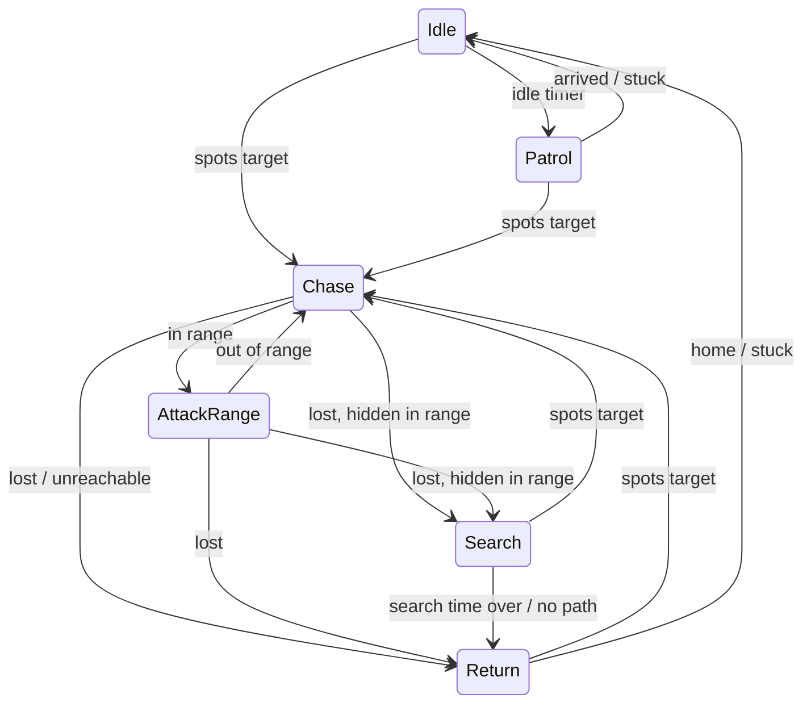
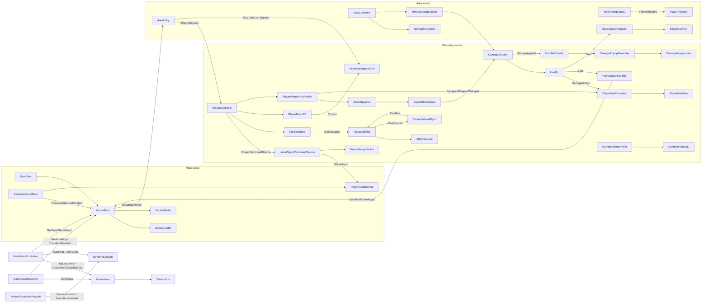

# Architecture

Code map for orienting quickly in the project. One section per system; keep headings stable and update the section that matches the code you change. Conventions and rules live in [CLAUDE.md](../CLAUDE.md); this file describes what exists.

All C# types are in the global namespace (no `namespace` declarations). Paths below are relative to this file.

## Overview

A Unity 6 (URP 2D) top-down action RPG prototype. The player boots into a main menu, starts a new game, and is placed in an area scene (currently the "Clearing", a forest clearing made with the editor's scene generator) where they walk in 8 directions and swing a sword. Weasel mobs idle, patrol around their spawn, spot the player with line-of-sight checks, path around walls on a tilemap grid, crowd around the player without overlapping, and melee attack on a cooldown. Damage shows floating numbers and a HUD health bar. Mobs target whichever registered player they spot (nearest visible), so the code is ready for more than one player. A dead player respawns at the area's spawn point after a delay while a teammate is still alive; when every player is dead at once the current area restarts. A dev-only stress-test area spawns hundreds of mobs on a procedurally generated map to profile AI and pathfinding.

## Packages

Notable entries in [Packages/manifest.json](../Packages/manifest.json):

| Package | Used for |
|---|---|
| `jp.hadashikick.vcontainer` (git, pinned to tag `1.19.0`) | Dependency injection, `LifetimeScope`s, entry points |
| `com.unity.inputsystem` | `InputSystem_Actions.inputactions`, `PlayerInputService`, `InputBindings` (rebinding), UI input module |
| `com.unity.render-pipelines.universal` | URP 2D renderer, `Light2D` |
| `com.unity.2d.tilemap` / `.extras` | Tilemaps for terrain, collision and navigation data; `RuleTile` base of the dual-grid walls tile |
| `com.unity.2d.aseprite`, `com.unity.2d.animation` | Sprite import and animation |
| `com.unity.ugui` + TextMesh Pro | Menu, HUD, damage popups |
| `com.unity.test-framework` | EditMode and PlayMode tests |
| `com.unity.netcode.gameobjects` 2.13.3 | Netcode for GameObjects: `NetworkManager`, host/client sessions, network prefab handlers |
| `com.unity.transport` 2.6.0 | `UnityTransport`. Pinned to the version Netcode declares: 2.7.x throws a Burst `NullReferenceException` from its `AnalyticsLayer` job every network update in this editor version. |
| `com.unity.multiplayer.playmode` 2.0.2 | Multiplayer Play Mode (up to 3 extra virtual players in the editor) |
| `com.unity.multiplayer.tools` 2.2.12 | Network Simulator (latency, jitter, packet loss) and network profiling. Simulation only runs in the editor and development builds. |
| `com.coplaydev.unity-mcp` (git) | UnityMCP editor automation |

## Assemblies

| Assembly | Folder | References | Notes |
|---|---|---|---|
| `TopDownRPG.Core` | `Assets/Scripts/Core` | VContainer, Unity.InputSystem, UnityEngine.UI (for the `EventSystem` pointer-over-UI check), Unity.Netcode.Runtime, Unity.Networking.Transport | Boot, scene flow, input, clock, randomness, network session, camera follow, screen fader. Must not reference Gameplay. |
| `TopDownRPG.Gameplay` | `Assets/Scripts` (everything outside `Core` and `Dev`) | Core, VContainer, Unity.InputSystem, Unity.TextMeshPro, Unity.Netcode.Runtime, Unity.2D.Tilemap.Extras | AI, navigation, combat, player, UI, effects, world (including the dual-grid walls and the blended terrain renderer), composition roots. |
| `TopDownRPG.DevTools` | `Assets/Scripts/Dev` | Gameplay, Core, VContainer, Unity.2D.Tilemap.Extras | `defineConstraints: UNITY_EDITOR \|\| DEVELOPMENT_BUILD`; not auto-referenced. Its editor-only code sits behind `#if UNITY_EDITOR`. |
| `TopDownRPG.Editor` | `Assets/Editor` | Core, Gameplay, VContainer, Unity.2D.Tilemap.Editor, Unity.2D.Tilemap.Extras, Unity.2D.Tilemap.Extras.Editor, Unity.2D.Sprite.Editor (slicing the walls sheet) | Editor-only platform. Includes the dual-grid tooling, the terrain brush and material tools, the walls sheet generator, the prop placement tool and the scene generator. |
| `TopDownRPG.EditModeTests` | `Assets/Tests/Editor` | Gameplay, Core, Editor (for the prop snapping rule, the scene generator and the terrain tools), DevTools (for the stress map), VContainer, Unity.InputSystem, Unity.InputSystem.TestFramework, Unity.TextMeshPro, Unity.Netcode.Runtime, Unity.2D.Tilemap.Extras, Unity.2D.Tilemap.Editor (for the grid brushes) | Editor-only test assembly. |
| `TopDownRPG.PlayModeTests` | `Assets/Tests/PlayMode` | Gameplay, Core, DevTools, VContainer, Unity.InputSystem, Unity.TextMeshPro, Unity.Netcode.Runtime | Needs DevTools for the stress-scene test. |

Dependency direction: `Core <- Gameplay <- DevTools`, with `Editor` and both test assemblies on top. Core and Gameplay each have an `AssemblyInfo.cs` ([Core](../Assets/Scripts/Core/AssemblyInfo.cs), [Gameplay](../Assets/Scripts/AssemblyInfo.cs)) granting `InternalsVisibleTo` to both test assemblies; `internal` members are test seams. Gameplay also grants it to `TopDownRPG.Editor`, whose dual-grid tools set `internal` members of the dual-grid types and whose terrain brush calls the terrain renderer's `internal` preview API. Editor's own [AssemblyInfo.cs](../Assets/Editor/AssemblyInfo.cs) grants it to the EditMode tests.

## Scenes and boot flow

### Scenes

| Scene | Role | Key contents |
|---|---|---|
| [Main.unity](../Assets/Scenes/Main.unity) | Persistent root, never unloaded. First scene in the build. | `MainLifetimeScope`, Main Camera (`CameraFollow2D`), `EventSystem`, `TransitionCanvas/Fade` (`ScreenFader`) |
| [MainMenu.unity](../Assets/Scenes/MainMenu.unity) | Title screen, loaded additively. | `MenuLifetimeScope`, `MainMenuCanvas` with `MainMenuController`; `Buttons` holds Continue, New Game, Host Game, the join address field, Join Game, Options, Quit and a status line; an `OptionsMenu` prefab instance draws over them while open |
| [Gameplay.unity](../Assets/Scenes/Gameplay.unity) | Session scene, loaded additively for a play session. | `GameplayLifetimeScope` (references the `Player` prefab, spawned at runtime), `PlayerHudCanvas` prefab, `DamagePopupCanvas` (`DamagePopupLayer`), `GameMenuCanvas` prefab (in-game menu and options screen, sort order 10000: above the popups, below the fader) |
| [Areas/Area_Clearing.unity](../Assets/Scenes/Areas/Area_Clearing.unity) | Starting area, loaded additively under Gameplay. | Generated with the Clearing generator (seed 1, see [SceneGeneration.md](SceneGeneration.md)). `AreaLifetimeScope`, `Grid` (with `NavigationGrid2D`, `AreaTerrain` for its grass layer (filled with `Tile_Grass`) and collision layer, and a `TerrainBlendRenderer` drawing the ground) holding three ground layers, each a plain data tilemap with a `NavigationTerrainSource2D`: `GrassTilemap`, `GravelTilemap` (gravel paths) and `StoneTilemap` (the stone road). Then `CollisionTilemap` (Obstacles layer; a DualGrid walls data tilemap with grid colliders, whose `RenderTilemap` child on the Default layer draws the walls; empty in the Clearing). `Props` holds a ring of trees with trees, bushes, rocks and plants inside; `MobSpawns` holds three `MobSpawnPoint`s for the Weasel prefab; then `SpawnPoint_start` (on the road) and a Global Light 2D |
| [Areas/Area_Lakeside.unity](../Assets/Scenes/Areas/Area_Lakeside.unity) | Third area, listed in `GameScenes.areas` and the build; nothing in gameplay leads to it yet. | A copy of the Village Forest scene (so its `Grid`, lifetime scope and lights are set up the same way) regenerated with the Lakeside generator (seed 1, see [SceneGeneration.md](SceneGeneration.md)): a 64 x 46 area with a lake in the north, a beach on its south shore and a marsh around the rest, a stone road across the south, a gravel trail down to the beach, mud and dry grass patches and three small shallow ponds, ringed by trees. `Props` holds 237 props; `MobSpawns` holds four Weasel `MobSpawnPoint`s; `SpawnPoint_start` is on the road in the west |
| [Areas/Area_VillageForest.unity](../Assets/Scenes/Areas/Area_VillageForest.unity) | Second area, listed in `GameScenes.areas` and the build; nothing in gameplay leads to it yet. | Made from the area template and generated with the Village Forest generator (seed 1, see [SceneGeneration.md](SceneGeneration.md)): a 92 x 62 area with a village of three cottages on a stone street in the west, a clearing to the north and a forest around both, crossed by gravel trails. Its `Grid` is set up like the Clearing's: `NavigationGrid2D` (blocking tilemap `CollisionTilemap`, obstacle layer `Obstacles`), `AreaTerrain` (grass and collision layers, `AreaTerrainSync` prefab), a `TerrainBlendRenderer` over the `GrassTilemap`, `GravelTilemap` and `StoneTilemap` layers, and an empty `CollisionTilemap` (walls module with grid colliders, `RenderTilemap` at order 10). `Props` holds about 800 props; `MobSpawns` holds nine Weasel `MobSpawnPoint`s (three in the clearing, six in the forest); `SpawnPoint_start` is on the street at the village's inner end |
| [Dev/StressTest/Area_StressTest.unity](../Assets/Dev/StressTest/Area_StressTest.unity) | Dev-only area (not in the build list, no `SceneDefinition`). | An area setup with one ground layer, `GrassTilemap`, drawn by a `TerrainBlendRenderer` and painted at runtime, and the walls' `CollisionTilemap`, plus `StressTestMap`, `StressTestSpawner`, `StressTestOverlay` |

New areas start from the scene template [AreaTemplate.scenetemplate](../Assets/Settings/AreaTemplate.scenetemplate) ([AreaTemplate.unity](../Assets/Settings/Scenes/AreaTemplate.unity)): an `AreaLifetimeScope`, a Global Light 2D, `SpawnPoint_start`, empty `Props` and `MobSpawns` roots, and a `Grid` set up like the generated areas' with nothing painted: `NavigationGrid2D` (blocking `CollisionTilemap`, obstacle layer `Obstacles`), `AreaTerrain` (grass and collision layers, `AreaTerrainSync` prefab), a `TerrainBlendRenderer` drawing the thirteen empty ground layers of the style's layer order (`GrassTilemap`, `DryGrassTilemap`, `MeadowTilemap`, `TallGrassTilemap` and on to `WaterTilemap` and `PlanksTilemap`, each a data tilemap with its navigation source, in that order) with `TerrainStyle.asset` and the project's materials, and an empty `CollisionTilemap` (walls module with grid colliders, `RenderTilemap` at order 10). A scene made from it can be painted with the Terrain Brush or filled by any generator straight away; `AreaTemplateTests` keeps it in step with the generators. It was a bare `Grid` until the Lakeside, whose scene is a copy of the Village Forest's for that reason.

Scene identity is data, not strings: [SceneDefinition](../Assets/Scripts/Core/Scenes/SceneDefinition.cs) assets under `Assets/Data/Scenes` hold a scene GUID + path, and [GameScenes](../Assets/Scripts/Core/Scenes/GameScenes.cs) (`Assets/Data/Scenes/GameScenes.asset`) lists MainMenu, Gameplay, the starting area + spawn id, and the known areas.

### Load hierarchy

```
Main (MainLifetimeScope)
├── MainMenu (MenuLifetimeScope, parent = Main)        -- while in the menu
└── Gameplay (GameplayLifetimeScope, parent = Main)    -- while in a session
    └── Area_* (AreaLifetimeScope, parent = Gameplay)  -- exactly one area at a time
```

### Boot sequence

1. Play (or a build) starts in `Main`. In the editor, [PlayModeBootstrapper](../Assets/Editor/Scenes/PlayModeBootstrapper.cs) forces `playModeStartScene = Main` (toggle: `Tools/TopDownRPG/Boot From Main`) and stores the scenes that were open via [EditorBootRequest](../Assets/Scripts/Core/Scenes/EditorBootRequest.cs) (`SessionState`). Test Runner sessions are detected by their `InitTestScene*` scene and left alone.
2. `MainLifetimeScope` builds; its entry point [BootFlow](../Assets/Scripts/Core/Boot/BootFlow.cs) (`IAsyncStartable`) runs.
3. Editor only: `BootFlow` consumes the boot request. If an area scene (known or any other scene, via `SceneDefinition.CreateTransient`) or Gameplay was open, it calls `GameFlow.StartNewGameAsync(area)`; if only MainMenu was open it shows the menu.
4. Otherwise `GameFlow.ShowMainMenuAsync()`.
5. Menu "New Game" -> `MainMenuController.StartNewGame()` -> `GameFlow.StartNewGameAsync()` (starting area + starting spawn id from `GameScenes`). "Continue" starts a new session in the saved area instead (see Save data). "Host Game" starts hosting first, then continues from the save when there is one or starts from the starting area otherwise; "Join Game" connects to the address in the field and then waits in the menu until the host announces its area, which starts the game (see Networking).

### GameFlow

[GameFlow](../Assets/Scripts/Core/Scenes/GameFlow.cs) (singleton in Main scope) owns all scene transitions. Uses [SceneLoader](../Assets/Scripts/Core/Scenes/SceneLoader.cs) (additive load/unload, `Resources.UnloadUnusedAssets`) and [ScreenFader](../Assets/Scripts/Core/UI/ScreenFader.cs).

- Every transition: reject if one is running -> `TransitionStarted` -> fade out -> work -> fade in -> `TransitionFinished`. Cancelled with `Application.exitCancellationToken`.
- `ShowMainMenuAsync`: unload area + gameplay, load MainMenu under Main.
- `StartNewGameAsync(area, spawnId)`: unload menu/area/gameplay, load Gameplay under Main, then load the area.
- `ChangeAreaAsync(area, spawnId)`: unload current area, load new area under the Gameplay scope. Nothing in gameplay calls it yet on the host (tests only); clients call it when the host announces an area change.
- `AreaLoading(AreaTransition)` event: raised by `StartNewGameAsync` (`NewSession` true) and `ChangeAreaAsync` right after the fade-out, before anything unloads. [AreaTransition](../Assets/Scripts/Core/Scenes/AreaTransition.cs): `Area`, `SpawnId`, `NewSession`.
- Area load: enqueues an [AreaEntryRequest](../Assets/Scripts/Core/Scenes/AreaEntryRequest.cs) into the area scope with `LifetimeScope.Enqueue`, parents via `LifetimeScope.EnqueueParent`, sets the area active, then resolves [IAreaEntry](../Assets/Scripts/Core/Scenes/IAreaEntry.cs) from the area scope and calls `Enter()`.
- State: `IsTransitioning`, `IsInMenu`, `IsInGame`, `CurrentArea`, `AreaScene`, `GameplayScene`.

## Composition / DI

VContainer scopes live one per scene. Each Gameplay-assembly scope logs an error and registers nothing if it has no parent (i.e. the scene was opened without booting through Main).

### MainLifetimeScope ([MainLifetimeScope.cs](../Assets/Scripts/Core/Boot/MainLifetimeScope.cs), Core)

| Registration | Kind |
|---|---|
| `GameScenes` | instance (inspector) |
| `Camera` (main camera), `ScreenFader`, `CameraFollow2D` | components (inspector) |
| `IClock` -> `UnityClock.Shared` | instance |
| `IRandom` -> `new SystemRandom()` (time-seeded) | instance |
| `SceneLoader`, `GameFlow` (gets this scope as `LifetimeScope` parameter) | singletons |
| `UISelection` (with the inspector's `EventSystem`) | singleton |
| `RuntimeInputActions` (the inspector's `InputActionAsset` and `EventSystem`) | singleton |
| `PlayerInputService` as `IPlayerInput`, `IMenuInput` + self (gets the `RuntimeInputActions` copy and the scene's `EventSystem`; a missing `EventSystem` logs an error) | singleton |
| `GameplayInputGate` (+ self), `TransitionTimeFreeze` | entry points |
| `TimeFreeze` (owns `Time.timeScale`, back to 1 on dispose) | singleton |
| `MenuStack` (+ self) | entry point |
| `BootFlow` | entry point |
| `NetworkSession` as `IGameAuthority`, `INetworkObjectSpawner`, `IClientReadiness`, `ISessionStatus` + self (gets the inspector's `NetworkManager` prefab and `NetworkSettings`) | singleton; logs an error and is skipped if either is missing |
| `NetworkSessionLifecycle`, `NetworkAreaSync`, `GameSaveRecorder` | entry points (the recorder needs `IGameAuthority`, so it is registered with the session) |
| `ISaveStore` -> `FileSaveStore` at `Application.persistentDataPath/save.json` | instance |
| `GameSave` | singleton |
| `ISaveStore` -> `FileSaveStore` at `Application.persistentDataPath/settings.json`, keyed `UserSettings.FileName` | instance |
| `UserSettings` (takes the keyed store) | singleton |
| `InputBindings` as `IInputBindingLabels` + self (gets the `RuntimeInputActions` copy and the inspector's `RebindableActionList`; a missing list logs an error) | entry point |

### MenuLifetimeScope ([MenuLifetimeScope.cs](../Assets/Scripts/Composition/MenuLifetimeScope.cs))

- `OptionsMenuView` via `RegisterComponentInHierarchy`, and `OptionsMenuController` as an entry point + self.
- `MainMenuController` via `RegisterComponentInHierarchy` (injected with `GameFlow`, `NetworkSession`, `GameSave`, `OptionsMenuController` and `UISelection`).

### GameplayLifetimeScope ([GameplayLifetimeScope.cs](../Assets/Scripts/Composition/GameplayLifetimeScope.cs))

| Registration | Kind |
|---|---|
| `PlayerRegistry` as `IPlayerRegistry` + self | singleton |
| `PlayerControlSettings` (the player prefab's own asset, so there is one source of truth; a prefab without one logs an error and registers nothing) | instance |
| `LocalPlayerTracker`, `PointerTargetPicker`, `LocalPlayerCommandSource`, `ActiveSpawnPoint`, `ActiveNavigationGrid`, `PlayerBinder`, `PlayerRespawner` | singletons |
| `PlayerSpawner` (with the inspector's player prefab and the Gameplay scene as parameters) | singleton |
| `GameplayPlayers` | entry point (spawns players in `Start`, see Player) |
| `DamagePopupLayer` | component |
| `PointerFeedbackLayer` (inspector; a missing one logs an error and skips `PointerFeedbackPresenter`) | component |
| `GameplaySettings` | instance |
| `CombatSettings` (inspector; a missing one logs an error and registers nothing, like a missing player prefab) | instance |
| `PlayerHudView`, `AbilityBarView`, `StatusBarView`, `OptionsMenuView`, `GameMenuView` | components in hierarchy |
| `CombatEvents`, `DamageService`, `HitService`, `AbilityService`, `SlashSpawner`, `EffectSpawner` | singletons |
| `StatusVisualPool` (with the Gameplay scene) | singleton (disposed with the scope) |
| `StatusEffectService` (+ self) | entry point (`ITickable`) |
| `DamagePopupPresenter`, `GameplayEntryPoint`, `PlayerDeathHandler`, `PlayerHudPresenter`, `AbilityBarPresenter`, `StatusBarPresenter`, `PointerFeedbackPresenter`, `OptionsMenuController` (+ self), `GameMenuController` (+ self) | entry points |

[GameplayEntryPoint](../Assets/Scripts/Composition/GameplayEntryPoint.cs): points `CameraFollow2D` at the local player and snaps whenever `LocalPlayerTracker` assigns one (on a client that happens when the host's spawn arrives); clears the target on dispose.

### AreaLifetimeScope ([AreaLifetimeScope.cs](../Assets/Scripts/Composition/AreaLifetimeScope.cs))

- `AreaEntry` as `IAreaEntry`, with every `SpawnPoint` in the scene and the area's `NavigationGrid2D` (null when there is none). `AreaEntryRequest` comes from `GameFlow`'s enqueued registration.
- `AreaClientReady` entry point: on a client, tells the host it is ready once the area is up (after the build callbacks below registered the area's network prefabs).
- `AreaTerrain` (when the scene has one): registered as a component (so it is injected), plus the `AreaTerrainSync` entry point (resolvable as itself, with the area scene) and a build callback that calls its `RegisterNetworkPrefab`. Registered before the grid check, since it does not need a grid.
- `NavigationGrid2D`: first one found in the area scene via [SceneQuery](../Assets/Scripts/Core/Scenes/SceneQuery.cs). Without one, nothing below is registered, and an error is logged if the area has mob spawn points.
- `AreaMobSpawner` entry point, also resolvable as itself (with every `MobSpawnPoint` and the area scene as parameters), plus a build callback that calls `RegisterNetworkPrefabs`.
- Logs an error for every `MobController` placed directly in the area scene: mobs must come from spawn points. Other scene objects needing injection go in the scope's `autoInjectGameObjects` (the stress scene lists its `StressTest` object).

[AreaEntry](../Assets/Scripts/Composition/AreaEntry.cs): sets the Gameplay-scope `ActiveNavigationGrid` to the area's grid (empty for an area without one), finds the `SpawnPoint` whose id matches the request (falls back to the first one with a warning), records it in the Gameplay-scope `ActiveSpawnPoint` for respawns, teleports every registered player this machine moves (`PlayerController.SimulatesMovement`: all players offline, only the local one online) to its own slot at that spawn point (`SpawnPoint.GetSlotPosition`, in registry order) and snaps the camera. It is `IDisposable`: when the area scene unloads, its scope is destroyed, VContainer disposes it, and it clears `ActiveNavigationGrid` if that still points at its own grid. Scope disposal is the hook (rather than `GameFlow.AreaLoading`) because it fires on every unload path (area change, new game, return to menu), at the moment the grid is destroyed rather than before the fade-out, and on clients too, without the Gameplay scope subscribing to Core events.

### How components get injected

- Plain classes: constructor injection (`GameFlow`, `BootFlow`, presenters, spawners, `AreaEntry`).
- MonoBehaviours: `[Inject] public void Construct(...)`, reached via `InjectGameObject` build callbacks or `IObjectResolver.Instantiate`.

| Component | `Construct` parameters | Injected by |
|---|---|---|
| `PlayerWeaponController` | `SlashSpawner`, `IClock` | `PlayerSpawner` (`resolver.Instantiate`), or `InjectingNetworkPrefabHandler` on clients |
| `PlayerNetworkSync` | `PlayerBinder` | same as `PlayerWeaponController` |
| `PlayerController` | `IClock` | same as `PlayerWeaponController` |
| `PlayerMotor2D` | `ActiveNavigationGrid` | same as `PlayerWeaponController` |
| `PlayerAbilities` | `IClock`, `AbilityService` | same as `PlayerWeaponController` |
| `MainMenuController` | `GameFlow`, `NetworkSession`, `GameSave`, `OptionsMenuController`, `UISelection` | Menu scope |
| `MobController` | `NavigationGrid2D`, `IPlayerRegistry`, `IRandom` | `AreaMobSpawner` or `StressTestSpawner` (`resolver.Instantiate`), or `InjectingNetworkPrefabHandler` on clients |
| `MobMotor2D` | `IClock` | same as `MobController` |
| `MeleeDamageDealer` | `IClock`, `HitService` | same as `MobController` |
| `DestroyMobOnDeath` | `EffectSpawner`, `IGameAuthority` | same as `MobController` |
| `NetworkHealth` | `DamageService` | player: same as `PlayerWeaponController`; mob: same as `MobController` |
| `NetworkStatusEffects` | `CombatSettings`, `StatusEffectService`, `IClientReadiness` | same as `NetworkHealth` |
| `StressTestSpawner` | `IObjectResolver`, `NavigationGrid2D`, `LocalPlayerTracker` | Area scope `autoInjectGameObjects` |
| `AreaTerrain` | `IGameAuthority` | Area scope `RegisterComponent` |
| `NetworkAreaTerrain` | `AreaTerrain` | `AreaTerrainSync` (`resolver.Instantiate`) on the host, or `InjectingNetworkPrefabHandler` on clients |

`MeleeDamageDealer`, `MobMotor2D`, `PlayerController`, `PlayerAbilities` and `PlayerWeaponController` default their clock to `UnityClock.Shared` when not injected. A `PlayerMotor2D` that was never injected has no grid and moves in straight lines.

## Networking

Netcode for GameObjects, host-and-play. See [Multiplayer.md](Multiplayer.md) for the plan; this section describes what exists. Players, mobs and health are replicated. The host runs all game logic (mob AI, damage, deaths, respawns); clients move their own player and mirror the rest.

| Type | Role |
|---|---|
| [NetworkSettings](../Assets/Scripts/Core/Network/NetworkSettings.cs) | ScriptableObject (`Assets/Data/NetworkSettings.asset`): default join address (`127.0.0.1`), host listen address (`0.0.0.0`), port (7777), client connect timeout (10 s), max players per session including the host (4, range 1–4). |
| [NetworkSession](../Assets/Scripts/Core/Network/NetworkSession.cs) | Main-scope singleton that owns the `NetworkManager`: instantiates it from `Assets/Prefabs/Network/NetworkManager.prefab` (`NetworkManager` + `UnityTransport`, scene management off, no player prefab) and destroys it on dispose, so it never outlives the Main scope despite Netcode moving it to `DontDestroyOnLoad`. `StartHost()`, `JoinAsync(address, timeout, token)` (connects, waits for the connection, shuts down and returns false on failure/timeout), `Shutdown()`, `RegisterPrefab`/`UnregisterPrefab`, `JoinRefusal` (the host's reason when it refused the last join, else null), `IsActive`/`IsHost`/`IsServer`/`IsConnectedClient`/`LocalClientId`, event `ConnectionLost` (local client stopped without `Shutdown` being called). Makes its `NetworkManager` the Netcode singleton before starting, since Netcode falls back to the singleton when spawning. Implements `IGameAuthority` (`IsAuthoritative` = server, or offline when not following a host: a client whose connection dropped stays non-authoritative until `Shutdown()`, which `NetworkSessionLifecycle` calls once it is back in the menu, so a stranded client never saves or runs the game on its own). Area announcements: the host's `AnnounceArea(scenePath, spawnId, newSession)` bumps `AreaEpoch`, clears every client's readiness and sends an `AreaAnnouncement` to connected clients; a client that connects later receives the current one on connection. Clients raise `AreaAnnounced` and adopt an announcement's epoch with `BeginAnnouncedArea` once they start loading it. Ready handshake: a client calls `NotifyReady()` once its area is up, sending its `AreaEpoch`; the host ignores reports for any other epoch, otherwise records it (`ReadyClients`, `IsClientReady`, cleared on disconnect), shows it every object spawned through the session, and raises `ClientReady`. `DespawnObjectsIn(scene)` (host) despawns every spawned object living in a scene. `HasPlayerObject(clientId)`. `SpawnPlayerObject(instance, owner)` and `Spawn(instance)` (server-owned) spawn with a visibility check so objects only reach ready clients, and destroy with their scene. Also implements `INetworkObjectSpawner`, and [ISessionStatus](../Assets/Scripts/Core/Network/ISessionStatus.cs) (`IsActive`, `IsHost`) for the in-game menu. A client stopping while the application quits or the editor leaves Play Mode is not reported as `ConnectionLost`. |
| [JoinApproval](../Assets/Scripts/Core/Network/JoinApproval.cs) | Static admission rule, free of Netcode types. `CreatePayload(version)` is the connection data a client sends (its `Application.version`); `Evaluate(payload, hostVersion, playerCount, maxPlayers)` returns null to approve, or a reason: another or missing version first, then a full party. `EncodeRefusal`/`TryDecodeRefusal` tag the reason so a client can tell it from Netcode's own disconnect text. |
| [AreaAnnouncement](../Assets/Scripts/Core/Network/AreaAnnouncement.cs) | Area message payload: `ScenePath`, `SpawnId`, `Epoch`, `NewSession`, with `Write`/`Read` over Netcode buffers. |
| [NetworkAreaSync](../Assets/Scripts/Core/Network/NetworkAreaSync.cs) | Main-scope entry point. Host: on `GameFlow.AreaLoading`, despawns the networked objects in the area scene (and the Gameplay scene for a new session) so clients drop their copies before anything unloads, then announces the area. Client: applies announcements through `GameFlow` (`StartNewGameAsync` for a new session or when not in a game, otherwise `ChangeAreaAsync`), keeping only the latest one while a transition runs; an area that is not in `GameScenes` logs an error and leaves the session. |
| [INetworkObjectSpawner](../Assets/Scripts/Core/Network/INetworkObjectSpawner.cs) | `IsActive`, `IsServer`, `RegisterPrefab` (with a target scene), `UnregisterPrefab`, `Spawn`: the slice of `NetworkSession` area code needs, so EditMode tests can fake it. |
| [IGameAuthority](../Assets/Scripts/Core/Network/IGameAuthority.cs) | `IsAuthoritative`: whether this machine decides game state. Implemented by `NetworkSession`; tests use a fixed fake. |
| [IClientReadiness](../Assets/Scripts/Core/Network/IClientReadiness.cs) | `IsClientReady(clientId)`: whether a client finished loading the current area (the host's own client always has). Implemented by `NetworkSession`; used by `NetworkStatusEffects` to hold a loading client's player. |
| [InjectingNetworkPrefabHandler](../Assets/Scripts/Core/Network/InjectingNetworkPrefabHandler.cs) | `INetworkPrefabInstanceHandler` that creates network prefab instances through an `IObjectResolver` so their `[Inject]` methods run, moves them into a target scene when one is given (players into Gameplay, mobs into their area, so a client's area change never destroys the other players), and destroys them on despawn. Netcode only calls it on clients; the host must create its instances with `resolver.Instantiate` itself before spawning. |
| [NetworkSessionLifecycle](../Assets/Scripts/Core/Network/NetworkSessionLifecycle.cs) | Main-scope entry point: shuts the session down whenever a transition ends in the menu, and returns to the menu (with a warning) when the connection is lost anywhere but the idle menu. A loss during a transition (a client still loading its first area, or mid area change) is remembered and acted on when that transition finishes, since `GameFlow` ignores a second transition. A loss in the idle menu (a join that was waiting for the host's announcement) just ends the session. |

- `Assets/DefaultNetworkPrefabs.asset` is Netcode's auto-maintained network prefab list, referenced by the NetworkManager prefab: the player, the Weasel, the stress-test mob and `AreaTerrainSync`.
- Runtime terrain edits: only the host (or an offline game) changes an area's editable tilemaps, through `AreaTerrain.TrySetCells`. Each changed cell is kept in a per-area list (last write per cell wins) that the host's `NetworkAreaTerrain` mirrors into a `NetworkList<TerrainEdit>`; a client applies the whole list when the object reaches it (after it is ready for the area, so late joiners catch up) and each change after that. Every machine's `NavigationGrid2D` follows the tile changes on its own. A client moves its own player, so between an edit and its arrival that player can still walk where the host just built a wall.
- Scene management is disabled: `GameFlow` keeps loading scenes on every machine. Revisit in Phase 5 of the multiplayer plan.
- Netcode sets `Application.runInBackground` while a `NetworkManager` exists.
- Connection approval is on in the NetworkManager prefab (`NetworkSession` logs an error if it is off). The host approves itself, and approves a client through `JoinApproval` against `Application.version` and `NetworkSettings.MaxPlayers`, counting connected clients plus clients approved this frame but not yet connected. A refused client gets the reason as its disconnect reason; `JoinAsync` exposes it as `JoinRefusal` and the menu shows it. Approval is part of Netcode's config hash, so every build that should connect must have it on. Bump the Version in Player Settings whenever a change breaks compatibility between builds.
- Join order on a client: connect, receive the host's area announcement, load Gameplay (its scope registers the player prefab in a build callback) and the area (registers its mob prefabs in a build callback), then `AreaClientReady` sends ready for that area's epoch; only then does the host show it the spawned players and mobs and spawn its player (once per connection: `PlayerSpawner` skips clients that already have one).
- Area change or restart on the host: fade out, despawn that scene's objects, announce, unload/load. Clients follow, and new-area objects only reach each client after it reports ready for the new epoch.
- Unity Transport timeouts on the NetworkManager prefab: heartbeat 500 ms, disconnect 10 s (down from the 30 s default). The disconnect timeout is how long a client waits before giving up on a host that vanished without a clean disconnect (a crash, or it dropping off the virtual LAN), and the same for the host about a client. 10 s still rides out short Wi-Fi or Tailscale hiccups; a heartbeat counts as traffic, so an idle but live connection never times out.
- The NetworkManager prefab carries a `NetworkSimulator` set to the `None` preset. It drives every transport in the process, so only one should be enabled (the in-process test clients remove theirs).

### Transform smoothing

Networked transforms use `LegacyLerp` position interpolation with unreliable deltas and the default buffer (`NetworkTransform.InterpolationBufferTickOffset` 0, tick rate 30). This was chosen by measurement, not by the package docs' suggestion: the explicit benchmark `NetworkSmoothnessPlayModeTests.Benchmark_RemotePlayerSmoothness_UnderStress` moves an in-process client's player for 2 s at a time under 150 ms latency, 20 ms jitter and 4% loss and records, per rendered frame of the host's copy, how far the speed strays from the owner's, the longest freeze and visible backward jumps. Results on this machine (6 runs per setting, run in both orders):

| Setting | Start lag | Mean speed error | Runs with a freeze over 150 ms |
|---|---|---|---|
| `LegacyLerp`, unreliable deltas, offset 0 or 1 | ~390 ms | 22–26% | 0–2 of 6 |
| `Lerp`, unreliable deltas, offset 1 or 2 | ~380 ms | 57–63% | 0–2 of 6 |
| `SmoothDampening`, unreliable deltas | ~350 ms | ~100% | up to 3 of 6 |
| Any type with reliable deltas | 450–550 ms | 60–150%, with backward jumps for `Lerp`/`SmoothDampening` | frequent |

Unreliable deltas are the biggest win (a lost update is replaced by the next one instead of resent behind it). Rerun the benchmark by name after changing tick rate, speeds, movement code or transform settings.

Rerun after click-to-move replaced WASD (the client's player now walks on far-away move orders, with the area's mobs despawned): `LegacyLerp` unreliable offset 0 gave 385 ms start lag, 21% mean speed error and no stall over 150 ms in 6 runs; offset 1 26%; `Lerp` 59–67%; `SmoothDampening` ~106%; reliable deltas 76% with stalls in 5 of 6 runs. The ranking and the shipped setting are unchanged. The 3-run regression test is noisier than the 6-run benchmark (38% in the same session).

## Save data

One local save file, written by the machine that decides game state. See [Multiplayer.md](Multiplayer.md#phase-6-services-and-persistence) for what persists and why. Per-machine preferences live in a separate settings file (see Settings below).

| Type | Role |
|---|---|
| [ISaveStore](../Assets/Scripts/Core/Save/ISaveStore.cs) | `TryRead`/`Write` of the save text, so save logic is tested without the disk. |
| [FileSaveStore](../Assets/Scripts/Core/Save/FileSaveStore.cs) | Writes `<path>.tmp`, then swaps it in (`File.Replace`, or a move for the first save) so a crash never leaves half a save; logs IO failures as errors and returns false. |
| [GameSaveData](../Assets/Scripts/Core/Save/GameSaveData.cs) | Serialized form (`JsonUtility`): `version` (`CurrentVersion` 1), `areaSceneGuid`, `spawnId`. `TryParse` returns false on malformed JSON. |
| [GameSave](../Assets/Scripts/Core/Save/GameSave.cs) | `SaveArea(area, spawnId)` writes only areas listed in `GameScenes` (dev and transient areas are skipped). `TryLoadArea` resolves the saved GUID through `GameScenes.FindAreaByGuid`; malformed files, other format versions and areas no longer in the build are ignored with a warning. `HasSave`, `GetSavedOrStartingArea` (falls back to the `GameScenes` start). |
| [GameSaveRecorder](../Assets/Scripts/Core/Save/GameSaveRecorder.cs) | Main-scope entry point. On `GameFlow.AreaLoading` it remembers the transition if `IGameAuthority.IsAuthoritative` at that moment (offline or host; a joined client never saves); on `TransitionFinished` it saves that area and spawn id if the game ended up in it. A party-wipe restart saves the same area again. |

Areas are saved by scene GUID, not path, so moving or renaming a scene keeps saves valid. Booting the editor straight into a listed area saves it like any other entry. Multiplayer Play Mode virtual players run with the same company and product name, so they use the same save folder: a virtual player playing offline writes the same file.

### Settings

The local machine's preferences, in `settings.json` next to the save. Every machine reads and writes its own, clients included; nothing is replicated. Starting a new game never touches it. Specified in [KeyBindings.md](KeyBindings.md#saving).

| Type | Role |
|---|---|
| [UserSettingsData](../Assets/Scripts/Core/Settings/UserSettingsData.cs) | Serialized form (`JsonUtility`): `version` (`CurrentVersion` 1) and `inputBindingOverrides` (the Input System's override JSON as a string). `TryParse` returns false on malformed JSON. |
| [UserSettings](../Assets/Scripts/Core/Settings/UserSettings.cs) | Reads the file once when created, through the `ISaveStore` registered under the `UserSettings.FileName` key (so tests swap it like the save store); a malformed file or an older format version is ignored with a warning and replaced on the next change, while a file from a newer build is ignored with a warning and never overwritten (`IsReadOnly`: changes stay in memory for the session). `InputBindingOverrides`, and `SetInputBindingOverrides`, which writes the file unless it is read-only and returns whether it did. |

## Input

Click-to-move, specified in [PlayerControls.md](PlayerControls.md). Mouse only for gameplay; the gamepad still works in menus. Every gameplay control but the pointer can be rebound ([KeyBindings.md](KeyBindings.md)); these are the defaults.

| Input | Action (`Player` map) |
|---|---|
| Right mouse button | `MoveClick`: pressed gives an order at the cursor, held re-evaluates it |
| A | `AttackMove`: an attack move to the cursor's point at once (no confirm click) |
| Pointer position | `Point` (`<Pointer>/position`, pass-through) |
| S | `Stop` |
| Q W E R, 1 2 | `Ability1`…`Ability6`: cast the ability in that slot toward the cursor (quick cast) |

- [IPlayerInput](../Assets/Scripts/Core/Input/IPlayerInput.cs): `GameplayEnabled`, `PointerScreenPosition`, `IsPointerOverUI`, `MovePressedThisFrame`, `MoveHeld`, `AttackMovePressedThisFrame`, `StopPressedThisFrame`, `WasAbilityPressedThisFrame(slot)`. The local device seam; gameplay reaches it only through `LocalPlayerCommandSource` (see Player). [AbilitySlots](../Assets/Scripts/Core/Input/AbilitySlots.cs)`.Count` is 6.
- [PlayerInputService](../Assets/Scripts/Core/Input/PlayerInputService.cs): wraps the `Player` action map of [InputSystem_Actions.inputactions](../Assets/InputSystem_Actions.inputactions) (action names are public constants; `AbilityActionName(slot)`). Returns neutral input while the map is disabled. `IsPointerOverUI` asks the injected Main-scope `EventSystem` (`IsPointerOverGameObject`, so only graphics with `raycastTarget` block clicks: the ability bar's slot frames, and `ScreenFader` while visible; every other HUD graphic has it off). Logs an error if the map or any action is missing. The `Player` map holds only `MoveClick`, `AttackMove`, `Point`, `Stop` and `Ability1`…`Ability6`, one `Keyboard&Mouse` binding each. A `Menus` map holds `Menu` (Escape, gamepad Start) for the in-game menu; `SetMenusEnabled`/`MenusEnabled` (the gate drives it).
- [GameplayInputGate](../Assets/Scripts/Core/Input/GameplayInputGate.cs): Main-scope entry point (+ self) that enables the `Player` map only when `GameFlow.IsInGame && !IsTransitioning` and nothing holds a block (`Block(owner)`/`Unblock(owner)`, `IsBlocked`; the in-game menu blocks it while open), and the `Menus` map whenever in game outside transitions; listens to `TransitionStarted`/`TransitionFinished`.
- [RuntimeInputActions](../Assets/Scripts/Core/Input/RuntimeInputActions.cs): Main-scope singleton holding this session's `Instantiate` copy of the project input asset (ids kept), which `PlayerInputService`, `InputBindings` and the `EventSystem`'s `InputSystemUIInputModule` use (it disables the module, points it at the copy and enables it again, so the module enables the copy's UI actions). The project asset is never changed at runtime; the copy is destroyed on dispose.
- [InputBindings](../Assets/Scripts/Core/Input/InputBindings.cs): Main-scope entry point that owns the binding overrides on the session's copy, for the actions listed in [RebindableActionList](../Assets/Scripts/Core/Input/RebindableActionList.cs) (`Assets/Data/Input/RebindableActions.asset`: `MoveClick`, `AttackMove`, `Stop`, `Ability1`…`Ability6`, each with the name and section the options screen shows; actions are matched by id, so a copy of the asset works too). On `Initialize` it loads the overrides from `UserSettings`, drops any on other actions or on forbidden inputs and both sides of a duplicate (with one warning, then rewrites the file); malformed overrides are ignored with a warning, and two actions sharing a default input are logged as one error. `TryAssign(action, path, out swappedWith)` binds any key but Escape, or a mouse button (left, right, middle, back, forward), swapping with the rebindable action that had the input, removing the override when the path is the default, saving and raising `BindingsChanged` once. `Reset(action, out swappedWith)` assigns the default the same way; `ResetAll`. `GetShortLabel` (the layout's key name, or LMB, RMB, MMB, M4, M5), `GetAbilityKeyLabel(slot)` (the same for an ability slot's action, found once at construction) and `GetLabel` (mouse buttons spelled out); `GetDisplayName` and `GetSection` from the list. A keyboard layout change raises `BindingsChanged`. `StartRebind(action, finished)` listens for the next key or allowed mouse button (`PerformInteractiveRebinding` restricted to `<Keyboard>` and the five mouse buttons, any-key excluded, Escape cancelling) and routes it through `TryAssign`; `finished` gets `RebindOutcome.Assigned` with the swapped action, or `Cancelled` (also for a refused input). One rebind at a time, never on an enabled action (logged as an error); `CancelRebind`, `IsRebinding`. `Dispose` cancels a running rebind. It only ever changes the session's `RuntimeInputActions` copy.
- [IInputBindingLabels](../Assets/Scripts/Core/Input/IInputBindingLabels.cs): `BindingsChanged` and `GetAbilityKeyLabel(slot)`, the seam the HUD uses.
- [IMenuInput](../Assets/Scripts/Core/Input/IMenuInput.cs): `BackPressedThisFrame`, the `UI` map's Cancel (Escape, gamepad East) while that map is enabled, and `MenuPressedThisFrame`, the `Menus` map's Menu (Escape, gamepad Start) while that map is enabled; `PlayerInputService` implements it and logs the missing action with the others.
- UI input uses the `UI` map through the `EventSystem` in Main.

## Clock

- [IClock](../Assets/Scripts/Core/Clock/IClock.cs): `float Time`. Used for cooldowns and gameplay timers.
- [UnityClock](../Assets/Scripts/Core/Clock/UnityClock.cs): `Time.time`; `UnityClock.Shared` is registered in the Main scope.
- Clock consumers: `MeleeDamageDealer`, `PlayerWeaponController`, `PlayerController` (order timing: hold re-evaluation, chase repaths, cast times, the cast buffer window), `PlayerAbilities` (cooldowns), `MobMotor2D` (attack animation window). Mob AI timers are driven by the `dt` passed to `MobController.TickStateMachine`, which tests control. Purely visual, per-client animations (`SwordSlashAttack` lifetime, `MobDeathAnimation`, damage popups) advance with `Time.deltaTime` on purpose. `StatusEffectService` ticks statuses with the clock's delta each frame.
- [TimeFreeze](../Assets/Scripts/Core/Clock/TimeFreeze.cs) (Main-scope singleton): the only writer of `Time.timeScale`: 0 while any owner holds it (`Hold`/`Release`, `IsFrozen`, on a [HoldSet](../Assets/Scripts/Core/HoldSet.cs), the owner set `GameplayInputGate` blocks with too), 1 after the last release and on dispose. Holders: `TransitionTimeFreeze`, and `GameMenuController` in solo play.
- [TransitionTimeFreeze](../Assets/Scripts/Core/Scenes/TransitionTimeFreeze.cs) (Main-scope entry point): holds the `TimeFreeze` from `GameFlow.TransitionStarted` to `TransitionFinished` (and releases it on dispose), so nothing on the game clock, `Time.deltaTime`, physics or `Awaitable.WaitForSecondsAsync` advances behind the fade. `ScreenFader` uses unscaled time. Netcode keeps messaging at a time scale of 0 (the hosted area-change tests run through it). Each machine freezes only during its own transitions.
- [IRandom](../Assets/Scripts/Core/Random/IRandom.cs): `Range(min, max)`, `InsideUnitCircle()`. [SystemRandom](../Assets/Scripts/Core/Random/SystemRandom.cs) wraps `System.Random`, time-seeded or with an explicit seed (tests). Gameplay code never uses `UnityEngine.Random`.
- Randomness consumers: `MobPatrolAnchor` (roam destinations, idle durations via `MobConfig.NextIdleDuration(IRandom)`), passed down from `MobController`.

## Camera and sprite sorting

- [CameraFollow2D](../Assets/Scripts/Core/Camera/CameraFollow2D.cs) (Core, on Main Camera): `LateUpdate` SmoothDamp follow of the target's Rigidbody2D position, separate smooth times for moving/idle, can snap to the pixel grid (32 PPU; `snapToPixelGrid` is off in `Main`, see Known gaps). `SetTarget`, `SnapToTarget`.
- The Main Camera's Pixel Perfect Camera (32 assets PPU, reference resolution 640 x 360) uses no crop frame: it picks the largest whole zoom that fits the 640 x 360 reference and shows the rest of the screen as more of the world, instead of drawing the reference into a centred box with a black border. At 1280 x 720 and 1920 x 1080 that is exactly the reference view. With a crop frame it renders into an offscreen texture blitted into the box, and Unity draws the Game view's gizmos as if the camera filled the whole window, so the spawn points' gizmos landed up to about 1.6 times farther from the screen centre than the world under them. The Pixel Perfect Camera warns in the Game view when the window has an odd width or height.
- [YPositionSorter](../Assets/Scripts/Camera/YPositionSorter.cs) (Gameplay, `[ExecuteAlways]`): sets `sortingOrder = offset - round(y * multiplier)` on a `SortingGroup` or on all child renderers (keeping their relative offsets). On the player, Weasel and death-animation prefabs.
- Sorting layers, back to front: `Default`, `Terrain` (ground: the blended terrain's chunks at order 0, the walls' render tilemap at 10; the move marker and hover ring also use order 10), `Entities` (units and props, sorted by `YPositionSorter`; slashes one order in front of their owner, or behind when swinging up), `Overlay` (world-space bars that draw over every unit).
- The camera culls the `Obstacles` layer, so the collision tilemap itself is never drawn. It is the data tilemap of a DualGrid walls module (`walls_DualGridRuleTile`): the module's `RenderTilemap` child, on the Default layer and the Terrain sorting layer at order 10 (above the ground), draws the 32 px wall art, while the data tiles carry `Grid` colliders, so physics, navigation and the art all follow the same cells.

## UI

| Type | Role |
|---|---|
| [MenuStack](../Assets/Scripts/Core/UI/MenuStack.cs) / [IMenuLayer](../Assets/Scripts/Core/UI/IMenuLayer.cs) | Main-scope entry point (`ITickable`) and the only reader of `IMenuInput`: the open menus, newest on top (`Push`, `Remove`, `Top`, `Count`). Each tick it handles at most one press: Back or the Menu key goes to the top layer's `HandleBack`, and the Menu key with nothing open raises `MenuRequested`. Escape is both keys and still counts once, so no menu needs its own frame bookkeeping. |
| [UISelection](../Assets/Scripts/Core/UI/UISelection.cs) | Main-scope singleton over the scene's `EventSystem`: `Select(selectable)` (null clears). The menus move focus only through it, never through `EventSystem.current`. |
| [ScreenFader](../Assets/Scripts/Core/UI/ScreenFader.cs) | `CanvasGroup` fade used by `GameFlow` (unscaled time); blocks raycasts while visible; starts opaque. |
| [MainMenuController](../Assets/Scripts/UI/MainMenuController.cs) | Button handlers `ContinueGame` (new session in the saved area; the button is only interactable, and selected first, when `GameSave.HasSave`), `StartNewGame`, `HostGame` (start hosting, then the saved area or the starting area), `JoinGame` (join the address in `joinAddressField`, prefilled with the default; once connected it waits for the host's area announcement, ignores repeat clicks while connecting, and shows the host's reason when it refuses the join) and `QuitGame`; the four start handlers do nothing while a `GameFlow` transition runs (the fader blocks clicks, but keyboard and gamepad Submit still reach the selected button, and a session started then would be shut down when the menu finishes fading in) or while a join is connecting; writes progress and failures to `statusText`; selects Continue, or else `firstSelected`, for gamepad/keyboard navigation; logs an error in `Awake` when `continueButton` is unassigned. `OpenOptions` (the Options button) hides the `Buttons` panel and opens the options screen, unless a transition runs; closing it shows the buttons again with Options selected. Logs an error in `Awake` when the buttons panel or Options button is unassigned. |
| [OptionsMenuView](../Assets/Scripts/UI/OptionsMenuView.cs) / [KeyBindingRowView](../Assets/Scripts/UI/KeyBindingRowView.cs) | Passive options screen on the [OptionsMenu](../Assets/Prefabs/UI/OptionsMenu.prefab) prefab: a full-screen `Panel` (hidden by default) with the "Controls" title, a `Rows` list filled from the `OptionsSectionHeader` and `KeyBindingRow` prefabs (label, a binding button showing the key, a Reset button), a notice line, Reset all and Back, a listening panel that blocks clicks, and a Reset all confirmation (Reset / Cancel). Logs an error in `Awake` for missing references. |
| [OptionsMenuController](../Assets/Scripts/UI/OptionsMenuController.cs) | Entry point (`IStartable`, `ITickable`) and `IMenuLayer`: in `Start` builds a row per `InputBindings` action under its section header and wires the buttons. `Open(closed)` clears the notice, selects the first binding and pushes it on the `MenuStack`; `Close()` cancels a listening rebind, takes it off the stack and runs `closed` once. Selecting a binding starts `StartRebind` on the next tick (the click is never captured), shows the listening prompt and clears the selection; when it ends the row is reselected and a swap names the action that moved ("Class ability 1 moved to S."). A row's Reset resets that action (same notice on a swap); Reset all asks first. `HandleBack` closes the confirmation, or else the screen, and does nothing while a rebind is pending or listening (the rebind consumes Escape as its cancel). Rows follow `BindingsChanged`. |
| [GameMenuView](../Assets/Scripts/UI/GameMenuView.cs) | Passive in-game menu on the [GameMenuCanvas](../Assets/Prefabs/UI/GameMenuCanvas.prefab) prefab (which also holds an `OptionsMenu` instance): a dimmed full-screen `Panel` (hidden by default) with a box of Resume, Options, Leave game and Quit, and a confirmation (question, confirm button whose label it sets, Cancel). Logs an error in `Awake` for missing references. |
| [GameMenuController](../Assets/Scripts/UI/GameMenuController.cs) | Gameplay-scope entry point (`IStartable`) and `IMenuLayer`. `MenuStack.MenuRequested` opens it (`Open()`: Resume selected, pushed on the stack, a `GameplayInputGate` block, and a `TimeFreeze` hold when `ISessionStatus.IsActive` is false, so solo play pauses and online play, a lone host included, never does). `HandleBack` closes the confirmation or else the menu; nothing opens or reacts during a transition or once leaving. `Close()` also closes the options screen, takes it off the stack and gives back input and time; `Dispose` does the same, so leaving or a session restart never strands them. Options opens the options screen on top of it, whose close shows the menu again with Options selected. Leave game runs `GameFlow.ShowMainMenuAsync` (`NetworkSessionLifecycle` then ends the session) and Quit runs `ApplicationExit.Quit`, each behind a confirmation for an online host ("Leaving ends the game for everyone in it."). `IsOpen`, `IsPaused`, `IsLeaving`. |
| [PlayerHudView](../Assets/Scripts/UI/PlayerHudView.cs) | Passive view on `PlayerHudCanvas`: health fill + "HP n" text, weapon icon with tint when missing. |
| [AbilityBarView](../Assets/Scripts/UI/AbilityBarView.cs) / [AbilitySlotView](../Assets/Scripts/UI/AbilitySlotView.cs) | Passive ability bar at the bottom centre of `PlayerHudCanvas`: six slots (four class, a gap, two weapon), each labelled with its bound key (`SetKey`). Each slot shows the ability's icon, or its name when it has none (all blanks today), or an empty state (dim frame); a radial cooldown fill (from the top, counter-clockwise) with whole seconds remaining (cached strings, no per-frame allocation); and a red failure flash. Slot frames block clicks. `SetAbility` resets the cooldown and flash. |
| [StatusBarView](../Assets/Scripts/UI/StatusBarView.cs) / [StatusIconView](../Assets/Scripts/UI/StatusIconView.cs) | Passive row of eight status icons on `PlayerHudCanvas`, centred just above the ability bar. Each icon: a frame in the status colour, its icon sprite (or its two-letter abbreviation when it has none, as every test status does today), a radial fill darkening as it runs out, and a stack count above 1. Nothing in it blocks clicks; unused icons are inactive. |
| [StatusBarPresenter](../Assets/Scripts/UI/StatusBarPresenter.cs) | Entry point (`IStartable`, `ITickable`): binds to the local player's `StatusEffects` through `LocalPlayerTracker` (rebinding when it changes, clearing the row without one); on `Changed` shows one icon per active status, buffs then debuffs, up to the row's capacity, with its stacks (independent instances counted together); each frame pushes each icon's elapsed fill (from its longest remaining instance) only when it moved. On a client the remaining times come from the mirror's countdown. |
| [WorldStatusIcons](../Assets/Scripts/UI/WorldStatusIcons.cs) | On the Weasel's `HealthBar` child: four small rounded squares above the health bar (`Overlay` layer, unlit, hidden until used) showing the unit's distinct debuffs in landing order, each in its status colour with its icon sprite or a plain square. Refreshed on `StatusEffects.Changed`, so it works on every machine. Players have no world bar, so no world icons. |
| [AbilityBarPresenter](../Assets/Scripts/UI/AbilityBarPresenter.cs) | Entry point (`IStartable`, `ITickable`): binds to the local player's `PlayerAbilities` through `LocalPlayerTracker` (rebinding when it changes, clearing the bar without one), refreshes slots on `SlotsChanged` (weapon changes), flashes a slot on `CastFailed` (fading over 0.35 s on `IClock`), and pushes cooldown fill and seconds each frame only when they change. Labels the slots from `IInputBindingLabels` at start and on `BindingsChanged`. |
| [PointerFeedbackPresenter](../Assets/Scripts/UI/PointerFeedbackPresenter.cs) | Entry point (`ITickable`), local only: each frame picks under the pointer with `PointerTargetPicker` and, over a living enemy, shows the hover ring under it and the attack cursor; a move press that is not on an enemy drops a move marker at the cursor, and an attack-move press drops a red one there, over an enemy too. Nothing shows while gameplay input is off, the pointer is over UI, or the local player is missing or dead. |
| [PointerFeedbackLayer](../Assets/Scripts/UI/PointerFeedbackLayer.cs) | On `PointerFeedback` in the Gameplay scene: an `ObjectPool<MoveMarker>` (prewarmed with 4), the `HoverRing` sprite (red `GroundRing` on the `Terrain` sorting layer, order 10) and the attack cursor (`AttackCursor.png`, hotspot at its centre, set with `Cursor.SetCursor` only when it changes and reset on disable). |
| [WorldHealthBar](../Assets/Scripts/UI/WorldHealthBar.cs) | Thin world-space bar above a unit, like League of Legends minion bars: a dark rounded frame (0.66 x 0.075) and a bright red rounded fill (0.62 x 0.04) that empties from the right. Both are 9-sliced `SpriteRenderer`s using `Assets/Textures/UI/RoundedBar.png` (a smooth 32x16 rounded rectangle, 256 PPU, bilinear, 7 px borders; it lives outside `Assets/Sprites` so the `PixelArtTextureDefaults` postprocessor does not force it to 32 PPU point filtering), on the `Overlay` sorting layer with URP's `Sprite-Unlit-Default` material, because the areas' 2D lights do not light `Overlay` and a lit material would draw black. The fill is resized through `SpriteRenderer.size`, so its corners keep their radius. Polls `Health.CurrentHealth` in `LateUpdate` with one integer compare (network syncs set health silently, so events would miss them) and hides while the unit is dead. On the Weasel prefab (and its stress-test variant), so it shows on every machine. |
| [MoveMarker](../Assets/Scripts/UI/MoveMarker.cs) | Pooled ring (`Assets/Prefabs/UI/MoveMarker.prefab`, `GroundRing` sprite on `Terrain` order 10) that shrinks and fades over 0.45 s, green for a move and red for an attack move (`Show(position, attackMove)`). |
| [PlayerHudPresenter](../Assets/Scripts/UI/PlayerHudPresenter.cs) | Entry point; binds to whichever player `LocalPlayerTracker` holds (rebinding when it changes) and listens to its `Health.Damaged`/`Healed`/`Died`/`Restored` and `PlayerWeaponController.EquippedWeaponChanged`, pushing into the view; clears the health display while there is no local player. |

UI text uses the static `LiberationSans SDF` font asset, which is also TMP's default for new text. Its dynamic `LiberationSans SDF - Fallback` only gains glyphs (and a git diff) when text uses characters outside the static atlas; nothing should reference the fallback directly.

Damage popups are under Combat.

## Player

Prefab: [Player.prefab](../Assets/Prefabs/Player/Player.prefab) (`PlayerController` with `PlayerControlSettings`, `PlayerMotor2D`, `PlayerWeaponController`, `PlayerAbilities` with `Class_Placeholder`, `Health` (100 HP), `DamageReceiver` (`Profile_Player`), `DisableOnDeath`, `StatusEffects`, `StatusVisuals`, `NetworkObject`, `NetworkTransform` with owner authority syncing x/y position only (`LegacyLerp`, unreliable deltas, see Transform smoothing), `PlayerNetworkSync`, `NetworkHealth`, `NetworkStatusEffects`, `YPositionSorter` on a child), referenced by `GameplayLifetimeScope`, spawned at runtime by `PlayerSpawner`, and listed in `Assets/DefaultNetworkPrefabs.asset`. Offline the networking components stay unspawned and do nothing.

| Type | Role |
|---|---|
| [PlayerController](../Assets/Scripts/Player/PlayerController.cs) | Wires the command source, `PlayerOrders`, `PlayerMotor2D` and the weapon. Each `Update` (internal `Tick`): read a `PlayerCommand`, tick the orders (which start casts on its `PlayerAbilities`) with the motor's state, the clock and the equipped weapon's `AttackRange`, then apply the output (`MoveTo`/`Stop` on the motor, `SetAim`, `TryAttack(aim)` on swing requests). Before ticking it passes its `StatusEffects` controls into the order context and their `MovementScale` (slow; 0 while stunned or rooted) to the motor's `SetSpeedScale`; on a client that is the owner's mirror of the host's statuses. Remote copies (`SetSimulatesMovement(false)`) do nothing in `Tick` and only show replicated movement. Death (`OnDisable`, through `DisableOnDeath`) and `Teleport` clear the orders, so a respawn starts Idle. No source on a simulated player = idle, with an error logged in `Start`. Keeps `SetCommandSource`, `CurrentMove`, `FacingDirection`, `SimulatesMovement`, `Face`, `Teleport`; adds `ShowRemoteMovement`, `ClearOrders`, `CurrentOrder`, `ControlSettings`. Gizmos (Debug toggle) for the ability side of its orders: a line and box to the target a CastWhenInRange is approaching, labelled with the slot number and ability, and a "buffered" label under the player. |
| [PlayerOrders](../Assets/Scripts/Player/PlayerOrders.cs) | Plain class: the order state machine (Idle, Move, Attack, AttackMove, CastWhenInRange, Casting, plus a paused order and a buffered cast), see Player orders below. [PlayerOrderTypes.cs](../Assets/Scripts/Player/PlayerOrderTypes.cs) holds `PlayerOrderKind`, `PlayerMotorRequest`, the `PlayerOrderContext` input and the `PlayerOrderOutput` (motor request + destination, aim, swing). |
| [PlayerMotor2D](../Assets/Scripts/Player/PlayerMotor2D.cs) | Owns a `PathFollower2D` (configured from `PlayerControlSettings`, straight-line shortcut on). `MoveTo(point)` paths on `ActiveNavigationGrid.Current` with partial paths allowed (an unwalkable point ends at the nearest walkable cell; a point with none within the grid's own nearest-cell search radius, e.g. far outside the map, is walked back along the line toward the player until a walkable cell); without a grid it goes in a straight line. `FixedUpdate` sets `Rigidbody2D.linearVelocity` from the follower (`Time.fixedDeltaTime`) at the settings' move speed times a speed scale (`SetSpeedScale`; the follower gets the scaled speed, so at 0 the body holds still, stall time stays 0 and the path is kept), facing follows movement. `Update` drives the animator (`IsMoving`, `MoveX/Y`, `LastMoveX/Y`, walk speed). `Stop`, `Face`, `SetAim(aiming, direction)` (while aiming the player faces the aim and movement does not turn it), `Teleport`, `ReachedDestination`, `StalledTime`, `CurrentMove`, `FacingDirection`; `ShowRemoteMovement(move, facing)` for remote copies, whose body it never moves. Sets up the body (no gravity, frozen rotation, interpolation) in `Awake`. |
| [PlayerControlSettings](../Assets/Scripts/Player/PlayerControlSettings.cs) | ScriptableObject (`Assets/Data/PlayerControlSettings.asset`): move speed 5, waypoint reach and arrival 0.1, terrain profile `TerrainMovement_Default`, stuck timeout 0.75 s, hold re-evaluation 0.15 s, chase repath 0.5 s or when the target moved 0.5, cast buffer window 0.4 s, attack-move acquire range 3, pick radius 0.35, enemy layers `Enemy`, ally layers `Player`. `FollowerSettings` builds the path follower settings. |
| [PlayerCommand](../Assets/Scripts/Player/PlayerCommand.cs) / [IPlayerCommandSource](../Assets/Scripts/Player/IPlayerCommandSource.cs) | One frame of intent in world space (`PointerWorld`, `Target` under the pointer, `MovePressed`, `MoveHeld`, `StopPressed`, `HasAbility`/`AbilitySlot` (the lowest slot pressed this frame), `AttackMovePressed`; `default` is "nothing") and where the local player gets it from. Only the local player reads commands. |
| [LocalPlayerCommandSource](../Assets/Scripts/Player/LocalPlayerCommandSource.cs) | Builds commands from `IPlayerInput` with the Main-scope `Camera` (screen to world) and `PointerTargetPicker` (only while the move button is pressed or held, or an ability key is pressed). A press over UI is dropped along with the hold that follows it; a hold that started on the world keeps steering over UI. The attack-move key, like the ability keys, is passed on wherever the pointer is. Nothing while gameplay input is disabled. `PlayerBinder` gives it to the local player only. |
| [PointerTargetPicker](../Assets/Scripts/Player/PointerTargetPicker.cs) | `Pick(worldPoint)`: non-allocating `Physics2D.OverlapCircle` within the pick radius on the enemy + ally layers (no triggers), returning the living unit whose collider centre is closest. Enemies need a `DamageReceiver` (alive `Health`); allies must be registered, living players. No line-of-sight test. The collider to `Health` lookup for enemies is cached by an [EnemyHealthLookup](../Assets/Scripts/Player/EnemyHealthLookup.cs) (up to 64 colliders, cleared when full; destroyed entries are looked up again), so the hover pick every frame does no component lookups once warm. |
| [UnitTarget](../Assets/Scripts/Player/UnitTarget.cs) | A picked or ordered unit: `Health` (identity), `Collider`, `UnitTeam` (`None`, `Enemy`, `Ally`). |
| [IUnitQueries](../Assets/Scripts/Player/IUnitQueries.cs) / [PlayerUnitQueries](../Assets/Scripts/Player/PlayerUnitQueries.cs) | What orders ask about a target: alive, position, and collider-to-collider distance from the player (`Collider2D.Distance`, zero when overlapping or when the target is the player's own collider, as for an ally cast on oneself, which Unity refuses to measure; centre distance when a collider is missing or disabled); and `NearestEnemyInRange(point, range)` for attack moves: a non-allocating `Physics2D.OverlapCircle` around the player's collider on the settings' enemy layers (no triggers), keeping living enemies (through its own `EnemyHealthLookup`) within `range` by collider distance, and returning the one whose position is closest to `point`. |
| [PlayerWeaponController](../Assets/Scripts/Player/PlayerWeaponController.cs) | Holds the equipped `PlayerWeapon`; `TryAttack(direction)` checks the `IClock` cooldown, spawns a slash toward the direction (the facing direction when it is zero) via `SlashSpawner` and raises `Attacked(direction)`. `PlayRemoteAttack(direction)` replays another machine's swing without a cooldown or event. Event `EquippedWeaponChanged`. |
| [PlayerHandle](../Assets/Scripts/Player/PlayerHandle.cs) | One player as other systems see it: `Transform`, `Health`, `IsAlive`. |
| [IPlayerRegistry](../Assets/Scripts/Player/IPlayerRegistry.cs) / [PlayerRegistry](../Assets/Scripts/Player/PlayerRegistry.cs) | Every player in the session: `Players`, `Contains`, `AnyAlive`, events `PlayerAdded`/`PlayerRemoved`. `Add`/`Remove` (ignore null and duplicates) are on the concrete class only. Used by mobs and death handling. |
| [PlayerSpawner](../Assets/Scripts/Player/PlayerSpawner.cs) | Instantiates the player prefab through `IObjectResolver` (injecting its components) and moves it into the Gameplay scene so it survives area changes. `SpawnLocalPlayer`: offline binds it as the local player directly; when hosting, spawns it as the host's network player object. `SpawnRemotePlayer(clientId)` (host only): spawns a player object owned by that client, unless it already has one. `PlayerNetworkPrefab`, `PlayersScene`. |
| [GameplayPlayers](../Assets/Scripts/Player/GameplayPlayers.cs) | Gameplay entry point. Offline: spawns the local player. Online: `RegisterNetworkPrefabs` (build callback) registers the player prefab with the session so client copies are injected from this scope and placed in the Gameplay scene; in `Start` the host spawns its own player, one for every ready client and then each newly ready client. Unregisters on dispose. |
| [PlayerBinder](../Assets/Scripts/Player/PlayerBinder.cs) | `BindLocal(controller)`: local command source, movement on, registers, places it at its slot of `ActiveSpawnPoint` if the area was already entered, assigns it to `LocalPlayerTracker`. `BindRemote(controller)`: no command source, movement off, registers. `PlaceAtActiveSpawn(handle)`: teleports to that player's slot. `Unbind(handle)`. |
| [LocalPlayerTracker](../Assets/Scripts/Player/LocalPlayerTracker.cs) | The current `LocalPlayer` (null until this machine's player exists) and a `Changed` event. |
| [PlayerNetworkSync](../Assets/Scripts/Player/PlayerNetworkSync.cs) | `NetworkBehaviour` on the player. On spawn the owner binds as local and forwards `Attacked` through `AttackRpc` (owner-invoked, runs on everyone else, replays with `PlayRemoteAttack`); other machines bind it as remote, make its body kinematic without interpolation, and every frame pass the owner-written `move`/`facing` `NetworkVariable`s to `PlayerController.ShowRemoteMovement`, which drives the copy's animation (owner updates them when they change by more than 0.01; `move` is the motor's `CurrentMove`). The owner also places itself at its spawn slot when its `Health` is restored (the host cannot move a client's player), and forwards `PlayerAbilities.CastStarted` as `CastRpc(slot, point, direction, target, hasTarget)` (owner-invoked, runs on everyone else; the target is a `NetworkObjectReference` resolved with this object's `NetworkManager`, an ally when it has a `PlayerController`, otherwise an enemy). Receivers call `PlayerAbilities.PlayRemoteCast`, which only the host's `AbilityService` applies. When a client's own cast completes, the owner sends `CastCompletedRpc(slot, point, direction, target, hasTarget)` to the server only, with the owner's own position at completion, which calls `PlayerAbilities.ResolveRemoteCast` so the host's `AbilityService` resolves its effect around where the owner was rather than around the host's lagging copy; the host's own player resolves directly. An interrupted cast sends nothing, so it never lands. the copy's facing comes from the replicated `facing` (the owner aims during the cast), as it does for `AttackRpc`. Unbinds on despawn. |
| [LocalPlayer](../Assets/Scripts/Player/LocalPlayer.cs) | The player this machine controls: `Controller`, `Weapon`, `Handle`, `Transform`. Reached through `LocalPlayerTracker` by the camera, HUD and the stress spawner. |
| [PlayerDeathHandler](../Assets/Scripts/Player/PlayerDeathHandler.cs) | Entry point; does nothing on a client (`IGameAuthority`). Listens to `Health.Died` of every registered player (follows `PlayerAdded`/`PlayerRemoved`). If no registered player is alive (party wipe), waits `GameplaySettings.RestartDelaySeconds`, then `GameFlow.StartNewGameAsync(CurrentArea)` (full session reload = fresh players). Otherwise waits `RespawnDelaySeconds` and asks `PlayerRespawner` to bring the dead player back, unless a party wipe happened in the meantime. |
| [PlayerRespawner](../Assets/Scripts/Player/PlayerRespawner.cs) | `TryRespawn(player)`: only for dead players in the registry; `Health.Restore()` (which re-enables the player through `DisableOnDeath`) and, if this machine moves that player, teleports it to its slot at `ActiveSpawnPoint.Current`; otherwise it stays in place. |
| [ActiveSpawnPoint](../Assets/Scripts/World/ActiveSpawnPoint.cs) | The `SpawnPoint` the party last entered the current area through. |

Config: [GameplaySettings](../Assets/Scripts/Composition/GameplaySettings.cs) (`Assets/Data/GameplaySettings.asset`): restart delay (1.5 s), respawn delay (3 s).

### Player orders

[PlayerOrders](../Assets/Scripts/Player/PlayerOrders.cs) runs on the machine that moves the player (the owner). It holds one current order, at most one paused order while a cast runs, and at most one buffered cast. Each tick: Stop; a move press (or a held button every `HoldReevaluateInterval`) issues an order; an attack-move press issues an attack move (after a move press on the same tick, so it wins); an ability press is handled; a buffered cast older than `CastBufferWindow` is dropped; then the current order runs. A held button only keeps steering a move or attack: unlike a press, it never replaces a CastWhenInRange approach or drops a buffered cast (the camera follows the player, so the cursor's world point changes at every re-evaluation). One `fresh` flag marks the order that has not started yet (so a move ignores the motor's stale arrival); it is set for new orders, for the order resumed after a cast, and for the paused order when a buffered cast fires, so a buffered `Continue` cast restarts the paused move instead of reading the stopped motor as arrived. The output's aim is zero whenever there is no aim, so a swing at a target on top of the player falls back to the facing.

| Order | Issued by | Runs | Ends |
|---|---|---|---|
| Idle | Stop, or an order ending | Nothing | Any new order |
| Move(point) | Press (or hold) on the ground, an ally, or a dead enemy | `MoveTo(point)` once; the arrival check is skipped on the tick it is issued, because the motor still reports the previous path | Motor reached its destination, or stalled for `StuckTimeout` |
| Attack(target) | Press (or hold) on a living enemy; re-issuing the same target keeps the chase as it is | In `AttackRange` (collider distance): `Stop` once, aim at the target, request a swing every tick (the weapon cooldown decides). Out of range: `MoveTo(target)` when the chase starts, every `RepathInterval`, or once the target moved `TargetMoveRepathDistance` from the last goal. Walls and distance never cancel it. | The target dies or is destroyed |
| AttackMove(point) | The attack-move key, at the cursor's point | Without a target, every tick it takes the living enemy within `AttackMoveAcquireRange` of the player (collider distance) that is closest to the point (`IUnitQueries.NearestEnemyInRange`); with none, it walks to the point like a Move. With a target it engages it exactly like Attack (chase, stop once in range, aim, swing). Taking a target or losing it restarts the movement (the order is fresh again), so after a kill it walks on at once, ignoring the motor's stale arrival, or takes the next enemy in range. Paused during a `Continue` cast it walks, takes targets and chases, but never swings. | Arrived at the point, or stalled for `StuckTimeout`, with nothing in range |
| CastWhenInRange(slot, target) | A `Unit` cast whose target is beyond the ability's range | Chases the target like Attack | In range: the cast starts (and this order is gone, so the cast resumes into Idle). Target lost: Idle, reported as `NoTarget`. Another order replaces it. |
| Casting(slot, aim) | A cast that started | Faces the aim (unless the ability targets `None`). `Stop`/`Ability` movement: the motor is stopped at the start. `Continue`: the paused order keeps running its movement (a paused attack chases but never swings). | After `CastTime` (instant casts end on the tick they start): a buffered cast fires if it is still valid, keeping the paused order paused; otherwise the paused order resumes as a fresh order (a move repaths, an attack re-chases). |

Ability presses (`PressAbility`):
1. The caster's `CanCast` fails (`EmptySlot`, `OnCooldown`, `Dead`), or crowd control blocks the ability (`Silenced`; `Rooted` for `CastMovement.Ability`): reported, nothing else happens. The same control check runs again whenever a cast is about to start (an approach in range, a buffered cast).
2. The aim is built from the command: `None` ignores it; `Direction` aims at the cursor; `Point` clamps the cursor to the range; `Unit` needs the unit under the cursor to be alive and accepted by the unit filter (`Enemy`, `Ally` (registered players, the caster included) or `Any`), otherwise `NoTarget`.
3. During a cast: a non-bufferable ability fails with `CastInProgress`; a bufferable one becomes the buffered cast with that aim, replacing (and reporting as `Cancelled`) an older one.
4. Otherwise the cast starts at once (`IAbilityCaster.TryCast`), pausing the current order, or turns into CastWhenInRange when a unit is out of range.

Rules: a new order replaces the current one, except during a cast, when it replaces the paused order instead; a click (not a hold) drops the buffered cast (`Cancelled`). Stop drops the buffered cast and, during a cast, the paused order; the started cast itself runs to its end, then the player is Idle. A buffered cast is re-checked when it fires (cooldown, a dead unit target: reported and dropped, and the paused order resumes); a buffered unit cast whose target moved out of range becomes CastWhenInRange, replacing the paused order. An empty command (gameplay input disabled during transitions) makes no new order and lets the current one run on. Crowd control arrives in `PlayerOrderContext.Controls`: when a stun starts the orders `Clear` and ask the motor to stop once, and while it lasts commands are ignored, ability presses report `Stunned` and nothing swings (the player is Idle afterwards); when a silence starts a running cast is cancelled (its cooldown stays spent, its effect never lands), the buffered cast is dropped (`Cancelled`) and the paused order resumes; a root changes nothing in the orders, since the motor holds still without stalling, so a move or chase waits for it to end. A cast whose cast time runs out completes (`IAbilityCaster.CompleteCast`); one that is stopped early is cancelled (`CancelCast`). `Clear` (death, teleports, becoming a remote copy) cancels a running cast, drops the buffered one and every order without a motor request; the controller stops the motor itself.

## Abilities

Abilities that go through the whole pipeline (cooldown, cast time, movement during the cast, buffering, networking). Four have real effects, which land when their cast completes (see below); the two movement abilities are still blanks. Cooldowns, orders and cast state live on the owner only and are never replicated; the loadout is the prefab default on every machine, so a slot index identifies an ability on the wire.

| Type | Role |
|---|---|
| [AbilityDefinition](../Assets/Scripts/Abilities/AbilityDefinition.cs) | ScriptableObject: display name, icon, cooldown (from cast start), cast time (0 = instant), `AbilityTargeting` (`None`, `Direction`, `Point`, `Unit`), `AbilityUnitFilter` (`Enemy`, `Ally`, `Any`; `Accepts(team)`), range, `CastMovement` (`Stop`, `Continue`, `Ability`, which stands still until abilities can move the caster), bufferable, and an effect: a `Hit` (damage, type, statuses), a heal amount (`HasEffect`) and an area radius (`None`: around the caster, 0 = the caster only; `Point`: around the point; `Direction`: half-width of a line `range` long; unused for `Unit`). `Create(...)` for tests. |
| [AbilityTypes.cs](../Assets/Scripts/Abilities/AbilityTypes.cs) | The enums above, `CastOutcome` (`Started`, `EmptySlot`, `OnCooldown`, `CastInProgress`, `NoTarget`, `Dead`, `Expired`, `Cancelled`, `Stunned`, `Silenced`, `Rooted`), `CastAim` (point, direction, optional `UnitTarget`) and `AbilityCast` (slot, ability, aim). |
| [PlayerClass](../Assets/Scripts/Abilities/PlayerClass.cs) | ScriptableObject: display name and exactly four abilities (slots 1–4). [AbilitySlotArrays](../Assets/Scripts/Abilities/AbilitySlotArrays.cs) keeps class and weapon lists at their fixed size. |
| [AbilityCooldowns](../Assets/Scripts/Abilities/AbilityCooldowns.cs) | Plain class: per-slot ready times on the clock, `IsReady`, `Remaining`, `Start`. |
| [IAbilityCaster](../Assets/Scripts/Abilities/IAbilityCaster.cs) | What orders need: `GetAbility`, `CanCast` (empty, cooldown, dead), `TryCast`, `CompleteCast` (the cast time ran out), `CancelCast` (stopped early), `ReportFailure`. Whether a cast is already running is decided by the orders. |
| [PlayerAbilities](../Assets/Scripts/Abilities/PlayerAbilities.cs) | Component (implements `IAbilityCaster`): builds the six slots from its `PlayerClass` and the equipped weapon's two abilities, rebuilding on `EquippedWeaponChanged` and in `OnEnable`. `TryCast(slot, aim)` fails without side effects (raising `CastFailed`) when the slot is empty, on cooldown, dead or another cast runs; otherwise starts the cooldown, raises `CastStarted` and hands the cast to `AbilityService.Apply`. `CompleteCast` raises `CastEnded` and `CastCompleted` (with the cast as started) and has `AbilityService.Resolve` apply its effect; `CancelCast` only raises `CastEnded`. `ResolveRemoteCast(slot, aim, casterPosition)` resolves a cast a client completed, under the `PlayRemoteCast` rules. `RemainingCooldown(slot)` feeds the HUD, `SlotsChanged`. `PlayRemoteCast(slot, aim)` replays another machine's cast into `AbilityService` with no cooldown or events, ignoring it when this machine sees the caster as dead or a `Unit` cast's target as missing (it despawned or did not resolve) or dead. Logs an error in `Start` without an injected service. Gizmos (Debug toggles): the last 8 casts, local and remote, are kept in a fixed ring; each shows its aim while its cast time runs and fades over `castGizmoSeconds` (1 s) after, in a per-slot colour (`None`: a circle round the caster; `Direction`: a 2-unit ray; `Point`: a line to the point; `Unit`: a line to the target), dimmer for remote casts, with a label stack above the head (slot number 1–6, name, cast time left, "(remote)"). When selected, the range of every `Point` and `Unit` ability is a circle labelled with its slot number on its right edge. |
| [AbilityService](../Assets/Scripts/Abilities/AbilityService.cs) | Gameplay-scope singleton mirroring `DamageService`: `Apply(caster, cast)` (cast started) and `Resolve(caster, cast, casterPosition)` (cast completed; the position is where circles around the caster and lines from it start) act only where `IGameAuthority.IsAuthoritative`. `Apply` raises `CastApplied` and nothing else. `Resolve` picks the affected units by targeting: the `Unit` target; the caster (`None` with radius 0) or every unit in a circle around it; every unit in a circle around the aimed `Point`; or every unit in a capsule from the caster along the aim `Direction`, `range` long (none without a direction). Areas use non-allocating `Physics2D` overlaps on `CombatSettings.UnitLayers` (no triggers), each unit counted once. Each unit is healed through `DamageService.ApplyHeal` and hit through `HitService`, with the caster as the source, so damage and debuffs only land on enemies and heals and buffs on allies. Then it raises `CastResolved`. Offline and host-owned casts reach both from `PlayerAbilities`; a client's cast reaches `Apply` through `CastRpc` and `Resolve` through `CastCompletedRpc`, so each cast is applied once and resolved at most once, on the host. |

Blanks (`Assets/Data/Abilities`, used by `Assets/Data/Classes/Class_Placeholder.asset` and the sword):

| Slot | Ability | Targeting | Cooldown | Cast time | Movement | Bufferable |
|---|---|---|---|---|---|---|
| Q | Blank Bolt | Direction | 2 s | 0.25 s | Stop | no |
| W | Blank Leap | Point, range 5 | 4 s | instant | Stop | yes |
| E | Blank Mend | Unit, allies, range 4 | 6 s | 0.5 s | Stop | no |
| R | Blank Smite | Unit, enemies, range 3 | 10 s | 1 s | Continue | no |
| 1 (sword) | Blank Whirl | None | 1.5 s | 0.3 s | Continue | yes |
| 2 (sword) | Blank Lunge | Direction | 5 s | 0.2 s | Ability | no |

Effects (when the cast completes): Blank Bolt deals 12 Frost and applies Chill along a 6-unit line 0.7 wide; Blank Whirl deals 10 Physical to every enemy within 1.5 of the caster; Blank Smite deals 15 Physical and applies Stun; Blank Mend heals 25 and applies Fortify. Blank Leap and Blank Lunge stay blank until abilities can move the caster. The asset and display names still say "Blank".

## Combat

### Health and damage

| Type | Role |
|---|---|
| [Health](../Assets/Scripts/Combat/Health.cs) | Int HP; `ApplyDamage(amount, source, type, flags)` clamps, returns applied amount; events `Damaged(Health.DamageEvent)` (amount, source, HP before and after, type, flags) and `Died(Health)` (once per death). `Heal(amount)` adds up to max HP, never revives a dead unit, and raises `Healed(Health, added)`. `Restore()` refills to max and raises `Restored(Health)` (no-op at full health); a restored `Health` can die again. `SyncTo(value)` sets HP (clamped) for network sync without `Damaged`, but raises `Died` when it takes a living unit to 0, so death reactions (`DisableOnDeath`, `DestroyMobOnDeath`) also run on machines that only learn the result. Coming back to life always goes through `Restore`. |
| [NetworkHealth](../Assets/Scripts/Combat/NetworkHealth.cs) | `NetworkBehaviour` on players and mobs. Host: mirrors HP into a server-written `NetworkVariable` and sends `HitRpc(amount, type, flags, healthAfter)` on `Health.Damaged` and on `DamageReceiver.ImmuneHit` (amount 0), `HealedRpc(amount, healthAfter)` on `Health.Healed` and `RestoredRpc` on `Restored`. It forwards `Health.Damaged` rather than a service event because that fires before `Died`, so the RPC leaves before a dying mob despawns. Clients: sync HP from the variable on spawn (a unit that arrives dead, e.g. a teammate awaiting respawn when someone joins, dies there through `SyncTo`), replay hits and heals through `DamageService.ApplyReplicatedHit`/`ApplyReplicatedHeal` (so `Damaged`/`Died`, HUD and popups work as on the host) and correct to `healthAfter`, and `Restore` on `RestoredRpc`. |
| [DamageReceiver](../Assets/Scripts/Combat/DamageReceiver.cs) | Marks something as hittable: `FindFor(transform)` walks up parents; exposes its `Health`, `PopupWorldPosition`, its `CombatProfile`, `Faction` (`None` without a profile), `StatusImmunities`, `Statuses` (its `StatusEffects`, or null), `GetDefense(type)` (profile resistance and immunity combined with its statuses' resistance deltas, granted immunities and damage-taken multiplier) and `DamageDealtMultiplier` (from its statuses). Event `ImmuneHit(type, flags)`, raised by `DamageService` on the authority for hits it was immune to. Applies nothing itself. |
| [DamageService](../Assets/Scripts/Combat/DamageService.cs) | Gameplay-scope singleton (with `CombatSettings`) and the only gameplay path that changes HP. `ApplyDamage(receiver, amount, type, source, flags)` returns a `DamageResult`; it rejects (`default`) null or dead targets, non-positive amounts, every hit on a machine without `IGameAuthority` (a client) and a source of the target's own faction (found with `GetComponentInParent<DamageReceiver>` on the source; no faction on either side means no rule). Otherwise it resolves through `DamageMath` with the source unit's damage-dealt multiplier and the target's defence, raises `ImmuneHit` for immune hits, applies to `Health` and publishes a `DamageReport` (immune hits included, with amount 0). The result's amount is the HP actually lost. `ApplyPeriodicDamage(receiver, amount, type, source, dealtMultiplier)` does the same for a damage-over-time tick, with the multiplier captured when its status landed and the `Periodic` flag. `ApplyHeal(receiver, amount, source)` heals a living target unless the source is of another faction and publishes a `HealReport`. Slashes play on every machine but only the host's (or the offline game's) apply damage. `ApplyReplicatedHit`/`ApplyReplicatedHeal` apply and publish what the host already decided, regardless of authority (used by `NetworkHealth` on clients). Tests still call `Health.ApplyDamage` directly to set up state. |
| [DamageReport](../Assets/Scripts/Combat/DamageReport.cs) | Target, amount (HP lost), type, flags, source, popup world position; `IsImmune`. [HealReport](../Assets/Scripts/Combat/HealReport.cs): target, amount added, source, popup world position. |
| [CombatEvents](../Assets/Scripts/Combat/CombatEvents.cs) | Gameplay-scope event bus: `DamageApplied(DamageReport)`, `HealApplied(HealReport)`, `StatusBlocked(StatusReport)` (`PublishBlocked`). |
| [Hit](../Assets/Scripts/Combat/Hit.cs) | Serializable struct: amount, damage type and the statuses it applies (`StatusCount`, `GetStatus`). |
| [HitService](../Assets/Scripts/Combat/HitService.cs) | Gameplay-scope singleton: `ApplyHit(receiver, hit, source)` applies the damage through `DamageService` and then, if the target survived, each status through `StatusEffectService`, each under its own faction rule (so a damaging hit's buffs still land on allies whose damage is refused, and its debuffs only on enemies). Returns whether the hit reached the target: its damage resolved (an immune hit included) or a status landed, stacked, refreshed or was blocked by an immunity. Used by `SwordSlashAttack`, `MeleeDamageDealer` (which record a hit or start the cooldown only when it reached) and `AbilityService`; it keeps the two services independent. |
| [CombatFactions](../Assets/Scripts/Combat/CombatFactions.cs) | Static: `UnitOf(source)` (the `DamageReceiver` on it or a parent), `SameFaction` (blocks hostile effects), `OtherFaction` (blocks helpful ones); a side without a faction is exempt. |
| [DamageTypes.cs](../Assets/Scripts/Combat/DamageTypes.cs) | `DamageType` (`Physical`, `Fire`, `Frost`, `Lightning`, `Poison`, `True`; serialized, append-only), `DamageTypeMask` (flags, `Includes(type)`), `DamageFlags` (`Immune`, `Resisted`, `Weakness`, `Periodic`), `Faction` (`None`, `Players`, `Mobs`). |
| [DamageMath](../Assets/Scripts/Combat/DamageMath.cs) | Static, pure: `Resolve(raw, type, dealt, DefenseSnapshot, CombatSettings, flags)`. Immune: 0 with `Immune`. Otherwise resistance clamped to the settings' floor and cap (0 for `True`), `raw x dealt x (1 - resistance/100) x taken`, rounded half away from zero, at least the minimum damage; `Resisted`/`Weakness` by the resistance's sign. See [DamageAndStatusEffects.md](DamageAndStatusEffects.md#resolving-a-hit). |
| [DefenseSnapshot](../Assets/Scripts/Combat/DefenseSnapshot.cs) / [DamageResult](../Assets/Scripts/Combat/DamageResult.cs) | A unit's defence against one type (resistance, immunity, damage-taken multiplier); a resolved hit (type, raw amount, amount, flags, `IsImmune`, `Resolved` = dealt damage or immune; `default` = rejected). |
| [CombatProfile](../Assets/Scripts/Combat/CombatProfile.cs) | ScriptableObject: faction, [DamageResistance](../Assets/Scripts/Combat/DamageResistance.cs) entries (type, percent in [-100, 100]; entries for one type add up), damage immunities, status immunity tags. `Create(...)` for tests. Assets `Assets/Data/Combat/Profile_Player.asset` (`Players`) and `Profile_Weasel.asset` (`Mobs`), no resistances yet. |
| [CombatSettings](../Assets/Scripts/Combat/CombatSettings.cs) | ScriptableObject (`Assets/Data/Combat/CombatSettings.asset`): resistance floor -100 and cap 80, minimum damage 1, the unit layers area effects search (`Player` and `Enemy`), the `StatusEffectCatalog`, the periodic popup scale 0.75, a popup colour per damage type, heal and immune colours, the immune text. |
| [MeleeDamageDealer](../Assets/Scripts/Combat/MeleeDamageDealer.cs) | Mob melee: `TryDealDamage(target)` with `IClock` cooldown, through `HitService` (logs an error and deals nothing without one); damage/interval overwritten from `MobConfig`, damage type and statuses (`AttackDamageType`, `AttackStatuses`; none on `Mob_Default`) taken from it (the statuses copied into the component's own array), applied as a `Hit`. A hit that reached the target (an immune one included) starts the cooldown, so an immune target is not reported every frame. |

### Player weapon and slash

| Type | Role |
|---|---|
| [PlayerWeapon](../Assets/Scripts/Combat/PlayerWeapon.cs) | ScriptableObject: name, damage (20 on the sword), damage type (`Physical` on the sword), on-hit statuses (none on the sword) and `Hit` built from them, cooldown, attack range for auto attacks (collider-to-collider, 0.3 on the sword), exactly two abilities (the A and S slots; the sword has Blank Whirl and Blank Lunge), spawn distance, per-direction offsets (Down, Up, Left, Right), slash prefab, HUD icon. Asset: `Assets/Data/Weapons/Sword.asset`. |
| [SlashSpawner](../Assets/Scripts/Combat/SlashSpawner.cs) | Instantiates the weapon's slash prefab through `IObjectResolver` and initializes it with the `HitService`. |
| [SwordSlashAttack](../Assets/Scripts/Combat/SwordSlashAttack.cs) | Trigger hitbox that follows the owner's sprite, rotates to the attack direction (the clip is drawn facing up), mirrors when facing east, sorts one order behind the owner's sprite when swinging up (so the arc passes behind the head) and one in front otherwise, plays its clip through a `PlayableGraph`, decides which `DamageReceiver`s it hit (each once, never the owner; an immune hit counts as hit) and applies the weapon's `Hit` (damage, type, on-hit statuses) through `HitService`, checks initial overlaps, self-destroys after the clip length. Prefab: `Assets/Prefabs/Combat/SwordSlash.prefab`. |

### Death

| Type | Role |
|---|---|
| [DisableOnDeath](../Assets/Scripts/Combat/DisableOnDeath.cs) | Player: on death disables every other enabled MonoBehaviour except `Health`/`DamageReceiver` and networking components, then `DeathPhysics.Disable`; on `Health.Restored` re-enables exactly the behaviours and colliders it turned off and restores the Rigidbody2D's `simulated` flag. |
| [DestroyMobOnDeath](../Assets/Scripts/Combat/DestroyMobOnDeath.cs) | Mobs: disables physics and spawns the `MobDeathAnimation` template via `EffectSpawner` on every machine. With authority it despawns the mob (destroying it everywhere) or, offline, destroys it; on a client it only hides the mob's renderers until the host's despawn arrives. |
| [DeathPhysics](../Assets/Scripts/Combat/DeathPhysics.cs) | Static helper: disable colliders, zero and unsimulate the Rigidbody2D. |
| [MobDeathAnimation](../Assets/Scripts/Combat/MobDeathAnimation.cs) | Copies the dead mob's sprite renderer settings/scale, plays `MobDeath.anim` via `PlayableGraph`, self-destroys. Prefab: `Assets/Prefabs/Combat/MobDeathAnimation.prefab`. |

### Damage popups

| Type | Role |
|---|---|
| [DamagePopupPresenter](../Assets/Scripts/Combat/DamagePopupPresenter.cs) | Entry point: `CombatEvents.DamageApplied` -> `DamagePopupLayer.Spawn` with the amount in the type's colour, or the immune text in the immune colour; `HealApplied` -> "+amount" in the heal colour; damage-over-time hits at `PeriodicPopupScale` (0.75) of the size; `StatusBlocked` -> the immune text (colours from `CombatSettings`); `Tick` advances popups, `PostLateTick` re-projects them after the camera moved. |
| [DamagePopupLayer](../Assets/Scripts/Combat/DamagePopupLayer.cs) | On `DamagePopupCanvas`; `ObjectPool<FloatingDamageText>` with prewarm; releases popups past their lifetime. |
| [FloatingDamageText](../Assets/Scripts/Combat/FloatingDamageText.cs) | TMP text (message and colour given by the caller) that rises and fades; world-to-canvas projection. Prefab: `Assets/Prefabs/UI/DamagePopup.prefab`. |

## Status effects

Specified in [DamageAndStatusEffects.md](DamageAndStatusEffects.md). The host applies, ticks, expires and removes statuses; clients mirror them. Nothing applies statuses in play yet (Phase 5 adds a dev tool and the first ability effects). Crowd control reaches players through `PlayerController` (orders and motor speed scale) and mobs through `MobController`.

| Type | Role |
|---|---|
| [StatusTypes.cs](../Assets/Scripts/StatusEffects/StatusTypes.cs) | `StatusTags` (flags: `Stun`, `Root`, `Silence`, `Slow`, `Burn`, `Chill`, `Poison`, `Bleed`; append-only), `StatusControls` (flags: `Stun`, `Root`, `Silence`), `StatusKind` (`Buff`, `Debuff`), `StatusStacking` (`Refresh`, `AddStack`, `Independent`), `StatusPeriodic` (`None`, `Damage`, `Heal`), `StatusApplyOutcome` (`Landed`, `Refreshed`, `Stacked`, `Immune`, `WrongFaction`, `TargetDead`, `NoAuthority`, `Invalid`). |
| [StatusEffectDefinition](../Assets/Scripts/StatusEffects/StatusEffectDefinition.cs) | ScriptableObject: display name, icon, description, colour (HUD frame, world icon and visual tint), optional `StatusVisual` prefab, `Abbreviation` (first two letters of the name, cached), kind, tags, duration, stacking and max stacks, periodic effect (amount per tick and stack, damage type, tick interval), move speed, damage dealt and taken multipliers, controls, resistance deltas, granted damage immunities and status immunities. `Create(...)` for tests. |
| [StatusEffectCatalog](../Assets/Scripts/StatusEffects/StatusEffectCatalog.cs) | ScriptableObject listing every definition; `Get(index)`, `IndexOf(definition)`. The index is a status's id on the wire. Referenced by `CombatSettings`. |
| [StatusEffectSet](../Assets/Scripts/StatusEffects/StatusEffectSet.cs) | Plain class: one unit's instances (definition, id, stacks, remaining, tick timer, source, captured damage-dealt multiplier). `Apply` (blocked by base or granted status immunity; refresh, add a stack, or add an independent instance; at the cap the instance closest to expiring is renewed, keeping its tick phase so spamming cannot stall ticks; a granted status immunity removes the active statuses it now blocks), `Remove`, `Clear`, `Tick(deltaTime, dueTicks)` (first tick one interval after landing, a tick on the expiry instant, refreshing keeps the tick phase), `SyncFrom(snapshots)` and `CountDown(deltaTime)` (runs remaining times down without ticking or expiring) for mirrors, `GetRemaining(definition)` (longest instance), `GetSnapshot`, `GetStacks`, and combined values recomputed only on change: move speed, damage dealt and taken (products, multipliers raised to the stack count), controls (OR), resistance deltas (times stacks), granted immunities. Event `Changed`. No allocation once warm. [StatusTick](../Assets/Scripts/StatusEffects/StatusTick.cs) and [StatusSnapshot](../Assets/Scripts/StatusEffects/StatusSnapshot.cs) are its outputs. |
| [StatusEffects](../Assets/Scripts/StatusEffects/StatusEffects.cs) | Component on players and mobs: owns the set; `Changed`, `Blocked`, `Count`, `GetSnapshot`, `GetStacks`, `GetRemaining` (longest instance), damage and move speed multipliers, `Controls`, `MovementScale` (0 while stunned or rooted, otherwise the move speed multiplier), `IsHeld` (from an [IStatusHold](../Assets/Scripts/StatusEffects/IStatusHold.cs)). No injection. |
| [StatusEffectService](../Assets/Scripts/StatusEffects/StatusEffectService.cs) | Gameplay-scope entry point (`ITickable`), authority only. `Apply(target, definition, source)`: rejects without authority, unknown or unit-less targets, dead targets, and the wrong faction (debuffs only across factions, buffs only within one); captures the source's damage-dealt multiplier; an immune target raises `StatusEffects.Blocked` and publishes `CombatEvents.StatusBlocked`. Tracks every unit a status landed on (subscribing to its `Health.Died` to clear its statuses on death) and drops it once its set is empty or it is destroyed. `Tick` advances every tracked, unheld unit by the `IClock` delta, then turns the due ticks into `DamageService.ApplyPeriodicDamage` or `ApplyHeal`. `Remove`, `ClearAll`, `PublishReplicatedBlock` (clients). |
| [NetworkStatusEffects](../Assets/Scripts/StatusEffects/NetworkStatusEffects.cs) | `NetworkBehaviour` on players and mobs. Host: rewrites a server-written `NetworkList<StatusEntry>` whenever the set changes, sends `BlockedRpc(catalogIndex)` for blocked statuses, and is the unit's `IStatusHold` (held while the owner is a client that `IClientReadiness` says is not ready). Clients: rebuild their mirror with `SyncFrom` on spawn and once per frame after list changes, subtracting the server time elapsed since each write from its remaining time. Logs an error when spawned without a catalog, and for a status missing from it. [StatusEntry](../Assets/Scripts/StatusEffects/StatusEntry.cs): instance id, catalog index, stacks, remaining, server write time. |
| [StatusVisual](../Assets/Scripts/StatusEffects/StatusVisual.cs) | On a visual prefab: tints its sprite with the status colour and pulses its alpha (`Time.deltaTime`, visual only); `SetLayer(i)` draws the i-th visual on a unit 20% larger per layer so stacked rings stay visible; `Follow`, `Show`, `Hide`. The only prefab is [StatusAura.prefab](../Assets/Prefabs/Effects/StatusAura.prefab): the `GroundRing` sprite under the unit (`Terrain` layer, order 9, just below the hover ring), scale 0.9. |
| [StatusVisualPool](../Assets/Scripts/StatusEffects/StatusVisualPool.cs) | Gameplay-scope pool, one free list per visual prefab; new instances move into the Gameplay scene; all destroyed on dispose. |
| [StatusVisuals](../Assets/Scripts/StatusEffects/StatusVisuals.cs) | Component on players and mobs, injected with the pool (logs an error in `Start` without one): on `Changed` it returns the visuals of ended statuses and shows one for each active status with a visual, re-layering them; keeps them at the unit's feet in `LateUpdate`; returns them all in `OnDisable` (death through `DisableOnDeath`, despawn). Runs on every machine. |
| [StatusReport](../Assets/Scripts/StatusEffects/StatusReport.cs) | A blocked status: target, definition, source, popup position. |

Statuses survive area changes: players live in the Gameplay scene, and `TransitionTimeFreeze` stops game time during transitions. Test statuses in `Assets/Data/StatusEffects`, all in `StatusEffectCatalog.asset`:

| Status | Kind | Effect |
|---|---|---|
| Burn | Debuff, `Burn` tag | 3 Fire per second per stack for 4 s, `AddStack` up to 5 |
| Poison | Debuff, `Poison` tag | 2 Poison per second for 6 s, `Independent` up to 3 |
| Regeneration | Buff | Heals 4 per second for 5 s |
| Fortify | Buff | +30% resistance to every type but True for 8 s |
| Vulnerable | Debuff | Takes 1.2x damage for 5 s |
| Empower | Buff | Deals 1.25x damage for 6 s |
| Invulnerable | Buff | Immune to all damage for 3 s |
| Chill | Debuff, `Chill` and `Slow` tags | Moves at 0.6x for 3 s |
| Stun | Debuff, `Stun` tag | Stunned for 1.5 s |
| Root | Debuff, `Root` tag | Rooted for 2 s |
| Silence | Debuff, `Silence` tag | Silenced for 3 s |
| Unstoppable | Buff | Immune to `Stun`, `Root` and `Slow` statuses for 4 s, removing active ones |

## Effects

- [EffectSpawner](../Assets/Scripts/Effects/EffectSpawner.cs): `Spawn<T>(template, configure)` instantiates an inactive copy at scene root, runs `configure`, activates it. No pooling. Only user: `DestroyMobOnDeath`.

## Mob AI: components

Prefab: [Weasel.prefab](../Assets/Prefabs/Mobs/Weasel.prefab): `MobController`, `MobMotor2D`, `MobPerception2D`, `MobPathAgent2D`, `MobPatrolAnchor`, `MeleeDamageDealer`, `Health` (100 HP), `DamageReceiver` (`Profile_Weasel`), `StatusEffects`, `StatusVisuals`, `DestroyMobOnDeath`, `NetworkObject`, `NetworkTransform` (server authority, x/y only, `LegacyLerp`, unreliable deltas), `NetworkHealth`, `NetworkStatusEffects`, `MobNetworkSync`, `YPositionSorter` (on `Visuals`), `WorldHealthBar` and `WorldStatusIcons` (on the `HealthBar` child, 1.45 above the feet, clear of the ears); config `Mob_Default`, death template `MobDeathAnimation.prefab`, animator `Weasel.controller`.

| Type | Role |
|---|---|
| [MobController](../Assets/Scripts/AI/Core/MobController.cs) | The brain. Initializes all mob components from `MobConfig`, builds the grid if needed, prewarms regions, creates the six states and `MobSeparation2D`. `Update` -> `TickStateMachine(dt)`; `FixedUpdate` -> `FixedTickStateMachine()`. Exposes components to states, `ChangeState`, attack-range checks (collider distance), `onAttackRangeEntered` UnityEvent, gizmos + state label. `Configure(...)` is a non-DI setup path used by tests. Logs an error in `Start` if it was never given its grid, players and random source. Reads its `StatusEffects` (when it has one): while stunned (`IsStunned`) perception still ticks but the state neither ticks nor fixed-ticks and the motor is stopped, so the mob resumes in the same state; every fixed tick it sets the motor's speed scale to the statuses' `MovementScale` (0 while stunned or rooted, so a rooted mob keeps deciding and attacking in range but cannot move). |
| [MobMotor2D](../Assets/Scripts/AI/Core/MobMotor2D.cs) | Rigidbody2D movement: `desiredVelocity` (path) + `steeringVelocity` (separation), clamped to `CurrentMoveSpeed` (move speed times the speed scale set by `SetSpeedScale`), accelerated with `MoveTowards` in `FixedTick`. Drives animator params incl. optional `IsAttacking` (timed on `IClock`); faces intended direction, not drift. `IsMoving`, `FacingDirection`, event `AttackAnimationPlayed(direction)`. `ShowRemoteMovement(moving, facing)` drives the animator from replicated state instead of its own velocity (and keeps doing so after attack animations). |
| [MobNetworkSync](../Assets/Scripts/AI/Core/MobNetworkSync.cs) | `NetworkBehaviour` on mobs. Host: writes `IsMoving`/`FacingDirection` into server-written `NetworkVariable`s when they change and forwards `AttackAnimationPlayed` as `AttackRpc` to clients. Clients: disable the `MobController` (no AI), make the body kinematic without interpolation, and feed the replicated state into `MobMotor2D.ShowRemoteMovement` / `PlayAttackAnimation`. |
| [MobPerception2D](../Assets/Scripts/AI/Core/MobPerception2D.cs) | Picks its target from `IPlayerRegistry`. Range hysteresis (`detectionRadius` to acquire, `loseTargetDistance` to keep), throttled `Physics2D.Linecast` against `obstacleLayerMask`. Keeps its current target while it stays detected; while it is not detected (hidden or outside detection range) it switches to the nearest other alive player inside `detectionRadius` with line of sight. Drops the target when it dies, leaves the registry or goes beyond `loseTargetDistance`. Exposes `CurrentTarget`, `CurrentTargetPlayer`, `HasDetectedTarget`, `HasLineOfSight`, `LastKnownTargetPosition`, `IsTargetHiddenInRange`. |
| [MobPathAgent2D](../Assets/Scripts/AI/Core/MobPathAgent2D.cs) | Mob wrapper around `PathFollower2D`: configures it from `MobConfig` (movement profile, `waypointReachDistance`, `arrivalDistance`, `nearestCellSearchRadius`; shortcut off), builds from `MobMotor2D.Position`, ticks the follower at `MobMotor2D.CurrentMoveSpeed` (so a rooted mob does not stall) and feeds the returned velocity to the motor (`Stop` when there is no path). Public API: `BuildPathToWorld`, `CanReachWorldTarget`, `FixedTick`, `ClearPath`, path flags, `StalledTime`, `NavigationGrid`. Keeps the `MobPathAgent2D.BuildPathToWorld` profiler marker and the path gizmos. See Navigation. |
| [MobPatrolAnchor](../Assets/Scripts/AI/Core/MobPatrolAnchor.cs) | Remembers spawn position; samples reachable roam destinations within `patrolRoamRadius` and idle durations from the injected `IRandom` (no roaming without one). |
| [MobSeparation2D](../Assets/Scripts/AI/Core/MobSeparation2D.cs) | Plain class for crowd steering. See Crowd separation. |
| [IMobState](../Assets/Scripts/AI/Core/IMobState.cs), [MobStateId](../Assets/Scripts/AI/Core/MobStateId.cs) | State contract (`Enter`/`Tick`/`FixedTick`/`Exit`) and ids. |
| [MobConfig](../Assets/Scripts/AI/Core/MobConfig.cs) | ScriptableObject with movement, perception, search, combat, crowd, patrol and navigation tuning, read-only at runtime: private serialized fields behind PascalCase properties (`MoveSpeed`, `DetectionRadius`, `AttackStatuses` as a read-only list, ...), with the design notes as inspector tooltips. Tests build theirs with `MobConfig.Create(...)`, whose named values left out keep the defaults. Assets: `Assets/Settings/AI/Mob_Default.asset`, `Assets/Dev/StressTest/Mob_StressTest.asset`. |

Per-frame order: `Update`: perception tick, then state `Tick` (decisions, repath; skipped while stunned). `FixedUpdate`: motor speed scale from statuses, separation sense, state `FixedTick` (path following sets desired velocity; skipped and the motor stopped while stunned), motor applies desired + steering.

## Mob AI: state machine

States are plain classes deriving from [MobStateBase](../Assets/Scripts/AI/StateMachine/MobStateBase.cs), which exposes the brain's components and config. "Spots target" below means `HasDetectedTarget` and `PathAgent.CanReachWorldTarget(target)`.

| State | Enter | Tick transitions | FixedTick |
|---|---|---|---|
| [IdleState](../Assets/Scripts/AI/StateMachine/IdleState.cs) | Clear path, stop, roll idle duration | Spots target -> Chase; timer done -> Patrol | Stop |
| [PatrolRoamState](../Assets/Scripts/AI/StateMachine/PatrolRoamState.cs) | Pick reachable roam point, build path; fail -> Idle | Spots target -> Chase; arrived or stalled `stuckTimeout` -> Idle | Follow path |
| [ChaseState](../Assets/Scripts/AI/StateMachine/ChaseState.cs) | Clear path | Lost target -> Search if hidden within lose range, else Return; in attack range -> AttackRange; every `repathInterval` repath, and unreachable / partial / goal-adjusted -> Return | Wait (stop, face target) if an ally is directly ahead near the target (with release hysteresis), else follow path |
| [AttackRangeState](../Assets/Scripts/AI/StateMachine/AttackRangeState.cs) | Clear path, stop, fire `onAttackRangeEntered`, attack | Lost target -> Search/Return; beyond `attackStopDistance + attackExitBuffer` -> Chase; else face + `TryDealDamage` + attack animation | Stop |
| [SearchState](../Assets/Scripts/AI/StateMachine/SearchState.cs) | Strict path to last known position; fail -> Return | Spots target -> Chase; once arrived or stalled, count down `searchDuration` -> Return | Follow path |
| [ReturnToSpawnState](../Assets/Scripts/AI/StateMachine/ReturnToSpawnState.cs) | Resolve spawn cell (or nearest walkable), build path; fail -> Idle | Spots target -> Chase; in spawn cell, arrived or stalled -> Idle | Follow path |



## Crowd separation

[MobSeparation2D](../Assets/Scripts/AI/Core/MobSeparation2D.cs), owned by each `MobController`:

- `Sense(position)` each fixed tick: `Physics2D.OverlapCircle` (non-allocating, `ContactFilter2D` on the mob's own layer, no triggers) within `separationRadius * SenseRadiusFactor`; push away from neighbours closer than `separationRadius`, weighted by overlap; exactly coincident mobs get opposite deterministic directions from instance ids.
- Velocity = push * `separationStrength`, clamped per axis so it never points into an unwalkable cell (look-ahead on the nav grid).
- `HasNeighborToward(target, maxDistance)`: used by `ChaseState` to wait behind allies within `crowdWaitDistance` of the target instead of pushing into them.
- The motor adds this steering velocity to the path velocity.

Config: `MobConfig` Crowd header (`separationRadius`, `separationStrength`, `crowdWaitDistance`).

## Navigation and pathfinding

| Type | Role |
|---|---|
| [NavigationGrid2D](../Assets/Scripts/AI/Navigation/NavigationGrid2D.cs) | Area-scene MonoBehaviour. `BuildGrid` (in `Awake`) collects cells from each terrain source's tilemap, tagged with the source's `TerrainType2D`, then removes every cell that has a tile on one of its `blockingTilemaps` (the collision tilemap), so a wall blocks all terrain layers, and every cell that a collider on its `obstacleLayers` overlaps (`Obstacles` in every area: the footprints of blocking props). Those come from one `Physics2D.OverlapArea` over the collected cells at build time, each collider's bounds shrunk by 0.01 so one ending on a cell edge leaves the next cell free; triggers and colliders on tilemaps are skipped, since blocking tilemaps already cover theirs. The obstacle cells are kept for the cell refreshes below, so a tile edit never unblocks a prop's cell; a prop moved, added or removed at runtime needs a `BuildGrid` (`ConfigureObstacleLayers` sets the mask in code). Sources on a dual-grid render tilemap are skipped with an error, and so are blocking tilemaps that are dual-grid render tilemaps. The cells are then baked into a flat array over `WalkableBounds` (`TryGetIndex`/`GetCell`). Each `TerrainMovementProfile2D` (and the null profile) gets a `CostField` on first use: per-cell traversal cost (0 = blocked; where terrain layers overlap, the highest `NavigationTerrainSource2D.Priority` decides and equal priorities combine as most restrictive walkability, highest cost; plus the profile's `EdgeCost` on cells touching a blocked one), diagonal cost, and 4-connected region, rebaked lazily when the grid's `Version` or the profile's `Version` changes. Live updates: while enabled the grid listens to `Tilemap.tilemapPositionsChanged` and, for its source and blocking tilemaps, re-reads just the changed cells (`RefreshCells`, also public) and bumps `Version`; a changed cell outside `WalkableBounds` that gained terrain triggers a full `BuildGrid`. World/cell conversion, octile heuristic, Bresenham line cost, nearest-walkable search, O(1) `AreCellsConnected`. Owns the `GridAStarPathfinder2D`. |
| [NavigationTerrainSource2D](../Assets/Scripts/AI/Navigation/NavigationTerrainSource2D.cs) | Sits on a tilemap (`[RequireComponent(typeof(Tilemap))]`) and marks its cells as one `TerrainType2D`, with a `Priority` for layers stacked over others (a road or bridge). On dual-grid terrain it goes on the data tilemap; `IsDualGridRenderTilemap` flags a misplaced one. On a ground layer of a `TerrainBlendRenderer` (`TerrainBlendRenderer.FindLayerDrawing`) the priority is the layer's index there, its draw order (see World and areas): `Reset` gives a source added there that priority, its inspector (`NavigationTerrainSource2DEditor`) shows it read-only, and in the editor `OnValidate` tells that renderer, which rebuilds and checks it, so sources added after the renderer built are followed too. |
| [IPathfinder2D](../Assets/Scripts/AI/Navigation/IPathfinder2D.cs) | `FindPath(request[, cellsBuffer])`. |
| [GridAStarPathfinder2D](../Assets/Scripts/AI/Navigation/GridAStarPathfinder2D.cs) | A* over the grid's `CostField`: 8 neighbours without corner cutting, binary heap, search state in flat arrays indexed like the grid and stamped per search (no clearing and no allocations once warm). Expands exactly the cells the earlier dictionary-based version did, about 7x faster in `PathfindingBenchmarkTests`. Strict requests fail fast when the goal is unwalkable or in another region. Partial requests adjust an unwalkable goal to the nearest walkable cell, and toward an unreachable goal return the path to the closest expanded cell, capped by `maxSearchCells`. `ProfilerMarker` `GridAStarPathfinder2D.FindPath`. |
| [PathTypes.cs](../Assets/Scripts/AI/Navigation/PathTypes.cs) | `PathRequest` (start, goal, allowPartial, profile), `PathResult` (success, partial, goal adjusted, reached resolved goal, cells). |
| [TerrainType2D](../Assets/Scripts/AI/Navigation/TerrainType2D.cs) | Terrain tag asset (`Assets/Settings/AI/Terrain_Grass.asset`, `Terrain_DryGrass.asset`, `Terrain_Meadow.asset`, `Terrain_TallGrass.asset`, `Terrain_Dirt.asset`, `Terrain_Sand.asset`, `Terrain_Mud.asset`, `Terrain_Gravel.asset`, `Terrain_Plaza.asset`, `Terrain_Stone.asset`, `Terrain_Shallows.asset`, `Terrain_Water.asset`, `Terrain_Planks.asset`); tests build theirs with `Create(id)`. |
| [TerrainMovementProfile2D](../Assets/Scripts/AI/Navigation/TerrainMovementProfile2D.cs) | Per-mob rules: default walkable/cost + per-terrain `TerrainRule`s (read-only properties) + `EdgeCost`, extra cost for entering a walkable cell whose 8 neighbours include one the profile cannot walk (keeps paths off ground edges and wall corners; 0 = off), read-only at runtime; `Version` bumps when the asset is edited (`OnValidate`) so cost fields rebake. Tests build theirs with `Create(defaultWalkable, defaultCost, [edgeCost,] rules)`. Asset: `Assets/Settings/AI/TerrainMovement_Default.asset`. |
| [PathFollower2D](../Assets/Scripts/AI/Navigation/PathFollower2D.cs) | Plain class shared by mobs (through `MobPathAgent2D`) and, from Phase 2 of [PlayerControls.md](PlayerControls.md), players. `Configure(grid, profile, settings)`, `BuildPath(start, goal, allowPartial)`, `CanReach(start, goal)`, `Tick(position, moveSpeed, deltaTime)` returning the desired velocity (zero once there is no path), `Clear`, path flags, `StalledTime`, `Waypoints`. No engine lookups, no motor or `MobConfig` dependency, no allocations once its buffers are warm. |
| [PathFollowerSettings2D](../Assets/Scripts/AI/Navigation/PathFollowerSettings2D.cs) | Waypoint reach distance, arrival distance, nearest-cell search radius (-1 = the grid's) and `UseStraightLineShortcut`. |
| [ActiveNavigationGrid](../Assets/Scripts/World/ActiveNavigationGrid.cs) | Gameplay-scope holder for the current area's grid (`Current`, `Set`, `Clear(grid)` which only clears that grid). Players live in the Gameplay scope and cannot inject the area's grid directly. Set by `AreaEntry.Enter`, cleared by `AreaEntry.Dispose`; each machine holds its own area's grid. Read by `PlayerMotor2D` on every `MoveTo`. |

Path follower flow ([PathFollower2D](../Assets/Scripts/AI/Navigation/PathFollower2D.cs)): world goal -> cells -> `FindPath` into a reused buffer -> smooth (skip intermediate cells only when the straight line is traversable and no more expensive than the route) -> waypoints (last one is the exact goal unless partial; the first is dropped when already within the reach distance) -> `Tick` steers toward the next waypoint, using the arrival distance for the final one, and grows `StalledTime` while the body covers less than 20% of `moveSpeed`. A failed build clears the path and the goal cell. When the grid's `Version` has moved on since the path was built, the next `Tick` checks the remaining segments once (`TryGetLineCost` from the current cell through each waypoint) and, if one is blocked, rebuilds toward the same goal with the same `allowPartial`; with no route left the path clears and `Tick` returns zero. Changes that open a shorter route are left to the owner's own repaths. `CanReach` = goal walkable + same region as the nearest walkable cell to the start. `MobPathAgent2D` calls it with `Time.fixedDeltaTime` and the motor's speed.

Straight-line shortcut (`UseStraightLineShortcut`): when the Bresenham line from the start cell to the goal cell is traversable and its cost is no more than the octile heuristic (so no route can be cheaper), the follower skips A* and uses the exact goal as its only waypoint. It is off for mobs: on random grids about 9% of the queries where it applies gave different waypoints than A* plus smoothing (smoothing stops at the first intermediate cell it cannot see, and A* breaks ties between equal-cost routes differently from the line), so turning it on would change mob paths. It is meant for player clicks.

Costs: 10 per straight step by default, diagonals x1.4.

## World and areas

- Areas are separate scenes with a `Grid` holding ground layers (plain data tilemaps, only those of the materials the area uses, in the shared draw order of `TerrainStyle.LayerOrder`: grass first, then dry grass, meadow, tall grass, dirt, sand, mud, the path layers (gravel, plaza, stone), then shallows and water over them, and planks over everything, each with a `NavigationTerrainSource2D` whose priority is its draw order) drawn by a `TerrainBlendRenderer` on the `Grid` (see Blended terrain below), a `CollisionTilemap` on the `Obstacles` layer (a DualGrid walls data tilemap; paint it with the Terrain Brush, which is the Dual Grid Brush there, with the Dual Grid Brush itself, or through `AreaTerrain`), `NavigationGrid2D` (with the `CollisionTilemap` as its blocking tilemap), optionally an `AreaTerrain` for runtime edits, one or more [SpawnPoint](../Assets/Scripts/World/SpawnPoint.cs)s (string `spawnId`, `partySpacing`, `GetSlotPosition(index)`: slot 0 on the point, then alternating right/left, gizmo), [MobSpawnPoint](../Assets/Scripts/World/MobSpawnPoint.cs)s (mob prefab, gizmo) and an `AreaLifetimeScope`.
- [AreaMobSpawner](../Assets/Scripts/World/AreaMobSpawner.cs): area entry point over `INetworkObjectSpawner`. `Start` (offline or host): `SpawnAll` instantiates each spawn point's mob prefab through the area container at the point's position, moves it into the area scene, and when hosting spawns it as a network object; spawn points without a prefab log an error. On a client it spawns nothing; `RegisterNetworkPrefabs` instead registers each distinct mob prefab so the host's mobs arrive injected from this area's container and in this area's scene, and `Dispose` unregisters them. Mobs are never placed in area scenes directly; the stress-test spawner's mobs stay local (offline tool).
- Project layers include `Obstacles` (collision tilemaps; `MobConfig.obstacleLayerMask` uses it for line of sight), `Player` and `Enemy`. Separation only senses colliders on the mob's own layer. `Player` vs `Player` collisions are off in the 2D physics matrix, so players walk through each other; everything else collides.
- Blended terrain ([Assets/Scripts/World/Terrain](../Assets/Scripts/World/Terrain), shaders in [Assets/Shaders](../Assets/Shaders), spec and phases in [TerrainBlending.md](TerrainBlending.md)): one shader draws an area's ground layers at 32 px per unit, in one of two looks: crisp (designed rounded edges with rims, outlines, shadows and tufts) or soft (shapes blended from the cells' weights and the materials' heights), switched by a developer toggle on the renderer. Every area's ground is drawn this way, each area listing only the layers it uses, a subsequence of the style's layer order (Phase 2 of [TerrainTypes.md](TerrainTypes.md)): the Clearing's `Grid` has a `TerrainBlendRenderer` with `TerrainStyle.asset` over `GrassTilemap`, `DirtTilemap`, `GravelTilemap` and `StoneTilemap`, the Village Forest's over `GrassTilemap`, `MeadowTilemap`, `TallGrassTilemap`, `DirtTilemap`, `GravelTilemap`, `PlazaTilemap` and `StoneTilemap`, the Lakeside's over `GrassTilemap`, `DryGrassTilemap`, `MeadowTilemap`, `TallGrassTilemap`, `SandTilemap`, `MudTilemap`, `GravelTilemap`, `StoneTilemap`, `ShallowsTilemap`, `WaterTilemap` and `PlanksTilemap`, each drawing the material assets of those names, and the stress test's over its `GrassTilemap` only, all saved in the crisp look. Water and the shallows are animated (their glints, sparkles and the swell of their shore rims) in the shader, from each machine's own clock. The ground layers are plain data tilemaps (no `TilemapRenderer`) holding their material's plain tile (`Tile_Grass` and so on), written by the scene generator, the Terrain Brush, `AreaTerrain` and `StressTestMap`; the dual-grid ground (modules, rule tiles, 64 px tilesets and render tilemaps) went in Phase 4. The Terrain Brush, the Tile Palette's default, previews a stroke on these layers through the renderer (see Editor tools).

  | Type / asset | Role |
  |---|---|
  | [TerrainBlendRenderer](../Assets/Scripts/World/Terrain/TerrainBlendRenderer.cs) | `[ExecuteAlways]` on the area's `Grid`. Lists its ground layers bottom first (data tilemap and `TerrainMaterial` asset, at most 16 (`TerrainControlMap.MaxLayers`); several layers may draw the same material; the order is the draw order and also the navigation priority: each layer's navigation source, `NavigationSourceOf` (the `NavigationTerrainSource2D` on its tilemap, when `FindLayerDrawing` finds this renderer and layer for the tilemap, that is the nearest renderer above it listing it, at its first listing), must have its index as priority, `NavigationPriorityOf`; `HasNavigationPrioritiesInStep` tells, its inspector keeps them in step, and a mismatch is logged as an error at each build while the ground is still drawn, since the drawing never reads the priority), its `TerrainStyle`, the chunk size (16), the sorting layer and order (`Terrain`, 0) and its `mode` (`TerrainBlendRenderer.BlendMode`: `Crisp` or `Soft`, serialized, a developer toggle that is not saved per machine; areas are saved as `Crisp`). When enabled it builds a `TerrainControlMap`, an albedo, a cell field and a height `Texture2DArray` (a slice per layer, sized to the largest material, filled on the GPU with `Graphics.CopyTexture`; a material without a cell field or height leaves its slice empty), the lookup texture of the style and the layers' materials, a runtime material of the style's shader with the `_TERRAIN_SOFT` keyword set from the mode, and a `MeshRenderer` quad per chunk of a fixed 16-cell grid over the control map's bounds, each a child object flagged `HideAndDontSave`, so nothing is saved into the scene and the Scene view never picks the ground; chunks the bounds no longer reach (after an undo shrinks them) are destroyed. The arrays keep no copy in memory (uploaded empty and made unreadable before the copies). Draws nothing where no layer is filled. Subscribes to `Tilemap.tilemapPositionsChanged` (and, in the editor, `Undo.undoRedoPerformed`, since an undo restores tilemaps without reporting the cells) in `OnEnable`: a change patches the control map at once, adds chunks when its bounds grow, and subscribes once to `RenderPipelineManager.beginContextRendering`, which uploads the texture and unsubscribes, so nothing runs per frame while no cell changes. The `Mode` property switches the keyword on the runtime material at once, in edit and play mode, rebuilding nothing and allocating nothing (the keyword is looked up on every switch, since one kept across a reimport of the shader stops working); set from code it marks nothing changed. Inspector changes to it switch the keyword too and rebuild it after the editor's current update (`EditorApplication.delayCall`) only when something the build reads changed since the last build (its style, its layers' tilemaps and materials, the chunk size, the sorting), so flipping the mode in the inspector rebuilds nothing; changes to its style or to one of its layers' materials (their editor-only `Validated` events), and to one of its layers' navigation sources (which call its `HandleNavigationSourceChanged`), always rebuild it; it follows its style and materials even when it could not build, so fixing one rebuilds it. The chunks are a `TerrainChunkSet`, the build's checks `TerrainBlendChecks` and the editor's rebuild decisions `TerrainBlendRebuilds` (rows below); the renderer keeps the layers and their navigation rules, the build, following tile changes and undo, previews and the seams. `OnDisable` unsubscribes and destroys the chunks, meshes, material and textures. A brush's hover preview goes through `internal` `IsDrawing(tilemap)` (built, and built with that tilemap among its layers), `SetPreview(tilemap, cells, filled)` and `ClearPreview()`. They set or clear the control map's preview bits without touching the tilemaps, navigation or anything saved, add chunks when filled preview cells grow the bounds, and schedule the upload before the next render like a tile change (one helper, `FollowControlMapChange`, does this bookkeeping for tile changes, undos and previews). `SetPreview` replaces any earlier preview and finds the layer among the tilemaps the renderer was built from, returning false and changing nothing for a tilemap it is not drawing (one added in the inspector before the rebuild). A preview lasts until cleared or rebuilt. The bounds a preview grew stay while previews replace each other, and `ClearPreview` shrinks them and the chunks back by reading the layers again. Moving a preview inside the bounds allocates nothing. Logs an error for each problem that stops it (no style or shader, no layers or more than 16, a graphics device that cannot sample the control map's `R16_UNorm` format (`TerrainControlMap.IsFormatSupported`), a layer without a tilemap, a tilemap listed twice, a layer without a material, a material without an albedo or without the cell field its cell mode needs, a texture (the height included) that is not repeat x 32 px RGBA32 with sRGB off, an unknown sorting layer; a missing height is not an error, the soft look moves that material's edges by nothing), and warns when the mode is soft and the shader has no `_TERRAIN_SOFT` keyword and when a layer's tilemap has an enabled `TilemapRenderer` (it would draw its tiles' sprites, the palette swatches, beside the ground), except when completely unconfigured outside play mode; a material several layers draw is checked, and reported, once. `LayerIndexOf(tilemap)` gives the layer drawing a tilemap. Animated materials move in the shader from the frame's time (URP's `_TimeParameters`), with nothing done per frame here; `SetFixedTime(seconds)` draws them at a fixed time instead, through `_TerrainInfo`'s last two values, for repeatable checks, and null goes back to the frame's time (not saved). `internal` seams for tests and the probe: `ControlMap`, `RuntimeMaterial`, the arrays (`AlbedoArray`, `FieldArray`, `HeightArray`), `Lut`, `Chunks`, `FlushPendingChanges`, `SetFixedTime`, `AnimationFramesPerSecond` (the fastest animated material it built from, 0 for none), `SetDebugView` (topmost visible layer as a pure colour, `TB_DEBUG_COLOURS` in the HLSL: each channel off, at half or full with at least one full, so the 16 colours differ whatever the lights' intensity; layers 0 to 6 light red, green and blue fully by the bits of the layer plus one, layers 7 to 12 one channel full and another at half, layers 13 to 15 two full and the third at half), `IsFlushScheduled`, `HandledChangeCount`, `RenderCallbackCount`, and in the editor `HandledUndoCount`, `IsRebuildScheduled` and `RunScheduledRebuild`. |
  | [TerrainChunkSet](../Assets/Scripts/World/Terrain/TerrainChunkSet.cs) | Plain C# (`internal`), the renderer's chunk quads: `Fit(bounds, empty, material, sortingLayerId, sortingOrder)` destroys the chunks the bounds no longer reach (all of them when empty), creates those it needs on a fixed grid of `ChunkSize` cells (child objects of the renderer, `HideAndDontSave`, a `MeshRenderer` with shadows, probes and occlusion off, named after the renderer and on its layer, meshes `DontSave`) and fits each quad to the bounds; `Clear` destroys them all; `Renderers` lists them. The renderer makes one at each build with its chunk size and calls `Fit` when the control map's bounds move. |
  | [TerrainBlendChecks](../Assets/Scripts/World/Terrain/TerrainBlendChecks.cs) | Static (`internal`): `IsUsable(renderer, grid, sortingLayerName)`, the checks a renderer runs before it builds, with the errors and warnings listed under `TerrainBlendRenderer` above, each logged against the renderer or the material or texture at fault. |
  | [TerrainBlendRebuilds](../Assets/Scripts/World/Terrain/TerrainBlendRebuilds.cs) | Editor only (`#if UNITY_EDITOR`, plain C#): when an inspector change rebuilds a renderer. `Remember` what a build read (style, layers' tilemaps and materials, chunk size, sorting) and `Changed` against it; `Follow` the style's and the layers' materials' `Validated` events (once per material) and `StopFollowing`; `Schedule` the rebuild on `EditorApplication.delayCall`, once however often asked, and `RunScheduled` (the renderer's `RunScheduledRebuild`), which rebuilds through the renderer unless it was destroyed or disabled since. |
  | [TerrainControlMap](../Assets/Scripts/World/Terrain/TerrainControlMap.cs) | Plain C# (`IDisposable`). An `R16` (`R16_UNorm`), point-filtered texture with a texel per cell over the layers' filled cells plus a margin of one empty cell (so edge bands stay on the chunks), bit i for layer i, up to `MaxLayers` (16); cells, `GetCell`, `GetShownCell` and the preview bits are `ushort`, and the shader reads a texel as `round(r * 65535)`. `IsFormatSupported` tells whether the device can sample that format. `Rebuild` reads every layer (tight bounds, whatever the tilemaps' own bounds; z = 0 only); `Refresh(layer, positions)` reads changed cells (ignoring z other than 0), growing the bounds first (by the cells needed plus 8 more on each growing side) when a filled cell lands outside them or in the margin; changed cells wait for `Apply`, which writes them into the texture's data and uploads once (`UploadCount`), allocating nothing inside the bounds. Preview bits (`SetPreview`, `ClearPreview`, `HasPreview`; the Terrain Brush's hover, through the renderer) show in the texture without touching the real bits (`GetCell` vs `GetShownCell`); a filled preview cell outside the bounds or in the margin grows them like a filled tile. |
  | [TerrainMaterial](../Assets/Scripts/World/Terrain/TerrainMaterial.cs) | ScriptableObject, one per ground material, read-only at runtime; its asset name is its name. Albedo, optional cell field and height textures, repeat in cells, outer and inner corner radii, cell mode (`TerrainMaterial.CellMode`: none / whole chips / cut stones) with base colour, keep margin (whole chips: how far clear of the rim all of a kept chip must lie; cut stones: how far inside the rim a kept stone's centre must lie), cut gap and cut bevel, the soft look's height scale (how many pixels the height texture moves its edges either way, and each whole stone's centre; at most `MaxHeightScale`, 2.5 px, which the inspector's range and the `HeightScale` getter hold to, and `OnValidate` warns about an edited asset holding more; see TerrainBlending.md's Phase 2 notes for the bound), its animation (frames per second, 0 for a still material, `IsAnimated` above it; glint colour, period and duty; sparkle colour, period and duty; rim swell in pixels and swell period; see TerrainBlending.md's Phase 5 notes), its sinking (sink depth in pixels, 0 for a material level with the ground, up to `MaxSinkDepth`; bank shadow), its bank colour (the face it shows where a sunken material cuts into it), its sway, under a header of its own in the inspector (amplitude up to `MaxSwayAmplitude`, period, gust length in cells; `Sways` when animated with an amplitude; `WholeClumps`, off by default: each weed takes its gust at the cell of its foot and only its own pixels lean, the ground inside its box staying still), its placement (`Bridge`: it lies on what is painted under it, so the layers under it count its cells only where they are painted there instead of going on beneath it; `TurnsToRuns`: its textures turn a quarter in cells where its layer runs further left and right than up and down; see TerrainTypes.md's Phase 5 notes), and a default `TerrainStyle.EdgeSettings`. The textures, repeat, cell mode and base colour, and an animated recipe's glint and sparkle colours, are written by its terrain material recipe (see Editor tools). `internal static Create` builds one in memory for tests. In the editor its `OnValidate` and `NotifyChanged` (which the recipe writer calls after rewriting the textures) raise `Validated` for the renderers drawing it. |
  | [TerrainStyle](../Assets/Scripts/World/Terrain/TerrainStyle.cs) | ScriptableObject, read-only at runtime: the shader; shared edge noise (px), pair margin (1.5 px) and pair blend (1.5 px); the layer order (`LayerOrder`, `LayerOrderIndexOf`): every ground material, bottom first, the project-wide draw order each area's layers follow as a subsequence, so a pair is always drawn the same way up (TerrainTypes.md's Decisions; the scene generator's writer and Convert Ground enforce it, the renderer draws whatever it lists); and pair overrides, each an upper `TerrainMaterial` over a lower one or over nothing (no lower material) with its `EdgeSettings`. `EdgeSettings`: rim width and rim `Gradient` (colours from the edge inwards, alpha how much of the interior it covers), outline colour and whether it is drawn, shadow colour, alpha and width, tuft height; for the soft look a band (width up to 4 px and colour) that replaces the outline and the rim, and whole stones (over a material with cut stones, each stone drawn whole or left out, decided at its centre moved by its own height). `GetEdge(upper, lower)` (upper required) returns the override for that pair of material assets or the upper material's default edge; overrides are keyed by asset, so another material of the same name and settings does not match. An override whose lower material is missing (`PairOverride.HasMissingLower`: set, but its asset deleted or the object destroyed, which Unity's `==` calls null) never applies, so it cannot pass for one over nothing. `internal static Create` builds one in memory for tests, with or without a layer order. In the editor its `OnValidate` warns about overrides without an upper material or with a missing lower one and about empty or repeated entries in the layer order, and raises `Validated` for the renderers using it. |
  | [TerrainBlendLut](../Assets/Scripts/World/Terrain/TerrainBlendLut.cs) | Static: the style and the layers' materials as shader data for both looks, an RGBA float texture read with `Load`, 37 texels wide (`Width`). Its layout has one name per column and row type, in C# constants and in the `#define`s of [TerrainBlendLut.hlsl](../Assets/Shaders/Terrain/TerrainBlendLut.hlsl) (`TB_` and the constant's name in capitals with underscores: `LayerBankColourColumn` is `TB_LAYER_BANK_COLOUR_COLUMN`), which `TerrainBlendLutTests` checks agree; the shader reads no column by number. Row `SharedRow` (0) the shared settings at `SharedColumn` (edge noise, pair margin, pair blend, and the bridge layers as bits, `BridgeBits`: bit i for a layer i drawing a bridge material); a row per layer (`LayerRow`, the shader's `TBLayerRow`): `LayerShapeColumn` (radii, repeat in pixels, cell mode), `LayerChipsColumn` (keep margin, cut gap, cut bevel, 1 when the material has cut stones and one of the layer's pairs shows them whole), `LayerBaseColumn` (base colour), `LayerHeightColumn` (height scale, 0 without a height texture; 1 when the material turns to its runs), for an animated material `LayerAnimationColumn` (frames per second, glint period, glint duty, rim swell), `LayerGlintColumn` (glint colour, swell period), `LayerSparkleColumn` (sparkle colour, sparkle period) and `LayerSparkleTimingColumn` (sparkle duty), zero for a still one; `LayerBankColumn` (sink depth, bank shadow), zero for a level one; `LayerBankColourColumn` its bank colour; `LayerSwayColumn` (sway amplitude, sway period, gust length, 1 when its clumps lean whole) for a swaying one, zero otherwise; a row per pair of an upper layer over a lower one or over nothing (`PairRow`; the shader's `TBFirstPairRow` is a layer's pair over nothing, the others following): `PairShadowColumn` (shadow colour, alpha), `PairOutlineColumn` (outline colour, drawn), `PairWidthsColumn` (shadow width, rim width, tuft height, whole stones, only over cut stones), `PairFillColumn` (the rim's outer colour; alpha 0 when the edge is seamless), `PairBandColumn` (the soft band's colour, its width), then from `PairRampColumn` the rim sampled every `RampStep` (half a pixel), `RampTexels` (32) texels. |
  | [TerrainBlend.shadergraph](../Assets/Shaders/Terrain/TerrainBlend.shadergraph), [TerrainBlend.hlsl](../Assets/Shaders/Terrain/TerrainBlend.hlsl) | Sprite Lit graph (`TopDownRPG/Terrain/TerrainBlend`, Disable Color Tint on) whose file-mode Custom Function calls `TerrainBlend_float` with the world position, the control map, the lookup texture, the three arrays, `_ControlRect` (world origin and size of the control map) and `_TerrainInfo` (the layer count the renderer was built with, debug view). Its keyword "Terrain Soft" (`_TERRAIN_SOFT`) is a local, fragment-only `multi_compile`, so builds keep both looks although only code ever enables it. The HLSL is split by concern (TerrainTypes.md's Phase 11): `TerrainBlend.hlsl`, the file the graph calls, holds `TerrainBlend_float` (the composite) and includes, in order, `TerrainBlendInputs.hlsl` (the lookup texture's named columns from `TerrainBlendLut.hlsl`, the row functions `TBLayerRow` and `TBFirstPairRow`, the other defines and the shared structs `TBInputs`, `TBCorner`, `TBEdge`, `TBCentre`; `TBLut`, `TBShape`, `TBToOutput`), `TerrainBlendShape.hlsl` (control map cells, masks and bridges, `TBLayersAt`), `TerrainBlendLook.hlsl`, which includes one look by the keyword: `TerrainBlendCrisp.hlsl` or `TerrainBlendSoft.hlsl`, each defining the same look functions (`TBDistanceTerms`, `TBLayerDistance`, `TBOutward`, `TBEdgeDirection` for banks and tufts, `TBAddPairEdge` and `TBRampTexel` for a pair's part of the edge and the rim, `TBAddCentrePair`, `TBCentreOutward` and `TBChipNearest` for chips and stones, `TBOpaqueInside`; crisp also `TBGradient`, soft also `TBCellHeights`, `TBSoftDistance` and `TBDepthAt`), `TerrainBlendCoverage.hlsl` (every layer's distance, `TBVisible`, the bridge checks), `TerrainBlendRuns.hlsl` (turning to runs), `TerrainBlendEdges.hlsl` (pair weights, edge settings, rims, `TBSeamlessBelow`, tufts), `TerrainBlendCells.hlsl` (`TBCentreAt`: what a chip or stone sees at its centre), `TerrainBlendAnimation.hlsl` (animation time, glints and sparkles, rim swell), `TerrainBlendSway.hlsl` (sway and the clump border check), `TerrainBlendBanks.hlsl` (sunken banks), `TerrainBlendInterior.hlsl` (`TBInterior`, `TBSeamlessEdge`, `TBInside`), `TerrainBlendLayer.hlsl`, which includes `TerrainBlendLayerCrisp.hlsl` or `TerrainBlendLayerSoft.hlsl` (each look's `TBLayer`) by the keyword, and `TerrainBlendDebug.hlsl` (the debug colours); each includes what it uses, and only the two selector files name the keyword. The HLSL (`TB_MAX_LAYERS` 16) snaps to the 32 px grid, reads the four cells around the nearest corner (each a 16-bit texel read as `round(r * 65535)`), computes the signed distance of each layer up to the highest one filled in those four cells (`TBLayersAt`; the layers above cover none of them, so an area pays per pixel only for the layers painted there) with cumulative masks, in which a cell counts for a layer when it or a layer above it is filled, except a bridge layer above it (`TBCounted`, from row 0's bridge bits), which lies on what is painted under it (crisp: the rounded shape distance pushed by the shared edge noise; soft: the bilinear weight of the four cells, less a bump on diagonal pairs, plus the heights of the cells' top materials mixed by the same weights, as a distance whose 0.5 is where the weight passes one half), chooses which lower layers show (a lower layer only where its edge lies the pair margin beyond the next layer up); where a bridge ends on the edge of a layer painted under it, which the next layer up does not then hide, that layer draws its edge pixel and its inside but neither its shadow nor its tufts (`TBBridgesAt`, `TBNearBridgeEdge`), blends each edge's pair settings over the pair blend width, and composites bottom up: shadow, outline, rim gradient over the interior, chips and stones decided at their centre with the pair found there (a whole chip kept only where its reach, read from the cell field and stretched by the edge noise's steepest slope, keeps all of it clear of the rim; stones left out or cut along the rim and bevelled to the light), and attached tufts on straight edges. An animated layer (its layer row's frames per second above 0) lights its glint and sparkle pixels, those whose height texel's blue channel holds a glint phase (1 to 127) or a sparkle phase (128 to 255), with its glint or sparkle colour for that one's duty fraction of each of its periods (half strength over its first and last quarter), and reads its rims up to its rim swell further in, swelling in and out over its swell period at a phase that drifts along the edge with the edge noise's pattern; its time is `_TimeParameters.x` (or `_TerrainInfo.w` when `_TerrainInfo.z` is set), stepped to its frames per second. A swaying layer (sway amplitude above 0) reads its albedo from a texel moved left by its sway (`TBSwayTexel`: a 0-to-1 gust rolling over the cells picks a pose, the tips' lean in whole pixels up to the amplitude, and a pixel leans by the pose times the square of its weight in the height's blue channel, rounded, at the frames per second), and its blue channel then holds no glints; where its clumps lean whole (its sway row's last value) the gust is taken at the cell of the clump's foot (the pixel's row less its box row from the height's green channel), and a leaning pixel that would show a texel the cell field holds unchanged (the ground) shows the field under itself instead, so only the clump's own pixels move. A pixel of a clump's box (the height's green channel above 0: its row from the row under the clump's base, plus one) shows the cell field's colour, the ground under the clumps, unless the clump's foot and its top (the field's alpha: the box's rows above its base) both lie on the layer where it shows (`TBOpenOn`: inside the layer past its edge pixel, with no layer above covering it), so a clump rooted under a path or beyond its layer's edge leaves no tip above it and one growing up under a path is not cut by it. A seamless pair (its rim's outer colour with alpha 0) draws the edge pixel with the layer's own interior under the rim's first texel (`TBSeamlessEdge`), so a seamless pair with a rim (deep water over shallows) starts its rim at the edge. A sunken layer (`TBInside`) draws its bank inside its edge, the sink depth times how much the edge faces up the screen (the bare shape's direction in crisp, so the bank keeps its height along a straight edge) and how much of it lies over another layer along a pair that is not seamless (`TBSeamlessBelow`), so none over nothing or over a layer of the same surface (shallows), in the bank colours of the layers it meets blended by their pair weights (`TBBankFace`, leaving out seamless pairs), its lowest pixel darker, from the edge pixel in (`TBEdgeColour`, in place of the outline or the rim's outer colour); the rim starts below the bank, and the bank's shadow darkens the layer over as many pixels again. In soft every pixel is opaque or clear: the edge pixel is opaque, no shadow is drawn, a pair's band replaces its outline and rim, whole chips are kept by the depth where they come nearest the edge, and over a pair with whole stones (where the stone's centre lies 10 px inside the lower layer) each stone is drawn whole or left clear, inside or outside the shape. A layer that turns to its runs (`TBTurned`) reads its albedo, cell field and height turned a quarter (`TBSampled`: the texture's x up the world, its top to the left) in a cell where its layer runs further left and right than up and down, counting up to `TB_RUN_REACH` (3) cells each way with a loop over control map reads, ties left as they are, and turns the offsets it reads back into the world (`TBUnturn`). Colours are treated as sRGB and converted for the target. |
  | [Assets/Shaders/Include](../Assets/Shaders/Include) | Shared helpers: `PixelSnap.hlsl` (`SnapToArtPixel`, `WrapPixel`), `PeriodicNoise.hlsl` (`PeriodicEdgeNoise`: three waves repeating every 128 px, slope under 0.33 per pixel at amplitude 1), `RoundedCorners.hlsl` (`CornerShapeDistance`: the exact distance to the filled cells around a corner, outer corners rounded, inner ones filleted). |
  | [TerrainStyle.asset](../Assets/Settings/Terrain/TerrainStyle.asset) | The terrain shader and the shared settings (edge noise 1 px, pair margin and pair blend 1.5 px). Its layer order: `Grass`, `DryGrass`, `Meadow`, `TallGrass`, `Dirt`, `Sand`, `Mud`, `Gravel`, `Plaza`, `Stone`, `Shallows`, `Water`, `Planks`. Pair overrides: stone over gravel: in crisp a 0.75 px rim of mortar (98, 88, 76), no outline, a neutral shadow (46, 40, 32) at 0.28 over a pixel, so the cobbles look set into the gravel; in soft whole stones. Plaza over gravel and stone over plaza: the same edge, so the street looks laid into the square. Water over sand: water's shore rim without its outline, and a wet sand shadow (150, 118, 76) at 0.5 over 2.5 px. Dry grass over grass: seamless, no outline, rim or shadow, with 3 px tufts in straw (164, 145, 98). Sand, mud, gravel and stone over dirt: their own default edges with an earth shadow (66, 46, 28) instead of a green one. See TerrainTypes.md's Phase 3 notes. Shallows over sand: their shore with the wet sand shadow (150, 118, 76) at 0.45 over 2 px. Water over shallows: seamless, no outline or shadow, a 4 px rim of two opaque steps, (56, 126, 172) then (48, 114, 166), so the lake steps down from the shallows into deep water (TerrainTypes.md's Phase 4 notes). The layer order ends with `Planks`, after the water. Planks over water and over shallows: their outline with a shadow cast on the water, (12, 30, 48) at 0.5 over 2.5 px (TerrainTypes.md's Phase 5 notes). Meadow over grass: seamless, with no outline, rim, shadow or tufts, since the meadow's ground is the grass's; meadow over dry grass: seamless with 3 px green tufts (52, 128, 50) (TerrainTypes.md's Phase 6 notes). |
  | [Assets/Settings/Terrain/Materials](../Assets/Settings/Terrain/Materials) | `Grass`, `DryGrass`, `Meadow`, `TallGrass`, `Dirt`, `Sand`, `Mud`, `Gravel`, `Plaza`, `Stone`, `Shallows`, `Water` and `Planks`. Dry grass is grass's edge in straw colours (rim (192, 175, 128) to (154, 133, 89), outline (95, 79, 51)) and level with it. Dirt: a 3 px rim from straw (190, 168, 92) fading into the earth, an outline (112, 94, 50), a green shadow (34, 70, 30) at 0.3 and 4.5 px tufts, so it meets grass with a fringe of dry blades, kept in soft (no band); a height scale of 2 px; bank colour (100, 76, 52). The plaza has stone's settings (radii, cut stones, keep margin, cut gap and bevel, height scale, edge). See TerrainTypes.md's Phase 3 notes. Grass and dry grass sway (8 frames per second, 2 px, 2.5 s, gusts 12 cells long): the clumps of weeds and stalks their recipes draw lean in the wind. (Grass and a separate Weeds material, grass with weed clumps, were merged in TerrainTypes.md's Phase 3.) Sand and mud have gravel's kind of edge in their own colours (a 1.5 px rim fading in, an outline, a green shadow, a 1.5 px band in soft) and a height scale of 2 px; water an outline, an 8 px shore rim in fixed steps from foam to shallows and a faint shadow, no soft band, a height scale of 1.5 px, and its animation (8 frames per second; glints in the strokes' highlight (140, 196, 228) every 3 s for 35 % of it; sparkles (226, 246, 242) every 4 s for a fifth of it; a 1.5 px rim swell over 4.5 s), and it is sunken 4.5 px under a bank with a 0.35 shadow; bank colours: grass (96, 74, 50), the dirt under it, sand (178, 146, 96), mud (82, 60, 40), gravel (118, 94, 64), stone (86, 76, 64), shallows (140, 118, 82); see TerrainBlending.md's Phase 5 notes. The shallows are lighter water over a sandy bed with the water's radii: a soft shore (no outline, a pixel of foam (214, 236, 232), two of pale water (156, 206, 214) at half cover, a faint wet shadow (24, 44, 30) at 0.25), a height scale of 1.5 px, animated like the water (8 frames per second; glints (168, 218, 236) every 2.5 s for 35 % of it; sparkles (232, 250, 246) every 4 s for a fifth of it; a 1 px rim swell over 3.5 s) and sunken 1.5 px under a bank with a 0.25 shadow; see TerrainTypes.md's Phase 4 notes. Grass, gravel and stone have today's pair rules as their default edges: grass over nothing (outline, the light fringe bands as a fixed-mode rim gradient 9 px deep, a green fringe shadow, 4.5 px tufts), gravel over grass (darker dirt rim fading over 1.75 px, outline, green shadow; whole chips kept only where all of them lies clear of the rim), stone over grass (earthy rim fading into mortar over 1.5 px, outline, green shadow; stones left out only where their centre lies more than 0.5 px into the rim, the rest cut along it). Base colours (35, 114, 40), (146, 122, 88) and (98, 88, 76). Soft: height scales 2.5, 2 and 1.5 px; grass over nothing keeps its outline and fringe, gravel draws a 1.5 px band of dirt (126, 104, 76), stone a 1.5 px band of mortar (98, 88, 76). The planks are boards cut along the rim (cut stones, keep margin -0.5 px, no cut gap, bevel 18), with 2 px corner radii, level (no sink), a bridge that turns to its runs; their edge: no rim, an outline (50, 35, 24) and an earthy shadow (28, 20, 12) at 0.35 over 1.5 px, no soft band; a height scale of 0, so their edges stay straight in the soft look; see TerrainTypes.md's Phase 5 notes. The meadow is the grass with flowers: the grass's edge, radii, height scale and bank colour, and its sway (8 frames per second, 2 px, 2.5 s, gusts 12 cells long), so its flowers sway in the grass's wind, their clumps leaning whole. Tall grass sways in the same wind 3 px (`MaxSwayAmplitude`), its clumps leaning whole, and draws an edge of its own over every material and nothing: a 2 px rim from (104, 162, 58) into its blades, an outline (26, 62, 18), a shadow (22, 54, 18) at 0.35 over 1.5 px and 5 px tufts, a fringe of blades, kept in soft (no band); see TerrainTypes.md's Phase 6 notes. |
  | [Assets/Textures/Terrain](../Assets/Textures/Terrain) | A folder per material, named after it: `Grass/`, `DryGrass/`, `Meadow/`, `TallGrass/`, `Dirt/`, `Sand/`, `Mud/`, `Shallows/` and `Water/` (albedo and height each), `Gravel/`, `Plaza/`, `Stone/` and `Planks/` (albedo, height and cell field each; grass's, dry grass's, the meadow's and tall grass's field is the ground under their clumps). 128 px textures (4 cells; grass's, dry grass's, the meadow's and tall grass's 256 px, 8 cells; water's, the shallows' and the planks' 256 px, 8 cells; mud's and sand's 512 px, 16 cells), written by their recipes in `Assets/Settings/Terrain/Recipes` through `TerrainMaterialWriter` and imported by `TerrainTextureDefaults`. The renderer copies the heights into its height array for the soft look, which reads R to move the edges and G to move whole stones. The cell field's contract, which the shader reads, per texel: R and G the offset in whole pixels (x right, y up) to the centre pixel of the texel's chip or stone (its pixel nearest its seed, which points at itself), plus 128; B 128 plus the amount added to the material's base colour to give the base under the chip or stone (dirt or mortar), which is exactly what the albedo shows wherever no chip or stone covers it; A times 16, at least 1, for whole chips the chip's reach (the distance from its centre pixel to its farthest pixel, its shadow included, the same over the whole chip) and for cut stones the texel's distance to its stone's cell edge; A 0 marks a texel of no chip. The planks point every pixel straight across its board, at the board's middle row in its own column, since a board can be longer than a dock is wide (its centre pixel then points at itself as the contract asks). Height: R a smooth height whose slope stays under 0.2 per pixel (the recipes keep it under 0.1, as `materials.py` did; the soft look's height scale bound of 2.5 px holds for slopes up to 0.1, see TerrainBlending.md's Phase 2 notes), G one random value per chip or stone (0.5 where there is none, and for grass), B an animated material's glint or sparkle (0 for neither, 1 plus 127 times a glint's phase, or 128 plus 128 times a sparkle's; only the water recipes write any). |
  | [Assets/Tiles/Ground](../Assets/Tiles/Ground) | `Tile_Grass`, `Tile_DryGrass`, `Tile_Meadow`, `Tile_TallGrass`, `Tile_Dirt`, `Tile_Sand`, `Tile_Mud`, `Tile_Gravel`, `Tile_Plaza`, `Tile_Stone`, `Tile_Shallows`, `Tile_Water` and `Tile_Planks`: the plain `Tile` of each ground material, without a collider, held by the palette of the same name in `Assets/Tiles/Palettes` (`Grass_Palette` and so on) (`Walls_Palette` holds the walls' data tile). Each tile's sprite is its material's swatch in [Assets/Sprites/Terrain](../Assets/Sprites/Terrain) (`grass_swatch.png` and so on: the albedo's bottom-left 32 px cell, a single 32 PPU sprite), seen only in the Tile Palette, since ground layers are data tilemaps without a `TilemapRenderer`. Written by `TerrainTileWriter` (see Editor tools). The ground layers hold them: the scene generator, the brushes, `StressTestMap` and `AreaTerrain` (as the ground layers' fill tile) write them. |
- Dual-grid walls ([Assets/Scripts/World/DualGrid](../Assets/Scripts/World/DualGrid), editor tools in [Assets/Editor/DualGrid](../Assets/Editor/DualGrid)): a `DualGridTilemapModule` on the painted data tilemap keeps a half-cell-offset render tilemap of `DualGridRuleTile`s in sync, each render cell picking its sprite from the four data cells around its corner. Since Phase 4 of TerrainBlending.md only the walls use it (`walls_DualGridRuleTile`, whose 32 px sheet `WallSheetRecipe` generates; see Editor tools). Adopted from skner's DualGrid 2.1.0 (MIT, license kept beside the code). Full description, authoring steps and editor behaviour in [DualGrid.md](DualGrid.md).
- Runtime terrain: [AreaTerrain](../Assets/Scripts/World/AreaTerrain.cs) on the area's `Grid` lists the tilemaps gameplay may change (a dual-grid data tilemap, painted through its module, or a plain tilemap with a fill tile) and its sync prefab. `TrySetCells(layer, cells, filled)` works only with authority, writes the tiles in bulk and records a [TerrainEdit](../Assets/Scripts/World/TerrainEdit.cs) per cell (layer index, cell, filled; `INetworkSerializable`), raising `EditRecorded(index)`; `ApplyReplicated(edits)` applies the host's edits on a client without recording them. [NetworkAreaTerrain](../Assets/Scripts/World/NetworkAreaTerrain.cs) (on [AreaTerrainSync.prefab](../Assets/Prefabs/Network/AreaTerrainSync.prefab)) replicates them; [AreaTerrainSync](../Assets/Scripts/World/AreaTerrainSync.cs) is the area entry point that spawns it on the host into the area scene and registers its prefab on clients (like `AreaMobSpawner`), and does nothing offline. The Clearing's and the Village Forest's layers are their plain grass layer, filled with `Tile_Grass`, and their dual-grid collision (walls) tilemap. A layer's index is its place in `AreaTerrain`'s own list, not in the terrain renderer, so it does not depend on which ground layers an area draws; host and clients load the same scene and so agree on it, and the scene generator's writer and Convert Ground never remove a tilemap `AreaTerrain` lists. Edits are not saved. Nothing in gameplay edits terrain yet; in play mode the editor menu `Tools/TopDownRPG/Dev/Toggle Terrain Cell At View Centre` (`AreaTerrainDevMenu`) makes edits by hand (see [Multiplayer.md](Multiplayer.md#checking-runtime-terrain-edits)).
- Props: four source sheets in `Assets/Sprites/Props` (`magecity.png`, `terrain_atlas.png`, `mountain_landscape.png`, `wood_tileset.png`) are sliced into 65 named sprites at 32 PPU like the characters (`PixelArtTextureDefaults`). Each sprite is pivoted at the middle of its base, half a unit up. Each has a prefab of the same name in `Assets/Prefabs/Props/<Trees|Bushes|Rocks|Plants|Statues|Town|Buildings>`, laid out like the player and mob prefabs: the root stands at the prop's base, and a `Visuals` child half a unit above it holds the `SpriteRenderer` (on the `Entities` sorting layer) and the `YPositionSorter`. That is where the player's `Visuals` sits above its feet, so props and the player sort against each other by where they stand; a tall sprite is not sorted by its centre, which would draw a tree over a player standing behind it. Every prop is a variant of one of two bases:
  - [Prop.prefab](../Assets/Prefabs/Props/Prop.prefab): the root on `Default` with nothing on it. Walk-through props (grass, ferns, flowers, cattails, mushrooms, a pumpkin, pebbles, the small stump) use it as is.
  - [BlockingProp.prefab](../Assets/Prefabs/Props/BlockingProp.prefab): the root on the `Obstacles` layer with a solid `BoxCollider2D` standing on it and lying under the sprite. Each variant sets its size. It is the prop's equivalent of the feet collider on a unit's root. The `Visuals` child stays on `Default`, because the camera culls `Obstacles`; this is the same split as the collision tilemap and its render tilemap. Bodies collide with the footprint, mobs cannot see through it (their line of sight uses `Obstacles`), and the area's `NavigationGrid2D` blocks every cell it overlaps, so paths go around it. Place props with the prop placement tool (see Editor tools), which snaps each footprint onto exactly the cells it needs; Snap Selected Props To Grid fixes props moved by hand.

  Every variant follows the convention set by hand on `Tree_Oak`:
  - `Visuals` is shifted sideways so the sprite's centre sits on the root, rounded to whole pixels; the oak's own shift is approximate.
  - The footprint is the bounding box of the solid ground-contact part of the art, even when that is off centre: a tree's root flare up to where the trunk narrows, the whole ring of the bare tree's planter and of the fountain, a statue's plinth, a stool's or table's legs, the lower body of a rock or bush, the cottage's walls.

  Footprints are sized in sprite pixels from the art.

  Six slices took in pixels of a neighbouring tile and were trimmed to their art, each keeping its pivot 16 px above its new bottom edge and its art where it was sideways: `Mushrooms_Brown`, `Plant_Fern`, `Rocks_White`, `Campfire`, `Bush_Autumn_B` and `LampPost_Vine`. When slicing a new prop, check its rect for strips of the next tile along the edges.

  Props are static scenery placed in area scenes, identical on every machine, so nothing about them is networked. The older `props1`–`props17` sprites are market stall pieces with no prefabs. Licences and authors are in [ArtCredits.md](ArtCredits.md).
- Adding an area: create from the area template, paint it or run a generator on it, add a `SceneDefinition`, list it in `GameScenes.areas`, enable it in build settings (enforced by `SceneBuildValidator`).
- Scene generation: `Tools/TopDownRPG/World/Scene Generator` fills the active area scene from an `AreaGenerator` asset. It repaints the terrain layers as plain data tilemaps (creating the missing ones), keeps any other layer the area draws that is painted, at its place in the style's layer order, and removes the empty ones, sets up the area's terrain renderer and `AreaTerrain`'s fill tiles for them, replaces the props under `Props` and every mob spawn point, and moves the start spawn point, as one undo step. Its Convert Ground sets an area's ground layers up as the generator's without repainting them, creating the ones the area lacks and keeping or removing the others the same way (`GroundLayerMigration`, which converted every area's dual-grid ground in Phase 4, gave the Clearing and the Village Forest their empty sand, mud and water layers in Phase 5, and trimmed both to the layers they use in TerrainTypes.md's Phase 2). Generation runs in the editor and its result is saved in the scene, so every machine loads the same content. The Clearing, the Village Forest and the Lakeside were made this way. See [SceneGeneration.md](SceneGeneration.md).

## Dev tools

### Status panel

[StatusDebugPanel](../Assets/Scripts/Dev/Statuses/StatusDebugPanel.cs) (`TopDownRPG.DevTools`, so editor and development builds only): created once per play session by `[RuntimeInitializeOnLoadMethod]` and kept in `DontDestroyOnLoad`. F2 toggles an IMGUI list of the status catalog (buffs `+`, debuffs `-`); F3 applies the selected status to the unit under the cursor (`PointerTargetPicker` rules) and F4 to the local player; a button clears the local player's statuses; the last outcome is shown. Statuses go through `StatusEffectService` without a source, so faction rules do not apply, and only with authority (offline or host; a client gets `NoAuthority`). Because the Gameplay scope cannot reference DevTools, the panel finds the `GameplayLifetimeScope` itself (cached) and resolves `StatusEffectService`, `CombatSettings`, `LocalPlayerTracker`, `PointerTargetPicker` and `Camera` from its container when used. `ApplyToSelf(definition)` and `ApplyToUnitAt(screenPoint, definition)` are public for tests.

### Stress test

Assembly `TopDownRPG.DevTools`, scene `Area_StressTest.unity`, mob variant `Weasel_StressTest.prefab` using `Mob_StressTest` (zero attack damage).

| Type | Role |
|---|---|
| [StressTestMap](../Assets/Scripts/Dev/StressTest/StressTestMap.cs) | `[DefaultExecutionOrder(-1000)]`; in `Awake` generates a seeded map (Open / Scattered / Corridors walls): fills the plain ground tilemap (`groundTilemap`, the scene's `GrassTilemap`, a layer of its `TerrainBlendRenderer`) with the ground tile (`groundTile`, `Tile_Grass`) in one batch, paints the walls through the collision tilemap's module (`DualGridTilemapModule.SetDataTiles`), then rebuilds the `NavigationGrid2D`. Logs an error and generates nothing when a reference is missing. |
| [StressTestSpawner](../Assets/Scripts/Dev/StressTest/StressTestSpawner.cs) | Seeded spawner using `resolver.Instantiate` on reachable cells near the player or across the map; `Mobs`, `MobCount`, `ClearMobs`. |
| [StressTestOverlay](../Assets/Scripts/Dev/StressTest/StressTestOverlay.cs) | IMGUI overlay: FPS, mob counts per state, `ProfilerRecorder` stats for FindPath/BuildPath and GC alloc per frame, spawn/clear buttons. |

Play it by opening `Area_StressTest.unity` and pressing Play (Boot From Main loads it as a transient area).

## Editor tools

Menu root: `Tools/TopDownRPG/`.

| Type | Role |
|---|---|
| [PlayModeBootstrapper](../Assets/Editor/Scenes/PlayModeBootstrapper.cs) | Boot From Main toggle (EditorPrefs), saves modified scenes before Play, records open scenes as an `EditorBootRequest`, skips Test Runner sessions. |
| [ProjectScenes](../Assets/Editor/Scenes/ProjectScenes.cs) | Constants for Main scene path, GameScenes asset path, menu root. |
| [SceneSetMenu](../Assets/Editor/Scenes/SceneSetMenu.cs) | `Open Scenes/` menu: Main; Main + Main Menu; Main + Gameplay + Starting Area. |
| [SceneBuildValidator](../Assets/Editor/Scenes/SceneBuildValidator.cs) | Pre-build check (and `Validate Build Scenes` menu): Main first in build list, every `SceneDefinition` assigned and enabled in the build. |
| [SceneDefinitionEditor.cs](../Assets/Editor/Scenes/SceneDefinitionEditor.cs) | Inspector with a `SceneAsset` picker + build-list warning; also contains `SceneDefinitionPathSync` (`AssetPostprocessor` refreshing paths when scenes move). |
| [PlayerSlashPrefabBootstrap](../Assets/Editor/Combat/PlayerSlashPrefabBootstrap.cs) | On editor load, (re)creates `SwordSlash.prefab` if missing/invalid and links it into `Sword.asset`; menu `Rebuild Player Slash Prefab`. |
| [VContainerDiagnosticsBuildGuard](../Assets/Editor/VContainerDiagnosticsBuildGuard.cs) | Turns off VContainer diagnostics for non-development builds and restores it afterwards. |
| [PixelArtTextureDefaults](../Assets/Editor/PixelArtTextureDefaults.cs) | `AssetPostprocessor` for `Assets/Sprites/`: sprite, 32 PPU, point filter, no mips, uncompressed RGBA32; menu `Tools/Textures/Apply Pixel Art Defaults To Sprites`. |
| [PixelArtEditorSnapSettings](../Assets/Editor/PixelArtEditorSnapSettings.cs) | Sets editor move snap to 1/32; menu `Tools/Pixel Art/Apply Move Snap (1/32)`. |
| [TerrainBlendRendererEditor](../Assets/Editor/World/Terrain/TerrainBlendRendererEditor.cs) | Inspector of `TerrainBlendRenderer`: its settings, with each layer's navigation priority kept equal to its index, the draw order. Whenever the inspector changes the renderer (reordering, adding or removing layers), it sets the priority of each layer's navigation source (`TerrainBlendRenderer.NavigationSourceOf`) in the same undo step (`SyncNavigationPriorities`); when they disagree anyway (`HasNavigationPrioritiesInStep`), an error box and Set Navigation Priorities From Draw Order fix them. |
| [NavigationTerrainSource2DEditor](../Assets/Editor/Navigation/NavigationTerrainSource2DEditor.cs) | Inspector of `NavigationTerrainSource2D`: its settings, with the priority read-only and a note when a `TerrainBlendRenderer` draws its tilemap as a ground layer (`TerrainBlendRenderer.FindLayerDrawing`), since that layer's place sets it. |
| [TerrainMaterialRecipe](../Assets/Editor/World/Terrain/TerrainMaterialRecipe.cs) and its kinds | Editor-only ScriptableObjects that generate a `TerrainMaterial`'s textures, like `AreaGenerator` generates an area. The abstract recipe holds the material it fills, a seed, the repeat in cells (32 px each, up to 16) and the waves of the smooth height (normalised into 0-1, and scaled down when the red channel's slope could reach 0.1 per pixel); `Generate(seed)` draws every random value from one `System.Random` seeded with it and returns a [TerrainTextures](../Assets/Editor/World/Terrain/TerrainTextures.cs): plain pixel arrays, rows from the bottom (y up), with the base colour and cell mode, touching no asset. Waves count whole periods across the texture, so everything repeats with it. Kinds (each a material's look; see TerrainBlending.md's Phase 1b and Phase 5 notes): [SandRipplesRecipe](../Assets/Editor/World/Terrain/SandRipplesRecipe.cs) (sand colour, tint waves and grit; ripples, whole across the texture along x and y, bent by wobble waves and shown where cover waves rise above a level, each a shaded trough under a lit crest of a band width; specks on a jittered grid, light or dark), [MudPuddlesRecipe](../Assets/Editor/World/Terrain/MudPuddlesRecipe.cs) (mud colour, tint waves and grit; puddles where puddle waves (many short ones, set for 16 cells) rise above a level, in wetter mud above a lower level, both levels lowered and the mud darkened by cluster waves scaled by a cluster amount and shade, their pool, bank shade on the top-left edge, wet rim on the bottom-right one and two-pixel reflections; ridges on a jittered grid, each kept at a chance with a length between the shortest and longest, a lit row over a shaded row a pixel to its right; lumps two pixels square on another, lit from the top left; ridges and lumps off the puddles and never touching another mark; cracks, none by default, on a third jittered grid, each kept at a chance with a length between the fewest and most pixels, each pixel a step from the last that turns an eighth of a turn left or right at a chance, in a crack colour with a lit lip on the pixel below and right of each crack pixel, also off the puddles and clear of other marks; the Dirt material is this recipe with no puddles or wet patches), [WeedsRecipe](../Assets/Editor/World/Terrain/WeedsRecipe.cs) (the grass recipe's textures repeated over its own repeat, or the grass colour with grit without one; `Recipe_Grass`, `Recipe_DryGrass`, `Recipe_Meadow` and `Recipe_TallGrass` are this kind: weed clumps over `Recipe_GrassGround`, dry stalks over `Recipe_DryGrassGround`, weeds and flowers over `Recipe_GrassGround` and tall blades over `Recipe_TallGrassGround`, grass recipes of hatched blades that write no material; weed spots on a jittered grid kept at a chance plus density waves, each a clump of blades with feet, heights, curves and seed heads, in stem, two leaf colours and tip over a shadow; flowers, none by default (their random draws are made only with a flower chance): at the flower chance plus the density waves times the flower drift a kept spot is a flower cluster instead, stems between the fewest and most, of a stem height, spread and curve, each topped by one flower head glyph ('o' petal, 'c' heart) in one petal and heart colour, picked by slow colour waves whose middle half is cut into even bands (or at the mix chance any colour), so clusters of one colour gather in drifts, a cluster's sway weight reaching its top at its lowest head so every head leans whole; every pixel of a weed's box, sway margin included, given its row's weight in the height's blue channel and its row from the shadow row under the base, plus one, in the green, boxes inside one cell column and a pixel apart; the cell field is the ground without the weeds, its alpha a box's height in rows above its base, 255 outside the boxes), [WaterHighlightsRecipe](../Assets/Editor/World/Terrain/WaterHighlightsRecipe.cs) (pond and lake water: the water, darker and lighter tones, cut from tone waves at the darker and lighter shares; for shallow water, none by default, a bed tone where bed waves are highest, at the bed share, under the strokes, and pebbles on another jittered grid, each kept at a chance, on plain water off the strokes and sparkles; the Shallows material is this recipe with both; stroke spots per world cell on a jittered grid, each kept at a chance plus density waves scaled by a density amount, with a length between the shortest and longest, a glint phase, and at a chance a companion half as long a row above, shifted a third of its length to one side and glinting a twentieth of a period after it; a stroke left out when it would touch another, bowed up a pixel in its middle from a length on (off by default), in the resting colour, its glint phases falling by the spread from its middle to its ends; sparkle spots off the strokes at a chance, each with a sparkle phase; the highlight and sparkle colours handed to the material as its glint and sparkle colours), [WaterCausticsRecipe](../Assets/Editor/World/Terrain/WaterCausticsRecipe.cs) (kept for a later ocean material; a breathing caustic net: water and deep fills, deep for the share of cells where depth waves read at the seed are lowest; net cells per world cell along x and y, each seed jittered over most of its lattice cell and given two positions a breathing distance apart; sideways and vertical warp waves in pixels; Voronoi cells found on the torus within two lattice cells, up-and-down distances counted `flatten` times over so the edges lean towards level, with exact pixel distances to the two nearest edges; a line width varied by width waves, thicker at junctions (within a reach of two drawn edges), or with a junction gap stopping short of them, line and glow, so the net breaks into separate ripples; edges dropped by a chance, a higher one between two deep cells, raised towards the upright drop chance by the square of how upright the edge stands, but never between a deep and a shallow cell; L corners tidied and pieces under a size removed; a glow colour within a width of the drawn edges, kept only near lines that survived the clean-up; net colour where both courses have a line, knot colour at a share of the knots, the glow or the fill elsewhere; on a line of one course only, a glint phase from its edge's hash, half a period later on the second course; at a share of the edges a sparkle dash from the middle of the edge's line, its phase stepping along it; the net's and the sparkle's colours handed to the material as its glint and sparkle colours), [PlankBoardsRecipe](../Assets/Editor/World/Terrain/PlankBoardsRecipe.cs) (planks: rows of boards along x, boards per cell (a gap row under each), joists per cell (nail heads), butt joints on the cell borders at lengths of whole cells between the shortest and longest, each kept off the two rows below's where a redraw allows; a palette colour and tint per board; a bevel lighter along the top row and left end and darker along the bottom row and right end; grain streaks per board per cell, dark at a chance, else light; knots at a chance; a nail on the middle row over each joist at a chance; the cell field points each pixel straight across its board at its middle row in the same column, alpha its distance to the board's edge, the gap colour the base; the Planks material), [GrassTuftsRecipe](../Assets/Editor/World/Terrain/GrassTuftsRecipe.cs) (grass colour, tint waves and grit; tuft spots on a jittered grid, their chance plus density waves, blade and tip colours and the tuft glyphs, top row drawn highest; colour patches, none by default: slow waves that shift the ground, blades and tips together towards a low and a high colour by up to an amount, so the hue varies as well as the lightness, as the DryGrass material's straw does), [GravelChipsRecipe](../Assets/Editor/World/Terrain/GravelChipsRecipe.cs) (dirt colour, tint waves and grit; chip spots, chance and density waves, the light, grey and dark chip colours with the dark chance, colour jitter, radius and stretch ranges, chip grit, bevel and where it starts, the one-pixel shadow; overlapping chips give a pixel to the chip it lies deepest in), [StoneCobblesRecipe](../Assets/Editor/World/Terrain/StoneCobblesRecipe.cs) (mortar colour, width and grit; stones per cell and jitter, a seed offset in pixels (0 by default; with no jitter, half a pixel puts the cell edges on pixel centres for one-pixel mortar, as the Plaza material's square slabs have), the palette, bevel and its width, the rounded look, the shaded side; each pixel's nearest seed and exact distance to its stone's cell edge, found by searching the seed grid ring by ring around the pixel until no farther ring can hold a nearer seed or edge, so a pixel's cost does not grow with the number of stones: about 30 ms at 128 px, 110 ms at 256 px). A chip's or stone's centre pixel is its pixel nearest its seed. Shared maths in [TerrainArt](../Assets/Editor/World/Terrain/TerrainArt.cs): periodic noise, jittered seeds, the per-pixel hash, shading with halves rounded up, wrapping, light from the top left as in the shader, waves' total amplitude, the height texture's pixels (with optional glint and sparkle phases, `GlintByte` and `SparkleByte`). Ported from `tools/terrain-art/materials.py`, which is gone: same parameters and look, other random draws. |
| [TerrainMaterialWriter](../Assets/Editor/World/Terrain/TerrainMaterialWriter.cs) | Static. `Generate(recipe)` writes the recipe's textures for its seed into the material's folder under `Assets/Textures/Terrain`, at `TargetPaths`: for each texture the PNG the material already uses there (so a renamed material keeps its files and GUIDs), else `<material name in lower case>_albedo.png`, `_height.png` and, with chips, stones or clumps, `_field.png` (`PathsIn`) in `FolderOf(material)`: the folder of the material's textures already there, so they stay together and a renamed material keeps its folder, else a new folder named after the material, which `EnsureFolder` creates (the tile writer uses it too). It refuses, with an error and without writing, a path that is another material's texture (`MaterialUsingTexture`, which searches every `TerrainMaterial` asset) or one file for two textures. `WriteFiles` encodes every PNG before touching a file and writes all of them or none: when one write fails, the files already written get their previous bytes back (new ones are deleted) and the error is rethrown. Then the files are reimported so `TerrainTextureDefaults` applies, and `Apply` points the material at them and writes the base colour, repeat and cell mode they were made for through its serialized data, without undo, and calls its `NotifyChanged`, so the renderers drawing it rebuild even when nothing on it changed; the material is saved. Last, `TerrainTileWriter.RefreshSwatch` rewrites the swatch of the material's ground tile when it has one. `EncodePng` gives the bytes; the same seed writes byte-identical files. `Generate(recipe, textures)` writes textures already generated for the recipe's seed (the inspector's preview) the same way. |
| [TerrainTileWriter](../Assets/Editor/World/Terrain/TerrainTileWriter.cs) | Static. `MaterialOf(tile)` is the ground material whose tile a tile is (`TilePath` read backwards), or null. `Write(material)` writes a ground material's swatch, `SwatchPixels` (the bottom-left 32 px cell of its albedo, decoded from the albedo PNG), to `SwatchPath` (`Assets/Sprites/Terrain/<material name in lower case>_swatch.png`, imported by `PixelArtTextureDefaults` and made a single sprite). Then it creates the material's plain `Tile` at `TilePath` (`Assets/Tiles/Ground/Tile_<material name>.asset`), or points the existing one at the swatch, without a collider. It refuses, with an error, a material outside `Assets/Settings/Terrain/Materials` (tiles and swatches are named after materials, whose names are unique only there), a material without a square albedo PNG of at least a cell, and a path holding anything but a plain `Tile` (a subclass included). `RefreshSwatch(material, textures)` rewrites the swatch of a material in that folder that has a plain tile and points the tile at it again (the material writer's Generate calls it). A swatch whose file already holds the same bytes is neither rewritten nor reimported. Menu `Tools/TopDownRPG/World/Terrain/Write Ground Tiles` writes the tile of every material in the folder. The tile is found by the material's name, so a renamed material gets a new tile. |
| [TerrainBrush](../Assets/Editor/World/Terrain/TerrainBrush.cs) | The Tile Palette's default brush, `[CustomGridBrush(true, true, true, "Terrain Brush")]`, which also hides Unity's default brush. A `DualGridBrush` with nothing overridden: on a tilemap with a `DualGridTilemapModule` (the walls) it writes the module's data tile into every cell of a stroke (flood fill included), and on a plain tilemap (the ground layers) the palette's tile, as the grid brush does. What it adds is its editor's preview on ground layers. The Dual Grid Brush stays in the brush list. |
| [TerrainBrushEditor](../Assets/Editor/World/Terrain/TerrainBrushEditor.cs) | Editor of `TerrainBrush`, a `DualGridBrushEditor`. A ground layer here is a target tilemap that the renderer `TerrainBlendRenderer.FindLayerDrawing` finds is drawing right now (`IsDrawing`). On one, `PaintPreview`, `ErasePreview` and `BoxFillPreview` replace the last preview with the stroke's cells, filled or empty, through the renderer's `SetPreview`, never touching the tilemap. A paint with the Paint tool or a box shows empty while shift is held, since the click then erases (`PaintPreview(…, erasing)`, `BoxPreview`). Pressing or releasing shift redoes a hovered paint or box preview, which Unity's refresh would not (`FollowShift`). Only the cells the click writes are shown: z = 0, and on a plain layer when filling only the cells whose brush cell holds a tile. A flood fill shows no preview there. The preview clears on commit (`RegisterUndo`), on stroke end (`FollowStroke`: the mouse released), pointer leave, tool deactivation, undo or redo, brush or paint target change (`GridPaintingState` events), scene closing, before an assembly reload, and when the editor is disabled. During `OnPaintSceneGUI` a clear waits for its end and is dropped when a new preview replaced the old one first, so a hover refresh uploads once and never shrinks a grown map in between. A clear that happens, or a preview that added chunks, has the Scene view repaint. A hover update allocates nothing. On every other tilemap, including the layers of a renderer that is off or has not built, it is the Dual Grid Brush's editor. In the Tile Palette (`OnPaintInspectorGUI`) it warns when a picked tile is a ground material's (`TerrainTileWriter.MaterialOf`) that the target layer is not drawn with (`PaletteProblem`): it names the area's layer for that material, or says the area has none and that adding the layer to its generator and running Convert Ground gives it one, since each area lists only the layers it uses and Unity's palette list cannot be filtered. See TerrainBlending.md's Phase 3 notes and TerrainTypes.md's Phase 2 notes. |
| [TerrainMaterialRecipeEditor](../Assets/Editor/World/Terrain/TerrainMaterialRecipeEditor.cs) | Inspector of every recipe: its settings; previews of the albedo, the cell field (each chip or stone in its own hue, brighter where its alpha is larger, its centre pixel white, texels of no chip dark) and the height's red channel (glint pixels in a hue by their phase, sparkle pixels white), regenerated after every change and after an undo or redo that changed the recipe (its serialized settings are compared, so undos elsewhere cost nothing); a line with the size, base colour and cell mode; and Generate, disabled without a material, which runs `TerrainMaterialWriter.Generate` once the inspector is drawn and names the files it writes. Beside it Auto Generate (`AutoGenerate`, an editor preference, off by default; turning it on generates once): the textures are written `AutoGenerateDelay` (0.4 s) after the last change or undo, each change pushing it back, from the preview when it matches the current settings (else rebuilt first), so the ground in the open scenes follows the settings while they are tuned; one still waiting when the inspector closes is written right after. `ScheduleAutoGenerate`, `IsAutoGenerateScheduled` and `FollowAutoGenerate(now)` are internal hooks. |
| [TerrainSceneViewAnimation](../Assets/Editor/World/Terrain/TerrainSceneViewAnimation.cs) | `[InitializeOnLoad]`: outside play mode, while an enabled `TerrainBlendRenderer` draws an animated material, repaints every Scene view at twice the fastest one's frames per second (`FramesPerSecond(renderers)`, from their `AnimationFramesPerSecond`), whichever window has focus, so water keeps moving there; otherwise it looks twice a second. Menu `Tools/TopDownRPG/World/Terrain/Animate In Scene View` turns it off and on (an editor preference, on by default). Unity throttles editor updates while it is in the background, which slows it there. |
| [TilePaletteFollower](../Assets/Editor/World/Terrain/TilePaletteFollower.cs) | `[InitializeOnLoad]`: when the Tile Palette's paint target changes (`GridPaintingState.scenePaintTargetChanged`), selects the palette holding a tile the target paints: a dual-grid layer's data tile, then the tile of the material a `TerrainBlendRenderer` draws the layer with (`TerrainTileWriter.TilePath`, so an empty layer finds its palette), then the tiles painted on it; with none it leaves the palette alone. `PaletteFor(target, palettes)` is the choice; it works with any set of layers an area lists. Tools/TopDownRPG/World/Terrain/Match Palette To Tilemap turns it off (an editor preference, on by default). |
| [TerrainTextureDefaults](../Assets/Editor/World/Terrain/TerrainTextureDefaults.cs) | `AssetPostprocessor` for `Assets/Textures/Terrain/` and its material folders (the files `TerrainMaterialWriter` writes): default texture type, sRGB off, point filtering, repeat wrapping, no mipmaps or NPOT scaling, uncompressed RGBA32, so `TerrainBlendRenderer` can copy the textures into its arrays as they are. |
| [TerrainBlendProbe](../Assets/Editor/World/Terrain/TerrainBlendProbe.cs) | Editor checks for a `TerrainBlendRenderer`, ported from the Phase 0 spike's probe. `Render` draws a world rectangle through a temporary camera (`RenderPipeline.SubmitRenderRequest`) at whole screen pixels per art pixel, with shaders compiled synchronously (`ShaderUtil.allowAsyncCompilation` off) and props, or every renderer in the open scenes but the chunks (other areas' chunks included, found with `Resources.FindObjectsOfTypeAll`), hidden through `Renderer.forceRenderingOff`; it clears the dirty mark that leaves on each prop, or the next save would write every prop's `YPositionSorter` order into the scene as an override. `Capture` writes a PNG; `CheckBlobs` renders the debug view over the control map, where its grid places it, at a fixed time, and lists per layer (named after its material) detached blobs under a size and holes, telling the 16 layers apart by `DebugClass` (each channel read as off, half or full against the brightest one and looked up in `DebugColours`, the HLSL's `TB_DEBUG_COLOURS`; a colour that is no layer's counts as "unknown colour"), or says that nothing is built or that nothing was drawn yet (menu `Tools/TopDownRPG/World/Terrain/Check Blobs In Open Areas`, which checks every renderer in both looks); `MeasureShimmer` and `MeasureCost` repeat Phase 0's measurements; `MeasureRebuildAndModeSwitch` times a full rebuild and a switch of the look. `InMode(renderer, mode, check)` runs any of them in a given look and puts the renderer's mode back afterwards, through the `Mode` property, so checks leave no scene diff. Chunks created or rebuilt in the current editor update are not drawn until the next one, so render in a later call after (re)building. |
| [NavigationGridEditModeRefresh](../Assets/Editor/Navigation/NavigationGridEditModeRefresh.cs) | `[InitializeOnLoad]`: outside Play Mode, forwards tile changes to every built `NavigationGrid2D` (`HandleTilemapPositionsChanged`), so painting updates the walkable-cell gizmo cell by cell. The grid also rebuilds before its next gizmo draw after an inspector change to it or one of its terrain sources (`OnValidate` -> `MarkGizmoGridStale`). |
| [PropGridSnapping](../Assets/Editor/World/PropGridSnapping.cs) | Static rule for where a prop's root goes on a `GridLayout`. A blocking prop's footprint (the solid `BoxCollider2D` on its root, `TryGetFootprint`) is centred on the fewest whole cells that hold it (`CellsSpanned`, allowing for `NavigationGrid2D`'s edge inset), on the run nearest to where it is now, and stands on the bottom edge of the cell its bottom falls in; snapping a snapped position changes nothing. A walk-through prop rounds to the 1/32 pixel grid. `BlockedCells` gives the cells the navigation grid will block, with the same inset rule. `RootOnCells` places a footprint on the cells starting at a given bottom-left cell (what `SnapBlocking` does once it has picked them), and `CellsCovered` gives how many columns and rows a snapped footprint blocks; the scene generator uses both. |
| [PropPlacementWindow](../Assets/Editor/World/PropPlacementWindow.cs) | `Tools/TopDownRPG/Props/Prop Placement`: a palette of the prefabs in `Assets/Prefabs/Props/<category>` with sprite thumbnails, a search field and a category filter. While one is picked, the Scene view keeps its clicks: a translucent preview follows the pointer at the snapped position, the cells it would block are drawn green, or red when a collider on the grid's obstacle layers (another prop, a wall) is already there, and a left click places it under the area scene's `Props` root object (created when missing) as one undo step. A red spot refuses the click. Escape or Stop ends placing. It targets the scene holding a `NavigationGrid2D` (the active scene first), and has that grid's gizmos rebuild after each change. `Tools/TopDownRPG/Props/Snap Selected Props To Grid`, also a button in the window, snaps the selected prop instances (or the props a selected child belongs to) with undo. |
| [Generation/](../Assets/Editor/World/Generation) | Scene generation: `AreaGenerator` (abstract `ScriptableObject` with a seed, its terrain layers (only those its areas use, a subsequence of the style's layer order), `Generate(seed)` and the `PropScatter` base of scatter layers), `ClearingGenerator` (with a campsite: a campfire and seats on a patch of dirt), `VillageForestGenerator` (a village, a clearing and a forest in one area, with a plaza square, dirt along the trails near the village, tall grass across the forest's edge and flower meadows in the clearing; `GenerateWithRegions` also returns each grass cell's region), `LakesideGenerator` (most terrain types around a lake: water, a beach, a marsh, mud and dry grass patches, small shallow ponds, a road, a trail to the beach, a dock from its end into the lake, tall grass along the trees and the marsh and flower meadows), `AreaLayoutBuilder` (internal: the state and steps the generators share, from the grass outline, painting and reservations to scatter, prop removal, mobs and reachability, and wobbly patches (`PaintPatch`, `PaintPatches` with a clearance around each centre, `RemoveFragments`, `CellsNear`, `AllWithin`), given the generator's grass, gravel and stone layers and any other path layers (the plaza) rather than fixed indices, with a second random stream seeded from the layout's seed, `StartDetailStream`, for terrain laid after the props and mobs so it moves none of them), `AreaLayout` (the result in cells, carrying the generator's layers, addressed by index, by layer or by material), `AreaLayoutWriter` (writes a layout into a scene with undo, its terrain layers as plain data tilemaps drawn by the area's `TerrainBlendRenderer`), `GroundLayerMigration` (sets an area's ground layers up as a generator's without repainting them, as one undo step: the layers it lacks created empty, plain tiles in the same cells and no record of old tiles, no dual-grid parts or tilemaps under the layers, any other layer the renderer drew kept with a warning at its place in the style's layer order when painted or listed by `AreaTerrain` and removed when empty, the renderer and the navigation priorities from that order, `AreaTerrain`'s fill tiles; an area with none of the layers is refused, and a second run changes nothing; it and the writer refuse to run in play mode), `AreaGroundSetup` (internal: the set-up steps the writer and the migration share: `Problem`, the check that a generator's layers can be set up, a subsequence of the style's layer order among them, and `SetUpLayers`, which merges the generator's layers with the ones kept, removes the empty ones and sets the children's order, the navigation priorities and the renderer, recorded in an order an undo can pass through) and `SceneGeneratorWindow` (`Tools/TopDownRPG/World/Scene Generator`: the generator's inspector, a live map of the layout in the materials' base colours, Random Seed, and Generate and Convert Ground, both disabled in play mode and, with the reason shown, while `Problem` finds one). See [SceneGeneration.md](SceneGeneration.md). |
| [Walls/](../Assets/Editor/World/Walls) | The walls' 32 px sheet, generated like the terrain materials: [WallSheetRecipe](../Assets/Editor/World/Walls/WallSheetRecipe.cs) (editor-only ScriptableObject: the sheet texture, the walls rule tile, a seed, the piece size, outer and inner corner radii, outline width, face height, block size and colours; `Generate(seed)` returns the sheet's pixels without touching an asset, each piece's quadrants read from the rule tile's tiling rules by `PieceMasks`, the shape from the exact signed distance to them like the shader's `CornerShapeDistance`; `CanGenerate` tells whether the settings can make a sheet), [WallSheetWriter](../Assets/Editor/World/Walls/WallSheetWriter.cs) (`Generate(recipe)` logs and refuses settings or rules that cannot make a sheet, then writes the PNG over the recipe's sheet when its bytes changed, sets the import settings and slices it into `walls_0` to `walls_15` at `PieceRect` through the sprite editor's data provider, so existing slices keep their sprite IDs and the rule tile and palette references survive; an unchanged sheet is not reimported) and [WallSheetRecipeEditor](../Assets/Editor/World/Walls/WallSheetRecipeEditor.cs) (its inspector: the settings, a preview of the sheet regenerated on every change and undo and when the rule tile's rules change, and Generate). See [DualGrid.md](DualGrid.md#walls) and TerrainBlending.md's Phase 4 notes. |
| [AreaTerrainDevMenu](../Assets/Editor/World/AreaTerrainDevMenu.cs) | `Tools/TopDownRPG/Dev/Toggle Terrain Cell At View Centre`: in play mode, toggles the cell at the Scene view's pivot (or the main camera's position when no Scene view is open) on the selected tilemap, at z = 0 (`CellAt`), through its area's `AreaTerrain` (`Toggle`), so a host's edit is recorded and replicated and a client is refused. For checking runtime terrain edits by hand (see [Multiplayer.md](Multiplayer.md#checking-runtime-terrain-edits)). |
| [DualGrid/](../Assets/Editor/DualGrid) | Dual-grid tooling: inspectors for the module, rule tile and data tile, the Dual Grid Brush (listed beside the default Terrain Brush, which derives from it), the rule tile preview, automatic tiling rules, `Assets/Create/2D/Tiles/Dual Grid Rule Tile` and `GameObject/2D Object/Tilemap/Dual Grid Tilemap`, and `DualGridTilemapPersistentListener` (edit-mode render refresh). `RestrictedTransformEditor`/`RestrictedTilemapEditor` replace every `Transform` and `Tilemap` inspector to lock render tilemaps. See [DualGrid.md](DualGrid.md). |

## ScriptableObject configs

| Type | Assets | Consumed by |
|---|---|---|
| `GameScenes` | `Assets/Data/Scenes/GameScenes.asset` | `MainLifetimeScope`, `GameFlow`, `BootFlow`, `GameSave` (`FindAreaByGuid`), editor scene tools |
| `NetworkSettings` | `Assets/Data/NetworkSettings.asset` | `MainLifetimeScope` -> `NetworkSession`, `MainMenuController` |
| `SceneDefinition` | `Assets/Data/Scenes/Scene_*.asset` | `GameScenes`, `GameFlow`, `SceneLoader` |
| `GameplaySettings` | `Assets/Data/GameplaySettings.asset` | `PlayerDeathHandler` (restart and respawn delays) |
| `CombatSettings` | `Assets/Data/Combat/CombatSettings.asset` | Gameplay scope -> `DamageService`, `DamagePopupPresenter` |
| `CombatProfile` | `Assets/Data/Combat/Profile_*.asset` | Player and Weasel prefabs (`DamageReceiver`) -> `DamageService` |
| `PlayerWeapon` | `Assets/Data/Weapons/Sword.asset` | `PlayerWeaponController`, `PlayerController` (attack range), `SlashSpawner`, `SwordSlashAttack`, HUD |
| `AbilityDefinition` | `Assets/Data/Abilities/Blank_*.asset` | `PlayerClass`, `PlayerWeapon`, `PlayerAbilities`, `PlayerOrders` |
| `PlayerClass` | `Assets/Data/Classes/Class_Placeholder.asset` | Player prefab (`PlayerAbilities`) |
| `StatusEffectDefinition` | `Assets/Data/StatusEffects/Status_*.asset` | `StatusEffectCatalog`, `PlayerWeapon` and `MobConfig` on-hit statuses (none yet) |
| `StatusEffectCatalog` | `Assets/Data/StatusEffects/StatusEffectCatalog.asset` | `CombatSettings` -> `NetworkStatusEffects` |
| `RebindableActionList` | `Assets/Data/Input/RebindableActions.asset` | `MainLifetimeScope` -> `InputBindings` |
| `PlayerControlSettings` | `Assets/Data/PlayerControlSettings.asset` | Player prefab (`PlayerController` -> `PlayerOrders`, `PlayerUnitQueries`, `PlayerMotor2D`), Gameplay scope -> `PointerTargetPicker` |
| `MobConfig` | `Assets/Settings/AI/Mob_Default.asset`, `Assets/Dev/StressTest/Mob_StressTest.asset` | All mob components and states |
| `TerrainMovementProfile2D` | `Assets/Settings/AI/TerrainMovement_Default.asset` (grass walkable at 10, mud and shallows at 20, water not walkable, edge cost 5; sand, gravel, stone and planks have no rule, so they are walkable at the default 10) | `MobConfig.movementProfile`, `PlayerControlSettings` -> navigation |
| `TerrainStyle` | `Assets/Settings/Terrain/TerrainStyle.asset` | `TerrainBlendRenderer` (every area's `Grid`), the `AreaGenerator` assets (their terrain style) |
| `TerrainMaterial` | `Assets/Settings/Terrain/Materials/Grass.asset`, `DryGrass.asset`, `Meadow.asset`, `TallGrass.asset`, `Dirt.asset`, `Sand.asset`, `Mud.asset`, `Gravel.asset`, `Plaza.asset`, `Stone.asset`, `Shallows.asset`, `Water.asset`, `Planks.asset` | `TerrainBlendRenderer` layers (every area's `Grid`), `AreaGenerator` terrain layers, `TerrainStyle` pair overrides; textures, base colour, repeat and cell mode written by its recipe |
| `GrassTuftsRecipe`, `GravelChipsRecipe`, `StoneCobblesRecipe`, `SandRipplesRecipe`, `MudPuddlesRecipe`, `WaterHighlightsRecipe`, `WaterCausticsRecipe`, `WeedsRecipe`, `PlankBoardsRecipe` (`TerrainMaterialRecipe`s, editor-only) | `Assets/Settings/Terrain/Recipes/Recipe_Grass.asset` (`WeedsRecipe`, 20261019, repeating over 8 cells, weed clumps over `Recipe_GrassGround.asset`, a `GrassTuftsRecipe` of green blades, seed 20261012, that writes no material), `Recipe_DryGrass.asset` (`WeedsRecipe`, 20261021, 8 cells, dry stalks over `Recipe_DryGrassGround.asset`, likewise), `Recipe_Meadow.asset` (`WeedsRecipe`, 20261024, 8 cells, the grass's weeds and flowers in four colours over `Recipe_GrassGround.asset`), `Recipe_TallGrass.asset` (`WeedsRecipe`, 20261025, 8 cells, tall blades over `Recipe_TallGrassGround.asset`, a `GrassTuftsRecipe` of dense tall blades, seed 20261026, that writes no material), `Recipe_Dirt.asset` (`MudPuddlesRecipe`, 20261019), `Recipe_Plaza.asset` (`StoneCobblesRecipe`, 20261020), `Recipe_Gravel.asset` (20261013), `Recipe_Stone.asset` (20261014), `Recipe_Sand.asset` (20261016, repeating over 16 cells), `Recipe_Mud.asset` (20261017, repeating over 16 cells), `Recipe_Water.asset` (20261018, `WaterHighlightsRecipe`, repeating over 8 cells), `Recipe_Shallows.asset` (20261022, `WaterHighlightsRecipe` with a bed and pebbles and fewer strokes, 8 cells), `Recipe_Planks.asset` (`PlankBoardsRecipe`, 20261023, 8 cells), `Recipe_WaterCaustics.asset` (`WaterCausticsRecipe`, no material: kept for a later ocean material) | `TerrainMaterialRecipeEditor`, `TerrainMaterialWriter` |
| `WallSheetRecipe` (editor-only) | `Assets/Settings/Terrain/Recipes/Recipe_Walls.asset` (seed 20261015; `walls.png` and `walls_DualGridRuleTile`; 32 px pieces, radii 6 and 6.2 px, a 1.5 px outline, a 2.5 px face, 2 px blocks) | `WallSheetRecipeEditor`, `WallSheetWriter` |
| `TerrainType2D` | `Assets/Settings/AI/Terrain_Grass.asset`, `Terrain_DryGrass.asset`, `Terrain_Meadow.asset`, `Terrain_TallGrass.asset`, `Terrain_Dirt.asset`, `Terrain_Sand.asset`, `Terrain_Mud.asset`, `Terrain_Gravel.asset`, `Terrain_Plaza.asset`, `Terrain_Stone.asset`, `Terrain_Shallows.asset`, `Terrain_Water.asset`, `Terrain_Planks.asset` (dry grass, the meadow, tall grass, dirt, plaza and planks walked like grass: no rule in `TerrainMovement_Default`) | `NavigationTerrainSource2D`, profiles, `AreaGenerator` terrain layers |
| `ClearingGenerator` (an `AreaGenerator`, editor-only) | `Assets/Settings/Generation/Generator_Clearing.asset` (terrain layers grass, dirt, gravel and stone with `Tile_*` tiles and the project's materials; its campsite's campfire and seats; `TerrainStyle.asset`) | `SceneGeneratorWindow` (Generate, Convert Ground), `AreaGenerationTests` |
| `VillageForestGenerator` (an `AreaGenerator`, editor-only) | `Assets/Settings/Generation/Generator_VillageForest.asset` (terrain layers grass, meadow, tall grass, dirt, gravel, plaza and stone; the same style; 3 meadows of 3.5 to 6 cells, 8 tall grass patches of 2 to 3.5 cells within 3 cells of the forest's edge) | `SceneGeneratorWindow` (Generate, Convert Ground), `AreaGenerationTests` |
| `LakesideGenerator` (an `AreaGenerator`, editor-only) | `Assets/Settings/Generation/Generator_Lakeside.asset` (terrain layers grass, dry grass, meadow, tall grass, sand, mud, gravel, stone, shallows, water and planks, all laid; 2 meadows of 3 to 5 cells, 7 tall grass patches of 2 to 3.5 cells within 3 cells of the trees or the mud; the same style; the Clearing's prefabs and mob) | `SceneGeneratorWindow` (Generate, Convert Ground), `AreaGenerationTests` |

## Cross-system interactions



Events summary:

| Event | Publisher | Subscribers |
|---|---|---|
| `GameFlow.TransitionStarted` / `TransitionFinished` | `GameFlow` | `GameplayInputGate`, `TransitionTimeFreeze`, `NetworkSessionLifecycle` and `GameSaveRecorder` (finished only) |
| `NetworkSession.ConnectionLost` | `NetworkSession` | `NetworkSessionLifecycle` |
| `NetworkSession.ClientReady` | `NetworkSession` (host) | `GameplayPlayers` |
| `NetworkSession.AreaAnnounced` | `NetworkSession` (client) | `NetworkAreaSync` |
| `GameFlow.AreaLoading` | `GameFlow` | `NetworkAreaSync` (host), `GameSaveRecorder` |
| `MobMotor2D.AttackAnimationPlayed` | `MobMotor2D.PlayAttackAnimation` | `MobNetworkSync` (host) |
| `LocalPlayerTracker.Changed` | `PlayerBinder` | `GameplayEntryPoint`, `PlayerHudPresenter` |
| `PlayerWeaponController.Attacked` | `PlayerWeaponController.TryAttack` | `PlayerNetworkSync` (owner) |
| `Health.Damaged` | `Health` | `PlayerHudPresenter`, `NetworkHealth` (host) |
| `Health.Healed` | `Health.Heal` (via `DamageService`) | `NetworkHealth` (host) |
| `DamageReceiver.ImmuneHit` | `DamageService.ApplyDamage` (authority) | `NetworkHealth` (host) |
| `Health.Died` | `Health` | `PlayerHudPresenter`, `PlayerDeathHandler`, `DisableOnDeath`, `DestroyMobOnDeath` |
| `Health.Restored` | `Health.Restore` (via `PlayerRespawner`, or `NetworkHealth` on clients) | `PlayerHudPresenter`, `DisableOnDeath`, `NetworkHealth` (host), `PlayerNetworkSync` (owner) |
| `CombatEvents.DamageApplied` / `HealApplied` | `DamageService` | `DamagePopupPresenter` |
| `CombatEvents.StatusBlocked` | `StatusEffectService` (authority, or replicated on clients) | `DamagePopupPresenter` |
| `StatusEffects.Changed` | `StatusEffectSet` | `NetworkStatusEffects` (host), `StatusBarPresenter`, `StatusVisuals`, `WorldStatusIcons` |
| `StatusEffects.Blocked` | `StatusEffectService.Apply` (authority) | `NetworkStatusEffects` (host) |
| `PlayerRegistry.PlayerAdded` / `PlayerRemoved` | `PlayerRegistry` | `PlayerDeathHandler` |
| `PlayerWeaponController.EquippedWeaponChanged` | `PlayerWeaponController` | `PlayerHudPresenter`, `PlayerAbilities` |
| `PlayerAbilities.CastStarted` | `PlayerAbilities.TryCast` | `PlayerNetworkSync` (owner) |
| `PlayerAbilities.CastFailed` / `SlotsChanged` | `PlayerAbilities` (failures come from `PlayerOrders` too) | `AbilityBarPresenter` |
| `InputBindings.BindingsChanged` | `InputBindings` (a change, a reset, or a keyboard layout change) | `AbilityBarPresenter`, `OptionsMenuController` |
| `PlayerAbilities.CastEnded` | `PlayerAbilities.CompleteCast` / `CancelCast` (called by `PlayerOrders`) | none yet |
| `PlayerAbilities.CastCompleted` | `PlayerAbilities.CompleteCast` | `PlayerNetworkSync` (owner on a client) |
| `AbilityService.CastApplied` / `CastResolved` | `AbilityService.Apply` / `Resolve` (authority only) | tests |
| `MobController.onAttackRangeEntered` (UnityEvent) | `AttackRangeState` | inspector listeners (none on Weasel) |

## Tests

Run through UnityMCP `run_tests` (see CLAUDE.md). Tests build their own grids, tilemaps and GameObjects and destroy them in `TearDown`.

### EditMode (`Assets/Tests/Editor`)

| File | Covers |
|---|---|
| [AreaEntryTests.cs](../Assets/Tests/Editor/AreaEntryTests.cs) | Spawn point slots, every registered player placed in its own slot at the requested spawn (and recorded as the active spawn point), `PlayerRespawner` rules and placement |
| [DualGridTilemapModuleTests.cs](../Assets/Tests/Editor/DualGridTilemapModuleTests.cs) | Render/data corner positions are inverses; a data tile fills the four render cells around it; clearing one keeps render cells a neighbouring data tile still uses; bulk `SetDataTiles` gives the same render cells as painting one cell at a time, bulk `ClearDataTiles` removes only unused render cells; writing the data tilemap directly updates the render tilemap; `RefreshRenderTilemap` rebuilds the render tilemap |
| [GameSaveTests.cs](../Assets/Tests/Editor/GameSaveTests.cs) | Save/load round trip by scene GUID and format version, areas outside `GameScenes` not saved, missing/malformed/other-version/unknown-area saves ignored with a warning, `GetSavedOrStartingArea` fallback, `FileSaveStore` round trip and replace without a leftover temp file (in a temp folder) |
| [JoinApprovalTests.cs](../Assets/Tests/Editor/JoinApprovalTests.cs) | Same version with room approved; full party and other or missing versions refused (version checked first); refusal round trip through a disconnect reason, other reasons not taken for refusals |
| [AreaAnnouncementTests.cs](../Assets/Tests/Editor/AreaAnnouncementTests.cs) | Announcement round trip through Netcode buffers; null strings become empty |
| [AreaMobSpawnerTests.cs](../Assets/Tests/Editor/AreaMobSpawnerTests.cs) | Spawn points without a prefab log an error and spawn nothing; on a client each mob prefab is registered once, nothing spawns, and dispose unregisters; offline registers nothing. Uses the shared [FakeNetworkObjects](../Assets/Tests/Editor/FakeNetworkObjects.cs) |
| [AreaTerrainTests.cs](../Assets/Tests/Editor/AreaTerrainTests.cs) | On a grid laid out like an area's (a plain ground layer with a fill tile, dual-grid walls): `TrySetCells` with authority fills and empties the plain layer with its fill tile and records the last write per cell (replaced in place), paints the walls through their module, changes nothing without authority, logs and fails for a tilemap that is not a layer; `ApplyReplicated` applies every layer (the plain one with its fill tile, the walls through their module) without recording and skips unknown layers; the editor's dev toggle (`AreaTerrainDevMenu.Toggle`) fills an empty cell and empties a filled one through the area terrain, and is refused without authority, and its cell is the one under the point at z = 0, even from a camera's position on a grid with deep cells; `AreaTerrainSync` spawns the sync object on the host, registers its prefab once on a client (unregistered on dispose), and does nothing offline |
| [GroundLayerMigrationTests.cs](../Assets/Tests/Editor/GroundLayerMigrationTests.cs) | `GroundLayerMigration` on a grid built in the test like an area before Phase 4 (dual-grid grass and gravel of rule tiles made for the test, a plain stone layer holding another tile, navigation priorities off, dual-grid walls, an `AreaTerrain` listing the grass and the walls): every filled cell kept as the layer's plain tile and no other, with no record of the old tiles; no module, render tilemap or Tilemap Renderer left on the ground layers while the walls keep theirs; the renderer added with the style and the layers and materials in order, each source's terrain type and priority from that order, and the renderer building with the converted cells; an existing renderer updated in place and a layer the area lacks created empty at its place among the grid's children, with its navigation source and drawn at its place; of the tilemaps the renderer drew besides the layers, the painted ones kept with their materials and a warning at their places in the style's layer order (sand between grass and gravel, water above stone) and one whose material the order does not list above them all, the empty one removed, each at its place among the grid's children with its priority following, and a second run changing nothing; an empty one that `AreaTerrain` lists kept at its place; a renderer entry without a tilemap dropped and reported; a render tilemap left without its module removed; a layer whose cells already hold its tile rewritten when it keeps an old tile's record; an area with none of the layers refused with an error, its renderer untouched; `AreaTerrain`'s fill tile set on the grass and not on the walls; one undo bringing back the modules, render tilemaps with their tiles, data tiles, priorities and fill tiles and removing the added renderer; a second run reporting nothing and recording no undo step; no style logging an error and changing nothing |
| [StressTestMapTests.cs](../Assets/Tests/Editor/StressTestMapTests.cs) | `StressTestMap` on a grid built in the test (a plain ground tilemap, dual-grid walls, a navigation grid): an open map fills exactly its rectangle with the ground tile, walls its border through the walls' module (data and render tiles), and leaves the ground walkable |
| [WallSheetRecipeTests.cs](../Assets/Tests/Editor/WallSheetRecipeTests.cs) | `WallSheetRecipe` in memory with the project's walls rule tile (only read): the same seed gives the same pixels and PNG bytes and another seed others; the pieces' quadrants read from the tiling rules (piece 6 all, 12 none, 0 bottom left, 1 the right half, all different); every generated piece opaque exactly in its filled quadrants beyond the corner radius; the project's `walls.png` (only read): 128 px, 16 slices of 32 px at 32 pixels per unit named `walls_0` to `walls_15` at their places with a centred pivot, filling their quadrants, byte for byte what `Recipe_Walls` generates, and every rule's sprite, the default sprite and the data tile's sprite (`walls_6`) among its slices; settings that cannot make a sheet reported by `CanGenerate`, throwing from `Generate` and refused with an error by the writer; the inspector's preview asking to be rebuilt after an edit to the rule tile's rules (on a copy) and not otherwise |
| [TerrainControlMapTests.cs](../Assets/Tests/Editor/TerrainControlMapTests.cs) | Bits per cell from several layers; with 16 layers every bit (one per cell, all 16 in one, a preview setting and clearing bit 15) round-tripping through the cells and the `R16` texture, and a 17th layer refused; bounds from the layers' filled cells plus the margin, whatever the tilemaps' own bounds; an empty map; an edit inside the bounds keeping the bounds and texture and changing only its texel once applied; a filled cell outside the bounds or in the margin growing them (an emptied one outside changes nothing); several changes going out in one upload, and none when nothing changed; preview bits showing (filling and emptying) and clearing without touching the real bits, growing the bounds when needed; a change off z = 0 ignored; `Refresh` and `Apply` allocating nothing inside the bounds |
| [TerrainBlendRendererTests.cs](../Assets/Tests/Editor/TerrainBlendRendererTests.cs) | With its own style and materials (`TestTerrainStyle`): enabling builds everything in the crisp look, the albedo, cell field and height arrays a slice per layer and unreadable; 16 layers, each its own material, build a slice each and the lookup texture's 289 rows, and the debug view rendered through `TerrainBlendProbe.Render` shows each layer on top in its own block in a colour `TerrainBlendProbe.DebugClass` tells apart, a preview on the top layer over a block showing that layer and clearing it the block's own; painting a data tilemap updates its texel once uploaded; a render (`RenderPipeline.SubmitRenderRequest`) uploads pending changes once and the next frame runs nothing; undoing a paint restores its texel through the undo handler; painting outside the bounds grows the map, adds chunks and moves `_ControlRect`, and an undo that shrinks it again destroys the chunks it no longer reaches; an empty map gets chunks once a cell is painted; an `AreaTerrain` edit on the host and one applied with `ApplyReplicated` on a client update their texels; disabling stops following tile changes, render callbacks (with an upload pending), undos and style and material changes, and destroys the control map texture, arrays (the height array included), lookup texture, material, chunk meshes and objects; the mode sets the soft keyword on the runtime material and clears it, across rebuilds; flipping it, from code or through a serialized object, schedules no rebuild, keeps the material, arrays and chunks and allocates nothing, while a change to a field the build reads still schedules one; a material without a height builds, with a height scale of 0 in the lookup texture; a sunken layer rendered with a bank in a lower layer's bank colour along a top edge over an ordinary pair and none, its own interior up to the edge, over a layer it meets seamlessly; where a column crosses a shore from water onto ground, an ordinary layer carries the water on under its ground end (the water's rounded inner corner shows on the ground beside it) and a bridge leaves the water its straight shore; where a bridge column and the ground under it both end at the map's edge, with a layer between them in the draw order, nothing is drawn below the bridge while the ground's shadow shows beside it; a layer that turns to its runs, with an albedo striped across its x, shows its stripes turned in a run going across and as they are in a run going up; a fixed time reaches the runtime material's `_TerrainInfo` and clears again, scheduling nothing; after an inspector change adds a layer, `_TerrainInfo` keeps the built layer count until the rebuild; an animated layer gives the renderer its frames per second, which `TerrainSceneViewAnimation` follows for enabled renderers, and none once disabled; a swaying layer's clump is drawn where its foot and top stand on the layer, and shows the cell field's ground where its foot lies under a layer above or below its own edge, or its top under a layer above; a layer whose clumps lean whole leans every row of a weed crossing a cell row alike and keeps a ground mark in its box still, in every frame of a gust, while the same textures without it shear the weed across the row and slide the mark in some frame; a layer whose navigation source's priority is not its index logs an error and is still drawn, a change to a layer's source (one added after the build included, which starts with its layer's priority) schedules a rebuild that reports a mismatch, the inspector's sync gives each layer's source its index after a reorder as one undo step, and only a renderer above a tilemap that lists it sets its priority (one it does not list, or lists from outside its hierarchy, is neither checked nor synced); the chunks cover the layers' bounds on `Terrain` at order 0 with the runtime material, flagged `DontSave`; nothing is scheduled or allocated per frame while no cell changes; an inspector change to the style or to a material a layer draws schedules a rebuild that rebuilds the lookup texture with the new settings, while one to a material no layer draws schedules nothing; a layer swapped to another material in the inspector follows the new material and no longer the old one; fixing a material that stopped the build schedules a rebuild that succeeds; the style, the materials and their textures (heights included) are never modified, switching the look included; a layer without a material, a material texture that is not its repeat x 32 px, or a tilemap listed twice logs an error and builds nothing, and a broken material drawn by two layers logs its error once; a layer whose tilemap has a `TilemapRenderer` is warned about and still drawn; a preview (filled on an empty cell, empty on a filled one) shows in the shown cells and the texture but not in the real cells or the tilemaps, a preview on another layer replaces it, and clearing restores the texels; only a renderer drawing a tilemap previews it (not when off, not a tilemap it does not draw); between an inspector change to the layers and the rebuild a preview follows the built layers (a reordered tilemap keeps its built bit, one just added is refused), and the new ones after it; a filled preview outside the bounds grows the map, adds chunks and moves `_ControlRect`, uploaded once by the next render, the grown bounds stay while previews replace it, and clearing shrinks the map, the chunks and `_ControlRect` back; after a preview nothing waits for a render, and once warmed up moving or clearing a preview allocates nothing |
| [TilePaletteFollowerTests.cs](../Assets/Tests/Editor/TilePaletteFollowerTests.cs) | `TilePaletteFollower.PaletteFor`: an empty ground layer drawn with the project's Sand or Grass material finding that material's project palette among others in any order, a tilemap with a painted tile the in-memory palette holding it (none when no palette does), an empty dual-grid layer the palette holding its data tile, and no palette for an object that is no tilemap or for none; every material of the project style's layer order having a palette an empty layer drawn with it finds; `TerrainBrushEditor.PaletteProblem` in an area drawing only grass and sand: nothing for a layer's own tile, a tile of no ground material or a tilemap no renderer draws, the sand layer named for sand's tile picked on the grass layer, and no layer for water's tile said so |
| [TerrainBrushTests.cs](../Assets/Tests/Editor/TerrainBrushTests.cs) | `TerrainBrush` and `TerrainBrushEditor` on a grid of their own (a renderer over a plain grass layer, a dual-grid gravel layer and a plain stone layer, beside a plain tilemap and a dual-grid walls tilemap it does not draw), strokes run as the Tile Palette runs them (the editor's `RegisterUndo`, then the brush): paint, erase, box fill and box erase on a plain ground layer write exactly the stroke's cells with the palette's tile, and an undo restores the tilemap and the control map; on a dual-grid ground layer paint and box fill write the module's data tile, never the palette's, and undos restore the data and render tilemaps and the control map; on tilemaps no renderer draws it is the Dual Grid Brush (palette tile and Unity's preview tile on a plain one, the data tile and the render preview on a dual-grid one, no preview bits), and on the layers of a renderer that is off its preview is the Dual Grid Brush's too; the paint, erase and box previews write preview bits only, on the cells the click writes (every cell on a dual-grid layer, only the brush's tiles on a plain one), each replacing the last, with no tile, editor preview tile or change mark on any tilemap; a paint or a box while erasing shows empty, and pressing or releasing shift redoes a hovered paint or box preview (nothing when shift does not change); the preview clears on stroke end, commit, pointer leave, tool deactivation and the editor's destruction; a flood fill shows no preview and fills an enclosed hole; preview updates allocate nothing once warmed up; a stroke updates a built `NavigationGrid2D` in edit mode |
| [TerrainTileTests.cs](../Assets/Tests/Editor/TerrainTileTests.cs) | `TerrainTileWriter.SwatchPixels` is the albedo's bottom-left cell and refuses an albedo that is not a square of a cell or more; the project's thirteen materials (only read) each have a plain `Tile` without a collider whose sprite is its swatch, one 32 px cell at 32 PPU holding exactly its albedo's bottom-left cell; each material's palette holds only its layer's tile and the walls palette the walls' data tile |
| [TerrainChunkSetTests.cs](../Assets/Tests/Editor/TerrainChunkSetTests.cs) | `TerrainChunkSet`: bounds over 20 x 5 cells from (-3, -2) make the eight chunks of 8 cells they touch, hidden and never saved children of the owner on the given sorting, each quad inside the bounds; smaller bounds destroy the chunks they no longer reach and empty bounds the last one; clearing destroys every chunk object and mesh |
| [TerrainBlendLutTests.cs](../Assets/Tests/Editor/TerrainBlendLutTests.cs) | A pair override replacing the upper material's default edge for its own pair of material assets only (over a lower material and over nothing), not for another material asset of the same name and settings, and not for a layer list without the lower material; an override whose lower material was destroyed not applying over nothing, with the style's warning, while one with no lower material does; the shared and layer rows (repeat, cell mode, base colour); the rim sampled every half pixel up to its width; the soft settings in their rows (height scale, 0 without a height texture and held to its bound; the band's colour and width; whole stones on the pair and the layer only over cut stones); the height scale held to its bound by the inspector's range, the getter and a warning; an animated material's frames per second, glint period, duty, rim swell, glint colour, swell period, sparkle colour, period and duty in its layer row and a still material's left empty; a sunken material's sink depth and bank shadow in its layer row and a level material's left empty, every material's bank colour in its row; the project's `TerrainStyle.asset` and materials (only read) giving stone over gravel its own edge and every other pair of grass, gravel and stone its upper material's default, and water, the only one with glints (grass and dry grass are animated only to sway), meeting sand without an outline and every other material with its default edge; dry grass seamless over grass with tufts (marked seamless in the lookup texture) and outlined over nothing, dirt's default edge (outline and tufts) over grass, dry grass and nothing, sand, mud, gravel and stone over dirt with their own rim and outline in an earth shadow, and the plaza cutting its slabs like stone with stone over gravel's edge for plaza over gravel and stone over plaza; the shallows glinting, sunken 1 to 2 px and less than the water, sharing its radii, with an outline-free shore and a wet sand shadow over sand, and the water over them seamless with a fading rim and no shadow; the bridge layers' bits in row 0 and a turning material's mark in its layer row (none for ordinary ones); the planks last in the order, a level, still bridge that turns to its runs with cut boards and nearly square corners, outlined, with their default edge over the land materials and over the water and the shallows a wider, darker, bluer shadow of their own; the meadow and tall grass right after dry grass, level, without a cell field, swaying in the grass's period and gust length (the meadow as far as the grass, tall grass further) with the grass's bank colour, the meadow seamless over grass with no tufts and over dry grass with tufts (marked seamless in the lookup texture) and the grass's edge over nothing, tall grass with its own outlined, shadowed, tufted edge over the grasses and nothing, both with whole clumps (the grass and dry grass without); a swaying material's whole clumps reaching its sway row's last value; every constant of `TerrainBlendLut` defined with the same value in the shader's `TerrainBlendLut.hlsl` (`TB_` and its name in capitals with underscores), and every define there one of the constants |
| [TerrainMaterialRecipeTests.cs](../Assets/Tests/Editor/TerrainMaterialRecipeTests.cs) | On the nine recipes built in memory with their default settings: the same seed gives the same pixels and another seed others; the PNGs written twice into a temporary folder outside Assets are byte-identical (a cell field only with chips, stones or weed clumps) and decode to the generated pixels; a write that fails on the last file (held open by a reader) restores the files written before it; `TargetPaths` names a new material's files after it in lower case in a folder named after it, keeps the files a material already uses under `Assets/Textures/Terrain` whatever its name and puts a missing one beside them, the project's grass, gravel, stone, dry grass, meadow, tall grass, dirt, plaza, shallows and planks (only read) keep their textures in a folder of their own named after them, and `MaterialUsingTexture` finds the other material using a file (the project's Gravel, only read); the gravel cell field keeps the shader's contract (every chip pixel points at a pixel with alpha that points at itself, its chip's centre, with the same alpha; the reach covers the farthest pixel, shadow included, within a sixteenth; alpha 0 with no offset exactly where the albedo shows the bare dirt); the stone cell field too (every pixel has alpha and points at its stone's centre; alpha / 16 is never more than the distance to another stone's nearest pixel nor less than that minus a pixel's diagonal, sums to at most a pixel across neighbours of different stones and changes by at most a pixel within a stone, and half the stones have a pixel over 2.5 px from their edge); chips and stones brighter up and left of their centre than down and right; the height's red channel changes by at most 0.1 per pixel, its green channel is one value per chip or stone (0.5 for none; for weeds a clump's row from under its base, plus one, or 0) and its blue channel is 0 but in the water and weeds recipes; weeds repeat their grass ground, which is also their cell field, every box's rows counting up by one from its shadow row with the field's alpha its height above its base (255 outside), leaning pixels above the base and the sway weight the same along a row; flower colours and waves without a flower chance change no pixel, and with one every petal and heart lies in a box above its base at the full weight and, with one colour wave once across and two colours, each colour fills many columns alone and at most six bands of 8 columns mix; the project's swaying recipes (grass, dry grass, meadow, tall grass) generate the same textures twice, keep that contract with a sway margin of at least their material's amplitude (at most `MaxSwayAmplitude`), every weed pixel leaning at the full amplitude staying in its box's row, all in the grass's wind, tall grass taller and swaying further; caustic water's albedo is only fill (water, deep or glow), net and knots, its breathing pixels show the fill, most of them with a pixel of the other course nearby half a period away, its sparkles start on the net and mostly step along their dash, and deep cells and the net each take a fair share; flattened with its upright edges dropped, its lines run longer along x against y than by default, and with a junction gap its largest piece of line holds under half the share it holds by default, sparkles still showing; pond water's albedo is only its three tones and strokes in the resting colour, exactly the stroke pixels glint, every stroke is a level dash of 2 px up to the longest stroke with its ends on one phase and, on an odd length, its middle a spread ahead of them, its tones lie near their shares and its sparkles sit on plain water; it shows no bed or pebbles by default, and with a bed share about that share of its plain pixels shows the bed, strokes still glint over it and pebbles lie only off strokes and sparkles; `Apply` writes the glint and sparkle colours the textures bring; sand's straight ripples lay a lit crest over every shaded trough; mud's bank-shaded puddle pixels have dry mud above or to the left, and its lit ones the puddle above and to the left and dry mud below or to the right, and with no puddles or lumps every lit ridge pixel has a shaded one a row below and a pixel to the right, and the other way round; with cracks and no other marks every crack pixel touches another and has crack or lip below and right of it, and every lip pixel a crack pixel above and left; stones with no jitter, two per cell side and a half-pixel seed offset have mortar on exactly every sixteenth row and column, and none without the offset; every planks pixel points straight across its board at the middle row of its own row of boards, its alpha / 16 the distance to the nearer of its row's gap rows and joints, the joints on cell borders, at least one a row and seldom meeting the next row's, the gaps the base colour shaded by the blue channel; boards are lighter along their top rows and left ends than along their bottom rows and right ends; with its cluster waves at 0.8 the share of puddle pixels over blocks of two cells square spreads at least half as much again as with none, and some blocks are bare; a tuft glyph's top row is drawn above its bottom row; grass colour patches leave one hue (red minus green) without an amount, even with patch colours set, and spread it over more than 20 steps with one; `TerrainMaterialWriter.Apply` sets the textures, repeat, cell mode and base colour, and wherever the albedo shows the base (bare dirt, mortar under half a pixel from a stone's edge) it is that base colour shaded by the field's blue channel; `Apply` has a renderer drawing the material rebuild even when nothing on the material changed; every project recipe that fills a material (thirteen, only read) still generates exactly its material's albedo, cell field and height |
| [TerrainBlendShaderTests.cs](../Assets/Tests/Editor/TerrainBlendShaderTests.cs) | The terrain graph imports without errors or messages (`ShaderUtil.ShaderHasError`, `GetShaderMessages`), and every pass compiles for D3D, vertex and fragment, with no keywords, with `_TERRAIN_SOFT`, with `USE_SHAPE_LIGHT_TYPE_0` and with both, without errors or warnings (`ShaderData.Pass.CompileVariant`); `_TERRAIN_SOFT` is a valid local keyword declared by the Sprite Lit pass |
| [StatusFeedbackTests.cs](../Assets/Tests/Editor/StatusFeedbackTests.cs) | Mirror countdown (no ticks, expiry or `Changed`), longest remaining time, abbreviations; the HUD icon (icon or abbreviation, colour, stacks, elapsed fill); the status row following the local player (buffs first, one icon per status, stacks, elapsed fill, removal, rebinding, capacity); world icons (distinct debuffs only, fallback sprite, colour, cap, clearing); visuals (only statuses with one, layering, return to the pool on end, reuse, release); the HUD prefab's eight non-blocking icons, the Player and Weasel feedback components, the Weasel's four hidden world icons, and every catalog status's distinct colour and visual rule |
| [StatusEffectTests.cs](../Assets/Tests/Editor/StatusEffectTests.cs) | `StatusEffectSet`: refresh, add-stack cap, independent instances replacing the one closest to expiring, tick timing (none on landing, the expiry instant, catching up a long delta, a refresh keeping the phase), stack scaling of ticks, multipliers and resistances, combined values and their recompute on expiry, removal and clearing, base and granted status immunities (a grant removing what it now blocks), mirrors via `SyncFrom`, no allocation. `StatusEffectService`: no authority, faction rules for debuffs and buffs, dead and unit-less targets, periodic damage with the captured multiplier after the source is destroyed (and the target's resistance), periodic heals, ticking on the clock and not when it stands still, statuses changing damage dealt and taken and granting immunity, blocked statuses reported, death clearing and untracking, held units, `Remove`/`ClearAll`. `HitService` (statuses only after a resolved hit on a survivor, an immune hit still trying them, a statuses-only hit). Melee config statuses; the Immune popup for a blocked status; the catalog listing every status once and the test statuses; the prefabs carrying `StatusEffects` and `NetworkStatusEffects`; move speed and controls combined, `MovementScale`, and the crowd-control test statuses (Unstoppable removing stuns and slows but not silences, then blocking roots); independent doses spammed at the cap keep ticking; a damaging hit still buffs the allies it cannot hurt and never buffs enemies; `ApplyHit` reports whether a hit reached its target, a statuses-only one included |
| [AbilityEffectTests.cs](../Assets/Tests/Editor/AbilityEffectTests.cs) | `AbilityService`: starting a cast has no effect and resolving it does; a unit ability damages an enemy and applies its statuses, heals and buffs an ally but never damages one; a self ability without a radius affects only the caster, and with one hits the enemies around it (not allies, not beyond); a point ability heals allies and hits enemies around the point; a direction ability pierces along its line up to its range (not beside, behind or beyond) and does nothing without a direction; no authority, no effect; a target without a receiver; through `PlayerAbilities`, a cancelled cast never lands and a completed one lands only on completion; the content (Bolt, Whirl, Smite and Mend effects; Leap and Lunge still blanks); areas around the caster start at the given caster position, not at the local copy |
| [DamageResolutionTests.cs](../Assets/Tests/Editor/DamageResolutionTests.cs) | `DamageMath` (no defence, resistance and weakness flags, cap and floor, `True` ignoring resistance but not immunity, immunity, multipliers, rounding half away from zero, the minimum, rejected amounts, flags kept); profile defence on `DamageReceiver`; `DamageService` typed and resisted hits (report and `Damaged` carry type and flags), the HP actually lost, immune hits (no HP, `ImmuneHit`, reported), the faction rule both ways and through a source's parents, replicated immune hits; `Health.Heal` caps and never revives; heals only within a faction and with authority, replicated heals; melee on an immune target starts the cooldown, melee damage type from `MobConfig`; popups by type, immune and heal; distinct type colours; the rescaled content and faction profiles; the Gameplay scene's `CombatSettings`; periodic popups drawn smaller |
| [CombatComponentTests.cs](../Assets/Tests/Editor/CombatComponentTests.cs) | `Health` clamping/single death, `Restore`, `SyncTo` (no `Damaged`, `Died` only when it kills, no `Restored`), `DamageService` publishing and invalid hits, replicated damage without authority, `MeleeDamageDealer` cooldown, receiver lookup and missing `DamageService`, `DamagePopupLayer` projection and pooling, `DamagePopupPresenter` subscription lifetime |
| [MobMotor2DTests.cs](../Assets/Tests/Editor/MobMotor2DTests.cs) | Attack animation flag and its end on the injected clock, `AttackAnimationPlayed`, remote-driven movement surviving an attack, no allocation, controller change, facing vs steering drift |
| [MobPathAgent2DTests.cs](../Assets/Tests/Editor/MobPathAgent2DTests.cs) | Arrival distance, smoothing respects terrain cost, no allocation when warm, stall tracking |
| [PathFollower2DTests.cs](../Assets/Tests/Editor/PathFollower2DTests.cs) | Waypoints recorded from the pre-extraction mob agent (wall gap, partial toward an unreachable goal, strict failure clearing the goal), the follower matching `MobPathAgent2D` step by step on seeded random grids (build result, flags, waypoints, motor velocity, stall time while following with blocked ticks), arrival distance, stall time from the given delta, no allocation when warm (build, tick, reach check, shortcut), unconfigured follower, the straight-line shortcut skipping A* and falling back behind walls or across costlier terrain, a grid change blocking the path rebuilding it around the cell, one off the path keeping it, one leaving no route stopping |
| [WorldHealthBarTests.cs](../Assets/Tests/Editor/WorldHealthBarTests.cs) | Fill shrinks toward the left edge, silent `SyncTo` updates are shown, hidden while dead and back on restore; the Weasel prefab's thin bar on `Overlay` above its head |
| [ActiveNavigationGridTests.cs](../Assets/Tests/Editor/ActiveNavigationGridTests.cs) | `Clear` only clears its own grid; through a VContainer area container: entering sets the grid and disposing clears it, a change of area points at the new grid (also when the old area is disposed after the new one was entered), an area without a grid leaves the holder empty |
| [MobStateMachineTests.cs](../Assets/Tests/Editor/MobStateMachineTests.cs) | All state transitions, reinjection, region prewarm, search timing, unreachable/off-grid/dead targets, attack cooldown, patrol reachability, separation (push apart, coincident, never into walls), chase crowd waiting, multi-player targeting (nearest visible, sticky target, switch on death or hiding, drop on registry removal); status crowd control (a stunned mob neither decides, attacks nor moves and reacts once it ends; a rooted mob chases without moving and attacks in range; a slowed mob chases at the scaled speed) |
| [NavigationGridPathfindingTests.cs](../Assets/Tests/Editor/NavigationGridPathfindingTests.cs) | A* shortest/partial/strict paths, allocation, search cap, corner cutting, terrain profiles and costs, overlapping sources, blocking tilemaps blocking every terrain layer, obstacle-layer colliders blocking the cells they overlap (not a cell they only touch, and still after a refresh) while other layers, triggers and tilemap colliders block nothing, and no obstacle layers blocking nothing, the top-priority layer deciding overlapping cells, a blocking tilemap that is a dual-grid render tilemap ignored with an error, painting a tile outside Play Mode updating a built grid (the editor listener), `RefreshCells` updating just the changed cells (and rebuilding for a cell outside the bounds), rebuilding rebaking cells and regions, the edge cost (routes move off the edge, cells next to terrain the profile cannot walk count as edges), sources on a dual-grid render tilemap skipped, region connectivity vs A* on random grids, connectivity and the minimum traversal cost refreshing when a profile is edited through its serialized data (as the inspector does) |
| [PathfindingBenchmarkTests.cs](../Assets/Tests/Editor/PathfindingBenchmarkTests.cs) | `[Explicit, Category("Benchmark")]` timing runs, logged with a `[PathBench]` prefix; run by name |
| [SystemRandomTests.cs](../Assets/Tests/Editor/SystemRandomTests.cs) | Range bounds, unit circle, same seed same sequence |
| [InjectingNetworkPrefabHandlerTests.cs](../Assets/Tests/Editor/InjectingNetworkPrefabHandlerTests.cs) | Network prefab instances are injected copies at the requested pose |
| [PlayerBinderTests.cs](../Assets/Tests/Editor/PlayerBinderTests.cs) | Local/remote binding (remote copies get no command source), unbinding, placement at the active spawn point, `DamageService` without authority |
| [PlayerAbilitiesTests.cs](../Assets/Tests/Editor/PlayerAbilitiesTests.cs) | Slots from class then weapon, rebuilt on a weapon change; `TryCast` starts the cooldown, raises `CastStarted` and is applied once; each failure reason reported without side effects; `CastEnded` only for the running slot; no application without authority; `PlayRemoteCast` (ignoring a dead caster and unit casts without a living target); the real `PlayerAbilities` driven through `PlayerOrders` (death mid-cast ends the cast, the next cast is only blocked by its cooldown); the recent-cast record behind the gizmos (newest first, remote flag, capped at 8); `AbilityCooldowns`; unit filters; the blanks cover every targeting and movement mode with distinct cooldowns, an instant one, a bufferable one and ally and enemy unit casts; the prefab's `PlayerAbilities`; `CompleteCast` and `CancelCast` end only the running slot and only a completed cast raises `CastCompleted` (with its starting aim) and resolves; `ResolveRemoteCast` resolves under the `PlayRemoteCast` rules |
| [PlayerOrdersTests.cs](../Assets/Tests/Editor/PlayerOrdersTests.cs) | With fake `IUnitQueries` and `IAbilityCaster`: ground click moves, arrival (ignoring the stale arrival on the issuing tick), stuck timeout, clicks on allies and dead enemies move, attack chase and its repath rules, in range (stop once, aim, swing every tick), already in range, leaving range and no leash, target death, Stop, new orders replacing old ones, throttled hold re-evaluation (ground and enemy), holding over the same enemy, empty commands, `Clear`, no allocation. Casting: instant casts, cast time pausing and resuming the order, facing the aim, `Continue` keeping the paused chase going without swings, `Ability` standing still, point clamping, unit filters (the caster as an ally), caster failures, `CastInProgress`, buffering (fires after the running cast pausing the order about to resume, newest wins, expiry, dropped by a new order or Stop, re-checked when it fires), new orders and Stop during a cast, CastWhenInRange (approach, cast, Idle; target lost), `Clear` during a cast, no allocation. Review follow-ups: a buffered `Continue` cast keeps the paused move (stale arrival), a buffered instant cast resumes in the same tick, a buffered unit cast out of range becomes an approach that chases at once, holding during a cast keeps the buffered cast while a click drops it, holding keeps an approach while a click replaces it, Stop during a `Continue` cast, no stale aim on a swing; Crowd control: a stun clears every order, ends the cast, drops the buffered one and stops the motor once, ignores commands and reports `Stunned` presses, stops swings, and leaves the player Idle; a silence ends a running cast resuming the paused order and dropping the buffered cast, fails casts with `Silenced` while swings go on, and stops an approach from casting in range; a root keeps a move order and fails only `CastMovement.Ability` casts with `Rooted`; a cast that runs its cast time (or an instant one, or one past a Stop) completes, while a cleared, stunned or silenced one is cancelled. Attack move: with nothing in range it walks to its point and ends on arrival (ignoring the stale arrival); it engages the enemy in range closest to its point, ignoring allies and enemies beyond the range; after a kill it walks on at once and takes the next enemy it meets; Stop ends it and a click replaces it; given during a `Continue` cast it waits as the paused order, takes its target without swinging and attacks once the cast ends |
| [PlayerMotor2DTests.cs](../Assets/Tests/Editor/PlayerMotor2DTests.cs) | Straight line without a grid (velocity, `CurrentMove`, facing), path around a wall on the active grid, shortcut for a clear line, unwalkable and far-outside-the-map destinations, aiming holding the facing while moving, switching and clearing the active grid, arrival, `Stop`, remote copies, stall time, no allocation when warm, `Player` vs `Player` collisions off (and nothing else); a speed scale slowing the body, and 0 holding it without stalling or losing the path |
| [PropGridSnappingTests.cs](../Assets/Tests/Editor/PropGridSnappingTests.cs) | Footprints of one, two, three and nine columns centred on their cells and standing on a bottom edge; an off-centre footprint centred itself; snapping a snapped position changing nothing; the grid's position shifting the cells; footprints read from the root collider, walk-through props snapping to pixels; the cells predicted for a snapped tree and cottage being exactly the ones `NavigationGrid2D` blocks; for every blocking prop, `RootOnCells` giving an already snapped root that blocks exactly `CellsCovered` cells from its corner, on a grid at the origin and on a shifted one |
| [AreaTemplateTests.cs](../Assets/Tests/Editor/AreaTemplateTests.cs) | The area template opened beside the open scenes and closed unsaved: a ground layer for every material of the project style's layer order, empty, first among the grid's children in that order, data tilemaps with their terrain types' navigation sources, drawn by the grid's `TerrainBlendRenderer` in that order with the style, priorities in step, every generator's layers among them; the navigation grid blocking the empty collision tilemap, `AreaTerrain` filling the grass layer with its tile, empty `Props` and `MobSpawns` roots and a start spawn point; each generator's layout written into it, trimming it to the generator's layers (the others removed), after which the renderer builds and the navigation grid blocks exactly the footprints and the water |
| [AreaGenerationTests.cs](../Assets/Tests/Editor/AreaGenerationTests.cs) | On the project's Clearing generator, for 20 seeds: the road and gravel paths on the grass, the spawn on the road with grass for its clear radius around it, no blocking prop near the spawn or beside a path, footprints on grass and apart, walk-through props on grass off the paths and footprints, every configured mob placed without warnings where the spawn can walk to it (4-connected) and far enough from the spawn and from each other, and a campsite on a patch of dirt on the grass, off the paths, outside the spawn's disc and deeper than the edge band, one campfire and every seat on it and no plant on or beside it. On each generator, a copy with its detail-stream step turned off (the campsite, the Village Forest's dirt, tall grass and meadows, the Lakeside's dry grass, shallow ponds, tall grass and meadows) laying every other layer, every mob, the spawn and every prop the same, the campsite's props and those they replaced aside, and the plants the ponds and the tall grass removed; on the Village Forest and the Lakeside, a copy with only the tall grass and meadows turned off laying every other layer (the dirt included), the spawn, every mob and every prop the same but the plants removed from the tall grass, and on the writer's layers of either, every meadow and tall grass cell off a footprint walkable and joined to the spawn, at grass's cost where nothing is blocked around it. On the Village Forest generator, for 20 seeds (each generated once per fixture), without warnings: every region at least 300 cells, the street through the village and trails into the clearing and the forest, the paths on grass and free of footprints as one 4-connected network through the spawn, the forest over three times as dense with footprints as the clearing, at least 99% of the village's and the clearing's open ground and 97% of the forest's reachable; every configured building in the village with a reachable stone doorstep and no other path within its clearance, one fountain in its plaza square, lamp posts and fences; the square plaza on grass around the fountain, opening onto the street; dirt on grass off the paths, under no building or fence, within its width of a trail and its reach of the street; the spawn on the street with open grass around it, footprints on grass and apart and (buildings aside) clear of the paths' clearance, walk-through props off paths and footprints; each region's configured mobs, most in the forest, reachable and spread out; meadows only in the clearing and tall grass within its reach of the forest's edge, off buildings and fences and with no plant on it, both in pieces of four cells or more, two cells inside the map's edge, a cell from every path, every dirt cell and each other, with no third look under a rounded corner around them. For each generator: the same seed giving the same layout and another seed another one; `TerrainStyle.asset` listing every material of `Assets/Settings/Terrain/Materials` in the shared order (grass, dry grass, meadow, tall grass, dirt, sand, mud, gravel, plaza, stone, shallows, water, planks); the project's generator assets (only read) listing only their own layers (the Clearing grass, dirt, gravel and stone, the Village Forest grass, meadow, tall grass, dirt, gravel, plaza and stone, the Lakeside grass, dry grass, meadow, tall grass, sand, mud, gravel, stone, shallows, water and planks) with their plain `Tile_*` tiles, terrain types and the project's materials, with `TerrainStyle.asset`, as a subsequence of its layer order of at most 16 that `AreaGroundSetup.Problem` accepts; the default movement profile walking sand, dirt, dry grass, the meadow, tall grass, the plaza and the planks like grass, mud and the shallows at twice grass's cost and not water, grass's cost staying the cheapest; on the Lakeside generator, for 20 seeds with no warnings, every layer filled and on the grass, dry grass only on open grass, not on or beside mud, a path or the map's edge and in pieces of four cells or more, the lake off the paths, the beach, the mud and the ponds and the road margin from the road, the beach along the water with the trail reaching it, the spawn on the road with no footprint or water near it, footprints and walk-through props on dry grass that is neither beach nor mud and off the paths (walk-through props not beside the water), and the whole beach and every mob within the spawn's reach around the footprints and the water; the lake the same with or without the ponds, one to the configured count of shallow ponds of four cells or more, two cells apart, each cell and its neighbours plain grass with no prop or mob, outside the spawn's disc, and no third look under a rounded corner around them; with the ponds turned off (the tall grass and meadows after them off on both sides), every other layer (the dry grass included), the spawn and every mob the same and every prop but the plants the ponds removed, on, beside or just below them; meadows on the open grass deeper than the band of trees and tall grass within its reach of that band or of the mud, with no plant on it, both in pieces of four cells or more, two cells inside the map's edge, a cell from every other look and each other, with no third look under a rounded corner around them; the determinism, writer and layer cases for all three generators, the writer's navigation grid blocking the water too; on the writer's layers of a Lakeside layout, water painted over the road blocking the cell and mud beside it walkable; a dock in every seed: a block of planks the dock width wide over the trail's last cell, on sand, the trail's gravel and water, at least the fewest rows of the dock reach over open water up to its far end, the cells beside its foot sand, water or gravel and those within the dock clearance of its lake rows water or beach, no prop on or beside it, and no third look under a rounded corner at its corners that was not there without it (counting cells as the renderer does with bridges; with the planks not a bridge, the trail's gravel shows under them); with the dock turned off, every other layer, the spawn and every mob the same and every prop but the plants it removed;
 on a written seed 1, the shallows' navigation source of their terrain type at their draw order, every pond cell walkable at exactly the default profile's 20 and joined to the spawn, every water cell blocked but under the dock; the planks' source of their terrain type at the last priority, above the water's, every dock cell walkable and joined to the spawn, over the water at grass's 10 in its middle and 10 plus the edge cost along its sides, the water beside it blocked; `AreaLayoutWriter` on a scene whose grass layer is still dual-grid: every layer a plain data tilemap at its place (no module, render tilemap or Tilemap Renderer left, no record of the old tiles), the layer's tile in exactly the layout's cells, a navigation source of its terrain type with its index as priority, the grid's `TerrainBlendRenderer` drawing the layers in order with their materials and the generator's style, `AreaTerrain` filling the grass layer with its tile, old props and mob spawn points replaced, the start spawn moved, then a built `NavigationGrid2D` blocking exactly the footprint cells and connecting every mob to the spawn; the renderer the writer added holding exactly the new layout's cells after one layout is written over another, cells the new one leaves empty included; a Village Forest area whose renderer also draws painted water and sand layers and an empty dry grass layer above its own, out of order, written again into the shared order (grass, dirt, sand, gravel, plaza, stone, water) with the painted layers kept with their cells and materials, the empty one removed, each layer at its place among the grid's children with its index as priority, and the renderer building; an area listing only grass, mud and water (a `TestAreaGenerator` of the Lakeside's layers) drawing its three layers and navigating as before, water blocking and mud dearer than grass. A `TestAreaGenerator` of 17 layers (the Clearing's grass tile and type, each with its own test material, in a test style whose layer order lists them) refused with an error and nothing written, and one of 16 written, its renderer building all 16 and each layer's cell holding its own bit alone; layers out of the style's order or drawn with a material it does not list refused with an error and nothing written. `TearDown` reverts the writer's undo group before destroying the test objects, so the Test Runner's undo revert after a run cannot bring the objects the writer destroyed back into the open scene |
| [PropPrefabTests.cs](../Assets/Tests/Editor/PropPrefabTests.cs) | One prefab per sliced prop sprite, each a variant of `Prop` or `BlockingProp` (itself a variant of `Prop`); every prop with a root that draws nothing and a visible `Visuals` child half a unit up (it may be nudged sideways), holding the sprite on the `Entities` layer (its base on the root) and a sorter with no offset; blocking props with a root on `Obstacles` holding a single solid footprint box that starts within a pixel of it and lies under the sprite, walk-through props with no collider; no slice holding a strip of a neighbouring tile (the columns and rows with opaque pixels in each rect form one run, read from the sheet files); a placed tree blocking only its cell on a grid with obstacle layers, and tall grass blocking nothing |
| [PlayerTargetingTests.cs](../Assets/Tests/Editor/PlayerTargetingTests.cs) | `PointerTargetPicker` (closest living enemy, dead units and receiver-less colliders ignored, registered living allies only, radius, no line-of-sight test, no allocation), `PlayerUnitQueries.NearestEnemyInRange` (the enemy in collider range closest to the point, not a closer one out of range; dead enemies, receiver-less colliders and players ignored; nothing without enemy layers; no allocation), `PlayerUnitQueries.DistanceTo` (zero to the caster's own picked body, the collider gap to a teammate) and `LocalPlayerCommandSource` (screen to world with the camera, picking under the pointer (also for ability presses), presses and holds over UI, accepted holds over UI, Stop and ability slot, attack moves passed on even over UI, disabled input), `PlayerCommand` defaults |
| [PlayerRegistryTests.cs](../Assets/Tests/Editor/PlayerRegistryTests.cs) | Add/remove events, null and duplicate handling, `AnyAlive` |
| [PlayerInputServiceTests.cs](../Assets/Tests/Editor/PlayerInputServiceTests.cs) | Map enable/disable, neutral input when disabled, no Back while the `UI` map is off or without a press, ability slots outside the bar, no `EventSystem` = never over UI, missing actions logged, dispose; the project asset's bindings (right button, A, pointer, S, Q W E R 1 2), the `Player` map holding only those actions with one binding each, and the `Menus` map only `Menu` on Escape and gamepad Start |
| [InputBindingsTests.cs](../Assets/Tests/Editor/InputBindingsTests.cs) | On a copy of the project asset with the project's `RebindableActions.asset`: the list's actions, order, labels and sections; defaults without duplicates, `Point` and `Menu` fixed; assigning (saved, one `BindingsChanged`), swapping, assigning the default removing overrides, the current key changing nothing; refusing Escape, any-key, pointer, scroll, gamepad and empty paths and fixed actions; mouse buttons with their labels; key labels; reset one (swapping back) and all; saved bindings applied by the next session without a rewrite; saved duplicates, overrides on fixed actions or forbidden inputs, and malformed overrides dropped with a warning; two actions sharing a default reported once; ability slot labels; a missing list logged |
| [InputRebindingTests.cs](../Assets/Tests/Editor/InputRebindingTests.cs) | `InputTestFixture` with a virtual keyboard and mouse: a key press binds, a taken key swaps, Escape cancels without a change, a mouse button binds, pointer movement and scrolling do not, a second rebind and a fixed action are refused, an enabled action logs an error, cancelling and disposing end a rebind as cancelled |
| [OptionsMenuControllerTests.cs](../Assets/Tests/Editor/OptionsMenuControllerTests.cs) | `InputTestFixture`, the `OptionsMenu` prefab and a `MenuStack` on a `FakeMenuInput`: rows and section headers with names and bindings, hidden at start; Back closes it, takes it off the stack and runs the callback once; the Back button; a selected binding listens from the next tick and a key press binds it; a taken key names the action that moved; Escape cancels listening without closing; Back does nothing while a rebind is pending or listening; closing while listening cancels; a row's reset swaps back with a notice and rows follow every change; Reset all asks first, Back closes only the question, Cancel keeps the bindings; reopening clears the notice |
| [GameMenuControllerTests.cs](../Assets/Tests/Editor/GameMenuControllerTests.cs) | The `GameMenuCanvas` prefab with real options, gate (on a `GameFlow` with no scenes), `TimeFreeze`, `MenuStack` and bindings, plus `FakeMenuInput` and `FakeSessionStatus`: the prefab's hidden menus and sort order; the Menu key opens it, blocks gameplay input and pauses solo play; online it pauses nothing; Escape (both keys) opens without also closing, the next Back or Menu key closes it and gives everything back; Resume; the options go on top of it and their Back returns to it only; closing with the options open; a host is asked before leaving or quitting and Back closes only the question; dispose while open gives back input and time and stops answering the menu key |
| [MenuStackTests.cs](../Assets/Tests/Editor/MenuStackTests.cs) | The Menu key with nothing open requests a menu and Back does nothing; both keys go only to the top layer, once per tick; a layer closing on Back leaves the next one for the next tick; pushing twice adds once and removing from the middle keeps the order |
| [RuntimeInputActionsTests.cs](../Assets/Tests/Editor/RuntimeInputActionsTests.cs) | The copy keeps the project's actions and ids and the UI module uses it; rebinding the copy leaves the project asset untouched; dispose destroys the copy; no project asset, no copy |
| [TimeFreezeTests.cs](../Assets/Tests/Editor/TimeFreezeTests.cs) | Time stops while any owner holds the freeze and runs after the last release; holding twice needs one release and releasing a stranger or null changes nothing; dispose runs time again |
| [UserSettingsTests.cs](../Assets/Tests/Editor/UserSettingsTests.cs) | Missing file gives defaults without writing; write on change and read back with the format version; malformed and other-version files ignored with a warning; a file from a newer build never overwritten while an older one is replaced; a file name apart from the save's |
| [PlayerFeedbackTests.cs](../Assets/Tests/Editor/PlayerFeedbackTests.cs) | Ability bar: slot names and empty states; key labels from the bindings, following `BindingsChanged` until disposed; cooldown fill and seconds on the clock; failure flash and fade; following the local player and its weapon, clearing without one; the HUD prefab's six wired slots blocking clicks. Pointer feedback: hover ring and attack cursor over a living enemy only; move markers on ground clicks but not on enemies or over UI; a red attack-move marker at the cursor, over an enemy too; nothing for a dead player; markers returned to the pool and reused; no allocation while hovering |
| [PlayerWeaponSystemTests.cs](../Assets/Tests/Editor/PlayerWeaponSystemTests.cs) | Equip + HUD icon, HUD presenter (including rebinding when the local player changes), `TryAttack(direction)` direction and cooldown, `Attacked` raised by local swings (a zero direction uses the facing) but not by `PlayRemoteAttack`, `PlayerController` attack order on an enemy in range (faces and swings toward it), idle without a command source, slash hit rules/follow/offsets/mirroring/sorting behind the owner when swinging up/opening sprite, Main scope input asset wiring; `PlayerController` feeding a stun to its orders (no order, no swing) and the slow or stop to the motor's speed scale; the HUD presenter shows heals |

Fakes and seams:
- [ManualClock](../Assets/Tests/Editor/ManualClock.cs): `IClock` with settable `Time` and `Advance`.
- [TestCombat](../Assets/Tests/Editor/TestCombat.cs): a shared default `CombatSettings`, `CreateDamageService(authority, events)`, `CreateStatusService(...)` (on a `ManualClock` by default) and `CreateHitService(authority, events)`.
- [TestTerrainStyle](../Assets/Tests/Editor/TestTerrainStyle.cs): a `TerrainStyle` built in memory with the project's terrain shader (only read) and given pair overrides, and `TerrainMaterial`s built in memory: plain grass, gravel (whole chips) and stone (cut stones) materials with fresh 128 px textures (albedo, a flat height and, with chips or stones, a cell field), or one of a given name and cell mode.
- [TestAreaGenerator](../Assets/Tests/Editor/TestAreaGenerator.cs): an `AreaGenerator` built in memory by `Create(style, layers)` (named TestGenerator), whose layouts fill cell (i, 0) of each layer i and nothing else, for writer cases the project's generators cannot give (such as 16 or 17 layers).
- [FakePlayerInput](../Assets/Tests/Editor/FakePlayerInput.cs): settable `IPlayerInput`. [TestPlayerControlSettings](../Assets/Tests/Editor/TestPlayerControlSettings.cs): builds a `PlayerControlSettings` (layers `Enemy`/`Player`) and assigns it to a `PlayerController`.
- [FakeInputBindingLabels](../Assets/Tests/Editor/FakeInputBindingLabels.cs): settable `IInputBindingLabels`. [FakeMenuInput](../Assets/Tests/Editor/FakeMenuInput.cs): settable `IMenuInput`. [FakeSessionStatus](../Assets/Tests/Editor/FakeSessionStatus.cs): settable `ISessionStatus`.
- `MemorySaveStore` ([EditMode](../Assets/Tests/Editor/MemorySaveStore.cs), [PlayMode](../Assets/Tests/PlayMode/MemorySaveStore.cs)): in-memory `ISaveStore` with `Contents` and `WriteCount`. `GameSaveTests` builds its own `GameScenes` and `SceneDefinition`s with fake GUIDs.
- `SystemRandom` with a fixed seed stands in for `IRandom`.
- A real `PlayerRegistry` of `PlayerHandle`s over test transforms stands in for the session players.
- Mobs are driven manually: `MobController.Configure`/`Construct`, then `TickStateMachine(dt)` / `FixedTickStateMachine()`.
- `internal` hooks via `InternalsVisibleTo`: `DamageReceiver.SetProfile`, `StatusEffects.SetHold`, `StatusEffectService.Advance`/`TrackedUnitCount`, `DamagePopupLayer.Configure`/`ActiveCount`, `PlayerHudView.ConfigureReferences`, `AbilityBarView`/`AbilitySlotView.ConfigureReferences` and the slot's parts, `PointerFeedbackLayer.Configure` and its state, `WorldHealthBar.Configure`/`Refresh`/`FillFraction`/`IsShown`, `FloatingDamageText.Advance`/`Refresh`, `SwordSlashAttack.Tick`, `PlayerController.Tick`/`Orders`, `PlayerMotor2D.FixedTick`/`Follower`, `PlayerAbilities.Configure`/`RecentCastCount`/`TryGetRecentCast`, `MobMotor2D` attack/facing state, `DesiredVelocity` and `UpdateAttackAnimation`, `MobPathAgent2D.Waypoints`, `GridAStarPathfinder2D.LastExpandedCount`, `NavigationGrid2D.AreRegionsLabeled`, and in the editor assembly `TerrainBrushEditor.FollowStroke`/`FollowShift`/`PaintPreview(…, erasing)`/`BoxPreview` (outside IMGUI `Event.current` is null, so the grid brush editor's `OnPaintSceneGUI` cannot run in a test).

### PlayMode (`Assets/Tests/PlayMode`)

| File | Covers |
|---|---|
| [SceneBootTestHelper.cs](../Assets/Tests/PlayMode/SceneBootTestHelper.cs) | Helper: boots through `Main` like a build using `EditorBootRequest`, resolves services from `MainLifetimeScope` or the Gameplay scope (`ResolveFromGameplay`), finds a status in the catalog by name (`FindStatus`), timeout-guarded waits. Every boot registers a `MemorySaveStore` (the test's own, or a fresh one) into Main with `LifetimeScope.Enqueue`, and a fresh one under the `UserSettings.FileName` key, so tests never read or write the real save or settings file. |
| [OptionsMenuPlayModeTests.cs](../Assets/Tests/PlayMode/OptionsMenuPlayModeTests.cs) | Booted main menu: the options screen exists hidden with its nine rows and three headers; Options hides the menu buttons and selects the first binding; Back shows them again with Options selected; the UI module and `InputBindings` use the session's `RuntimeInputActions` copy, whose UI actions are enabled |
| [GameMenuPlayModeTests.cs](../Assets/Tests/PlayMode/GameMenuPlayModeTests.cs) | Solo: the menu key's map is live in game, the open menu pauses and blocks gameplay input until it closes; leaving from a pause reaches the main menu with time running and both maps off. Hosting: the menu pauses nothing, Leave asks first, and confirming ends the session in the menu |
| [GameSavePlayModeTests.cs](../Assets/Tests/PlayMode/GameSavePlayModeTests.cs) | Entering an area saves its scene GUID and spawn; without a save Continue is disabled and not selected; after playing and returning to the menu, Continue is selected and starts a new session in the saved area |
| [NetworkAreaSyncPlayModeTests.cs](../Assets/Tests/PlayMode/NetworkAreaSyncPlayModeTests.cs) | Hosted game plus in-process client: a late joiner is told the current area; after a host area change the old mob is despawned on the client, the new area's mob stays hidden until the client reports ready for the new epoch (a stale report is ignored), the client's player is held meanwhile (a Burn on it neither ticks nor runs down) and ticks once released, and re-reporting ready does not spawn a second player. A host restart without clients bumps the epoch and respawns the host's player. |
| [NetworkTerrainPlayModeTests.cs](../Assets/Tests/PlayMode/NetworkTerrainPlayModeTests.cs) | Hosted game: the host walls off cells and empties a grass cell through `AreaTerrain`, on open ground it finds near the middle of the area (walkable and covered only by grass), and its grid follows; an in-process client that joins afterwards receives all four edits on its `NetworkAreaTerrain` copy, and a later edit of the same cell replaces its record there instead of adding one. The client shares the host's scene, so applying the edits on a separate client is only checked in EditMode and Multiplayer Play Mode |
| [NetworkMobsPlayModeTests.cs](../Assets/Tests/PlayMode/NetworkMobsPlayModeTests.cs) | Hosted game plus in-process client: the host's mob is a spawned network object; the client's copy (the same network object id, since the area has several mobs) has its AI off and a kinematic body, follows the host's mob, mirrors its HP and publishes the hit for popups with its damage type, and an immune hit as an immune report without HP loss; the host's heal reaches the client's player and is published; a status on the host's mob reaches a late-joining client (with its effect on the copy's defence), a blocked status reaches it for the Immune popup, and a Burn on the client's player shows on its owner and its ticks arrive; the client's own player takes the host's damage, dies (its statuses cleared on the client too) and is respawned by the host; killing the mob despawns the client copy and plays the death animation on both; a stun on the host's mob shows on the client's copy |
| [NetworkSmoothnessPlayModeTests.cs](../Assets/Tests/PlayMode/NetworkSmoothnessPlayModeTests.cs) | With the area's mobs despawned and under simulated 150 ms / 20 ms / 4% loss, the client's player is sent on move orders 1000 units left or right (constant speed) and stopped with Stop: the host's copy starts within 0.8 s, never jumps back a visible pixel, never freezes for 0.6 s and keeps its speed within 50% on average over 3 runs. Plus the explicit `NetworkBench` benchmark described under Transform smoothing. |
| [InProcessClient.cs](../Assets/Tests/PlayMode/InProcessClient.cs) | Helper: a second `NetworkManager` cloned from the session's (without its simulator), with its own container (camera, the player prefab's `PlayerControlSettings`, picker, an empty `ActiveNavigationGrid` so its player walks in straight lines), `AbilityService`, the host's `CombatSettings`, `StatusEffectService`, `HitService` and an always-ready `IClientReadiness`), prefab handler, player registry, local player tracker and scripted input (`TestInput.PointAt(world)` plus one-frame `MovePressedThisFrame`/`StopPressedThisFrame`/`AbilityPressedThisFrame`), acting as a joining client inside the test process; it also registers the current area's mob prefabs and its `AreaTerrain` sync prefab (its container resolves whichever `AreaTerrain` is loaded when a copy arrives, so copies after an area reload get the new one), keeps received copies in `DontDestroyOnLoad`, records area announcements, sends ready for the host's (or a given) epoch and exposes `Resolve<T>()`. Never let the host reload the Gameplay scene while one is connected: that froze the editor every time (see [Multiplayer.md](Multiplayer.md#testing)). |
| [NetworkAbilitiesPlayModeTests.cs](../Assets/Tests/PlayMode/NetworkAbilitiesPlayModeTests.cs) | Hosted game with a connected in-process client: a host cast reaches the client's copy of the host's player (recorded as remote) and the client's `AbilityService` never applies anything; the client's enemy cast (R) on its copy of a mob (matched by network object id) reaches the host with that mob as target. Separately: the host's own cast is applied once; an in-process client, moved two units from the host's player (it never enters the area itself, so it starts on top of it), presses E on the host's player (an ally cast through its real command source and picker) and the host's `AbilityService` applies it exactly once, from the host's copy of the client's player, with the host's player as target; the client's facing toward the aim reaches that copy; the client's Smite damages and stuns the host's mob only once its cast completes (and both reach the client's copy), and its completed Mend fortifies the host's player |
| [NetworkPlayersPlayModeTests.cs](../Assets/Tests/PlayMode/NetworkPlayersPlayModeTests.cs) | Hosting from the menu, then a second in-process `NetworkManager` acting as a client (with its own container and prefab handler): nothing reaches it before it reports ready, both sides then see both players with the right ownership, the client's move order (a click far to the right) reaches the host copy as movement, facing and a walking animation, a swing on the client plays on the host, and its player is removed when it disconnects; a player that is already dead when it reaches a client (hidden, killed, then shown again, as a late joiner sees it) arrives dead with its collider and gameplay behaviours off, and comes back with them on when the host respawns it; a Chill the host puts on the client's player slows its owner's movement as seen on the host, and a Stun clears the owner's orders and holds the host's copy still |
| [NetworkSessionPlayModeTests.cs](../Assets/Tests/PlayMode/NetworkSessionPlayModeTests.cs) | Host from the menu enters the game, saves it, and the menu ends the session; joining a second in-process host from the menu waits for its announcement, loads the announced area, reports ready with its epoch, follows an area change and a new-session restart, then returns to the menu when that host leaves, never writing a save; the host leaving while the client is still loading its first area brings the client back to the menu once the load ends, without saving and without becoming authoritative until it is back in the menu, after which an offline New Game saves normally; a host's refusal reaches `JoinRefusal`; hosting refuses a client on another version; Host Game and Join Game do nothing while the menu is still fading, and work once it settles; join timeout with no host |
| [SceneFlowPlayModeTests.cs](../Assets/Tests/PlayMode/SceneFlowPlayModeTests.cs) | Boot composition (single camera/listener/EventSystem, one spawned player in the Gameplay scene and registry), the time scale at 0 for a whole area change and 1 after it, with a Burn on the player surviving it without ticking or running down, `ChangeAreaAsync` placement, menu round trip, death restart, respawn at the spawn point while a teammate lives, restart only on a full party wipe, menu boot focus |
| [PlayerControlsPlayModeTests.cs](../Assets/Tests/PlayMode/PlayerControlsPlayModeTests.cs) | In the Clearing, with a scripted command source on the local player: entering makes the area's grid active; a click behind a collision wall built at runtime through `AreaTerrain` (the grid picks it up without a rebuild; the wall gets grid colliders and is drawn by the collision tilemap's dual-grid render tilemap on a visible layer, over the Clearing's `TerrainBlendRenderer` chunks on the same sorting layer) paths around it and arrives; a click on a mob hidden behind that wall (picked with `PointerTargetPicker`, the other mobs deactivated) paths around and kills it, then goes Idle; an attack move past a mob beside the way kills it, then walks on to its point and ends there; walking through a body on the `Player` layer without pushing it; the HUD's ability bar shows the blanks, a key label on every slot and a cast's cooldown, and the pointer feedback layer is prewarmed; death clears the orders; statuses on the local player show on the HUD row (buffs first) and as a ring that follows the player, a debuff on a mob shows above its health bar, and clearing returns the icon and the ring; the dev status panel exists hidden, applies a status to the player and to the mob under a screen point (nothing elsewhere), Smite damages (1.2x on a Vulnerable mob) and stuns the mob, and Mend heals the player and applies Fortify |
| [MobPlayModeBehaviorTests.cs](../Assets/Tests/PlayMode/MobPlayModeBehaviorTests.cs) | Clearing mobs spawned from spawn points into the area scene (one per point), and with every other mob deactivated: detection/loss in the Clearing, shared grid/player injection, attack + popup, attack interval, player death disengagement, mob death animation, HUD + slash damage |
| [StressTestScenePlayModeTests.cs](../Assets/Tests/PlayMode/StressTestScenePlayModeTests.cs) | Stress area boots with its ground a plain tilemap (no module) that its `TerrainBlendRenderer` draws, filled at the middle and followed by the control map, under walls drawn at a higher order on the same sorting layer; spawns its initial mobs and they engage |

## Known gaps and oddities

Factual observations against CLAUDE.md; nothing here has been changed.

- **Inline comments** (CLAUDE.md allows only XML doc summaries): `IClock.cs`, `SceneDefinition.cs`, the editor scene tools (`PlayModeBootstrapper`, `SceneBuildValidator`, `SceneDefinitionEditor`, `SceneSetMenu`), `VContainerDiagnosticsBuildGuard`, and several test files.
- **`MobConfig` defaults `obstacleLayerMask`** to a hard-coded `1 << 8`. Its create-menu path is `AI/...` while other assets use `TopDownRPG/...` (same for `TerrainType2D`/`TerrainMovementProfile2D`).
- **Mob config assets lag the class**: `Mob_StressTest.asset` has no serialized values for `searchDuration` or the Crowd fields, so those run on the C# defaults until the asset is re-saved.
- **No pooling for slashes or death effects**: `SlashSpawner` and `EffectSpawner` instantiate, and `SwordSlashAttack`/`MobDeathAnimation` destroy themselves. Only damage popups are pooled.
- **Allocating calls per attack**: `SwordSlashAttack` uses `Physics2D.OverlapBoxAll` and `GetComponentsInChildren<Collider2D>` on every slash.
- **`?.`/`??` on Unity objects**: `FindArea(...) ?? CreateTransient(...)` (`BootFlow`).
- **Static mutable state**: `SceneQuery` shares a static root-object buffer. `UnityClock.Shared` is a static used as a fallback clock inside components.
- **Two classes in one file**: `SceneDefinitionEditor.cs` also defines `SceneDefinitionPathSync`.
- **No in-game area transitions**: `GameFlow.ChangeAreaAsync` exists and is tested, but nothing in gameplay (doors, triggers) calls it. `GameScenes.areas` holds the Clearing, the Village Forest and the Lakeside, and the last two can only be played by opening them and pressing Play.
- **A party wipe restarts the whole session**: it reloads Gameplay + area rather than resetting the area in place.
- **The status dev panel finds the Gameplay scope itself** (`FindAnyObjectByType`, cached) instead of being injected, since DevTools types cannot be registered by the Gameplay scope.
- **Unused or test-only API**: `TerrainType2D.TerrainId`; `YPositionSorter.SetSortingOrderOffset`/`SetSortingReferenceY`/`ClearSortingReferenceY`; `ScreenFader.IsOpaque`; `PlayerWeaponController.CurrentWeaponName` (tests only); `AbilityService.CastApplied`/`CastResolved` (tests only); `PlayerAbilities.CastEnded` (no listener yet); `PlayerClass.DisplayName` (nothing shows the class); `MobController.onAttackRangeEntered` has no listeners on the Weasel prefab; `AreaTerrain.TrySetCells` (tests and the editor's dev menu only: nothing in gameplay edits terrain yet).
- **Duplicated tuning**: `nearestCellSearchRadius` exists on both `NavigationGrid2D` (used when no radius is passed, e.g. inside A*) and `MobConfig`. `MobMotor2D` speed/acceleration, `MeleeDamageDealer` damage/interval and `SwordSlashAttack.damageAmount` are serialized but overwritten at runtime by `MobConfig`/`PlayerWeapon`.
- **Magic numbers**: `MobDeathAnimation` scales the effect by a hard-coded `1.2`; the `StressTestSpawner` tooltip hard-codes "Detection radius is 6".
- **TMP's dynamic fallback font changes at runtime**: a glyph missing from the static `LiberationSans SDF` atlas is added to `LiberationSans SDF - Fallback`, which is package behaviour; in the editor that dirties the fallback asset. `Clear Dynamic Data On Build` empties it again on builds and when the editor closes, so the fallback is committed in that empty state. Keep UI text inside the static atlas's character set; if the fallback shows a diff with glyphs in it, find the text that used a character outside the atlas.
- **Editor asset writes on load**: `PlayerSlashPrefabBootstrap` can regenerate `SwordSlash.prefab` and rewrite `Sword.asset` from an `[InitializeOnLoad]` delay call.
- **Unit picks ignore the ability's filter**: `PointerTargetPicker` returns the closest living unit of either team, so an ally-only cast on an ally overlapping an enemy that is closer to the cursor fails with `NoTarget`.
- **Client status timers can read short after a host transition**: a client derives remaining time from the server time elapsed since the host last wrote the list, but the host's game clock (and so its statuses) stood still during its own transition while server time ran on. The host's removal is still authoritative; only the shown countdown is off until the next change rewrites the list.
- **Status icons are placeholders**: no status has an icon sprite, so the HUD shows two-letter abbreviations on coloured squares and the world icons are plain coloured squares; every visual is the same tinted ring.
- **The generated areas have no walls**: the Clearing's and the Village Forest's collision tilemaps are empty, and their edges are only missing ground behind a ring of trees whose footprints leave gaps, so nothing physical stops a body at the edge; paths keep players and mobs inside, and the default profile's edge cost keeps routes a cell in from the edge where there is room. `PlayerControlsPlayModeTests` builds its own wall at runtime.
- **Dual-grid leftovers from upstream**: `DualGridRuleTile`'s create-menu path is `Scriptable Objects/DualGridRuleTile` rather than `TopDownRPG/...`. `DualGridRuleTile.DataTile` logs an error and throws when the data tile sub-asset is missing.
- **Units sort by their sprite's centre, not their feet**: the player's and the Weasel's `YPositionSorter` sit on their `Visuals`, at the centre of their sprites: 0.5 above the feet for the player, 0.72 for the Weasel. Props put theirs 0.5 above their base to match the player, so a Weasel standing level with a prop's base sorts as if 0.22 further back.
- **Runtime terrain edits are not saved**: they live in the area scene, so an area change, a party-wipe restart or Continue brings back the authored terrain. Path followers only react to edits that block their path; an edit that opens a shorter route is picked up at the owner's next repath.
- **The camera does not snap to the pixel grid**: `CameraFollow2D.snapToPixelGrid` is off in `Main`, as are the Pixel Perfect Camera's grid and pixel snapping. The camera moves by fractions of an art pixel, so 32 px art, the blended ground included, changes shape for a frame whenever the camera crosses the half-pixel phase of the art grid. Turning the snap on (tried in terrain blending Phase 1) makes the moving player shake: the camera then jumps by whole art pixels while the interpolated player moves smoothly, so the player wobbles by up to about 2.7 screen pixels against the screen. Snapping needs the sprites snapped too, or a camera that snaps only once it settles.
- **Saving after touching a prop's renderer writes its sorting order**: `YPositionSorter` sets each prop's sorting order in edit mode without recording it, so the scene file has none, but once anything marks a prop's renderer changed (`forceRenderingOff`, a script setter), the next save writes that prop's order as a prefab override. `TerrainBlendProbe` clears the mark it leaves; other tools should too, or reopen the scene before saving.
- **The soft terrain look compiles on first use in the editor**: its shader variant compiles in the background the first time a renderer switches to soft in a session, so the ground draws nothing for a few frames. `TerrainBlendProbe` compiles variants synchronously, so its checks are unaffected.
- **A flood fill on a ground layer shows no preview**: the Terrain Brush keeps the Dual Grid Brush's flood fill, which from an empty cell outside a shape fills up to the tilemap's bounds, and previews nothing there (see TerrainBlending.md's Phase 3 notes). Undo it if it filled more than meant.
- **A ground tile is found by its material's name**: `TerrainTileWriter` names the tile and the swatch after the material, and only serves `Assets/Settings/Terrain/Materials`, so after a material is renamed, Write Ground Tiles makes a new tile and swatch, while the palette keeps the old tile and Generate no longer refreshes its swatch. Rename the tile and swatch along with the material.
- **The renderer does not check the shared layer order**: `TerrainBlendRenderer` draws its layers as listed, so layers reordered by hand in its inspector, or a material missing from `TerrainStyle.LayerOrder`, draw pairs the other way up from other areas. Only the scene generator's writer and Convert Ground enforce the order; running Convert Ground puts an area back in it.
- **An area gains a ground layer only through its generator**: each area lists only the layers it uses, and there is no command to add one layer by hand. To paint a material an area lacks, add its layer to the area's generator and run Convert Ground (the Terrain Brush says so in the Tile Palette), or add a tilemap and a renderer entry by hand at its place in the layer order.
- **Water blocks only through navigation**: it has no collider, so nothing physical stops a body there. Bodies move only along paths today, which go around it; a knockback or a dash would need a collider on a layer that does not block line of sight.
- **A layer that turns to its runs picks a way per cell**: the planks turn their boards a quarter in a cell where the layer runs further left and right than up and down, counting 3 cells each way, so at a junction, in a wide platform or at the end of a boardwalk wider than 3 cells the boards may lie either way, one cell at a time, and a painter cannot choose (TerrainTypes.md's Phase 5 notes).
- **A layer beside a lower one of another look shows it under its corners**: each layer's shape counts the cells of every layer above it, since lower layers are meant to go on under upper ones (a bridge, the planks, excepted: the layers under it count its cells only where they are painted there). Where an upper layer lies beside a lower one instead (mud or a road next to dry grass, with only grass under them), the lower one shows under the upper one's rounded corners where the two meet a third material: a notch in crisp, a spike in soft. Paint the lower layer under the upper one where they meet, or keep a cell between them, as the Lakeside's dry grass does from mud and paths, and its shallow ponds from every other look (TerrainTypes.md's Phase 3 and Phase 4 notes).
- **Diagonal paths step from cell to cell**: the path layers are filled cell by cell, so a road that wanders north or south climbs in cell steps. The crisp look's corner rounding turns the steps into a wavy band, but a diagonal never runs straight there (the soft look draws straight diagonals). The Clearing generator's `roadMeander` trades variety against steps.
- **Walls leave a gap at the ground's corners**: where a wall runs along the ground's edge, as around the stress test's border, the grass's rounded outer corner (about 14 px) and the walls' fillet (6.2 px) leave a few pixels without ground at each inner corner, where the camera's background shows. The 64 px tiles left the same gap.
- **Folder naming**: `YPositionSorter` lives under `Assets/Scripts/Camera` although it handles sprite sorting; the camera follow script is in `Core/Camera`.
