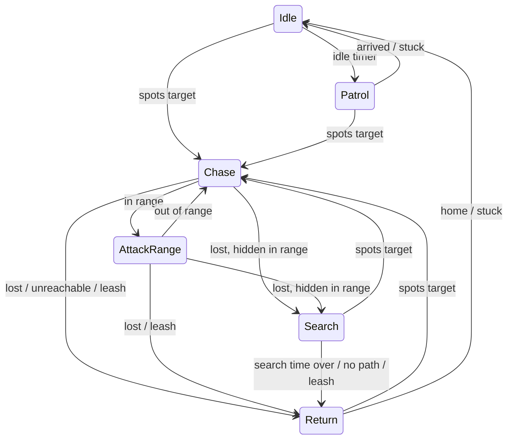
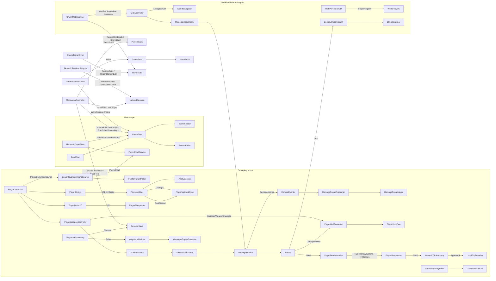

# Architecture

Code map for orienting quickly in the project. One section per system; keep headings stable and update the section that matches the code you change. Conventions and rules live in [CLAUDE.md](../CLAUDE.md); this file describes what exists.

All C# types are in the global namespace (no `namespace` declarations). Paths below are relative to this file.

## Overview

A Unity 6 (URP 2D) top-down action RPG prototype. The player boots into a main menu, starts a new game, and is placed in a seamless world, a grid of chunk scenes streamed around the players (Testlands, the hand-painted test world, at its `start` entry), where they walk in 8 directions and swing a sword. Weasel mobs idle, patrol around their spawn, spot the player with line-of-sight checks, path around walls on their world's navigation, crowd around the player without overlapping, and melee attack on a cooldown. Damage shows floating numbers and a HUD health bar. Mobs target whichever player of their world they spot (nearest visible). A dead player respawns on its own after a delay at the nearest waystone it discovered in its world, whatever the other players do: nothing restarts when every player is dead. Offline and online play (host and join) run in seamless worlds, each player in its own world and travelling between worlds through exits (see Networking and Worlds and streaming). A dev-only stress world spawns hundreds of mobs on a procedurally generated map to profile AI and pathfinding.

## Packages

Notable entries in [Packages/manifest.json](../Packages/manifest.json):

| Package | Used for |
|---|---|
| `jp.hadashikick.vcontainer` (git, pinned to tag `1.19.0`) | Dependency injection, `LifetimeScope`s, entry points |
| `com.unity.inputsystem` | `InputSystem_Actions.inputactions`, `PlayerInputService`, `InputBindings` (rebinding), UI input module |
| `com.unity.render-pipelines.universal` | URP 2D renderer, `Light2D` |
| `com.unity.2d.tilemap` / `.extras` | Tilemaps for terrain, collision and navigation data; `RuleTile` base of the dual-grid walls tile |
| `com.unity.2d.aseprite`, `com.unity.2d.animation` | Sprite import and animation |
| `com.unity.ugui` + TextMesh Pro | Menu, HUD, damage popups |
| `com.unity.test-framework` | EditMode and PlayMode tests |
| `com.unity.netcode.gameobjects` 2.13.3 | Netcode for GameObjects: `NetworkManager`, host/client sessions, network prefab handlers |
| `com.unity.transport` 2.6.0 | `UnityTransport`. Pinned to the version Netcode declares: 2.7.x throws a Burst `NullReferenceException` from its `AnalyticsLayer` job every network update in this editor version. |
| `com.unity.multiplayer.playmode` 2.0.2 | Multiplayer Play Mode (up to 3 extra virtual players in the editor) |
| `com.unity.multiplayer.tools` 2.2.12 | Network Simulator (latency, jitter, packet loss) and network profiling. Simulation only runs in the editor and development builds. |
| `com.coplaydev.unity-mcp` (git) | UnityMCP editor automation |

## Assemblies

| Assembly | Folder | References | Notes |
|---|---|---|---|
| `TopDownRPG.Core` | `Assets/Scripts/Core` | VContainer, Unity.InputSystem, UnityEngine.UI (for the `EventSystem` pointer-over-UI check), Unity.Netcode.Runtime, Unity.Networking.Transport | Boot, scene flow, input, clock, randomness, network session, camera follow, screen fader. Must not reference Gameplay. |
| `TopDownRPG.Gameplay` | `Assets/Scripts` (everything outside `Core` and `Dev`) | Core, VContainer, Unity.InputSystem, Unity.TextMeshPro, Unity.Netcode.Runtime, Unity.2D.Tilemap.Extras | AI, navigation, combat, player, UI, effects, world (including the dual-grid walls and the blended terrain renderer), composition roots. |
| `TopDownRPG.DevTools` | `Assets/Scripts/Dev` | Gameplay, Core, VContainer, Unity.2D.Tilemap.Extras | `defineConstraints: UNITY_EDITOR \|\| DEVELOPMENT_BUILD`; not auto-referenced. Its editor-only code sits behind `#if UNITY_EDITOR`. |
| `TopDownRPG.Editor` | `Assets/Editor` | Core, Gameplay, VContainer, Unity.2D.Tilemap.Editor, Unity.2D.Tilemap.Extras, Unity.2D.Tilemap.Extras.Editor, Unity.2D.Sprite.Editor (slicing the walls sheet), Unity.RenderPipelines.Universal.2D.Runtime (the stress scene's Global Light 2D) | Editor-only platform. Includes the dual-grid tooling, the terrain brush and material tools, the walls sheet generator, the prop placement tool and the scene generator. |
| `TopDownRPG.Editor.Testing` | `Assets/Editor/Testing` | UnityEditor.TestRunner, UnityEngine.TestRunner | Editor-only, not auto-referenced: `ProjectTestRun`, the test runner for tools that drive the editor (see Tests). |
| `TopDownRPG.EditModeTests` | `Assets/Tests/Editor` | Gameplay, Core, Editor (for the prop snapping rule, the scene generator and the terrain tools), DevTools (for the stress map), VContainer, Unity.InputSystem, Unity.InputSystem.TestFramework, Unity.TextMeshPro, Unity.Netcode.Runtime, Unity.2D.Tilemap.Extras, Unity.2D.Tilemap.Editor (for the grid brushes) | Editor-only test assembly. |
| `TopDownRPG.PlayModeTests` | `Assets/Tests/PlayMode` | Gameplay, Core, DevTools, VContainer, Unity.InputSystem, Unity.TextMeshPro, Unity.Netcode.Runtime | Needs DevTools for the stress-scene test. |

Dependency direction: `Core <- Gameplay <- DevTools`, with `Editor` and both test assemblies on top. Core and Gameplay each have an `AssemblyInfo.cs` ([Core](../Assets/Scripts/Core/AssemblyInfo.cs), [Gameplay](../Assets/Scripts/AssemblyInfo.cs)) granting `InternalsVisibleTo` to both test assemblies; `internal` members are test seams. Gameplay also grants it to `TopDownRPG.Editor`, whose dual-grid tools set `internal` members of the dual-grid types and whose terrain brush calls the terrain renderer's `internal` preview API. Editor's own [AssemblyInfo.cs](../Assets/Editor/AssemblyInfo.cs) grants it to the EditMode tests.

## Scenes and boot flow

### Scenes

| Scene | Role | Key contents |
|---|---|---|
| [Main.unity](../Assets/Scenes/Main.unity) | Persistent root, never unloaded. First scene in the build. | `MainLifetimeScope`, Main Camera (`CameraFollow2D`), `EventSystem`, `TransitionCanvas/Fade` (`ScreenFader`) |
| [MainMenu.unity](../Assets/Scenes/MainMenu.unity) | Title screen, loaded additively. | `MenuLifetimeScope`, `MainMenuCanvas` with `MainMenuController`; `Buttons` holds Continue, New Game, Host Game, the join address field, Join Game, Options, Quit and a status line; an `OptionsMenu` prefab instance draws over them while open |
| [Gameplay.unity](../Assets/Scenes/Gameplay.unity) | Session scene, loaded additively for a play session. | `GameplayLifetimeScope` (references the `Player` prefab, spawned at runtime), `PlayerHudCanvas` prefab, `DamagePopupCanvas` (`DamagePopupLayer`), `GameMenuCanvas` prefab (in-game menu and options screen, sort order 10000: above the popups, below the fader) |
| [Worlds/Sandbox/World_Sandbox.unity](../Assets/Worlds/Sandbox/World_Sandbox.unity) and its four chunks under `Chunks/` | The Sandbox, a seamless test world of 2 x 2 chunks at origin (2048, 0), listed in `GameScenes.worlds` and the build; nothing in the menu leads to it, so it is played by opening one of its scenes and pressing Play (see Worlds and streaming). | Root scene: `WorldLifetimeScope`, `Lighting` (`WorldLighting`) holding a white Global Light 2D at 0.85. Each chunk scene: `ChunkLifetimeScope`, a `Grid` at the world's origin with its `WorldChunk`, a `TerrainBlendRenderer` drawing the chunk's ground layers (each list covering its neighbours' border materials) and a `NavigationGrid2D` its navigation page is built from (blocked by the walls and the `Obstacles` layer, reading the cliff of its raised tilemap; `WorldAuthoring.SetUpNavigation` gave every chunk of both test worlds theirs), the walls' `CollisionTilemap` (copied from the area template), and `MobSpawns` holding three `MobSpawnPoint`s of the Weasel (nothing spawns them yet). Painted by script: grass over all 128 x 128 cells, a stone road across the south (rows 40 to 43), a gravel trail up the east (columns 90 and 91), a pond of water in the north-west with a sandy shore, a patch of dirt over the corner where the four chunks meet, a meadow across the border at row 64 in the west and tall grass across the border at column 64 in the north; walls: a line along row 20 and a block across the border at column 64 in the south, a ring around the corner where the four chunks meet and a 2 x 2 block on that corner; a plateau of raised ground (columns 100 to 118, rows 52 to 76) with a ramp in its southern edge across the border at row 64 (WorldStreaming.md's Phase 2); entry `start` (a waystone) on the road at (30.5, 42), and entry `fromInterior` at (33.5, 42), where the interior's exit leads, two and a half cells west of the world exit `Exit_SandboxInterior` (under `Exits` in chunk (0, 0): cells (36, 41) and (36, 42) of the road, leading to the SandboxInterior's `start`); entry `fromTestlands` at (5.5, 42), two and a half cells east of the world exit `Exit_Testlands` (cells (3, 41) and (3, 42) of the road, leading to Testlands' `fromSandbox`). Every chunk has an `AreaTerrain` (its grass layer and walls) |
| [Worlds/SandboxInterior/World_SandboxInterior.unity](../Assets/Worlds/SandboxInterior/World_SandboxInterior.unity) and its chunk | A one-chunk test world at origin (4096, 0), standing in for an interior; listed and built like the Sandbox. | Set up like the Sandbox: a 24 x 16 room of dirt with a square of plaza in its middle, its grass layer empty (the room covers cells (20, 24) to (43, 39)); entry `start` at (32, 32), and the world exit `Exit_Sandbox` on the room's bottom row (cells (31, 24) and (32, 24)), leading back to the Sandbox's `fromInterior` |
| [Worlds/Testlands/World_Testlands.unity](../Assets/Worlds/Testlands/World_Testlands.unity) and its four chunks under `Chunks/` | Testlands, the hand-painted test world of 2 x 2 chunks at origin (6144, 0), the first free slot of the layout when it was made; listed in `GameScenes.worlds` and the build, and `GameScenes`' starting world: New Game and Host Game start at its `start`, and so does every player the host does not know. The PlayMode tests that need a session boot into it (`SceneBootTestHelper.BootIntoTestlands`). | Made with the World Editor's steps (`WorldAuthoring.CreateWorld` and `CreateChunk`, `ListInGameScenes`) and painted with the Terrain Brush's strokes, each written across the chunk borders it crossed (WorldStreaming.md's Phase 5): grass over all 128 x 128 cells, a stone road across the world (rows 38 to 41) crossing the border at column 64, a gravel trail up the east (columns 88 and 89, rows 42 to 127) crossing the border at row 64, a meadow across row 64 in the west, tall grass across column 64 in the south, a patch of dirt on the corner where the four chunks meet, and a pond of water in a sandy shore across column 64 in the north; walls (`WorldAuthoring.AddWalls` on chunk (0, 0), then the brush): a line along row 24 from column 56 to 72 across the border and a short spur up column 56; a plateau of raised ground (columns 100 to 115, rows 56 to 72) across the border at row 64 with a ramp in its southern edge (columns 106 to 108). Each chunk's `MobSpawns` holds two Weasel `MobSpawnPoint`s with their `PersistentId`, all at least 23 cells from the entry. Entry `start` (a waystone) on the road at (24.5, 40.5): every cell within 6 of it is open ground, with room for the seven-cell wall `PlayerControlsPlayModeTests` builds two cells to its right (Docs/SceneGeneration.md's "What the PlayMode tests rely on"). Entry `fromSandbox` at (117.5, 40), two and a half cells west of the world exit `Exit_Sandbox` (under `Exits` in chunk (1, 0): cells (120, 39) and (120, 40) of the road, leading to the Sandbox's `fromTestlands`), so a hosted game reaches the Sandbox and its interior. Entry `north` (a waystone) on the grass of chunk (0, 1) at (30.5, 90.5), 50 cells from `start` and 19 from the nearest Weasel spawn point, for the respawn tests and the Multiplayer Play Mode steps (WorldStreaming.md's Phase 9). Every chunk has an `AreaTerrain` (its grass layer, and its walls where it has them). No sea, so no coast maps. |
| [Worlds/Overworld/World_Overworld.unity](../Assets/Worlds/Overworld/World_Overworld.unity) and its twenty chunks under `Chunks/` | The Overworld, the first generated world ([WorldGeneration.md](WorldGeneration.md)), 5 x 4 chunks at origin (8192, 0), the first free slot of the layout when it was made; listed in `GameScenes.worlds` and the build, but not yet the starting world (WorldGeneration.md's Phase 5). Six regions, the six area generators' seed 1 layouts, on an island in the sea, joined by stone and gravel roads through the wilds' grass; a waystone per region on a plaza at its spawn cell, `clearing` the default entry, and a gate on each linked port. | Made with the World Editor's steps (`WorldAuthoring.CreateWorld`, `CreateChunk` for every chunk, `ListInGameScenes`) and written through the World Generator's code path (`WorldGeneratorSession`) from `WorldGenerator_Overworld.asset`, then synced, baked, repaired and validated: every chunk 5 to 14 layers in the style's order, all eighteen materials laid, the Coast region's plateau of raised ground with its ramp, 48 spawn points of the Weasel under the chunk grids' `GeneratedMobSpawns` (28 in the regions, 20 in the wilds) with derived ids, 14 baked coast maps beside the chunk scenes, no walls; 19 entries, the six waystones then the 13 gates. Regenerate it from its generator asset only (WorldGeneration.md: Generating a world), locking a chunk there before painting it by hand. |
| [Dev/Worlds/StressTest/World_StressTest.unity](../Assets/Dev/Worlds/StressTest/World_StressTest.unity) and its four chunks under `Chunks/` | The stress world, a dev-only world of 2 x 2 chunks at origin (0, 0), the first free slot of the layout when it was made. Not listed in `GameScenes` and not in the build list: its `SceneDefinition`s lie under `Assets/Dev/`, which `SceneBuildValidator` skips and `WorldAuthoring` keeps out of the build. Played by opening one of its scenes and pressing Play. | Made with the World Editor's steps (`WorldAuthoring.CreateWorld` into `Assets/Dev/Worlds`, `CreateChunk`, `AddWalls`). Root scene: `WorldLifetimeScope`, whose auto-inject objects list `StressTest` (at the world's middle, (64.5, 64.5)) holding `StressTestSpawner` and `StressTestOverlay`, and the lighting. Each chunk's grid has an empty `GrassTilemap` layer, walls and a `StressTestMap`, which paints the chunk's part of the 128 x 128 map at runtime. Entry `start` (a waystone) at the world's middle. No mob spawn points: the spawner makes the mobs. |

Chunks get their walls from [Walls.prefab](../Assets/Prefabs/World/Walls.prefab) (`WorldAuthoring.AddWalls`, the World Editor's Add walls): an empty `CollisionTilemap` on the `Obstacles` layer with its dual-grid walls module (`walls_DualGridRuleTile`) and grid colliders, and its `RenderTilemap` at order 10 on the `Terrain` sorting layer, saved from the area template as the areas went (WorldStreaming.md's Phase 9). The Scene Generator writes into standalone scratch scenes (`WorldAuthoring.CreateScratchScene`, see Editor tools), never into a world's chunk.

Scene identity is data, not strings: [SceneDefinition](../Assets/Scripts/Core/Scenes/SceneDefinition.cs) assets under `Assets/Data/Scenes` (and beside each world's scenes under `Assets/Worlds`) hold a scene GUID + path, and [GameScenes](../Assets/Scripts/Core/Scenes/GameScenes.cs) (`Assets/Data/Scenes/GameScenes.asset`) lists MainMenu, Gameplay, the seamless worlds (`worlds`, `FindWorldOwning(scenePath)`: the listed world whose root or chunk scene that is; `FindWorldById`), and the starting world and entry (`StartingWorld`, `StartingWorldEntry`: Testlands' `start`), where New Game and Host Game start and where a joining player the host does not know arrives.

### Load hierarchy

```
Main (MainLifetimeScope)
├── MainMenu (MenuLifetimeScope, parent = Main)            -- while in the menu
└── Gameplay (GameplayLifetimeScope, parent = Main)        -- while in a session
    └── World_* (WorldLifetimeScope, parent = Gameplay)    -- each world with a player in it
        └── World_*_x_y (ChunkLifetimeScope, parent = its world) -- the chunks streamed around the players
```

Every session runs in seamless worlds (see Worlds and streaming). The area path (one area scene at a time under Gameplay) went in WorldStreaming.md's Phase 9.

### Boot sequence

1. Play (or a build) starts in `Main`. In the editor, [PlayModeBootstrapper](../Assets/Editor/Scenes/PlayModeBootstrapper.cs) forces `playModeStartScene = Main` (toggle: `Tools/TopDownRPG/Boot From Main`) and stores the scenes that were open via [EditorBootRequest](../Assets/Scripts/Core/Scenes/EditorBootRequest.cs) (`SessionState`). Test Runner sessions are detected by their `InitTestScene*` scene and left alone.
2. `MainLifetimeScope` builds; its entry point [BootFlow](../Assets/Scripts/Core/Boot/BootFlow.cs) (`IAsyncStartable`) runs.
3. Editor only: `BootFlow` consumes the boot request. If a world's root or chunk scene was open (a world `GameScenes` lists, else any `WorldDefinition` asset in the project, such as the dev stress world), it starts a new game there (`SessionSave.StartNew`, then `GameFlow.StartWorldGameAsync(world)` at the world's default entry); if only Gameplay was open, a new game in the starting world at its entry; if MainMenu was open, the menu. Any other scene is no world's: it warns and shows the menu.
4. Otherwise `GameFlow.ShowMainMenuAsync()`.
5. Every session from the menu runs in seamless worlds (see Save data). Menu "New Game" -> `MainMenuController.StartNewGame()`: `SessionSave.StartNew()`, then `GameFlow.StartWorldGameAsync` offline in the starting world at its entry (`GameScenes.StartingWorld`, `StartingWorldEntry`: Testlands' `start`). "Continue" loads the save into the `SessionSave` and starts offline with the local player at its saved world and position (`PlayerStarts`). "Host Game" starts hosting first, then continues the save the same way when there is one, or starts a new game. "Join Game" connects to the address in the field and then starts `GameFlow.StartJoinedGameAsync`, which waits for the host to place this player in a world (see Networking).

### GameFlow

[GameFlow](../Assets/Scripts/Core/Scenes/GameFlow.cs) (singleton in Main scope) owns all scene transitions. Uses [SceneLoader](../Assets/Scripts/Core/Scenes/SceneLoader.cs) (additive load/unload, `Resources.UnloadUnusedAssets`) and [ScreenFader](../Assets/Scripts/Core/UI/ScreenFader.cs).

- Every transition: reject if one is running -> `TransitionStarted` -> fade out -> work -> fade in -> `TransitionFinished`. Cancelled with `Application.exitCancellationToken`. A trip between worlds is a transition too (`IsTravelling`), so it never runs beside another one, either way round.
- `ShowMainMenuAsync`: leave any world session, unload gameplay and unused assets, load MainMenu under Main.
- `StartWorldGameAsync(world, position)` (and `StartWorldGameAsync(world, entryName)`, which starts at that entry's position, `WorldDefinition.EntryPosition`): unload menu, leave any world session, unload gameplay and unused assets, load Gameplay under Main (made the active scene), set `CurrentWorld`, then await the Gameplay scope's [IWorldSession](../Assets/Scripts/Core/Worlds/IWorldSession.cs) `EnterAsync(world, position)`, which completes once the ground around the players is loaded, before the fade in. Logs an error and enters nothing when the scope provides no `IWorldSession`. Leaving a world session first raises `WorldSessionEnding` (the session's last save), then (`LeaveAsync`, awaited before anything unloads) unloads its chunks and worlds one at a time.
- `StartJoinedGameAsync()`: a joined client's session. Like `StartWorldGameAsync` up to the Gameplay scene, then awaits the Gameplay scope's `IWorldSession.JoinAsync()`: the host spawns this machine's player in a world, which the client loads around it before the fade in, and that world becomes `CurrentWorld`. When the session ends first it warns and leaves the Gameplay scene without a world; `NetworkSessionLifecycle` then takes the game back to the menu. Leaving a world session also leaves one that is still joining (the world session is active though no world is recorded yet).
- `TravelAsync(world, entryName)`: the local player's trip to another world (WorldStreaming.md's Travelling between worlds), run by `LocalTripTraveller` once the trip's authority has approved it and put the player in that world. A transition flagged `IsTravelling`: fade out, set `CurrentWorld`, await the Gameplay scope's `IWorldSession.ArriveAsync(world, entryName)` (the local player moved to the entry, then the ground around it loaded), fade in. It loads and unloads nothing itself, and `TransitionTimeFreeze` leaves game time running. Logs an error outside a world session.
- `WorldSessionEnding` event: raised as a world session is about to end (the menu, a new session), with its players still in their worlds; `GameSaveRecorder` saves then.
- State: `IsTransitioning`, `IsTravelling` (the transition running is a trip), `IsInMenu`, `IsInGame` (Gameplay loaded and a world recorded), `CurrentWorld` (the local player's world: the one the session started in, then each one it travelled to), `GameplayScene`.

## Composition / DI

VContainer scopes live one per scene. Each Gameplay-assembly scope logs an error and registers nothing if it has no parent (i.e. the scene was opened without booting through Main).

### MainLifetimeScope ([MainLifetimeScope.cs](../Assets/Scripts/Core/Boot/MainLifetimeScope.cs), Core)

| Registration | Kind |
|---|---|
| `GameScenes` | instance (inspector) |
| `Camera` (main camera), `ScreenFader`, `CameraFollow2D` | components (inspector) |
| `IClock` -> `UnityClock.Shared` | instance |
| `IRandom` -> `new SystemRandom()` (time-seeded) | instance |
| `SceneLoader`, `GameFlow` (gets this scope as `LifetimeScope` parameter) | singletons |
| `UISelection` (with the inspector's `EventSystem`) | singleton |
| `RuntimeInputActions` (the inspector's `InputActionAsset` and `EventSystem`) | singleton |
| `PlayerInputService` as `IPlayerInput`, `IMenuInput` + self (gets the `RuntimeInputActions` copy and the scene's `EventSystem`; a missing `EventSystem` logs an error) | singleton |
| `GameplayInputGate` (+ self), `TransitionTimeFreeze` (with `ISessionStatus`, so it freezes offline only) | entry points |
| `TimeFreeze` (owns `Time.timeScale`, back to 1 on dispose) | singleton |
| `MenuStack` (+ self) | entry point |
| `BootFlow` | entry point |
| `NetworkSession` as `IGameAuthority`, `INetworkObjectSpawner`, `IClientReadiness`, `IChunkHandshake`, `IChunkHolds`, `ISessionStatus`, `IPlayerIdSource` + self (gets the inspector's `NetworkManager` prefab and `NetworkSettings`, and `UserSettings` for the player id) | singleton; logs an error and is skipped if either is missing |
| `NetworkSessionLifecycle` | entry point |
| `ISaveStore` -> `FileSaveStore` at `Application.persistentDataPath/save.json` (`save.Player2.json` and so on for a Multiplayer Play Mode virtual player, `InstanceFiles`) | instance |
| `GameSave`, `SessionSave`, `PlayerStarts` | singletons |
| `ISaveStore` -> `FileSaveStore` at `Application.persistentDataPath/settings.json` (a virtual player's own, as above), keyed `UserSettings.FileName` | instance |
| `UserSettings` (takes the keyed store) | singleton |
| `InputBindings` as `IInputBindingLabels` + self (gets the `RuntimeInputActions` copy and the inspector's `RebindableActionList`; a missing list logs an error) | entry point |

### MenuLifetimeScope ([MenuLifetimeScope.cs](../Assets/Scripts/Composition/MenuLifetimeScope.cs))

- `OptionsMenuView` via `RegisterComponentInHierarchy`, and `OptionsMenuController` as an entry point + self.
- `MainMenuController` via `RegisterComponentInHierarchy` (injected with `GameFlow`, `NetworkSession`, `GameSave`, `SessionSave`, `PlayerStarts`, `OptionsMenuController` and `UISelection`).

### GameplayLifetimeScope ([GameplayLifetimeScope.cs](../Assets/Scripts/Composition/GameplayLifetimeScope.cs))

| Registration | Kind |
|---|---|
| `PlayerRegistry` as `IPlayerRegistry` + self | singleton |
| `PlayerControlSettings` (the player prefab's own asset, so there is one source of truth; a prefab without one logs an error and registers nothing) | instance |
| `LocalPlayerTracker`, `PointerTargetPicker`, `LocalPlayerCommandSource`, `PlayerNavigation`, `PlayerBinder`, `PlayerRespawner` | singletons |
| `PlayerSpawner` (with the inspector's player prefab and the Gameplay scene as parameters; places a joining player on a free entry slot with `GameplaySettings`) | singleton |
| `GameplayPlayers` | entry point (spawns players in `Start`, see Player) |
| `DamagePopupLayer` | component |
| `PointerFeedbackLayer` (inspector; a missing one logs an error and skips `PointerFeedbackPresenter`) | component |
| `GameplaySettings` | instance |
| `CombatSettings` (inspector; a missing one logs an error and registers nothing, like a missing player prefab) | instance |
| `PlayerHudView`, `AbilityBarView`, `StatusBarView`, `OptionsMenuView`, `GameMenuView` | components in hierarchy |
| `CombatEvents`, `DamageService`, `HitService`, `AbilityService`, `SlashSpawner`, `EffectSpawner` | singletons |
| `StatusVisualPool` (with the Gameplay scene) | singleton (disposed with the scope) |
| `StatusEffectService` (+ self) | entry point (`ITickable`) |
| `DamagePopupPresenter`, `GameplayEntryPoint`, `PlayerDeathHandler` (`ITickable`), `PlayerHudPresenter`, `AbilityBarPresenter`, `StatusBarPresenter`, `PointerFeedbackPresenter`, `OptionsMenuController` (+ self), `GameMenuController` (+ self) | entry points |
| `Worlds`, `PlayerWorlds`, `ChunkNetworkPrefabs` | singletons |
| `NavigationPagePool` (`DefaultSlots`: 24 chunk pages, shared by every loaded world's `WorldNavigation`) | instance |
| `TripArrivals`, `WorldExits`, `LocalTripAuthority`, `NetworkTripAuthority` as `ITripAuthority` + self, `PlayerIds`, `WaystoneNotices` | singletons (outside the settings check below: every player's `PlayerWorldSync` takes the trip authority and the notices, and the respawns go through the trip authority) |
| `WaystoneDiscovery`, `WaystonePopupPresenter` | entry points (see Worlds and streaming, UI) |
| `GameSaveRecorder` (+ self) | entry point (see Save data) |
| `WorldStreaming` as `IWorldSession` + self (with the inspector's `WorldStreamingSettings`, this scope as the `LifetimeScope` parent of every world, and `GameplaySettings` for the entry slots), `LocalWorldPresentation` (with the same settings) | entry points; both skipped, with an error, when the settings are missing, and so is every trip registration below |
| `LocalTripTraveller` (+ self) | entry point |

[GameplayEntryPoint](../Assets/Scripts/Composition/GameplayEntryPoint.cs): points `CameraFollow2D` at the local player and snaps whenever `LocalPlayerTracker` assigns one (on a client that happens when the host's spawn arrives); clears the target on dispose.

### WorldLifetimeScope and ChunkLifetimeScope ([WorldLifetimeScope.cs](../Assets/Scripts/Composition/WorldLifetimeScope.cs), [ChunkLifetimeScope.cs](../Assets/Scripts/Composition/ChunkLifetimeScope.cs))

- A world's root scene holds a `WorldLifetimeScope`, built under the Gameplay scope with the world's `WorldDefinition` enqueued by `WorldStreaming`; each chunk scene holds a `ChunkLifetimeScope`, built under its world's scope with a `ChunkIdentity` (world, chunk coordinates) enqueued. Both log an error without a parent scope and then register nothing; the chunk scope also logs one for every `MobController` placed in the chunk: mobs come from spawn points. Other scene objects needing injection go in a scope's `autoInjectGameObjects` (the stress world's root scene lists its `StressTest` object).
- `WorldLifetimeScope` registers the world's `WorldNavigation` (as itself and `INavigation2D`, with the Gameplay scope's `NavigationPagePool`), disposed with the scope, which frees its pages' slots. `WorldStreaming` resolves it into the world's `LoadedWorld`. It also registers the world's `WorldPlayers` (as itself and `IPlayerRegistry`, built by a factory from the Gameplay scope's registry, `PlayerWorlds` and the world's definition, since a constructor taking `IPlayerRegistry` would resolve itself), disposed with the scope: everything injected in the world's scope and its chunks' scopes, the mobs above all, sees only the players in that world. And it registers the world's `WorldState`, from the Main scope's `SessionSave` (`WorldOf(world id)`), which outlives the scope, so what its chunks record survives the world unloading.
- `ChunkLifetimeScope` registers the `ChunkNavigation` entry point with the chunk's `NavigationGrid2D` (an error when the chunk has none, and then nothing below either): in `Start` it adds the chunk's page to its world's navigation, and when the scope is disposed (the chunk unloading) it takes it out. It also registers the `ChunkMobSpawner` entry point, resolvable as itself (with every `MobSpawnPoint` of the chunk and the chunk's scene; its `WorldState` and `SessionSave` come from the parent scopes), plus a build callback that calls its `RegisterNetworkPrefabs`. When the chunk has an `AreaTerrain` (every chunk of the worlds; `WorldAuthoring.SetUpTerrainEdits` gives one) it registers it as a component and the `ChunkTerrainSync` entry point, resolvable as itself (with the chunk's scene), plus a build callback that calls its `RegisterNetworkPrefab`; these come before the grid check.

### How components get injected

- Plain classes: constructor injection (`GameFlow`, `BootFlow`, presenters, spawners, `WorldStreaming`).
- MonoBehaviours: `[Inject] public void Construct(...)`, reached via `InjectGameObject` build callbacks or `IObjectResolver.Instantiate`.

| Component | `Construct` parameters | Injected by |
|---|---|---|
| `PlayerWeaponController` | `SlashSpawner`, `IClock` | `PlayerSpawner` (`resolver.Instantiate`), or `InjectingNetworkPrefabHandler` on clients |
| `PlayerNetworkSync` | `PlayerBinder` | same as `PlayerWeaponController` |
| `PlayerWorldSync` | `PlayerWorlds`, `GameScenes`, `NetworkTripAuthority`, `IClientReadiness`, `WaystoneNotices` | same as `PlayerWeaponController` |
| `PlayerController` | `IClock` | same as `PlayerWeaponController` |
| `PlayerMotor2D` | `PlayerNavigation` | same as `PlayerWeaponController` |
| `PlayerAbilities` | `IClock`, `AbilityService` | same as `PlayerWeaponController` |
| `MainMenuController` | `GameFlow`, `NetworkSession`, `GameSave`, `SessionSave`, `PlayerStarts`, `OptionsMenuController`, `UISelection` | Menu scope |
| `MobController` | `INavigation2D`, `IPlayerRegistry`, `IRandom` | `ChunkMobSpawner` or `StressTestSpawner` (`resolver.Instantiate` through a chunk's or the stress world's scope), or `InjectingNetworkPrefabHandler` on clients (through `ChunkNetworkPrefabs`). The navigation is its world's `WorldNavigation` and the players its world's `WorldPlayers` |
| `MobMotor2D` | `IClock` | same as `MobController` |
| `MeleeDamageDealer` | `IClock`, `HitService` | same as `MobController` |
| `DestroyMobOnDeath` | `EffectSpawner`, `IGameAuthority` | same as `MobController` |
| `NetworkHealth` | `DamageService` | player: same as `PlayerWeaponController`; mob: same as `MobController` |
| `NetworkStatusEffects` | `CombatSettings`, `StatusEffectService`, `IClientReadiness` | same as `NetworkHealth` |
| `StressTestSpawner` | `IObjectResolver`, `WorldNavigation`, `WorldDefinition`, `LocalPlayerTracker` | The stress world's `WorldLifetimeScope` `autoInjectGameObjects` |
| `AreaTerrain` | `IGameAuthority` | Chunk scope `RegisterComponent` |
| `NetworkAreaTerrain` | `AreaTerrain` | `ChunkTerrainSync` (`resolver.Instantiate`) on the host, or a client's chunk handler through `ChunkNetworkPrefabs` |

`MeleeDamageDealer`, `MobMotor2D`, `PlayerController`, `PlayerAbilities` and `PlayerWeaponController` default their clock to `UnityClock.Shared` when not injected. A `PlayerMotor2D` that was never injected has no navigation and moves in straight lines.

## Networking

Netcode for GameObjects, host-and-play. See [Multiplayer.md](Multiplayer.md) for the plan and [WorldStreaming.md](WorldStreaming.md#networking) for worlds online; this section describes what exists. Players, mobs, health and runtime terrain edits are replicated. The host runs all game logic (mob AI, damage, deaths, respawns, trips between worlds); clients move their own player and mirror the rest. Sessions run in seamless worlds: each player is in one world at a time, every machine knows each player's world, the host streams for every player and a client for itself, and what a client receives follows the chunks it holds.

| Type | Role |
|---|---|
| [NetworkSettings](../Assets/Scripts/Core/Network/NetworkSettings.cs) | ScriptableObject (`Assets/Data/NetworkSettings.asset`): default join address (`127.0.0.1`), host listen address (`0.0.0.0`), port (7777), client connect timeout (10 s), max players per session including the host (4, range 1–4). |
| [NetworkSession](../Assets/Scripts/Core/Network/NetworkSession.cs) | Main-scope singleton that owns the `NetworkManager`: instantiates it from `Assets/Prefabs/Network/NetworkManager.prefab` (`NetworkManager` + `UnityTransport`, scene management off, no player prefab) and destroys it on dispose, so it never outlives the Main scope despite Netcode moving it to `DontDestroyOnLoad`. `StartHost()`, `JoinAsync(address, timeout, token)` (connects with this build's version and `LocalPlayerId`, the install's player id from `UserSettings`, waits for the connection, shuts down and returns false on failure/timeout), `Shutdown()`, `RegisterPrefab`/`UnregisterPrefab`, `JoinRefusal` (the host's reason when it refused the last join, else null), `IsActive`/`IsHost`/`IsServer`/`IsConnectedClient`/`LocalClientId`, event `ConnectionLost` (local client stopped without `Shutdown` being called). Makes its `NetworkManager` the Netcode singleton before starting, since Netcode falls back to the singleton when spawning. Implements `IGameAuthority` (`IsAuthoritative` = server, or offline when not following a host: a client whose connection dropped stays non-authoritative until `Shutdown()`, which `NetworkSessionLifecycle` calls once it is back in the menu, so a stranded client never saves or runs the game on its own). Player ids: the host keys every approved client by the id in its join payload (`PlayerIdOf(clientId)`; the host's own is `LocalPlayerId`); a client without one, or with one already in the session (a copied `settings.json`; Multiplayer Play Mode's virtual players have files of their own, `InstanceFiles`), gets a new id for the session, with a warning. Readiness (`ClientChunkReadiness`, below, with this session as its `IClientVisibility`), over named messages on `MessageDelivery` (`ReliableFragmentedSequenced`, the channel Netcode creates and destroys objects on, so an acknowledgement arrives after the hides before it): a client's `NotifyJoined()` (`ClientJoinedMessage`) once its Gameplay scope is up; host `JoinedClients`, `IsClientJoined`, event `ClientJoined`; a client's `ReportChunkReady(trip, chunk)` (`ChunkReadyMessage`) and `ReleaseChunkAsync(chunk)` (`ChunkReleasingMessage`, then waits for `ChunkReleasedMessage` or the session's end); host `IsClientReady(clientId)` (settled in its current trip), `IsClientReady(clientId, chunk)`, `BeginTrip(clientId, trip)`, `IsChunkHeld(chunk)`, all true for the host's own client where they ask about one; `Readiness` (internal, for tests). Spawning, all destroyed with their scene: `SpawnPlayerObject(instance, owner)` and `Spawn(instance)` are visible to every joined client; `Spawn(instance, homeChunk)` to the clients that hold that chunk, and, when the prefab's handler here is a `NetworkPrefabInstanceHandlerWithData<NetworkChunkId>` (the chunks register theirs on the host too), it sets the chunk as the instantiation data. `ShowNowVisible`/`HideNoLongerVisible` walk the spawned objects with a visibility check and `NetworkShow`/`NetworkHide` the ones whose check changed for that client. `Despawn(instance)` (host) despawns and destroys one object, destroying it when it is not spawned. `RegisterPrefab(prefab, handler)` installs a handler of the caller's own (`ChunkNetworkPrefabs`' routers), with an error when the prefab already has one. `HasPlayerObject(clientId)`. Also implements `INetworkObjectSpawner`, `IChunkHandshake`, [ISessionStatus](../Assets/Scripts/Core/Network/ISessionStatus.cs) (`IsActive`, `IsHost`) for the in-game menu, the trips and the time freeze, and [IPlayerIdSource](../Assets/Scripts/Core/Network/IPlayerIdSource.cs) (`LocalPlayerId`, `PlayerIdOf`) for `PlayerIds`. A client stopping while the application quits or the editor leaves Play Mode is not reported as `ConnectionLost`. |
| [JoinApproval](../Assets/Scripts/Core/Network/JoinApproval.cs) | Static admission rule, free of Netcode types. `CreatePayload(version, playerId)` is the connection data a client sends (its `Application.version`, a line break, its player id; line breaks inside either are dropped) and `ReadPayload` reads both back (a payload with only a version has no player id); `Evaluate(payload, hostVersion, playerCount, maxPlayers)` returns null to approve, or a reason: another or missing version first, then a full party. `EncodeRefusal`/`TryDecodeRefusal` tag the reason so a client can tell it from Netcode's own disconnect text. |
| [ClientChunkReadiness](../Assets/Scripts/Core/Network/ClientChunkReadiness.cs) | Plain C#, the host's per-client readiness and the release handshake (WorldStreaming.md's Networking). `Join(client)` (shows it what it may see: the players), `Leave`, `Clear`, `JoinedClients`, `IsJoined`; `BeginTrip(client, trip)` (a newer trip only: reports tagged with an earlier one are ignored from then on, and the client is unsettled until it reports a chunk for the trip; chunks it holds stay held), `TripOf`; `ReportReady(client, trip, chunk)` (ignored before joining, for another trip or no chunk; else the chunk is held, the client settled and shown what it may now see); `Release(client, chunk)` (forgets the chunk, hides what the client may no longer see, then acknowledges, held or not); `IsReady(client, chunk)`, `IsSettled(client)`, `IsHeld(chunk)` (by any client). Showing, hiding and acknowledging go through an [IClientVisibility](../Assets/Scripts/Core/Network/IClientVisibility.cs), so `ClientChunkReadinessTests` runs it without Netcode. |
| [ChunkId](../Assets/Scripts/Core/Worlds/ChunkId.cs), [NetworkChunkId](../Assets/Scripts/Core/Network/NetworkChunkId.cs) | A chunk as every machine names it: its world's `WorldId` and its coordinates (`Of(world, coords)`, `IsValid`, value equality), and its wire form (`INetworkSerializable`, the id a `FixedString64Bytes`), which the chunk messages and chunk objects' instantiation data carry. |
| [IChunkHolds](../Assets/Scripts/Core/Network/IChunkHolds.cs), [IChunkHandshake](../Assets/Scripts/Core/Network/IChunkHandshake.cs) | The handshake as the world streaming sees it: `IsChunkHeld(chunk)` (host: some client holds it, so the streamer keeps it), `ReportChunkReady(trip, chunk)` and `ReleaseChunkAsync(chunk)` (client only; nothing offline or on the host). |
| [PlayerWorldState](../Assets/Scripts/Core/Network/PlayerWorldState.cs) | A player's world as `PlayerWorldSync` replicates it: `WorldId` (empty for none), `Trip` (its trip count) and `Entry` (where its latest trip leads), fixed strings and value equality. |
| [INetworkObjectSpawner](../Assets/Scripts/Core/Network/INetworkObjectSpawner.cs) | `IsActive`, `IsServer`, `RegisterPrefab` (with a resolver and a target scene, or with a handler of one's own, which `NetworkSession` installs and refuses with an error when the prefab already has one, since Netcode keeps one handler per prefab), `UnregisterPrefab`, `Spawn` (visible to joined clients) and `Spawn(instance, homeChunk)` (visible to the clients holding that chunk), `Despawn` (host: despawns and destroys; destroys an object that is not spawned): the slice of `NetworkSession` chunk code needs, so EditMode tests can fake it. |
| [IGameAuthority](../Assets/Scripts/Core/Network/IGameAuthority.cs) | `IsAuthoritative`: whether this machine decides game state. Implemented by `NetworkSession`; tests use a fixed fake. |
| [IClientReadiness](../Assets/Scripts/Core/Network/IClientReadiness.cs) | `IsClientReady(clientId)`: whether a client reported a chunk ready since its player's latest trip began (the host's own client always has); `IsClientReady(clientId, chunk)`: whether it holds that chunk; `BeginTrip(clientId, trip)` (host). Implemented by `NetworkSession`; `NetworkStatusEffects` holds a client's player until it is ready, and `PlayerWorldSync` begins its trips. |
| [InjectingNetworkPrefabHandler](../Assets/Scripts/Core/Network/InjectingNetworkPrefabHandler.cs) | `INetworkPrefabInstanceHandler` that creates network prefab instances through an `IObjectResolver` so their `[Inject]` methods run, moves them into a target scene when one is given (players into Gameplay, a chunk's objects into their home chunk through `ChunkNetworkPrefabs`), and destroys them on despawn. Netcode only calls it on clients; the host must create its instances with `resolver.Instantiate` itself before spawning. |
| [NetworkSessionLifecycle](../Assets/Scripts/Core/Network/NetworkSessionLifecycle.cs) | Main-scope entry point: shuts the session down whenever a transition ends in the menu, and returns to the menu (with a warning) when the connection is lost anywhere but the idle menu. A loss during a transition (a client still joining, mid-trip, or loading) is remembered and acted on when that transition finishes, since `GameFlow` ignores a second transition. A loss in the idle menu just ends the session. |

- `Assets/DefaultNetworkPrefabs.asset` is Netcode's auto-maintained network prefab list, referenced by the NetworkManager prefab: the player, the Weasel, the stress-test mob and `AreaTerrainSync` (the prefab of `NetworkAreaTerrain`).
- Runtime terrain edits, per chunk: only the host (or an offline game) changes a chunk's editable tilemaps, through its `AreaTerrain.TrySetCells`. Each changed cell is kept in a per-chunk list (last write per cell wins) that the host's `NetworkAreaTerrain` of that chunk mirrors into a `NetworkList<TerrainEdit>`; a client applies the whole list when the object reaches it (once it holds the chunk, so a client arriving there catches up as a late joiner does) and each change after that. Every machine's navigation follows the tile changes on its own. A client moves its own player, so between an edit and its arrival that player can still walk where the host just built a wall.
- Scene management is disabled: each machine loads its own worlds and chunks (`WorldStreaming`), so nothing networked is placed in a scene and nothing networked moves between scenes (players live in Gameplay, a chunk's objects in their home chunk).
- Netcode sets `Application.runInBackground` while a `NetworkManager` exists.
- Connection approval is on in the NetworkManager prefab (`NetworkSession` logs an error if it is off). The host approves itself, and approves a client through `JoinApproval` against `Application.version` and `NetworkSettings.MaxPlayers`, counting connected clients plus clients approved this frame but not yet connected. A refused client gets the reason as its disconnect reason; `JoinAsync` exposes it as `JoinRefusal` and the menu shows it. Approval is part of Netcode's config hash, so every build that should connect must have it on. Bump the Version in Player Settings whenever a change breaks compatibility between builds.
- Join order on a client: connect (version and player id), load Gameplay (its scope registers the player prefab in a build callback) and send joined (`GameplayPlayers.Start`); the host spawns its player where `PlayerStarts` places it (its saved place by player id, else the starting world's entry), once its own streaming has loaded that world and the chunks around the place (`IWorldSession.PrepareAsync`), with its world set, and shows it every player, whatever their world; the client's `PlayerWorldSync` puts its player in that world, `WorldStreaming` loads the world and the chunks around it, registering each chunk's mob and terrain sync prefabs (`ChunkNetworkPrefabs`), and reports each chunk ready once it is up; only then does the host show it that chunk's mobs and terrain edits, and stop holding its player. A late joiner goes the same way.
- Walking and trips: a client releases each chunk before unloading it (`WorldStreaming`), and the host hides that chunk's objects from it before acknowledging; the host never unloads a chunk a client holds (its streamer's `IChunkHolds`), except when the session ends. A client's trip is an RPC naming the exit (`PlayerWorldSync.RequestTripRpc`, with the client's own position); the host checks it (`LocalTripAuthority`), streams the entry, and puts the player in the target world for its next trip, which reaches the client as its player's networked world: the client fades, moves its own player there (a teleport snaps on the other machines), reports the new world's chunks for that trip and fades in. Nobody else fades. No session ever restarts when every player is dead: each player respawns on its own, and a respawn is a trip within the player's own world to its waystone, decided by the host and run by the player's own machine like any trip; the host restores the player's health once it sees it there with the waystone's chunk held by its client (see Player). A discovery of a waystone by a client's player reaches its owner as `PlayerWorldSync.WaystoneDiscoveredRpc`, for its popup. The protocol gained that RPC in WorldStreaming.md's Phase 9, so the build version went from 1.3 to 1.4.
- Unity Transport timeouts on the NetworkManager prefab: heartbeat 500 ms, disconnect 10 s (down from the 30 s default). The disconnect timeout is how long a client waits before giving up on a host that vanished without a clean disconnect (a crash, or it dropping off the virtual LAN), and the same for the host about a client. 10 s still rides out short Wi-Fi or Tailscale hiccups; a heartbeat counts as traffic, so an idle but live connection never times out.
- The NetworkManager prefab carries a `NetworkSimulator` set to the `None` preset. It drives every transport in the process, so only one should be enabled (the in-process test clients remove theirs).

### Transform smoothing

Networked transforms use `LegacyLerp` position interpolation with unreliable deltas and the default buffer (`NetworkTransform.InterpolationBufferTickOffset` 0, tick rate 30). This was chosen by measurement, not by the package docs' suggestion: the explicit benchmark `NetworkSmoothnessPlayModeTests.Benchmark_RemotePlayerSmoothness_UnderStress` moves an in-process client's player for 2 s at a time under 150 ms latency, 20 ms jitter and 4% loss and records, per rendered frame of the host's copy, how far the speed strays from the owner's, the longest freeze and visible backward jumps. Results on this machine (6 runs per setting, run in both orders):

| Setting | Start lag | Mean speed error | Runs with a freeze over 150 ms |
|---|---|---|---|
| `LegacyLerp`, unreliable deltas, offset 0 or 1 | ~390 ms | 22–26% | 0–2 of 6 |
| `Lerp`, unreliable deltas, offset 1 or 2 | ~380 ms | 57–63% | 0–2 of 6 |
| `SmoothDampening`, unreliable deltas | ~350 ms | ~100% | up to 3 of 6 |
| Any type with reliable deltas | 450–550 ms | 60–150%, with backward jumps for `Lerp`/`SmoothDampening` | frequent |

Unreliable deltas are the biggest win (a lost update is replaced by the next one instead of resent behind it). Rerun the benchmark by name after changing tick rate, speeds, movement code or transform settings.

Rerun after click-to-move replaced WASD (the client's player now walks on far-away move orders, with the mobs despawned): `LegacyLerp` unreliable offset 0 gave 385 ms start lag, 21% mean speed error and no stall over 150 ms in 6 runs; offset 1 26%; `Lerp` 59–67%; `SmoothDampening` ~106%; reliable deltas 76% with stalls in 5 of 6 runs. The ranking and the shipped setting are unchanged. The 3-run regression test is noisier than the 6-run benchmark (38% in the same session).

## Save data

One local save file, written by the machine that decides game state (offline or the host; a client never saves), holding the world sessions (WorldStreaming.md's Persistence, Phase 8). See [Multiplayer.md](Multiplayer.md#phase-6-services-and-persistence) for the decisions. Per-machine preferences live in a separate settings file (see Settings below).

| Type | Role |
|---|---|
| [ISaveStore](../Assets/Scripts/Core/Save/ISaveStore.cs) | `TryRead`/`Write` of the save text, so save logic is tested without the disk. |
| [FileSaveStore](../Assets/Scripts/Core/Save/FileSaveStore.cs) | Writes `<path>.tmp`, then swaps it in (`File.Replace`, or a move for the first save) so a crash never leaves half a save; logs IO failures as errors and returns false. |
| [GameSaveData](../Assets/Scripts/Core/Save/GameSaveData.cs) | Serialized form (`JsonUtility`), version 2 (`CurrentVersion`): `time` (the world clock, game seconds played on the save), `players` (per player id: `worldId`, `position`, `waystones` (the waystones it discovered, world id and entry name each; the world's default entry counts as discovered without one)) and `worlds` (per world id visited: its `chunks`, each with `coords`, `deadMobs` (spawn point id and `diedAt` on the world clock) and `terrainEdits` (layer index, cell, filled)). Nested records `Player`, `Waystone`, `World`, `Chunk`, `MobDeath`, `CellEdit`. `TryParse` returns false on malformed JSON. A version 1 save (an area GUID and spawn id) is not read. |
| [GameSave](../Assets/Scripts/Core/Save/GameSave.cs) | `TryLoad(out data)`, `HasSave`, `Write(data)`. A malformed file or another format version (version 1 included) is ignored with a warning. |
| [SessionSave](../Assets/Scripts/Core/Save/SessionSave.cs) | Main-scope singleton: the running session's saved state in memory, used offline and on the host. `StartNew()` (New Game, an editor boot into a world, and a joining client, which never writes it) or `StartFrom(data)` (Continue, Host Game with a save). The world clock `Time`: the saved time plus the game time (`IClock`) since the session started, so a death time from one session means the same in the next. Places by player id (`TryGetPlace`, `SetPlace`) and, apart from them, the waystones each player id discovered (`Discover(playerId, worldId, entry)`, once each, true when new; `WaystonesOf`), which a new place keeps and `ToData` writes into each player's record (a player with discoveries but no place yet is left out; every player in a world has its place recorded before each save), the `WorldState` of every world visited (`WorldOf(worldId)`, made empty on first visit; `TryGetWorld`), `ToData()`. It outlives the Gameplay scope. |
| [WorldState](../Assets/Scripts/Core/Save/WorldState.cs), [ChunkState](../Assets/Scripts/Core/Save/ChunkState.cs) | What persists of a world: a `ChunkState` per chunk coordinates (`Chunk(coords)`, made on first use; `TryGetChunk`; empty ones are not saved), `ToData`/`FromData`. A chunk's record: killed mobs by spawn point persistent id (`RecordMobDeath(id, time)`, `TryGetMobDeath`, `StaysDead(id, now, respawns, delay)`, which forgets a death whose delay has passed so the mob spawns again) and terrain edits, the last write per layer and cell kept in place (`RecordTerrainEdit`, `TerrainEdits`). |
| [PlayerStarts](../Assets/Scripts/Core/Worlds/PlayerStarts.cs) | Main-scope singleton: where a player starts. `TryGetStart(playerId, out world, out position)`: its saved place in the `SessionSave` when its world is listed (`GameScenes.FindWorldById`) and the position lies on one of that world's chunks (`WorldDefinition.HasChunkAt`), else, with a warning for a place gone, `GameScenes.StartingWorld` at `StartingWorldEntry` (an error and false without a starting world). The menu asks it for the local player, the host for each joining one. |
| [GameSaveRecorder](../Assets/Scripts/World/Persistence/GameSaveRecorder.cs) | Gameplay-scope entry point (`IStartable`, `ITickable`). Writes the `SessionSave` through `GameSave` only while `IGameAuthority.IsAuthoritative` and a world session runs (`GameFlow.CurrentWorld`): once a frame at most after any player enters a world (`PlayerWorlds.Changed`: the session's start, a trip, a player joining), every `GameplaySettings.AutosaveIntervalSeconds` (60) of game time, and at once on `GameFlow.WorldSessionEnding` (the menu, the host leaving, a new game) and `Application.quitting` (in the editor, leaving Play Mode). `Save()` first records each registered player's place under its player id (`PlayerIds`): where it stands, or the entry of its trip while `TripArrivals` holds one it has not reached, since a traveller is put in the target world before it moves (`TryGetPlace`, internal), or, for a dead player on no trip, the waystone it will respawn at (`TryGetRespawnPlace`, internal: `WaystoneRules.TryFindNearest`), so leaving or quitting while dead neither skips the respawn nor brings it back beside its killer; nothing when it stands on none of its world's chunks. A player leaving the registry (a client disconnecting) has its place recorded as it goes, for its next join. |
| [InstanceFiles](../Assets/Scripts/Core/Save/InstanceFiles.cs) | Static: `NameFor(fileName)`, the save and settings file names of this instance. In the editor a Multiplayer Play Mode virtual player (launched with `-name Player2` to `-name Player4`, per the package's FAQ) gets its own (`save.Player2.json`), so it keeps its own player id, key bindings and offline save, as a separate install would; the main editor and builds keep the plain names. |

Worlds are saved by world id (their asset GUID), never by path. Booting the editor straight into a world starts a new game there, so its first save replaces the save file, as New Game does. A killed mob comes back after its config's `RespawnDelaySeconds` of world-clock time, and only as its chunk loads again: chunks load outside every player's view (the interest rectangle is the view plus the load margin), or behind a fade (a session's start, a trip, a join), so a mob never appears in front of a player. Multiplayer Play Mode virtual players share the main editor's data folder; `InstanceFiles` gives each its own files.

### Settings

The local machine's preferences, in `settings.json` next to the save (a Multiplayer Play Mode virtual player's own `settings.Player2.json` and so on, see `InstanceFiles`). Every machine reads and writes its own, clients included; nothing is replicated. Starting a new game never touches it. Specified in [KeyBindings.md](KeyBindings.md#saving).

| Type | Role |
|---|---|
| [UserSettingsData](../Assets/Scripts/Core/Settings/UserSettingsData.cs) | Serialized form (`JsonUtility`): `version` (`CurrentVersion` 1), `inputBindingOverrides` (the Input System's override JSON as a string) and `playerId` (the install's player id; a file from before it reads with an empty one, so the format version stayed 1). `TryParse` returns false on malformed JSON. |
| [UserSettings](../Assets/Scripts/Core/Settings/UserSettings.cs) | Reads the file once when created, through the `ISaveStore` registered under the `UserSettings.FileName` key (so tests swap it like the save store); a malformed file or an older format version is ignored with a warning and replaced on the next change, while a file from a newer build is ignored with a warning and never overwritten (`IsReadOnly`: changes stay in memory for the session). `InputBindingOverrides`, and `SetInputBindingOverrides`, which writes the file unless it is read-only and returns whether it did. `PlayerId`: this install's player id (WorldStreaming.md's Player identity), a GUID made the first time it is read and written to the file with the other settings (kept for the session only when the file is read-only). |

## Input

Click-to-move, specified in [PlayerControls.md](PlayerControls.md). Mouse only for gameplay; the gamepad still works in menus. Every gameplay control but the pointer can be rebound ([KeyBindings.md](KeyBindings.md)); these are the defaults.

| Input | Action (`Player` map) |
|---|---|
| Right mouse button | `MoveClick`: pressed gives an order at the cursor, held re-evaluates it |
| A | `AttackMove`: an attack move to the cursor's point at once (no confirm click) |
| Pointer position | `Point` (`<Pointer>/position`, pass-through) |
| S | `Stop` |
| Q W E R, 1 2 | `Ability1`…`Ability6`: cast the ability in that slot toward the cursor (quick cast) |

- [IPlayerInput](../Assets/Scripts/Core/Input/IPlayerInput.cs): `GameplayEnabled`, `PointerScreenPosition`, `IsPointerOverUI`, `MovePressedThisFrame`, `MoveHeld`, `AttackMovePressedThisFrame`, `StopPressedThisFrame`, `WasAbilityPressedThisFrame(slot)`. The local device seam; gameplay reaches it only through `LocalPlayerCommandSource` (see Player). [AbilitySlots](../Assets/Scripts/Core/Input/AbilitySlots.cs)`.Count` is 6.
- [PlayerInputService](../Assets/Scripts/Core/Input/PlayerInputService.cs): wraps the `Player` action map of [InputSystem_Actions.inputactions](../Assets/InputSystem_Actions.inputactions) (action names are public constants; `AbilityActionName(slot)`). Returns neutral input while the map is disabled. `IsPointerOverUI` asks the injected Main-scope `EventSystem` (`IsPointerOverGameObject`, so only graphics with `raycastTarget` block clicks: the ability bar's slot frames, and `ScreenFader` while visible; every other HUD graphic has it off). Logs an error if the map or any action is missing. The `Player` map holds only `MoveClick`, `AttackMove`, `Point`, `Stop` and `Ability1`…`Ability6`, one `Keyboard&Mouse` binding each. A `Menus` map holds `Menu` (Escape, gamepad Start) for the in-game menu; `SetMenusEnabled`/`MenusEnabled` (the gate drives it).
- [GameplayInputGate](../Assets/Scripts/Core/Input/GameplayInputGate.cs): Main-scope entry point (+ self) that enables the `Player` map only when `GameFlow.IsInGame && !IsTransitioning` and nothing holds a block (`Block(owner)`/`Unblock(owner)`, `IsBlocked`; the in-game menu blocks it while open), and the `Menus` map whenever in game outside transitions; listens to `TransitionStarted`/`TransitionFinished`.
- [RuntimeInputActions](../Assets/Scripts/Core/Input/RuntimeInputActions.cs): Main-scope singleton holding this session's `Instantiate` copy of the project input asset (ids kept), which `PlayerInputService`, `InputBindings` and the `EventSystem`'s `InputSystemUIInputModule` use (it disables the module, points it at the copy and enables it again, so the module enables the copy's UI actions). The project asset is never changed at runtime; the copy is destroyed on dispose.
- [InputBindings](../Assets/Scripts/Core/Input/InputBindings.cs): Main-scope entry point that owns the binding overrides on the session's copy, for the actions listed in [RebindableActionList](../Assets/Scripts/Core/Input/RebindableActionList.cs) (`Assets/Data/Input/RebindableActions.asset`: `MoveClick`, `AttackMove`, `Stop`, `Ability1`…`Ability6`, each with the name and section the options screen shows; actions are matched by id, so a copy of the asset works too). On `Initialize` it loads the overrides from `UserSettings`, drops any on other actions or on forbidden inputs and both sides of a duplicate (with one warning, then rewrites the file); malformed overrides are ignored with a warning, and two actions sharing a default input are logged as one error. `TryAssign(action, path, out swappedWith)` binds any key but Escape, or a mouse button (left, right, middle, back, forward), swapping with the rebindable action that had the input, removing the override when the path is the default, saving and raising `BindingsChanged` once. `Reset(action, out swappedWith)` assigns the default the same way; `ResetAll`. `GetShortLabel` (the layout's key name, or LMB, RMB, MMB, M4, M5), `GetAbilityKeyLabel(slot)` (the same for an ability slot's action, found once at construction) and `GetLabel` (mouse buttons spelled out); `GetDisplayName` and `GetSection` from the list. A keyboard layout change raises `BindingsChanged`. `StartRebind(action, finished)` listens for the next key or allowed mouse button (`PerformInteractiveRebinding` restricted to `<Keyboard>` and the five mouse buttons, any-key excluded, Escape cancelling) and routes it through `TryAssign`; `finished` gets `RebindOutcome.Assigned` with the swapped action, or `Cancelled` (also for a refused input). One rebind at a time, never on an enabled action (logged as an error); `CancelRebind`, `IsRebinding`. `Dispose` cancels a running rebind. It only ever changes the session's `RuntimeInputActions` copy.
- [IInputBindingLabels](../Assets/Scripts/Core/Input/IInputBindingLabels.cs): `BindingsChanged` and `GetAbilityKeyLabel(slot)`, the seam the HUD uses.
- [IMenuInput](../Assets/Scripts/Core/Input/IMenuInput.cs): `BackPressedThisFrame`, the `UI` map's Cancel (Escape, gamepad East) while that map is enabled, and `MenuPressedThisFrame`, the `Menus` map's Menu (Escape, gamepad Start) while that map is enabled; `PlayerInputService` implements it and logs the missing action with the others.
- UI input uses the `UI` map through the `EventSystem` in Main.

## Clock

- [IClock](../Assets/Scripts/Core/Clock/IClock.cs): `float Time`. Used for cooldowns and gameplay timers.
- [UnityClock](../Assets/Scripts/Core/Clock/UnityClock.cs): `Time.time`; `UnityClock.Shared` is registered in the Main scope.
- Clock consumers: `MeleeDamageDealer`, `PlayerWeaponController`, `PlayerController` (order timing: hold re-evaluation, chase repaths, cast times, the cast buffer window), `PlayerAbilities` (cooldowns), `MobMotor2D` (attack animation window). Mob AI timers are driven by the `dt` passed to `MobController.TickStateMachine`, which tests control. Purely visual, per-client animations (`SwordSlashAttack` lifetime, `MobDeathAnimation`, damage popups) advance with `Time.deltaTime` on purpose. `StatusEffectService` ticks statuses with the clock's delta each frame.
- [TimeFreeze](../Assets/Scripts/Core/Clock/TimeFreeze.cs) (Main-scope singleton): the only writer of `Time.timeScale`: 0 while any owner holds it (`Hold`/`Release`, `IsFrozen`, on a [HoldSet](../Assets/Scripts/Core/HoldSet.cs), the owner set `GameplayInputGate` blocks with too), 1 after the last release and on dispose. Holders: `TransitionTimeFreeze`, and `GameMenuController` in solo play.
- [TransitionTimeFreeze](../Assets/Scripts/Core/Scenes/TransitionTimeFreeze.cs) (Main-scope entry point): offline, holds the `TimeFreeze` from `GameFlow.TransitionStarted` to `TransitionFinished` (and releases it on dispose), except during a trip (`GameFlow.IsTravelling`), which is a local fade only, so nothing on the game clock, `Time.deltaTime`, physics or `Awaitable.WaitForSecondsAsync` advances behind the fade of a new game, Continue or the menu. In a session (`ISessionStatus.IsActive`) it never holds (`Freezes(transitioning, travelling, inSession)`): a machine's own start, join or leave stops nobody's game (WorldStreaming.md's Simulation and presentation). `ScreenFader` uses unscaled time.
- [IRandom](../Assets/Scripts/Core/Random/IRandom.cs): `Range(min, max)`, `InsideUnitCircle()`. [SystemRandom](../Assets/Scripts/Core/Random/SystemRandom.cs) wraps `System.Random`, time-seeded or with an explicit seed (tests). Gameplay code never uses `UnityEngine.Random`.
- Randomness consumers: `MobPatrolAnchor` (roam destinations, idle durations via `MobConfig.NextIdleDuration(IRandom)`), passed down from `MobController`.

## Camera and sprite sorting

- [CameraFollow2D](../Assets/Scripts/Core/Camera/CameraFollow2D.cs) (Core, on Main Camera): `LateUpdate` SmoothDamp follow of the target's Rigidbody2D position, separate smooth times for moving/idle, can snap to the pixel grid (32 PPU; `snapToPixelGrid` is off in `Main`, see Known gaps). `SetTarget`, `SnapToTarget`.
- The Main Camera's Pixel Perfect Camera (32 assets PPU, reference resolution 640 x 360) uses no crop frame: it picks the largest whole zoom that fits the 640 x 360 reference and shows the rest of the screen as more of the world, instead of drawing the reference into a centred box with a black border. At 1280 x 720 and 1920 x 1080 that is exactly the reference view. With a crop frame it renders into an offscreen texture blitted into the box, and Unity draws the Game view's gizmos as if the camera filled the whole window, so the spawn points' gizmos landed up to about 1.6 times farther from the screen centre than the world under them. The Pixel Perfect Camera warns in the Game view when the window has an odd width or height.
- [YPositionSorter](../Assets/Scripts/Camera/YPositionSorter.cs) (Gameplay, `[ExecuteAlways]`): sets `sortingOrder = offset - round(y * multiplier)` on a `SortingGroup` or on all child renderers (keeping their relative offsets). On the player, Weasel and death-animation prefabs.
- Sorting layers, back to front: `Default`, `Terrain` (ground: the blended terrain's chunks at order 0, the walls' render tilemap at 10; the move marker and hover ring also use order 10), `Entities` (units and props, sorted by `YPositionSorter`; slashes one order in front of their owner, or behind when swinging up), `Overlay` (world-space bars that draw over every unit).
- The camera culls the `Obstacles` layer, so the collision tilemap itself is never drawn in the game; in the editor `CollisionTileGizmo` (see Editor tools) shows its cells. It is the data tilemap of a DualGrid walls module (`walls_DualGridRuleTile`): the module's `RenderTilemap` child, on the Default layer and the Terrain sorting layer at order 10 (above the ground), draws the 32 px wall art, while the data tiles carry `Grid` colliders, so physics, navigation and the art all follow the same cells.

## UI

| Type | Role |
|---|---|
| [MenuStack](../Assets/Scripts/Core/UI/MenuStack.cs) / [IMenuLayer](../Assets/Scripts/Core/UI/IMenuLayer.cs) | Main-scope entry point (`ITickable`) and the only reader of `IMenuInput`: the open menus, newest on top (`Push`, `Remove`, `Top`, `Count`). Each tick it handles at most one press: Back or the Menu key goes to the top layer's `HandleBack`, and the Menu key with nothing open raises `MenuRequested`. Escape is both keys and still counts once, so no menu needs its own frame bookkeeping. |
| [UISelection](../Assets/Scripts/Core/UI/UISelection.cs) | Main-scope singleton over the scene's `EventSystem`: `Select(selectable)` (null clears). The menus move focus only through it, never through `EventSystem.current`. |
| [ScreenFader](../Assets/Scripts/Core/UI/ScreenFader.cs) | `CanvasGroup` fade used by `GameFlow` (unscaled time); blocks raycasts while visible; starts opaque. |
| [MainMenuController](../Assets/Scripts/UI/MainMenuController.cs) | Button handlers `ContinueGame` (`SessionSave.StartFrom` the save, then an offline world session with the local player at `PlayerStarts`' place for this install's player id; the button is only interactable, and selected first, when `GameSave.HasSave`), `StartNewGame` (`SessionSave.StartNew`, then the starting world at its entry, offline), `HostGame` (start hosting, then from the save when there is one, else new, as Continue and New Game do; an error and a status line when `GameScenes` has no starting world), `JoinGame` (join the address in `joinAddressField`, prefilled with the default; once connected it empties the `SessionSave` and starts `GameFlow.StartJoinedGameAsync`, ignores repeat clicks while connecting, and shows the host's reason when it refuses the join) and `QuitGame`; the four start handlers do nothing while a `GameFlow` transition runs (the fader blocks clicks, but keyboard and gamepad Submit still reach the selected button, and a session started then would be shut down when the menu finishes fading in) or while a join is connecting; writes progress and failures to `statusText`; selects Continue, or else `firstSelected`, for gamepad/keyboard navigation; logs an error in `Awake` when `continueButton` is unassigned. `OpenOptions` (the Options button) hides the `Buttons` panel and opens the options screen, unless a transition runs; closing it shows the buttons again with Options selected. Logs an error in `Awake` when the buttons panel or Options button is unassigned. |
| [OptionsMenuView](../Assets/Scripts/UI/OptionsMenuView.cs) / [KeyBindingRowView](../Assets/Scripts/UI/KeyBindingRowView.cs) | Passive options screen on the [OptionsMenu](../Assets/Prefabs/UI/OptionsMenu.prefab) prefab: a full-screen `Panel` (hidden by default) with the "Controls" title, a `Rows` list filled from the `OptionsSectionHeader` and `KeyBindingRow` prefabs (label, a binding button showing the key, a Reset button), a notice line, Reset all and Back, a listening panel that blocks clicks, and a Reset all confirmation (Reset / Cancel). Logs an error in `Awake` for missing references. |
| [OptionsMenuController](../Assets/Scripts/UI/OptionsMenuController.cs) | Entry point (`IStartable`, `ITickable`) and `IMenuLayer`: in `Start` builds a row per `InputBindings` action under its section header and wires the buttons. `Open(closed)` clears the notice, selects the first binding and pushes it on the `MenuStack`; `Close()` cancels a listening rebind, takes it off the stack and runs `closed` once. Selecting a binding starts `StartRebind` on the next tick (the click is never captured), shows the listening prompt and clears the selection; when it ends the row is reselected and a swap names the action that moved ("Class ability 1 moved to S."). A row's Reset resets that action (same notice on a swap); Reset all asks first. `HandleBack` closes the confirmation, or else the screen, and does nothing while a rebind is pending or listening (the rebind consumes Escape as its cancel). Rows follow `BindingsChanged`. |
| [GameMenuView](../Assets/Scripts/UI/GameMenuView.cs) | Passive in-game menu on the [GameMenuCanvas](../Assets/Prefabs/UI/GameMenuCanvas.prefab) prefab (which also holds an `OptionsMenu` instance): a dimmed full-screen `Panel` (hidden by default) with a box of Resume, Options, Leave game and Quit, and a confirmation (question, confirm button whose label it sets, Cancel). Logs an error in `Awake` for missing references. |
| [GameMenuController](../Assets/Scripts/UI/GameMenuController.cs) | Gameplay-scope entry point (`IStartable`) and `IMenuLayer`. `MenuStack.MenuRequested` opens it (`Open()`: Resume selected, pushed on the stack, a `GameplayInputGate` block, and a `TimeFreeze` hold when `ISessionStatus.IsActive` is false, so solo play pauses and online play, a lone host included, never does). `HandleBack` closes the confirmation or else the menu; nothing opens or reacts during a transition or once leaving. `Close()` also closes the options screen, takes it off the stack and gives back input and time; `Dispose` does the same, so leaving or a session restart never strands them. Options opens the options screen on top of it, whose close shows the menu again with Options selected. Leave game runs `GameFlow.ShowMainMenuAsync` (`NetworkSessionLifecycle` then ends the session) and Quit runs `ApplicationExit.Quit`, each behind a confirmation for an online host ("Leaving ends the game for everyone in it."). `IsOpen`, `IsPaused`, `IsLeaving`. |
| [PlayerHudView](../Assets/Scripts/UI/PlayerHudView.cs) | Passive view on `PlayerHudCanvas`: health fill + "HP n" text, weapon icon with tint when missing. |
| [AbilityBarView](../Assets/Scripts/UI/AbilityBarView.cs) / [AbilitySlotView](../Assets/Scripts/UI/AbilitySlotView.cs) | Passive ability bar at the bottom centre of `PlayerHudCanvas`: six slots (four class, a gap, two weapon), each labelled with its bound key (`SetKey`). Each slot shows the ability's icon, or its name when it has none (all blanks today), or an empty state (dim frame); a radial cooldown fill (from the top, counter-clockwise) with whole seconds remaining (cached strings, no per-frame allocation); and a red failure flash. Slot frames block clicks. `SetAbility` resets the cooldown and flash. |
| [StatusBarView](../Assets/Scripts/UI/StatusBarView.cs) / [StatusIconView](../Assets/Scripts/UI/StatusIconView.cs) | Passive row of eight status icons on `PlayerHudCanvas`, centred just above the ability bar. Each icon: a frame in the status colour, its icon sprite (or its two-letter abbreviation when it has none, as every test status does today), a radial fill darkening as it runs out, and a stack count above 1. Nothing in it blocks clicks; unused icons are inactive. |
| [StatusBarPresenter](../Assets/Scripts/UI/StatusBarPresenter.cs) | Entry point (`IStartable`, `ITickable`): binds to the local player's `StatusEffects` through `LocalPlayerTracker` (rebinding when it changes, clearing the row without one); on `Changed` shows one icon per active status, buffs then debuffs, up to the row's capacity, with its stacks (independent instances counted together); each frame pushes each icon's elapsed fill (from its longest remaining instance) only when it moved. On a client the remaining times come from the mirror's countdown. |
| [WorldStatusIcons](../Assets/Scripts/UI/WorldStatusIcons.cs) | On the Weasel's `HealthBar` child: four small rounded squares above the health bar (`Overlay` layer, unlit, hidden until used) showing the unit's distinct debuffs in landing order, each in its status colour with its icon sprite or a plain square. Refreshed on `StatusEffects.Changed`, so it works on every machine. Players have no world bar, so no world icons. |
| [AbilityBarPresenter](../Assets/Scripts/UI/AbilityBarPresenter.cs) | Entry point (`IStartable`, `ITickable`): binds to the local player's `PlayerAbilities` through `LocalPlayerTracker` (rebinding when it changes, clearing the bar without one), refreshes slots on `SlotsChanged` (weapon changes), flashes a slot on `CastFailed` (fading over 0.35 s on `IClock`), and pushes cooldown fill and seconds each frame only when they change. Labels the slots from `IInputBindingLabels` at start and on `BindingsChanged`. |
| [PointerFeedbackPresenter](../Assets/Scripts/UI/PointerFeedbackPresenter.cs) | Entry point (`ITickable`), local only: each frame picks under the pointer with `PointerTargetPicker` and, over a living enemy, shows the hover ring under it and the attack cursor; a move press that is not on an enemy drops a move marker at the cursor, and an attack-move press drops a red one there, over an enemy too. Nothing shows while gameplay input is off, the pointer is over UI, or the local player is missing or dead. |
| [PointerFeedbackLayer](../Assets/Scripts/UI/PointerFeedbackLayer.cs) | On `PointerFeedback` in the Gameplay scene: an `ObjectPool<MoveMarker>` (prewarmed with 4), the `HoverRing` sprite (red `GroundRing` on the `Terrain` sorting layer, order 10) and the attack cursor (`AttackCursor.png`, hotspot at its centre, set with `Cursor.SetCursor` only when it changes and reset on disable). |
| [WorldHealthBar](../Assets/Scripts/UI/WorldHealthBar.cs) | Thin world-space bar above a unit, like League of Legends minion bars: a dark rounded frame (0.66 x 0.075) and a bright red rounded fill (0.62 x 0.04) that empties from the right. Both are 9-sliced `SpriteRenderer`s using `Assets/Textures/UI/RoundedBar.png` (a smooth 32x16 rounded rectangle, 256 PPU, bilinear, 7 px borders; it lives outside `Assets/Sprites` so the `PixelArtTextureDefaults` postprocessor does not force it to 32 PPU point filtering), on the `Overlay` sorting layer with URP's `Sprite-Unlit-Default` material, because the areas' 2D lights do not light `Overlay` and a lit material would draw black. The fill is resized through `SpriteRenderer.size`, so its corners keep their radius. Polls `Health.CurrentHealth` in `LateUpdate` with one integer compare (network syncs set health silently, so events would miss them) and hides while the unit is dead. On the Weasel prefab (and its stress-test variant), so it shows on every machine. |
| [MoveMarker](../Assets/Scripts/UI/MoveMarker.cs) | Pooled ring (`Assets/Prefabs/UI/MoveMarker.prefab`, `GroundRing` sprite on `Terrain` order 10) that shrinks and fades over 0.45 s, green for a move and red for an attack move (`Show(position, attackMove)`). |
| [PlayerHudPresenter](../Assets/Scripts/UI/PlayerHudPresenter.cs) | Entry point; binds to whichever player `LocalPlayerTracker` holds (rebinding when it changes) and listens to its `Health.Damaged`/`Healed`/`Died`/`Restored` and `PlayerWeaponController.EquippedWeaponChanged`, pushing into the view; clears the health display while there is no local player. |
| [WaystonePopupPresenter](../Assets/Scripts/UI/WaystonePopupPresenter.cs) | Entry point: on `WaystoneNotices.Discovered` for the local player, spawns `GameplaySettings.WaystoneDiscoveredText` ("Waystone discovered") in its colour over the player on the `DamagePopupLayer`, which `DamagePopupPresenter` ticks; waystones have no art yet, so this is how a player learns it found one. On this machine only. |

UI text uses the static `LiberationSans SDF` font asset, which is also TMP's default for new text. Its dynamic `LiberationSans SDF - Fallback` only gains glyphs (and a git diff) when text uses characters outside the static atlas; nothing should reference the fallback directly.

Damage popups are under Combat.

## Player

Prefab: [Player.prefab](../Assets/Prefabs/Player/Player.prefab) (`PlayerController` with `PlayerControlSettings`, `PlayerMotor2D`, `PlayerWeaponController`, `PlayerAbilities` with `Class_Placeholder`, `Health` (100 HP), `DamageReceiver` (`Profile_Player`), `DisableOnDeath`, `StatusEffects`, `StatusVisuals`, `NetworkObject`, `NetworkTransform` with owner authority syncing x/y position only (`LegacyLerp`, unreliable deltas, see Transform smoothing), `PlayerNetworkSync`, `NetworkHealth`, `NetworkStatusEffects`, `PlayerWorldSync`, `YPositionSorter` on a child), referenced by `GameplayLifetimeScope`, spawned at runtime by `PlayerSpawner`, and listed in `Assets/DefaultNetworkPrefabs.asset`. Offline the networking components stay unspawned and do nothing.

| Type | Role |
|---|---|
| [PlayerController](../Assets/Scripts/Player/PlayerController.cs) | Wires the command source, `PlayerOrders`, `PlayerMotor2D` and the weapon. Each `Update` (internal `Tick`): read a `PlayerCommand`, tick the orders (which start casts on its `PlayerAbilities`) with the motor's state, the clock and the equipped weapon's `AttackRange`, then apply the output (`MoveTo`/`Stop` on the motor, `SetAim`, `TryAttack(aim)` on swing requests). Before ticking it passes its `StatusEffects` controls into the order context and their `MovementScale` (slow; 0 while stunned or rooted) to the motor's `SetSpeedScale`; on a client that is the owner's mirror of the host's statuses. Remote copies (`SetSimulatesMovement(false)`) do nothing in `Tick` and only show replicated movement. Death (`OnDisable`, through `DisableOnDeath`) and `Teleport` clear the orders, so a respawn starts Idle. No source on a simulated player = idle, with an error logged in `Start`. Keeps `SetCommandSource`, `CurrentMove`, `FacingDirection`, `SimulatesMovement`, `Face`, `Teleport`; adds `ShowRemoteMovement`, `ClearOrders`, `CurrentOrder`, `ControlSettings`. Gizmos (Debug toggle) for the ability side of its orders: a line and box to the target a CastWhenInRange is approaching, labelled with the slot number and ability, and a "buffered" label under the player. |
| [PlayerOrders](../Assets/Scripts/Player/PlayerOrders.cs) | Plain class: the order state machine (Idle, Move, Attack, AttackMove, CastWhenInRange, Casting, plus a paused order and a buffered cast), see Player orders below. [PlayerOrderTypes.cs](../Assets/Scripts/Player/PlayerOrderTypes.cs) holds `PlayerOrderKind`, `PlayerMotorRequest`, the `PlayerOrderContext` input and the `PlayerOrderOutput` (motor request + destination, aim, swing). |
| [PlayerMotor2D](../Assets/Scripts/Player/PlayerMotor2D.cs) | Owns a `PathFollower2D` (configured from `PlayerControlSettings`, straight-line shortcut on). `MoveTo(point)` paths on its own navigation, `PlayerNavigation.Of(transform)` (its world's `WorldNavigation`; the follower is reconfigured when that changes), with partial paths allowed (an unwalkable point ends at the nearest walkable cell; a point beyond the loaded chunks ends at the loaded edge; on a standalone grid, as in tests, a point with no walkable cell within the grid's own nearest-cell search radius is walked back along the line toward the player until a walkable cell); without navigation (a player in no world) it goes in a straight line. `FixedUpdate` sets `Rigidbody2D.linearVelocity` from the follower (`Time.fixedDeltaTime`) at the settings' move speed times a speed scale (`SetSpeedScale`; the follower gets the scaled speed, so at 0 the body holds still, stall time stays 0 and the path is kept), facing follows movement. `Update` drives the animator (`IsMoving`, `MoveX/Y`, `LastMoveX/Y`, walk speed). `Stop`, `Face`, `SetAim(aiming, direction)` (while aiming the player faces the aim and movement does not turn it), `Teleport`, `ReachedDestination`, `StalledTime`, `CurrentMove`, `FacingDirection`; `ShowRemoteMovement(move, facing)` for remote copies, whose body it never moves. Sets up the body (no gravity, frozen rotation, interpolation) in `Awake`. |
| [PlayerControlSettings](../Assets/Scripts/Player/PlayerControlSettings.cs) | ScriptableObject (`Assets/Data/PlayerControlSettings.asset`): move speed 5, waypoint reach and arrival 0.1, terrain profile `TerrainMovement_Default`, stuck timeout 0.75 s, hold re-evaluation 0.15 s, chase repath 0.5 s or when the target moved 0.5, cast buffer window 0.4 s, attack-move acquire range 3, pick radius 0.35, enemy layers `Enemy`, ally layers `Player`. `FollowerSettings` builds the path follower settings. |
| [PlayerCommand](../Assets/Scripts/Player/PlayerCommand.cs) / [IPlayerCommandSource](../Assets/Scripts/Player/IPlayerCommandSource.cs) | One frame of intent in world space (`PointerWorld`, `Target` under the pointer, `MovePressed`, `MoveHeld`, `StopPressed`, `HasAbility`/`AbilitySlot` (the lowest slot pressed this frame), `AttackMovePressed`; `default` is "nothing") and where the local player gets it from. Only the local player reads commands. |
| [LocalPlayerCommandSource](../Assets/Scripts/Player/LocalPlayerCommandSource.cs) | Builds commands from `IPlayerInput` with the Main-scope `Camera` (screen to world) and `PointerTargetPicker` (only while the move button is pressed or held, or an ability key is pressed). A press over UI is dropped along with the hold that follows it; a hold that started on the world keeps steering over UI. The attack-move key, like the ability keys, is passed on wherever the pointer is. Nothing while gameplay input is disabled. `PlayerBinder` gives it to the local player only. |
| [PointerTargetPicker](../Assets/Scripts/Player/PointerTargetPicker.cs) | `Pick(worldPoint)`: non-allocating `Physics2D.OverlapCircle` within the pick radius on the enemy + ally layers (no triggers), returning the living unit whose collider centre is closest. Enemies need a `DamageReceiver` (alive `Health`); allies must be registered, living players. No line-of-sight test. The collider to `Health` lookup for enemies is cached by an [EnemyHealthLookup](../Assets/Scripts/Player/EnemyHealthLookup.cs) (up to 64 colliders, cleared when full; destroyed entries are looked up again), so the hover pick every frame does no component lookups once warm. |
| [UnitTarget](../Assets/Scripts/Player/UnitTarget.cs) | A picked or ordered unit: `Health` (identity), `Collider`, `UnitTeam` (`None`, `Enemy`, `Ally`). |
| [IUnitQueries](../Assets/Scripts/Player/IUnitQueries.cs) / [PlayerUnitQueries](../Assets/Scripts/Player/PlayerUnitQueries.cs) | What orders ask about a target: alive, position, and collider-to-collider distance from the player (`Collider2D.Distance`, zero when overlapping or when the target is the player's own collider, as for an ally cast on oneself, which Unity refuses to measure; centre distance when a collider is missing or disabled); and `NearestEnemyInRange(point, range)` for attack moves: a non-allocating `Physics2D.OverlapCircle` around the player's collider on the settings' enemy layers (no triggers), keeping living enemies (through its own `EnemyHealthLookup`) within `range` by collider distance, and returning the one whose position is closest to `point`. |
| [PlayerWeaponController](../Assets/Scripts/Player/PlayerWeaponController.cs) | Holds the equipped `PlayerWeapon`; `TryAttack(direction)` checks the `IClock` cooldown, spawns a slash toward the direction (the facing direction when it is zero) via `SlashSpawner` and raises `Attacked(direction)`. `PlayRemoteAttack(direction)` replays another machine's swing without a cooldown or event. Event `EquippedWeaponChanged`. |
| [PlayerHandle](../Assets/Scripts/Player/PlayerHandle.cs) | One player as other systems see it: `Transform`, `Health`, `IsAlive`. |
| [IPlayerRegistry](../Assets/Scripts/Player/IPlayerRegistry.cs) / [PlayerRegistry](../Assets/Scripts/Player/PlayerRegistry.cs) | Every player in the session: `Players`, `Contains`, `AnyAlive`, events `PlayerAdded`/`PlayerRemoved`. `Add`/`Remove` (ignore null and duplicates) are on the concrete class only. Used by mobs and death handling. |
| [PlayerSpawner](../Assets/Scripts/Player/PlayerSpawner.cs) | Instantiates the player prefab through `IObjectResolver` (injecting its components) and moves it into the Gameplay scene so it survives trips. `SpawnLocalPlayer`: offline binds it as the local player directly; when hosting, spawns it as the host's network player object. `SpawnRemotePlayer(clientId, world, position)` (host only): places a player owned by that client on a free entry slot at the position (`EntrySlots`, so players joining at one entry stand apart), gives its `PlayerWorldSync` the world to start in and spawns it, unless the client already has one. `PlayerNetworkPrefab`, `PlayersScene`. |
| [GameplayPlayers](../Assets/Scripts/Player/GameplayPlayers.cs) | Gameplay entry point. Offline: spawns the local player. Online: `RegisterNetworkPrefabs` (build callback) registers the player prefab with the session so client copies are injected from this scope and placed in the Gameplay scene; in `Start` the host spawns its own player, one for every joined client and then each newly joined client, where `PlayerStarts` places it by its player id, once the world session has loaded that world around the place (`IWorldSession.PrepareAsync`, at once when it already is; one wait per client, dropped when the client leaves or the scope goes); a client sends joined (`NetworkSession.NotifyJoined`). Unregisters on dispose. |
| [PlayerBinder](../Assets/Scripts/Player/PlayerBinder.cs) | `BindLocal(controller)`: local command source, movement on, registers, assigns it to `LocalPlayerTracker`. `BindRemote(controller)`: no command source, movement off, registers. `Unbind(handle)`. It places nobody: the world session does (its start, trips, respawns). |
| [LocalPlayerTracker](../Assets/Scripts/Player/LocalPlayerTracker.cs) | The current `LocalPlayer` (null until this machine's player exists) and a `Changed` event. |
| [PlayerNetworkSync](../Assets/Scripts/Player/PlayerNetworkSync.cs) | `NetworkBehaviour` on the player. On spawn the owner binds as local and forwards `Attacked` through `AttackRpc` (owner-invoked, runs on everyone else, replays with `PlayRemoteAttack`); other machines bind it as remote, make its body kinematic without interpolation, and every frame pass the owner-written `move`/`facing` `NetworkVariable`s to `PlayerController.ShowRemoteMovement`, which drives the copy's animation (owner updates them when they change by more than 0.01; `move` is the motor's `CurrentMove`). The owner also forwards `PlayerAbilities.CastStarted` as `CastRpc(slot, point, direction, target, hasTarget)` (owner-invoked, runs on everyone else; the target is a `NetworkObjectReference` resolved with this object's `NetworkManager`, an ally when it has a `PlayerController`, otherwise an enemy). Receivers call `PlayerAbilities.PlayRemoteCast`, which only the host's `AbilityService` applies. When a client's own cast completes, the owner sends `CastCompletedRpc(slot, point, direction, target, hasTarget)` to the server only, with the owner's own position at completion, which calls `PlayerAbilities.ResolveRemoteCast` so the host's `AbilityService` resolves its effect around where the owner was rather than around the host's lagging copy; the host's own player resolves directly. An interrupted cast sends nothing, so it never lands. the copy's facing comes from the replicated `facing` (the owner aims during the cast), as it does for `AttackRpc`. The owner's teleports (`PlayerController.Teleported`: arriving at an entry, a session's start) go through `NetworkTransform.Teleport`, so the other machines snap the copy there instead of interpolating, which across worlds would slide it thousands of units. `Handle` (internal): the player's registry handle once bound. Unbinds on despawn. |
| [PlayerWorldSync](../Assets/Scripts/Player/PlayerWorldSync.cs) | `NetworkBehaviour` on the player, its `ITripLink` and `IWaystoneLink`. In `OnNetworkPostSpawn` (once `PlayerNetworkSync` bound the player): the host puts the player in the world `SetSpawnWorld` gave it (a client's player) and writes a server-only `NetworkVariable<PlayerWorldState>` (world id, trip count, trip entry) from `PlayerWorlds` now and on every change, telling `IClientReadiness.BeginTrip` about a client's player; every client applies it to its own `PlayerWorlds` (`Apply`; an unlisted world id logs an error), and the owner hands a new trip to `NetworkTripAuthority.Deliver` with the entry's position. `SendTripRequest(exitId, position)` (owner) sends `RequestTripRpc` to the host, which checks it through `NetworkTripAuthority.Approve`. `SendWaystoneDiscovered(entry)` (host, for a client's player) sends `WaystoneDiscoveredRpc` to the owner, which raises it on its `WaystoneNotices`. A respawn reaches the owner as a trip like any other. `State` (internal). |
| [LocalPlayer](../Assets/Scripts/Player/LocalPlayer.cs) | The player this machine controls: `Controller`, `Weapon`, `Handle`, `Transform`. Reached through `LocalPlayerTracker` by the camera, HUD and the stress spawner. |
| [PlayerDeathHandler](../Assets/Scripts/Player/PlayerDeathHandler.cs) | Entry point (`IStartable`, `ITickable`); does nothing on a client (`IGameAuthority`). Listens to `Health.Died` of every registered player (follows `PlayerAdded`/`PlayerRemoved`) and runs each dead player's respawn on its own (WorldStreaming.md's Death and respawn): `GameplaySettings.RespawnDelaySeconds` of game time (`IClock`) after the death, and once a trip the player was on has arrived, `PlayerRespawner` sends it to its waystone; while it travels there it stays dead, and once it stands there it is restored. A player in no world, or in a world without entries, is restored where it stands. No rule looks at the other players: nothing restarts when every player is dead at once. A player leaving the registry, or alive again, is forgotten; `PendingCount` and `IsTravellingToWaystone` (internal) for tests. |
| [PlayerRespawner](../Assets/Scripts/Player/PlayerRespawner.cs) | What a respawn does, where game state is decided. `TryFindWaystone(player)`: the player's world and the waystone it respawns at (`WaystoneRules.TryFindNearest` from where it stands, among the waystones its player id discovered in the `SessionSave`, `PlayerIds`). `TrySendToWaystone(player, out respawn)`: a trip within its world to that waystone through `NetworkTripAuthority.Send` (the arrival held, so this machine streams the waystone's chunks at once in whatever world, the player put in the world for one more trip, `Approved` raised: the host's own player travels through `LocalTripTraveller`, a client's hears of it through its networked world and fades, moves itself, waits for the chunks and reports them with the new trip count). `HasArrived(player, respawn)`: in that world within two cells of the entry (`TripArrivals.HasArrived`), the entry's chunk loaded here and, for a client's player, held by its client (`IClientReadiness.IsClientReady(owner, chunk)`). `TryRestore(player)`: `Health.Restore()` for a dead registered player, which re-enables it through `DisableOnDeath` and reaches every machine through `NetworkHealth`; it moves nobody. `IsTravelling(player)`: a trip under way (`TripArrivals.IsHeld`). |

Config: [GameplaySettings](../Assets/Scripts/Composition/GameplaySettings.cs) (`Assets/Data/GameplaySettings.asset`): respawn delay (3 s of game time), entry slot spacing (0.6, `EntrySlots`), autosave interval (60 s of game time, `GameSaveRecorder`), and under Waystones the discovery reach (2 cells along each axis, `WaystoneDiscovery`) and the discovery popup's text ("Waystone discovered") and colour (`WaystonePopupPresenter`).

### Player orders

[PlayerOrders](../Assets/Scripts/Player/PlayerOrders.cs) runs on the machine that moves the player (the owner). It holds one current order, at most one paused order while a cast runs, and at most one buffered cast. Each tick: Stop; a move press (or a held button every `HoldReevaluateInterval`) issues an order; an attack-move press issues an attack move (after a move press on the same tick, so it wins); an ability press is handled; a buffered cast older than `CastBufferWindow` is dropped; then the current order runs. A held button only keeps steering a move or attack: unlike a press, it never replaces a CastWhenInRange approach or drops a buffered cast (the camera follows the player, so the cursor's world point changes at every re-evaluation). One `fresh` flag marks the order that has not started yet (so a move ignores the motor's stale arrival); it is set for new orders, for the order resumed after a cast, and for the paused order when a buffered cast fires, so a buffered `Continue` cast restarts the paused move instead of reading the stopped motor as arrived. The output's aim is zero whenever there is no aim, so a swing at a target on top of the player falls back to the facing.

| Order | Issued by | Runs | Ends |
|---|---|---|---|
| Idle | Stop, or an order ending | Nothing | Any new order |
| Move(point) | Press (or hold) on the ground, an ally, or a dead enemy | `MoveTo(point)` once; the arrival check is skipped on the tick it is issued, because the motor still reports the previous path | Motor reached its destination, or stalled for `StuckTimeout` |
| Attack(target) | Press (or hold) on a living enemy; re-issuing the same target keeps the chase as it is | In `AttackRange` (collider distance): `Stop` once, aim at the target, request a swing every tick (the weapon cooldown decides). Out of range: `MoveTo(target)` when the chase starts, every `RepathInterval`, or once the target moved `TargetMoveRepathDistance` from the last goal. Walls and distance never cancel it. | The target dies or is destroyed |
| AttackMove(point) | The attack-move key, at the cursor's point | Without a target, every tick it takes the living enemy within `AttackMoveAcquireRange` of the player (collider distance) that is closest to the point (`IUnitQueries.NearestEnemyInRange`); with none, it walks to the point like a Move. With a target it engages it exactly like Attack (chase, stop once in range, aim, swing). Taking a target or losing it restarts the movement (the order is fresh again), so after a kill it walks on at once, ignoring the motor's stale arrival, or takes the next enemy in range. Paused during a `Continue` cast it walks, takes targets and chases, but never swings. | Arrived at the point, or stalled for `StuckTimeout`, with nothing in range |
| CastWhenInRange(slot, target) | A `Unit` cast whose target is beyond the ability's range | Chases the target like Attack | In range: the cast starts (and this order is gone, so the cast resumes into Idle). Target lost: Idle, reported as `NoTarget`. Another order replaces it. |
| Casting(slot, aim) | A cast that started | Faces the aim (unless the ability targets `None`). `Stop`/`Ability` movement: the motor is stopped at the start. `Continue`: the paused order keeps running its movement (a paused attack chases but never swings). | After `CastTime` (instant casts end on the tick they start): a buffered cast fires if it is still valid, keeping the paused order paused; otherwise the paused order resumes as a fresh order (a move repaths, an attack re-chases). |

Ability presses (`PressAbility`):
1. The caster's `CanCast` fails (`EmptySlot`, `OnCooldown`, `Dead`), or crowd control blocks the ability (`Silenced`; `Rooted` for `CastMovement.Ability`): reported, nothing else happens. The same control check runs again whenever a cast is about to start (an approach in range, a buffered cast).
2. The aim is built from the command: `None` ignores it; `Direction` aims at the cursor; `Point` clamps the cursor to the range; `Unit` needs the unit under the cursor to be alive and accepted by the unit filter (`Enemy`, `Ally` (registered players, the caster included) or `Any`), otherwise `NoTarget`.
3. During a cast: a non-bufferable ability fails with `CastInProgress`; a bufferable one becomes the buffered cast with that aim, replacing (and reporting as `Cancelled`) an older one.
4. Otherwise the cast starts at once (`IAbilityCaster.TryCast`), pausing the current order, or turns into CastWhenInRange when a unit is out of range.

Rules: a new order replaces the current one, except during a cast, when it replaces the paused order instead; a click (not a hold) drops the buffered cast (`Cancelled`). Stop drops the buffered cast and, during a cast, the paused order; the started cast itself runs to its end, then the player is Idle. A buffered cast is re-checked when it fires (cooldown, a dead unit target: reported and dropped, and the paused order resumes); a buffered unit cast whose target moved out of range becomes CastWhenInRange, replacing the paused order. An empty command (gameplay input disabled during transitions) makes no new order and lets the current one run on. Crowd control arrives in `PlayerOrderContext.Controls`: when a stun starts the orders `Clear` and ask the motor to stop once, and while it lasts commands are ignored, ability presses report `Stunned` and nothing swings (the player is Idle afterwards); when a silence starts a running cast is cancelled (its cooldown stays spent, its effect never lands), the buffered cast is dropped (`Cancelled`) and the paused order resumes; a root changes nothing in the orders, since the motor holds still without stalling, so a move or chase waits for it to end. A cast whose cast time runs out completes (`IAbilityCaster.CompleteCast`); one that is stopped early is cancelled (`CancelCast`). `Clear` (death, teleports, becoming a remote copy) cancels a running cast, drops the buffered one and every order without a motor request; the controller stops the motor itself.

## Abilities

Abilities that go through the whole pipeline (cooldown, cast time, movement during the cast, buffering, networking). Four have real effects, which land when their cast completes (see below); the two movement abilities are still blanks. Cooldowns, orders and cast state live on the owner only and are never replicated; the loadout is the prefab default on every machine, so a slot index identifies an ability on the wire.

| Type | Role |
|---|---|
| [AbilityDefinition](../Assets/Scripts/Abilities/AbilityDefinition.cs) | ScriptableObject: display name, icon, cooldown (from cast start), cast time (0 = instant), `AbilityTargeting` (`None`, `Direction`, `Point`, `Unit`), `AbilityUnitFilter` (`Enemy`, `Ally`, `Any`; `Accepts(team)`), range, `CastMovement` (`Stop`, `Continue`, `Ability`, which stands still until abilities can move the caster), bufferable, and an effect: a `Hit` (damage, type, statuses), a heal amount (`HasEffect`) and an area radius (`None`: around the caster, 0 = the caster only; `Point`: around the point; `Direction`: half-width of a line `range` long; unused for `Unit`). `Create(...)` for tests. |
| [AbilityTypes.cs](../Assets/Scripts/Abilities/AbilityTypes.cs) | The enums above, `CastOutcome` (`Started`, `EmptySlot`, `OnCooldown`, `CastInProgress`, `NoTarget`, `Dead`, `Expired`, `Cancelled`, `Stunned`, `Silenced`, `Rooted`), `CastAim` (point, direction, optional `UnitTarget`) and `AbilityCast` (slot, ability, aim). |
| [PlayerClass](../Assets/Scripts/Abilities/PlayerClass.cs) | ScriptableObject: display name and exactly four abilities (slots 1–4). [AbilitySlotArrays](../Assets/Scripts/Abilities/AbilitySlotArrays.cs) keeps class and weapon lists at their fixed size. |
| [AbilityCooldowns](../Assets/Scripts/Abilities/AbilityCooldowns.cs) | Plain class: per-slot ready times on the clock, `IsReady`, `Remaining`, `Start`. |
| [IAbilityCaster](../Assets/Scripts/Abilities/IAbilityCaster.cs) | What orders need: `GetAbility`, `CanCast` (empty, cooldown, dead), `TryCast`, `CompleteCast` (the cast time ran out), `CancelCast` (stopped early), `ReportFailure`. Whether a cast is already running is decided by the orders. |
| [PlayerAbilities](../Assets/Scripts/Abilities/PlayerAbilities.cs) | Component (implements `IAbilityCaster`): builds the six slots from its `PlayerClass` and the equipped weapon's two abilities, rebuilding on `EquippedWeaponChanged` and in `OnEnable`. `TryCast(slot, aim)` fails without side effects (raising `CastFailed`) when the slot is empty, on cooldown, dead or another cast runs; otherwise starts the cooldown, raises `CastStarted` and hands the cast to `AbilityService.Apply`. `CompleteCast` raises `CastEnded` and `CastCompleted` (with the cast as started) and has `AbilityService.Resolve` apply its effect; `CancelCast` only raises `CastEnded`. `ResolveRemoteCast(slot, aim, casterPosition)` resolves a cast a client completed, under the `PlayRemoteCast` rules. `RemainingCooldown(slot)` feeds the HUD, `SlotsChanged`. `PlayRemoteCast(slot, aim)` replays another machine's cast into `AbilityService` with no cooldown or events, ignoring it when this machine sees the caster as dead or a `Unit` cast's target as missing (it despawned or did not resolve) or dead. Logs an error in `Start` without an injected service. Gizmos (Debug toggles): the last 8 casts, local and remote, are kept in a fixed ring; each shows its aim while its cast time runs and fades over `castGizmoSeconds` (1 s) after, in a per-slot colour (`None`: a circle round the caster; `Direction`: a 2-unit ray; `Point`: a line to the point; `Unit`: a line to the target), dimmer for remote casts, with a label stack above the head (slot number 1–6, name, cast time left, "(remote)"). When selected, the range of every `Point` and `Unit` ability is a circle labelled with its slot number on its right edge. |
| [AbilityService](../Assets/Scripts/Abilities/AbilityService.cs) | Gameplay-scope singleton mirroring `DamageService`: `Apply(caster, cast)` (cast started) and `Resolve(caster, cast, casterPosition)` (cast completed; the position is where circles around the caster and lines from it start) act only where `IGameAuthority.IsAuthoritative`. `Apply` raises `CastApplied` and nothing else. `Resolve` picks the affected units by targeting: the `Unit` target; the caster (`None` with radius 0) or every unit in a circle around it; every unit in a circle around the aimed `Point`; or every unit in a capsule from the caster along the aim `Direction`, `range` long (none without a direction). Areas use non-allocating `Physics2D` overlaps on `CombatSettings.UnitLayers` (no triggers), each unit counted once. Each unit is healed through `DamageService.ApplyHeal` and hit through `HitService`, with the caster as the source, so damage and debuffs only land on enemies and heals and buffs on allies. Then it raises `CastResolved`. Offline and host-owned casts reach both from `PlayerAbilities`; a client's cast reaches `Apply` through `CastRpc` and `Resolve` through `CastCompletedRpc`, so each cast is applied once and resolved at most once, on the host. |

Blanks (`Assets/Data/Abilities`, used by `Assets/Data/Classes/Class_Placeholder.asset` and the sword):

| Slot | Ability | Targeting | Cooldown | Cast time | Movement | Bufferable |
|---|---|---|---|---|---|---|
| Q | Blank Bolt | Direction | 2 s | 0.25 s | Stop | no |
| W | Blank Leap | Point, range 5 | 4 s | instant | Stop | yes |
| E | Blank Mend | Unit, allies, range 4 | 6 s | 0.5 s | Stop | no |
| R | Blank Smite | Unit, enemies, range 3 | 10 s | 1 s | Continue | no |
| 1 (sword) | Blank Whirl | None | 1.5 s | 0.3 s | Continue | yes |
| 2 (sword) | Blank Lunge | Direction | 5 s | 0.2 s | Ability | no |

Effects (when the cast completes): Blank Bolt deals 12 Frost and applies Chill along a 6-unit line 0.7 wide; Blank Whirl deals 10 Physical to every enemy within 1.5 of the caster; Blank Smite deals 15 Physical and applies Stun; Blank Mend heals 25 and applies Fortify. Blank Leap and Blank Lunge stay blank until abilities can move the caster. The asset and display names still say "Blank".

## Combat

### Health and damage

| Type | Role |
|---|---|
| [Health](../Assets/Scripts/Combat/Health.cs) | Int HP; `ApplyDamage(amount, source, type, flags)` clamps, returns applied amount; events `Damaged(Health.DamageEvent)` (amount, source, HP before and after, type, flags) and `Died(Health)` (once per death). `Heal(amount)` adds up to max HP, never revives a dead unit, and raises `Healed(Health, added)`. `Restore()` refills to max and raises `Restored(Health)` (no-op at full health); a restored `Health` can die again. `SyncTo(value)` sets HP (clamped) for network sync without `Damaged`, but raises `Died` when it takes a living unit to 0, so death reactions (`DisableOnDeath`, `DestroyMobOnDeath`) also run on machines that only learn the result. Coming back to life always goes through `Restore`. |
| [NetworkHealth](../Assets/Scripts/Combat/NetworkHealth.cs) | `NetworkBehaviour` on players and mobs. Host: mirrors HP into a server-written `NetworkVariable` and sends `HitRpc(amount, type, flags, healthAfter)` on `Health.Damaged` and on `DamageReceiver.ImmuneHit` (amount 0), `HealedRpc(amount, healthAfter)` on `Health.Healed` and `RestoredRpc` on `Restored`. It forwards `Health.Damaged` rather than a service event because that fires before `Died`, so the RPC leaves before a dying mob despawns. Clients: sync HP from the variable on spawn (a unit that arrives dead, e.g. a teammate awaiting respawn when someone joins, dies there through `SyncTo`), replay hits and heals through `DamageService.ApplyReplicatedHit`/`ApplyReplicatedHeal` (so `Damaged`/`Died`, HUD and popups work as on the host) and correct to `healthAfter`, and `Restore` on `RestoredRpc`. |
| [DamageReceiver](../Assets/Scripts/Combat/DamageReceiver.cs) | Marks something as hittable: `FindFor(transform)` walks up parents; exposes its `Health`, `PopupWorldPosition`, its `CombatProfile`, `Faction` (`None` without a profile), `StatusImmunities`, `Statuses` (its `StatusEffects`, or null), `GetDefense(type)` (profile resistance and immunity combined with its statuses' resistance deltas, granted immunities and damage-taken multiplier) and `DamageDealtMultiplier` (from its statuses). Event `ImmuneHit(type, flags)`, raised by `DamageService` on the authority for hits it was immune to. Applies nothing itself. |
| [DamageService](../Assets/Scripts/Combat/DamageService.cs) | Gameplay-scope singleton (with `CombatSettings`) and the only gameplay path that changes HP. `ApplyDamage(receiver, amount, type, source, flags)` returns a `DamageResult`; it rejects (`default`) null or dead targets, non-positive amounts, every hit on a machine without `IGameAuthority` (a client) and a source of the target's own faction (found with `GetComponentInParent<DamageReceiver>` on the source; no faction on either side means no rule). Otherwise it resolves through `DamageMath` with the source unit's damage-dealt multiplier and the target's defence, raises `ImmuneHit` for immune hits, applies to `Health` and publishes a `DamageReport` (immune hits included, with amount 0). The result's amount is the HP actually lost. `ApplyPeriodicDamage(receiver, amount, type, source, dealtMultiplier)` does the same for a damage-over-time tick, with the multiplier captured when its status landed and the `Periodic` flag. `ApplyHeal(receiver, amount, source)` heals a living target unless the source is of another faction and publishes a `HealReport`. Slashes play on every machine but only the host's (or the offline game's) apply damage. `ApplyReplicatedHit`/`ApplyReplicatedHeal` apply and publish what the host already decided, regardless of authority (used by `NetworkHealth` on clients). Tests still call `Health.ApplyDamage` directly to set up state. |
| [DamageReport](../Assets/Scripts/Combat/DamageReport.cs) | Target, amount (HP lost), type, flags, source, popup world position; `IsImmune`. [HealReport](../Assets/Scripts/Combat/HealReport.cs): target, amount added, source, popup world position. |
| [CombatEvents](../Assets/Scripts/Combat/CombatEvents.cs) | Gameplay-scope event bus: `DamageApplied(DamageReport)`, `HealApplied(HealReport)`, `StatusBlocked(StatusReport)` (`PublishBlocked`). |
| [Hit](../Assets/Scripts/Combat/Hit.cs) | Serializable struct: amount, damage type and the statuses it applies (`StatusCount`, `GetStatus`). |
| [HitService](../Assets/Scripts/Combat/HitService.cs) | Gameplay-scope singleton: `ApplyHit(receiver, hit, source)` applies the damage through `DamageService` and then, if the target survived, each status through `StatusEffectService`, each under its own faction rule (so a damaging hit's buffs still land on allies whose damage is refused, and its debuffs only on enemies). Returns whether the hit reached the target: its damage resolved (an immune hit included) or a status landed, stacked, refreshed or was blocked by an immunity. Used by `SwordSlashAttack`, `MeleeDamageDealer` (which record a hit or start the cooldown only when it reached) and `AbilityService`; it keeps the two services independent. |
| [CombatFactions](../Assets/Scripts/Combat/CombatFactions.cs) | Static: `UnitOf(source)` (the `DamageReceiver` on it or a parent), `SameFaction` (blocks hostile effects), `OtherFaction` (blocks helpful ones); a side without a faction is exempt. |
| [DamageTypes.cs](../Assets/Scripts/Combat/DamageTypes.cs) | `DamageType` (`Physical`, `Fire`, `Frost`, `Lightning`, `Poison`, `True`; serialized, append-only), `DamageTypeMask` (flags, `Includes(type)`), `DamageFlags` (`Immune`, `Resisted`, `Weakness`, `Periodic`), `Faction` (`None`, `Players`, `Mobs`). |
| [DamageMath](../Assets/Scripts/Combat/DamageMath.cs) | Static, pure: `Resolve(raw, type, dealt, DefenseSnapshot, CombatSettings, flags)`. Immune: 0 with `Immune`. Otherwise resistance clamped to the settings' floor and cap (0 for `True`), `raw x dealt x (1 - resistance/100) x taken`, rounded half away from zero, at least the minimum damage; `Resisted`/`Weakness` by the resistance's sign. See [DamageAndStatusEffects.md](DamageAndStatusEffects.md#resolving-a-hit). |
| [DefenseSnapshot](../Assets/Scripts/Combat/DefenseSnapshot.cs) / [DamageResult](../Assets/Scripts/Combat/DamageResult.cs) | A unit's defence against one type (resistance, immunity, damage-taken multiplier); a resolved hit (type, raw amount, amount, flags, `IsImmune`, `Resolved` = dealt damage or immune; `default` = rejected). |
| [CombatProfile](../Assets/Scripts/Combat/CombatProfile.cs) | ScriptableObject: faction, [DamageResistance](../Assets/Scripts/Combat/DamageResistance.cs) entries (type, percent in [-100, 100]; entries for one type add up), damage immunities, status immunity tags. `Create(...)` for tests. Assets `Assets/Data/Combat/Profile_Player.asset` (`Players`) and `Profile_Weasel.asset` (`Mobs`), no resistances yet. |
| [CombatSettings](../Assets/Scripts/Combat/CombatSettings.cs) | ScriptableObject (`Assets/Data/Combat/CombatSettings.asset`): resistance floor -100 and cap 80, minimum damage 1, the unit layers area effects search (`Player` and `Enemy`), the `StatusEffectCatalog`, the periodic popup scale 0.75, a popup colour per damage type, heal and immune colours, the immune text. |
| [MeleeDamageDealer](../Assets/Scripts/Combat/MeleeDamageDealer.cs) | Mob melee: `TryDealDamage(target)` with `IClock` cooldown, through `HitService` (logs an error and deals nothing without one); damage/interval overwritten from `MobConfig`, damage type and statuses (`AttackDamageType`, `AttackStatuses`; none on `Mob_Default`) taken from it (the statuses copied into the component's own array), applied as a `Hit`. A hit that reached the target (an immune one included) starts the cooldown, so an immune target is not reported every frame. |

### Player weapon and slash

| Type | Role |
|---|---|
| [PlayerWeapon](../Assets/Scripts/Combat/PlayerWeapon.cs) | ScriptableObject: name, damage (20 on the sword), damage type (`Physical` on the sword), on-hit statuses (none on the sword) and `Hit` built from them, cooldown, attack range for auto attacks (collider-to-collider, 0.3 on the sword), exactly two abilities (the A and S slots; the sword has Blank Whirl and Blank Lunge), spawn distance, per-direction offsets (Down, Up, Left, Right), slash prefab, HUD icon. Asset: `Assets/Data/Weapons/Sword.asset`. |
| [SlashSpawner](../Assets/Scripts/Combat/SlashSpawner.cs) | Instantiates the weapon's slash prefab through `IObjectResolver` and initializes it with the `HitService`. |
| [SwordSlashAttack](../Assets/Scripts/Combat/SwordSlashAttack.cs) | Trigger hitbox that follows the owner's sprite, rotates to the attack direction (the clip is drawn facing up), mirrors when facing east, sorts one order behind the owner's sprite when swinging up (so the arc passes behind the head) and one in front otherwise, plays its clip through a `PlayableGraph`, decides which `DamageReceiver`s it hit (each once, never the owner; an immune hit counts as hit) and applies the weapon's `Hit` (damage, type, on-hit statuses) through `HitService`, checks initial overlaps, self-destroys after the clip length. Prefab: `Assets/Prefabs/Combat/SwordSlash.prefab`. |

### Death

| Type | Role |
|---|---|
| [DisableOnDeath](../Assets/Scripts/Combat/DisableOnDeath.cs) | Player: on death disables every other enabled MonoBehaviour except `Health`/`DamageReceiver` and networking components, then `DeathPhysics.Disable`; on `Health.Restored` re-enables exactly the behaviours and colliders it turned off and restores the Rigidbody2D's `simulated` flag. |
| [DestroyMobOnDeath](../Assets/Scripts/Combat/DestroyMobOnDeath.cs) | Mobs: disables physics and spawns the `MobDeathAnimation` template via `EffectSpawner` on every machine. With authority it despawns the mob (destroying it everywhere) or, offline, destroys it; on a client it only hides the mob's renderers until the host's despawn arrives. |
| [DeathPhysics](../Assets/Scripts/Combat/DeathPhysics.cs) | Static helper: disable colliders, zero and unsimulate the Rigidbody2D. |
| [MobDeathAnimation](../Assets/Scripts/Combat/MobDeathAnimation.cs) | Copies the dead mob's sprite renderer settings/scale, plays `MobDeath.anim` via `PlayableGraph`, self-destroys. Prefab: `Assets/Prefabs/Combat/MobDeathAnimation.prefab`. |

### Damage popups

| Type | Role |
|---|---|
| [DamagePopupPresenter](../Assets/Scripts/Combat/DamagePopupPresenter.cs) | Entry point: `CombatEvents.DamageApplied` -> `DamagePopupLayer.Spawn` with the amount in the type's colour, or the immune text in the immune colour; `HealApplied` -> "+amount" in the heal colour; damage-over-time hits at `PeriodicPopupScale` (0.75) of the size; `StatusBlocked` -> the immune text (colours from `CombatSettings`); `Tick` advances popups, `PostLateTick` re-projects them after the camera moved. |
| [DamagePopupLayer](../Assets/Scripts/Combat/DamagePopupLayer.cs) | On `DamagePopupCanvas`; `ObjectPool<FloatingDamageText>` with prewarm; releases popups past their lifetime. |
| [FloatingDamageText](../Assets/Scripts/Combat/FloatingDamageText.cs) | TMP text (message and colour given by the caller) that rises and fades; world-to-canvas projection. Prefab: `Assets/Prefabs/UI/DamagePopup.prefab`. |

## Status effects

Specified in [DamageAndStatusEffects.md](DamageAndStatusEffects.md). The host applies, ticks, expires and removes statuses; clients mirror them. Nothing applies statuses in play yet (Phase 5 adds a dev tool and the first ability effects). Crowd control reaches players through `PlayerController` (orders and motor speed scale) and mobs through `MobController`.

| Type | Role |
|---|---|
| [StatusTypes.cs](../Assets/Scripts/StatusEffects/StatusTypes.cs) | `StatusTags` (flags: `Stun`, `Root`, `Silence`, `Slow`, `Burn`, `Chill`, `Poison`, `Bleed`; append-only), `StatusControls` (flags: `Stun`, `Root`, `Silence`), `StatusKind` (`Buff`, `Debuff`), `StatusStacking` (`Refresh`, `AddStack`, `Independent`), `StatusPeriodic` (`None`, `Damage`, `Heal`), `StatusApplyOutcome` (`Landed`, `Refreshed`, `Stacked`, `Immune`, `WrongFaction`, `TargetDead`, `NoAuthority`, `Invalid`). |
| [StatusEffectDefinition](../Assets/Scripts/StatusEffects/StatusEffectDefinition.cs) | ScriptableObject: display name, icon, description, colour (HUD frame, world icon and visual tint), optional `StatusVisual` prefab, `Abbreviation` (first two letters of the name, cached), kind, tags, duration, stacking and max stacks, periodic effect (amount per tick and stack, damage type, tick interval), move speed, damage dealt and taken multipliers, controls, resistance deltas, granted damage immunities and status immunities. `Create(...)` for tests. |
| [StatusEffectCatalog](../Assets/Scripts/StatusEffects/StatusEffectCatalog.cs) | ScriptableObject listing every definition; `Get(index)`, `IndexOf(definition)`. The index is a status's id on the wire. Referenced by `CombatSettings`. |
| [StatusEffectSet](../Assets/Scripts/StatusEffects/StatusEffectSet.cs) | Plain class: one unit's instances (definition, id, stacks, remaining, tick timer, source, captured damage-dealt multiplier). `Apply` (blocked by base or granted status immunity; refresh, add a stack, or add an independent instance; at the cap the instance closest to expiring is renewed, keeping its tick phase so spamming cannot stall ticks; a granted status immunity removes the active statuses it now blocks), `Remove`, `Clear`, `Tick(deltaTime, dueTicks)` (first tick one interval after landing, a tick on the expiry instant, refreshing keeps the tick phase), `SyncFrom(snapshots)` and `CountDown(deltaTime)` (runs remaining times down without ticking or expiring) for mirrors, `GetRemaining(definition)` (longest instance), `GetSnapshot`, `GetStacks`, and combined values recomputed only on change: move speed, damage dealt and taken (products, multipliers raised to the stack count), controls (OR), resistance deltas (times stacks), granted immunities. Event `Changed`. No allocation once warm. [StatusTick](../Assets/Scripts/StatusEffects/StatusTick.cs) and [StatusSnapshot](../Assets/Scripts/StatusEffects/StatusSnapshot.cs) are its outputs. |
| [StatusEffects](../Assets/Scripts/StatusEffects/StatusEffects.cs) | Component on players and mobs: owns the set; `Changed`, `Blocked`, `Count`, `GetSnapshot`, `GetStacks`, `GetRemaining` (longest instance), damage and move speed multipliers, `Controls`, `MovementScale` (0 while stunned or rooted, otherwise the move speed multiplier), `IsHeld` (from an [IStatusHold](../Assets/Scripts/StatusEffects/IStatusHold.cs)). No injection. |
| [StatusEffectService](../Assets/Scripts/StatusEffects/StatusEffectService.cs) | Gameplay-scope entry point (`ITickable`), authority only. `Apply(target, definition, source)`: rejects without authority, unknown or unit-less targets, dead targets, and the wrong faction (debuffs only across factions, buffs only within one); captures the source's damage-dealt multiplier; an immune target raises `StatusEffects.Blocked` and publishes `CombatEvents.StatusBlocked`. Tracks every unit a status landed on (subscribing to its `Health.Died` to clear its statuses on death) and drops it once its set is empty or it is destroyed. `Tick` advances every tracked, unheld unit by the `IClock` delta, then turns the due ticks into `DamageService.ApplyPeriodicDamage` or `ApplyHeal`. `Remove`, `ClearAll`, `PublishReplicatedBlock` (clients). |
| [NetworkStatusEffects](../Assets/Scripts/StatusEffects/NetworkStatusEffects.cs) | `NetworkBehaviour` on players and mobs. Host: rewrites a server-written `NetworkList<StatusEntry>` whenever the set changes, sends `BlockedRpc(catalogIndex)` for blocked statuses, and is the unit's `IStatusHold` (held while the owner is a client that `IClientReadiness` says is not ready: joined but with no chunk reported, or travelling until it reports a chunk for its trip). Clients: rebuild their mirror with `SyncFrom` on spawn and once per frame after list changes, subtracting the server time elapsed since each write from its remaining time. Logs an error when spawned without a catalog, and for a status missing from it. [StatusEntry](../Assets/Scripts/StatusEffects/StatusEntry.cs): instance id, catalog index, stacks, remaining, server write time. |
| [StatusVisual](../Assets/Scripts/StatusEffects/StatusVisual.cs) | On a visual prefab: tints its sprite with the status colour and pulses its alpha (`Time.deltaTime`, visual only); `SetLayer(i)` draws the i-th visual on a unit 20% larger per layer so stacked rings stay visible; `Follow`, `Show`, `Hide`. The only prefab is [StatusAura.prefab](../Assets/Prefabs/Effects/StatusAura.prefab): the `GroundRing` sprite under the unit (`Terrain` layer, order 9, just below the hover ring), scale 0.9. |
| [StatusVisualPool](../Assets/Scripts/StatusEffects/StatusVisualPool.cs) | Gameplay-scope pool, one free list per visual prefab; new instances move into the Gameplay scene; all destroyed on dispose. |
| [StatusVisuals](../Assets/Scripts/StatusEffects/StatusVisuals.cs) | Component on players and mobs, injected with the pool (logs an error in `Start` without one): on `Changed` it returns the visuals of ended statuses and shows one for each active status with a visual, re-layering them; keeps them at the unit's feet in `LateUpdate`; returns them all in `OnDisable` (death through `DisableOnDeath`, despawn). Runs on every machine. |
| [StatusReport](../Assets/Scripts/StatusEffects/StatusReport.cs) | A blocked status: target, definition, source, popup position. |

Statuses survive trips between worlds, since players live in the Gameplay scene, and run on during them, since trips never stop time. Test statuses in `Assets/Data/StatusEffects`, all in `StatusEffectCatalog.asset`:

| Status | Kind | Effect |
|---|---|---|
| Burn | Debuff, `Burn` tag | 3 Fire per second per stack for 4 s, `AddStack` up to 5 |
| Poison | Debuff, `Poison` tag | 2 Poison per second for 6 s, `Independent` up to 3 |
| Regeneration | Buff | Heals 4 per second for 5 s |
| Fortify | Buff | +30% resistance to every type but True for 8 s |
| Vulnerable | Debuff | Takes 1.2x damage for 5 s |
| Empower | Buff | Deals 1.25x damage for 6 s |
| Invulnerable | Buff | Immune to all damage for 3 s |
| Chill | Debuff, `Chill` and `Slow` tags | Moves at 0.6x for 3 s |
| Stun | Debuff, `Stun` tag | Stunned for 1.5 s |
| Root | Debuff, `Root` tag | Rooted for 2 s |
| Silence | Debuff, `Silence` tag | Silenced for 3 s |
| Unstoppable | Buff | Immune to `Stun`, `Root` and `Slow` statuses for 4 s, removing active ones |

## Effects

- [EffectSpawner](../Assets/Scripts/Effects/EffectSpawner.cs): `Spawn<T>(template, configure)` instantiates an inactive copy at scene root, runs `configure`, activates it. No pooling. Only user: `DestroyMobOnDeath`.

## Mob AI: components

Prefab: [Weasel.prefab](../Assets/Prefabs/Mobs/Weasel.prefab): `MobController`, `MobMotor2D`, `MobPerception2D`, `MobPathAgent2D`, `MobPatrolAnchor`, `MeleeDamageDealer`, `Health` (100 HP), `DamageReceiver` (`Profile_Weasel`), `StatusEffects`, `StatusVisuals`, `DestroyMobOnDeath`, `NetworkObject`, `NetworkTransform` (server authority, x/y only, `LegacyLerp`, unreliable deltas), `NetworkHealth`, `NetworkStatusEffects`, `MobNetworkSync`, `YPositionSorter` (on `Visuals`), `WorldHealthBar` and `WorldStatusIcons` (on the `HealthBar` child, 1.45 above the feet, clear of the ears); config `Mob_Default`, death template `MobDeathAnimation.prefab`, animator `Weasel.controller`.

| Type | Role |
|---|---|
| [MobController](../Assets/Scripts/AI/Core/MobController.cs) | The brain. Initializes all mob components from `MobConfig` and its `INavigation2D` (its world's `WorldNavigation`, or a standalone `NavigationGrid2D` in tests), builds a standalone grid if needed, prewarms regions, creates the six states and `MobSeparation2D`. `Update` -> `TickStateMachine(dt)`; `FixedUpdate` -> `FixedTickStateMachine()`. Exposes components to states, `ChangeState`, attack-range checks (collider distance), `onAttackRangeEntered` UnityEvent, gizmos + state label. `Configure(...)` is a non-DI setup path used by tests. `SetHome(rect)` gives a mob of a world its home chunk's area (`ChunkMobSpawner` calls it; see `MobPatrolAnchor`). Logs an error in `Start` if it was never given its grid, players and random source. Reads its `StatusEffects` (when it has one): while stunned (`IsStunned`) perception still ticks but the state neither ticks nor fixed-ticks and the motor is stopped, so the mob resumes in the same state; every fixed tick it sets the motor's speed scale to the statuses' `MovementScale` (0 while stunned or rooted, so a rooted mob keeps deciding and attacking in range but cannot move). |
| [MobMotor2D](../Assets/Scripts/AI/Core/MobMotor2D.cs) | Rigidbody2D movement: `desiredVelocity` (path) + `steeringVelocity` (separation), clamped to `CurrentMoveSpeed` (move speed times the speed scale set by `SetSpeedScale`), accelerated with `MoveTowards` in `FixedTick`. Drives animator params incl. optional `IsAttacking` (timed on `IClock`); faces intended direction, not drift. `IsMoving`, `FacingDirection`, event `AttackAnimationPlayed(direction)`. `ShowRemoteMovement(moving, facing)` drives the animator from replicated state instead of its own velocity (and keeps doing so after attack animations). |
| [MobNetworkSync](../Assets/Scripts/AI/Core/MobNetworkSync.cs) | `NetworkBehaviour` on mobs. Host: writes `IsMoving`/`FacingDirection` into server-written `NetworkVariable`s when they change and forwards `AttackAnimationPlayed` as `AttackRpc` to clients. Clients: disable the `MobController` (no AI), make the body kinematic without interpolation, and feed the replicated state into `MobMotor2D.ShowRemoteMovement` / `PlayAttackAnimation`. |
| [MobPerception2D](../Assets/Scripts/AI/Core/MobPerception2D.cs) | Picks its target from its `IPlayerRegistry`: its world's `WorldPlayers`, so a mob of a world considers only the players in it and drops a target that leaves it. Range hysteresis (`detectionRadius` to acquire, `loseTargetDistance` to keep), throttled `Physics2D.Linecast` against `obstacleLayerMask`. Keeps its current target while it stays detected; while it is not detected (hidden or outside detection range) it switches to the nearest other alive player inside `detectionRadius` with line of sight. Drops the target when it dies, leaves the registry or goes beyond `loseTargetDistance`. Exposes `CurrentTarget`, `CurrentTargetPlayer`, `HasDetectedTarget`, `HasLineOfSight`, `LastKnownTargetPosition`, `IsTargetHiddenInRange`. |
| [MobPathAgent2D](../Assets/Scripts/AI/Core/MobPathAgent2D.cs) | Mob wrapper around `PathFollower2D`: configures it from `MobConfig` (movement profile, `waypointReachDistance`, `arrivalDistance`, `nearestCellSearchRadius`; shortcut off), builds from `MobMotor2D.Position`, ticks the follower at `MobMotor2D.CurrentMoveSpeed` (so a rooted mob does not stall) and feeds the returned velocity to the motor (`Stop` when there is no path). Public API: `BuildPathToWorld`, `CanReachWorldTarget`, `FixedTick`, `ClearPath`, path flags, `StalledTime`, `Navigation`. Keeps the `MobPathAgent2D.BuildPathToWorld` profiler marker and the path gizmos. See Navigation. |
| [MobPatrolAnchor](../Assets/Scripts/AI/Core/MobPatrolAnchor.cs) | Remembers spawn position; samples reachable roam destinations within `patrolRoamRadius` and idle durations from the injected `IRandom` (no roaming without one). A mob of a world has a home (`SetHome`, `HasHome`, `HomeArea`: its home chunk's 64 x 64 cells in world units, kept across rebuilds): roam destinations lie inside it (`IsInHome`), and `IsWithinLeash(position)` and `IsPathWithinLeash(waypoints)` tell whether points lie within `MobConfig.LeashCells` of it, always true without a home. `IsLeashed` (`SetLeashed`) records that the mob gave up at its leash and is going home; `Initialize` clears it. An area's mob has no home and no leash. |
| [MobSeparation2D](../Assets/Scripts/AI/Core/MobSeparation2D.cs) | Plain class for crowd steering. See Crowd separation. |
| [IMobState](../Assets/Scripts/AI/Core/IMobState.cs), [MobStateId](../Assets/Scripts/AI/Core/MobStateId.cs) | State contract (`Enter`/`Tick`/`FixedTick`/`Exit`) and ids. |
| [MobConfig](../Assets/Scripts/AI/Core/MobConfig.cs) | ScriptableObject with movement, perception, search, combat, crowd, patrol, leash (`LeashCells`, 8: how far beyond its home chunk's edge a mob of a world chases; see Worlds and streaming for the rule it must keep) and navigation tuning, read-only at runtime: private serialized fields behind PascalCase properties (`MoveSpeed`, `DetectionRadius`, `AttackStatuses` as a read-only list, ...), with the design notes as inspector tooltips. Tests build theirs with `MobConfig.Create(...)`, whose named values left out keep the defaults. Assets: `Assets/Settings/AI/Mob_Default.asset`, `Assets/Dev/StressTest/Mob_StressTest.asset`. |

Per-frame order: `Update`: perception tick, then state `Tick` (decisions, repath; skipped while stunned). `FixedUpdate`: motor speed scale from statuses, separation sense, state `FixedTick` (path following sets desired velocity; skipped and the motor stopped while stunned), motor applies desired + steering.

## Mob AI: state machine

States are plain classes deriving from [MobStateBase](../Assets/Scripts/AI/StateMachine/MobStateBase.cs), which exposes the brain's components and config. "Spots target" below (`SpotsTarget`) means the mob is not leashed, `HasDetectedTarget`, the target and the mob both lie within the leash (`IsWithinLeash`), and `PathAgent.CanReachWorldTarget(target)`. "Gives up at the leash" (`GiveUpAtLeash`) marks the mob leashed and goes to Return; while leashed it spots no target, until Idle's timer runs out. Only a mob of a world (with a home chunk) has a leash; for an area's mob every leash check passes.

| State | Enter | Tick transitions | FixedTick |
|---|---|---|---|
| [IdleState](../Assets/Scripts/AI/StateMachine/IdleState.cs) | Clear path, stop, roll idle duration | Spots target -> Chase; timer done -> no longer leashed, Patrol | Stop |
| [PatrolRoamState](../Assets/Scripts/AI/StateMachine/PatrolRoamState.cs) | Pick reachable roam point (inside the home chunk for a mob of a world), build path; fail -> Idle | Spots target -> Chase; arrived or stalled `stuckTimeout` -> Idle | Follow path |
| [ChaseState](../Assets/Scripts/AI/StateMachine/ChaseState.cs) | Clear path | Lost target -> Search if hidden within lose range, else Return; target or mob beyond the leash -> gives up at the leash; in attack range -> AttackRange; every `repathInterval` repath, and unreachable / partial / goal-adjusted -> Return, a waypoint beyond the leash -> gives up at the leash | Wait (stop, face target) if an ally is directly ahead near the target (with release hysteresis), else follow path |
| [AttackRangeState](../Assets/Scripts/AI/StateMachine/AttackRangeState.cs) | Clear path, stop, fire `onAttackRangeEntered`, attack | Lost target -> Search/Return; target or mob beyond the leash -> gives up at the leash; beyond `attackStopDistance + attackExitBuffer` -> Chase; else face + `TryDealDamage` + attack animation | Stop |
| [SearchState](../Assets/Scripts/AI/StateMachine/SearchState.cs) | Last known position beyond the leash -> gives up at the leash; strict path to it; fail -> Return | Spots target -> Chase; once arrived or stalled, count down `searchDuration` -> Return | Follow path |
| [ReturnToSpawnState](../Assets/Scripts/AI/StateMachine/ReturnToSpawnState.cs) | Resolve spawn cell (or nearest walkable), build path; fail -> Idle | Spots target -> Chase; in spawn cell, arrived or stalled -> Idle | Follow path |



## Crowd separation

[MobSeparation2D](../Assets/Scripts/AI/Core/MobSeparation2D.cs), owned by each `MobController`:

- `Sense(position)` each fixed tick: `Physics2D.OverlapCircle` (non-allocating, `ContactFilter2D` on the mob's own layer, no triggers) within `separationRadius * SenseRadiusFactor`; push away from neighbours closer than `separationRadius`, weighted by overlap; exactly coincident mobs get opposite deterministic directions from instance ids.
- Velocity = push * `separationStrength`, clamped per axis so it never points into an unwalkable cell or across the cliff of raised ground (look-ahead on the mob's navigation, `CrossesCliff`).
- `HasNeighborToward(target, maxDistance)`: used by `ChaseState` to wait behind allies within `crowdWaitDistance` of the target instead of pushing into them.
- The motor adds this steering velocity to the path velocity.

Config: `MobConfig` Crowd header (`separationRadius`, `separationStrength`, `crowdWaitDistance`).

## Navigation and pathfinding

| Type | Role |
|---|---|
| [NavigationGrid2D](../Assets/Scripts/AI/Navigation/NavigationGrid2D.cs) | MonoBehaviour on each chunk's grid, and on a standalone grid (a Scene Generator scratch scene, tests): what a navigation page reads, and a standalone grid's navigation (`INavigation2D`). On a standalone grid, `BuildGrid` (in `Awake`) collects cells from each terrain source's tilemap (row z = 0), tagged with the source's `TerrainType2D`, then removes every cell that has a tile on one of its `blockingTilemaps` (the collision tilemap), so a wall blocks all terrain layers, and every cell that a collider on its `obstacleLayers` overlaps (`Obstacles` on every grid: the footprints of blocking props). Those come from one `Physics2D.OverlapArea` over the collected cells at build time, each collider's bounds shrunk by 0.01 so one ending on a cell edge leaves the next cell free; triggers and colliders on tilemaps are skipped, since blocking tilemaps already cover theirs. The obstacle cells are kept for the cell refreshes below, so a tile edit never unblocks a prop's cell; a prop moved, added or removed at runtime needs a `BuildGrid` (`ConfigureObstacleLayers` sets the mask in code). Sources on a dual-grid render tilemap are skipped with an error, and so are blocking tilemaps that are dual-grid render tilemaps. The cells are then baked into a `NavigationPage` over `WalkableBounds` (the smallest rectangle holding every walkable cell; `GetCell`), in a `NavigationMap2D` of that one page and a pool of one slot of its own, made again on every `BuildGrid`; the grid passes every query to that map. On a chunk's grid (one with a `WorldChunk`) `Awake` builds nothing: `WorldNavigation.AddChunk` builds its page over the chunk's 64 x 64 cells into the world's map (`PlaceIn`), `RemoveChunk` takes it out (`Unbuild`), and outside Play Mode `BuildGrid` builds that page on its own for the gizmos. Each `TerrainMovementProfile2D` (and the null profile) gets a cost field on first use (`NavigationCostField`, see `NavigationPagePool`): per-cell traversal cost (0 = blocked; where terrain layers overlap, the highest `NavigationTerrainSource2D.Priority` decides and equal priorities combine as most restrictive walkability, highest cost; plus the profile's `EdgeCost` on cells touching a blocked one), diagonal cost, and 4-connected region, rebaked lazily, page by page, when a page changes or the profile's `Version` does. The grid's `Version` changes on every build and every change to its page (its own cells, or a neighbouring chunk's page loading or unloading). Live updates: while enabled the grid listens to `Tilemap.tilemapPositionsChanged` and, for its source and blocking tilemaps, re-reads just the changed cells (`RefreshCells`, also public) and bumps `Version`; a changed cell outside a standalone grid's `WalkableBounds` that gained terrain triggers a full `BuildGrid` (a chunk ignores cells outside its chunk). World/cell conversion, octile heuristic, Bresenham line cost, nearest-walkable search, O(1) `AreCellsConnected` and the `GridAStarPathfinder2D` are its map's. With a raised tilemap (`ConfigureRaisedTilemap`, `RaisedTilemap`; the scene writer and Convert Ground set the grid's) it also bakes the cliff of raised ground, a line along the sides between raised cells (ramps included) and level ones that blocks no cell (`RaisedGround.CanCross`; TerrainTypes.md's Phase 13): a byte per cell with a bit per side (`LeftSide`, `RightSide`, `DownSide`, `UpSide`; `GetCliffSides`), kept in the pool, which A* (a straight step across a cliff side, a diagonal one when either way round its corner crosses one), `TryGetLineCost`, `MovementCost` (a blocked step's cost), the region flood fill and `CrossesCliff(from, to)` (public, along the Bresenham line, for movement off the paths) respect, so units cross between raised and level ground only at a ramp's foot. The profile's edge cost counts a cell with a cliff side, on either side of the cliff. A changed cell of that tilemap re-reads the sides of the cell and its 4 neighbours. The cliff face rises the style's cliff height over `TerrainStyle.PixelsPerCell` (read at each build, before blocked cells are removed, from the `TerrainBlendRenderer` on the grid's object that draws the same raised tilemap; none without one) from the bottom of the lowest raised cell that is no ramp with level ground below, through the raised cells above it. The rows it covers whole (`RaisedGround.RowsCovered`: two at the project's 64 px, none for a face under a cell) are removed like walls (`RaisedGround.IsOnFace`, over the raised ground of every loaded page through `RaisedGround.IKinds`), except above a ramp, where the ramp's slope rises instead (TerrainTypes.md's Phase 14), and a changed cell of the raised tilemap also re-reads the cells above it up to that many rows (`RefreshFaceColumn`). `MoveOffCliffFace(point)` moves a point on the face, a covered cell included, straight up to its top (`RaisedGround.OffTheFace`); `PathFollower2D.BuildPath` applies it to every goal. `GetBlocker(cell, profile)` (internal, for `MovementBlockerGizmo`) tells what keeps a profile off a cell (`Blocker`: `None`, `NoGround` (no terrain, also outside the bounds), `Terrain` the profile cannot walk, `Wall` (a blocking tilemap), `Obstacle`, `CliffFace` (a cell the cliff face covers whole); the cliff's line blocks no cell). Outside Play Mode its gizmos build it on demand (`BuildGizmoGridIfStale`: when stale, or when unbuilt unless the last such build failed, so a broken setup logs its error once rather than on every repaint). |
| [NavigationTerrainSource2D](../Assets/Scripts/AI/Navigation/NavigationTerrainSource2D.cs) | Sits on a tilemap (`[RequireComponent(typeof(Tilemap))]`) and marks its cells as one `TerrainType2D`, with a `Priority` for layers stacked over others (a road or bridge). On dual-grid terrain it goes on the data tilemap; `IsDualGridRenderTilemap` flags a misplaced one. On a ground layer of a `TerrainBlendRenderer` (`TerrainBlendRenderer.FindLayerDrawing`) the priority is the layer's index there, its draw order (see World): `Reset` gives a source added there that priority, its inspector (`NavigationTerrainSource2DEditor`) shows it read-only, and in the editor `OnValidate` tells that renderer, which rebuilds and checks it, so sources added after the renderer built are followed too. |
| [INavigation2D](../Assets/Scripts/AI/Navigation/INavigation2D.cs) | What paths, players and mobs use: `IsBuilt`, `Version`, `Pathfinder`, world/cell conversion, `IsCellWalkable`, `TryGetNearestWalkableCell`, `MovementCost`, `HeuristicCost`, `AreCellsConnected`, `TryGetLineCost`, `CrossesCliff`, `MoveOffCliffFace`, `PrewarmRegions`. A world's `WorldNavigation` and a standalone `NavigationGrid2D` both provide it. |
| [NavigationPage](../Assets/Scripts/AI/Navigation/NavigationPage.cs) | Internal. One rectangle of cells read from a `NavigationGrid2D`'s configuration (its terrain layers, at most 64, usable blocking tilemaps, raised tilemap, obstacle cells and cliff face height): per cell, in flat arrays allocated once, the terrain layer bits of the highest priority there (0 = blocked or no ground; the cost bake reads a layer's `TerrainType2D` by its bit) and the kind of raised ground. `ReadTerrainBlock` reads each layer and blocking tilemap in one `GetTilesBlockNonAlloc`. Its `Slot`, `Base` (its first index in the pool), `Around` (the 3 x 3 pages around it in its map, itself in the middle), `IndexAt(x, y)` (a local cell, or one a step beyond its edge in a neighbouring page), and a `Stamp` renewed on every change, its own or a neighbour's. |
| [NavigationPagePool](../Assets/Scripts/AI/Navigation/NavigationPagePool.cs) | Slots for pages, shared by every map placed in it: a cell's index is `slot * SlotSize + local index`. Holds the cliff sides, each profile's `NavigationCostField` and the A* `SearchState`, all flat arrays sized to the pool and reused. The Gameplay scope's pool (24 slots of 4096 cells: the host holds at most 16 chunks in interest, plus those waiting out their hysteresis) is shared by every loaded world; a standalone grid has one of a single slot. A page placed when every slot is taken grows it (doubling, with a warning). `GetCostField(profile)` bakes again only the pages whose stamp changed (traversal cost from the layer bits, the edge cost, diagonal costs, and the page's own 4-connected regions, labelled from its base), then, after any change, joins the regions meeting along the right and upper borders of loaded neighbouring pages where no cliff runs between them (a union-find over the labels, flattened so `AreCellsConnected` is one read). A cell beside one where no page is loaded counts as beside a blocked cell for the edge cost. `UsedSlots`, `SlotCount`. |
| [NavigationCostField](../Assets/Scripts/AI/Navigation/NavigationCostField.cs) | Internal. One profile's view of a pool: `Costs` (0 = blocked), `DiagonalCosts`, `Regions` (-1 = blocked), `Roots` (each region's joined root), the stamp each slot was baked at and its region count. |
| [NavigationMap2D](../Assets/Scripts/AI/Navigation/NavigationMap2D.cs) | `INavigation2D` over pages of one size on a page grid, in a pool: the queries above, reading across the borders of loaded neighbouring pages, a cell where no page is loaded blocked. `AddPage` places a page, links it with its loaded neighbours, reads its cells (the cliff face's rows reading the page below) and then reads again what its neighbours read across their shared borders (their border cliff sides, and the face rows of the page above), stamping them; `RemovePage` does the same the other way. `RefreshCell` and `RefreshRaisedCell` follow tile edits in whichever pages the cells touch, stamping a neighbour when the cell is on its border. Every change bumps `Version`. `MaxSearchCells` (4096) and `NearestCellSearchRadius` (8) by default; a standalone grid sets its own. A single-grid map (a standalone grid's) also reads its tilemaps outside its page, as a standalone grid always did; a world's map knows nothing outside its pages. |
| [WorldNavigation](../Assets/Scripts/AI/Navigation/WorldNavigation.cs) | A world's navigation, in the world's scope: a `NavigationMap2D` with a page per loaded chunk on a 16 x 16 grid of 64-cell pages from the world's cell (0, 0), its pages in the Gameplay scope's pool. `AddChunk(grid, coords)` builds the chunk grid's page over the chunk's cells and joins it (false, with an error, for a chunk outside the world or added twice), `RemoveChunk(coords)`, `HasChunk`; `Dispose` takes every page out. A Sandbox chunk's page builds in 1 to 3 ms in the editor (WorldStreaming.md's Phase 3 notes). |
| [ChunkNavigation](../Assets/Scripts/World/Streaming/ChunkNavigation.cs) | Chunk-scope entry point: adds the chunk's page to its world's `WorldNavigation` in `Start` (once every collider of the scene is in the physics world) and takes it out when the chunk's scope is disposed. |
| [IPathfinder2D](../Assets/Scripts/AI/Navigation/IPathfinder2D.cs) | `FindPath(request[, cellsBuffer])`. |
| [GridAStarPathfinder2D](../Assets/Scripts/AI/Navigation/GridAStarPathfinder2D.cs) | A* over a `NavigationMap2D`'s cost field: 8 neighbours without corner cutting or a step across the cliff of raised ground (not checked on a map without raised ground, `HasCliffSides`), a step off a page's edge reading the loaded neighbouring page directly (`NavigationPage.IndexAt`), binary heap, search state (`SearchState`) in flat arrays indexed like the pool, shared by every map in it and stamped per search (no clearing and no allocations once warm). Expands exactly the cells the earlier dictionary-based version did, about 7x faster in `PathfindingBenchmarkTests`. Strict requests fail fast when the goal is unwalkable or in another region. Partial requests adjust an unwalkable goal to the nearest walkable cell, and toward an unreachable goal return the path to the closest expanded cell, capped by `MaxSearchCells`; on a world's map a partial request toward a goal where no page is loaded, with no walkable cell near it, heads for it the same way, so the path ends at the loaded edge. `ProfilerMarker` `GridAStarPathfinder2D.FindPath`. |
| [PathTypes.cs](../Assets/Scripts/AI/Navigation/PathTypes.cs) | `PathRequest` (start, goal, allowPartial, profile), `PathResult` (success, partial, goal adjusted, reached resolved goal, cells). |
| [TerrainType2D](../Assets/Scripts/AI/Navigation/TerrainType2D.cs) | Terrain tag asset (`Assets/Settings/AI/Terrain_Grass.asset`, `Terrain_DryGrass.asset`, `Terrain_Weeds.asset`, `Terrain_Meadow.asset`, `Terrain_TallGrass.asset`, `Terrain_Snow.asset`, `Terrain_Dirt.asset`, `Terrain_Sand.asset`, `Terrain_Mud.asset`, `Terrain_Ice.asset`, `Terrain_Gravel.asset`, `Terrain_Plaza.asset`, `Terrain_Stone.asset`, `Terrain_Shallows.asset`, `Terrain_Water.asset`, `Terrain_Ocean.asset`, `Terrain_Lava.asset`, `Terrain_Planks.asset`); tests build theirs with `Create(id)`. |
| [TerrainMovementProfile2D](../Assets/Scripts/AI/Navigation/TerrainMovementProfile2D.cs) | Per-mob rules: default walkable/cost + per-terrain `TerrainRule`s (read-only properties) + `EdgeCost`, extra cost for entering a walkable cell whose 8 neighbours include one the profile cannot walk (keeps paths off ground edges and wall corners; 0 = off), read-only at runtime; `Version` bumps when the asset is edited (`OnValidate`) so cost fields rebake. Tests build theirs with `Create(defaultWalkable, defaultCost, [edgeCost,] rules)`. Asset: `Assets/Settings/AI/TerrainMovement_Default.asset`. |
| [PathFollower2D](../Assets/Scripts/AI/Navigation/PathFollower2D.cs) | Plain class shared by mobs (through `MobPathAgent2D`) and, from Phase 2 of [PlayerControls.md](PlayerControls.md), players. `Configure(navigation, profile, settings)` (any `INavigation2D`), `BuildPath(start, goal, allowPartial)`, `CanReach(start, goal)`, `Tick(position, moveSpeed, deltaTime)` returning the desired velocity (zero once there is no path), `Clear`, path flags, `StalledTime`, `Waypoints`. No engine lookups, no motor or `MobConfig` dependency, no allocations once its buffers are warm. |
| [PathFollowerSettings2D](../Assets/Scripts/AI/Navigation/PathFollowerSettings2D.cs) | Waypoint reach distance, arrival distance, nearest-cell search radius (-1 = the grid's) and `UseStraightLineShortcut`. |
| [PlayerNavigation](../Assets/Scripts/World/PlayerNavigation.cs) | Gameplay-scope lookup of the navigation a player paths on, since players live in the Gameplay scope and cannot inject a world's. `Of(transform)`: for a registered player in a world (`PlayerWorlds`), that world's `LoadedWorld.Navigation` through `Worlds`; null while the world is not loaded and for a player in no world. Read by `PlayerMotor2D` on every `MoveTo`. It replaced `ActiveNavigationGrid` (WorldStreaming.md's Phase 3); its area half went with the areas in Phase 9. |

Path follower flow ([PathFollower2D](../Assets/Scripts/AI/Navigation/PathFollower2D.cs)): world goal (moved off the cliff face, `MoveOffCliffFace`) -> cells -> `FindPath` into a reused buffer -> smooth (skip intermediate cells only when the straight line is traversable and no more expensive than the route) -> waypoints (last one is the exact goal unless partial; the first is dropped when already within the reach distance) -> `Tick` steers toward the next waypoint, using the arrival distance for the final one, and grows `StalledTime` while the body covers less than 20% of `moveSpeed`. A failed build clears the path and the goal cell. When the navigation's `Version` has moved on since the path was built (a tile edit, a build, or in a world a chunk's page loading or unloading), the next `Tick` checks the remaining segments once (`TryGetLineCost` from the current cell through each waypoint) and, if one is blocked, rebuilds toward the same goal with the same `allowPartial`; with no route left the path clears and `Tick` returns zero. Changes that open a shorter route are left to the owner's own repaths. `CanReach` = goal walkable + same region as the nearest walkable cell to the start. `MobPathAgent2D` calls it with `Time.fixedDeltaTime` and the motor's speed.

Straight-line shortcut (`UseStraightLineShortcut`): when the Bresenham line from the start cell to the goal cell is traversable and its cost is no more than the octile heuristic (so no route can be cheaper), the follower skips A* and uses the exact goal as its only waypoint. It is off for mobs: on random grids about 9% of the queries where it applies gave different waypoints than A* plus smoothing (smoothing stops at the first intermediate cell it cannot see, and A* breaks ties between equal-cost routes differently from the line), so turning it on would change mob paths. It is meant for player clicks.

Costs: 10 per straight step by default, diagonals x1.4.

## World

- A world's chunk scenes (see Worlds and streaming below) each hold a `Grid` at the world's origin with ground layers (plain data tilemaps, only those of the materials the chunk and its neighbours' borders use, in the shared draw order of `TerrainStyle.LayerOrder`: grass first, then dry grass, meadow, tall grass, snow, dirt, sand, mud, ice, the path layers (gravel, plaza, stone), then shallows, water, the ocean and lava over them, and planks over everything, each with a `NavigationTerrainSource2D` whose priority is its draw order) drawn by a `TerrainBlendRenderer` on the `Grid` (see Blended terrain below), optionally a `CollisionTilemap` on the `Obstacles` layer (a DualGrid walls data tilemap from `Walls.prefab`; paint it with the Terrain Brush, which is the Dual Grid Brush there, with the Dual Grid Brush itself, or through `AreaTerrain`), `NavigationGrid2D` (with the `CollisionTilemap` as its blocking tilemap), optionally a `RaisedTilemap` of raised ground and ramps (`RaisedGroundTile`s, [TerrainTypes.md](TerrainTypes.md)'s Phase 10) that the terrain renderer draws as plateaus with cliffs and the navigation reads for their cliff, an `AreaTerrain` for runtime edits, [MobSpawnPoint](../Assets/Scripts/World/MobSpawnPoint.cs)s (mob prefab, gizmo, `PersistentId`) and a `ChunkLifetimeScope`. A world's entries are data on its `WorldDefinition`, not scene objects. A standalone grid (a Scene Generator scratch scene) is set up the same way without a `WorldChunk`.
- [MobSpawning](../Assets/Scripts/World/MobSpawning.cs): static, what `ChunkMobSpawner` spawns with: `HasAuthority` (offline or host) and `IsClient`, `CollectNetworkPrefabs` (the distinct networked mob prefabs of a set of spawn points), `Instantiate` (one spawn point's mob through a resolver, named after its prefab, moved into a scene; null with an error without a prefab), `NetworkSpawn` (in a session) and `Despawn` (network-despawned in a session, destroyed offline, nothing for a mob already gone).
- [EntrySlots](../Assets/Scripts/World/EntrySlots.cs): static, where players arriving at one place of a world stand so they do not stand on each other: slot 0 on the place, then alternately right and left, `GameplaySettings.EntrySlotSpacing` (0.6) apart (`SlotPosition`); `FreeSlot` gives the first slot no other registered player of that world stands within half a spacing of, whatever the players' order in the registry. `WorldStreaming.EnterAsync` and `ArriveAsync` (the session's start, trips) and `PlayerSpawner.SpawnRemotePlayer` (a joining player) place players with it.
- Project layers include `Obstacles` (collision tilemaps; `MobConfig.obstacleLayerMask` uses it for line of sight), `Player` and `Enemy`. Separation only senses colliders on the mob's own layer. `Player` vs `Player` collisions are off in the 2D physics matrix, so players walk through each other; everything else collides.
- Blended terrain ([Assets/Scripts/World/Terrain](../Assets/Scripts/World/Terrain), shaders in [Assets/Shaders](../Assets/Shaders), spec and phases in [TerrainBlending.md](TerrainBlending.md)): one shader draws a grid's ground layers at 32 px per unit, in one of two looks: crisp (designed rounded edges with rims, outlines, shadows and tufts) or soft (shapes blended from the cells' weights and the materials' heights), switched by a developer toggle on the renderer. Every chunk's ground is drawn this way, each chunk listing only the layers it and its neighbours' borders use, a subsequence of the style's layer order (Phase 2 of [TerrainTypes.md](TerrainTypes.md)), with `TerrainStyle.asset`: Testlands' and the Sandbox's chunks draw grass, meadow, tall grass, dirt, sand, gravel, stone and water among them, the SandboxInterior's dirt and plaza, and the stress world's its `GrassTilemap` only, all saved in the crisp look. Water and the shallows are animated (their glints, sparkles and the swell of their shore rims) in the shader, from each machine's own clock, and so are snow (sparkles only), ice (glints and sparkles) and the ocean (its wave crests travelling towards the shore, sparkles and the swell of its surf); no world lists snow, ice or the ocean yet (the generated areas that did went in WorldStreaming.md's Phase 9; their generators still lay them, TerrainTypes.md's Phases 7 and 8). Raised ground, plateaus with a cliff face, a ledge and ramps, is drawn over the layers from the grid's raised tilemap; the Sandbox and Testlands have a plateau each (Phase 10). The ground layers are plain data tilemaps (no `TilemapRenderer`) holding their material's plain tile (`Tile_Grass` and so on), written by the scene generator, the Terrain Brush, `AreaTerrain` and `StressTestMap`; the dual-grid ground (modules, rule tiles, 64 px tilesets and render tilemaps) went in Phase 4. The Terrain Brush, the Tile Palette's default, previews a stroke on these layers through the renderer (see Editor tools).

  | Type / asset | Role |
  |---|---|
  | [TerrainBlendRenderer](../Assets/Scripts/World/Terrain/TerrainBlendRenderer.cs) | `[ExecuteAlways]` on a chunk's (or a standalone) `Grid`. Lists its ground layers bottom first (data tilemap and `TerrainMaterial` asset, at most 32 (`TerrainControlMap.MaxLayers`), drawn in the shader's slower wide variant past 16; several layers may draw the same material; the order is the draw order and also the navigation priority: each layer's navigation source, `NavigationSourceOf` (the `NavigationTerrainSource2D` on its tilemap, when `FindLayerDrawing` finds this renderer and layer for the tilemap, that is the nearest renderer above it listing it, at its first listing), must have its index as priority, `NavigationPriorityOf`; `HasNavigationPrioritiesInStep` tells, its inspector keeps them in step, and a mismatch is logged as an error at each build while the ground is still drawn, since the drawing never reads the priority), its `TerrainStyle`, the chunk size (16), the sorting layer and order (`Terrain`, 0) and its `mode` (`TerrainBlendRenderer.BlendMode`: `Crisp` or `Soft`, serialized, a developer toggle that is not saved per machine; chunks are saved as `Crisp`). When enabled it builds a `TerrainControlMap` (narrow, `R16`; wide, `RGBA32`, when it lists more than `TerrainControlMap.NarrowLayers` (16) layers, or whenever the `internal` seam `SetAlwaysWide(true)` asks, so tests and checks can compare the wide path with the narrow one on the same layers; `IsWide` tells which; see [TerrainLayers32.md](TerrainLayers32.md)), an albedo, a cell field and a height `Texture2DArray` (a slice per layer, sized to the largest material, filled on the GPU with `Graphics.CopyTexture`; a material without a cell field or height leaves its slice empty), the lookup texture of the style and the layers' materials, a `TerrainCoastMap` for its first layer whose material has waves (built again whenever the control map uploads, with the bridge layers' bits as a `uint`; a chunk with a baked coast map uses that instead, see below), a runtime material of the style's shader with the `_TERRAIN_SOFT` keyword set from the mode and `_TERRAIN_WIDE` when built wide (both in `ApplyMode`), and a `MeshRenderer` quad per chunk of a fixed 16-cell grid over the control map's bounds (a world chunk's: over its own cells only), each a child object flagged `HideAndDontSave`, so nothing is saved into the scene and the Scene view never picks the ground; chunks the bounds no longer reach (after an undo shrinks them) are destroyed. The arrays keep no copy in memory (uploaded empty and made unreadable before the copies). Draws nothing where no layer is filled. Subscribes to `Tilemap.tilemapPositionsChanged` (and, in the editor, `Undo.undoRedoPerformed`, since an undo restores tilemaps without reporting the cells) in `OnEnable`: a change patches the control map at once, adds chunks when its bounds grow, and subscribes once to `RenderPipelineManager.beginContextRendering`, which uploads the texture and unsubscribes, so nothing runs per frame while no cell changes. The `Mode` property switches the keyword on the runtime material at once, in edit and play mode, rebuilding nothing and allocating nothing (the keyword is looked up on every switch, since one kept across a reimport of the shader stops working); set from code it marks nothing changed. Inspector changes to it switch the keyword too and rebuild it after the editor's current update (`EditorApplication.delayCall`) only when something the build reads changed since the last build (its style, its layers' tilemaps and materials, the chunk size, the sorting), so flipping the mode in the inspector rebuilds nothing; changes to its style or to one of its layers' materials (their editor-only `Validated` events), and to one of its layers' navigation sources (which call its `HandleNavigationSourceChanged`), always rebuild it; it follows its style and materials even when it could not build, so fixing one rebuilds it. The chunks are a `TerrainChunkSet`, the build's checks `TerrainBlendChecks` and the editor's rebuild decisions `TerrainBlendRebuilds` (rows below); the renderer keeps the layers and their navigation rules, the build, following tile changes and undo, previews and the seams. A chunk of a seamless world (WorldStreaming.md's Phase 2; its `WorldChunk` sets this up) is drawn through `internal` `SetChunk(cells, skirtWidth, coastMap)` and `SetSkirt(sources)`, neither saved: its control map covers a fixed area, `ChunkControlArea(cells, skirt)` (its cells and the skirt around them plus the margin, 74 x 74 cells for a 64-cell chunk and a 4-cell skirt), its quads only its own cells, and it also reads `TerrainSkirtSource`s, its loaded neighbours' ground layers and raised ground in a strip along each border, each ground source counted for its first layer of the same material. A material a skirt source shows (with a tile in its strip) that none of its layers draws adds a built layer at its place in the style's order (`BuiltMaterials`; its own layer list is untouched), and a tile landing in such a source's strip, or raised ground in a raised source's while it draws none, rebuilds it; a skirt that changes nothing else only reads the control map and elevation map again. The skirt never touches its tilemaps, so navigation never reads it. With a wave layer and a baked coast map of the control map's size (`IsCoastBaked`, `CoastTexture`) it draws that map and builds no `TerrainCoastMap`; a map of another size is warned about and one is built instead. It builds only once its own `OnEnable` ran (another component enabled before it in the same load, a `WorldChunk`, only stores its settings), so a scene load or domain reload never builds it twice or leaks chunk quads. `OnDisable` unsubscribes and destroys the chunks, meshes, material and textures. A brush's hover preview goes through `internal` `IsDrawing(tilemap)` (built, and built with that tilemap among its layers), `SetPreview(tilemap, cells, filled)` and `ClearPreview()`. They set or clear the control map's preview bits without touching the tilemaps, navigation or anything saved, add chunks when filled preview cells grow the bounds, and schedule the upload before the next render like a tile change (one helper, `FollowControlMapChange`, does this bookkeeping for tile changes, undos and previews). `SetPreview` replaces any earlier preview and finds the layer among the tilemaps the renderer was built from, returning false and changing nothing for a tilemap it is not drawing (one added in the inspector before the rebuild). A preview lasts until cleared or rebuilt. The bounds a preview grew stay while previews replace each other, and `ClearPreview` shrinks them and the chunks back by reading the layers again. Moving a preview inside the bounds allocates nothing. Logs an error for each problem that stops it (no style or shader, no layers or more than 32, a graphics device that cannot sample the format of the control map it builds, `R16_UNorm` or, wide, `R8G8B8A8_UNorm` (`TerrainControlMap.IsFormatSupported(wide)`, the message naming `TerrainControlMap.FormatOf(wide)`), a wide build for a shader without `_TERRAIN_WIDE`, a layer without a tilemap, a tilemap listed twice, a layer without a material, a material without an albedo or without the cell field its cell mode needs, a texture (the height included) that is not repeat x 32 px RGBA32 with sRGB off, an unknown sorting layer; a missing height is not an error, the soft look moves that material's edges by nothing), and warns when the mode is soft and the shader has no `_TERRAIN_SOFT` keyword, when it is built wide and the shader (reimported since) has no `_TERRAIN_WIDE`, and when a layer's tilemap has an enabled `TilemapRenderer` (it would draw its tiles' sprites, the palette swatches, beside the ground), except when completely unconfigured outside play mode; a material several layers draw is checked, and reported, once. `LayerIndexOf(tilemap)` gives the layer drawing a tilemap. Animated materials move in the shader from the frame's time (URP's `_TimeParameters`), with nothing done per frame here; `SetFixedTime(seconds)` draws them at a fixed time instead, through `_TerrainInfo`'s last two values, for repeatable checks, and null goes back to the frame's time (not saved). `internal` seams for tests and the probe: `ControlMap`, `IsWide`, `SetAlwaysWide` (rebuilds when it changes; not saved), `RuntimeMaterial`, the arrays (`AlbedoArray`, `FieldArray`, `HeightArray`), `Lut`, `Chunks`, `FlushPendingChanges`, `SetFixedTime`, `AnimationFramesPerSecond` (the fastest animated material it built from, 0 for none), `SetDebugView` (topmost visible layer as a pure colour, `TB_DEBUG_COLOURS` in the HLSL: each channel off, at a quarter, half, three quarters or full with at least one full, so the 32 colours differ whatever the lights' intensity; layers 0 to 6 light red, green and blue fully by the bits of the layer plus one, layers 7 to 12 one channel full and another at half, layers 13 to 15 two full and the third at half, and in the wide variant layers 16 to 21 and 22 to 27 are layers 7 to 12 with the second channel at a quarter and at three quarters, 28 to 30 one channel full and the others at half, 31 blue full and the others at three quarters, so the first 16 keep their colours), `IsFlushScheduled`, `HandledChangeCount`, `RenderCallbackCount`, and in the editor `HandledUndoCount`, `IsRebuildScheduled` and `RunScheduledRebuild`. Its optional raised tilemap (`raisedTilemap`, `RaisedTilemap`, `Configure(style, raised, layers)`), whose cells are raised ground or ramps, is read into a `TerrainElevationMap` (`_TerrainRaised`; seam `ElevationMap`) at each build, again when the control map's bounds change and after an undo, and when one of its tiles changes, before the next render as for a layer's; with one, the lookup texture holds the style's cliff settings and the runtime material has the `_TERRAIN_RAISED` keyword, set with the look's keyword (TerrainTypes.md's Phase 10 notes). A change of it in the inspector rebuilds. |
  | [TerrainChunkSet](../Assets/Scripts/World/Terrain/TerrainChunkSet.cs) | Plain C# (`internal`), the renderer's chunk quads: `Fit(bounds, empty, material, sortingLayerId, sortingOrder)` destroys the chunks the bounds no longer reach (all of them when empty), creates those it needs on a fixed grid of `ChunkSize` cells (child objects of the renderer, `HideAndDontSave`, a `MeshRenderer` with shadows, probes and occlusion off, named after the renderer and on its layer, meshes `DontSave`) and fits each quad to the bounds; `Clear` destroys them all; `Renderers` lists them. The renderer makes one at each build with its chunk size and calls `Fit` when the control map's bounds move. |
  | [TerrainBlendChecks](../Assets/Scripts/World/Terrain/TerrainBlendChecks.cs) | Static (`internal`): `IsUsable(renderer, grid, sortingLayerName, wide)`, the checks a renderer runs before it builds a narrow or wide control map, with the errors and warnings listed under `TerrainBlendRenderer` above, each logged against the renderer or the material or texture at fault. |
  | [TerrainBlendRebuilds](../Assets/Scripts/World/Terrain/TerrainBlendRebuilds.cs) | Editor only (`#if UNITY_EDITOR`, plain C#): when an inspector change rebuilds a renderer. `Remember` what a build read (style, layers' tilemaps and materials, chunk size, sorting) and `Changed` against it; `Follow` the style's and the layers' materials' `Validated` events (once per material) and `StopFollowing`; `Schedule` the rebuild on `EditorApplication.delayCall`, once however often asked, and `RunScheduled` (the renderer's `RunScheduledRebuild`), which rebuilds through the renderer unless it was destroyed or disabled since. |
  | [TerrainControlMap](../Assets/Scripts/World/Terrain/TerrainControlMap.cs) | Plain C# (`IDisposable`). A point-filtered texture with a texel per cell over the layers' filled cells plus a margin of one empty cell (so edge bands stay on the chunks), bit i for layer i, built narrow or wide by an explicit choice (the constructor's `wide`, `IsWide`): narrow an `R16` (`R16_UNorm`) texel, up to `NarrowLayers` (16), which the shader reads as `round(r * 65535)`; wide an `RGBA32` (`R8G8B8A8_UNorm`, linear) texel, up to `WideLayers` (32), its four bytes the bits from red up, which the shader's `_TERRAIN_WIDE` variant reads as `r | g << 8 | b << 16 | a << 24`, each channel `round(c * 255)`; more layers than its format holds throw. `MaxLayers` (32) is the most a renderer draws, the wide variant's cap. Cells, `GetCell`, `GetShownCell` and the preview bits are `uint` either way, and `Apply` writes each texel's bytes lowest first. `FormatOf(wide)` gives the format and `IsFormatSupported(wide)` tells whether the device can sample it (the format and its layout are checked against Unity's, D3D's and Vulkan's docs in TerrainLayers32.md's Decisions). `Rebuild` reads every layer (tight bounds, whatever the tilemaps' own bounds; z = 0 only); `Refresh(layer, positions)` reads changed cells (ignoring z other than 0), growing the bounds first (by the cells needed plus 8 more on each growing side) when a filled cell lands outside them or in the margin; changed cells wait for `Apply`, which writes them into the texture's data and uploads once (`UploadCount`), allocating nothing inside the bounds. Preview bits (`SetPreview`, `ClearPreview`, `HasPreview`; the Terrain Brush's hover, through the renderer) show in the texture without touching the real bits (`GetCell` vs `GetShownCell`); a filled preview cell outside the bounds or in the margin grows them like a filled tile. A layer may also read `Source`s (tilemap, layer, cells; `SetSources`, `Sources`, `Reads`), extra tilemaps counted only inside their cells, so a cell is filled for a layer when its own tilemap or a source covering it holds a tile; `Refresh(tilemap, positions)` reads changed cells for every layer that has the tilemap as its own or a source. Built over a fixed area (the constructor's `fixedArea`, `HasArea`, `Area`; a world chunk's), the bounds are that area while any cell in it is filled and nothing outside it is read. |
  | [TerrainCoastMap](../Assets/Scripts/World/Terrain/TerrainCoastMap.cs) | Plain C# (`IDisposable`). How far each spot of a renderer's area lies from the coast of its layer with waves: a bilinear `R16` texture, `TexelsPerCell` (8) texels per cell side over the control map's bounds, holding the signed distance in pixels (positive at sea) as (distance - `MinDistance`) / `DistanceRange`; 1 x 1 without a layer with waves. A cell is the sea's where that layer or one above it that is no bridge is filled, or where it is empty, so the map's edge is no coast. `Build(controlMap, waveLayer, bridges)` (`bridges` a `uint`, a bit per bridge layer, so a narrow or wide map's layers all count) takes chamfer distances both ways, blurs them three times over 3 texels and, blending in from 8 px out over 50 px, over 8 texels, so waves following it bend gently near the coast and forget its steps out at sea; it works them out again only when a cell changed sides since the last build (about 70 ms for the Coast in the editor's debug code). `BuildFromCells(sea, width, height)` builds it from a sea flag per cell of a window instead, and `EncodedAt(x, y)` reads a texel, clamped at the edge: the editor's coast bake (`WorldCoastBake`). The blur's running sums are doubles, so a texel does not depend on where its line starts and a window of the world gives the texels a map of the whole world gives. See TerrainTypes.md's Phase 8 notes. |
  | [TerrainElevationMap](../Assets/Scripts/World/Terrain/TerrainElevationMap.cs) | Plain C# (`IDisposable`). Which cells of a renderer's area are raised ground: a point-filtered `R8` texel per cell over the control map's bounds holding what the cell of the raised tilemap is (`RaisedGround.KindOf`: 0 level, 1 raised, 2 a ramp), 1 x 1 and level without a raised tilemap or with an empty control map. `Build(controlMap, raised)` reads the tilemap again, and `Build(controlMap, raised, skirt)` also the raised `TerrainSkirtSource`s where the cell is level on its own tilemap (`HasRaised`); `GetCell` reads the last build. About 3 KiB for the Coast. |
  | [TerrainSkirtSource](../Assets/Scripts/World/Terrain/TerrainSkirtSource.cs) | Readonly struct: one tilemap of a neighbouring chunk a renderer also reads, only in `Cells` (the strip along the border): a ground layer drawing `Material`, or raised ground (`Raised(tilemap, cells)`, `IsRaised`); `Contains`, `HasAnyTile`. |
| [RaisedGround](../Assets/Scripts/World/Terrain/RaisedGround.cs) | Static: the rules of raised ground the renderer, navigation and the scene generator share. `KindOf(tile)` (`Level` without a tile, `Ramp` for a `RaisedGroundTile` that is a ramp, else `Raised`), `KindAt(raised, cell)`, `CanCross(from, to, step)` (a step between level ground and raised ground, ramps included, is refused, except between a ramp and the level cell right below it; navigation bakes it into cliff sides), `RowsCovered(faceHeight)` and `RowsReached(faceHeight)` (how many rows of cells a face that many cells tall covers whole, and reaches into at all), `IsOnFace(raised, cell, rows)` and its twin over a layout's cell sets (a raised cell at most `rows` cells above level ground, raised all the way down, whose lowest raised cell, the face's foot, is no ramp: above a ramp the slope rises instead), `OffTheFace(raised, point, faceHeight)` (a point on the cliff face moved straight up to the face's top, `faceHeight` cells above its foot); `IsOnFace` and `OffTheFace` also take any `IKinds` (a raised tilemap's is `TilemapKinds`), through which navigation reads raised ground across chunk borders; and `IsCliff` over a layout's cell sets: the plateau's rim, a raised cell that is no ramp with level ground among its 8 neighbours, which the generator keeps mobs and props off and counts as blocked when it checks what the spawn reaches. |
| [RaisedGroundTile](../Assets/Scripts/World/Terrain/RaisedGroundTile.cs) | A `Tile` for a raised tilemap: raised ground, or a ramp (`IsRamp`), raised ground that slopes down to the ground below along its bottom edge and can be walked up there. Its sprite is a palette swatch only. `internal static Create(isRamp)` for tests. |
| [TerrainMaterial](../Assets/Scripts/World/Terrain/TerrainMaterial.cs) | ScriptableObject, one per ground material, read-only at runtime; its asset name is its name. Albedo, optional cell field and height textures, repeat in cells, outer and inner corner radii, cell mode (`TerrainMaterial.CellMode`: none / whole chips / cut stones) with base colour, keep margin (whole chips: how far clear of the rim all of a kept chip must lie; cut stones: how far inside the rim a kept stone's centre must lie), cut gap and cut bevel, the soft look's height scale (how many pixels the height texture moves its edges either way, and each whole stone's centre; at most `MaxHeightScale`, 2.5 px, which the inspector's range and the `HeightScale` getter hold to, and `OnValidate` warns about an edited asset holding more; see TerrainBlending.md's Phase 2 notes for the bound), its animation (frames per second, 0 for a still material, `IsAnimated` above it; glint colour, period and duty; sparkle colour, period and duty; rim swell in pixels and swell period; swash, up to `MaxSwash` (12 px), how far past its edge it washes up what it meets as each of its waves arrives; see TerrainBlending.md's Phase 5 notes), its waves, under a header of their own (spacing in pixels, 0 for none, up to `MaxWaveSpacing`; period; width; angle in degrees; the distance from the coast within which they run whole; stretch, how much of each shows further out; wave, crest and trough colours; the swash's foam, foam shade, film and film back colours and how wet it leaves the shore; `HasWaves` when animated with a spacing; see TerrainTypes.md's Phase 8 notes), its sinking (sink depth in pixels, 0 for a material level with the ground, up to `MaxSinkDepth`; bank shadow), its bank colour (the face it shows where a sunken material cuts into it), its sway, under a header of its own in the inspector (amplitude up to `MaxSwayAmplitude`, period, gust length in cells; `Sways` when animated with an amplitude; `WholeClumps`, off by default: each weed takes its gust at the cell of its foot and only its own pixels lean, the ground inside its box staying still), its placement (`Bridge`: it lies on what is painted under it, so the layers under it count its cells only where they are painted there instead of going on beneath it; `TurnsToRuns`: its textures turn a quarter in cells where its layer runs further left and right than up and down; see TerrainTypes.md's Phase 5 notes), and a default `TerrainStyle.EdgeSettings`. The textures, repeat, cell mode and base colour, and an animated recipe's glint and sparkle colours, are written by its terrain material recipe (see Editor tools). `internal static Create` builds one in memory for tests. In the editor its `OnValidate` and `NotifyChanged` (which the recipe writer calls after rewriting the textures) raise `Validated` for the renderers drawing it. |
  | [TerrainStyle](../Assets/Scripts/World/Terrain/TerrainStyle.cs) | ScriptableObject, read-only at runtime: the shader; shared edge noise (px), pair margin (1.5 px) and pair blend (1.5 px); the layer order (`LayerOrder`, `LayerOrderIndexOf`): every ground material, bottom first, the project-wide draw order each grid's layers follow as a subsequence, so a pair is always drawn the same way up (TerrainTypes.md's Decisions; the scene generator's writer and Convert Ground enforce it, the renderer draws whatever it lists); and pair overrides, each an upper `TerrainMaterial` over a lower one or over nothing (no lower material) with its `EdgeSettings`. `EdgeSettings`: rim width and rim `Gradient` (colours from the edge inwards, alpha how much of the interior it covers), outline colour and whether it is drawn, shadow colour, alpha and width, tuft height; for the soft look a band (width up to 4 px and colour) that replaces the outline and the rim, and whole stones (over a material with cut stones, each stone drawn whole or left out, decided at its centre moved by its own height). `GetEdge(upper, lower)` (upper required) returns the override for that pair of material assets or the upper material's default edge; overrides are keyed by asset, so another material of the same name and settings does not match. An override whose lower material is missing (`PairOverride.HasMissingLower`: set, but its asset deleted or the object destroyed, which Unity's `==` calls null) never applies, so it cannot pass for one over nothing. `internal static Create` builds one in memory for tests, with or without a layer order. In the editor its `OnValidate` warns about overrides without an upper material or with a missing lower one and about empty or repeated entries in the layer order, and raises `Validated` for the renderers using it. Its Raised ground settings are raised ground's look, the same for every material, whose bank colour the face takes: the cliff's height (inside the raised cells), fringe, outer and inner radius, band rows, band shade, depth shade, pebble chance and light, foot and outline shades, rim light and ledge width, the ramp's shade, and the shadow's alpha and height (TerrainTypes.md's Phase 10 notes). |
  | [TerrainBlendLut](../Assets/Scripts/World/Terrain/TerrainBlendLut.cs) | Static: the style and the layers' materials as shader data for both looks, an RGBA float texture read with `Load`, 37 texels wide (`Width`). Its layout has one name per column and row type, in C# constants and in the `#define`s of [TerrainBlendLut.hlsl](../Assets/Shaders/Terrain/TerrainBlendLut.hlsl) (`TB_` and the constant's name in capitals with underscores: `LayerBankColourColumn` is `TB_LAYER_BANK_COLOUR_COLUMN`), which `TerrainBlendLutTests` checks agree; the shader reads no column by number. Row `SharedRow` (0) the shared settings at `SharedColumn` (edge noise, pair margin, pair blend, and the low 16 bits of the bridge layers, `BridgeBits`, a `uint`: bit i for a layer i drawing a bridge material) and at `SharedHighBridgesColumn` the high 16 bits in its first value (empty for 16 layers or fewer, so a narrow renderer's lookup texture is as before; each half is a whole number a float holds exactly, and the shader reads the high half only with `_TERRAIN_WIDE`); a row per layer (`LayerRow`, the shader's `TBLayerRow`): `LayerShapeColumn` (radii, repeat in pixels, cell mode), `LayerChipsColumn` (keep margin, cut gap, cut bevel, 1 when the material has cut stones and one of the layer's pairs shows them whole), `LayerBaseColumn` (base colour), `LayerHeightColumn` (height scale, 0 without a height texture; 1 when the material turns to its runs), for an animated material `LayerAnimationColumn` (frames per second, glint period, glint duty, rim swell), `LayerGlintColumn` (glint colour, swell period), `LayerSparkleColumn` (sparkle colour, sparkle period) and `LayerSparkleTimingColumn` (sparkle duty, swash), zero for a still one; `LayerBankColumn` (sink depth, bank shadow), zero for a level one; `LayerBankColourColumn` its bank colour; `LayerSwayColumn` (sway amplitude, sway period, gust length, 1 when its clumps lean whole) for a swaying one, zero otherwise; for a material with waves `LayerWavesColumn` (spacing, period, width, tangent of the angle), `LayerWaveColourColumn` (wave colour, whole within), `LayerWaveCrestColumn` (crest colour, stretch), `LayerWaveTroughColumn` (trough colour), `LayerWashFoamColumn` (foam colour, wet), `LayerWashFoamShadeColumn`, `LayerWashFilmColumn` and `LayerWashFilmBackColumn` (their colours), zero otherwise; a row per pair of an upper layer over a lower one or over nothing (`PairRow`; the shader's `TBFirstPairRow` is a layer's pair over nothing, the others following): `PairShadowColumn` (shadow colour, alpha), `PairOutlineColumn` (outline colour, drawn), `PairWidthsColumn` (shadow width, rim width, tuft height, whole stones, only over cut stones), `PairFillColumn` (the rim's outer colour; alpha 0 when the edge is seamless), `PairBandColumn` (the soft band's colour, its width), then from `PairRampColumn` the rim sampled every `RampStep` (half a pixel), `RampTexels` (32) texels. For layers drawn over raised ground (`BuildTexels(…, raised)`, `Create(…, raised)`), row 0 also holds the style's cliff settings at `SharedCliffColumn` (height, fringe, outer and inner radius), `SharedCliffFaceColumn` (band rows, band shade, depth shade, pebble chance), `SharedCliffEdgeColumn` (foot shade, outline shade, rim light, pebble light), `SharedCliffShadowColumn` (shadow alpha and height, ramp shade) and `SharedCliffRimColumn` (ledge width); they are empty otherwise, and the shader then draws no cliffs. |
  | [TerrainBlend.shadergraph](../Assets/Shaders/Terrain/TerrainBlend.shadergraph), [TerrainBlend.hlsl](../Assets/Shaders/Terrain/TerrainBlend.hlsl) | Sprite Lit graph (`TopDownRPG/Terrain/TerrainBlend`, Disable Color Tint on) whose file-mode Custom Function calls `TerrainBlend_float` with the world position, the control map, the lookup texture, the three arrays, `_ControlRect` (world origin and size of the control map) and `_TerrainInfo` (the layer count the renderer was built with, debug view). Its keyword "Terrain Soft" (`_TERRAIN_SOFT`) is a local, fragment-only `multi_compile`, so builds keep both looks although only code ever enables it; so is "Terrain Raised" (`_TERRAIN_RAISED`), which the renderer enables when it has a raised tilemap, so a grid without raised ground runs a variant without its code (TerrainTypes.md's Phase 10 notes), and so is "Terrain Wide" (`_TERRAIN_WIDE`), which the renderer enables when it builds a wide control map: under it `TBCell` decodes the RGBA32 texel, `TerrainBlend_float` adds the bridge bits' high half from `TB_SHARED_HIGH_BRIDGES_COLUMN`, and `TBNearBridgeEdge` builds its mask of the bridges from two layers up as `2u << min(m + 1, 31)`, never shifting by 32 or more (without it, `1u << min(m + 2, 31)` as before). `TB_MAX_LAYERS` is 32 with it and 16 without it, and so are the debug colours, so without the keyword every variant compiles to the same code as before the keyword and grids of 16 layers or fewer draw exactly as they did. In the wide variant the per-pixel arrays, every layer's distance `d` and the pair weights `w`, are static variables every function reads in place, where the narrow variant passes them as parameters, which FXC copies into each function; the macros `TB_D_PARAM`, `TB_D_OUT_PARAM`, `TB_W_PARAM`, `TB_W_OUT_PARAM`, `TB_D_ARG` and `TB_W_ARG` of `TerrainBlendInputs.hlsl` name those parameters and arguments, expanding to nothing in the wide variant. The wide variant draws the 16-layer stress scene about twice as long as the narrow one in crisp and 1.35 times in soft, and 32 layers 2.1 and 1.65 times (TerrainLayers32.md's Phase 2 and 3 notes). The HLSL is split by concern (TerrainTypes.md's Phase 11): `TerrainBlend.hlsl`, the file the graph calls, holds `TerrainBlend_float` (the composite) and includes, in order, `TerrainBlendInputs.hlsl` (the lookup texture's named columns from `TerrainBlendLut.hlsl`, the row functions `TBLayerRow` and `TBFirstPairRow`, the other defines and the shared structs `TBInputs`, `TBCorner`, `TBEdge`, `TBCentre`; `TBLut`, `TBShape`, `TBToOutput`), `TerrainBlendShape.hlsl` (control map cells, masks and bridges, `TBLayersAt`), `TerrainBlendLook.hlsl`, which includes one look by the keyword: `TerrainBlendCrisp.hlsl` or `TerrainBlendSoft.hlsl`, each defining the same look functions (`TBDistanceTerms`, `TBLayerDistance`, `TBOutward`, `TBEdgeDirection` for banks and tufts, `TBAddPairEdge` and `TBRampTexel` for a pair's part of the edge and the rim, `TBAddCentrePair`, `TBCentreOutward` and `TBChipNearest` for chips and stones, `TBOpaqueInside`; crisp also `TBGradient`, soft also `TBCellHeights`, `TBSoftDistance` and `TBDepthAt`), `TerrainBlendCoverage.hlsl` (every layer's distance, `TBVisible`, the bridge checks), `TerrainBlendRuns.hlsl` (turning to runs), `TerrainBlendEdges.hlsl` (pair weights, edge settings, rims, `TBSeamlessBelow`, tufts), `TerrainBlendCells.hlsl` (`TBCentreAt`: what a chip or stone sees at its centre), `TerrainBlendAnimation.hlsl` (animation time, glints and sparkles, rim swell), `TerrainBlendSway.hlsl` (sway and the clump border check), `TerrainBlendBanks.hlsl` (sunken banks), `TerrainBlendInterior.hlsl` (`TBInterior`; `TBLayerInterior`, which works the interior out once per layer for the edge pixel and the inside; `TBSeamlessEdge`, `TBInside`, which draws a layer's waves over its inside), `TerrainBlendWaves.hlsl` (`TBCoastDistance`, which samples the coast map, `_TerrainCoast`, a texture the runtime material sets and the include declares, the graph listing it as the hidden property "Terrain Coast" (`_TerrainCoast`) with its HLSL declaration overridden to "Do Not Declare", like "Terrain Raised" (`_TerrainRaised`): a texture a material sets that its shader's Properties do not list is not bound per material by the SRP Batcher, so with several chunk renderers every chunk read one material's elevation and coast maps (WorldStreaming.md's Phase 2 notes); `TBWaves`, a layer's waves; `TBWash`, its swash past its edge, which each look draws there, over the pair's shadow in crisp and where it covers at least half a pixel in soft), `TerrainBlendLayer.hlsl`, which includes `TerrainBlendLayerCrisp.hlsl` or `TerrainBlendLayerSoft.hlsl` (each look's `TBLayer`) by the keyword, and `TerrainBlendDebug.hlsl` (the debug colours); each includes what it uses, and only the two selector files name the look's keyword (`_TERRAIN_WIDE` is named where it changes the code: `TerrainBlendShape.hlsl`, `TerrainBlend.hlsl` and `TerrainBlendCoverage.hlsl`). The HLSL (`TB_MAX_LAYERS` 16, or 32 with `_TERRAIN_WIDE`) snaps to the 32 px grid, reads the four cells around the nearest corner (each a 16-bit texel read as `round(r * 65535)`, or with `_TERRAIN_WIDE` an RGBA32 texel read byte by byte), computes the signed distance of each layer up to the highest one filled in those four cells (`TBLayersAt`; the layers above cover none of them, so a grid pays per pixel only for the layers painted there) with cumulative masks, in which a cell counts for a layer when it or a layer above it is filled, except a bridge layer above it (`TBCounted`, from row 0's bridge bits), which lies on what is painted under it (crisp: the rounded shape distance pushed by the shared edge noise; soft: the bilinear weight of the four cells, less a bump on diagonal pairs, plus the heights of the cells' top materials mixed by the same weights, as a distance whose 0.5 is where the weight passes one half), chooses which lower layers show (a lower layer only where its edge lies the pair margin beyond the next layer up); where a bridge ends on the edge of a layer painted under it, which the next layer up does not then hide, that layer draws its edge pixel and its inside but neither its shadow nor its tufts (`TBBridgesAt`, `TBNearBridgeEdge`), blends each edge's pair settings over the pair blend width, and composites bottom up: shadow, outline, rim gradient over the interior, chips and stones decided at their centre with the pair found there (a whole chip kept only where its reach, read from the cell field and stretched by the edge noise's steepest slope, keeps all of it clear of the rim; stones left out or cut along the rim and bevelled to the light), and attached tufts on straight edges. An animated layer (its layer row's frames per second above 0) lights its glint and sparkle pixels, those whose height texel's blue channel holds a glint phase (1 to 127) or a sparkle phase (128 to 255), with its glint or sparkle colour for that one's duty fraction of each of its periods (half strength over its first and last quarter), and reads its rims up to its rim swell further in, swelling in and out over its swell period at a phase that drifts along the edge with the edge noise's pattern; its time is `_TimeParameters.x` (or `_TerrainInfo.w` when `_TerrainInfo.z` is set), stepped to its frames per second. A swaying layer (sway amplitude above 0) reads its albedo from a texel moved left by its sway (`TBSwayTexel`: a 0-to-1 gust rolling over the cells picks a pose, the tips' lean in whole pixels up to the amplitude, and a pixel leans by the pose times the square of its weight in the height's blue channel, rounded, at the frames per second), and its blue channel then holds no glints; where its clumps lean whole (its sway row's last value) the gust is taken at the cell of the clump's foot (the pixel's row less its box row from the height's green channel), and a leaning pixel that would show a texel the cell field holds unchanged (the ground) shows the field under itself instead, so only the clump's own pixels move. A pixel of a clump's box (the height's green channel above 0: its row from the row under the clump's base, plus one) shows the cell field's colour, the ground under the clumps, unless the clump's foot and its top (the field's alpha: the box's rows above its base) both lie on the layer where it shows (`TBOpenOn`: inside the layer past its edge pixel, with no layer above covering it), so a clump rooted under a path or beyond its layer's edge leaves no tip above it and one growing up under a path is not cut by it. A seamless pair (its rim's outer colour with alpha 0) draws the edge pixel with the layer's own interior under the rim's first texel (`TBSeamlessEdge`), so a seamless pair with a rim (deep water over shallows) starts its rim at the edge. A sunken layer (`TBInside`) draws its bank inside its edge, the sink depth times how much the edge faces up the screen (the bare shape's direction in crisp, so the bank keeps its height along a straight edge) and how much of it lies over another layer along a pair that is not seamless (`TBSeamlessBelow`), so none over nothing or over a layer of the same surface (shallows), in the bank colours of the layers it meets blended by their pair weights (`TBBankFace`, leaving out seamless pairs), its lowest pixel darker, from the edge pixel in (`TBEdgeColour`, in place of the outline or the rim's outer colour); the rim starts below the bank, and the bank's shadow darkens the layer over as many pixels again. In soft every pixel is opaque or clear: the edge pixel is opaque, no shadow is drawn, a pair's band replaces its outline and rim, whole chips are kept by the depth where they come nearest the edge, and over a pair with whole stones (where the stone's centre lies 10 px inside the lower layer) each stone is drawn whole or left clear, inside or outside the shape. A layer that turns to its runs (`TBTurned`) reads its albedo, cell field and height turned a quarter (`TBSampled`: the texture's x up the world, its top to the left) in a cell where its layer runs further left and right than up and down, counting up to `TB_RUN_REACH` (3) cells each way with a loop over control map reads, ties left as they are, and turns the offsets it reads back into the world (`TBUnturn`). Colours are treated as sRGB and converted for the target. After the layer loop, with `_TERRAIN_RAISED` and when row 0's cliff height is above 0, `TerrainBlendRaised.hlsl` draws raised ground over the composite (`TBRaisedOver`, `TBRaised`): it reads `_TerrainRaised` (the elevation map, a texture the runtime material sets and the include declares; the graph lists it as the hidden property "Terrain Raised" with "Do Not Declare", see below), the raised ground's distance at the pixel's corner patch with each look's `TBRaisedDistance` (crisp the rounded shape with the cliff's radii and no edge noise, soft the cells' bilinear weight), and how many rows a pixel lies above the cliff's foot by halving the cliff's height (`TBRowsAboveFoot`); within the cliff's height of the foot it draws the cliff face (`TBCliffFace`: the ground hanging over it, banded earth in the bank colour of the composite's top layer, a dark foot) or, where the foot lies in a ramp's cell, the ramp's slope over the face's whole height, up through the raised cells above the ramp (`TBRampFace`), elsewhere on raised ground the outline and the ledge along the sides and back (`TBCliffRim`), and below the foot the shadow (`TBCliffShadow`, scaled by each look's `TBCliffShadowScale`, none in soft). The debug view does not draw it. |
  | [Assets/Shaders/Include](../Assets/Shaders/Include) | Shared helpers: `PixelSnap.hlsl` (`SnapToArtPixel`, `WrapPixel`), `PeriodicNoise.hlsl` (`PeriodicEdgeNoise`: three waves repeating every 128 px, slope under 0.33 per pixel at amplitude 1), `RoundedCorners.hlsl` (`CornerShapeDistance`: the exact distance to the filled cells around a corner, outer corners rounded, inner ones filleted). |
  | [TerrainStyle.asset](../Assets/Settings/Terrain/TerrainStyle.asset) | The terrain shader and the shared settings (edge noise 1 px, pair margin and pair blend 1.5 px). Its layer order: `Grass`, `DryGrass`, `Weeds`, `Meadow`, `TallGrass`, `Snow`, `Dirt`, `Sand`, `Mud`, `Ice`, `Gravel`, `Plaza`, `Stone`, `Shallows`, `Water`, `Ocean`, `Lava`, `Planks`. Pair overrides: stone over gravel: in crisp a 0.75 px rim of mortar (98, 88, 76), no outline, a neutral shadow (46, 40, 32) at 0.28 over a pixel, so the cobbles look set into the gravel; in soft whole stones. Plaza over gravel and stone over plaza: the same edge, so the street looks laid into the square. Water over sand: water's shore rim without its outline, and a wet sand shadow (150, 118, 76) at 0.5 over 2.5 px. Dry grass over grass: seamless, no outline, rim or shadow, with 3 px tufts in straw (164, 145, 98). Sand, mud, gravel and stone over dirt: their own default edges with an earth shadow (66, 46, 28) instead of a green one. See TerrainTypes.md's Phase 3 notes. Shallows over sand: their shore with the wet sand shadow (150, 118, 76) at 0.45 over 2 px. Water over shallows: seamless, no outline or shadow, a 4 px rim of two opaque steps, (56, 126, 172) then (48, 114, 166), so the lake steps down from the shallows into deep water (TerrainTypes.md's Phase 4 notes). The layer order ends with `Planks`, after the water. Planks over water and over shallows: their outline with a shadow cast on the water, (12, 30, 48) at 0.5 over 2.5 px (TerrainTypes.md's Phase 5 notes). Meadow over grass: seamless, with no outline, rim, shadow or tufts, since the meadow's ground is the grass's; meadow over dry grass: seamless with 3 px green tufts (52, 128, 50) (TerrainTypes.md's Phase 6 notes). Weeds over grass and the meadow over weeds: seamless the same way, all three sharing the grass's ground; weeds over dry grass: seamless with the same green tufts (TerrainTypes.md's Phase 12 notes). Dirt, gravel, stone and ice over snow: their own edges with a soft blue shade (150, 172, 210) at 0.35 over 3.5 px instead of their shadow, so the snow looks banked against them, dirt's without its straw tufts and with a 1.5 px rim of wet earth (118, 96, 72) under an outline (92, 72, 50); water over ice takes its default edge (TerrainTypes.md's Phase 7 notes). The ocean comes after the water: ocean over sand draws its surf without an outline and a wet sand shadow (150, 118, 76) at 0.5 over 3 px; ocean over nothing (the map's edge, where the sea goes on) draws no outline, rim or shadow (TerrainTypes.md's Phase 8 notes). Lava comes after the ocean, with no overrides: its default edge reads the same over every ground it meets (TerrainTypes.md's Phase 9 notes). Raised ground: a 64 px cliff, two cells (TerrainTypes.md's Phase 14), with a fringe of up to 3 px, radii 14 and 11 px, bands of 3 rows every other one at 0.82, darkening by 0.3 to a foot at 0.6, pebbles at 1.25 on 1.2 % of the face, an outline at 0.55, a rim light of 0.2, a 3 px ledge, a ramp shade of 0.18, and a shadow of 0.4 over 4 px (TerrainTypes.md's Phase 10 notes). |
  | [Assets/Settings/Terrain/Materials](../Assets/Settings/Terrain/Materials) | `Grass`, `DryGrass`, `Weeds`, `Meadow`, `TallGrass`, `Snow`, `Dirt`, `Sand`, `Mud`, `Ice`, `Gravel`, `Plaza`, `Stone`, `Shallows`, `Water`, `Ocean`, `Lava` and `Planks`. Dry grass is grass's edge in straw colours (rim (192, 175, 128) to (154, 133, 89), outline (95, 79, 51)) and level with it. Dirt: a 3 px rim from straw (190, 168, 92) fading into the earth, an outline (112, 94, 50), a green shadow (34, 70, 30) at 0.3 and 4.5 px tufts, so it meets grass with a fringe of dry blades, kept in soft (no band); a height scale of 2 px; bank colour (100, 76, 52). The plaza has stone's settings (radii, cut stones, keep margin, cut gap and bevel, height scale, edge). See TerrainTypes.md's Phase 3 notes. The grass is still (not animated, no clumps, no cell field); weeds and dry grass sway (8 frames per second, 2 px, 2.5 s, gusts 12 cells long): the clumps of weeds and stalks their recipes draw lean in the wind. Weeds are the grass's edge, radii, height scale and bank colour with the clumps (merged into the grass in TerrainTypes.md's Phase 3, separated again in Phase 12). Sand and mud have gravel's kind of edge in their own colours (a 1.5 px rim fading in, an outline, a green shadow, a 1.5 px band in soft) and a height scale of 2 px; water an outline, an 8 px shore rim in fixed steps from foam to shallows and a faint shadow, no soft band, a height scale of 1.5 px, and its animation (8 frames per second; glints in the strokes' highlight (140, 196, 228) every 3 s for 35 % of it; sparkles (226, 246, 242) every 4 s for a fifth of it; a 1.5 px rim swell over 4.5 s), and it is sunken 4.5 px under a bank with a 0.35 shadow; bank colours: grass (96, 74, 50), the dirt under it, sand (178, 146, 96), mud (82, 60, 40), gravel (118, 94, 64), stone (86, 76, 64), shallows (140, 118, 82); see TerrainBlending.md's Phase 5 notes. The shallows are lighter water over a sandy bed with the water's radii: a soft shore (no outline, a pixel of foam (214, 236, 232), two of pale water (156, 206, 214) at half cover, a faint wet shadow (24, 44, 30) at 0.25), a height scale of 1.5 px, animated like the water (8 frames per second; glints (168, 218, 236) every 2.5 s for 35 % of it; sparkles (232, 250, 246) every 4 s for a fifth of it; a 1 px rim swell over 3.5 s) and sunken 1.5 px under a bank with a 0.25 shadow; see TerrainTypes.md's Phase 4 notes. Grass, gravel and stone have today's pair rules as their default edges: grass over nothing (outline, the light fringe bands as a fixed-mode rim gradient 9 px deep, a green fringe shadow, 4.5 px tufts), gravel over grass (darker dirt rim fading over 1.75 px, outline, green shadow; whole chips kept only where all of them lies clear of the rim), stone over grass (earthy rim fading into mortar over 1.5 px, outline, green shadow; stones left out only where their centre lies more than 0.5 px into the rim, the rest cut along it). Base colours (35, 114, 40), (146, 122, 88) and (98, 88, 76). Soft: height scales 2.5, 2 and 1.5 px; grass over nothing keeps its outline and fringe, gravel draws a 1.5 px band of dirt (126, 104, 76), stone a 1.5 px band of mortar (98, 88, 76). The planks are boards cut along the rim (cut stones, keep margin -0.5 px, no cut gap, bevel 18), with 2 px corner radii, level (no sink), a bridge that turns to its runs; their edge: no rim, an outline (50, 35, 24) and an earthy shadow (28, 20, 12) at 0.35 over 1.5 px, no soft band; a height scale of 0, so their edges stay straight in the soft look; see TerrainTypes.md's Phase 5 notes. The meadow is the grass with flowers: the grass's edge, radii, height scale and bank colour, still (no animation, since Phase 12), so its flowers stand still. Tall grass sways in the same wind 3 px (`MaxSwayAmplitude`), its clumps leaning whole, and draws an edge of its own over every material and nothing: a 2 px rim from (104, 162, 58) into its blades, an outline (26, 62, 18), a shadow (22, 54, 18) at 0.35 over 1.5 px and 5 px tufts, a fringe of blades, kept in soft (no band); see TerrainTypes.md's Phase 6 notes. Snow has the water's radii, a height scale of 2 px and sparkles only (8 frames per second; white sparkles every 4.5 s for a quarter of it), level, bank colour (182, 198, 222); its edge over everything: no outline, a 2.5 px rim fading from (196, 212, 236) and a white frost shadow (240, 245, 252) at 0.35 over 1.5 px. Ice has the water's radii, a height scale of 1.5 px, glints (244, 252, 255) every 3.5 s for 30 % of it and white sparkles every 5 s for a fifth of it, level, bank colour (136, 178, 208); its edge over everything: an outline (84, 128, 166), a 2 px bright bevel from (220, 238, 250) and a shadow (36, 56, 78) at 0.3 over a pixel; see TerrainTypes.md's Phase 7 notes. The ocean has the water's radii and height scale and its recipe's dark tones with no glints or sparkles lit (both duties 0); its waves (8 frames per second; 48 px apart, rolling in every 3.2 s at 8.5 degrees, 10 px wide in (44, 94, 150) with a crest (140, 184, 218) and a trough (14, 40, 80), whole within 40 px of the coast, in stretches further out at a stretch of 0.05), its swash up to 10 px (foam (240, 244, 248) and its shade (214, 226, 238), the film (150, 192, 222) and its back (112, 166, 204), the shore 15 % darker as it dries), no rim swell, sunk 6 px (`MaxSinkDepth`) under a bank with a 0.4 shadow, bank colour (140, 118, 82); its edge over grass and every other material without an override: an outline (36, 62, 64), an 8 px pale band in fixed steps ((126, 180, 212), (100, 158, 200), (74, 132, 182), (50, 104, 160), 2 px each) and a faint shadow (18, 40, 30) at 0.25 over a pixel, no soft band; see TerrainTypes.md's Phase 8 notes. Lava has the water's radii and a height scale of 1.5 px; its bubbles glint (250, 160, 60) and their rims sparkle (130, 26, 18), both every 4 s for a fifth of it, so each bubble swells, opens into a ring and goes out (8 frames per second); a 1 px rim swell over 3 s; sunk 1.5 px under a bank with a 0.35 shadow, bank colour (70, 34, 28); its edge over every material and nothing: an outline (48, 20, 18), a 4.5 px molten rim in fixed steps (yellow (255, 214, 110) to 2 px, orange (240, 132, 40) to 3 px, then (220, 70, 26) at 0.6 to 4.5 px, the first pixel under the outline) and a warm glow (150, 52, 24) at 0.4 over 4 px on what it meets, no soft band; see TerrainTypes.md's Phase 9 notes. |
  | [Assets/Textures/Terrain](../Assets/Textures/Terrain) | A folder per material, named after it: `Grass/`, `DryGrass/`, `Weeds/`, `Meadow/`, `TallGrass/`, `Snow/`, `Dirt/`, `Sand/`, `Mud/`, `Ice/`, `Shallows/`, `Water/`, `Ocean/` and `Lava/` (albedo and height each), `Gravel/`, `Plaza/`, `Stone/` and `Planks/` (albedo, height and cell field each; dry grass's, the weeds', the meadow's and tall grass's field is the ground under their clumps; the grass has none). 128 px textures (4 cells; grass's, dry grass's, the weeds', the meadow's and tall grass's 256 px, 8 cells; water's, the shallows' and the planks' 256 px, 8 cells; mud's, sand's, snow's, ice's, the ocean's and lava's 512 px, 16 cells), written by their recipes in `Assets/Settings/Terrain/Recipes` through `TerrainMaterialWriter` and imported by `TerrainTextureDefaults`. The renderer copies the heights into its height array for the soft look, which reads R to move the edges and G to move whole stones. The cell field's contract, which the shader reads, per texel: R and G the offset in whole pixels (x right, y up) to the centre pixel of the texel's chip or stone (its pixel nearest its seed, which points at itself), plus 128; B 128 plus the amount added to the material's base colour to give the base under the chip or stone (dirt or mortar), which is exactly what the albedo shows wherever no chip or stone covers it; A times 16, at least 1, for whole chips the chip's reach (the distance from its centre pixel to its farthest pixel, its shadow included, the same over the whole chip) and for cut stones the texel's distance to its stone's cell edge; A 0 marks a texel of no chip. The planks point every pixel straight across its board, at the board's middle row in its own column, since a board can be longer than a dock is wide (its centre pixel then points at itself as the contract asks). Height: R a smooth height whose slope stays under 0.2 per pixel (the recipes keep it under 0.1, as `materials.py` did; the soft look's height scale bound of 2.5 px holds for slopes up to 0.1, see TerrainBlending.md's Phase 2 notes), G one random value per chip or stone (0.5 where there is none, and for grass), B an animated material's glint or sparkle (0 for neither, 1 plus 127 times a glint's phase, or 128 plus 128 times a sparkle's; only the water highlights, ocean waves and lava bubbles recipes write any, snow's only sparkles). |
  | [Assets/Tiles/Ground](../Assets/Tiles/Ground) | `Tile_Grass`, `Tile_DryGrass`, `Tile_Weeds`, `Tile_Meadow`, `Tile_TallGrass`, `Tile_Snow`, `Tile_Dirt`, `Tile_Sand`, `Tile_Mud`, `Tile_Ice`, `Tile_Gravel`, `Tile_Plaza`, `Tile_Stone`, `Tile_Shallows`, `Tile_Water`, `Tile_Ocean`, `Tile_Lava` and `Tile_Planks`: the plain `Tile` of each ground material, without a collider, held by the palette of the same name in `Assets/Tiles/Palettes` (`Grass_Palette` and so on) (`Walls_Palette` holds the walls' data tile). Each tile's sprite is its material's swatch in [Assets/Sprites/Terrain](../Assets/Sprites/Terrain) (`grass_swatch.png` and so on: the albedo's bottom-left 32 px cell, a single 32 PPU sprite), seen only in the Tile Palette, since ground layers are data tilemaps without a `TilemapRenderer`. Written by `TerrainTileWriter` (see Editor tools). The ground layers hold them: the scene generator, the brushes, `StressTestMap` and `AreaTerrain` (as the ground layers' fill tile) write them. `Assets/Tiles/Raised` holds `Tile_Raised` and `Tile_Ramp`, the `RaisedGroundTile`s of raised ground and of a ramp (swatches `raised_swatch.png` and `ramp_swatch.png`, generated), held by `Raised_Palette`; the scene generator writes them on a grid's `RaisedTilemap`. |
- Dual-grid walls ([Assets/Scripts/World/DualGrid](../Assets/Scripts/World/DualGrid), editor tools in [Assets/Editor/DualGrid](../Assets/Editor/DualGrid)): a `DualGridTilemapModule` on the painted data tilemap keeps a half-cell-offset render tilemap of `DualGridRuleTile`s in sync, each render cell picking its sprite from the four data cells around its corner. Since Phase 4 of TerrainBlending.md only the walls use it (`walls_DualGridRuleTile`, whose 32 px sheet `WallSheetRecipe` generates; see Editor tools). Adopted from skner's DualGrid 2.1.0 (MIT, license kept beside the code). On a chunk of a seamless world its `WorldChunk` gives the module its cells and its loaded neighbours' wall modules (`internal SetChunk(cells, neighbours)`, `HasChunk`, `ChunkCells`): its rules read a neighbour's data cells past its border (`DataTileForRules`, which `DualGridRuleTile` reads through the module), it draws the render tiles on its own cells, and those along its upper and right border only while the chunk owning them is not loaded (`OwnsRenderTile`), refreshes its border when a neighbour comes or goes, and follows a neighbour's data changes along it (in edit mode `DualGridTilemapPersistentListener` forwards them, `ReadsNeighbourData`). So a wall across a border shows the same sprites as on one grid, each drawn once. Full description, authoring steps and editor behaviour in [DualGrid.md](DualGrid.md).
- Runtime terrain: [AreaTerrain](../Assets/Scripts/World/AreaTerrain.cs) on a world chunk's `Grid` lists the tilemaps gameplay may change (a dual-grid data tilemap, painted through its module, or a plain tilemap with a fill tile) and its sync prefab (`AssignSyncPrefabIfMissing`, editor only, for the authoring tools). `TrySetCells(layer, cells, filled)` works only with authority, writes the tiles in bulk and records a [TerrainEdit](../Assets/Scripts/World/TerrainEdit.cs) per cell (layer index, cell, filled; `INetworkSerializable`), raising `EditRecorded(index)`; `ApplyReplicated(edits)` applies the host's edits on a client without recording them; `RestoreEdits(edits)` applies persisted edits and records them as just made (skipping, with a warning, layers it does not have). [NetworkAreaTerrain](../Assets/Scripts/World/NetworkAreaTerrain.cs) (on [AreaTerrainSync.prefab](../Assets/Prefabs/Network/AreaTerrainSync.prefab)) replicates a chunk's; `ChunkTerrainSync` (see Worlds and streaming) spawns it. Every chunk of the worlds lists its `GrassTilemap` (filled with `Tile_Grass`) and its walls when it has them (`WorldAuthoring.SetUpTerrainEdits`, which `CreateChunk`, `AddWalls` and the brush's walls copy run). A layer's index is its place in `AreaTerrain`'s own list, not in the terrain renderer, so it does not depend on which ground layers a grid draws; every machine loads the same scene and so agrees on it, a new layer is appended after those listed, and the scene generator's writer and Convert Ground never remove a tilemap `AreaTerrain` lists. A chunk's edits persist in its world's `WorldState`: `ChunkTerrainSync` restores them as the chunk loads, before its sync object spawns, and records each new one. Nothing in gameplay edits terrain yet; in play mode the editor menu `Tools/TopDownRPG/Dev/Toggle Terrain Cell At View Centre` (`AreaTerrainDevMenu`) makes edits by hand (see [Multiplayer.md](Multiplayer.md#checking-runtime-terrain-edits)).
- Props: none for now. The borrowed prop art (four sheets in `Assets/Sprites/Props` sliced into 65 sprites, and a prefab for each in `Assets/Prefabs/Props/<Trees|Bushes|Rocks|Plants|Statues|Town|Buildings>`) was removed, and the generators place no props until the game has its own. What stays is the layout every prop follows, in two base prefabs, the placement tool and the snapping (see Editor tools), and the generators' prop steps. A prop is laid out like the player and mob prefabs: the root stands at the prop's base, and a `Visuals` child half a unit above it holds the `SpriteRenderer` (on the `Entities` sorting layer, its sprite pivoted at the middle of its base, half a unit up, at 32 PPU like the characters) and the `YPositionSorter`. That is where the player's `Visuals` sits above its feet, so props and the player sort against each other by where they stand; a tall sprite is not sorted by its centre, which would draw a tree over a player standing behind it. Every prop is a variant of one of two bases:
  - [Prop.prefab](../Assets/Prefabs/Props/Prop.prefab): the root on `Default` with nothing on it, for walk-through props (grass, flowers, mushrooms).
  - [BlockingProp.prefab](../Assets/Prefabs/Props/BlockingProp.prefab): the root on the `Obstacles` layer with a solid `BoxCollider2D` standing on it and lying under the sprite. Each variant sets its size. It is the prop's equivalent of the feet collider on a unit's root. The `Visuals` child stays on `Default`, because the camera culls `Obstacles`; this is the same split as the collision tilemap and its render tilemap. Bodies collide with the footprint, mobs cannot see through it (their line of sight uses `Obstacles`), and the chunk's `NavigationGrid2D` blocks every cell it overlaps, so paths go around it. Place props with the prop placement tool (see Editor tools), which snaps each footprint onto exactly the cells it needs; Snap Selected Props To Grid fixes props moved by hand.

  A variant shifts `Visuals` sideways so the sprite's centre sits on the root, rounded to whole pixels, and sizes its footprint, in sprite pixels, as the bounding box of the solid ground-contact part of the art, even when that is off centre: a tree's root flare up to where the trunk narrows, a statue's plinth, a stool's legs, the lower body of a rock or bush, a building's walls. When slicing a prop from a sheet, check its rect for strips of the next tile along the edges.

  Props are static scenery placed in chunk scenes, identical on every machine, so nothing about them is networked.
- Adding a world: with the World Editor (`Tools/TopDownRPG/World/World Editor`, see Editor tools); the steps are in [WorldStreaming.md](WorldStreaming.md#authoring-a-world).

### Worlds and streaming

Seamless worlds, specified in [WorldStreaming.md](WorldStreaming.md) (Phases 1 to 8 so far: worlds and chunks streaming offline, terrain and walls drawn across chunk borders, navigation across chunks, authoring (the World Editor, the Terrain Brush across chunk borders, ownership validation and persistent ids), mobs per chunk, world exits with trips between worlds offline, multiplayer: each player's world replicated, trips by RPC, per-chunk readiness and release, home-chunk routing and per-chunk terrain sync, persistence: world states, mob respawns, terrain edits and players' places saved and continued, see Save data; and death and respawn: waystones discovered per player, a dead player sent to the nearest one on a trip within its world, nothing restarting, and the area path gone, every session in worlds). A world is a root scene and up to 16 x 16 chunk scenes of 64 x 64 cells, at a fixed origin in one global layout; chunk scenes hold their content at world positions (each chunk's `Grid` sits at the world's origin, its tilemaps in cells counted from it). Code in `Assets/Scripts/Core/Worlds` and `Assets/Scripts/World/Streaming`. The worlds (Scenes, above): Testlands, the starting world, the Sandbox and its interior, the dev stress world, all painted by hand, and the Overworld, generated in the editor ([WorldGeneration.md](WorldGeneration.md)) into chunk scenes that stream, draw, navigate, spawn and save as the painted ones do.

| Type | Role |
|---|---|
| [WorldDefinition](../Assets/Scripts/Core/Worlds/WorldDefinition.cs) | ScriptableObject (Core): `WorldId` (its asset GUID, set by the editor), the root scene's `SceneDefinition`, `Origin` (world units of its cell (0, 0)), `SizeInChunks` (at most `MaxChunksPerSide`, 16), `Chunks` (coordinates and `SceneDefinition` each; a missing chunk has no scene and loads nothing), `Entries` (name, position from the origin, waystone; the first is `DefaultEntry`). `TryGetChunkScene`, `HasChunk`, `HasChunkAt(worldPosition)`, `FindEntry` (the default, with a warning, for an unknown name), `EntryPosition(entryName)` (that entry's world position, or the world's middle without entries), `OwnsScene(path)`, `ToWorld`/`ToLocal`, `LocalBounds`. Editor-only `Configure`, `SetChunk`, `SetEntries`; `internal static Create` builds one with transient scenes for tests. |
| [ChunkCoords](../Assets/Scripts/Core/Worlds/ChunkCoords.cs) | Static (Core): `Size` (64), `ChunkOf(cell)` (rounding down, below zero too), `CellOf(position)`, `Bounds(chunk)`, `Around(cell, extents)`, `AddOverlapping`, `Overlaps`, `SquaredDistance(cell, chunk)`. |
| [IWorldSession](../Assets/Scripts/Core/Worlds/IWorldSession.cs) | Core interface `GameFlow` enters and leaves worlds through: `IsActive`, `EnterAsync(world, position)`, `PrepareAsync(world, position)` (loads a world around a place for this machine's simulation without moving anyone: the host before spawning a joining player there), `JoinAsync()` (a joined client's start, returning the world the host put its player in, or null when the session ended first), `ArriveAsync(world, entryName)` (the end of a local player's trip), `LeaveAsync()`. |
| [ChunkStreamer](../Assets/Scripts/World/Streaming/ChunkStreamer.cs) | Plain C#, the decisions. Interests ([StreamInterest](../Assets/Scripts/World/Streaming/StreamInterest.cs): a world and a world position) come in with the game time (`SetInterests`); `TryNext` gives one [StreamAction](../Assets/Scripts/World/Streaming/StreamAction.cs) at a time (`LoadWorld`, `LoadChunk`, `UnloadChunk`, `UnloadWorld`) and `Complete(success)` records how it ended (a failed world or chunk is not tried again). Order: a world a player is in; the missing chunk nearest a player within the view plus the load margin; a loaded chunk no player keeps within the view plus the margin plus the unload hysteresis (only in worlds someone is in); then, for a world nobody has been in for the empty-world grace, its chunks and itself. A chunk its `IChunkHolds` (the host's session) says a client holds never unloads, so neither does its world, until it is released or `ReleaseAll` (the session ending) lets everything go. `ReleaseAll` lets everything go (`Resume` streams again); `IsSettled(interest)`, `IsWorldLoaded`, `IsChunkLoaded`, `IsBusy`, `IsEmpty`; static `ExtentsOf(viewCells, margin)`, the cells a rectangle reaches around a player's cell. |
| [WorldStreaming](../Assets/Scripts/World/Streaming/WorldStreaming.cs) | Gameplay-scope entry point (`IStartable`, `ITickable`) and `IWorldSession`. Each frame, while a session runs, it gives the streamer (made with the session as its `IChunkHolds`) the players it streams for (every registered player in a world with `IGameAuthority`, so the host streams for every player in every world; else the local one; their world from `PlayerWorlds`) and runs its next action: a world's root scene loaded additively under the Gameplay scope with the `WorldDefinition` enqueued, a chunk under its world's scope with a `ChunkIdentity` enqueued, recorded in `Worlds`; unloads remove them from `Worlds` first. A failure is logged and completes the action as failed. The client's half of the handshake (`IChunkHandshake`, nothing offline or on the host): a loaded chunk is reported ready with the local player's trip count; when that count changes, every loaded chunk of the player's new world is reported again (a chunk kept from an earlier visit is up, and its report from before the trip may have been ignored); and an unload first releases the chunk and waits for the host's acknowledgement. `EnterAsync` waits for the local player (up to 600 frames), puts every player this machine simulates in the world and teleports it to a free slot (`EntrySlots`) at the start position (an entry's or a saved place), snaps the camera, and waits until `IsSettled` there; `PrepareAsync` streams a place as an interest of its own (`preparations`) until `IsSettled` there, then drops it (at once when no session streams); `JoinAsync` waits (up to 60 s of real time, or until the session ends) for the host to spawn the local player in a world, snaps the camera and waits until `IsSettled` around the player; `LeaveAsync` releases everything, forgets the trips' arrivals, waits until the streamer is empty and takes the players out of their worlds. It also streams each held trip arrival (`TripArrivals.AddInterests`) as an interest of its own, so a trip's target world and the chunks around its entry load while the traveller's screen fades out. `ArriveAsync`, the end of the local player's trip, teleports the local player (already in the target world, put there by the trip's authority) to a free slot at the entry, snaps the camera and waits until `IsSettled` there; the world it left is untouched and waits out the empty-world grace like any world nobody is in. |
| [Worlds](../Assets/Scripts/World/Streaming/Worlds.cs), [LoadedWorld](../Assets/Scripts/World/Streaming/LoadedWorld.cs) | Gameplay-scope registry of the loaded worlds: each `LoadedWorld` has its definition, root scene, scope, `WorldLighting`, `Navigation` (the `WorldNavigation` its scope registers, resolved by `WorldStreaming` as the root scene loads) and the scenes of its loaded chunks. `TryGet`, events `WorldLoaded`, `WorldUnloading`, `ChunkLoaded`, `ChunkUnloading`. |
| [PlayerWorlds](../Assets/Scripts/World/Streaming/PlayerWorlds.cs) | Gameplay-scope record of the world each registered player is in, with its trip count and its latest trip's entry (`Get`, `TripOf`, `EntryOf`, `Changed` when the world or the trip count changes): `Set` (no trip; taking a player out of every world forgets its trips), `Travel(player, world, entry)` (an approved trip: one more, even back into the same world), `Apply(player, world, trip, entry)` (a client following the host, through `PlayerWorldSync`); forgets a player that leaves the registry. |
| [ChunkIdentity](../Assets/Scripts/World/Streaming/ChunkIdentity.cs) | Which chunk a chunk scene is (world, coordinates), registered into its scope. |
| [WorldLighting](../Assets/Scripts/World/Streaming/WorldLighting.cs) | Marker on the object of a world's root scene that holds its global lights (`SetShown`). In play mode it hides its object in `Awake` (execution order -1000, before the lights under it are enabled), since URP logs an error whenever a second global light is enabled, as when a trip's target world loads beside the one on screen; `LocalWorldPresentation` shows the world on screen. |
| [LocalWorldPresentation](../Assets/Scripts/World/Streaming/LocalWorldPresentation.cs) | Gameplay-scope entry point (`IStartable`, `ITickable`, with the `WorldStreamingSettings`): shows the lighting of the presented world and hides every other loaded world's, as a world loads (at once, so two global lights never draw together) and whenever the local player, its world or its cell change. The presented world (`PresentedWorld`) is the local player's world once the player stands on that world's cells: a trip puts the player in its target world before moving it there, so the world being left stays lit and drawn behind the fade out until the player arrives. URP warns about two global lights on a sorting layer and lights everything with one of them, whatever world it is in (WorldStreaming.md's Phase 0). Only the local world draws: it records each loaded chunk's `WorldChunk` (`ChunkLoaded`, `ChunkUnloading`) and enables a chunk's terrain once the local player's interest rectangle (`LoadExtents`) overlaps it, keeping it until it leaves the rectangle widened by the hysteresis (`KeepExtents`), and disables every chunk of another world (`ShouldDraw`), so the host builds no ground for chunks it loads for other players. Each frame it only compares the local player's cell with the last one. |
| [WorldChunk](../Assets/Scripts/World/Streaming/WorldChunk.cs) | `[ExecuteAlways]`, `[DefaultExecutionOrder(-100)]` on a chunk scene's `Grid`: its `World`, `Coords` (`Cells`), the `CoastMap` baked for it and `CoastSource`, what that map was baked from (`WorldCoastBake.SourceOf`; serialized; `Configure`). When enabled it makes the grid's terrain renderer a chunk with a `SkirtCells` (4) skirt and its wall modules chunk modules, then links with each of its eight neighbours of the same world whose scene is open (`SceneManager.GetSceneByPath` of the world's chunk scene, so at runtime and in the editor alike): each gives the other its ground layers and raised ground in the strip along their border and its wall modules of the same rule tile. Disabled or unloaded, it unlinks and its neighbours draw their own edges again. `Link`, `Unlink` (`internal`), `Neighbours`, `RefreshLinks` (after an editor tool changes its layers or walls). In play mode its terrain starts disabled (`IsDrawn`, `SetDrawn`) until `LocalWorldPresentation` shows it. |
| [WorldStreamingSettings](../Assets/Scripts/World/Streaming/WorldStreamingSettings.cs) | ScriptableObject: `ViewCells` (20 x 12), `LoadMargin` (12), `UnloadHysteresis` (8), `EmptyWorldGraceSeconds` (10); `LoadExtents` and `KeepExtents` (`ChunkStreamer.ExtentsOf`: 22 x 18 and 30 x 26 cells each side), `CreateStreamer`. The margins come from WorldStreaming.md's Phase 2 load times. `KeepsHomeChunkLoaded(config, out problem)` is the leash rule: a mob's `LeashCells` plus its `DetectionRadius` under the load extents' smaller side (18), so any player it can detect has its home chunk in its interest rectangle, and plus its `LoseTargetDistance` under the keep extents' smaller side (26), so that chunk never unloads under it while it chases. `MobLeashConstraintTests` checks every `MobConfig` asset against the project's settings (the Weasel's 8 + 6 and 8 + 8). |
| [ChunkMobSpawner](../Assets/Scripts/World/Streaming/ChunkMobSpawner.cs) | Chunk-scope entry point (`IPostStartable`, so it runs after `ChunkNavigation.Start` added the chunk's page). Offline or on the host, `PostStart` spawns one mob per spawn point of the chunk through the chunk's scope (`MobSpawning`) into the chunk's scene, gives it the chunk's area as its home (`HomeArea`, `MobController.SetHome`) and network-spawns it in a session as an object of its chunk (`Spawn(instance, homeChunk)`: visible to the clients holding the chunk; `Mobs` lists them). It despawns them when `Worlds.ChunkUnloading` names its chunk, before the scene unloads, and anything left when its scope is disposed. A mob stays in its home chunk's scene its whole life, wherever it walks, so it goes with that chunk. In a session `RegisterNetworkPrefabs` (the scope's build callback) registers each distinct mob prefab for its chunk with `ChunkNetworkPrefabs`, on a client so the host's mobs arrive in this chunk's scope, on the host so its spawns carry their home chunk, and `Dispose` unregisters them. On a client it spawns nothing. Persistence, offline and on the host: it follows each mob's `Health.Died` and records the death in its chunk's record of the world's `WorldState` by the spawn point's `PersistentId`, at `SessionSave.Time` (a spawn point without an id warns, and its mob comes back at every load); `ShouldSpawn` (private) skips a spawn point whose mob `StaysDead` by its `MobConfig` (`Respawns`, `RespawnDelaySeconds`). |
| [ChunkNetworkPrefabs](../Assets/Scripts/World/Streaming/ChunkNetworkPrefabs.cs) | Gameplay-scope registry of the network prefabs the loaded chunks of this machine's worlds register in a session (`Register(prefab, chunk, resolver, scene)`, `Unregister`, `IsRegistered`). Netcode keeps one handler per prefab while several chunks list the same mob, so it installs one routing handler per prefab through `INetworkObjectSpawner` when the first chunk registers it and removes it when the last one unregisters. The handler is a `NetworkPrefabInstanceHandlerWithData<NetworkChunkId>`: the host's spawns carry their home chunk as instantiation data, and a client's copy is created through the `InjectingNetworkPrefabHandler` of that chunk, wherever the object stands (a mob that walked into a neighbour still lands in its home chunk's scene); a copy without one, or whose chunk is not registered (with a warning), goes to the registered chunk holding its spawn position, or the nearest. The host registers too, since Netcode sets instantiation data only for a prefab with such a handler; it never instantiates through it. `Dispose` removes every handler. |
| [ChunkTerrainSync](../Assets/Scripts/World/Streaming/ChunkTerrainSync.cs) | Chunk-scope entry point for a chunk with an `AreaTerrain`, per-chunk terrain sync. In a session `RegisterNetworkPrefab` (the scope's build callback) registers the terrain's sync prefab for the chunk with `ChunkNetworkPrefabs`, so a client's copy is injected with this chunk's terrain. Offline and on the host `Start` restores the chunk's edits from its record in the world's `WorldState` (`AreaTerrain.RestoreEdits`, so they are the terrain's own and replicate) and records every later edit there (`EditRecorded`, until disposed). On the host it then instantiates the sync prefab through the chunk's scope into the chunk's scene and spawns it as an object of the chunk (`Spawned`), and despawns it when `Worlds.ChunkUnloading` names the chunk or the scope is disposed. On a client it restores and records nothing. |
| [WorldPlayers](../Assets/Scripts/World/Streaming/WorldPlayers.cs) | The players in one world, an `IPlayerRegistry` (its `World`): the Gameplay scope's registry narrowed by `PlayerWorlds`, following players into and out of the world (`PlayerAdded`, `PlayerRemoved`) without allocating per frame. The world's scope registers it as its `IPlayerRegistry`, so the chunks' mobs consider only the players in their world. |
| [PersistentId](../Assets/Scripts/World/PersistentId.cs) | A stable id for a placed object whose state persists (`Id`, `HasId`): a GUID string the editor assigns once and keeps unique within the world (`PersistentIds`, `PersistentIdWatcher`). Every `MobSpawnPoint` and `WorldExit` in a chunk scene has one (the Sandbox's twelve spawn points got theirs in Phase 5). A trip request names its exit by it (`WorldExits.TryFind`), and the world state keys killed mobs by it. |
| [WorldExit](../Assets/Scripts/World/Trips/WorldExit.cs) | A marker in a chunk scene (`[RequireComponent(typeof(PersistentId))]`, a cyan gizmo): `TargetWorld`, `TargetEntry` (empty for the default entry), `SizeInCells`, `Id` (its persistent id), `CellsIn(world)` (its lower-left cell holds its position). Placed under an `Exits` root by `WorldAuthoring.AddExit`; validated as owned by its chunk. |
| [WorldExits](../Assets/Scripts/World/Trips/WorldExits.cs) | Gameplay-scope registry of the exits in the loaded chunks of every loaded world: it reads a chunk's exits (`SceneQuery`) on `Worlds.ChunkLoaded` and forgets them on `ChunkUnloading`. `TryFind(world, id)`, `TryFindAt(world, cell)`, `Add` (tests), `Count`. |
| [TripRequest](../Assets/Scripts/World/Trips/TripRequest.cs), [TripApproval](../Assets/Scripts/World/Trips/TripApproval.cs) | Plain data: a player, an exit id and, for a client's request, the position its own machine has for the player (`HasPosition`); a player, its target world, the entry's name and its position. |
| [ITripAuthority](../Assets/Scripts/World/Trips/ITripAuthority.cs), [LocalTripAuthority](../Assets/Scripts/World/Trips/LocalTripAuthority.cs) | Where a player's machine sends trip requests (`Request`) and hears back which trips go (`Approved`). `LocalTripAuthority` is the checks, offline and on the host: `TryApprove` checks that the exit is loaded in the player's world, that the player stands within `ReachCells` (1) of its cells (at the request's position when it has one, else its body's), that it leads to a world `GameScenes` lists, and that the world has the entry (an unknown name falls back to the default, with `FindEntry`'s warning), and refuses a player whose trip is under way; then it holds the arrival in `TripArrivals` (so the target loads), puts the player in the target world for one more trip (`PlayerWorlds.Travel`) and gives the approval with the resolved entry, through `Send(player, world, entry)` (internal), which does that last part without any check for a trip the authority starts itself (a respawn). Its own `Request` (tests) logs a refusal with the reason. |
| [NetworkTripAuthority](../Assets/Scripts/World/Trips/NetworkTripAuthority.cs), [ITripLink](../Assets/Scripts/World/Trips/ITripLink.cs) | The Gameplay scope's `ITripAuthority`. Offline and on the host `Request` goes to `Approve`: `LocalTripAuthority.TryApprove`, then `Approved` (a refusal is a warning); a client's player hears of its trip through its networked world instead. On a client (`SendsToHost`: in a session, not hosting) `Request` goes through the player's `ITripLink` (`PlayerWorldSync`; `LinkFinder`, internal, swaps the lookup in tests) with the position this machine has for the player, a warning without one; `Deliver(approval)`, from `PlayerWorldSync`, holds the arrival in `TripArrivals` and raises `Approved`. `Send(player, world, entry)` (offline or the host): a trip no request asked for, a dead player's to its waystone (`PlayerRespawner`), through `LocalTripAuthority.Send`, then `Approved`; a client's player hears of it through its networked world, as of any trip. |
| [TripArrivals](../Assets/Scripts/World/Trips/TripArrivals.cs) | Gameplay-scope record of the trips under way: per player, the target world and entry position (`Hold`, `IsHeld`, `TryGet`, `Release`, `Clear`). `AddInterests(interests, playerWorlds)` adds each to the streamed interests and drops it once the player stands within two cells of the entry in that world (`HasArrived`), or is gone; allocates nothing once warm. |
| [WaystoneRules](../Assets/Scripts/Core/Worlds/WaystoneRules.cs) | Static (Core), the waystone rules over a player's discoveries (a list of `GameSaveData.Waystone`): `IsDiscovered` (the world's default entry always, a waystone entry once the list names it in that world, a plain entry never), `Contains`, `TryFindNearest(world, position, discovered)` (the discovered entry nearest in a straight line, the first listed on a tie; false without entries), `TryFindDiscovery(world, position, reach, discovered)` (the first undiscovered waystone, in list order, whose cell lies within `reach` cells of the position's along each axis). |
| [WaystoneDiscovery](../Assets/Scripts/World/Waystones/WaystoneDiscovery.cs) | Gameplay-scope entry point (`IStartable`, `ITickable`), offline and on the host only (it has every player's position): each frame it compares every living player's cell in its world with the last one, allocating nothing once warm, and on a new cell asks `WaystoneRules.TryFindDiscovery` with `GameplaySettings.WaystoneReachCells` (2). A discovery is recorded in the `SessionSave` under the player's id (`PlayerIds`), raised on `WaystoneNotices`, and sent to the player's machine through its `IWaystoneLink` (`PlayerWorldSync`; `LinkFinder`, internal, swaps the lookup in tests). |
| [WaystoneNotices](../Assets/Scripts/World/Waystones/WaystoneNotices.cs), [IWaystoneLink](../Assets/Scripts/World/Waystones/IWaystoneLink.cs) | Gameplay-scope news of discoveries on this machine (`Discovered(player, entryName)`, `Raise`): every player's offline and on the host, its own player's on a client (raised by `PlayerWorldSync` from the host's RPC); and how the host tells a client's machine (`SendWaystoneDiscovered`). |
| [PlayerIds](../Assets/Scripts/World/Persistence/PlayerIds.cs) | Gameplay-scope record of each registered player's player id (`IdOf`): its owner's on the host while it is a spawned network object, this install's otherwise (`IPlayerIdSource`), learned as it registers, while its owner is still known, and kept until another player registers after it leaves, so it stays readable while the registry announces the removal. `GameSaveRecorder`, `WaystoneDiscovery` and `PlayerRespawner` key a player's place and waystones by it. |
| [ExitTriggerGuard](../Assets/Scripts/World/Trips/ExitTriggerGuard.cs) | Plain re-trigger protection: `Step(onExit)` fires once when the player steps onto an exit from a cell that is none; it starts unarmed and `Disarm` (after a trip) waits for the player to stand on no exit again. |
| [LocalTripTraveller](../Assets/Scripts/World/Trips/LocalTripTraveller.cs) | Gameplay-scope entry point (`IStartable`, `ITickable`), the local player's side of trips. Each frame outside transitions it compares the local player's cell with the last one; on a new cell it asks `WorldExits.TryFindAt` and the guard, and requests a trip through `ITripAuthority` when the guard fires (on a client, an RPC to the host). On an approval for the local player it waits for any running transition, stops the player (`ClearOrders`) and runs `GameFlow.TravelAsync`; a session that ended meanwhile releases the arrival instead. `IsTravelling`. |

Online (Phase 7) every machine knows each player's world, a client streams only its own player's world and the host every player's, and a client sees a chunk's mobs and terrain edits only while it holds that chunk (see Networking). A player walking into a world exit travels to another world (Phase 6): the trip is a local transition (`GameFlow.TravelAsync`) with gameplay input off and game time running, and the world left behind stays loaded for the empty-world grace (10 s), so a trip straight back reloads nothing. A player in a world paths on its world's `WorldNavigation` (Phase 3): each loaded chunk's page joined to its loaded neighbours', so steps, costs, the cliff and regions run across borders and a path ends at the edge of the loaded chunks. Each chunk spawns its mobs as it loads and takes them out before it unloads (Phase 4): they path on the same navigation, consider only the players in their world, patrol inside their home chunk and give up on a target or a path more than their leash (8 cells) beyond it. Ground, raised ground and walls draw across chunk borders (Phase 2): each chunk's `WorldChunk` links its renderer and walls with its loaded neighbours', and each chunk's coast map is baked from the whole world by `WorldAuthoring.BakeCoastMaps` (`WorldCoastBake`).
- Scene generation: `Tools/TopDownRPG/World/Scene Generator` fills the active scene's standalone grid (a scratch scene its New scratch scene button makes, `WorldAuthoring.CreateScratchScene`) from an `AreaGenerator` asset; it refuses a world chunk's grid, since writing layouts into worlds belongs to the world generation plan (WorldStreaming.md's Later). It repaints the terrain layers as plain data tilemaps (creating the missing ones), keeps any other layer the grid draws that is painted, at its place in the style's layer order, and removes the empty ones, sets up the grid's terrain renderer and `AreaTerrain`'s fill tiles for them, and replaces the props under `Props` and every mob spawn point, as one undo step. Its Convert Ground sets a grid's ground layers up as the generator's without repainting them, creating the ones the grid lacks and keeping or removing the others the same way (`GroundLayerMigration`). Generation runs in the editor and its result is saved in the scene. The six generated areas (the Clearing, the Village Forest, the Lakeside, the Snowfield, the Coast and the Lava Fields) were made this way and went with the area path in WorldStreaming.md's Phase 9; their generator assets and seeds stay, for world generation to bring them back as regions of the first world. See [SceneGeneration.md](SceneGeneration.md).

## Dev tools

### Status panel

[StatusDebugPanel](../Assets/Scripts/Dev/Statuses/StatusDebugPanel.cs) (`TopDownRPG.DevTools`, so editor and development builds only): created once per play session by `[RuntimeInitializeOnLoadMethod]` and kept in `DontDestroyOnLoad`. F2 toggles an IMGUI list of the status catalog (buffs `+`, debuffs `-`); F3 applies the selected status to the unit under the cursor (`PointerTargetPicker` rules) and F4 to the local player; a button clears the local player's statuses; the last outcome is shown. Statuses go through `StatusEffectService` without a source, so faction rules do not apply, and only with authority (offline or host; a client gets `NoAuthority`). Because the Gameplay scope cannot reference DevTools, the panel finds the `GameplayLifetimeScope` itself (cached) and resolves `StatusEffectService`, `CombatSettings`, `LocalPlayerTracker`, `PointerTargetPicker` and `Camera` from its container when used. `ApplyToSelf(definition)` and `ApplyToUnitAt(screenPoint, definition)` are public for tests.

### Stress test

Assembly `TopDownRPG.DevTools`, the dev-only stress world `Assets/Dev/Worlds/StressTest` (see Scenes), mob variant `Weasel_StressTest.prefab` using `Mob_StressTest` (zero attack damage), in `Assets/Dev/StressTest`.

| Type | Role |
|---|---|
| [StressTestMap](../Assets/Scripts/Dev/StressTest/StressTestMap.cs) | `[DefaultExecutionOrder(-1000)]`; in `Awake` generates a seeded map of `width` x `height` cells (128 x 128, the whole stress world) from its grid's cell (0, 0), walled along its outer ring and inside in an Open, Scattered or Corridors layout, its middle kept clear: it fills the plain ground tilemap (`groundTilemap`, the chunk's `GrassTilemap`, a layer of its `TerrainBlendRenderer`) with the ground tile (`groundTile`, `Tile_Grass`) in one batch and paints the walls through the collision tilemap's module (`DualGridTilemapModule.SetDataTiles`). On a chunk's grid (with a `WorldChunk`) it paints only that chunk's cells, every chunk laying the map out alike from the seed so walls run on across borders, and leaves the navigation page to `ChunkNavigation`, which builds it in `Start`; on a standalone grid it rebuilds the `NavigationGrid2D`. Logs an error and generates nothing when a reference is missing. |
| [StressTestSpawner](../Assets/Scripts/Dev/StressTest/StressTestSpawner.cs) | In the stress world's root scene, injected from its world scope (listed in the `WorldLifetimeScope`'s auto-inject objects). Once every chunk of the world has its page in the `WorldNavigation`, a seeded spawn of its initial mobs through the world's scope (so they path on its navigation and see its players) on reachable cells near itself and across the world, then it stops updating; `SpawnNearPlayer`, `SpawnAcrossMap`, `Mobs`, `MobCount`, `ClearMobs`. Its mobs have no home chunk, so no leash holds them. |
| [StressTestOverlay](../Assets/Scripts/Dev/StressTest/StressTestOverlay.cs) | IMGUI overlay: FPS, mob counts per state, `ProfilerRecorder` stats for FindPath/BuildPath and GC alloc per frame, spawn/clear buttons. |

Play it by opening `World_StressTest.unity` (or one of its chunks) and pressing Play: Boot From Main boots into any world asset, listed in `GameScenes` or not.

## Editor tools

Menu root: `Tools/TopDownRPG/`.

| Type | Role |
|---|---|
| [PlayModeBootstrapper](../Assets/Editor/Scenes/PlayModeBootstrapper.cs) | Boot From Main toggle (EditorPrefs), saves modified scenes before Play, records open scenes as an `EditorBootRequest`, skips Test Runner sessions. |
| [ProjectScenes](../Assets/Editor/Scenes/ProjectScenes.cs) | Constants for Main scene path, GameScenes asset path, menu root. |
| [SceneSetMenu](../Assets/Editor/Scenes/SceneSetMenu.cs) | `Open Scenes/` menu: Main; Main + Main Menu; Main + Gameplay + Starting World (its root scene). |
| [SceneBuildValidator](../Assets/Editor/Scenes/SceneBuildValidator.cs) | Pre-build check (and `Validate Build Scenes` menu): Main first in build list, every `SceneDefinition` assigned and enabled in the build, but those under `DevFolder` (`Assets/Dev/`: the stress world's, played from the editor only). |
| [SceneDefinitionEditor.cs](../Assets/Editor/Scenes/SceneDefinitionEditor.cs) | Inspector with a `SceneAsset` picker + build-list warning; also contains `SceneDefinitionPathSync` (`AssetPostprocessor` refreshing paths when scenes move). |
| [PlayerSlashPrefabBootstrap](../Assets/Editor/Combat/PlayerSlashPrefabBootstrap.cs) | On editor load, (re)creates `SwordSlash.prefab` if missing/invalid and links it into `Sword.asset`; menu `Rebuild Player Slash Prefab`. |
| [VContainerDiagnosticsBuildGuard](../Assets/Editor/VContainerDiagnosticsBuildGuard.cs) | Turns off VContainer diagnostics for non-development builds and restores it afterwards. |
| [PixelArtTextureDefaults](../Assets/Editor/PixelArtTextureDefaults.cs) | `AssetPostprocessor` for `Assets/Sprites/`: sprite, 32 PPU, point filter, no mips, uncompressed RGBA32; menu `Tools/Textures/Apply Pixel Art Defaults To Sprites`. |
| [PixelArtEditorSnapSettings](../Assets/Editor/PixelArtEditorSnapSettings.cs) | Sets editor move snap to 1/32; menu `Tools/Pixel Art/Apply Move Snap (1/32)`. |
| [TerrainBlendRendererEditor](../Assets/Editor/World/Terrain/TerrainBlendRendererEditor.cs) | Inspector of `TerrainBlendRenderer`: its settings, with each layer's navigation priority kept equal to its index, the draw order. Whenever the inspector changes the renderer (reordering, adding or removing layers), it sets the priority of each layer's navigation source (`TerrainBlendRenderer.NavigationSourceOf`) in the same undo step (`SyncNavigationPriorities`); when they disagree anyway (`HasNavigationPrioritiesInStep`), an error box and Set Navigation Priorities From Draw Order fix them. |
| [NavigationTerrainSource2DEditor](../Assets/Editor/Navigation/NavigationTerrainSource2DEditor.cs) | Inspector of `NavigationTerrainSource2D`: its settings, with the priority read-only and a note when a `TerrainBlendRenderer` draws its tilemap as a ground layer (`TerrainBlendRenderer.FindLayerDrawing`), since that layer's place sets it. |
| [TerrainMaterialRecipe](../Assets/Editor/World/Terrain/TerrainMaterialRecipe.cs) and its kinds | Editor-only ScriptableObjects that generate a `TerrainMaterial`'s textures, like `AreaGenerator` generates an area. The abstract recipe holds the material it fills, a seed, the repeat in cells (32 px each, up to 16) and the waves of the smooth height (normalised into 0-1, and scaled down when the red channel's slope could reach 0.1 per pixel); `Generate(seed)` draws every random value from one `System.Random` seeded with it and returns a [TerrainTextures](../Assets/Editor/World/Terrain/TerrainTextures.cs): plain pixel arrays, rows from the bottom (y up), with the base colour and cell mode, touching no asset. Waves count whole periods across the texture, so everything repeats with it. Kinds (each a material's look; see TerrainBlending.md's Phase 1b and Phase 5 notes): [SandRipplesRecipe](../Assets/Editor/World/Terrain/SandRipplesRecipe.cs) (sand colour, tint waves and grit; ripples, whole across the texture along x and y, bent by wobble waves and shown where cover waves rise above a level, each a shaded trough under a lit crest of a band width; specks on a jittered grid, light or dark; clumps, none by default: low bumps on another jittered grid, each kept at a chance, an ellipse of a height between two values and a stretch times as wide, its middle in the middle colour and its outer half lit where it faces the light and shaded where it faces away, kept apart; sparkles, none by default: pixels off the clumps' shade on a third grid, each with a sparkle phase, the sparkle colour handed to the material; the Snow material is this recipe with both), [MudPuddlesRecipe](../Assets/Editor/World/Terrain/MudPuddlesRecipe.cs) (mud colour, tint waves and grit; puddles where puddle waves (many short ones, set for 16 cells) rise above a level, in wetter mud above a lower level, both levels lowered and the mud darkened by cluster waves scaled by a cluster amount and shade, their pool, bank shade on the top-left edge, wet rim on the bottom-right one and two-pixel reflections; ridges on a jittered grid, each kept at a chance with a length between the shortest and longest, a lit row over a shaded row a pixel to its right; lumps two pixels square on another, lit from the top left; ridges and lumps off the puddles and never touching another mark; cracks, none by default, on a third jittered grid, each kept at a chance with a length between the fewest and most pixels, each pixel a step from the last that turns an eighth of a turn left or right at a chance, in a crack colour with a lit lip on the pixel below and right of each crack pixel, also off the puddles and clear of other marks; the Dirt material is this recipe with no puddles or wet patches), [WeedsRecipe](../Assets/Editor/World/Terrain/WeedsRecipe.cs) (the grass recipe's textures repeated over its own repeat, or the grass colour with grit without one; `Recipe_Grass`, `Recipe_DryGrass`, `Recipe_Meadow` and `Recipe_TallGrass` are this kind: weed clumps over `Recipe_GrassGround`, dry stalks over `Recipe_DryGrassGround`, weeds and flowers over `Recipe_GrassGround` and tall blades over `Recipe_TallGrassGround`, grass recipes of hatched blades that write no material; weed spots on a jittered grid kept at a chance plus density waves, each a clump of blades with feet, heights, curves and seed heads, in stem, two leaf colours and tip over a shadow; flowers, none by default (their random draws are made only with a flower chance): at the flower chance plus the density waves times the flower drift a kept spot is a flower cluster instead, stems between the fewest and most, of a stem height, spread and curve, each topped by one flower head glyph ('o' petal, 'c' heart) in one petal and heart colour, picked by slow colour waves whose middle half is cut into even bands (or at the mix chance any colour), so clusters of one colour gather in drifts, a cluster's sway weight reaching its top at its lowest head so every head leans whole; every pixel of a weed's box, sway margin included, given its row's weight in the height's blue channel and its row from the shadow row under the base, plus one, in the green, boxes inside one cell column and a pixel apart; the cell field is the ground without the weeds, its alpha a box's height in rows above its base, 255 outside the boxes), [WaterHighlightsRecipe](../Assets/Editor/World/Terrain/WaterHighlightsRecipe.cs) (pond and lake water, and the ice made with it: the water, darker and lighter tones, cut from tone waves at the darker and lighter shares; for shallow water, none by default, a bed tone where bed waves are highest, at the bed share, under the strokes, and pebbles on another jittered grid, each kept at a chance, on plain water off the strokes and sparkles; the Shallows material is this recipe with both; stroke spots per world cell on a jittered grid, each kept at a chance plus density waves scaled by a density amount, with a length between the shortest and longest, a glint phase, and at a chance a companion half as long a row above, shifted a third of its length to one side and glinting a twentieth of a period after it; a stroke left out when it would touch another, bowed up a pixel in its middle from a length on (off by default), in the resting colour, its glint phases falling by the spread from its middle to its ends; sparkle spots off the strokes at a chance, each with a sparkle phase; a slant, 0 by default, that has each stroke climb that many rows per pixel, rounded (1 for the Ice material's diagonal glare); shines, none by default: shine spots on another jittered grid, each kept at a chance with a half-width between two values, a squat ellipse the shine squash times as tall in the edge colour round a core in the shine colour, the pixels within half of it from a point a quarter of the way towards the light whose four neighbours are in the shine, left out where it would lie on a stroke or beside one, on a sparkle or on or beside another shine, as the Ice material's are; the highlight and sparkle colours handed to the material as its glint and sparkle colours; with no strokes it writes only sparkle phases, as snow's), [OceanWavesRecipe](../Assets/Editor/World/Terrain/OceanWavesRecipe.cs) (the Ocean material's: dark water in three flat tones cut from a tone field at shares, as the water highlights recipe's; crests in families, each with its own phase offset, a sideways bend from smooth noise along x and a smooth mask, a pixel on the crests of the family whose mask is highest and above the crest level (below the crest level plus the fade, only at a chance that grows with the mask, so a crest's ends break up), its crest's middle pushed towards the shore by up to the arch as its mask rises, carrying a glint phase that grows by one period over the crest spacing up the texture (the texture's height over `crestsAcross`), so the band lit for the glint duty moves down the texture by the spacing each glint period, towards a shore to the south, as one field wherever the material lies; a few sparkles off the crests; the crests' and the sparkles' colours handed to the material), [LavaBubblesRecipe](../Assets/Editor/World/Terrain/LavaBubblesRecipe.cs) (the Lava material's: a surface in a red and a darker red where a slow tint noise is highest, at the darker share; hot patches where a patch noise roughened by a finer one is highest, at the hot share, with hotter cores at the core share, each connected patch (wrapping) in its own orange, its hue and brightness moved by up to the hue and value ranges; dark specks where a speck noise is highest, on the cooler half of the surface only; the noises are tileable value noise with no direction; bubbles per cell, each a disc of a radius between two values placed a pixel clear of the others, its pixels' glint phases falling behind by the swell delay per pixel from its middle, so it swells from a point and opens into a ring as its middle goes out first, the outermost pixel of a bubble of two pixels' radius or more a sparkle phase on the same timing, its dark rim; the bubble and rim colours handed to the material as its glint and sparkle colours, which needs the material's sparkle period and duty to match its glint's), [PlankBoardsRecipe](../Assets/Editor/World/Terrain/PlankBoardsRecipe.cs) (planks: rows of boards along x, boards per cell (a gap row under each), joists per cell (nail heads), butt joints on the cell borders at lengths of whole cells between the shortest and longest, each kept off the two rows below's where a redraw allows; a palette colour and tint per board; a bevel lighter along the top row and left end and darker along the bottom row and right end; grain streaks per board per cell, dark at a chance, else light; knots at a chance; a nail on the middle row over each joist at a chance; the cell field points each pixel straight across its board at its middle row in the same column, alpha its distance to the board's edge, the gap colour the base; the Planks material), [GrassTuftsRecipe](../Assets/Editor/World/Terrain/GrassTuftsRecipe.cs) (grass colour, tint waves and grit; tuft spots on a jittered grid, their chance plus density waves, blade and tip colours and the tuft glyphs, top row drawn highest; colour patches, none by default: slow waves that shift the ground, blades and tips together towards a low and a high colour by up to an amount, so the hue varies as well as the lightness, as the DryGrass material's straw does), [GravelChipsRecipe](../Assets/Editor/World/Terrain/GravelChipsRecipe.cs) (dirt colour, tint waves and grit; chip spots, chance and density waves, the light, grey and dark chip colours with the dark chance, colour jitter, radius and stretch ranges, chip grit, bevel and where it starts, the one-pixel shadow; overlapping chips give a pixel to the chip it lies deepest in), [StoneCobblesRecipe](../Assets/Editor/World/Terrain/StoneCobblesRecipe.cs) (mortar colour, width and grit; stones per cell and jitter, a seed offset in pixels (0 by default; with no jitter, half a pixel puts the cell edges on pixel centres for one-pixel mortar, as the Plaza material's square slabs have), the palette, bevel and its width, the rounded look, the shaded side; each pixel's nearest seed and exact distance to its stone's cell edge, found by searching the seed grid ring by ring around the pixel until no farther ring can hold a nearer seed or edge, so a pixel's cost does not grow with the number of stones: about 30 ms at 128 px, 110 ms at 256 px). A chip's or stone's centre pixel is its pixel nearest its seed. Shared maths in [TerrainArt](../Assets/Editor/World/Terrain/TerrainArt.cs): periodic noise, tileable value noise (`PeriodicValueNoise`, a lattice read with a cubic B-spline), the value below which a share of a field lies (`Level`), jittered seeds, the per-pixel hash, shading with halves rounded up, wrapping, light from the top left as in the shader, waves' total amplitude, the height texture's pixels (with optional glint and sparkle phases, `GlintByte` and `SparkleByte`), and cracks (`CrackSteps`, `CrackDirections` drawing a crack's length and turns, `CrackPixels` its groove and its lip below and right), the mud recipe's. Ported from `tools/terrain-art/materials.py`, which is gone: same parameters and look, other random draws. |
| [TerrainMaterialWriter](../Assets/Editor/World/Terrain/TerrainMaterialWriter.cs) | Static. `Generate(recipe)` writes the recipe's textures for its seed into the material's folder under `Assets/Textures/Terrain`, at `TargetPaths`: for each texture the PNG the material already uses there (so a renamed material keeps its files and GUIDs), else `<material name in lower case>_albedo.png`, `_height.png` and, with chips, stones or clumps, `_field.png` (`PathsIn`) in `FolderOf(material)`: the folder of the material's textures already there, so they stay together and a renamed material keeps its folder, else a new folder named after the material, which `EnsureFolder` creates (the tile writer uses it too). It refuses, with an error and without writing, a path that is another material's texture (`MaterialUsingTexture`, which searches every `TerrainMaterial` asset) or one file for two textures. `WriteFiles` encodes every PNG before touching a file and writes all of them or none: when one write fails, the files already written get their previous bytes back (new ones are deleted) and the error is rethrown. Then the files are reimported so `TerrainTextureDefaults` applies, and `Apply` points the material at them and writes the base colour, repeat and cell mode they were made for through its serialized data, without undo, and calls its `NotifyChanged`, so the renderers drawing it rebuild even when nothing on it changed; the material is saved. Last, `TerrainTileWriter.RefreshSwatch` rewrites the swatch of the material's ground tile when it has one. `EncodePng` gives the bytes; the same seed writes byte-identical files. `Generate(recipe, textures)` writes textures already generated for the recipe's seed (the inspector's preview) the same way. |
| [TerrainTileWriter](../Assets/Editor/World/Terrain/TerrainTileWriter.cs) | Static. `MaterialOf(tile)` is the ground material whose tile a tile is (`TilePath` read backwards), or null. `Write(material)` writes a ground material's swatch, `SwatchPixels` (the bottom-left 32 px cell of its albedo, decoded from the albedo PNG), to `SwatchPath` (`Assets/Sprites/Terrain/<material name in lower case>_swatch.png`, imported by `PixelArtTextureDefaults` and made a single sprite). Then it creates the material's plain `Tile` at `TilePath` (`Assets/Tiles/Ground/Tile_<material name>.asset`), or points the existing one at the swatch, without a collider. It refuses, with an error, a material outside `Assets/Settings/Terrain/Materials` (tiles and swatches are named after materials, whose names are unique only there), a material without a square albedo PNG of at least a cell, and a path holding anything but a plain `Tile` (a subclass included). `RefreshSwatch(material, textures)` rewrites the swatch of a material in that folder that has a plain tile and points the tile at it again (the material writer's Generate calls it). A swatch whose file already holds the same bytes is neither rewritten nor reimported. Menu `Tools/TopDownRPG/World/Terrain/Write Ground Tiles` writes the tile of every material in the folder. The tile is found by the material's name, so a renamed material gets a new tile. |
| [TerrainBrush](../Assets/Editor/World/Terrain/TerrainBrush.cs) | The Tile Palette's default brush, `[CustomGridBrush(true, true, true, "Terrain Brush")]`, which also hides Unity's default brush. A `DualGridBrush`: on a tilemap with a `DualGridTilemapModule` (the walls) it writes the module's data tile into every cell of a stroke (flood fill included), and on a plain tilemap (the ground layers) the palette's tile, as the grid brush does. What it adds is its editor's preview on ground layers and, on a chunk of a world, strokes across chunk borders: its `BoxFill`, `BoxErase` (so paint and erase, which the grid brush runs through them) and `FloodFill` hand a target under a `WorldChunk` to `WorldBrushStroke`, and leave any other target (a standalone area) to the Dual Grid Brush as before. The Dual Grid Brush stays in the brush list. |
| [TerrainBrushEditor](../Assets/Editor/World/Terrain/TerrainBrushEditor.cs) | Editor of `TerrainBrush`, a `DualGridBrushEditor`. A ground layer here is a target tilemap that the renderer `TerrainBlendRenderer.FindLayerDrawing` finds is drawing right now (`IsDrawing`). On one, `PaintPreview`, `ErasePreview` and `BoxFillPreview` replace the last preview with the stroke's cells, filled or empty, through the renderer's `SetPreview`, never touching the tilemap. On a ground layer of a chunk the preview shows on the renderer of each chunk it covers, the target's and its linked neighbours' (`ShowOnChunk`), on their layer of the same material, each given the cells within its own cells and skirt so the preview blends across the border; a chunk that lacks the layer shows none until the stroke adds it. A paint with the Paint tool or a box shows empty while shift is held, since the click then erases (`PaintPreview(…, erasing)`, `BoxPreview`). Pressing or releasing shift redoes a hovered paint or box preview, which Unity's refresh would not (`FollowShift`). Only the cells the click writes are shown: z = 0, and on a plain layer when filling only the cells whose brush cell holds a tile. A flood fill shows no preview there. The preview clears on commit (`RegisterUndo`), on stroke end (`FollowStroke`: the mouse released), pointer leave, tool deactivation, undo or redo, brush or paint target change (`GridPaintingState` events), scene closing, before an assembly reload, and when the editor is disabled. During `OnPaintSceneGUI` a clear waits for its end and is dropped when a new preview replaced the old one first, so a hover refresh uploads once and never shrinks a grown map in between. A clear that happens, or a preview that added chunks, has the Scene view repaint. A hover update allocates nothing. On every other tilemap, including the layers of a renderer that is off or has not built, it is the Dual Grid Brush's editor. In the Tile Palette (`OnPaintInspectorGUI`) it warns when a picked tile is a ground material's (`TerrainTileWriter.MaterialOf`) that the target layer is not drawn with (`PaletteProblem`): it names the area's layer for that material, or, when the area has none (`MissingMaterial`), says so and shows a button, "Add the <material> layer", which adds it (`AddMissingLayer`: `GroundLayerMigration.AddLayer`, one undo step) and makes it the paint target, since each area lists only the layers it uses and Unity's palette list cannot be filtered (TerrainLayers32.md's Phase 4). See TerrainBlending.md's Phase 3 notes and TerrainTypes.md's Phase 2 notes. |
| [TerrainMaterialRecipeEditor](../Assets/Editor/World/Terrain/TerrainMaterialRecipeEditor.cs) | Inspector of every recipe: its settings; previews of the albedo, the cell field (each chip or stone in its own hue, brighter where its alpha is larger, its centre pixel white, texels of no chip dark) and the height's red channel (glint pixels in a hue by their phase, sparkle pixels white), regenerated after every change and after an undo or redo that changed the recipe (its serialized settings are compared, so undos elsewhere cost nothing); a line with the size, base colour and cell mode; and Generate, disabled without a material, which runs `TerrainMaterialWriter.Generate` once the inspector is drawn and names the files it writes. Beside it Auto Generate (`AutoGenerate`, an editor preference, off by default; turning it on generates once): the textures are written `AutoGenerateDelay` (0.4 s) after the last change or undo, each change pushing it back, from the preview when it matches the current settings (else rebuilt first), so the ground in the open scenes follows the settings while they are tuned; one still waiting when the inspector closes is written right after. `ScheduleAutoGenerate`, `IsAutoGenerateScheduled` and `FollowAutoGenerate(now)` are internal hooks. |
| [TerrainSceneViewAnimation](../Assets/Editor/World/Terrain/TerrainSceneViewAnimation.cs) | `[InitializeOnLoad]`: outside play mode, while an enabled `TerrainBlendRenderer` draws an animated material, repaints every Scene view at twice the fastest one's frames per second (`FramesPerSecond(renderers)`, from their `AnimationFramesPerSecond`), whichever window has focus, so water keeps moving there; otherwise it looks twice a second. Menu `Tools/TopDownRPG/World/Terrain/Animate In Scene View` turns it off and on (an editor preference, on by default). Unity throttles editor updates while it is in the background, which slows it there. |
| [TilePaletteFollower](../Assets/Editor/World/Terrain/TilePaletteFollower.cs) | `[InitializeOnLoad]`: when the Tile Palette's paint target changes (`GridPaintingState.scenePaintTargetChanged`), selects the palette holding a tile the target paints: a dual-grid layer's data tile, then the tile of the material a `TerrainBlendRenderer` draws the layer with (`TerrainTileWriter.TilePath`, so an empty layer finds its palette), then the tiles painted on it; with none it leaves the palette alone. `PaletteFor(target, palettes)` is the choice; it works with any set of layers an area lists. Tools/TopDownRPG/World/Terrain/Match Palette To Tilemap turns it off (an editor preference, on by default). |
| [TerrainTextureDefaults](../Assets/Editor/World/Terrain/TerrainTextureDefaults.cs) | `AssetPostprocessor` for `Assets/Textures/Terrain/` and its material folders (the files `TerrainMaterialWriter` writes): default texture type, sRGB off, point filtering, repeat wrapping, no mipmaps or NPOT scaling, uncompressed RGBA32, so `TerrainBlendRenderer` can copy the textures into its arrays as they are. |
| [TerrainBlendProbe](../Assets/Editor/World/Terrain/TerrainBlendProbe.cs) | Editor checks for a `TerrainBlendRenderer`, ported from the Phase 0 spike's probe. `Render` draws a world rectangle through a temporary camera (`RenderPipeline.SubmitRenderRequest`) at whole screen pixels per art pixel, with shaders compiled synchronously (`ShaderUtil.allowAsyncCompilation` off) and props, or every renderer in the open scenes but the chunks (other areas' chunks included, found with `Resources.FindObjectsOfTypeAll`), hidden through `Renderer.forceRenderingOff`; it clears the dirty mark that leaves on each prop, or the next save would write every prop's `YPositionSorter` order into the scene as an override. `Capture` writes a PNG; `CheckBlobs` renders the debug view over the control map, where its grid places it, at a fixed time, and lists per layer (named after its material) detached blobs under a size and holes, telling up to 32 layers apart by `DebugClass` (each channel read as the nearest quarter of the brightest one and looked up in `DebugColours`, the HLSL's `TB_DEBUG_COLOURS` in quarters; a colour that is no layer's counts as "unknown colour"), or says that nothing is built or that nothing was drawn yet (menu `Tools/TopDownRPG/World/Terrain/Check Blobs In Open Areas`, which checks every renderer in both looks); `MeasureShimmer` and `MeasureCost` repeat Phase 0's measurements; `MeasureRebuildAndModeSwitch` times a full rebuild and a switch of the look. `BuildStressScene(layers)` builds the scene those measurements share into the active scene, so every session measures the same ground ([TerrainLayers32.md](TerrainLayers32.md)'s Decisions), and returns its renderer: a white Global Light 2D at 0.85, as in the areas, and a grid at the origin whose renderer draws that many layers of `TerrainStyle.asset` in the crisp look, grass over 72 x 48 cells and above it the style's later materials in turn, starting over after the last, each painted as four discs of radius 2 to 5 cells inside the grass at spots drawn from a `System.Random` seeded with the layer's index, so a scene of more layers is one of fewer with more on top (16 layers reach the ocean; planks, a bridge, fall at layer 17); the caller opens an empty scene first and saves nothing. `InMode(renderer, mode, check)` runs any of them in a given look and puts the renderer's mode back afterwards, through the `Mode` property, so checks leave no scene diff. Chunks created or rebuilt in the current editor update are not drawn until the next one, so render in a later call after (re)building. |
| [NavigationGridEditModeRefresh](../Assets/Editor/Navigation/NavigationGridEditModeRefresh.cs) | `[InitializeOnLoad]`: outside Play Mode, forwards tile changes to every built `NavigationGrid2D` (`HandleTilemapPositionsChanged`), so painting updates the walkable-cell gizmo and `MovementBlockerGizmo` cell by cell (a raised cell on a chunk's border reaches the page across it when both are in one map). The grid also rebuilds before its next gizmo draw after an inspector change to it or one of its terrain sources (`OnValidate` -> `MarkGizmoGridStale`). |
| [MovementBlockerGizmo](../Assets/Editor/Navigation/MovementBlockerGizmo.cs) | Static `[DrawGizmo]` drawer for every enabled `NavigationGrid2D`, selected or not, in edit and play mode (the Scene view, and the Game view with gizmos on): what keeps players off each cell of the grid's walkable bounds (a chunk's cells on a chunk's grid, a page per chunk), under the movement profile of the project's `PlayerControlSettings` (the first found; mobs use the same profile today). Blocked cells are filled by `NavigationGrid2D.Blocker`: terrain the profile cannot walk (water, ocean, lava) magenta, walls red, blocking props orange, cells the cliff face of raised ground covers whole yellow, no ground grey; a white line runs along every side where a walkable cell meets a blocked one, the cell beyond the bounds read from the grid's navigation (nothing outside an area or in a chunk not loaded, the neighbouring chunk's page when it is, so no line runs along a border the ground crosses: in play mode through the world's navigation, outside it through `EditModeWorldNavigation`), and a yellow one along the cliff of raised ground (`GetCliffSides`), which blocks steps rather than cells. Cells outside the bounds are not drawn (nothing there is walkable). `BlockerMap` caches each grid's fill as runs of neighbouring cells along a row with the same blocker (`BlockedRun`) plus the edge and cliff lines (`LineList`s, `Edges` and `Cliffs`), rebuilt when the grid's `Version` or the profile (or its `Version`) changes: on the Coast 62 runs, 220 edge lines and 40 cliff lines, built in about 4 ms. Toggle: `Tools/TopDownRPG/Gizmos/Movement Blockers` (EditorPrefs, on by default). |
| [PropGridSnapping](../Assets/Editor/World/PropGridSnapping.cs) | Static rule for where a prop's root goes on a `GridLayout`. A blocking prop's footprint (the solid `BoxCollider2D` on its root, `TryGetFootprint`) is centred on the fewest whole cells that hold it (`CellsSpanned`, allowing for `NavigationGrid2D`'s edge inset), on the run nearest to where it is now, and stands on the bottom edge of the cell its bottom falls in; snapping a snapped position changes nothing. A walk-through prop rounds to the 1/32 pixel grid. `BlockedCells` gives the cells the navigation grid will block, with the same inset rule. `RootOnCells` places a footprint on the cells starting at a given bottom-left cell (what `SnapBlocking` does once it has picked them), and `CellsCovered` gives how many columns and rows a snapped footprint blocks; the scene generator uses both. |
| [PropPlacementWindow](../Assets/Editor/World/PropPlacementWindow.cs) | `Tools/TopDownRPG/Props/Prop Placement`: a palette of the prefabs in `Assets/Prefabs/Props/<category>` (none for now: only the two base prefabs remain) with sprite thumbnails, a search field and a category filter. While one is picked, the Scene view keeps its clicks: a translucent preview follows the pointer at the snapped position, the cells it would block are drawn green, or red when a collider on the grid's obstacle layers (another prop, a wall) is already there, and a left click places it under the active scene's `Props` root object (created when missing) as one undo step. A red spot refuses the click. Escape or Stop ends placing. It targets the scene holding a `NavigationGrid2D` (the active scene first), and has that grid's gizmos rebuild after each change. `Tools/TopDownRPG/Props/Snap Selected Props To Grid`, also a button in the window, snaps the selected prop instances (or the props a selected child belongs to) with undo. |
| [Generation/](../Assets/Editor/World/Generation) | Scene generation: `AreaGenerator` (abstract `ScriptableObject` with a seed, its terrain layers (only those its areas use, a subsequence of the style's layer order), `Generate(seed)`, the `PropScatter` base of scatter layers and the `WeedPatches` settings of `AreaLayoutBuilder.LayWeeds`, the weed patches the Clearing, the Village Forest, the Lakeside and the Coast lay last on their plain grass, along the band of trees and in the open; the project's generator assets set no props for now, so their scatter layers, campfires, seats and village furniture are empty and they lay no props, campsites, buildings or square), `ClearingGenerator` (with a campsite: a campfire and seats on a patch of dirt), `VillageForestGenerator` (a village, a clearing and a forest in one area, with a plaza square, dirt along the trails near the village, tall grass across the forest's edge and flower meadows in the clearing; `GenerateWithRegions` also returns each grass cell's region), `LakesideGenerator` (most terrain types around a lake: water, a beach, a marsh, mud and dry grass patches, small shallow ponds, a road, a trail to the beach, a dock from its end into the lake, tall grass along the trees and the marsh and flower meadows), `SnowfieldGenerator` (a field of snow, its ground, ringed by pines: a frozen lake of ice with a hole of open water, a road, a trail that stops short of the ice and a campsite on trodden dirt), `CoastGenerator` (a beach along the northern edge giving onto the ocean out to the map's edge, the ocean meeting only the beach, a road, a trail onto the beach, a campsite on trodden dirt and a plateau of raised grass with a ramp), `LavaFieldsGenerator` (scorched earth, its ground, crossed by a lava river with pools beside it that keep a cell of earth from the paths, a road crossing the river on earth, an unbroken trail that stops short of the lava and a campsite), `AreaLayoutBuilder` (internal: the state and steps the generators share, from the ground's outline (`LayGround`, `Ground`, `OrderedGround`: the base layer every other one lies on, grass, the Snowfield's snow or the Lava Fields' dirt) through painting and reservations to scatter, prop removal, mobs and reachability (around a layer that cannot be walked too), each ground cell's steps from a layer (`StepsFrom`, `StepsAt`), the path cells, where a trail leaves the road at no step (`TrailStart`), wobbly patches (`PaintPatch`, `PaintPatches` with a clearance around each centre, `RemoveFragments`, `CellsNear`, `AllWithin`) and a campsite (`LayCampsite` with a `Campsite`: a campfire and seats on a patch of dirt, used by the Clearing, the Snowfield, the Coast and the Lava Fields), given the generator's ground, gravel and stone layers and any other path layers (the plaza) rather than fixed indices, with a second random stream seeded from the layout's seed, `StartDetailStream`, for terrain laid after the props and mobs so it moves none of them), `AreaLayout` (the result in cells, carrying the generator's layers, addressed by index, by layer or by material), `CellComparer` (the comparer of every set and dictionary of cells in generation and its tests: `Vector3Int`'s equality with a hash that spreads small coordinates), `AreaLayoutWriter` (writes a layout into a scene with undo, its terrain layers as plain data tilemaps drawn by the area's `TerrainBlendRenderer`), `GroundLayerMigration` (sets an area's ground layers up as a generator's without repainting them, as one undo step: the layers it lacks created empty, plain tiles in the same cells and no record of old tiles, no dual-grid parts or tilemaps under the layers, any other layer the renderer drew kept with a warning at its place in the style's layer order when painted or listed by `AreaTerrain` and removed when empty, the renderer and the navigation priorities from that order, `AreaTerrain`'s fill tiles; an area with none of the layers is refused, and a second run changes nothing; it and the writer refuse to run in play mode; `AddLayer(grid, material)` adds one material's layer, its tilemap `TilemapName` (the material's name and Tilemap), its tile and its terrain type `TerrainTypePath` (`Assets/Settings/AI/Terrain_<material>.asset`), and `AddLayer(grid, layer)` a generator's layer, at its material's place in the style's order through `AreaGroundSetup.InsertLayer`, keeping every layer the renderer draws, empty ones included, as one undo step (or, with `ownUndoStep` false, in the current undo group, so a brush stroke adding layers to several chunks stays one step), refused with an error during play, without a renderer and style, for a material the order does not list or the renderer draws, and past `TerrainControlMap.MaxLayers`), `AreaGroundSetup` (internal: the set-up steps the writer and the migration share: `Problem`, the check that a generator's layers can be set up, a subsequence of the style's layer order among them, and `SetUpLayers`, which merges the generator's layers with the ones kept, removes the empty ones and sets the children's order, the navigation priorities and the renderer, recorded in an order an undo can pass through) and `SceneGeneratorWindow` (`Tools/TopDownRPG/World/Scene Generator`: the generator's inspector, a live map of the layout in the materials' base colours, Random Seed, and Generate and Convert Ground, both disabled in play mode and, with the reason shown, while `Problem` finds one or the active scene's grid is a world chunk's; New scratch scene, `WorldAuthoring.CreateScratchScene`). See [SceneGeneration.md](SceneGeneration.md). Raised ground: `AreaGenerator`'s raised and ramp tiles (`RaisedTile`, `RampTile`; none for a generator that lays none), `AreaLayout.Raised` and `Ramps`, `AreaLayoutBuilder.LayPlateau` with a `Plateau` (half size, ramp width, face rows: the rows its cliff face reaches into, whose props it clears, the Coast's from its style's cliff height; a mesa of blocks three cells thick everywhere, its ramp in a straight stretch of its bottom with cliff on either side; the Coast's), and the writer putting them on the grid's `RaisedTilemap` and Convert Ground keeping it, both through `AreaGroundSetup.SetUpRaised` (the tilemap created when missing and set on the terrain renderer and the navigation grid). World generation ([WorldGeneration.md](WorldGeneration.md), Phases 1 to 3: composing in memory, writing into chunk scenes and the World Generator window): `WorldGenerator` (`ScriptableObject`, create menu `TopDownRPG/World/World Generator`, editor-only data: the `WorldDefinition` it composes, a world seed, the terrain style, the movement profile, the world's own materials (`GroundMaterials`), the sea (depth, wobble, wavelengths, beach widths, corner radius, the ease beside a sea region), the `RegionPlacement`s (key, generator, seed, cell) and gaps, the plaza's radius, the `RoadLink`s (from a port to a port, to the road leaving a port, or to the nearest road; stone or gravel; width) and the roads' lead-in, spline spacing, margin, avoidance and wander, the gates' distance, the wilds' `Patches` and mobs per chunk, a `ChunkRecord` per chunk (written hash, locked, allowed wide, wilds seed) and the names of the entries the writer last set (`WrittenEntries`); `Compose()`; internal `Create` and `Set*`, `SetWrittenHash` among them, for tests and tools), `WorldComposition` (the result in world-local cells: a bit per material of the style's layer order, the owner (a region, the wilds or the sea) and the raised ground of every cell; the regions with their outlines, ports (`PortSide`) and gates, the roads, the mobs with derived ids, the entries, the waystones first, the terrain style, the base ground materials (`Grounds`: the wilds' grass and each region's ground), each chunk's material list with its neighbours' 4-cell strips and content hash, the warnings, those among them that stop a write (`BlockingWarnings`: layer lists past 16, reachability) and each step's time), `WorldComposer` (internal: the steps in order on dense arrays: regions moved cell for cell, the land with its rounded, wobbling coast and beach held at a sea region's own rows, the wilds' grass, the roads as A* routes pulled straight, wandering, through a spline, the waystones' plaza discs and the gates, the wilds' patches and mobs per chunk on its own stream, chunk lists and hashes, and the checks: placement from one pass outwards from every outline, layer lists past 16, reachability by the movement profile and `RaisedGround.CanCross`, ids and links) `GeneratedIds` (`For(worldId, scope, kind, ordinal)`: the first 32 hex digits of a SHA-256, the format of `PersistentIds.NewId`), `ChunkContent` (internal: what a chunk holds in its written hash's terms, a bit per material for each of its cells, its raised ground and the spawn points under its generated root, read from a composition, `Of`, or from a chunk's grid, `Read`; `Hash`, the one hash the composition's content hashes and the writer's records share, which ignores empty layers, the walls and every other object) and `WorldGenerationWriter` (`WriteChunk(grid, composition, coords)` writes one open chunk, its grid inactive meanwhile and its scene active: its ground layers become its list's materials plus those its `AreaTerrain` lists, in the style's order, set up through `AreaGroundSetup.SetUpLayers`, each cleared and filled in one batch in exactly the composed cells, a layer neither listed nor kept removed, its raised tilemap written or removed, its base ground layers appended to its `AreaTerrain`, which is only appended to, and the spawn points under its grid's `GeneratedMobSpawns` made its mobs, reused in order, each with its prefab and derived `PersistentId`, every object outside that root kept; `Write(generator, composition, chunks, force, despiteWarnings)` creates the missing chunks (`WorldAuthoring.CreateChunk`), never opens a locked chunk, skips one whose composed hash equals its record without opening it, refuses one whose scene no longer hashes to its record (an empty chunk's hash when it has none) unless forced, and opens, writes, saves, records and closes the others one at a time, then sets the generated entries first in the world's list and the hand-made ones after, returning a `ChunkWrite` per chunk (outcome, time, line); it refuses play mode, a composition with blocking warnings unless asked, a world that is no asset and creating chunks over an untitled scene with unsaved changes; `ContentHash(grid, coords, layerOrder)` reads a chunk scene's hash; `RunWorldSteps(world)` runs Sync layer lists, Bake changed coasts, Repair ids and Validate after a write), `WorldGeneratorSession` (internal: what the World Generator window works on, kept out of its GUI so tests and tools drive every step with no dialog: one generator's composition, composed again `RecomposeDelay` (0.4 s) after the last change (`NoteChange`, `FollowRecompose`) to what it is made from (`SettingsKey`: the generator's serialized settings without its chunk records and written entries, the records' wide allowances and wilds seeds, the world's id, size and chunks, the region generators' settings), so a lock, a write's hashes and an undo elsewhere recompose nothing; each chunk's `ChunkState` (unchanged, changed, locked, missing) from its record and composed hash alone, never opening a scene; `Plan(scope, selection)`, a `WritePlan` per button (`Scope`: the changed and missing chunks, the selected ones forced, or every chunk forced, never a locked one): the chunks it covers (`Targets`, handed to the writer so each gets its line) and writes, those it creates, the warnings, its `Question`, and the problems that stop it whatever the answer (play mode, no world, a failed composition, a world that is no asset, the world's chunk scenes open with unsaved changes, chunks to create over an unsaved untitled scene); `Write(plan, confirm)`, which asks through the callback it is given (an `Answer`: cancel, write, write anyway, the last needed past `BlockingWarnings`), writes through `WorldGenerationWriter.Write`, runs `RunWorldSteps` when any chunk was written and returns the report, a line per chunk and per step with its time; `SetLocked` and `SetAllowWide` on the records through the generator's serialized object, a record made in row order where missing, one undo step each), `WorldGeneratorPreview` (internal, static: `Pixels(composition, generator)` and `Draw` into a point-filtered texture, one pixel per cell: the top material's base colour, a shade darker for each earlier material of that colour, the world's weeds and meadow tinted; raised ground darker, ramps lighter; chunk borders darker; locked chunks hatched; outlines lighter, ports magenta (orange unlinked); mobs red (the wilds' pink); waystones cyan and gates yellow crosses; each chunk's layer count by its top-left corner, `CountOrigin`, black, red past 16 and blue when allowed wide) and `WorldGeneratorWindow` (`Tools/TopDownRPG/World/World Generator`, a thin window over the session: the asset picker, Recompose and the world; the preview zoomed to fit or by whole pixels a cell, the selected chunks framed, the cell under the pointer described and a click selecting its chunk; the warnings, those that stop a write first; the chunk grid, north up, each button tinted by its state with its coordinates, layer count (red past 16 unless allowed wide), L, + and W; Locked and Allowed wide for the selection, mixed when they differ; Write changed chunks, Write selected chunks and Write every chunk, each run after the GUI pass and asking with `EditorUtility.DisplayDialog`, Write anyway past warnings that stop it; the last write's report; the generator's inspector. Its only standing work is following changes to the generator, its world and its region generators (inspector edits, undo, `ObjectChangeEvents`, gaining focus) and one editor update hook while a recompose waits; disabled in play mode). |
| [Walls/](../Assets/Editor/World/Walls) | The walls' 32 px sheet, generated like the terrain materials: [WallSheetRecipe](../Assets/Editor/World/Walls/WallSheetRecipe.cs) (editor-only ScriptableObject: the sheet texture, the walls rule tile, a seed, the piece size, outer and inner corner radii, outline width, face height, block size and colours; `Generate(seed)` returns the sheet's pixels without touching an asset, each piece's quadrants read from the rule tile's tiling rules by `PieceMasks`, the shape from the exact signed distance to them like the shader's `CornerShapeDistance`; `CanGenerate` tells whether the settings can make a sheet), [WallSheetWriter](../Assets/Editor/World/Walls/WallSheetWriter.cs) (`Generate(recipe)` logs and refuses settings or rules that cannot make a sheet, then writes the PNG over the recipe's sheet when its bytes changed, sets the import settings and slices it into `walls_0` to `walls_15` at `PieceRect` through the sprite editor's data provider, so existing slices keep their sprite IDs and the rule tile and palette references survive; an unchanged sheet is not reimported) and [WallSheetRecipeEditor](../Assets/Editor/World/Walls/WallSheetRecipeEditor.cs) (its inspector: the settings, a preview of the sheet regenerated on every change and undo and when the rule tile's rules change, and Generate). See [DualGrid.md](DualGrid.md#walls) and TerrainBlending.md's Phase 4 notes. |
| [CollisionTileGizmo](../Assets/Editor/World/CollisionTileGizmo.cs) | Static `[DrawGizmo]` drawer for every enabled `TilemapCollider2D`, selected or not, in edit and play mode (the Scene view, and the Game view with gizmos on): a translucent red fill and an outline on each cell whose tile has a collider (`CollectCollisionCells`: the filled cells of the tilemap's bounds whose collider type is not `None`), drawn whole even for a `Sprite` collider. Shows the walls' `CollisionTilemap`, which has no renderer and sits on the culled `Obstacles` layer. Reuses its buffers across repaints. Toggle: `Tools/TopDownRPG/Gizmos/Collision Tiles` (EditorPrefs, on by default). |
| [WorldAuthoring](../Assets/Editor/World/Worlds/WorldAuthoring.cs) | Static, the steps the World Editor runs. `NameProblem(name)`: letters and digits, starting with a letter, and no folder yet. `CreateWorld(name, origin, sizeInChunks, parentFolder)`: `Assets/Worlds/<name>/` (or another parent folder: the stress world's is `Assets/Dev/Worlds`) with the root scene `World_<name>.unity` (a `WorldLifetimeScope`, and `Lighting` with `WorldLighting` and a white Global Light 2D at 0.85), its `SceneDefinition` beside it, and the `WorldDefinition` `<name>.asset`. `CreateChunk(world, coords)`: `Chunks/World_<name>_<x>_<y>.unity` with a `ChunkLifetimeScope` and a `Grid` at the world's origin whose `TerrainBlendRenderer` (the project's style) draws an empty grass layer, its `SceneDefinition`, and its entry in the world. Every scene goes into the build list, but a dev world's (under `SceneBuildValidator.DevFolder`). The scenes are made beside the open ones, or in their place when an untitled scene is open. `CreateChunk` is also how the world generation writer makes a chunk the world lacks, and it also puts a `WorldChunk` on the grid and sets up its navigation (`SetUpNavigation(grid)`: a `NavigationGrid2D` reading the ground layers under the grid, blocked by the walls and the `Obstacles` layer, reading the raised tilemap the renderer draws; `AddWalls` adds the walls to it). `Paint(world, material, cells)` paints world-local cells into the open chunk scenes that own them, adding the material's layer where missing (`GroundLayerMigration.AddLayer`) and to each open neighbour whose skirt the cells reach; `PaintWalls(world, cells, filled)` through each chunk's wall module, adding the walls (`AddWalls`: an unlinked copy of `Walls.prefab`, `WallsPrefabPath`, an empty `CollisionTilemap`) where missing; `PaintRaised(world, cells, tile)` into each chunk's raised tilemap (`AreaGroundSetup.SetUpRaised` where missing). `AddRaised(grid)` sets up a chunk's raised tilemap on its own, as one undo step. Whole-world steps, opening the chunk scenes that are not open and saving the ones they change: `MarkChunks(world)` gives every chunk its `WorldChunk` (how the Sandbox's got theirs), `SetUpNavigation(world)` sets up every chunk's navigation (how both test worlds' chunks got theirs), `SyncLayerLists(world)` adds to each chunk a layer for every material within its skirt it lacks, in the style's order, and `BakeCoastMaps(world)` bakes each chunk's coast map (`WorldCoastBake`) into a 16-bit PNG beside its scene (`CoastMapPath`: `World_<name>_<x>_<y>_Coast.png`, imported linear, uncompressed `R16`, bilinear, clamped, unreadable), sets it on the chunk's `WorldChunk`, and removes the map of a chunk that shows no waves, returning a line per chunk with its time; with `onlyChanged` it bakes only the chunks whose `WorldChunk.CoastSource` differs from what they would be baked from now (`IsCoastStale`), and `StaleCoastMaps(world)` lists them without baking (opening the chunk scenes and closing them unchanged). Opening and closing: `OpenChunk(world, coords, withNeighbours)` opens a chunk's scene and its eight neighbours' beside the open scenes (closing an untitled scene without changes; opening beside the others keeps loaded assets alive) and makes it active, `OpenRoot`, `OpenChunkCoords`, `OpenScenesExcept` and `CloseChunks(world, keep, root)` (the caller asks to save first; the last scene open stays), `OpenChunkScenes`/`CloseScenes` for whole-world steps. `ListInGameScenes(world)`. World exits and entries: `AddExit(world, cell, target, entryName, size)` places a `WorldExit` with a new `PersistentId` on a world cell of the open chunk owning it, under that scene's `Exits` root (`ExitsRootName`, made when missing), as one undo step; `ConfigureExit` sets where an exit leads and its size through its serialized object; `OpenExits(world)` lists the exits of the open chunks; `SetEntry(world, name, position, waystone)` replaces or appends an entry and saves the world. `CreateScratchScene()`: after offering to save the open scenes, a new unsaved scene with a Global Light 2D and a standalone grid at the origin set up as a chunk's (an empty grass layer drawn by the terrain renderer, its navigation grid, its `AreaTerrain`, the walls) without a `WorldChunk`, for the Scene Generator. `OpenChunkGrid`, `MaterialNamed`, `ChunkSceneName`. |
| [WorldCoastBake](../Assets/Editor/World/Worlds/WorldCoastBake.cs) | Static: a chunk's coast map from the whole world's ground. `WorldCells` holds a bit per material per cell of the world (`Add(tilemap, material, cells)`, `BitsAt`, `MaterialsIn`, `Covered`: the filled cells and the control map's margin, as one renderer over the world would cover them). `BakeChunk(world, style, chunkMaterials, chunkCells, out width, out height)` takes the first material with waves in the style's order among the chunk's layers and the ground within its skirt (null when none), flags each cell of a window `Reach` (40) cells around the chunk, clipped to `Covered`, as sea when it is empty or holds that material or a non-bridge one above it, builds a `TerrainCoastMap` over the window and crops it to the chunk's control map (clamping past the window's edge): the texels a renderer over the whole world gives those cells, exactly. `SourceOf` hashes what a chunk's map is baked from (the material with waves, the window and which of its cells are sea), or `NoWaves`, so equal sources bake equal maps; a change of ground that is no sea, under the waves' place in the order or past the reach leaves it as it was. `ToTexture` makes the R16 texture. About 220 ms per chunk of a 2 x 2 world in the editor (20 µs per cell of the window). |
| [WorldEditorWindow](../Assets/Editor/World/Worlds/WorldEditorWindow.cs) | `Tools/TopDownRPG/World/World Editor`. A picker of every world in the project; New world: a name (`NameProblem`), a size in chunks and the first free origin (`WorldLayout.TryFindFreeOrigin`, or one typed in, checked against the layout as it is typed), creating every chunk and listing it in `GameScenes` when asked; the picked world's origin and size with any layout problem, and a button listing it in `GameScenes` when it is not; a grid of its chunks, north up, each closed, open or missing, the selected one created, opened with its neighbours or alone, or kept while the others close (asking to save changed scenes first), and, while open, given walls (`AddWalls`) or raised ground (`AddRaised`) when it lacks them, the root scene opened and every chunk closed; the world's entries (name, position, waystone; the first is the default) edited in place, with a warning for one on no chunk; the exits of the open chunks, each with its target world, a popup of that world's entries (or its default entry), its size and a Select button, and Add exit, which places one in the selected open chunk at the Scene view's pivot when it lies on that chunk (its middle otherwise) and selects it; and the whole-world steps: Sync layer lists, Check coasts, Bake changed coasts, Bake every coast, Repair ids and Validate, each reporting its lines under the window. Its only standing work is a flag set when a tile of an open chunk of the picked world changes (`Tilemap.tilemapTileChanged`), which shows a hint to check the coasts. |
| [WorldBrushStroke](../Assets/Editor/World/Worlds/WorldBrushStroke.cs) | Static, the Terrain Brush's strokes on a chunk. `TryResolve(target)` gives a tilemap under a `WorldChunk` naming a world its `Target`: the chunk and a `Kind`, `Ground` (a layer the chunk's renderer draws, with its material), `Raised` (the renderer's raised tilemap), `Walls` (any other dual-grid tilemap) or `Other`. `Apply(target, changes)` splits the stroke's `TileChangeData` by the chunk owning each cell (chunks are found among the open scenes, `OpenChunks`) and writes each part to that chunk's tilemap of the same kind: the layer drawing the material, added where missing (`GroundLayerMigration.AddLayer` in the current undo group) and added also to each open neighbour whose skirt the painted cells reach; the walls of the same rule tile (`WallsLike`), an empty copy of the target's walls where missing, joined to the chunk's navigation; the raised tilemap (`AreaGroundSetup.SetUpRaised` where missing). Each part records its tilemaps, and for walls the open neighbours' render tilemaps, in the current undo group, so the stroke is one undo step across scenes. A part of a chunk not open or outside the world, or of another chunk for an `Other` target, is skipped and named in one warning; returns how many cells it skipped. `FloodFill(target, start, fill)` fills the 4-connected cells of the kind holding the start's tile across the open chunks of the world (a chunk lacking the tilemap counts as empty), warning when it stopped at the border of a chunk that is not open, and applies them as one stroke. `LayerOf`, `WallsLike`. |
| [WorldLayout](../Assets/Editor/World/Worlds/WorldLayout.cs) | Static, the global layout (WorldStreaming.md's World origins): `RectOf` (a world's rectangle in units), `Gap` (the distance between two rectangles), `Problem(origin, size, others, self)` (a rectangle leaving `Extent`, 16 384 units around the origin, or within `MinimumGap`, 1024 units, of another world's, naming it), `Validate(worlds)` (every world leaving the layout and every pair too close), `TryFindFreeOrigin(size, worlds)` (the first slot of a grid `SlotSize`, 2048 units, apart, row by row from the origin's, where the world fits) and `AllWorlds()`. |
| [WorldValidation](../Assets/Editor/World/Worlds/WorldValidation.cs) | Static, the ownership checks, a line per problem naming the object (scene and hierarchy path). `ValidateChunk(chunk)`: every `SpawnPoint`, `MobSpawnPoint`, object with a `PersistentId` and walk-through prop (a child of the scene's `Props` root) on one of the chunk's cells; every blocking prop's footprint (`PropGridSnapping.TryGetFootprint`) blocking only its cells (`FootprintInside`, with `PropGridSnapping.BlockedCells`, the navigation's rule); every mob spawn point with a `PersistentId`, and every id set; every `WorldExit` covering only the chunk's cells and leading to a world the listed worlds hold (`GameScenes`', or a list a test passes) at an entry it has (or its default entry for an empty name). `ValidateIds(ids)`: a line per shared id naming its holders. `ValidateWorld(world, allWorlds)`: the origin against the layout, each chunk scene's `WorldChunk` naming the world and its coordinates, `ValidateChunk` for each, and ids unique across the world, opening the chunk scenes that are not open and closing them unchanged. `ValidateAll()` for every world. |
| [WorldBuildValidator](../Assets/Editor/World/Worlds/WorldBuildValidator.cs) | Pre-build check (`IPreprocessBuildWithReport`, after `SceneBuildValidator`) failing a build with any `WorldValidation.ValidateAll` problem, listed; also `Tools/TopDownRPG/World/Validate Worlds`, which logs each problem as an error. About 0.2 s for the three worlds. |
| [PersistentIds](../Assets/Editor/World/Worlds/PersistentIds.cs) | Static: `NewId` (a GUID without dashes), `SetId` (through the serialized object, with undo), `AddToSpawnPoints(roots)` (a `PersistentId` on every `MobSpawnPoint` lacking one), `MakeUnique(ids)` (an id for each without one and for each later holder of a shared one, the first keeping it), `RepairNew(fresh, existing)` (a new id for each fresh object whose id is missing or held by another, so a duplicate changes and its original keeps its own), `Duplicates`, `IsChunkScene`, `InWorld`, `Repair(world)` (the World Editor's Repair ids over every chunk scene, saving the ones it changed; it keeps the derived ids the world generation writer sets, since they are set and unique), `PathOf`. |
| [PersistentIdWatcher](../Assets/Editor/World/Worlds/PersistentIdWatcher.cs) | `[InitializeOnLoad]`: outside play mode, on `ObjectChangeEvents` for a created hierarchy (a new object, a duplicate, a paste) or a changed object structure in a chunk scene, gives its mob spawn points their `PersistentId` and repairs its ids against every loaded one (`RepairNew`), logging each new id. Changes made by scripts without undo raise no event; Repair ids covers them. The world generation writer sets each generated spawn point's derived id as it makes it, so the watcher, should it see one, keeps it. |
| [EditModeWorldNavigation](../Assets/Editor/Navigation/EditModeWorldNavigation.cs) | `[InitializeOnLoad]`: outside Play Mode, joins the `NavigationGrid2D` pages of the open chunks of each world in a `WorldNavigation` of its own (one pool, up to `NavigationPagePool.DefaultSlots` chunks), as the world's navigation joins them in play, so the movement blocker gizmo draws no line along a border the ground crosses and a cliff across a border only where the game has one. A chunk takes part when its `WorldChunk` and grid are enabled in the scene its world lists for those coordinates (chunks built in memory by tests stand alone). `Sync` runs once per editor update at most after a scene opens or the hierarchy changes; a closing scene's pages leave first, and every page leaves before Play Mode and an assembly reload (`LeaveAll`). `IsJoined(grid)`, and `NavigationOf(world)`, the joined navigation of a world's open chunks (`OverworldTests` walks it). |
| [AreaTerrainDevMenu](../Assets/Editor/World/AreaTerrainDevMenu.cs) | `Tools/TopDownRPG/Dev/Toggle Terrain Cell At View Centre`: in play mode, toggles the cell at the Scene view's pivot (or the main camera's position when no Scene view is open) on the selected tilemap, at z = 0 (`CellAt`), through its area's `AreaTerrain` (`Toggle`), so a host's edit is recorded and replicated and a client is refused. For checking runtime terrain edits by hand (see [Multiplayer.md](Multiplayer.md#checking-runtime-terrain-edits)). |
| [DualGrid/](../Assets/Editor/DualGrid) | Dual-grid tooling: inspectors for the module, rule tile and data tile, the Dual Grid Brush (listed beside the default Terrain Brush, which derives from it), the rule tile preview, automatic tiling rules, `Assets/Create/2D/Tiles/Dual Grid Rule Tile` and `GameObject/2D Object/Tilemap/Dual Grid Tilemap`, and `DualGridTilemapPersistentListener` (edit-mode render refresh). `RestrictedTransformEditor`/`RestrictedTilemapEditor` replace every `Transform` and `Tilemap` inspector to lock render tilemaps. See [DualGrid.md](DualGrid.md). |

## ScriptableObject configs

| Type | Assets | Consumed by |
|---|---|---|
| `GameScenes` | `Assets/Data/Scenes/GameScenes.asset` | `MainLifetimeScope`, `GameFlow`, `BootFlow`, `PlayerStarts` (`FindWorldById`, the starting world and entry), `LocalTripAuthority` (the listed worlds), editor scene tools |
| `NetworkSettings` | `Assets/Data/NetworkSettings.asset` | `MainLifetimeScope` -> `NetworkSession`, `MainMenuController` |
| `SceneDefinition` | `Assets/Data/Scenes/Scene_*.asset`; each world's beside its scenes under `Assets/Worlds` | `GameScenes`, `WorldDefinition`, `GameFlow`, `WorldStreaming`, `SceneLoader` |
| `GameplaySettings` | `Assets/Data/GameplaySettings.asset` | `PlayerDeathHandler` (respawn delay), `WorldStreaming` and `PlayerSpawner` (entry slot spacing), `GameSaveRecorder` (autosave interval), `WaystoneDiscovery` (reach), `WaystonePopupPresenter` (text, colour) |
| `WorldStreamingSettings` | `Assets/Data/WorldStreamingSettings.asset` (view 20 x 12, load margin 12, unload hysteresis 8, grace 10 s) | Gameplay scope -> `WorldStreaming` (its `ChunkStreamer`) and `LocalWorldPresentation` |
| `WorldDefinition` | `Assets/Worlds/Sandbox/Sandbox.asset`, `Assets/Worlds/SandboxInterior/SandboxInterior.asset`, `Assets/Worlds/Testlands/Testlands.asset`, `Assets/Worlds/Overworld/Overworld.asset` | `GameScenes.worlds`, `GameFlow`, `BootFlow`, `WorldStreaming`, `ChunkStreamer` |
| `CombatSettings` | `Assets/Data/Combat/CombatSettings.asset` | Gameplay scope -> `DamageService`, `DamagePopupPresenter` |
| `CombatProfile` | `Assets/Data/Combat/Profile_*.asset` | Player and Weasel prefabs (`DamageReceiver`) -> `DamageService` |
| `PlayerWeapon` | `Assets/Data/Weapons/Sword.asset` | `PlayerWeaponController`, `PlayerController` (attack range), `SlashSpawner`, `SwordSlashAttack`, HUD |
| `AbilityDefinition` | `Assets/Data/Abilities/Blank_*.asset` | `PlayerClass`, `PlayerWeapon`, `PlayerAbilities`, `PlayerOrders` |
| `PlayerClass` | `Assets/Data/Classes/Class_Placeholder.asset` | Player prefab (`PlayerAbilities`) |
| `StatusEffectDefinition` | `Assets/Data/StatusEffects/Status_*.asset` | `StatusEffectCatalog`, `PlayerWeapon` and `MobConfig` on-hit statuses (none yet) |
| `StatusEffectCatalog` | `Assets/Data/StatusEffects/StatusEffectCatalog.asset` | `CombatSettings` -> `NetworkStatusEffects` |
| `RebindableActionList` | `Assets/Data/Input/RebindableActions.asset` | `MainLifetimeScope` -> `InputBindings` |
| `PlayerControlSettings` | `Assets/Data/PlayerControlSettings.asset` | Player prefab (`PlayerController` -> `PlayerOrders`, `PlayerUnitQueries`, `PlayerMotor2D`), Gameplay scope -> `PointerTargetPicker` |
| `MobConfig` | `Assets/Settings/AI/Mob_Default.asset`, `Assets/Dev/StressTest/Mob_StressTest.asset` (both respawn after 300 s) | All mob components and states; `ChunkMobSpawner` (Respawn header: `respawns`, off for mobs that stay dead such as bosses, and `respawnDelaySeconds`) |
| `TerrainMovementProfile2D` | `Assets/Settings/AI/TerrainMovement_Default.asset` (grass walkable at 10, snow at 15, mud and shallows at 20, water, the ocean and lava not walkable, edge cost 5; sand, ice, gravel, stone and planks have no rule, so they are walkable at the default 10) | `MobConfig.movementProfile`, `PlayerControlSettings` -> navigation |
| `TerrainStyle` | `Assets/Settings/Terrain/TerrainStyle.asset` | `TerrainBlendRenderer` (every area's `Grid`), the `AreaGenerator` assets (their terrain style) |
| `TerrainMaterial` | `Assets/Settings/Terrain/Materials/Grass.asset`, `DryGrass.asset`, `Meadow.asset`, `TallGrass.asset`, `Snow.asset`, `Dirt.asset`, `Sand.asset`, `Mud.asset`, `Ice.asset`, `Gravel.asset`, `Plaza.asset`, `Stone.asset`, `Shallows.asset`, `Water.asset`, `Planks.asset` | `TerrainBlendRenderer` layers (every area's `Grid`), `AreaGenerator` terrain layers, `TerrainStyle` pair overrides; textures, base colour, repeat and cell mode written by its recipe |
| `GrassTuftsRecipe`, `GravelChipsRecipe`, `StoneCobblesRecipe`, `SandRipplesRecipe`, `MudPuddlesRecipe`, `WaterHighlightsRecipe`, `OceanWavesRecipe`, `LavaBubblesRecipe`, `WeedsRecipe`, `PlankBoardsRecipe` (`TerrainMaterialRecipe`s, editor-only) | `Assets/Settings/Terrain/Recipes/Recipe_GrassGround.asset` (`GrassTuftsRecipe`, 20261012, repeating over 8 cells: green blades and tufts, the grass's textures and the ground the weeds and the meadow draw over), `Recipe_Weeds.asset` (`WeedsRecipe`, 20261019, 8 cells, weed clumps over `Recipe_GrassGround.asset`; the grass's recipe until Phase 12), `Recipe_DryGrass.asset` (`WeedsRecipe`, 20261021, 8 cells, dry stalks over `Recipe_DryGrassGround.asset`, a `GrassTuftsRecipe` that writes no material), `Recipe_Meadow.asset` (`WeedsRecipe`, 20261024, 8 cells, flowers in four colours over `Recipe_GrassGround.asset`, every kept spot a flower), `Recipe_TallGrass.asset` (`WeedsRecipe`, 20261025, 8 cells, tall blades over `Recipe_TallGrassGround.asset`, a `GrassTuftsRecipe` of dense tall blades, seed 20261026, that writes no material), `Recipe_Dirt.asset` (`MudPuddlesRecipe`, 20261019), `Recipe_Plaza.asset` (`StoneCobblesRecipe`, 20261020), `Recipe_Gravel.asset` (20261013), `Recipe_Stone.asset` (20261014), `Recipe_Sand.asset` (20261016, repeating over 16 cells), `Recipe_Mud.asset` (20261017, repeating over 16 cells), `Recipe_Water.asset` (20261018, `WaterHighlightsRecipe`, repeating over 8 cells), `Recipe_Shallows.asset` (20261022, `WaterHighlightsRecipe` with a bed and pebbles and fewer strokes, 8 cells), `Recipe_Planks.asset` (`PlankBoardsRecipe`, 20261023, 8 cells), `Recipe_Snow.asset` (`SandRipplesRecipe`, 20261027, 16 cells: smooth snow, sparse curved wind streaks, low bumps and sparkles), `Recipe_Ice.asset` (`WaterHighlightsRecipe`, 20261028, 16 cells: pale sheets, diagonal glare, sparkles and shiny spots), `Recipe_Ocean.asset` (`OceanWavesRecipe`, 20261029, 16 cells: dark blue water with wave crests travelling south), `Recipe_Lava.asset` (`LavaBubblesRecipe`, 20261030, 16 cells: red lava with orange patches each in its own tone, dark specks and bubbles) | `TerrainMaterialRecipeEditor`, `TerrainMaterialWriter` |
| `WallSheetRecipe` (editor-only) | `Assets/Settings/Terrain/Recipes/Recipe_Walls.asset` (seed 20261015; `walls.png` and `walls_DualGridRuleTile`; 32 px pieces, radii 6 and 6.2 px, a 1.5 px outline, a 2.5 px face, 2 px blocks) | `WallSheetRecipeEditor`, `WallSheetWriter` |
| `TerrainType2D` | `Assets/Settings/AI/Terrain_Grass.asset`, `Terrain_DryGrass.asset`, `Terrain_Weeds.asset`, `Terrain_Meadow.asset`, `Terrain_TallGrass.asset`, `Terrain_Snow.asset`, `Terrain_Dirt.asset`, `Terrain_Sand.asset`, `Terrain_Mud.asset`, `Terrain_Ice.asset`, `Terrain_Gravel.asset`, `Terrain_Plaza.asset`, `Terrain_Stone.asset`, `Terrain_Shallows.asset`, `Terrain_Water.asset`, `Terrain_Ocean.asset`, `Terrain_Lava.asset`, `Terrain_Planks.asset` (dry grass, weeds, the meadow, tall grass, dirt, ice, plaza and planks walked like grass: no rule in `TerrainMovement_Default`) | `NavigationTerrainSource2D`, profiles, `AreaGenerator` terrain layers |
| `ClearingGenerator` (an `AreaGenerator`, editor-only) | `Assets/Settings/Generation/Generator_Clearing.asset` (terrain layers grass, weeds, dirt, gravel and stone with `Tile_*` tiles and the project's materials; scatter layers, a campfire and seats without props for now, so no campsite; 4 edge and 3 open weed patches of 2 to 3.5 cells; `TerrainStyle.asset`) | `SceneGeneratorWindow` (Generate, Convert Ground), `AreaGenerationTests` |
| `VillageForestGenerator` (an `AreaGenerator`, editor-only) | `Assets/Settings/Generation/Generator_VillageForest.asset` (terrain layers grass, weeds, meadow, tall grass, dirt, gravel, plaza and stone; 10 edge and 6 open weed patches; the same style; 3 meadows of 3.5 to 6 cells, 8 tall grass patches of 2 to 3.5 cells within 3 cells of the forest's edge; no building, fence, lamp post, fountain, town or scatter props for now, so no buildings or square) | `SceneGeneratorWindow` (Generate, Convert Ground), `AreaGenerationTests` |
| `CoastGenerator` (an `AreaGenerator`, editor-only) | `Assets/Settings/Generation/Generator_Coast.asset` (terrain layers grass, weeds, dirt, sand, gravel, stone and ocean; 6 edge and 4 open weed patches; a 64 x 46 area of squareness 6, an ocean 9 rows deep give or take 2 and a beach 4 to 7 rows wide; the Lakeside's scatter layers and the Clearing's campfire and seats, without props for now, and its mob; the same style) | `SceneGeneratorWindow` (Generate, Convert Ground), `AreaGenerationTests` |
| `LavaFieldsGenerator` (an `AreaGenerator`, editor-only) | `Assets/Settings/Generation/Generator_LavaFields.asset` (terrain layers dirt, gravel, stone and lava, all laid; a 64 x 46 area, a lava river 3 cells wide and five pools of 2 to 3.5 cells; scatter layers for dead trees, spires, boulders and stumps and the Clearing's campfire and seats, without props for now, and its mob; the same style) | `SceneGeneratorWindow` (Generate, Convert Ground), `AreaGenerationTests` |
| `SnowfieldGenerator` (an `AreaGenerator`, editor-only) | `Assets/Settings/Generation/Generator_Snowfield.asset` (terrain layers snow, dirt, ice, gravel, stone and water, all laid; a 60 x 44 area, a frozen lake of 24 x 12, one hole of 1.5 to 2.2 cells with two cells of ice round it, the Clearing's mob; scatter layers for pines, dead trees, rocks and stumps and a campfire and seats, without props for now; the same style) | `SceneGeneratorWindow` (Generate, Convert Ground), `AreaGenerationTests` |
| `LakesideGenerator` (an `AreaGenerator`, editor-only) | `Assets/Settings/Generation/Generator_Lakeside.asset` (terrain layers grass, dry grass, weeds, meadow, tall grass, sand, mud, gravel, stone, shallows, water and planks, all laid; 5 edge and 3 open weed patches, the edge ones also around the marsh; 2 meadows of 3 to 5 cells, 7 tall grass patches of 2 to 3.5 cells within 3 cells of the trees or the mud; the same style; the Clearing's scatter layers, without props for now, and its mob) | `SceneGeneratorWindow` (Generate, Convert Ground), `AreaGenerationTests` |
| `WorldGenerator` (editor-only) | `Assets/Settings/Generation/WorldGenerator_Overworld.asset`: the Overworld's, Phase 0's settings of WorldGeneration.md (the six regions at their generators' seed 1 layouts in Behaviour: The Overworld's cells, the Clearing first, and the eight road links), every other setting at its default; its chunk records hold each chunk's written hash, none locked or allowed wide, and its written entries the 19 it set | `WorldGeneratorWindow`, `WorldGeneratorSession`, `WorldGenerationWriter`, `OverworldTests` |

## Cross-system interactions



Events summary:

| Event | Publisher | Subscribers |
|---|---|---|
| `GameFlow.TransitionStarted` / `TransitionFinished` | `GameFlow` | `GameplayInputGate`, `TransitionTimeFreeze` (offline only, and not for trips, `IsTravelling`), `NetworkSessionLifecycle` (finished only) |
| `GameFlow.WorldSessionEnding` | `GameFlow` (leaving a world session) | `GameSaveRecorder` |
| `Application.quitting` | Unity | `NetworkSession`, `GameSaveRecorder` |
| `ITripAuthority.Approved` | `NetworkTripAuthority` (offline or on the host once `LocalTripAuthority` checked a request, held the arrival and set the player's world, or once it sent a dead player to its waystone, `Send`; on a client when the host's trip arrives through `PlayerWorldSync`) | `LocalTripTraveller` (the local player's trip: `GameFlow.TravelAsync`) |
| `WaystoneNotices.Discovered` | `WaystoneDiscovery` (offline or the host, every player's), `PlayerWorldSync.WaystoneDiscoveredRpc` (a client, its own player's) | `WaystonePopupPresenter` (the local player's) |
| `NetworkSession.ConnectionLost` | `NetworkSession` | `NetworkSessionLifecycle` |
| `NetworkSession.ClientJoined` | `NetworkSession` (host) | `GameplayPlayers` |
| `PlayerWorlds.Changed` | `PlayerWorlds` | `WorldPlayers`, `PlayerWorldSync` (host), `WorldStreaming` (the local player's trips, for its chunk reports), `GameSaveRecorder` (a player entering a world) |
| `PlayerController.Teleported` | `PlayerController.Teleport` | `PlayerNetworkSync` (owner) |
| `MobMotor2D.AttackAnimationPlayed` | `MobMotor2D.PlayAttackAnimation` | `MobNetworkSync` (host) |
| `LocalPlayerTracker.Changed` | `PlayerBinder` | `GameplayEntryPoint`, `PlayerHudPresenter` |
| `PlayerWeaponController.Attacked` | `PlayerWeaponController.TryAttack` | `PlayerNetworkSync` (owner) |
| `Health.Damaged` | `Health` | `PlayerHudPresenter`, `NetworkHealth` (host) |
| `Health.Healed` | `Health.Heal` (via `DamageService`) | `NetworkHealth` (host) |
| `DamageReceiver.ImmuneHit` | `DamageService.ApplyDamage` (authority) | `NetworkHealth` (host) |
| `Health.Died` | `Health` | `PlayerHudPresenter`, `PlayerDeathHandler`, `DisableOnDeath`, `DestroyMobOnDeath`, `ChunkMobSpawner` (its mobs, offline or on the host) |
| `Health.Restored` | `Health.Restore` (via `PlayerRespawner`, or `NetworkHealth` on clients) | `PlayerHudPresenter`, `DisableOnDeath`, `NetworkHealth` (host) |
| `CombatEvents.DamageApplied` / `HealApplied` | `DamageService` | `DamagePopupPresenter` |
| `CombatEvents.StatusBlocked` | `StatusEffectService` (authority, or replicated on clients) | `DamagePopupPresenter` |
| `StatusEffects.Changed` | `StatusEffectSet` | `NetworkStatusEffects` (host), `StatusBarPresenter`, `StatusVisuals`, `WorldStatusIcons` |
| `StatusEffects.Blocked` | `StatusEffectService.Apply` (authority) | `NetworkStatusEffects` (host) |
| `PlayerRegistry.PlayerAdded` / `PlayerRemoved` | `PlayerRegistry` | `PlayerDeathHandler`, `PlayerIds` (added only: learning ids), `GameSaveRecorder` (removed only: a leaving player's place), `WaystoneDiscovery` (removed only) |
| `AreaTerrain.EditRecorded` | `AreaTerrain` (authority) | `NetworkAreaTerrain` (host), `ChunkTerrainSync` (offline or host, into the world state) |
| `PlayerWeaponController.EquippedWeaponChanged` | `PlayerWeaponController` | `PlayerHudPresenter`, `PlayerAbilities` |
| `PlayerAbilities.CastStarted` | `PlayerAbilities.TryCast` | `PlayerNetworkSync` (owner) |
| `PlayerAbilities.CastFailed` / `SlotsChanged` | `PlayerAbilities` (failures come from `PlayerOrders` too) | `AbilityBarPresenter` |
| `InputBindings.BindingsChanged` | `InputBindings` (a change, a reset, or a keyboard layout change) | `AbilityBarPresenter`, `OptionsMenuController` |
| `PlayerAbilities.CastEnded` | `PlayerAbilities.CompleteCast` / `CancelCast` (called by `PlayerOrders`) | none yet |
| `PlayerAbilities.CastCompleted` | `PlayerAbilities.CompleteCast` | `PlayerNetworkSync` (owner on a client) |
| `AbilityService.CastApplied` / `CastResolved` | `AbilityService.Apply` / `Resolve` (authority only) | tests |
| `MobController.onAttackRangeEntered` (UnityEvent) | `AttackRangeState` | inspector listeners (none on Weasel) |

## Tests

Tests build their own grids, tilemaps and GameObjects and destroy them in `TearDown`. When the editor is driven by a tool (UnityMCP), run them through [ProjectTestRun](../Assets/Editor/Testing/ProjectTestRun.cs) rather than UnityMCP's `run_tests`, so one call starts a run and one wait reads a short summary (see CLAUDE.md for when to run what):

- `ProjectTestRun.Start(mode, fixtures, categories, tests, slowest)`, from execute_code: `mode` is `EditMode` or `PlayMode`, and the other three are lists separated by semicolons, of test classes, categories and full test names, that narrow the run (all empty: the whole suite of that mode). It returns `started ...`, or `refused: ...` while the editor compiles, imports or plays, while a run is going, or while an open scene has unsaved changes, since it makes an empty scene active first (EditMode tests touch the active scene). It runs through the Test Framework's `TestRunnerApi`.
- When the run ends it writes `Temp/TestRunSummary.txt` (`SummaryPath`, written whole through a temporary file and deleted when a run starts): `PASSED` or `FAILED` with the filter, the counts and the run's length, the slowest test classes and tests with their times (`slowest` of each, 8 by default), and a `FAIL` line per failed test with the first line of its message; `ERROR` and the message when the run could not go. Its callbacks are registered on every domain load, so a PlayMode run writes it too.
- Waiting: a shell loop until the file exists, run in the background, which then prints it and `git status` of ProjectSettings and the scenes (a run can leave churn there).
- Checks that run for every cell or pixel (the area generation and terrain recipe tests) go through an `Expect(condition, message)` helper rather than `Assert.That`, which costs a few microseconds a call even when it passes, its message formatted and a constraint result built; `Expect` formats its message only on failure.
- Explicit tests run only when named or when their category is: the pathfinding benchmarks (`Benchmark`) and the terrain shader's compile test (`ShaderCompile`, about three and a quarter minutes, with a timeout of its own past the Test Framework's default of three minutes), run after a shader change and before merging one.

### EditMode (`Assets/Tests/Editor`)

| File | Covers |
|---|---|
| [ChunkCoordsTests.cs](../Assets/Tests/Editor/ChunkCoordsTests.cs) | Cells to chunks rounding down (below zero too), positions to cells, a chunk's bounds and the squared distance to them, the chunks a rectangle overlaps inside the world, the cells around a centre |
| [ChunkStreamerTests.cs](../Assets/Tests/Editor/ChunkStreamerTests.cs) | On worlds built with `WorldDefinition.Create`: the world loads first, then the chunks within the view plus the load margin, nearest first, and nothing more; cells counted from the world's origin; a chunk kept within the hysteresis and unloaded past it; chunks without a scene skipped; every world a player is in loaded; an empty world kept for its grace, reused within it, then its chunks and itself unloaded; one action at a time; `ReleaseAll` unloading chunks before worlds and `Resume`; a failed chunk not retried and counting as done for `IsSettled`; a chunk another machine holds kept with its world past the grace while chunks nobody holds go, unloaded once released, and ignored by `ReleaseAll` |
| [EntrySlotsTests.cs](../Assets/Tests/Editor/EntrySlotsTests.cs) | `EntrySlots`: slot 0 on the place, then alternately right and left; the free slot skips the ones other players of the world stand on, whatever their order, and ignores players of other worlds and the arriving player itself |
| [WaystoneTests.cs](../Assets/Tests/Editor/WaystoneTests.cs) | On worlds built in memory: the default entry discovered from the start, a waystone once listed in its own world, a plain entry never; a waystone discovered within two cells along each axis and not three, once; the nearest discovered waystone of the player's own world chosen in a straight line, the first listed on a tie, none without entries; discoveries kept per player id, once each, kept by a new place, round-tripping through the save in format version 2 and forgotten by a new game; `WaystoneDiscovery` recording, raising and sending a discovery on the authority only, not for a dead player or one in no world; `PlayerIds` learned as players register and readable through their removal; a dead player saved at the waystone it respawns at |
| [PlayerDeathHandlerTests.cs](../Assets/Tests/Editor/PlayerDeathHandlerTests.cs) | With a manual clock: a dead player stays dead through the delay, then travels within its world to `start` (one more trip, the arrival held, the approval raised), and is restored where it stands once there with the entry's chunk loaded and ready, not before; each player respawns at the nearest waystone it discovered; every player dead at once each respawns on its own delay, nothing restarting; a trip under way comes first; a player in no world comes back where it stands, one that left is forgotten, and a machine without authority respawns nobody |
| [TerrainSkirtTests.cs](../Assets/Tests/Editor/TerrainSkirtTests.cs) | A control map's source counts only inside its cells, a fixed area bounds the map and a change on the source inside its cells reaches it; a chunk's renderer builds over its cells and the skirt (26 x 26 cells for a 16-cell test chunk), draws quads over its own cells only, reads a neighbour's strip without writing its own tilemap, follows a change there and empties when the skirt is cleared; a skirt material no layer draws gets a built layer at its place in the style's order, at once or when a tile first lands in its strip; raised ground across a border turns the raised look on only once its strip holds some; a baked coast map of the control map's size is drawn, one of another size is warned about and built instead |
| [WorldChunkTests.cs](../Assets/Tests/Editor/WorldChunkTests.cs) | Linked chunks read each other's border strip (4 cells wide, a 4 x 4 corner from a diagonal neighbour) until one is disabled; a chunk of another world is not linked; walls painted across the borders of four chunks (the project's walls rule tile) show at every render cell the sprite and transform of the same walls on one grid, each drawn by one chunk, and a chunk whose neighbour is gone draws its walls' edge there as a grid of its own cells would |
| [WorldCoastBakeTests.cs](../Assets/Tests/Editor/WorldCoastBakeTests.cs) | On `ChunkedGround` (a test fixture: one renderer over a 2 x 2 chunk world and a linked renderer per chunk, over the project's style and materials, with an ocean across a border, a road, a trail, a plank bridge over a pond on the corner, tall grass and a plateau with a ramp across borders): every chunk's baked coast map equals the whole renderer's coast map texel for texel and is drawn; a chunk showing no sea bakes nothing. On tilemaps of its own: what a chunk's map is baked from (`SourceOf`) stays the same for gravel on the grass and a hole past the reach, and changes when the ocean grows or a hole opens within reach; `IsCoastStale` for a chunk with and without waves and a map |
| [WorldBrushStrokeTests.cs](../Assets/Tests/Editor/WorldBrushStrokeTests.cs) | The Terrain Brush on a 2 x 2 world whose chunks (0, 0), (1, 0) and (0, 1) are built in memory and linked (the project's style, materials, tiles and walls rule tile; chunk (1, 1) part of the world but not open), strokes run as the Tile Palette runs them: a box of sand across a border lands on each chunk's own cells, adding the layer to the chunk without it and not to a chunk whose skirt it misses, and one undo takes the cells and the added layer back; paint within four cells of a border gives the neighbour an empty layer; an erase across a border empties both chunks' cells; walls across a border copy the walls to the chunk without them, one undo removing them; raised ground sets up the raised tilemap where missing; cells of the chunk not open and outside the world are skipped with one warning; a tilemap of another kind is written only inside its chunk; a flood fill inside a ring of sand across a border fills both chunks' cells and nothing outside; the hover preview shows on both chunks' renderers and clears from both; a grid that is no chunk is painted as before |
| [WorldLayoutTests.cs](../Assets/Tests/Editor/WorldLayoutTests.cs) | `WorldLayout` on unsaved worlds: the first free origin is the first slot no world takes, the origin's included, fits a full 16 x 16 world, stays clear of a world off the slots and fails when every slot is full; an origin closer than 1024 units (diagonally measured as a distance) or leaving the layout is refused naming the other world, exactly 1024 allowed; `Validate` names the pair too close and the world outside |
| [WorldValidationTests.cs](../Assets/Tests/Editor/WorldValidationTests.cs) | `WorldValidation` on chunk (1, 0) of a world built in memory: a mob spawn point and a walk-through prop past its border refused by name and cell, those inside passing; a blocking prop whose footprint crosses the border refused, passing a cell further in; a mob spawn point without a `PersistentId` and an id never set refused; a shared id refused in one line naming its holders; a world exit inside the chunk leading to a listed world's entry (or its default) passing, and one crossing the border, one to a world not listed, one naming an entry its target lacks and one leading nowhere refused by name |
| [PersistentIdTests.cs](../Assets/Tests/Editor/PersistentIdTests.cs) | `PersistentIds`: spawn points get a `PersistentId` once; `MakeUnique` assigns missing ids and renews later duplicates, keeping the first; `RepairNew` gives a copy (made with `Instantiate`, which copies the id) a new id and keeps the original's; `Duplicates` groups by id |
| [EditModeWorldNavigationTests.cs](../Assets/Tests/Editor/EditModeWorldNavigationTests.cs) | `EditModeWorldNavigation` on Testlands' chunk scenes opened beside the test's and closed unchanged: chunk (0, 0) alone outlines its border at column 64 in the gizmo's `BlockerMap`, not once chunk (1, 0) is open and joined, and again once it closes; a chunk built in memory is not joined |
| [ChunkedGroundRenderTests.cs](../Assets/Tests/Editor/ChunkedGroundRenderTests.cs) | WorldStreaming.md's Phase 0 comparison kept as a test: `ChunkedGround` drawn per chunk shows exactly the pixels it shows drawn whole, chunk by chunk, in crisp and in soft, animated materials at a fixed time; and the same for a 2 x 2 block of the Overworld's Phase 0 composition written by `WorldGenerationWriter.WriteChunk` into chunk grids, around the Lava Fields' dirt edge with the roads leaving its ports and the south shore, coast maps baked from the block, against one renderer over the block's composed cells |
| [WorldTripTests.cs](../Assets/Tests/Editor/WorldTripTests.cs) | `LocalTripAuthority` on worlds built in memory and a `GameScenes` instance listing two of them: a request at an exit of the player's world is approved (the approval raised with the entry and its position, the player put in the target world, the arrival held and streamed as an interest); an exit of another world, a player more than a cell from the exit (one cell away goes), a target not listed or missing, a second request while travelling and an unknown exit id are refused, changing nothing (a refused `Request` logs why and raises nothing); an unknown entry name falls back to the default entry with a warning, an empty one means the default. `WorldExits` finds an exit by id only in its own world and by each cell it covers. `ExitTriggerGuard` fires once per step onto an exit from a cell that is none, never on appearing on one or right after a trip. `TripArrivals` streams an arrival until the player stands within two cells of the entry in that world, and drops it for a player that is gone. `TransitionTimeFreeze.Freezes` holds for offline transitions but not for trips, nor for anything in a session. `NetworkTripAuthority`: on the host a request is approved here, counting the trip and naming the entry; a client's request is checked at the position it sends, not the host's copy (refused away from the exit with a warning, approved at it with the copy far away); on a client a request goes through the player's link with its position and changes nothing, a player without a link sends nothing with a warning, and a delivered approval holds the arrival and raises `Approved`. `PlayerWorlds` counts trips (a trip back into the same world counts, applying the same state again raises nothing, leaving every world forgets them) |
| [LocalWorldPresentationTests.cs](../Assets/Tests/Editor/LocalWorldPresentationTests.cs) | A chunk draws only in the local world, from the interest rectangle on, until it leaves the rectangle widened by the hysteresis; the presented world is the player's once it stands on that world's cells (or nothing is shown yet), and the one shown while a trip has put it in another world but not moved it there |
| [DualGridTilemapModuleTests.cs](../Assets/Tests/Editor/DualGridTilemapModuleTests.cs) | Render/data corner positions are inverses; a data tile fills the four render cells around it; clearing one keeps render cells a neighbouring data tile still uses; bulk `SetDataTiles` gives the same render cells as painting one cell at a time, bulk `ClearDataTiles` removes only unused render cells; writing the data tilemap directly updates the render tilemap; `RefreshRenderTilemap` rebuilds the render tilemap |
| [GameSaveTests.cs](../Assets/Tests/Editor/GameSaveTests.cs) | A `SessionSave` (players, worlds, chunk records, world clock) written through `GameSave` loads back as it was, keyed by player and world id; a hand-written version 2 save parses, and one without lists reads them empty; the written save has the format version, empty waystones and no empty chunk; version 1, newer, malformed and empty saves are ignored with a warning; places are keyed by player id and keep their waystones; the world clock continues from the saved time and a new game restarts it; `FileSaveStore` round trip and replace without a leftover temp file (in a temp folder); `InstanceFiles` gives a virtual player (`-name Player2`) its own file names, and the main editor or anything else the plain ones |
| [WorldStateTests.cs](../Assets/Tests/Editor/WorldStateTests.cs) | `WorldState` round trips through save data chunk by chunk; chunk records are made on use and empty ones not saved; a killed mob stays dead until its delay has passed, then is forgotten; a mob that never respawns stays dead, one never killed spawns, a zero delay brings it back at the next load; a second death replaces the first; terrain edits keep the last write per layer and cell |
| [PlayerStartsTests.cs](../Assets/Tests/Editor/PlayerStartsTests.cs) | `PlayerStarts`: a known player starts at its saved place, an unknown one at the starting entry, and one saved in an unlisted world or off its world's chunks at the starting entry with a warning; `GameSaveRecorder.TryGetPlace`: where the player stands on its world's chunks, nothing off them or in another world, and a traveller's trip entry until it arrives |
| [JoinApprovalTests.cs](../Assets/Tests/Editor/JoinApprovalTests.cs) | The payload carries the version, then the player id, and reads back as both (a version-only payload has an empty id; line breaks are dropped); the version is read from a payload with an id; same version with room approved; full party and other or missing versions refused (version checked first); refusal round trip through a disconnect reason, other reasons not taken for refusals |
| [ClientChunkReadinessTests.cs](../Assets/Tests/Editor/ClientChunkReadinessTests.cs) | `ClientChunkReadiness` over a recording `IClientVisibility`: joining shows once, at trip 0, holding nothing and unsettled, and reports before joining are ignored; a chunk reported ready for the current trip is held, shown once and settles the client, an invalid chunk is ignored; after `BeginTrip` a report from the trip before is ignored (no show, still unsettled) while held chunks stay held, a report for the new trip counts, and an older trip number changes nothing; a release hides, then acknowledges (a chunk never held is acknowledged without a hide); a chunk stays held while any client holds it, and leaving releases everything. `ChunkId` equality (a null world id equals the default) and its `NetworkChunkId` round trip |
| [ChunkMobSpawnerTests.cs](../Assets/Tests/Editor/ChunkMobSpawnerTests.cs) | `ChunkMobSpawner` on a 2 x 2 chunk world: offline one injected mob per spawn point at its position in the chunk's scene with the chunk as its home, destroyed when the scope is disposed; on the host the prefab registered (so spawns carry their home chunk), the mobs network-spawned as objects of their chunk and network-despawned when its own chunk unloads (not another); a spawn point without a prefab logs an error; a killed mob is recorded in its chunk's record by its spawn point's id at the world clock's time (none without an id, with a warning); as a chunk loads, a killed mob is skipped until its delay has passed, then spawns and is forgotten, while a mob that never respawns stays away; on a client two chunks listing the Weasel register it once, spawn nothing, and the handler stays until the last chunk goes; offline registers nothing. `ChunkNetworkPrefabs`: a copy without instantiation data is injected by the chunk holding its position, or the nearest, and a chunk registering twice counts once; a copy with its home chunk is injected by that chunk wherever it stands, and one whose home chunk is not registered falls back to its position with a warning |
| [WorldPlayersTests.cs](../Assets/Tests/Editor/WorldPlayersTests.cs) | `WorldPlayers` lists only the players in its world and follows them in and out (and out of the registry) with its events, until disposed; a mob's perception over it targets the player in its world past a nearer one in another, and drops a target that leaves the world |
| [MobLeashConstraintTests.cs](../Assets/Tests/Editor/MobLeashConstraintTests.cs) | Every `MobConfig` asset keeps its home chunk loaded under the project's `WorldStreamingSettings` (`KeepsHomeChunkLoaded`); leashes reaching the load or keep extents are refused |
| [AreaTerrainTests.cs](../Assets/Tests/Editor/AreaTerrainTests.cs) | On a grid laid out like an area's (a plain ground layer with a fill tile, dual-grid walls): `TrySetCells` with authority fills and empties the plain layer with its fill tile and records the last write per cell (replaced in place), paints the walls through their module, changes nothing without authority, logs and fails for a tilemap that is not a layer; `ApplyReplicated` applies every layer (the plain one with its fill tile, the walls through their module) without recording and skips unknown layers; the editor's dev toggle (`AreaTerrainDevMenu.Toggle`) fills an empty cell and empties a filled one through the area terrain, and is refused without authority, and its cell is the one under the point at z = 0, even from a camera's position on a grid with deep cells; `ChunkTerrainSync` registers its prefab for the chunk and spawns the sync object as an object of its chunk on the host, despawning it when its own chunk unloads (not another, and not twice), with the chunk's persisted edit restored first, registers its prefab once on a client and spawns nothing nor restores anything (unregistered on dispose), and offline restores the chunk's persisted edits (filled, emptied, a wall; an unknown layer skipped with a warning) as the terrain's own, records new edits in the chunk's record until disposed, and registers and spawns nothing |
| [GroundLayerMigrationTests.cs](../Assets/Tests/Editor/GroundLayerMigrationTests.cs) | `GroundLayerMigration` on a grid built in the test like an area before Phase 4 (dual-grid grass and gravel of rule tiles made for the test, a plain stone layer holding another tile, navigation priorities off, dual-grid walls, an `AreaTerrain` listing the grass and the walls): every filled cell kept as the layer's plain tile and no other, with no record of the old tiles; no module, render tilemap or Tilemap Renderer left on the ground layers while the walls keep theirs; the renderer added with the style and the layers and materials in order, each source's terrain type and priority from that order, and the renderer building with the converted cells; an existing renderer updated in place and a layer the area lacks created empty at its place among the grid's children, with its navigation source and drawn at its place; of the tilemaps the renderer drew besides the layers, the painted ones kept with their materials and a warning at their places in the style's layer order (sand between grass and gravel, water above stone) and one whose material the order does not list above them all, the empty one removed, each at its place among the grid's children with its priority following, and a second run changing nothing; an empty one that `AreaTerrain` lists kept at its place; a renderer entry without a tilemap dropped and reported; a render tilemap left without its module removed; a layer whose cells already hold its tile rewritten when it keeps an old tile's record; an area with none of the layers refused with an error, its renderer untouched; `AreaTerrain`'s fill tile set on the grass and not on the walls; `AddLayer` putting the sand, water and weeds layers at their places (grass, weeds, sand, gravel, stone, water), created empty with their terrain types, priorities following, the empty sand kept as the others are added and the painted layers keeping their cells, each added layer one undo step, refused without a renderer, for a material the renderer draws and for one the order does not list, and a 17th layer making the renderer build wide, up to 32, a 33rd refused; one undo bringing back the modules, render tilemaps with their tiles, data tiles, priorities and fill tiles and removing the added renderer; a second run reporting nothing and recording no undo step; no style logging an error and changing nothing; for the project's Coast, a generator with raised ground, the area's raised tilemap kept with its cells and set on the renderer and the navigation grid, and a second run changing nothing |
| [CollisionTileGizmoTests.cs](../Assets/Tests/Editor/CollisionTileGizmoTests.cs) | `CollisionTileGizmo.CollectCollisionCells` on a tilemap built in the test: only cells holding a tile with a collider, at negative cells and on two z layers, in the tilemap's block order (z, then x, then y); a tile without a collider and a cell emptied again left out; an empty tilemap lists nothing |
| [StressTestMapTests.cs](../Assets/Tests/Editor/StressTestMapTests.cs) | `StressTestMap` on a grid built in the test (a plain ground tilemap, dual-grid walls, a navigation grid): an open map on a standalone grid fills exactly its rectangle from cell (0, 0) with the ground tile, walls its outer ring through the walls' module (data and render tiles), and leaves the ground inside walkable; on a chunk's grid it paints only that chunk's cells of the map |
| [WallSheetRecipeTests.cs](../Assets/Tests/Editor/WallSheetRecipeTests.cs) | `WallSheetRecipe` in memory with the project's walls rule tile (only read): the same seed gives the same pixels and PNG bytes and another seed others; the pieces' quadrants read from the tiling rules (piece 6 all, 12 none, 0 bottom left, 1 the right half, all different); every generated piece opaque exactly in its filled quadrants beyond the corner radius; the project's `walls.png` (only read): 128 px, 16 slices of 32 px at 32 pixels per unit named `walls_0` to `walls_15` at their places with a centred pivot, filling their quadrants, byte for byte what `Recipe_Walls` generates, and every rule's sprite, the default sprite and the data tile's sprite (`walls_6`) among its slices; settings that cannot make a sheet reported by `CanGenerate`, throwing from `Generate` and refused with an error by the writer; the inspector's preview asking to be rebuilt after an edit to the rule tile's rules (on a copy) and not otherwise |
| [TerrainControlMapTests.cs](../Assets/Tests/Editor/TerrainControlMapTests.cs) | Bits per cell from several layers; with 16 layers every bit (one per cell, all 16 in one, a preview setting and clearing bit 15) round-tripping through a narrow map's cells and `R16` texture, and a 17th layer refused; with 32 layers every bit of a wide map (one per cell, in its own channel, byte i / 8 from red up; all 32 in one, every channel full; a preview setting and clearing bit 31, alpha's top bit) round-tripping through the cells, the preview and the `RGBA32` texture, read both as `uint` texels and through `GetPixel`, and a 33rd layer refused; bounds from the layers' filled cells plus the margin, whatever the tilemaps' own bounds; an empty map; an edit inside the bounds keeping the bounds and texture and changing only its texel once applied; a filled cell outside the bounds or in the margin growing them (an emptied one outside changes nothing); several changes going out in one upload, and none when nothing changed; preview bits showing (filling and emptying) and clearing without touching the real bits, growing the bounds when needed; a change off z = 0 ignored; `Refresh` and `Apply` allocating nothing inside the bounds |
| [TerrainCoastMapTests.cs](../Assets/Tests/Editor/TerrainCoastMapTests.cs) | The distance rising steadily from the land through about 0 at the coast out to sea, near its true value a few cells out; a sea filling every cell far out everywhere, the map's edge no coast; a dock over the beach counting as sea when it is no bridge and as land when it is one, in a map of three layers and in the top three layers of a wide map (the dock's the top bit, 31); a single texel without a layer with waves; the texture uploaded again only when the coast moves. |
| [TerrainBlendRendererTests.cs](../Assets/Tests/Editor/TerrainBlendRendererTests.cs) | With its own style and materials (`TestTerrainStyle`): enabling builds everything in the crisp look, the albedo, cell field and height arrays a slice per layer and unreadable; 16 layers, each its own material, build a narrow control map, a slice each and the lookup texture's 289 rows, and 32 build wide on their own with the lookup texture's 1089 rows (`ThirtyTwoLayers_BuildWide_DrawEveryLayer_AndPreviewOnTheTopOne`), and the debug view rendered through `TerrainBlendProbe.Render` shows each layer on top in its own block in a colour `TerrainBlendProbe.DebugClass` tells apart, a preview on the top layer over a block (bit 31 of 32) showing that layer and clearing it the block's own; the same 16 layers, with a bridge among them and a preview on the top one, built wide through `SetAlwaysWide` (an `RGBA32` map and `_TERRAIN_WIDE`) drawing exactly the pixels they draw narrow in crisp, soft and the debug view, and dropping the keyword built narrow again (`AWideRenderer_DrawsTheSamePixelsAsANarrowOne`); painting a data tilemap updates its texel once uploaded; a render (`RenderPipeline.SubmitRenderRequest`) uploads pending changes once and the next frame runs nothing; undoing a paint restores its texel through the undo handler; painting outside the bounds grows the map, adds chunks and moves `_ControlRect`, and an undo that shrinks it again destroys the chunks it no longer reaches; an empty map gets chunks once a cell is painted; an `AreaTerrain` edit on the host and one applied with `ApplyReplicated` on a client update their texels; disabling stops following tile changes, render callbacks (with an upload pending), undos and style and material changes, and destroys the control map texture, arrays (the height array included), lookup texture, material, chunk meshes and objects; the mode sets the soft keyword on the runtime material and clears it, across rebuilds; flipping it, from code or through a serialized object, schedules no rebuild, keeps the material, arrays and chunks and allocates nothing, while a change to a field the build reads still schedules one; a material without a height builds, with a height scale of 0 in the lookup texture; a sunken layer rendered with a bank in a lower layer's bank colour along a top edge over an ordinary pair and none, its own interior up to the edge, over a layer it meets seamlessly; where a column crosses a shore from water onto ground, an ordinary layer carries the water on under its ground end (the water's rounded inner corner shows on the ground beside it) and a bridge leaves the water its straight shore; where a bridge column and the ground under it both end at the map's edge, with a layer between them in the draw order, nothing is drawn below the bridge while the ground's shadow shows beside it; a layer that turns to its runs, with an albedo striped across its x, shows its stripes turned in a run going across and as they are in a run going up; an animated layer whose height holds only sparkle phases, with glints set to stay lit, shows no glint colour and lights its sparkles for their duty only; a fixed time reaches the runtime material's `_TerrainInfo` and clears again, scheduling nothing; after an inspector change adds a layer, `_TerrainInfo` keeps the built layer count until the rebuild; an animated layer gives the renderer its frames per second, which `TerrainSceneViewAnimation` follows for enabled renderers, and none once disabled; a swaying layer's clump is drawn where its foot and top stand on the layer, and shows the cell field's ground where its foot lies under a layer above or below its own edge, or its top under a layer above; a layer whose clumps lean whole leans every row of a weed crossing a cell row alike and keeps a ground mark in its box still, in every frame of a gust, while the same textures without it shear the weed across the row and slide the mark in some frame; a layer whose navigation source's priority is not its index logs an error and is still drawn, a change to a layer's source (one added after the build included, which starts with its layer's priority) schedules a rebuild that reports a mismatch, the inspector's sync gives each layer's source its index after a reorder as one undo step, and only a renderer above a tilemap that lists it sets its priority (one it does not list, or lists from outside its hierarchy, is neither checked nor synced); the chunks cover the layers' bounds on `Terrain` at order 0 with the runtime material, flagged `DontSave`; nothing is scheduled or allocated per frame while no cell changes; an inspector change to the style or to a material a layer draws schedules a rebuild that rebuilds the lookup texture with the new settings, while one to a material no layer draws schedules nothing; a layer swapped to another material in the inspector follows the new material and no longer the old one; fixing a material that stopped the build schedules a rebuild that succeeds; the style, the materials and their textures (heights included) are never modified, switching the look included; a layer without a material, a material texture that is not its repeat x 32 px, or a tilemap listed twice logs an error and builds nothing, and a broken material drawn by two layers logs its error once; a layer whose tilemap has a `TilemapRenderer` is warned about and still drawn; a preview (filled on an empty cell, empty on a filled one) shows in the shown cells and the texture but not in the real cells or the tilemaps, a preview on another layer replaces it, and clearing restores the texels; only a renderer drawing a tilemap previews it (not when off, not a tilemap it does not draw); between an inspector change to the layers and the rebuild a preview follows the built layers (a reordered tilemap keeps its built bit, one just added is refused), and the new ones after it; a filled preview outside the bounds grows the map, adds chunks and moves `_ControlRect`, uploaded once by the next render, the grown bounds stay while previews replace it, and clearing shrinks the map, the chunks and `_ControlRect` back; after a preview nothing waits for a render, and once warmed up moving or clearing a preview allocates nothing; a layer with waves rolling them in toward its coast, a spacing apart and 4 px nearer a quarter of a second later (`ALayerWithWaves_RollsThemInTowardItsCoast`), and washing up what it meets as each wave arrives, never past its swash, and nothing past its edge without swash (`ALayerWithWaves_WashesUpWhatItMeets_NeverPastItsSwash`). Raised ground drawing its cliff face in the bank colour of the ground on top, at the default 64 px through two rows, its shadow below, its ramp's slope darkening towards its foot and reaching into the raised cell above the ramp, and plain ground beside it, and plain ground without a raised tilemap (`RaisedGround_DrawsItsCliffFace_ItsShadow_AndItsRamp`); the elevation map following the raised tilemap's tiles, and the lookup texture holding the cliff only with a raised tilemap (`TheElevationMap_FollowsTheRaisedTilemap`). |
| [TilePaletteFollowerTests.cs](../Assets/Tests/Editor/TilePaletteFollowerTests.cs) | `TilePaletteFollower.PaletteFor`: an empty ground layer drawn with the project's Sand or Grass material finding that material's project palette among others in any order, a tilemap with a painted tile the in-memory palette holding it (none when no palette does), an empty dual-grid layer the palette holding its data tile, and no palette for an object that is no tilemap or for none; every material of the project style's layer order having a palette an empty layer drawn with it finds; `TerrainBrushEditor.PaletteProblem` in an area drawing only grass and sand: nothing for a layer's own tile, a tile of no ground material or a tilemap no renderer draws, the sand layer named for sand's tile picked on the grass layer, and no layer for water's tile said so; `MissingMaterial` naming the water for water's tile on the grass layer (not sand's, not on a tilemap no renderer draws), and `AddMissingLayer` adding the project's water layer (`WaterTilemap`, `Terrain_Water`) after the sand as one undo step, after which the check names it as the paint target |
| [TerrainBrushTests.cs](../Assets/Tests/Editor/TerrainBrushTests.cs) | `TerrainBrush` and `TerrainBrushEditor` on a grid of their own (a renderer over a plain grass layer, a dual-grid gravel layer and a plain stone layer, beside a plain tilemap and a dual-grid walls tilemap it does not draw), strokes run as the Tile Palette runs them (the editor's `RegisterUndo`, then the brush): paint, erase, box fill and box erase on a plain ground layer write exactly the stroke's cells with the palette's tile, and an undo restores the tilemap and the control map; on a dual-grid ground layer paint and box fill write the module's data tile, never the palette's, and undos restore the data and render tilemaps and the control map; on tilemaps no renderer draws it is the Dual Grid Brush (palette tile and Unity's preview tile on a plain one, the data tile and the render preview on a dual-grid one, no preview bits), and on the layers of a renderer that is off its preview is the Dual Grid Brush's too; the paint, erase and box previews write preview bits only, on the cells the click writes (every cell on a dual-grid layer, only the brush's tiles on a plain one), each replacing the last, with no tile, editor preview tile or change mark on any tilemap; a paint or a box while erasing shows empty, and pressing or releasing shift redoes a hovered paint or box preview (nothing when shift does not change); the preview clears on stroke end, commit, pointer leave, tool deactivation and the editor's destruction; a flood fill shows no preview and fills an enclosed hole; preview updates allocate nothing once warmed up; a stroke updates a built `NavigationGrid2D` in edit mode |
| [TerrainTileTests.cs](../Assets/Tests/Editor/TerrainTileTests.cs) | `TerrainTileWriter.SwatchPixels` is the albedo's bottom-left cell and refuses an albedo that is not a square of a cell or more; the project's eighteen materials (only read) each have a plain `Tile` without a collider whose sprite is its swatch, one 32 px cell at 32 PPU holding exactly its albedo's bottom-left cell; each material's palette holds only its layer's tile and the walls palette the walls' data tile |
| [TerrainChunkSetTests.cs](../Assets/Tests/Editor/TerrainChunkSetTests.cs) | `TerrainChunkSet`: bounds over 20 x 5 cells from (-3, -2) make the eight chunks of 8 cells they touch, hidden and never saved children of the owner on the given sorting, each quad inside the bounds; smaller bounds destroy the chunks they no longer reach and empty bounds the last one; clearing destroys every chunk object and mesh |
| [TerrainBlendLutTests.cs](../Assets/Tests/Editor/TerrainBlendLutTests.cs) | A pair override replacing the upper material's default edge for its own pair of material assets only (over a lower material and over nothing), not for another material asset of the same name and settings, and not for a layer list without the lower material; an override whose lower material was destroyed not applying over nothing, with the style's warning, while one with no lower material does; the shared and layer rows (repeat, cell mode, base colour); the rim sampled every half pixel up to its width; the soft settings in their rows (height scale, 0 without a height texture and held to its bound; the band's colour and width; whole stones on the pair and the layer only over cut stones); the height scale held to its bound by the inspector's range, the getter and a warning; an animated material's frames per second, glint period, duty, rim swell, glint colour, swell period, sparkle colour, period and duty in its layer row and a still material's left empty; a sunken material's sink depth and bank shadow in its layer row and a level material's left empty, every material's bank colour in its row; the project's `TerrainStyle.asset` and materials (only read) giving stone over gravel its own edge and every other pair of grass, gravel and stone its upper material's default, and water, the only one with glints (the weeds, dry grass and tall grass are animated only to sway), meeting sand without an outline and every other material with its default edge; dry grass seamless over grass with tufts (marked seamless in the lookup texture) and outlined over nothing, dirt's default edge (outline and tufts) over grass, dry grass and nothing, sand, mud, gravel and stone over dirt with their own rim and outline in an earth shadow, and the plaza cutting its slabs like stone with stone over gravel's edge for plaza over gravel and stone over plaza; the shallows glinting, sunken 1 to 2 px and less than the water, sharing its radii, with an outline-free shore and a wet sand shadow over sand, and the water over them seamless with a fading rim and no shadow; the bridge layers' bits in row 0 (the high half's column empty with no bridge past layer 15) and a turning material's mark in its layer row (none for ordinary ones); with 32 layers, bridges at 3, 17 and 31 reaching both halves (`TheBridgeBitsOfLayersPastSixteen_ReachTheHighHalf`); the planks last in the order, a level, still bridge that turns to its runs with cut boards and nearly square corners, outlined, with their default edge over the land materials and over the water and the shallows a wider, darker, bluer shadow of their own; the still grass (not animated, no cell field) and the weeds right after dry grass, swaying in the grass's old wind with a cell field, seamless over the grass and, with green tufts, over dry grass, the meadow seamless over them; the meadow and tall grass right after the weeds, level, without a cell mode, the meadow still and tall grass swaying in the weeds' period and gust length further than them, with the grass's bank colour, the meadow seamless over grass with no tufts and over dry grass with tufts (marked seamless in the lookup texture) and the grass's edge over nothing, tall grass with its own outlined, shadowed, tufted edge over the grasses and nothing, tall grass with whole clumps (the weeds and dry grass without); a swaying material's whole clumps reaching its sway row's last value; every constant of `TerrainBlendLut` defined with the same value in the shader's `TerrainBlendLut.hlsl` (`TB_` and its name in capitals with underscores), and every define there one of the constants; an animated material's swash beside its sparkle duty; a material with waves holding them in its layer row, and one without waves, or with waves but still, holding nothing there.; raised ground's cliff settings in row 0's cliff columns only for layers drawn over raised ground, every other texel the same |
| [TerrainMaterialRecipeTests.cs](../Assets/Tests/Editor/TerrainMaterialRecipeTests.cs) | On the ten recipes built in memory with their default settings: the same seed gives the same pixels and another seed others; the PNGs written twice into a temporary folder outside Assets are byte-identical (a cell field only with chips, stones or weed clumps) and decode to the generated pixels; a write that fails on the last file (held open by a reader) restores the files written before it; `TargetPaths` names a new material's files after it in lower case in a folder named after it, keeps the files a material already uses under `Assets/Textures/Terrain` whatever its name and puts a missing one beside them, the project's grass, gravel, stone, dry grass, meadow, tall grass, dirt, plaza, shallows and planks (only read) keep their textures in a folder of their own named after them, and `MaterialUsingTexture` finds the other material using a file (the project's Gravel, only read); the gravel cell field keeps the shader's contract (every chip pixel points at a pixel with alpha that points at itself, its chip's centre, with the same alpha; the reach covers the farthest pixel, shadow included, within a sixteenth; alpha 0 with no offset exactly where the albedo shows the bare dirt); the stone cell field too (every pixel has alpha and points at its stone's centre; alpha / 16 is never more than the distance to another stone's nearest pixel nor less than that minus a pixel's diagonal, sums to at most a pixel across neighbours of different stones and changes by at most a pixel within a stone, and half the stones have a pixel over 2.5 px from their edge); chips and stones brighter up and left of their centre than down and right; the height's red channel changes by at most 0.1 per pixel, its green channel is one value per chip or stone (0.5 for none; for weeds a clump's row from under its base, plus one, or 0) and its blue channel is 0 but in the water, lava and weeds recipes; weeds repeat their grass ground, which is also their cell field, every box's rows counting up by one from its shadow row with the field's alpha its height above its base (255 outside), leaning pixels above the base and the sway weight the same along a row; flower colours and waves without a flower chance change no pixel, and with one every petal and heart lies in a box above its base at the full weight and, with one colour wave once across and two colours, each colour fills many columns alone and at most six bands of 8 columns mix; the project's swaying recipes (weeds, dry grass, tall grass) generate the same textures twice, keep that contract with a sway margin of at least their material's amplitude (at most `MaxSwayAmplitude`), every weed pixel leaning at the full amplitude staying in its box's row, all in the weeds' wind, tall grass taller and swaying further; the ocean's albedo only its three tones, the crest colour its glint colour, a fair share of its pixels on crests whose glint phases grow by one period over the crest spacing up the texture, so its crests travel down it, and few sparkles; lava's bubbles (groups of pixels with phases) have phases falling behind with the distance from their middle by the swell delay, rim sparkle phases only on their outside and leave the albedo as it is, its hot patches each hold at most two colours within the hue shift of the orange and core and still orange, the patches differ in tone and cover about the hot share, and the value noise runs on across the texture's edges no more steeply than inside; pond water's albedo is only its three tones and strokes in the resting colour, exactly the stroke pixels glint, every stroke is a level dash of 2 px up to the longest stroke with its ends on one phase and, on an odd length, its middle a spread ahead of them, its tones lie near their shares and its sparkles sit on plain water; it shows no bed or pebbles by default, and with a bed share about that share of its plain pixels shows the bed, strokes still glint over it and pebbles lie only off strokes and sparkles; with a stroke chance and density amount of 0 it writes no stroke and only sparkle phases, its sparkles where they lie with strokes; the shine colours change no pixel by default; with shines every core pixel has its four neighbours in the shine, more edge lies below and right of the cores than above and left, and no shine pixel glints, sparkles or touches a stroke; with a slant of 1 every stroke pixel has another up and right or down and left of it and none beside it on its row; `Apply` writes the glint and sparkle colours the textures bring; sand's straight ripples lay a lit crest over every shaded trough; sand's clump colours change no pixel and its height holds no phase by default, and with clumps and sparkles every clump is lit up and left of its shade, clumps are apart, the height holds only sparkle phases, none on a clump's shade, and the textures bring the sparkle colour; mud's bank-shaded puddle pixels have dry mud above or to the left, and its lit ones the puddle above and to the left and dry mud below or to the right, and with no puddles or lumps every lit ridge pixel has a shaded one a row below and a pixel to the right, and the other way round; with cracks and no other marks every crack pixel touches another and has crack or lip below and right of it, and every lip pixel a crack pixel above and left; stones with no jitter, two per cell side and a half-pixel seed offset have mortar on exactly every sixteenth row and column, and none without the offset; every planks pixel points straight across its board at the middle row of its own row of boards, its alpha / 16 the distance to the nearer of its row's gap rows and joints, the joints on cell borders, at least one a row and seldom meeting the next row's, the gaps the base colour shaded by the blue channel; boards are lighter along their top rows and left ends than along their bottom rows and right ends; with its cluster waves at 0.8 the share of puddle pixels over blocks of two cells square spreads at least half as much again as with none, and some blocks are bare; a tuft glyph's top row is drawn above its bottom row; grass colour patches leave one hue (red minus green) without an amount, even with patch colours set, and spread it over more than 20 steps with one; `TerrainMaterialWriter.Apply` sets the textures, repeat, cell mode and base colour, and wherever the albedo shows the base (bare dirt, mortar under half a pixel from a stone's edge) it is that base colour shaded by the field's blue channel; `Apply` has a renderer drawing the material rebuild even when nothing on the material changed; every project recipe that fills a material (fifteen, only read) still generates exactly its material's albedo, cell field and height |
| [TerrainBlendShaderTests.cs](../Assets/Tests/Editor/TerrainBlendShaderTests.cs) | The terrain graph imports without errors or messages (`ShaderUtil.ShaderHasError`, `GetShaderMessages`), and every pass compiles for D3D, vertex and fragment, with no keywords and every combination of `_TERRAIN_SOFT`, `_TERRAIN_RAISED`, `_TERRAIN_WIDE` and `USE_SHAPE_LIGHT_TYPE_0`, without errors or warnings (`ShaderData.Pass.CompileVariant`; explicit, category `ShaderCompile`); `_TERRAIN_SOFT`, `_TERRAIN_RAISED` and `_TERRAIN_WIDE` are valid local keywords declared by the Sprite Lit pass; the debug view's 32 colours (`TB_DEBUG_COLOURS`, 16 before the wide variant's), in quarters with one channel full and no two alike, each read back by `TerrainBlendProbe.DebugClass` as its own layer under a white light from 0.1 to 1 |
| [StatusFeedbackTests.cs](../Assets/Tests/Editor/StatusFeedbackTests.cs) | Mirror countdown (no ticks, expiry or `Changed`), longest remaining time, abbreviations; the HUD icon (icon or abbreviation, colour, stacks, elapsed fill); the status row following the local player (buffs first, one icon per status, stacks, elapsed fill, removal, rebinding, capacity); world icons (distinct debuffs only, fallback sprite, colour, cap, clearing); visuals (only statuses with one, layering, return to the pool on end, reuse, release); the HUD prefab's eight non-blocking icons, the Player and Weasel feedback components, the Weasel's four hidden world icons, and every catalog status's distinct colour and visual rule |
| [StatusEffectTests.cs](../Assets/Tests/Editor/StatusEffectTests.cs) | `StatusEffectSet`: refresh, add-stack cap, independent instances replacing the one closest to expiring, tick timing (none on landing, the expiry instant, catching up a long delta, a refresh keeping the phase), stack scaling of ticks, multipliers and resistances, combined values and their recompute on expiry, removal and clearing, base and granted status immunities (a grant removing what it now blocks), mirrors via `SyncFrom`, no allocation. `StatusEffectService`: no authority, faction rules for debuffs and buffs, dead and unit-less targets, periodic damage with the captured multiplier after the source is destroyed (and the target's resistance), periodic heals, ticking on the clock and not when it stands still, statuses changing damage dealt and taken and granting immunity, blocked statuses reported, death clearing and untracking, held units, `Remove`/`ClearAll`. `HitService` (statuses only after a resolved hit on a survivor, an immune hit still trying them, a statuses-only hit). Melee config statuses; the Immune popup for a blocked status; the catalog listing every status once and the test statuses; the prefabs carrying `StatusEffects` and `NetworkStatusEffects`; move speed and controls combined, `MovementScale`, and the crowd-control test statuses (Unstoppable removing stuns and slows but not silences, then blocking roots); independent doses spammed at the cap keep ticking; a damaging hit still buffs the allies it cannot hurt and never buffs enemies; `ApplyHit` reports whether a hit reached its target, a statuses-only one included |
| [AbilityEffectTests.cs](../Assets/Tests/Editor/AbilityEffectTests.cs) | `AbilityService`: starting a cast has no effect and resolving it does; a unit ability damages an enemy and applies its statuses, heals and buffs an ally but never damages one; a self ability without a radius affects only the caster, and with one hits the enemies around it (not allies, not beyond); a point ability heals allies and hits enemies around the point; a direction ability pierces along its line up to its range (not beside, behind or beyond) and does nothing without a direction; no authority, no effect; a target without a receiver; through `PlayerAbilities`, a cancelled cast never lands and a completed one lands only on completion; the content (Bolt, Whirl, Smite and Mend effects; Leap and Lunge still blanks); areas around the caster start at the given caster position, not at the local copy |
| [DamageResolutionTests.cs](../Assets/Tests/Editor/DamageResolutionTests.cs) | `DamageMath` (no defence, resistance and weakness flags, cap and floor, `True` ignoring resistance but not immunity, immunity, multipliers, rounding half away from zero, the minimum, rejected amounts, flags kept); profile defence on `DamageReceiver`; `DamageService` typed and resisted hits (report and `Damaged` carry type and flags), the HP actually lost, immune hits (no HP, `ImmuneHit`, reported), the faction rule both ways and through a source's parents, replicated immune hits; `Health.Heal` caps and never revives; heals only within a faction and with authority, replicated heals; melee on an immune target starts the cooldown, melee damage type from `MobConfig`; popups by type, immune and heal; distinct type colours; the rescaled content and faction profiles; the Gameplay scene's `CombatSettings`; periodic popups drawn smaller |
| [CombatComponentTests.cs](../Assets/Tests/Editor/CombatComponentTests.cs) | `Health` clamping/single death, `Restore`, `SyncTo` (no `Damaged`, `Died` only when it kills, no `Restored`), `DamageService` publishing and invalid hits, replicated damage without authority, `MeleeDamageDealer` cooldown, receiver lookup and missing `DamageService`, `DamagePopupLayer` projection and pooling, `DamagePopupPresenter` subscription lifetime |
| [MobMotor2DTests.cs](../Assets/Tests/Editor/MobMotor2DTests.cs) | Attack animation flag and its end on the injected clock, `AttackAnimationPlayed`, remote-driven movement surviving an attack, no allocation, controller change, facing vs steering drift |
| [MobPathAgent2DTests.cs](../Assets/Tests/Editor/MobPathAgent2DTests.cs) | Arrival distance, smoothing respects terrain cost, no allocation when warm, stall tracking |
| [PathFollower2DTests.cs](../Assets/Tests/Editor/PathFollower2DTests.cs) | Waypoints recorded from the pre-extraction mob agent (wall gap, partial toward an unreachable goal, strict failure clearing the goal), the follower matching `MobPathAgent2D` step by step on seeded random grids (build result, flags, waypoints, motor velocity, stall time while following with blocked ticks), arrival distance, stall time from the given delta, no allocation when warm (build, tick, reach check, shortcut), unconfigured follower, the straight-line shortcut skipping A* and falling back behind walls or across costlier terrain, a grid change blocking the path rebuilding it around the cell, one off the path keeping it, one leaving no route stopping |
| [WorldHealthBarTests.cs](../Assets/Tests/Editor/WorldHealthBarTests.cs) | Fill shrinks toward the left edge, silent `SyncTo` updates are shown, hidden while dead and back on restore; the Weasel prefab's thin bar on `Overlay` above its head |
| [PlayerNavigationTests.cs](../Assets/Tests/Editor/PlayerNavigationTests.cs) | A player in no world paths on nothing; in a world on that world's navigation while it is loaded, and on nothing while it is not |
| [WorldNavigationTests.cs](../Assets/Tests/Editor/WorldNavigationTests.cs) | `WorldNavigation` over chunk grids made in code: a 2 x 2 chunk world (holes, water across a border, wall lines across both borders, a plateau with ramps over the corner where the four chunks meet) reading exactly like one grid over the same cells (every cell's walkability, blocker, cliff sides and step costs for two profiles, connectivity, and the cells of 300 strict and partial paths); steps across a border; the cliff read across borders, its face following the page below as it unloads and loads; the edge cost beside an unloaded chunk; regions joining and splitting as a page loads and unloads; a partial path toward an unloaded chunk ending at the loaded edge; a follower checking its path again when a page unloads; a raised tile edit on a border reaching the page across it; two worlds sharing a pool that grows when full; no allocations once warm |
| [MobStateMachineTests.cs](../Assets/Tests/Editor/MobStateMachineTests.cs) | All state transitions, reinjection, region prewarm, search timing, unreachable/off-grid/dead targets, attack cooldown, patrol reachability, separation (push apart, coincident, never into walls or across the cliff of raised ground), chase crowd waiting, multi-player targeting (nearest visible, sticky target, switch on death or hiding, drop on registry removal); status crowd control (a stunned mob neither decides, attacks nor moves and reacts once it ends; a rooted mob chases without moving and attacks in range; a slowed mob chases at the scaled speed); a world mob's leash (it gives up on a target past its leash and ignores it on the way home, never starts chasing one beyond it, gives up when the only path leaves the leash without flipping back, spots targets again after idling) while an area mob has none, and its patrol points stay inside its home chunk |
| [NavigationGridPathfindingTests.cs](../Assets/Tests/Editor/NavigationGridPathfindingTests.cs) | A* shortest/partial/strict paths, allocation, search cap, corner cutting, terrain profiles and costs, overlapping sources, blocking tilemaps blocking every terrain layer, obstacle-layer colliders blocking the cells they overlap (not a cell they only touch, and still after a refresh) while other layers, triggers and tilemap colliders block nothing, and no obstacle layers blocking nothing, the top-priority layer deciding overlapping cells, a blocking tilemap that is a dual-grid render tilemap ignored with an error, painting a tile outside Play Mode updating a built grid (the editor listener), `RefreshCells` updating just the changed cells (and rebuilding for a cell outside the bounds), rebuilding rebaking cells and regions, the edge cost (routes move off the edge, cells next to terrain the profile cannot walk count as edges), sources on a dual-grid render tilemap skipped, region connectivity vs A* on random grids, connectivity and the minimum traversal cost refreshing when a profile is edited through its serialized data (as the inspector does); raised ground's cliff a line between cells (the rim walkable; steps up the face, onto the sides and back and diagonally past it refused, the ramp's foot and sides open, a step across it costing a blocked one, a line across it not walkable, a path up crossing none, and the top, rim included, cut off at once when the ramp is painted over as raised ground), the edge cost counting the cliff on both sides of it, and a goal on a 14 px cliff face moved up to its top at the renderer's style's cliff height, a path toward it ending there and the front row left walkable; a 64 px face blocking the two rows it covers as `CliffFace` but the ramp and the slope above it, a path up the slope, goals anywhere on the face moved to its top two cells above its foot and one on the slope kept, and painting the ramp over or erasing a foot cell reaching the built grid at once; `GetBlocker` naming what keeps a profile off a cell (terrain it cannot walk, a wall, a prop, a hole, outside the bounds; nothing on the water without a profile, or on a plateau) |
| [MovementBlockerGizmoTests.cs](../Assets/Tests/Editor/MovementBlockerGizmoTests.cs) | `MovementBlockerGizmo.BlockerMap` on a 5 x 3 grid with a wall and two cells of water a profile cannot walk: the wall one run and the water one, centred and sized in world space, and 24 edge lines; after the wall is cleared only the water is left, and without a profile nothing but the 16 sides along the bounds; a chunk's grid in a world outlining its border with the chunk across only while that chunk is not loaded; a 2 x 1 plateau adding no run or edge, only its 6 cliff lines, once each; a column of raised ground under a 64 px face filling its two bottom cells as `CliffFace` runs and leaving its top open |
| [PathfindingBenchmarkTests.cs](../Assets/Tests/Editor/PathfindingBenchmarkTests.cs) | `[Explicit, Category("Benchmark")]` timing runs, logged with a `[PathBench]` prefix; run by name |
| [SystemRandomTests.cs](../Assets/Tests/Editor/SystemRandomTests.cs) | Range bounds, unit circle, same seed same sequence |
| [InjectingNetworkPrefabHandlerTests.cs](../Assets/Tests/Editor/InjectingNetworkPrefabHandlerTests.cs) | Network prefab instances are injected copies at the requested pose |
| [PlayerBinderTests.cs](../Assets/Tests/Editor/PlayerBinderTests.cs) | Local/remote binding (remote copies get no command source; neither is moved), unbinding, `DamageService` without authority |
| [PlayerAbilitiesTests.cs](../Assets/Tests/Editor/PlayerAbilitiesTests.cs) | Slots from class then weapon, rebuilt on a weapon change; `TryCast` starts the cooldown, raises `CastStarted` and is applied once; each failure reason reported without side effects; `CastEnded` only for the running slot; no application without authority; `PlayRemoteCast` (ignoring a dead caster and unit casts without a living target); the real `PlayerAbilities` driven through `PlayerOrders` (death mid-cast ends the cast, the next cast is only blocked by its cooldown); the recent-cast record behind the gizmos (newest first, remote flag, capped at 8); `AbilityCooldowns`; unit filters; the blanks cover every targeting and movement mode with distinct cooldowns, an instant one, a bufferable one and ally and enemy unit casts; the prefab's `PlayerAbilities`; `CompleteCast` and `CancelCast` end only the running slot and only a completed cast raises `CastCompleted` (with its starting aim) and resolves; `ResolveRemoteCast` resolves under the `PlayRemoteCast` rules |
| [PlayerOrdersTests.cs](../Assets/Tests/Editor/PlayerOrdersTests.cs) | With fake `IUnitQueries` and `IAbilityCaster`: ground click moves, arrival (ignoring the stale arrival on the issuing tick), stuck timeout, clicks on allies and dead enemies move, attack chase and its repath rules, in range (stop once, aim, swing every tick), already in range, leaving range and no leash, target death, Stop, new orders replacing old ones, throttled hold re-evaluation (ground and enemy), holding over the same enemy, empty commands, `Clear`, no allocation. Casting: instant casts, cast time pausing and resuming the order, facing the aim, `Continue` keeping the paused chase going without swings, `Ability` standing still, point clamping, unit filters (the caster as an ally), caster failures, `CastInProgress`, buffering (fires after the running cast pausing the order about to resume, newest wins, expiry, dropped by a new order or Stop, re-checked when it fires), new orders and Stop during a cast, CastWhenInRange (approach, cast, Idle; target lost), `Clear` during a cast, no allocation. Review follow-ups: a buffered `Continue` cast keeps the paused move (stale arrival), a buffered instant cast resumes in the same tick, a buffered unit cast out of range becomes an approach that chases at once, holding during a cast keeps the buffered cast while a click drops it, holding keeps an approach while a click replaces it, Stop during a `Continue` cast, no stale aim on a swing; Crowd control: a stun clears every order, ends the cast, drops the buffered one and stops the motor once, ignores commands and reports `Stunned` presses, stops swings, and leaves the player Idle; a silence ends a running cast resuming the paused order and dropping the buffered cast, fails casts with `Silenced` while swings go on, and stops an approach from casting in range; a root keeps a move order and fails only `CastMovement.Ability` casts with `Rooted`; a cast that runs its cast time (or an instant one, or one past a Stop) completes, while a cleared, stunned or silenced one is cancelled. Attack move: with nothing in range it walks to its point and ends on arrival (ignoring the stale arrival); it engages the enemy in range closest to its point, ignoring allies and enemies beyond the range; after a kill it walks on at once and takes the next enemy it meets; Stop ends it and a click replaces it; given during a `Continue` cast it waits as the paused order, takes its target without swinging and attacks once the cast ends |
| [PlayerMotor2DTests.cs](../Assets/Tests/Editor/PlayerMotor2DTests.cs) | Straight line without navigation (velocity, `CurrentMove`, facing), on the navigation of the player's world (a page of chunk (0, 0) of a world built in memory): a path around a wall, the shortcut for a clear line, unwalkable destinations and ones beyond the loaded chunks, the next world's navigation used after a change of world and none in no world; aiming holding the facing while moving, arrival, `Stop`, remote copies, stall time, no allocation when warm, `Player` vs `Player` collisions off (and nothing else); a speed scale slowing the body, and 0 holding it without stalling or losing the path |
| [PropGridSnappingTests.cs](../Assets/Tests/Editor/PropGridSnappingTests.cs) | Footprints of one, two, three and nine columns centred on their cells and standing on a bottom edge; an off-centre footprint centred itself; snapping a snapped position changing nothing; the grid's position shifting the cells; footprints read from the root collider, walk-through props snapping to pixels; the cells predicted for a snapped one-cell blocking prop and one with a cottage's footprint being exactly the ones `NavigationGrid2D` blocks; for the footprints of the props the generators were built with and the blocking base prop's, `RootOnCells` giving an already snapped root that blocks exactly `CellsCovered` cells from its corner, on a grid at the origin and on a shifted one |
| [AreaGenerationTests.cs](../Assets/Tests/Editor/AreaGenerationTests.cs) | The project's six generators placing no props and warning of nothing over five seeds, their mobs placed. The Clearing, the Village Forest, the Lakeside and the Coast laying weed patches over 20 seeds, in pieces of four cells or more, on grass two cells inside the map's edge, a step from every other layer; the detail-stream, meadow and pond comparisons turning the weeds off too. Every other case runs copies of them with the test props (`TestPropPrefabs`) in place of the props they were built with, made once per fixture and shared, as is each layout they lay for a seed (only the determinism case generates afresh), but the meadow and tall grass costs, which run the project's generators. On the Clearing generator, for 20 seeds: the road and gravel paths on the grass, the spawn on the road with grass for its clear radius around it, no blocking prop near the spawn or beside a path, footprints on grass and apart, walk-through props on grass off the paths and footprints, every configured mob placed without warnings where the spawn can walk to it (4-connected) and far enough from the spawn and from each other, and a campsite on a patch of dirt on the grass, off the paths, outside the spawn's disc and deeper than the edge band, one campfire and every seat on it and no plant on or beside it. On each generator, a copy with its detail-stream step turned off (the campsite, the Village Forest's dirt, tall grass and meadows, the Lakeside's dry grass, shallow ponds, tall grass and meadows, the Snowfield's holes and campsite) laying every other layer, every mob, the spawn and every prop the same, the campsite's props and those they replaced aside, and the plants the ponds and the tall grass removed; on the Village Forest and the Lakeside, a copy with only the tall grass and meadows turned off laying every other layer (the dirt included), the spawn, every mob and every prop the same but the plants removed from the tall grass, and on the writer's layers of either, every meadow and tall grass cell off a footprint walkable and joined to the spawn, at grass's cost where nothing is blocked around it. On the Village Forest generator, for 20 seeds (each generated once per fixture), without warnings: every region at least 300 cells, the street through the village and trails into the clearing and the forest, the paths on grass and free of footprints as one 4-connected network through the spawn, the forest over three times as dense with footprints as the clearing, at least 99% of the village's and the clearing's open ground and 97% of the forest's reachable; every configured building in the village with a reachable stone doorstep and no other path within its clearance, one fountain in its plaza square, lamp posts and fences; the square plaza on grass around the fountain, opening onto the street; dirt on grass off the paths, under no building or fence, within its width of a trail and its reach of the street; the spawn on the street with open grass around it, footprints on grass and apart and (buildings aside) clear of the paths' clearance, walk-through props off paths and footprints; each region's configured mobs, most in the forest, reachable and spread out; meadows only in the clearing and tall grass within its reach of the forest's edge, off buildings and fences and with no plant on it, both in pieces of four cells or more, two cells inside the map's edge, a cell from every path, every dirt cell and each other, with no third look under a rounded corner around them. For each generator: the same seed giving the same layout and another seed another one; `TerrainStyle.asset` listing every material of `Assets/Settings/Terrain/Materials` in the shared order (grass, dry grass, meadow, tall grass, snow, dirt, sand, mud, ice, gravel, plaza, stone, shallows, water, ocean, planks); the project's generator assets (only read) listing only their own layers (the Clearing grass, dirt, gravel and stone, the Village Forest grass, meadow, tall grass, dirt, gravel, plaza and stone, the Lakeside grass, dry grass, meadow, tall grass, sand, mud, gravel, stone, shallows, water and planks, the Snowfield snow, dirt, ice, gravel, stone and water, the Coast grass, dirt, sand, gravel, stone and ocean, the Lava Fields dirt, gravel, stone and lava) with their plain `Tile_*` tiles, terrain types and the project's materials, with `TerrainStyle.asset`, as a subsequence of its layer order of at most 32 that `AreaGroundSetup.Problem` accepts; the default movement profile walking sand, dirt, dry grass, the meadow, tall grass, ice, the plaza and the planks like grass, snow at one and a half times grass's cost, mud and the shallows at twice it and neither water nor the ocean, grass's cost staying the cheapest; on the Lakeside generator, for 20 seeds with no warnings, every layer filled and on the grass, dry grass only on open grass, not on or beside mud, a path or the map's edge and in pieces of four cells or more, the lake off the paths, the beach, the mud and the ponds and the road margin from the road, the beach along the water with the trail reaching it, the spawn on the road with no footprint or water near it, footprints and walk-through props on dry grass that is neither beach nor mud and off the paths (walk-through props not beside the water), and the whole beach and every mob within the spawn's reach around the footprints and the water; the lake the same with or without the ponds, one to the configured count of shallow ponds of four cells or more, two cells apart, each cell and its neighbours plain grass with no prop or mob, outside the spawn's disc, and no third look under a rounded corner around them; with the ponds turned off (the tall grass and meadows after them off on both sides), every other layer (the dry grass included), the spawn and every mob the same and every prop but the plants the ponds removed, on, beside or just below them; meadows on the open grass deeper than the band of trees and tall grass within its reach of that band or of the mud, with no plant on it, both in pieces of four cells or more, two cells inside the map's edge, a cell from every other look and each other, with no third look under a rounded corner around them; the determinism, writer and layer cases for all five generators, the writer's navigation grid blocking the water and the ocean too; on the writer's layers of a Lakeside layout, water painted over the road blocking the cell and mud beside it walkable; a dock in every seed: a block of planks the dock width wide over the trail's last cell, on sand, the trail's gravel and water, at least the fewest rows of the dock reach over open water up to its far end, the cells beside its foot sand, water or gravel and those within the dock clearance of its lake rows water or beach, no prop on or beside it, and no third look under a rounded corner at its corners that was not there without it (counting cells as the renderer does with bridges; with the planks not a bridge, the trail's gravel shows under them); with the dock turned off, every other layer, the spawn and every mob the same and every prop but the plants it removed;
| [WorldGeneratorTests.cs](../Assets/Tests/Editor/WorldGeneratorTests.cs) | Composing worlds of the project's generators from unsaved generators and worlds (`TestWorldGenerators`; the Overworld's Phase 0 settings on 5 x 4 chunks, composed once; a row of the Snowfield, the Lakeside and the Lava Fields on 6 x 2; one or two Clearings on 3 x 2): the same settings giving the same composition cell for cell and in order over two world and two region seeds, another seed another one; re-seeding a region changing only the chunks its cells, road and gates touch and their neighbours, re-rolling a chunk's wilds only that chunk and its neighbours; each region its generator's layout moved by its cell plus its plaza disc, raised ground and mobs included; a region off the land, beside the beach, near another or on a missing chunk warned about, the Coast's ocean meeting the sea and its beach the world's, the ocean meeting only sand or ocean, an inland Coast warned about; ground on every cell, the sea ring ocean alone and 16 cells deep, the beach between the land and the sea all round; every chunk listing its own and its neighbours' strips' materials in the style's order within 16, all eighteen laid, a chunk past 16 warned about unless allowed wide; every waystone, gate and mob reachable from the default entry, every port linked, roads and gates on walkable wilds; the wilds' patches meeting only grass and their mobs keeping their distances; derived ids unique, fixed in their derivation, and kept through re-seeding, moving, re-rolling and composing again |
| [WorldGenerationWriterTests.cs](../Assets/Tests/Editor/WorldGenerationWriterTests.cs) | `WorldGenerationWriter`: in memory, chunks of the Overworld's Phase 0 composition (composed once) written into chunk grids built as `CreateChunk` builds them: each chunk's layers its list and its listed layers in the style's order, each a child of the grid at its place with its navigation priority and terrain type, holding exactly its composed cells and tile, its raised ground and ramps, its mobs under its generated root with their prefabs, places and derived ids, which `PersistentIds.RepairNew` (the id watcher's rule) keeps, and its hash read back as composed; `AreaTerrain` keeping every entry's index, gaining the snow layer, keeping an empty listed layer drawn, its fill tiles its layers' tiles, and a second write appending nothing; the hash following paint on an empty listed layer and on any ground layer, a raised cell and a moved generated spawn point, but not walls, a decor tilemap or a hand-made spawn point; objects outside the generated root kept, a painted layer neither listed nor kept and unneeded raised ground removed; a composition with a chunk past 16 refused unless written anyway; the entries merged generated first, hand-made after, a stale generated one dropped. On disk, a Clearing on a 2 x 2 world in `Assets/Dev/WorldGenerationWriterTests` (deleted after): created and written, validating, its coasts baked and fresh, its derived ids kept through Repair ids and read back; a second write opening no chunk and changing no file; after a new world seed a locked chunk neither opened nor changed, a chunk painted by hand refused, named and unchanged until forced, the others written with a hand-made spawn point kept |
| [WorldGeneratorWindowTests.cs](../Assets/Tests/Editor/WorldGeneratorWindowTests.cs) | The logic the World Generator window calls, on unsaved generators (`TestWorldGenerators`): in memory on the Overworld's Phase 0 settings on a world lacking chunk (4, 3), composed once, the preview's pixels (the Lakeside's water in its base colour, a linked port, a region's and a wilds mob, a waystone and a gate clear of the counts, chunk (1, 0)'s count of 14 black, a locked chunk's stripes darker and the cells between them as they were, a chunk of 17 layers (three regions laid over one another) red and blue once allowed wide); the chunk states from the records and composed hashes alone, opening no scene, a lock before a missing scene; the plans: Write changed chunks covering every chunk and writing all but the unchanged and locked ones, creating the missing one, unforced, Write every chunk forced with the unchanged one, Write selected chunks forced over the selection inside the world in row order, none with the locked one, each naming the world that is no asset and asking with its chunks; a lock through the session adding only that record in row order, recomposing nothing and redrawing the preview, and a wide allowance changing only that flag and waiting to recompose, both undone. On disk, a world of one chunk with no region (its one warning stopping a write) created in `Assets/Dev/WorldGeneratorWindowTests` and deleted after: an unsaved untitled scene stopping the write that creates the chunk; answered Write, nothing written; answered Write anyway, the chunk created and written with its line and the four steps' lines with their times, out of the build, unchanged after; nothing asked with nothing to write; Write every chunk listing it; a new seed recomposing after the delay and not before, the chunk changed; its scene open with unsaved changes stopping a write without asking; locked, written by no button. About 4 s, 3.1 of it on disk. |
| [OverworldTests.cs](../Assets/Tests/Editor/OverworldTests.cs) | The committed Overworld, its twenty chunk scenes opened together once for the fixture beside the test's scene and closed unchanged: its generator asset composing with no warnings, every chunk (locked ones aside, none today) recorded with its composed hash and its scene hashing to it, so the asset and the scenes have not drifted apart; the world's entries starting with the composition's 19, `clearing` the default, the generator recording them; the world listed in `GameScenes`; every chunk drawing 16 layers or fewer and together all eighteen materials; no coast map stale (`StaleCoastMaps`) and `WorldValidation` passing; every chunk joined to the edit-mode navigation (`EditModeWorldNavigation.Sync`, `NavigationOf`), on which, by the generator's movement profile, every entry and every one of the 48 spawn points is connected to the default entry across chunk borders. About 2.6 s. |
 on a written seed 1, the shallows' navigation source of their terrain type at their draw order, every pond cell walkable at exactly the default profile's 20 and joined to the spawn, every water cell blocked but under the dock; the planks' source of their terrain type at the last priority, above the water's, every dock cell walkable and joined to the spawn, over the water at grass's 10 in its middle and 10 plus the edge cost along its sides, the water beside it blocked; on the Snowfield generator, for 20 seeds with no warnings, every layer filled and on the snow, the ice one piece off the road margin, every hole cell with ice all round it for the hole margin in one to the hole count pieces of four cells or more, no trail cell on or beside the ice and the trail leaving the road, no third look under a rounded corner around the ice, the holes or the campsite's dirt, one campfire and every seat on the dirt, no dirt beside the ice or a path and no plant on or beside it, footprints on snow off and away from the ice and apart, walk-through props off the ice and the footprints, the spawn on the road with its disc clear, every mob off the ice, reachable and spread out, and every ice cell reachable around the holes; on a written seed 1, the snow, ice and water sources of their terrain types at their draw order, a step into open snow costing 15 and onto open ice 10, every ice cell joined to the spawn and every hole cell blocked; on the Coast generator, for 20 seeds with no warnings, every layer filled and on the grass, the ocean one piece meeting only the beach, no third look under a rounded corner around the coast away from the map's edge (`InlandCornerProblems`), down every column of the middle three quarters ocean from the map's edge and at least two rows of beach and no coast further south, the trail leaving the road and ending on the beach, no path or dirt cell on or beside the sea, the road its margin from the coast, no third look around the trail or the dirt, one campfire and every seat on the dirt, no dirt beside the beach or a path and no plant on or beside it, footprints and walk-through props on grass off the coast, the spawn on the road with its disc clear, every mob on land, reachable and spread out, and every beach and trail cell reachable around the footprints and the ocean; on a written seed 1, the sand and ocean sources of their terrain types at their draw order, every ocean cell blocked (the top of every middle column among them), a step onto open beach costing grass's 10 and every beach cell joined to the spawn; on the Lava Fields generator, for 20 seeds with no warnings, every layer filled and on the dirt, no lava within a step of a path or inside the spawn's disc and the cell beyond it, lava on both sides of the road, in pieces of four cells or more, with no small island of earth, no third look under a rounded corner around the lava or the trail away from the map's edge, the trail one piece leaving the road and ending near the lava, one campfire away from the lava with no plant but its seats near it, footprints on earth neither on nor beside the lava and apart, walk-through props off the lava and the footprints, the spawn on the road with its disc clear, every mob two steps or more from the lava, reachable and spread out, and every trail and road cell reachable around the footprints and the lava; on a written seed 1, the lava source of its terrain type at the last priority, every lava cell blocked, a step onto open earth costing grass's 10 and every mob and trail cell joined to the spawn; `AreaLayoutWriter` on a scene whose ground layer is still dual-grid: every layer a plain data tilemap at its place (no module, render tilemap or Tilemap Renderer left, no record of the old tiles), the layer's tile in exactly the layout's cells, a navigation source of its terrain type with its index as priority, the grid's `TerrainBlendRenderer` drawing the layers in order with their materials and the generator's style, `AreaTerrain` filling the grass layer with its tile, old props and mob spawn points replaced, the start spawn moved, then a built `NavigationGrid2D` blocking exactly the footprint cells and connecting every mob to the spawn; the renderer the writer added holding exactly the new layout's cells after one layout is written over another, cells the new one leaves empty included; a Village Forest area whose renderer also draws painted water and sand layers and an empty dry grass layer above its own, out of order, written again into the shared order (grass, dirt, sand, gravel, plaza, stone, water) with the painted layers kept with their cells and materials, the empty one removed, each layer at its place among the grid's children with its index as priority, and the renderer building; an area listing only grass, mud and water (a `TestAreaGenerator` of the Lakeside's layers) drawing its three layers and navigating as before, water blocking and mud dearer than grass. A `TestAreaGenerator` of 33 layers (the Clearing's grass tile and type, each with its own test material, in a test style whose layer order lists them) refused with an error and nothing written, and one of 32 written, its renderer building all 32 wide and each layer's cell holding its own bit alone; layers out of the style's order or drawn with a material it does not list refused with an error and nothing written. On the Coast over 20 seeds, its plateau on the grass off the coast, the paths and the spawn's disc by its margin, in one piece three cells thick, its ramp the ramp width wide in its bottom row with cliff on either side and two rows of walkable ground in front, no prop on its face, its ramp, the row above it or in front of it, no footprint across its edge, no mob on its cliff, the ramp and the top above it reached from the spawn and no cell of it reached without the ramp; every generator's written layout holding its raised ground on the raised tilemap, ramp tiles in the ramps, drawn by the renderer and read by the navigation grid, whose cliff stops every step up the plateau's face but the ramp's while blocking no cell; the plateau off in the detail stream case, and raised ground in the determinism case. `TearDown` reverts the writer's undo group before destroying the test objects, so the Test Runner's undo revert after a run cannot bring the objects the writer destroyed back into the open scene |
| [PropPrefabTests.cs](../Assets/Tests/Editor/PropPrefabTests.cs) | `BlockingProp` a variant of `Prop`, and every other prop prefab a variant of one of them; every prop, the bases included, with a root that draws nothing and a visible `Visuals` child half a unit up (it may be nudged sideways), holding a sprite renderer on the `Entities` layer (a sprite's base on the root) and a sorter with no offset; blocking props with a root on `Obstacles` holding a single solid footprint box that starts within a pixel of it and lies under any sprite, walk-through props with no collider; a placed blocking base prop blocking only its cell on a grid with obstacle layers, and a walk-through one blocking nothing |
| [PlayerTargetingTests.cs](../Assets/Tests/Editor/PlayerTargetingTests.cs) | `PointerTargetPicker` (closest living enemy, dead units and receiver-less colliders ignored, registered living allies only, radius, no line-of-sight test, no allocation), `PlayerUnitQueries.NearestEnemyInRange` (the enemy in collider range closest to the point, not a closer one out of range; dead enemies, receiver-less colliders and players ignored; nothing without enemy layers; no allocation), `PlayerUnitQueries.DistanceTo` (zero to the caster's own picked body, the collider gap to a teammate) and `LocalPlayerCommandSource` (screen to world with the camera, picking under the pointer (also for ability presses), presses and holds over UI, accepted holds over UI, Stop and ability slot, attack moves passed on even over UI, disabled input), `PlayerCommand` defaults |
| [PlayerRegistryTests.cs](../Assets/Tests/Editor/PlayerRegistryTests.cs) | Add/remove events, null and duplicate handling, `AnyAlive` |
| [PlayerInputServiceTests.cs](../Assets/Tests/Editor/PlayerInputServiceTests.cs) | Map enable/disable, neutral input when disabled, no Back while the `UI` map is off or without a press, ability slots outside the bar, no `EventSystem` = never over UI, missing actions logged, dispose; the project asset's bindings (right button, A, pointer, S, Q W E R 1 2), the `Player` map holding only those actions with one binding each, and the `Menus` map only `Menu` on Escape and gamepad Start |
| [InputBindingsTests.cs](../Assets/Tests/Editor/InputBindingsTests.cs) | On a copy of the project asset with the project's `RebindableActions.asset`: the list's actions, order, labels and sections; defaults without duplicates, `Point` and `Menu` fixed; assigning (saved, one `BindingsChanged`), swapping, assigning the default removing overrides, the current key changing nothing; refusing Escape, any-key, pointer, scroll, gamepad and empty paths and fixed actions; mouse buttons with their labels; key labels; reset one (swapping back) and all; saved bindings applied by the next session without a rewrite; saved duplicates, overrides on fixed actions or forbidden inputs, and malformed overrides dropped with a warning; two actions sharing a default reported once; ability slot labels; a missing list logged |
| [InputRebindingTests.cs](../Assets/Tests/Editor/InputRebindingTests.cs) | `InputTestFixture` with a virtual keyboard and mouse: a key press binds, a taken key swaps, Escape cancels without a change, a mouse button binds, pointer movement and scrolling do not, a second rebind and a fixed action are refused, an enabled action logs an error, cancelling and disposing end a rebind as cancelled |
| [OptionsMenuControllerTests.cs](../Assets/Tests/Editor/OptionsMenuControllerTests.cs) | `InputTestFixture`, the `OptionsMenu` prefab and a `MenuStack` on a `FakeMenuInput`: rows and section headers with names and bindings, hidden at start; Back closes it, takes it off the stack and runs the callback once; the Back button; a selected binding listens from the next tick and a key press binds it; a taken key names the action that moved; Escape cancels listening without closing; Back does nothing while a rebind is pending or listening; closing while listening cancels; a row's reset swaps back with a notice and rows follow every change; Reset all asks first, Back closes only the question, Cancel keeps the bindings; reopening clears the notice |
| [GameMenuControllerTests.cs](../Assets/Tests/Editor/GameMenuControllerTests.cs) | The `GameMenuCanvas` prefab with real options, gate (on a `GameFlow` with no scenes), `TimeFreeze`, `MenuStack` and bindings, plus `FakeMenuInput` and `FakeSessionStatus`: the prefab's hidden menus and sort order; the Menu key opens it, blocks gameplay input and pauses solo play; online it pauses nothing; Escape (both keys) opens without also closing, the next Back or Menu key closes it and gives everything back; Resume; the options go on top of it and their Back returns to it only; closing with the options open; a host is asked before leaving or quitting and Back closes only the question; dispose while open gives back input and time and stops answering the menu key |
| [MenuStackTests.cs](../Assets/Tests/Editor/MenuStackTests.cs) | The Menu key with nothing open requests a menu and Back does nothing; both keys go only to the top layer, once per tick; a layer closing on Back leaves the next one for the next tick; pushing twice adds once and removing from the middle keeps the order |
| [RuntimeInputActionsTests.cs](../Assets/Tests/Editor/RuntimeInputActionsTests.cs) | The copy keeps the project's actions and ids and the UI module uses it; rebinding the copy leaves the project asset untouched; dispose destroys the copy; no project asset, no copy |
| [TimeFreezeTests.cs](../Assets/Tests/Editor/TimeFreezeTests.cs) | Time stops while any owner holds the freeze and runs after the last release; holding twice needs one release and releasing a stranger or null changes nothing; dispose runs time again |
| [UserSettingsTests.cs](../Assets/Tests/Editor/UserSettingsTests.cs) | Missing file gives defaults without writing; write on change and read back with the format version; malformed and other-version files ignored with a warning; a file from a newer build never overwritten while an older one is replaced; the player id made once when first asked for, written with the bindings kept and read back, and only for the session with a file from a newer build; a file name apart from the save's |
| [PlayerFeedbackTests.cs](../Assets/Tests/Editor/PlayerFeedbackTests.cs) | Ability bar: slot names and empty states; key labels from the bindings, following `BindingsChanged` until disposed; cooldown fill and seconds on the clock; failure flash and fade; following the local player and its weapon, clearing without one; the HUD prefab's six wired slots blocking clicks. Pointer feedback: hover ring and attack cursor over a living enemy only; move markers on ground clicks but not on enemies or over UI; a red attack-move marker at the cursor, over an enemy too; nothing for a dead player; markers returned to the pool and reused; no allocation while hovering |
| [PlayerWeaponSystemTests.cs](../Assets/Tests/Editor/PlayerWeaponSystemTests.cs) | Equip + HUD icon, HUD presenter (including rebinding when the local player changes), `TryAttack(direction)` direction and cooldown, `Attacked` raised by local swings (a zero direction uses the facing) but not by `PlayRemoteAttack`, `PlayerController` attack order on an enemy in range (faces and swings toward it), idle without a command source, slash hit rules/follow/offsets/mirroring/sorting behind the owner when swinging up/opening sprite, Main scope input asset wiring; `PlayerController` feeding a stun to its orders (no order, no swing) and the slow or stop to the motor's speed scale; the HUD presenter shows heals |

Fakes and seams:
- [ManualClock](../Assets/Tests/Editor/ManualClock.cs): `IClock` with settable `Time` and `Advance`.
- [TestWorldGenerators](../Assets/Tests/Editor/TestWorldGenerators.cs): unsaved world generators and worlds (at (8192, 0)) with the project's style, profile, ground materials and Weasel, only read; the Overworld's Phase 0 settings (`Overworld`); chunk grids built in memory as `WorldAuthoring.CreateChunk` builds them (`NewChunk`); `Destroy` clears their undo and destroys what it made. `WorldGeneratorTests`, `WorldGenerationWriterTests`, `WorldGeneratorWindowTests` and `ChunkedGroundRenderTests` share it.
- [TestCombat](../Assets/Tests/Editor/TestCombat.cs): a shared default `CombatSettings`, `CreateDamageService(authority, events)`, `CreateStatusService(...)` (on a `ManualClock` by default) and `CreateHitService(authority, events)`.
- [TestTerrainStyle](../Assets/Tests/Editor/TestTerrainStyle.cs): a `TerrainStyle` built in memory with the project's terrain shader (only read) and given pair overrides, and `TerrainMaterial`s built in memory: plain grass, gravel (whole chips) and stone (cut stones) materials with fresh 128 px textures (albedo, a flat height and, with chips or stones, a cell field), or one of a given name and cell mode.
- [TestPropPrefabs](../Assets/Tests/Editor/TestPropPrefabs.cs): prop prefabs saved in a temporary folder (`Assets/Tests/TestPropPrefabs`, removed by `Delete`) as variants of `Prop` and `BlockingProp` without art, with footprints the sizes of the props the generators were built with (trees, bushes, rocks, plants, a campfire, stools, a building, a fountain, a fence, a lamp post, barrels and tables), and the lists of them `AreaGenerationTests` gives the generators' copies.
- [TestAreaGenerator](../Assets/Tests/Editor/TestAreaGenerator.cs): an `AreaGenerator` built in memory by `Create(style, layers)` (named TestGenerator), whose layouts fill cell (i, 0) of each layer i and nothing else, for writer cases the project's generators cannot give (such as 16 or 17 layers).
- [FakePlayerInput](../Assets/Tests/Editor/FakePlayerInput.cs): settable `IPlayerInput`. [TestPlayerControlSettings](../Assets/Tests/Editor/TestPlayerControlSettings.cs): builds a `PlayerControlSettings` (layers `Enemy`/`Player`) and assigns it to a `PlayerController`.
- [FakeInputBindingLabels](../Assets/Tests/Editor/FakeInputBindingLabels.cs): settable `IInputBindingLabels`. [FakeMenuInput](../Assets/Tests/Editor/FakeMenuInput.cs): settable `IMenuInput`. [FakeSessionStatus](../Assets/Tests/Editor/FakeSessionStatus.cs): settable `ISessionStatus`.
- `MemorySaveStore` ([EditMode](../Assets/Tests/Editor/MemorySaveStore.cs), [PlayMode](../Assets/Tests/PlayMode/MemorySaveStore.cs)): in-memory `ISaveStore` with `Contents` and `WriteCount`. `GameSaveTests` builds its own `GameScenes` and `SceneDefinition`s with fake GUIDs.
- `SystemRandom` with a fixed seed stands in for `IRandom`.
- A real `PlayerRegistry` of `PlayerHandle`s over test transforms stands in for the session players.
- Mobs are driven manually: `MobController.Configure`/`Construct`, then `TickStateMachine(dt)` / `FixedTickStateMachine()`.
- `internal` hooks via `InternalsVisibleTo`: `DamageReceiver.SetProfile`, `StatusEffects.SetHold`, `StatusEffectService.Advance`/`TrackedUnitCount`, `DamagePopupLayer.Configure`/`ActiveCount`, `PlayerHudView.ConfigureReferences`, `AbilityBarView`/`AbilitySlotView.ConfigureReferences` and the slot's parts, `PointerFeedbackLayer.Configure` and its state, `WorldHealthBar.Configure`/`Refresh`/`FillFraction`/`IsShown`, `FloatingDamageText.Advance`/`Refresh`, `SwordSlashAttack.Tick`, `GameSaveRecorder.TryGetPlace`, `PlayerController.Tick`/`Orders`, `PlayerMotor2D.FixedTick`/`Follower`, `PlayerAbilities.Configure`/`RecentCastCount`/`TryGetRecentCast`, `MobMotor2D` attack/facing state, `DesiredVelocity` and `UpdateAttackAnimation`, `MobPathAgent2D.Waypoints`, `GridAStarPathfinder2D.LastExpandedCount`, `NavigationGrid2D.AreRegionsLabeled`, and in the editor assembly `TerrainBrushEditor.FollowStroke`/`FollowShift`/`PaintPreview(…, erasing)`/`BoxPreview` (outside IMGUI `Event.current` is null, so the grid brush editor's `OnPaintSceneGUI` cannot run in a test).

### PlayMode (`Assets/Tests/PlayMode`)

| File | Covers |
|---|---|
| [SceneBootTestHelper.cs](../Assets/Tests/PlayMode/SceneBootTestHelper.cs) | Helper: boots through `Main` like a build using `EditorBootRequest`, resolves services from `MainLifetimeScope` or the Gameplay scope (`ResolveFromGameplay`), finds a status in the catalog by name (`FindStatus`), timeout-guarded waits. Every boot registers a `MemorySaveStore` (the test's own, or a fresh one) into Main with `LifetimeScope.Enqueue`, and a fresh one under the `UserSettings.FileName` key, so tests never read or write the real save or settings file. |
| [OptionsMenuPlayModeTests.cs](../Assets/Tests/PlayMode/OptionsMenuPlayModeTests.cs) | Booted main menu: the options screen exists hidden with its nine rows and three headers; Options hides the menu buttons and selects the first binding; Back shows them again with Options selected; the UI module and `InputBindings` use the session's `RuntimeInputActions` copy, whose UI actions are enabled |
| [GameMenuPlayModeTests.cs](../Assets/Tests/PlayMode/GameMenuPlayModeTests.cs) | Solo: the menu key's map is live in game, the open menu pauses and blocks gameplay input until it closes; leaving from a pause reaches the main menu with time running and both maps off. Hosting: the menu pauses nothing, Leave asks first, and confirming ends the session in the menu |
| [GameSavePlayModeTests.cs](../Assets/Tests/PlayMode/GameSavePlayModeTests.cs) | New Game enters the starting world and saves the local player there by its player id (version 2, empty waystones); without a save or with a version 1 save Continue is disabled and not selected; Continue lands offline in the saved world and position with the world clock and world state continued; Host Game with a save lands its player at its saved place and saves it there; hosting the starting world with a save that knows a client's player id in the Sandbox, the joining `InProcessClient` spawns at its saved place only once the host loaded the Sandbox around it, is in the Sandbox on both machines and is saved, and when it leaves after walking its new place is kept |
| [WorldPersistencePlayModeTests.cs](../Assets/Tests/PlayMode/WorldPersistencePlayModeTests.cs) | In the Sandbox: a killed mob of the start chunk stays dead after the chunk unloads and loads again, and comes back once its respawn delay has passed (its death moved back on the world clock), its death forgotten; a hole opened in the start chunk's grass survives the chunk unloading, restored as the terrain's own edit; leaving to the menu saves the killed mob and the player's place, and Continue brings both back |
| [NetworkWorldsPlayModeTests.cs](../Assets/Tests/PlayMode/NetworkWorldsPlayModeTests.cs) | Seamless worlds online with an in-process client. Hosting Testlands: a joined client gets both players, its own in Testlands on both machines and held, but no mob until it reports the chunk ready; then the mobs arrive with that home chunk and its player is released; with both players moved to another chunk the host keeps the held chunk (and the client its copies); the client's release hides the chunk's objects before the acknowledgement arrives, and the host then unloads it; a disconnect releases what the client held. In the Sandbox (the host starts there; the client starts in the starting world and the host sends it to the Sandbox's entry on its first trip): the client's trip into the interior goes by RPC with its own position, the host approves without fading or moving its player, counts the trip, loads the interior and holds the client's player; a report from before the trip is ignored and one for it shows the interior's objects; the host's own trip leaves the client where it is, with its mob copies, sees the host's player in the interior snapped to the entry, and the host keeps the Sandbox loaded |
| [NetworkTerrainPlayModeTests.cs](../Assets/Tests/PlayMode/NetworkTerrainPlayModeTests.cs) | Hosting Testlands: the host walls off cells and empties a grass cell through the `AreaTerrain` of the chunk under its player, on open grass it finds near the entry, and the world's navigation follows; an in-process client that joins afterwards gets no sync object while it holds no chunk, and once it reports the chunk ready receives all four edits on its `NetworkAreaTerrain` copy, which arrives with that home chunk; a later edit of the same cell replaces its record there instead of adding one. The client shares the host's scene, so applying the edits on a separate client is only checked in EditMode and Multiplayer Play Mode |
| [NetworkMobsPlayModeTests.cs](../Assets/Tests/PlayMode/NetworkMobsPlayModeTests.cs) | Hosted game plus in-process client: the host's mob is a spawned network object; the client's copy (the same network object id, since the area has several mobs) has its AI off and a kinematic body, follows the host's mob, mirrors its HP and publishes the hit for popups with its damage type, and an immune hit as an immune report without HP loss; the host's heal reaches the client's player and is published; a status on the host's mob reaches a late-joining client (with its effect on the copy's defence), a blocked status reaches it for the Immune popup, and a Burn on the client's player shows on its owner and its ticks arrive; the client's own player takes the host's damage, dies (its statuses cleared on the client too) and is respawned by the host; killing the mob despawns the client copy and plays the death animation on both; a stun on the host's mob shows on the client's copy |
| [NetworkSmoothnessPlayModeTests.cs](../Assets/Tests/PlayMode/NetworkSmoothnessPlayModeTests.cs) | With the area's mobs despawned and under simulated 150 ms / 20 ms / 4% loss, the client's player is sent on move orders 1000 units left or right (constant speed) and stopped with Stop: the host's copy starts within 0.8 s, never jumps back a visible pixel, never freezes for 0.6 s and keeps its speed within 50% on average over 3 runs. Plus the explicit `NetworkBench` benchmark described under Transform smoothing. |
| [InProcessClient.cs](../Assets/Tests/PlayMode/InProcessClient.cs) | Helper: a second `NetworkManager` cloned from the session's (without its simulator, joining with a given player id or a fresh one), with its own container (`BuildContainer`: camera, the player prefab's `PlayerControlSettings`, picker, `PlayerWorlds`, the trip services with a client `ISessionStatus`, an empty `WorldNavigation`, so its player walks in straight lines, `AbilityService`, the host's `CombatSettings`, `StatusEffectService`, `HitService` and an always-ready `IClientReadiness`), prefab handlers, player registry, local player tracker and scripted input (`TestInput.PointAt(world)` plus one-frame `MovePressedThisFrame`/`StopPressedThisFrame`/`AbilityPressedThisFrame`), acting as a joining client inside the test process. It shares the host's scenes and loads no world of its own: its handler for the mob and terrain sync prefabs of the host's loaded chunks takes their home chunk as instantiation data (`HomeChunks`), injects the copy with that chunk's `AreaTerrain` and keeps copies in `DontDestroyOnLoad`; `SendJoined`, `SendChunkReady(trip, chunk)`, `SendChunkReleasing(chunk)` (acknowledgements land in `Released`) and `SendReady` (joined, then every chunk the host has loaded ready for trip 0) stand in for a real client's streaming; `HostChunks`, `Resolve<T>()`. Never let the host reload the Gameplay scene while one is connected: that froze the editor every time (see [Multiplayer.md](Multiplayer.md#testing)). |
| [InProcessHost.cs](../Assets/Tests/PlayMode/InProcessHost.cs) | Helper: a bare host cloned from the session's manager on its port, so the editor's own session is tested as a joining client: it approves every client or refuses remote ones, and with the player prefab, combat settings and scene catalogue it has a host-side container (`InProcessClient.BuildContainer` with a host `ISessionStatus`) and spawns a joined client's player at `SpawnPosition` in `SpawnWorld` (unless `SpawnsJoinedPlayers` is off), making itself Netcode's singleton for the spawn. It records `Joined`, `Ready` (trip, chunk) and `Releasing`, acknowledges a release at once unless the chunk is in `HeldAcknowledgements` (then `Acknowledge`), and exposes `Players`, `PlayerWorlds` (so a test can send a trip) and `PlayerOf(clientId)`. |
| [NetworkAbilitiesPlayModeTests.cs](../Assets/Tests/PlayMode/NetworkAbilitiesPlayModeTests.cs) | Hosted game with a connected in-process client: a host cast reaches the client's copy of the host's player (recorded as remote) and the client's `AbilityService` never applies anything; the client's enemy cast (R) on its copy of a mob (matched by network object id) reaches the host with that mob as target. Separately: the host's own cast is applied once; an in-process client, moved two units from the host's player (it never enters the area itself, so it starts on top of it), presses E on the host's player (an ally cast through its real command source and picker) and the host's `AbilityService` applies it exactly once, from the host's copy of the client's player, with the host's player as target; the client's facing toward the aim reaches that copy; the client's Smite damages and stuns the host's mob only once its cast completes (and both reach the client's copy), and its completed Mend fortifies the host's player |
| [NetworkPlayersPlayModeTests.cs](../Assets/Tests/PlayMode/NetworkPlayersPlayModeTests.cs) | Hosting from the menu, then a second in-process `NetworkManager` acting as a client (with its own container and prefab handler): nothing reaches it before it joins, both sides then see both players with the right ownership, the client's move order (a click far to the right) reaches the host copy as movement, facing and a walking animation, a swing on the client plays on the host, and its player is removed when it disconnects; a player that is already dead when it reaches a client (hidden, killed, then shown again, as a late joiner sees it) arrives dead with its collider and gameplay behaviours off, and comes back with them on when the host respawns it; a Chill the host puts on the client's player slows its owner's movement as seen on the host, and a Stun clears the owner's orders and holds the host's copy still |
| [NetworkSessionPlayModeTests.cs](../Assets/Tests/PlayMode/NetworkSessionPlayModeTests.cs) | Host from the menu enters the starting world at its entry with the player's world replicated, saves the host's place there, and the menu ends the session; joining an `InProcessHost` from the menu loads Gameplay and joins, follows the host into the world it placed the player in and reports its chunk ready for trip 0; teleported into another chunk it releases the chunk it left and keeps it loaded until the host acknowledges, then unloads it, having reported the new one; a trip the host sends takes it into the interior (its own player moved to the entry, which snaps the host's copy) where it reports the chunk for trip 1; it returns to the menu when the host leaves, never writing a save; the host leaving while the client is still joining brings it back to the menu once the join ends, without saving and without becoming authoritative until it is back in the menu, after which an offline New Game saves normally; a host's refusal reaches `JoinRefusal`; hosting refuses a client on another version; the host keys clients by player id and gives a duplicate a new one; Host Game and Join Game do nothing while the menu is still fading, and work once it settles; join timeout with no host |
| [WorldStreamingPlayModeTests.cs](../Assets/Tests/PlayMode/WorldStreamingPlayModeTests.cs) | Booting with the Sandbox's root scene open: a session in that world at its default entry, its scope a child of Gameplay and each chunk's a child of the world's, its lighting on, the player at the entry and in the world, exactly chunk (0, 0) loaded and its ground drawn; the player teleported beside the border at row 64 loads chunks (0, 0) and (0, 1), drawn and linked, each terrain reading the other's border and their wall modules each other; the player teleported to the far corner leaves only chunk (1, 1) loaded, and the menu unloads every world scene; with the player beside the border at row 64, both chunks add their pages to the world's navigation, the player's navigation is the world's, and the player told to walk across the border gets there; chunk (0, 0)'s mobs, one per spawn point, are in its scene on walkable ground with the world's navigation and players and the chunk as home, and go when it unloads; a mob of chunk (0, 0) chasing the player north across the border stops within its leash (8 cells past it), gives up, ignores the player on the way home and gets back into its chunk; after the menu no mob is left |
| [WorldTripPlayModeTests.cs](../Assets/Tests/PlayMode/WorldTripPlayModeTests.cs) | Booting into the Sandbox, the player walks east along the road into its exit: on every frame of the trip gameplay input is off, `TimeFreeze` is not held, the time scale is 1 and the game clock moves on; it arrives at the SandboxInterior's `start`, in that world (`PlayerWorlds`, `GameFlow.CurrentWorld`), the interior's chunk drawn and its lighting on, the Sandbox's off but the Sandbox still loaded with the same `LoadedWorld` and scenes; walking into the interior's exit brings it to the Sandbox's `fromInterior` within the grace, reusing the very same scenes, the interior still loaded, and arriving beside the exit fires nothing; the menu then unloads both worlds. Left in the interior, the Sandbox unloads once at least the 10 s grace of game time has passed since the player left it. |
| [TestlandsPlayModeTests.cs](../Assets/Tests/PlayMode/TestlandsPlayModeTests.cs) | Booting into Testlands (`SceneBootTestHelper.BootIntoTestlands`): the player at its default entry (a waystone), every cell within 6 of it walkable on the world's navigation, five clear cells in a straight line on one side, every loaded mob spawn point at least 14 cells away and every chunk not loaded further than that; a seven-cell wall built two cells right of the player through chunk (0, 0)'s wall module blocks its cells and the straight line, and the player walks around it to the cell behind. The other PlayMode tests that boot into it rely on these margins. |
| [SceneFlowPlayModeTests.cs](../Assets/Tests/PlayMode/SceneFlowPlayModeTests.cs) | In Testlands: boot composition (Gameplay active, single camera/listener/EventSystem, one spawned player in the Gameplay scene and registry, the Main, Gameplay, world and chunk scopes parented in turn, a chunk's mob with its world's players and navigation), the time scale at 0 for a whole offline new game and 1 after it, with a Burn on the player not ticking behind the fade, menu round trip, the only player dying travelling to `start` with time running and coming back there without a reload, every player dead at once restarting nothing (a player in no world coming back where it stands), menu boot focus |
| [PlayerControlsPlayModeTests.cs](../Assets/Tests/PlayMode/PlayerControlsPlayModeTests.cs) | In Testlands, with a scripted command source on the local player: entering gives the player its world's navigation; a click behind a collision wall built at runtime through the start chunk's `AreaTerrain` (the chunk's grid picks it up without a rebuild; the wall gets grid colliders and is drawn by the collision tilemap's dual-grid render tilemap on a visible layer, over the chunk's `TerrainBlendRenderer` quads on the same sorting layer) paths around it and arrives; a click on a mob of the start chunk hidden behind that wall (picked with `PointerTargetPicker`, the other mobs deactivated) paths around and kills it, then goes Idle; an attack move past a mob beside the way kills it, then walks on to its point and ends there; walking through a body on the `Player` layer without pushing it; the HUD's ability bar shows the blanks, a key label on every slot and a cast's cooldown, and the pointer feedback layer is prewarmed; death clears the orders; statuses on the local player show on the HUD row (buffs first) and as a ring that follows the player, a debuff on a mob shows above its health bar, and clearing returns the icon and the ring; the dev status panel exists hidden, applies a status to the player and to the mob under a screen point (nothing elsewhere), Smite damages (1.2x on a Vulnerable mob) and stuns the mob, and Mend heals the player and applies Fortify |
| [MobPlayModeBehaviorTests.cs](../Assets/Tests/PlayMode/MobPlayModeBehaviorTests.cs) | In Testlands: each loaded chunk's mobs spawned from its spawn points into its scene (one per point) with the world's navigation and players, a mob instantiated through a chunk scope sharing them, and with every other mob deactivated: detection/loss, attack + popup, attack interval, player death disengagement, mob death animation, HUD + slash damage |
| [StressTestScenePlayModeTests.cs](../Assets/Tests/PlayMode/StressTestScenePlayModeTests.cs) | The stress world boots from its root scene, unlisted; once its initial mobs spawn the player in its middle holds every chunk, each with its ground a plain tilemap (no module) that its `TerrainBlendRenderer` draws, painted at the chunk's middle, under walls drawn at a higher order on the same sorting layer; the mobs engage the player |
| [WaystonePlayModeTests.cs](../Assets/Tests/PlayMode/WaystonePlayModeTests.cs) | In Testlands, offline: a player that dies five cells from the undiscovered `north` is still dead two seconds later and respawns at `start`; once it stood at `north`, dying near it respawns it there. Walking to `north` discovers it (recorded under this install's player id, the notice raised, the popup shown), leaving saves it with the player's place, Continue brings it back and a death near it respawns the player there. Hosted with an in-process client: the client's dead player gets a trip within Testlands to `start` from the host, which fades nothing and keeps its own player still; it stays dead until the client moves it there and reports the entry's chunk for that trip, then both copies come back |
| [OverworldPlayModeTests.cs](../Assets/Tests/PlayMode/OverworldPlayModeTests.cs) | Booting into the Overworld by its root scene (`SceneBootTestHelper.BootIntoWorld`): the player on the Clearing's waystone, the default entry; once the chunks around it settle, each loaded chunk drawn, linked with each loaded neighbour and holding one mob per spawn point. The player walking the Clearing's road east to its east gate, past the outline at x = 108, then on along the world road across the border into chunk (2, 1), each leg walkable and connected on the world's navigation, the mobs deactivated as their chunks load, and no error logged. One case per region: sent to its waystone, the player discovers it (the Clearing's counting as discovered from the start), dies four cells away and comes back alive at it after the respawn delay. 8 tests, about 40 s. |

## Known gaps and oddities

Factual observations against CLAUDE.md; nothing here has been changed.

- **Inline comments** (CLAUDE.md allows only XML doc summaries): `IClock.cs`, `SceneDefinition.cs`, the editor scene tools (`PlayModeBootstrapper`, `SceneBuildValidator`, `SceneDefinitionEditor`), `VContainerDiagnosticsBuildGuard`, and several test files.
- **`MobConfig` defaults `obstacleLayerMask`** to a hard-coded `1 << 8`. Its create-menu path is `AI/...` while other assets use `TopDownRPG/...` (same for `TerrainType2D`/`TerrainMovementProfile2D`).
- **No pooling for slashes or death effects**: `SlashSpawner` and `EffectSpawner` instantiate, and `SwordSlashAttack`/`MobDeathAnimation` destroy themselves. Only damage popups are pooled.
- **Allocating calls per attack**: `SwordSlashAttack` uses `Physics2D.OverlapBoxAll` and `GetComponentsInChildren<Collider2D>` on every slash.
- **Static mutable state**: `SceneQuery` shares a static root-object buffer. `UnityClock.Shared` is a static used as a fallback clock inside components.
- **Two classes in one file**: `SceneDefinitionEditor.cs` also defines `SceneDefinitionPathSync`.
- **A bridge's end depends on the layers listed between it and the layer under it**: `TBVisible` hides a layer under a bridge directly above it where their edges meet, while a bridge two or more layers up leaves the layer its edge pixel there (`TBNearBridgeEdge`), even when the layers between are empty. Chunks list different materials, so a plank bridge over water ending near a border where one chunk lists the ocean (between water and planks) and the other does not draws up to about 25 pixels differently on either side; `ChunkedGround` gives every grid the same list to keep its comparison to the skirt (WorldStreaming.md's Phase 2 notes).
- **Chunk loads hitch in the editor**: a Sandbox chunk loads in 3 frames, the worst about 18 to 26 ms against a 3 ms frame (the scene's activation; the ground's build is 3.5 ms of it), over a 16.7 ms budget; a player build, which loads scenes in binary, is unmeasured (WorldStreaming.md's Phase 2 notes).
- **Waystones are invisible in game**: a waystone is an entry on its `WorldDefinition`, with no art or marker in its chunk, so a player finds one by its place (Testlands' `north`) and learns of a discovery from its popup only.
- **World exits are invisible in game**: a `WorldExit` is a marker with a scene gizmo and no art (no door, no mat), so the Sandbox's exits are found by their place (the road east of the entry; the interior's bottom row).
- **A trip's arrival is not protected**: game time runs during a trip, so a mob already standing by the entry, or a status ticking, can hurt the player while it is faded out and its input is off (about half a second plus the time the chunks there take to load). A respawn's trip is protected while the player is dead, but the host restores it as soon as it stands at the waystone with the chunk there held, which can come before its machine fades in; a client's player can also show dead for a round trip after its fade in, until the host's restore arrives.
- **The save keeps one session**: there is one save file per install, and New Game (or pressing Play on a world scene in the editor) replaces it at its first save; a host's save holds every player who joined it, and a client keeps no copy of its own place in the host's world.
- **Chunk holds outlive trips**: a client keeps holding a chunk across its trips, so a respawn at a waystone in a chunk the client already held counts that chunk as ready at once; the host still waits for the player to stand at the waystone.
- **Players' places are checked only against chunks**: a saved place on a chunk that was repainted since (now water or a wall) is used as it is; the player can walk off, since paths start from the nearest walkable cell.
- **Every player is visible to every client**: players are never hidden, so a client receives the movement of players in other worlds, thousands of units away and never drawn. Fine for 2 to 4 players.
- **The walls' hover preview across a chunk border is the target chunk's**: the Terrain Brush splits a walls stroke by chunk, but its preview stays the Dual Grid Brush's on the target chunk's module, which draws past its border in the right place but picks its corner sprites there from the neighbour's walls without the preview.
- **A generated chunk keeps layers it no longer needs**: the world generation writer writes a chunk when what it holds changes, not when only a neighbour's border strip changes its list, so a material that leaves a neighbour's strip stays an empty layer of the chunk (texture memory, and a layer towards 16) until the chunk is next written; Sync layer lists only adds layers. And `CreateChunk` lists the grass layer in every chunk's `AreaTerrain`, which is only appended to, so a chunk of open sea draws an empty grass layer beside its ocean.
- **Wave crests stand on end at the Overworld's top edge**: in the open sea within about 12 cells of the world's top edge a few crests run north and south instead of along the waves (at cells x 3, 164, 184, 195, 216 and 234), lined up with the bumps of the Coast region's beach to the south: seams in the baked coast maps far from any shore. They lie 20 cells or more from every walkable cell, past the view (10 cells to either side, 5.6 up and down), so no player sees them; WorldGeneration.md's Phase 4 notes.
- **A sand nub at the Coast region's joins**: where the Coast region's beach meets the world's at either end, a cell or two of sand pokes into the sea, the step of one row the region's outermost columns leave (WorldGeneration.md's Phase 1 notes), seen from the beach in the Overworld.
- **Persistent ids are repaired only for undoable edits**: `PersistentIdWatcher` follows the editor's object change events, which scripts writing scenes without undo do not raise; the World Editor's Repair ids and Validate, and the build, catch what they miss.
- **The coast maps are baked on request**: painting the sea or its shore marks nothing; the World Editor hints that the ground changed and Check coasts lists the stale chunks, and a build does not check them.
- **A world's search limits are code defaults**: `WorldNavigation` uses `NavigationMap2D`'s `MaxSearchCells` (4096) and `NearestCellSearchRadius` (8); no asset sets them, unlike an area grid's inspector fields.
- **The status dev panel finds the Gameplay scope itself** (`FindAnyObjectByType`, cached) instead of being injected, since DevTools types cannot be registered by the Gameplay scope.
- **Unused or test-only API**: `TerrainType2D.TerrainId`; `YPositionSorter.SetSortingOrderOffset`/`SetSortingReferenceY`/`ClearSortingReferenceY`; `ScreenFader.IsOpaque`; `PlayerWeaponController.CurrentWeaponName` (tests only); `AbilityService.CastApplied`/`CastResolved` (tests only); `PlayerAbilities.CastEnded` (no listener yet); `PlayerClass.DisplayName` (nothing shows the class); `MobController.onAttackRangeEntered` has no listeners on the Weasel prefab; `AreaTerrain.TrySetCells` (tests and the editor's dev menu only: nothing in gameplay edits terrain yet); `SessionSave.PlayerCount`/`WorldCount`, `WorldState.ChunkCount` and `ChunkState.DeadMobCount` (tests only).
- **Duplicated tuning**: `nearestCellSearchRadius` exists on both `NavigationGrid2D` (used when no radius is passed, e.g. inside A*) and `MobConfig`. `MobMotor2D` speed/acceleration, `MeleeDamageDealer` damage/interval and `SwordSlashAttack.damageAmount` are serialized but overwritten at runtime by `MobConfig`/`PlayerWeapon`.
- **Magic numbers**: `MobDeathAnimation` scales the effect by a hard-coded `1.2`.
- **TMP's dynamic fallback font changes at runtime**: a glyph missing from the static `LiberationSans SDF` atlas is added to `LiberationSans SDF - Fallback`, which is package behaviour; in the editor that dirties the fallback asset. `Clear Dynamic Data On Build` empties it again on builds and when the editor closes, so the fallback is committed in that empty state. Keep UI text inside the static atlas's character set; if the fallback shows a diff with glyphs in it, find the text that used a character outside the atlas.
- **Editor asset writes on load**: `PlayerSlashPrefabBootstrap` can regenerate `SwordSlash.prefab` and rewrite `Sword.asset` from an `[InitializeOnLoad]` delay call.
- **Unit picks ignore the ability's filter**: `PointerTargetPicker` returns the closest living unit of either team, so an ally-only cast on an ally overlapping an enemy that is closer to the cursor fails with `NoTarget`.
- **Status icons are placeholders**: no status has an icon sprite, so the HUD shows two-letter abbreviations on coloured squares and the world icons are plain coloured squares; every visual is the same tinted ring.
- **A world's edge has no walls**: where a world's ground stops (Testlands' and the Sandbox's outer border), nothing physical stops a body; paths keep players and mobs inside, and the default profile's edge cost keeps routes a cell in from the edge where there is room.
- **Dual-grid leftovers from upstream**: `DualGridRuleTile`'s create-menu path is `Scriptable Objects/DualGridRuleTile` rather than `TopDownRPG/...`. `DualGridRuleTile.DataTile` logs an error and throws when the data tile sub-asset is missing.
- **Units sort by their sprite's centre, not their feet**: the player's and the Weasel's `YPositionSorter` sit on their `Visuals`, at the centre of their sprites: 0.5 above the feet for the player, 0.72 for the Weasel. Props put theirs 0.5 above their base to match the player, so a Weasel standing level with a prop's base sorts as if 0.22 further back.
- **Saved terrain edits name layers by index**: a chunk's saved edits name its `AreaTerrain` layers by index, so re-authoring a chunk must only append layers. Path followers only react to edits that block their path; an edit that opens a shorter route is picked up at the owner's next repath.
- **The camera does not snap to the pixel grid**: `CameraFollow2D.snapToPixelGrid` is off in `Main`, as are the Pixel Perfect Camera's grid and pixel snapping. The camera moves by fractions of an art pixel, so 32 px art, the blended ground included, changes shape for a frame whenever the camera crosses the half-pixel phase of the art grid. Turning the snap on (tried in terrain blending Phase 1) makes the moving player shake: the camera then jumps by whole art pixels while the interpolated player moves smoothly, so the player wobbles by up to about 2.7 screen pixels against the screen. Snapping needs the sprites snapped too, or a camera that snaps only once it settles.
- **Saving after touching a prop's renderer writes its sorting order**: `YPositionSorter` sets each prop's sorting order in edit mode without recording it, so the scene file has none, but once anything marks a prop's renderer changed (`forceRenderingOff`, a script setter), the next save writes that prop's order as a prefab override. `TerrainBlendProbe` clears the mark it leaves; other tools should too, or reopen the scene before saving.
- **The soft terrain look compiles on first use in the editor**: its shader variant compiles in the background the first time a renderer switches to soft in a session, so the ground draws nothing for a few frames. `TerrainBlendProbe` compiles variants synchronously, so its checks are unaffected.
- **A flood fill on a ground layer shows no preview**: the Terrain Brush keeps the Dual Grid Brush's flood fill, which from an empty cell outside a shape fills up to the tilemap's bounds, and previews nothing there (see TerrainBlending.md's Phase 3 notes). Undo it if it filled more than meant.
- **A ground tile is found by its material's name**: `TerrainTileWriter` names the tile and the swatch after the material, and only serves `Assets/Settings/Terrain/Materials`, so after a material is renamed, Write Ground Tiles makes a new tile and swatch, while the palette keeps the old tile and Generate no longer refreshes its swatch. Rename the tile and swatch along with the material.
- **The renderer does not check the shared layer order**: `TerrainBlendRenderer` draws its layers as listed, so layers reordered by hand in its inspector, or a material missing from `TerrainStyle.LayerOrder`, draw pairs the other way up from other areas. Only the scene generator's writer and Convert Ground enforce the order; running Convert Ground puts an area back in it.
- **A scratch scene's `AreaTerrain` lists the grass layer**: generating a layout whose ground is not grass (the Snowfield's snow, the Lava Fields' dirt) into a scratch scene keeps its empty grass layer, since `AreaTerrain` lists it, and warns, until that entry is pointed at the generator's ground layer.
- **One layer with waves per area**: a renderer builds its coast map for its first layer whose material has waves, so a second such layer would roll its waves toward the first one's coast. Each build of the coast map after the coast moves takes about 70 ms in the editor (the Coast, debug code), so painting the ocean with the brush stutters; painting anything else only compares the cells. The ocean's recipe still writes its crests' glint phases, which its material no longer lights (its glint duty is 0).
- **Water blocks only through navigation**: it has no collider, so nothing physical stops a body there, and neither do the ocean, lava and the cliff of raised ground. Bodies move only along paths today, which go around them; a knockback or a dash would need a collider on a layer that does not block line of sight.
- **Lava only blocks**: it does no damage yet; standing in or next to it burning a unit is planned in DamageAndStatusEffects.md (TerrainTypes.md's Phase 9).
- **A layer that turns to its runs picks a way per cell**: the planks turn their boards a quarter in a cell where the layer runs further left and right than up and down, counting 3 cells each way, so at a junction, in a wide platform or at the end of a boardwalk wider than 3 cells the boards may lie either way, one cell at a time, and a painter cannot choose (TerrainTypes.md's Phase 5 notes).
- **A layer beside a lower one of another look shows it under its corners**: each layer's shape counts the cells of every layer above it, since lower layers are meant to go on under upper ones (a bridge, the planks, excepted: the layers under it count its cells only where they are painted there). Where an upper layer lies beside a lower one instead (mud or a road next to dry grass, with only grass under them), the lower one shows under the upper one's rounded corners where the two meet a third material: a notch in crisp, a spike in soft. Paint the lower layer under the upper one where they meet, or keep a cell between them, as the Lakeside's dry grass does from mud and paths, and its shallow ponds from every other look (TerrainTypes.md's Phase 3 and Phase 4 notes). The map's edge counts as the third material: where bands that lie over each other run out at it, as the Coast's beach and ocean do at its side edges, the lower band shows under the upper one's rounded corner there, a notch of a pixel or two, and draws its own edge over nothing up to it (the beach's outline along the map's edge).
- **Diagonal paths step from cell to cell**: the path layers are filled cell by cell, so a road that wanders north or south climbs in cell steps. The crisp look's corner rounding turns the steps into a wavy band, but a diagonal never runs straight there (the soft look draws straight diagonals). The Clearing generator's `roadMeander` trades variety against steps.
- **No brush preview on raised ground**: the Terrain Brush paints `Tile_Raised` and `Tile_Ramp` from `Raised_Palette` on an area's `RaisedTilemap` like any plain tile, but the renderer previews only ground layers, so a stroke shows once painted. Raised ground has one level: a plateau cannot stand on another.
- **Walls leave a gap at the ground's corners**: where a wall runs along the ground's edge, as around the stress world's border, the grass's rounded outer corner (about 14 px) and the walls' fillet (6.2 px) leave a few pixels without ground at each inner corner, where the camera's background shows. The 64 px tiles left the same gap.
- **Folder naming**: `YPositionSorter` lives under `Assets/Scripts/Camera` although it handles sprite sorting; the camera follow script is in `Core/Camera`.
