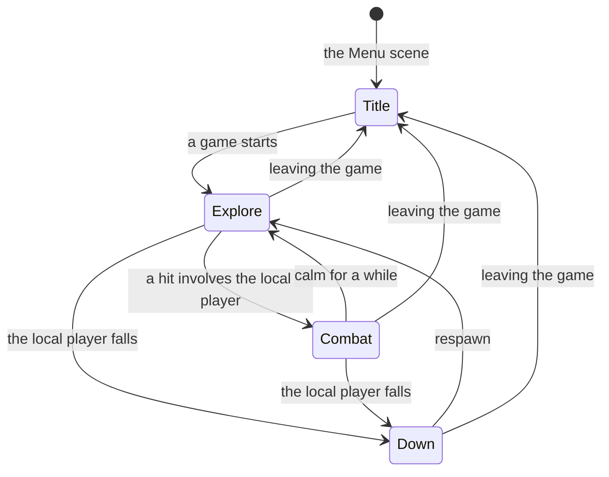
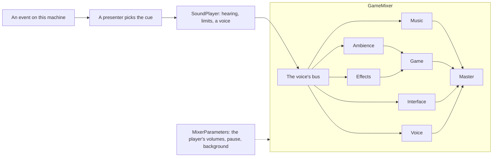
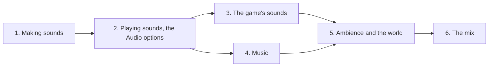

# Audio

Plan for the game's audio: the systems that play every kind of sound the game will use, the Audio options that adjust them, and the tools the sounds come from. It builds the systems and proves each one with placeholder sounds; the real sounds and music arrive with the features that need them ([PreAlpha.md](Milestones/PreAlpha.md)'s phases, its Phase 8 for that build) and later.

[Architecture.md](Architecture.md) describes what exists. Every rule in [Multiplayer.md](Multiplayer.md#rules-for-new-code-starting-now) applies. [DesignSystem.md](DesignSystem.md) shapes this file; its accessibility baseline gains the audio rows and its feedback pattern a sound channel. This plan runs before PreAlpha.md's Phase 1 ([Roadmap.md](Roadmap.md)). Tick off the phase checklist as steps land.

## Where we start

- **No audio.** The project has no `AudioSource`, clip, mixer or audio asset. The only audio component is the `AudioListener` on the Main scene's camera, and `SceneFlowPlayModeTests` checks that it is the only one.
- **Unity's defaults.** `ProjectSettings/AudioManager.asset`: stereo, 32 real voices and 512 virtual, a DSP buffer of 1024 samples (Best performance).
- **Places left for it.**
  - DesignSystem.md lists audio as a non-goal until the project has some, and says its feedback pattern gains a sound channel then.
  - KeyBindings.md left room for audio options in `settings.json` and the options screen. UiRevamp.md left audio settings out.
  - WorldStreaming.md decided that ambience and music follow the local camera's world.
  - PreAlpha.md's Sound section sketched recipes that write `.wav` assets, a mixer, `SoundCue` and `SoundPlayer`, and left open whether the art rule covers sound. Settled below.
- **Events to hang sounds on.** Presentation already reacts to events that every machine raises:
  - combat: `CombatEvents` (`DamageApplied`, `HealApplied`, `StatusBlocked`), `Health` (`Damaged`, `Died`, `Restored`), `DamageReceiver.ImmuneHit`;
  - attacks and casts: `MeleeDamageDealer` (a mob's `AttackStarted`, its telegraph, and `AttackContacted`), `PlayerWeaponController` (`AttackStarted`, `AttackContacted`), `PlayerAbilities` (`CastStarted`, `CastCompleted`, their remote counterparts, `CastFailed`), `ProjectileService`;
  - the world and the UI: `WaystoneNotices.Discovered`, `NoticePresenter`, `ChatLog.Added`, `GameFlow`'s transitions, `UISelection` and `MenuStack`.
  - `HitFeedbackPresenter` and `EffectPool` show the pattern this plan follows: a presenter on an event, a pool, nothing networked.
- **What the world knows.**
  - Each generated chunk holds its regions' weights every 4 cells (`ChunkSky`, Lighting.md's Phase 8), and `RegionSkies` blends them around a place.
  - `DayClock` gives the time of day.
  - Every cell's ground is a terrain material ([TerrainTypes.md](TerrainTypes.md)).
  - Light props (campfires, torches, braziers, lamp posts) carry a `PropLight` that `PropLighting` lights at night, and the prop writer makes their prefabs.
- **Animation markers.** An action's clip marks its contact or release frame: `CharacterAnimationClip.ContactFrame` from the baker, `contact` cel data in an Aseprite file. A gait marks nothing ([AsepriteCharacters.md](AsepriteCharacters.md)).
- **Time.** Offline, the in-game menu freezes game time (`TimeFreeze`, `Time.timeScale` 0). Online nothing pauses.
- **Settings.** `settings.json` through `UserSettings`: each preference is saved at once, and a file from before reads at the defaults, so the format version stays 1. The options screen has three categories, Accessibility, Interface and Controls (UiRevamp.md's Phase 8).

## Terms

- **Clip**: an audio file imported as an `AudioClip`.
- **Cue**: a `SoundCue` asset, the thing code plays: one or more clips, a bus, volume and pitch ranges, how it is heard, and its limits. Content names cues, never clips.
- **Bus**: where a cue's sound goes and which volume governs it: `Music`, `Ambience`, `Effects`, `Interface` or `Voice` (append-only). Each is a group of the mixer under `Master`.
- **Voice**: one `AudioSource` playing one clip. Voices are pooled per bus.
- **One-shot**, **loop**: a cue played once, or until it is stopped.
- **Listener point**: the place this machine hears from, the local camera's centre on the ground.
- **Hearing**: how a cue is heard.
  - `Everywhere`: from no place in particular, at its own volume. Interface sounds and music are heard this way.
  - `Positional`: from a place in a world, quieter with distance and panned toward its side. A positional cue is never started beyond the hearing range.
- **Emitter**: something in a world that plays a loop while it is in hearing, such as a campfire's crackle.
- **Bed**: an ambience loop heard everywhere, its volume weighted by how much of its region or ground lies around the listener point.
- **Track**: a `MusicTrack`: an intro, a loop, and optional layers in time with the loop. **Stinger**: a short piece of music played over the track, which dips while it plays.
- **Surface**: what a footstep sounds like on a terrain material: grass, dirt, stone, wood, water, snow, ice, sand.
- **Recipe**: a `SoundRecipe` asset that the editor renders into a clip. **Licensed pack**: a third-party set of sounds licensed for use in a game, kept with its licence.
- **Placeholder**: a cue whose sound stands in until the real one lands, flagged on the cue so the generated table can list every placeholder left.

## Goals

- **Every kind of audio has a home.** Interface sounds, effects, footsteps, ambience, emitters, music and voices each have a bus, a player and a way in from data. A feature adds sounds by naming cues on its assets, with no new playback code (Kinds of audio, below).
- **The player sets the mix.** Master, Music, Ambience, Effects and Interface volumes, Mono audio and Mute in background, in an Audio category of the options screen, each saved at once.
- **Readable, not noisy.**
  - Every attack's windup is heard as well as seen.
  - Ten hits in one frame play as one sound.
  - Far sounds are quieter and panned toward their side, and sounds out of hearing never start.
- **Co-op first.** Every machine hears the same moments, from events it already has. Nothing is sent over the network for sound.
- **Made in the project, or licensed.** Sounds come from recipes in the editor or from packs licensed for a game, each pack kept with its licence.
- **Cheap.** No allocation per sound once warm, no per-frame lookups, a fixed voice budget.
- **Tested.** Every decision (which cue, how loud, which side, which voice) is made in a plain class and tested with fakes. The mixer, the settings and the event bindings are tested in PlayMode on the in-process host and client.

## Non-goals (for now)

- **The real sounds and music.** Placeholders only. The real ones come with their features and in PreAlpha.md's Phase 8.
- **Speech, subtitles and voice chat.** The `Voice` bus is in the mixer for PreAlpha.md's dialogue (its Phase 6) and later speech. Its volume row arrives with its first sound.
- **Captions for sounds.** No sound carries information alone (Decisions), so none needs a caption yet.
- **An output device picker, or surround.** Sound goes to the system's default device in stereo, or in mono by choice.
- **Occlusion, reverb from geometry, Doppler.** Walls and cliffs do not muffle anything. Only a world's acoustics do (Phase 5, Should).
- **Synthesis at runtime.** Recipes render clips in the editor, and the game plays clips.
- **Middleware** such as FMOD or Wwise (Tools considered).
- **Sound from outside services**, such as UnityMCP's `generate_audio`.
- **Weather's sounds** (Roadmap.md's Weather) and **music recipes** (Later).

## Decisions

| Topic | Decision |
|---|---|
| Sources | **Settled by the user on 2026-11-13:** recipes where they sound good, and packs licensed for a game for what synthesis does poorly. **Where:** a licensed pack lives in `Assets/Audio/Licensed/<Pack>`, with a `LICENSE.txt` and a `SOURCE.txt` (where it came from, which licence, what attribution it asks for). **Which licences:** CC0, or any licence that allows use and redistribution in a game, commercial use included. A licence that asks for attribution gets a line in the credits (Open questions). **Rules:** CLAUDE.md's art rule and DesignSystem.md's fifth principle cover sounds from this plan on. |
| Scope | **Settled by the user on 2026-11-13:** the systems, the settings and placeholders. |
| Engine | Unity's built-in audio: `AudioSource`, `AudioMixer`, `AudioSettings`. |
| Mixer | **Asset:** one `GameMixer`. `Master` holds `Music`, `Game` (which holds `Ambience` and `Effects`), `Interface` and `Voice`. **Parameters:** each group's volume and the `Game` and `Music` low-pass cutoffs are exposed parameters. Only `MixerParameters` sets them, through `AudioMixer.SetFloat`. **No snapshots:** once `SetFloat` sets a parameter, snapshots no longer drive it (Unity's docs), and one class deciding every parameter can be tested. **Limiter:** one on `Master` keeps stacked sounds from clipping. **Check:** Phase 2 confirms that `SetFloat` in play mode leaves the asset unchanged, as CLAUDE.md asks of runtime code. If it changes the asset, the volumes move onto the voices instead. |
| Volumes | Master and each bus from 0 to 100 in steps of 5. 0 is silence (-80 dB). Phase 2 settles by ear the curve from a step to decibels (candidates: amplitude squared, or decibels linear over 50 dB) and the defaults. |
| Hearing | **Our own, in 2D:** voices play with `spatialBlend` 0, and `SoundSpace` places them. **Gain:** from a positional voice's distance to the listener point, full within the inner radius and falling to silence at the hearing range. **Pan:** from its side, its x offset over the pan width, held within ±0.6 (a candidate) so nothing plays in one ear only. **Why not Unity's 3D sound:** it pans by angle, so a sound one step to the left plays hard left, and the camera stands 10 units off the ground. **Out of hearing:** a one-shot there is never started, and a loop there stops and starts again once back in range. |
| Listener point | The local camera's centre (`CameraFollow2D` follows the local player), one per machine. A world at its own origin lies far beyond hearing of every other, so only the local camera's world is heard, as WorldStreaming.md decided. A test holds this. |
| Cues | **Our own `SoundCue`**, not Unity's Audio Random Container: a cue carries its bus, its hearing, its limits and its priority, which the container has no fields for, and picks its clip through the sound player's own random source. **Fields:** clips (one at random, never the same one twice running when there are more), volume with a random spread, a pitch range, hearing, max instances, a min interval, priority, loop, placeholder. |
| Limits | **Per cue:** at most a number of instances at once (4 by default) and a min interval between starts (0.05 s), so ten hits in a frame play as one. **Per bus:** a voice budget from `SoundSettings`, the budgets together within the real voices. **Over budget:** a new start takes the voice of lowest priority, then the quietest at the listener point, or is dropped when it would be that voice itself. |
| Randomness | The sound player has its own random source and never draws from the `IRandom` that gameplay draws from, so sounds never change gameplay's numbers. |
| Time and pause | **Clock:** voices play in real time. **Offline pause** (`TimeFreeze`): `AudioListener.pause` pauses the effects. Music, ambience and interface voices ignore the pause (`ignoreListenerPause`); the `Game` low-pass muffles the ambience and the music dips under its own low-pass. **Online:** nothing pauses. **Local player down:** the `Game` group is muffled until respawn (Could). |
| Mono | **Setting:** Mono audio sets the audio configuration's speaker mode to Mono (`AudioSettings.Reset`), which puts both channels in each ear. **Restart:** Reset stops what is playing (Phase 2 checks), so the music and ambience players restart their loops where they were, and one-shots in flight are let go. |
| Device change | When `AudioSettings.OnAudioConfigurationChanged` reports a device change, the sound resets to the new default device, keeping the speaker mode, and restarts the loops, so plugging in headphones keeps the sound going. |
| In background | Mute in background mutes `Master` while the window is not focused (`Application.focusChanged`). The game keeps running either way. |
| Sound alone | No sound carries information alone (Game Accessibility Guidelines): every cue comes with something shown, such as a windup's telegraph, a hit's flash or a notice's line. A spec that adds a cue names what shows with it. |
| Import | By the folder of the clip's kind, set on import by `AudioImportRules` and checked by `AudioImportTests` (the table below). |
| Generated clips | 16-bit PCM WAV, mono, 44.1 kHz, peaking at -1 dBFS, written by `SoundRecipeWriter` under `Assets/Audio/Generated/<Kind>`. Regenerating writes identical bytes. A loop's ends are crossfaded into each other so it loops without a click. |
| Settings | Local, in `settings.json` through `UserSettings`, never replicated. Volumes are stored per bus by name, so a bus added later reads at its default. |
| Assemblies | **Core:** buses, cues, tracks, the mixer's parameters, the sound and music players, interface sounds, the audio device. Core already holds `UISelection`, `MenuStack`, the camera and `WorldDefinition`, which these need. **Gameplay:** what decides game sounds: combat, units, footsteps, the music director, ambience, emitters. **Editor:** recipes, the synth, import rules, tables. **DevTools:** the audio panel. |

Import settings by kind, each kind a folder (`Assets/Audio/Generated/<Kind>`, `Assets/Audio/Licensed/<Pack>/<Kind>`):

| Kind | Load type | Format | Channels | Other |
|---|---|---|---|---|
| `Effects`, `Interface` | Decompress On Load | PCM | Force To Mono | Preload Audio Data |
| `Voice` | Compressed In Memory | Vorbis | Force To Mono | Load In Background |
| `Ambience` | Compressed In Memory | Vorbis | Stereo kept | Load In Background |
| `Music` | Streaming | Vorbis | Stereo kept | Load In Background |

## Behaviour

### Kinds of audio

Every kind of audio the game uses or plans for, where it plays and when it gets a placeholder. Real sounds come later.

| Kind | Sounds | Bus | Hearing | Raised by | Phase |
|---|---|---|---|---|---|
| Menus | Move, confirm, back, toggle, value step, denied (a disabled control, or a refused action) | Interface | Everywhere | `UISelection`, `MenuStack`, the rows | 2 |
| Volume sample | A short sound on the bus a volume row changes, at the new level | That bus | Everywhere | The options screen | 2 |
| HUD feedback | A cast refused (the failure line's words) | Interface | Everywhere | `PlayerAbilities.CastFailed`, local player only | 3 |
| Notices and chat | A chime per notice; another player's message; the party's lines | Interface | Everywhere | `NoticePresenter`, `ChatLog` | 3 |
| Weapons | A swing at the contact frame; a projectile's launch and its impact | Effects | Positional | `PlayerWeaponController`, `ProjectileService` | 3 |
| Hits | An impact per damage type; blocked and immune; a heal; a status taking hold and its periodic tick | Effects | Positional | `CombatEvents`, `DamageReceiver` | 3 |
| Abilities | A cast's gather, its release, a channel's loop | Effects | Positional | `PlayerAbilities` (local and remote) | 3 |
| Mobs | The windup (the telegraph, heard), the attack, hurt, death; aggro (Could) | Effects | Positional | `MeleeDamageDealer`, `Health` | 3 |
| Players | Hurt, death, respawn | Effects | Positional | `Health` | 3 |
| Footsteps | A step at each footfall frame, by the surface underfoot and the body | Effects | Positional | `CharacterVisuals.Footfall` | 3 |
| World moments | A waystone discovered (a stinger), leaving and arriving on a trip | Music, Effects | Everywhere | `WaystoneNotices`, `GameFlow` | 3, 4 |
| Music | The title, a world's or region's exploration, night, combat, down, stingers | Music | Everywhere | `MusicDirector`, the Menu scope | 4 |
| Region beds | A region's day bed and night bed, by its weight around the listener | Ambience | Everywhere | `AmbienceDirector` | 5 |
| Ground beds | Surf by the ocean, lapping by shallows, rumbling by lava, wind over snow, rustling in tall grass | Ambience | Everywhere | `AmbienceDirector` | 5 |
| Emitters | A campfire's, torch's or brazier's crackle while it burns | Ambience | Positional | `SoundEmitter` | 5 |
| Acoustics | A world's room: dry outdoors, a reverb in an interior (Should) | Game | — | `WorldAudio` | 5 |
| Dialogue | A voice blip per character of dialogue | Voice | Everywhere | PreAlpha.md's Phase 6 | Later |
| Weather, speech, bosses | Rain, wind, speech, a boss's music | — | — | Their own plans | Later |

The local player's own sounds are positional like anyone's. They play at the listener point, so they sound centred and at full volume.

### The Audio options

A fourth category on the options screen's rail, Audio, placed between Interface and Controls (Claude's call; Phase 2's previews confirm it). Like every row, each change applies and saves at once, and each row shows Reset only while it differs from its default. The footer's reset puts back the whole category in one write.

| Row | Values | Default | Effect |
|---|---|---|---|
| Master volume | 0 to 100, steps of 5 | Phase 2 | Everything |
| Music | 0 to 100 | Phase 2 | The `Music` bus |
| Ambience | 0 to 100 | Phase 2 | The `Ambience` bus |
| Effects | 0 to 100 | Phase 2 | The `Effects` bus |
| Interface | 0 to 100 | Phase 2 | The `Interface` bus |
| Mono audio | Off, On | Off | Both ears hear everything: for hearing on one side, or one earbud |
| Mute in background | Off, On | Phase 2 | Silent while the game's window is not focused |

- **A volume row** shows a bar and its number. Left and Right step it by 5, a click on the bar sets it, and every change plays the bus's sample at the new level. Phase 2's previews settle its look.
- **Descriptions** on the description line say what each row governs ("Footsteps, hits, spells and mobs" for Effects).
- **A Voices row** joins the category when the first dialogue sound lands.

### Hearing a fight

A Weasel attacks the local player while a second player fights nearby:

1. The Weasel's windup starts: its windup cue plays from where it stands, as its telegraph shows.
2. At contact, its attack cue plays. If the hit lands, the impact of its damage type plays where the flash shows, and the player's hurt cue plays.
3. The player's sword swings: the swing cue at the contact frame, then the impact.
4. The second player's swings, casts and hits play from their side, quieter with distance. Out of hearing they never start.
5. Each unit's footsteps play at its footfall frames, by the ground underfoot.
6. The Weasel dies: its death cue plays with the puff.

The music moves to combat at the first hit involving the local player, and back to exploring after a calm (Phase 4 settles how long).

### Music

- **Explore's track:**
  - the region weighing most at the listener point, held for a few seconds before it changes, so walking along a border does not flip it;
  - otherwise the world's own (`WorldAudio`);
  - at night, the track's night layer where it has one.
- **Transitions:** tracks crossfade (about 2 s). Combat comes in quickly and leaves slowly. Down dips the track and muffles it.
- **Stingers** (a waystone discovered; later a level up or a quest done) play over the track, which dips under them.
- **Trips:** the fader's fade-out lowers the world's music and ambience with the picture, and the new world's fade in with it.

### Ambience

- **Region beds:** a day bed and a night bed per region, crossfaded by `DayClock`'s daylight, each weighted by its region's share around the listener point.
- **Ground beds:** weighted by how much of their ground lies around the listener point. The ground is sampled on a coarse ring, a few samples a frame, never all at once.
- **Emitters:** each plays its loop from its place while it is in hearing and its light burns. The nearest audible emitters get voices, within the `Ambience` budget.
- **Worlds:** a world without regions (the test worlds, interiors) plays its own bed from `WorldAudio`.

### Pausing, menus and the title

- **Offline, the in-game menu pauses:** effects stop where they are, ambience muffles, the music dips, and the menu's own sounds play.
- **Online, nothing pauses:** the game's sounds go on around the menu.
- **The main menu** plays the title track. Starting a game crossfades it into the world's track as the fader clears.

## Architecture

Sketched here and settled in each phase, which records what it built in Architecture.md.

### Core (`Assets/Scripts/Core/Audio`, Main scope)

- `SoundBus`: the enum, append-only.
- `SoundCue`, `MusicTrack` and `WorldAudio`: read-only ScriptableObjects with a `Create` for tests.
  - `WorldAudio` is the world's default track and bed, and its acoustics. `WorldDefinition` gains a reference to it.
- `SoundSettings` (`Assets/Data/Audio/SoundSettings.asset`, inspector on `MainLifetimeScope`): the mixer and its parameters' names, the voices per bus, the hearing radii and pan width, the volumes' step, curve and defaults, the fade lengths, the sample cue per bus, and the interface cues.
- `AudioMix`: plain. It turns volumes and states (paused, in background, down) into the mixer's parameter values.
- `MixerParameters`: entry point. It applies `AudioMix` on settings changes and state changes.
- `SoundSpace`: plain and static. Gain and pan from a position and the listener point.
- `VoiceLimiter`: plain. Instances, intervals, budgets and which voice to take.
- `SoundPlayer`: entry point (`ITickable` for the loops' positions).
  - `Play(cue)`, `Play(cue, world position)`, and `StartLoop(cue, anchor)` returning a handle to stop it.
  - An internal `Played` event for tests.
  - It plays through `ISoundVoices`. `AudioSourceVoices` implements it with the pool of `AudioSource`s, made at start under one object in the Main scene from `SoundSettings`, so the scene file does not change.
- `IListenerPoint`: implemented by `CameraListenerPoint`, the Main camera's position on the ground.
- `MusicPlayer`: entry point.
  - Two decks crossfading on unscaled time.
  - The intro scheduled into its loop with `PlayScheduled`, so there is no gap.
  - Layers started on the same DSP time.
  - Stingers, with the track dipping under them.
- `AudioDevice`: entry point. Mono, device changes and focus, restarting the loops after a reset. It sits behind a seam for focus and the configuration, so tests do not depend on the editor's focus.
- `InterfaceSounds`: entry point on `UISelection` and `MenuStack`. It plays a move only for a selection the player moved, not one a screen made as it opened.

### Gameplay (`Assets/Scripts/Audio`)

- **Cues on content:**
  - `PlayerWeapon` gains a swing and a launch;
  - `AbilityDefinition` gains a gather, a release and a channel loop;
  - `MobConfig` gains a windup, an attack, hurt, death and its footstep body;
  - the player's prefab gets the same through `UnitSounds`.
- `CombatSounds` (`Assets/Data/Audio/CombatSounds.asset`): an impact per damage type, plus blocked, immune, heal, a status taking hold and a tick. `CombatSoundPresenter` plays them from `CombatEvents`.
- `UnitSounds`: on unit roots (the player and the Weasel). It subscribes in `OnEnable` to its own `Health`, attacks, casts and `CharacterVisuals.Footfall`, and unsubscribes in `OnDisable`.
- `SurfaceSounds`: a footstep cue per surface and body, and a surface per terrain material. `GroundQuery` gives the material on top at a place.
- `MusicDirector`: Gameplay entry point, taking combat, down, region and night from local state. `MenuMusic` in the Menu scope asks for the title track.
- `AmbienceDirector`: entry point. Region beds from `RegionAudio` assets, ground beds from `GroundBeds`, daylight from `DayClock`.
- `SoundEmitter`: on a prop, a loop cue that follows its light's burning. `ChunkSoundEmitters`, a chunk entry point, hands a chunk's emitters to the Gameplay-scope `SoundEmitters` and takes them back, as `ChunkPropLights` does for lights. The prop writer adds the emitter from the light prop's recipe, so regenerating keeps it.
- `WorldSoundPresenter`: waystones, trips, notices, chat.

### Editor (`Assets/Editor/Audio`)

- `SoundSynth`: plain and deterministic.
  - Square, saw, triangle, sine and noise oscillators.
  - An envelope (attack, sustain, punch, decay), a pitch slide with its acceleration, vibrato, an arpeggio step, a duty sweep.
  - Low-pass and high-pass filters with their sweeps, a repeat, and layers mixed into one sound.
  - Normalised to its peak, and seeded.
- `SoundRecipe` (`Assets/Settings/Audio/Recipes`) and `SoundRecipeWriter`. `WavFile` writes and reads 16-bit PCM.
- The recipe's inspector: Generate, Play, Mutate, and starting points (blip, hit, swing, cast, step, chime, death, whoosh, a noise bed).
- `SoundCue`'s inspector: Play, a clip at a time or picked as the game picks them.
- `AudioImportRules`: an `AssetPostprocessor` setting a clip's import settings by its kind's folder.
- `DesignTables` writes `Docs/Generated/Sounds.md`, and `AudioLevels` reads a source file's peak and loudness for it.

### DevTools

- The Audio panel: voices in use per bus, plays and steals per cue, a mute per bus.

## Networking

| What | Decided by | Sent to |
|---|---|---|
| Every sound | Each machine, from events it already raises | Nothing |
| Music and ambience | Each machine, from its local camera's world, region, day clock, and its own player's combat and death | Nothing |
| Volumes and audio preferences | Each machine | Nothing (`settings.json`) |

- **A missing event:** if an event a sound needs is not raised on clients, the phase adds a presentation event from state the client already receives. A sound never gets an RPC of its own.
- **Late join:** a late joiner hears the loops its own state calls for. One-shots from before it joined are not replayed.

## Removals and migrations

- **`UserSettingsData`** gains `volumes` (a bus's name and its percent, per bus set), `monoAudio` and `muteInBackground`. A file from before reads every bus at its default and both toggles off, so the format version stays 1. A bus name this build does not know is kept but not used. `UserSettings` gains `ResetAudio()`.
- **`OptionsMenuController.Category`** gains `Audio`, and the rail gains a fourth item.
- **AsepriteCharacters.md's rule** "a gait has no marker" changes: a gait may mark its footfall frames with `step` cel data (Phase 3). The baker marks a gait's footfalls where each foot plants, and the character sets are rebaked.
- **`ProjectSettings/AudioManager.asset`**: the DSP buffer and the real voices (Phase 2).
- **Light props' prefabs** gain a `SoundEmitter`, written by the prop writer (Phase 5).
- **`WorldDefinition`** gains `WorldAudio`, and the four worlds get one each (Phase 4).
- **CLAUDE.md** names this plan, and its art rule and DesignSystem.md's fifth principle cover sounds (done as this plan was adopted).

## Phases

Each phase ships on its own, keeps the game playable offline and hosted, and comes with tests. Where a sound or a look can change, the phase settles it on previews first, signed off before its tests and docs. For sounds the previews are WAV files in the gitignored `Recordings/Audio/Phase<n>`, for the user to listen to. An open question is settled with the user at the start of the phase named for it. Each phase updates Architecture.md, Roadmap.md and DesignSystem.md's vocabulary as it lands.

### Phase 1: making sounds

- [ ] Previews: the placeholder kit's WAVs, signed off.
- [ ] `SoundSynth`, `WavFile`, `SoundRecipe`, `SoundRecipeWriter` and the recipe's inspector.
- [ ] Loops: a recipe with a loop length crossfades its ends.
- [ ] `AudioImportRules` and the kind folders under `Assets/Audio`.
- [ ] Licensed packs: the folder, its `LICENSE.txt` and `SOURCE.txt`, and the check.
- [ ] `SoundBus`, `SoundCue` and its inspector's Play.
- [ ] The placeholder kit, about a dozen recipes and their cues:
  - [ ] the interface: move, confirm, back, toggle, denied;
  - [ ] effects: swing, impact, magic impact, gather, release, step, hurt, death, chime, whoosh;
  - [ ] a noise bed for ambience.
- [ ] `Docs/Generated/Sounds.md`: every cue, its bus, clips, length, peak, hearing, limits and whether it is a placeholder.
- [ ] EditMode:
  - [ ] the synth's determinism and each block's shape (the envelope's length, the slide's direction, the peak, a loop's seam);
  - [ ] the WAV header and samples;
  - [ ] `AudioImportTests`: every clip has its kind's settings;
  - [ ] `AudioSourcesTests`: every clip is generated by a recipe or sits in a licensed pack beside its licence;
  - [ ] `ContentTests`: cues have clips of their bus's kind and ranges that make sense;
  - [ ] the table is up to date.

### Phase 2: playing sounds, the Audio options

- [ ] Open questions settled:
  - [ ] by ear: the volume curve, the defaults, the DSP buffer, Mute in background's default;
  - [ ] on previews: the Audio category, its place on the rail, the volume row.
- [ ] `GameMixer`:
  - [ ] its groups, exposed parameters and limiter;
  - [ ] confirmed that `SetFloat` leaves the asset unchanged.
- [ ] `SoundSettings`, `AudioMix` and `MixerParameters`.
- [ ] `SoundPlayer`:
  - [ ] `AudioSourceVoices` and `ISoundVoices`;
  - [ ] `VoiceLimiter` and `SoundSpace`, with `CameraListenerPoint`;
  - [ ] its own random source;
  - [ ] no allocation once warm.
- [ ] `UserSettings`: volumes per bus, Mono audio, Mute in background, `ResetAudio`.
- [ ] The options screen's Audio category:
  - [ ] its rows and descriptions;
  - [ ] the volume row component (`RowVolume`), its sample on change;
  - [ ] the category's reset;
  - [ ] DesignSystem.md's Components.
- [ ] `AudioDevice`: Mono through the speaker mode, device changes, focus. The loops restart after a reset.
- [ ] Offline pause: effects paused, ambience and music muffled, interface sounds playing.
- [ ] `InterfaceSounds` on every screen: the main menu, the in-game menu, options, the Character screen, Play together, Saved games, Welcome.
- [ ] `AudioManager`: the DSP buffer and the real voices.
- [ ] Should: the Audio dev panel.
- [ ] EditMode:
  - [ ] `AudioMix` (the curve, 0 as silence, each state);
  - [ ] `SoundSpace` (gain, pan held within its limit, out of hearing);
  - [ ] `VoiceLimiter` (instances, intervals, budgets, which voice is taken);
  - [ ] `SoundPlayer` with fake voices (a clip never twice running, its own random, no allocation once warm, loops after a reset);
  - [ ] `UserSettings` (a file from before at the defaults, an unknown bus kept, the reset in one write);
  - [ ] `OptionsMenuControllerTests` and `OptionsMenuLayoutTests` (the Audio category at every display size).
- [ ] PlayMode:
  - [ ] the saved volumes on the mixer after boot;
  - [ ] a row's change on the mixer and in the file;
  - [ ] the offline pause;
  - [ ] the menus' sounds.

### Phase 3: the game's sounds

- [ ] Open questions settled by ear in the Overworld: the hearing radii and the pan width; whose footsteps play and how loud the local player's are.
- [ ] Cues on content:
  - [ ] on weapons, abilities and `MobConfig`;
  - [ ] `CombatSounds`;
  - [ ] `UnitSounds` on the player and the Weasel;
  - [ ] placeholders throughout.
- [ ] Presenters on the events in Kinds of audio, checked on a client one by one. A missing event is added from replicated state, never an RPC.
- [ ] Footfalls:
  - [ ] the baker's step markers and Aseprite's `step` cel data;
  - [ ] `CharacterVisuals.Footfall`;
  - [ ] `SurfaceSounds` and `GroundQuery`;
  - [ ] only units in hearing step.
- [ ] Notices, the chat's lines, the cast refused, a waystone discovered, trips.
- [ ] `ContentTests`: every weapon, ability, mob, damage type, surface and terrain material names its cues.
- [ ] DesignSystem.md's feedback pattern gains its sound channel.
- [ ] EditMode:
  - [ ] each presenter's cue for its event;
  - [ ] the footfall markers (two a gait cycle, where the feet plant);
  - [ ] the surface of each terrain material;
  - [ ] the hearing check before a footstep.
- [ ] PlayMode:
  - [ ] a hit the host resolves plays its impact on the client;
  - [ ] a client's swing and cast play on the host;
  - [ ] a mob's windup plays on a client near it and not on one in another world.

### Phase 4: music

- [ ] Open questions settled: the placeholder tracks' source; when the music counts as combat and how long the calm lasts.
- [ ] `MusicTrack` and `MusicPlayer` (decks, intro into loop, layers, stingers, dips). Could: changes on the bar.
- [ ] `MusicDirector` and `MenuMusic`: title, explore, night, combat, down; the trips and the fader.
- [ ] `WorldAudio` on each world.
- [ ] Placeholders: a title, an exploring and a combat track, a stinger.
- [ ] EditMode:
  - [ ] the director's states on a `ManualClock`: combat in and out, the region held at a border, night;
  - [ ] the decks' crossfade;
  - [ ] a stinger's dip.
- [ ] PlayMode:
  - [ ] the title track in the menu, crossfading into the world's as a game starts and back on leaving;
  - [ ] a trip moving the music to the new world's.

### Phase 5: ambience and the world

- [ ] Open question settled: how audio learns the region.
- [ ] `RegionAudio` per region, with a day and a night bed and its track; the regions' weights around the listener point.
- [ ] Ground beds from `GroundBeds`, sampled on a ring a few samples a frame.
- [ ] `AmbienceDirector` blending the beds by weight and daylight, and crossfading on trips.
- [ ] `SoundEmitter` on the light props, written by the prop writer, and `ChunkSoundEmitters` and `SoundEmitters`.
- [ ] Should: a world's acoustics, a reverb on `Game` for an interior.
- [ ] Placeholders: a bed per region and ground kind; the light props' crackle.
- [ ] EditMode:
  - [ ] the beds' weights from fake regions and ground;
  - [ ] the day and night blend;
  - [ ] the nearest emitters getting the voices.
- [ ] PlayMode: a trip swapping the beds; a campfire heard while it burns and in hearing, and not otherwise.

### Phase 6: the mix

- [ ] Loudness rules per bus in `ContentTests`: every clip peaks at -1 dBFS or under, and each bus's cues fall within its loudness range.
- [ ] A mix pass by ear with the user: the defaults, each bus at its level in a fight, the menus, a trip, the offline pause.
- [ ] A player build plays the mix and reads the settings.
- [ ] DesignSystem.md:
  - [ ] the accessibility rows: separate volumes, mono, nothing by sound alone;
  - [ ] the preferences.
- [ ] The full EditMode and PlayMode suites; merged into `main`.

### Later

- The real sounds and music, from PreAlpha.md's Phase 8 on.
- Dialogue's voice blips (PreAlpha.md's Phase 6) and the Voices row; speech and its subtitles.
- Music recipes: a step sequencer rendering note patterns through the synth.
- Weather's sounds (Roadmap.md's Weather); interiors' room tones with buildings.
- Occlusion by walls and cliffs.
- A dynamic range option (night mode); a low-health warning.
- Captions, if a sound ever has to carry information alone.
- Bosses' music.

## Testing

- **EditMode, plain classes with fakes:** the synth and WAV files; `AudioMix`, `SoundSpace`, `VoiceLimiter`; `SoundPlayer` over fake voices; `UserSettings`; the music director on a `ManualClock`; the ambience weights; the footfall markers; the presenters' cues.
  - No allocation once warm, checked with the `GC.Alloc` recorder: `GC.GetAllocatedBytes` reads 0 in the editor.
- **EditMode, assets:**
  - `AudioImportTests` and `AudioSourcesTests`;
  - `ContentTests` for cues, tracks and every content kind's cues;
  - the loudness rules;
  - `Docs/Generated/Sounds.md` up to date.
- **PlayMode, on the in-process host and client:**
  - the mixer from the settings;
  - each kind of game sound heard on the machine that did not cause it;
  - a world beyond hearing;
  - the pause, the menus, the music's states and the trips.
  - Tests watch `SoundPlayer.Played`, not the speakers.
- **By ear:** each phase's previews, and Phase 6's mix pass.

## Open questions

- **The volume curve, step and defaults; the DSP buffer** (512 or 1024 samples; latency against CPU); **Mute in background's default** (Phase 2, by ear).
- **The volume row's look and the Audio category's place on the rail** (Phase 2, on previews).
- **The hearing radii and pan width; whose footsteps play** (Phase 3, by ear).
- **The placeholder music:** a recipe's sounds or a CC0 track (Phase 4).
- **When music counts as combat**, and how long the calm lasts before it leaves (Phase 4).
- **How audio learns the region** (Phase 5): grow `ChunkSky` into a region map that PreAlpha.md's region names share too, or key each region's audio by its sky asset.
- **Credits** for a pack that asks for attribution: the release readme only, or a Credits screen too (with the first such pack; PreAlpha.md's Phase 9 writes the readme).

## Tools considered

- **FMOD and Wwise.** Both have free tiers for small projects and better tools for adaptive music. Not used: each brings a second authoring tool and native plugins, and UnityMCP has no hold on it. The game's needs fit Unity's mixer. Revisit if music outgrows layers and crossfades.
- **Unity's Audio Random Container.** It randomises clips, pitch and volume, but has no bus, hearing, limits or priority, and draws from Unity's random. Our `SoundCue` does all of these.
- **Unity's 3D sound.** It pans by angle and measures distance from a camera 10 units off the ground (Decisions, Hearing).
- **sfxr, Bfxr, jsfxr, ChipTone.** The synth follows their blocks, but the sounds stay recipes in the project, regenerated like the art, rather than files exported from outside tools.
