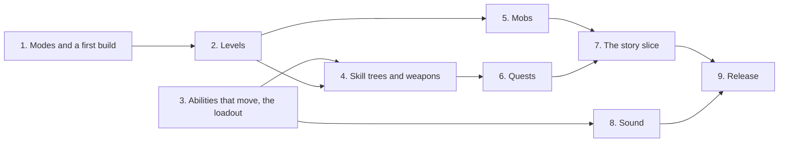

# Pre-alpha

Plan for the first pre-alpha build, playable by 2026-12-31: two ways to play, a short story slice built from quests and Free play, a PvE grind on the open island with everything unlocked; levels and skill trees in place of classes; abilities that move; more mobs; sound; and a release that a tester can install, play solo and play in co-op over a virtual LAN.

The story is not written yet. This plan builds what the story needs (quests, NPCs, dialogue, rewards) and fills the slice with placeholder quests that exercise all of it, to be rewritten once the story exists. The skill trees get the same treatment: the system is built in full and its content stays small until the trees are designed.

[Architecture.md](../Architecture.md) describes what exists. [UiRevamp.md](../UiRevamp.md) rebuilds the screens this build shows, on its own branch, at the same time (Working beside the UI revamp). Every rule in [Multiplayer.md](../Multiplayer.md#rules-for-new-code-starting-now) applies. [Roadmap.md](../Roadmap.md)'s Next lists the features this needs and which of them get a plan of their own. Tick off the phase checklist as steps land.

A milestone gathers many features toward a date. Where a phase grows into a system of its own (quests, skill trees, sound), it gets a feature plan in `Docs/` beside the others, linked from its phase here; this file keeps the build's scope, its dates and its cuts.

## Where we start

- **No game loop.** There is no XP, level, item, reward, quest, NPC, dialogue or ending. A player can walk, fight and die, and nothing else changes.
- **One mob.** The Weasel: 100 health, a 10 Physical melee hit on a telegraphed timeline ([Units.md](../Generated/Units.md)), with a single attack (`MobNetworkSync` relays attack 0 only). 48 of its spawn points stand in the Overworld, 28 in the regions and 20 in the wilds. A killed mob comes back 300 s of game time later (`Mob_Default`), and only as its chunk loads again.
- **The player.** 100 health, 5 units/s, no stats beyond its health and combat profile. It respawns 3 s after death at its nearest discovered waystone, with no penalty.
- **Abilities.** Ten, all named "Blank …" ([Abilities.md](../Generated/Abilities.md)): Q W E R come from `Class_Placeholder` (Bolt, Leap, Mend, Smite) and 1 and 2 from the weapon. Six have effects. Leap, Lunge, Charge and Roll play their cast without moving the caster (Architecture.md's Known gaps: no dashes or the colliders they need). Abilities have no catalog: the wire names one by its slot and the weapon held.
- **Weapons.** Sword, Greatsword and Longbow ([Weapons.md](../Generated/Weapons.md)). Only the dev panel's F5 switches them, and a build without `DEVELOPMENT_BUILD` leaves the dev tools out, so a release build could never leave the Sword. The weapon each player holds is saved.
- **The world.** The Overworld, 5 x 4 chunks, about a minute's walk across: six regions (the Clearing, where a new game starts, the Village Forest, the Lakeside, the Snowfield, the Coast and the Lava Fields), a waystone in each, roads and wilds between them, no exits and no buildings ([WorldGeneration.md](../WorldGeneration.md)). Regions have no names in game. Mobs stand where the area generators put them, all the same level of threat.
- **Input.** Left click has no gameplay action; PlayerControls.md reserves it for selecting or interacting. D and F are free.
- **Co-op.** Host and join by address, on a LAN or a virtual LAN (Tailscale, Multiplayer.md). Every player's place, waystones and weapon are saved in the host's session; a joined client keeps a copy of its own. Nobody has played it by hand across two machines (CLAUDE.md puts that in Roadmap.md's Later).
- **Sound.** None. No `AudioSource` exists in the project.
- **UI.** UiRevamp.md is under way on `feature/ui-revamp`: Phases 1 and 2 (the HUD says why, the command bar) are done, and 3 to 11 (notices, players in the world, party frames, the in-game menu, the Character screen, the options screen, the main menu, saved games, the title view) are next.
- **Builds.** Player builds have been made for benchmarks (WorldScale.md, `Builds/`), never a release build, a package or a readme. The version is `0.1.0-prealpha`.

## Terms

- **Mode**: how a session plays, chosen when it starts: **Story** (the quests, unlocks earned) or **Free play** (no quests, everything unlocked). Called Free play rather than Sandbox, the name of a test world (Open questions).
- **XP, level**: a player's experience points and the level they add up to, 1 to the cap.
- **Mob level**: the level a mob spawns at, set on its spawn point. It scales the mob's health, damage and XP.
- **Skill point**: what a player spends in a skill tree, one per level after the first.
- **Skill tree**: a named set of nodes. A tree's **rank** is the points spent in it. **Node**: an ability to learn or a passive bonus with ranks, open once its tree reaches the node's rank.
- **Known ability**: an ability a player has learned and can slot. **Loadout**: the four known abilities on Q W E R.
- **Owned weapon**: a weapon a player has and can switch to.
- **Quest**: a definition with steps, each step one or more **objectives**, a giver and rewards. **Quest state**: a player's progress through one quest.
- **NPC**: a non-combat character placed in a world, who gives and takes quests. **Interactable**: anything a player can use with an Interact order: an NPC, a quest object.

## Goals

- **A tester knows what to do.** Story mode opens with a quest from an NPC, and every quest says where to go and what is left to do.
- **Story: 15 to 20 minutes, 3 to 4 quests, no bosses**, touching every system the build has: talking, travelling between regions, killing each kind of mob, collecting, using objects, learning abilities, earning a weapon, levelling.
- **Free play: a grind with nothing to unlock.** Every ability, weapon and waystone from the start, levels still earned, harder mobs further from the Clearing.
- **Growth without classes.** Levels raise health and damage; skill points in any tree learn abilities and passives; any four known abilities go on Q W E R.
- **Every ability does what it says.** The four movement abilities move the caster.
- **Variety.** Mobs that fight differently, and levels by region.
- **Sound** on every hit, swing, cast, death, level and UI press.
- **Solo first, co-op works.** Tuned and tested solo; 2 to 4 players on a virtual LAN can play either mode together, checked by hand once before release.
- **A release.** A Windows build a tester unzips and runs, with a readme, made from `main` by 2026-12-31.

## Non-goals (for now)

- **The story itself.** Its premise, characters and text. The slice ships with placeholder quests (Open questions).
- **Bosses and elites.**
- **Classes.** `PlayerClass` goes (Removals and migrations).
- **The full skill tree design.** This build has a few small trees on a complete system; their number, shape and how they level are settled later (Open questions).
- **Items:** loot, an inventory, equipment beyond weapons, gold, vendors, crafting (Roadmap.md's Equipment stays Later).
- **Buildings and interiors.** NPCs stand at camps; there is no building art.
- **Branching dialogue, voices and cutscenes.**
- **A map, a minimap, fast travel.**
- **Music** (Open questions).
- **A relay, Steam, join codes.** Co-op stays on a LAN or virtual LAN.
- **Mobs scaling with the party.** Co-op is easier than solo in this build.
- **Characters that travel between sessions.** A player's level, skills, weapons and quests belong to a session, as its place and waystones do; joining another host's game starts fresh there.
- **Gamepad gameplay, other platforms, localisation.**

## Decisions

| Topic | Decision |
|---|---|
| Two modes | Chosen at New game and at Host a new game, saved in the session, never changed afterwards. A joining player plays the host's mode. Both run in the Overworld from the Clearing. |
| Story | Quests are offered only in Story. The weapons other than the Sword come from quests; abilities from skill points. |
| Free play | No quests. Every ability known, every weapon owned and every waystone discovered from the start. XP, levels and skill points as in Story, so the passives are still earned. NPCs stand with no quest markers. |
| Level cap | 10 for this build. A player starts at level 1 with the Sword and no known abilities: the auto attack and the weapon's two abilities on 1 and 2. |
| Level growth | A fight at equal level plays the same at every level: a player's and a mob's health and damage grow by the same factor per level, from one table in `ProgressionSettings`. A mob above the player's level is harder, one below easier. Builds come from the trees, not from the level. |
| XP | From kills, by the mob's level against the killer's, and from quest rewards. Every player in the mob's world within a share radius of the kill gets the full XP: no split, so co-op never slows a player down. Nothing is lost on death. |
| Mob levels | Set per region: the Clearing lowest, then the Village Forest and the Lakeside, then the Snowfield and the Coast, then the Lava Fields. The wilds take the level of the nearest region. The World Generator writes each spawn point's level and kind from its region's table (Mobs), so nothing is chosen at runtime. |
| Skill trees | Points from levels, one per level from level 2, spent in any tree; a tree's rank is the points spent in it, and a node opens at a rank. A node is an ability (learning it makes it known) or a passive with ranks (a modifier on the player's stats). Respec is free and allowed anywhere outside a cast in this build. This build ships 3 placeholder trees of about 5 nodes each, built from the four former class abilities, two new ones and passives. |
| Weapons and trees | Weapons keep their two abilities on 1 and 2 in this build, and belong to no tree. |
| Loadout | Q W E R take any four known abilities, set on the Skills screen, anywhere outside a cast. An ability's cooldown follows the ability, not the slot. Empty slots are allowed. |
| Ability ids | An append-only `AbilityCatalog`, whose index is the wire id, as weapons and statuses have. Saves name abilities, nodes, trees and quests by GUID. |
| Owned weapons | A list per player, saved. A `Swap weapon` binding (X) cycles the owned weapons outside an attack or a cast, and the Skills screen lists them. The dev panel's F5 stays dev-only and equips any weapon. |
| Movement abilities | Lunge, Charge, Roll and Leap move the caster through its `Rigidbody2D`, stopping at walls and mobs, on the owner's machine like any player move. A dash is the first move that leaves the paths, so the world's edge, water, the ocean, lava and cliffs, which only navigation stops today, get colliders (Architecture.md's Known gaps). |
| Mobs | Three kinds of fighting: the Weasel (melee); the Weasel archer (shoots arrows through `ProjectileService` from its attack range); the Weasel brute (slow, a wide area hit with a long windup and a ground marker, which Animation.md kept for elites and bosses). All three on the Weasel's body plan, baked by its recipe with their own weapons and palettes. Regional variants (frost in the Snowfield, fire in the Lava Fields) are Should: the same kinds, a palette and a damage type and status. |
| Mob density | Today's 48 lone mobs, back only after 300 s and a chunk reload, are too few for a grind. Phase 5 adds spawn points, lets a spawn point stand a small pack of its region's kinds (Should), and tunes the respawn delay, measured by hand: a solo player at a region's level finds a fight within 20 s of walking in it. |
| Quests | `QuestDefinition` assets: a giver, steps of objectives, a turn-in, rewards, and prerequisites (quests done, level). One quest is tracked at a time on the HUD; the Journal lists all. |
| Objectives | Talk (to an NPC), Reach (an entry or a marked place), Kill (N of a mob kind, optionally in a region), Collect (N quest items, dropped by a mob kind or taken from an interactable), Use (an interactable), and Do (a game event: reach a level, learn an ability, slot one, own a weapon, discover a waystone). |
| Rewards | XP, skill points and a weapon. |
| Quests in co-op | Each player has their own quest state. A kill, a drop or a use counts for every player of that world within the share radius who has that objective; Talk and Reach count only for the player who does them. |
| NPCs | Made from the adventurer's body, parts and colours (PlayerCharacter.md), with its idle animations; not units (no health, no faction, never targeted by attacks). Placed by hand in chunk scenes as scene content, which the World Generator keeps. A name over the head, and a marker for a quest to give or to turn in. |
| Interaction | Right click on an NPC or interactable gives an Interact order: walk into reach, then talk or use, like an attack order on an enemy. Left click stays for the UI. |
| Dialogue | Linear lines with a speaker's name, in a panel over the bottom of the screen above the command bar, then Accept or Turn in. It never pauses the game. |
| Finding the way | The tracker names the place of the current objective, and an objective pointer at the screen's edge points to it. Regions get display names, shown in a notice on entering one. |
| Sound | Every sound generated in the editor from a recipe, as the art is: no third-party sound (Open questions). Effects and UI sounds only; no music. An audio mixer with Master, Effects and Interface volumes in the options screen, saved in `settings.json`. Sounds play from events on every machine, like visuals, never sent on the wire. |
| Co-op in this build | Solo first. Every phase keeps its PlayMode tests with the in-process host and client, as CLAUDE.md asks. The release adds one check by hand: two machines on a virtual LAN playing each mode together. This pulls that one check out of Roadmap.md's Multiplayer testing; the rest stays Later. |
| Release | A Windows x64 player build from `main`, not a development build, zipped with a readme. The version stays `0.1.0-prealpha` unless the user asks for another. |
| Scope and cuts | Each phase marks its items Must, Should or Could. When a phase runs late, its Could items go to Later first, then its Should items, never its Must. The feature freeze is 2026-12-14. |
| Branch | `feature/prealpha` from `main`, merged into `main` after each phase or two, so it never drifts far from `feature/ui-revamp`. |

## Behaviour

### Starting a game

New game (and Host a new game) asks for the mode: Story or Free play, each with one line saying what it is. The Character screen follows on the first New game, as UiRevamp.md's Phase 11 plans. The save shows its mode wherever it is listed (Continue's line, Saved games' cards).

### Levels

- XP fills a thin bar in the command bar. On a level up the player is healed to full, a notice says "Level 3", and an effect and a sound play on every machine.
- At the cap the bar shows full and XP stops counting.
- Targets, checked by `BalanceTargetsTests` once the numbers exist: the story slice ends at level 3 or 4; without passives, a mob of the player's level dies in 3 to 5 sword hits and kills a player standing still in 7 to 12 of its hits, as the Weasel does today, at every level; in Free play, killing mobs of their own level takes a solo player from 1 to 10 in 2 to 3 hours.

### Skill trees and the loadout

- The Skills screen (K, and from the in-game menu): the trees side by side, each node showing its rank, cost and what it does in words; the owned weapons; and the loadout's four slots, filled from the known abilities.
- Spending a point asks nothing; Reset trees gives every point back and empties the loadout of abilities no longer known.
- A point is spent, a node opened and a slot set by the owner's request, checked by the host (enough points, node open, ability known), so the rules hold in co-op.

### Quests

- An NPC with a quest to give shows a `!` marker over the head; with one to turn in, a `?`. The marker shapes come from the design system's markers.
- Talking opens the dialogue: the giver's lines, then Accept. The quest goes into the Journal and onto the tracker, and a notice says "Quest accepted".
- The tracker, at the right edge under the top right that UiRevamp.md keeps free, shows the tracked quest's title and its current objectives with their counts ("Weasels 3 / 5"). An objective done is struck through, and a step done shows the next.
- Turning in shows the rewards, then a notice: "Quest complete". The next quest's giver gets its `!`.
- Quest items have no inventory: they are counts on the quest state, shown on the tracker, dropped from the Journal when the quest ends.

### The story slice

Placeholder quests, rewritten when the story is written. Together they use every objective, every reward and two regions, and take 15 to 20 minutes:

1. **In the Clearing.** Talk to the first NPC, at a camp by the Clearing's waystone. Kill Weasels near the Clearing. Turn in: XP to level 2, so the first skill point.
2. **Learn and travel.** Do: learn an ability and put it on a slot. Reach the Lakeside's waystone (discovering it). Collect items from Weasel archers there. Turn in to a second NPC at a Lakeside camp: the Longbow.
3. **The Lakeside.** Use objects around the lake (light unlit torches, light props that exist today). Kill Weasel brutes. Turn in: the Greatsword and a skill point.
4. **Back to the Clearing.** Talk to the first NPC. The slice ends with a notice saying the story stops here for this build and Free play has the rest of the island.

### Free play

A new Free play game starts in the Clearing at level 1 with every ability known, every weapon owned and every waystone discovered, so a death returns the player to the nearest region. The whole island is open; the further from the Clearing, the higher the mobs' levels.

### Sound

- Recipes in the editor write the sounds as `.wav` assets (oscillators, noise, envelopes and filters, as sfxr does), regenerated on demand like the art.
- Sounds for: each weapon's swing and hit, hits by damage type, each ability's cast and release, dashes, a mob's windup (the telegraph, heard as well as seen), mob and player deaths, a player hurt, respawn, level up, quest accepted and complete, waystone discovered, footsteps, and the UI's move, confirm and back.
- Positioned around the local player, quieter with distance, pooled, with a limit per sound so ten hits in a frame stay one sound.

## Architecture

Sketched here and settled in each phase, which records what it built in Architecture.md.

- **Modes**: the session's mode in `GameSaveData`, given to the Gameplay scope at start; a `GameMode` read by whatever differs (quest offers, starting unlocks). Core holds the value; Gameplay reads it.
- **Progression** (Gameplay, `Assets/Scripts/Progression`): `ProgressionSettings` (the XP curve, the cap, the per-level growth, the share radius); `PlayerProgress`, a plain class per player holding XP, level, points, tree ranks, known abilities, loadout and owned weapons; `PlayerStats`, the player's health and damage from level and passives, read by `Health` and the damage service. `SkillTreeDefinition` and `SkillNodeDefinition` assets under `Assets/Data/SkillTrees`.
- **Abilities**: `AbilityCatalog`; the loadout replacing `PlayerClass` in `PlayerAbilities`; a `CasterMotion` for the movement abilities driven on the owner's machine.
- **Mobs**: a ranged attack beside `MeleeDamageDealer`; a level on `MobSpawnPoint`, applied by the spawner; region mob tables in the World Generator's asset.
- **Quests** (Gameplay, `Assets/Scripts/Quests`): `QuestDefinition` and objective blocks under `Assets/Data/Quests`; `QuestService` (host) turning game events (kills, drops, uses, discoveries, levels) into progress; `QuestLog`, a plain class per player; `NpcDefinition`, the `Npc` component and `Interactable`; the dialogue, tracker, Journal and pointer presenters in `Assets/Scripts/UI`.
- **Sound** (Core for the mixer and settings, Gameplay for the cues): `SoundCue` assets, `SoundPlayer` (pooled sources), the event bindings, and the recipes and their writer in the Editor assembly.

## Networking

| State | Decided by | Sent to |
|---|---|---|
| The session's mode | The host, from the save | Every client, at join |
| XP, level, points, tree ranks | The host | The owner |
| Known abilities, loadout | The host, on the owner's request | The owner; the loadout to every machine (other players' casts show the right ability) |
| Owned weapons | The host | The owner (the held weapon is replicated as today) |
| Quest states | The host | The owner |
| A level up | The host | Every machine (effect and sound) |
| Dialogue, tracker, pointer | Local | Nothing |
| NPCs | Scene content | Nothing: every machine loads the same chunk |
| Sounds | Local, from events | Nothing |

Every new RPC names who may invoke it, and `NetworkRpcTests` checks it. A joined client's copy (`JoinedSaveRecorder`) carries its own player's progress and quests.

## Removals and migrations

- `PlayerClass` and `Class_Placeholder` go, with the class row of the design tables; the four former class abilities move into the trees.
- Every ability loses "Blank" from its name; the movement abilities lose "For now the cast plays without moving you" from their descriptions.
- The wire names abilities by catalog index, no longer by slot and weapon.
- The key bindings' "Class ability 1 to 4" become "Ability 1 to 4" (`RebindableActionList`).
- `GameSaveData` gains the session's mode and, per player, progress, owned weapons and quest states; `CurrentVersion` goes up. A save of the version before is read as a Story session, its players at level 1 holding the weapon they had, their places and waystones kept.
- The area generators' Weasel-only spawn points become kinds and levels from the region tables; regenerating the Overworld keeps every spawn point's derived id, so saved deaths still hold.

## Working beside the UI revamp

UiRevamp.md runs in another session on `feature/ui-revamp`, with its own editor (parallel work needs a worktree and a pinned UnityMCP instance per session). What this build needs from it:

| UiRevamp.md phase | For this build | Why |
|---|---|---|
| 3. Notices | Must | Level up, quest accepted and complete, region entered, the end of the slice |
| 6. The in-game menu | Must | Skills and Journal entries; the Controls card is the only help a tester gets |
| 9. The main menu and Play together | Must | The mode choice in New game and Host a new game; joining over a virtual LAN |
| 10. Saved games | Must | A Story and a Free play save side by side; Continue reaches only the latest |
| 4. Players in the world, 5. Party frames | Should | Co-op reads much better with them |
| 7. The Character screen, 8. The options screen | Should | The first New game through the Character screen; the volume rows find their category |
| 11. The title view and first run | Could | The game's name and logo, the first run |

Where both touch one screen (the main menu's New game, the command bar's XP bar, the in-game menu's column), the later of the two builds on the other's merged work rather than both changing it at once.

## Phases

Each phase ships on its own, keeps the game playable offline and hosted, and comes with tests. A phase whose look can change settles it on previews first, signed off before its tests and docs. An open question is settled with the user at the start of the phase named for it. Each phase updates Architecture.md, Roadmap.md and DesignSystem.md's vocabulary as it lands.

| Phase | Target | |
|---|---|---|
| 1. Modes and a first build | 2026-11-11 to 11-13 | |
| 2. Levels | 11-14 to 11-18 | |
| 3. Abilities that move, the loadout | 11-18 to 11-22 | |
| 4. Skill trees and weapons | 11-23 to 11-28 | |
| 5. Mobs | 11-29 to 12-03 | |
| 6. Quests | 12-04 to 12-09 | |
| 7. The story slice | 12-10 to 12-12 | |
| 8. Sound | 12-12 to 12-14 | Depends only on Phase 3; can run earlier in a session of its own |
| Feature freeze | 12-14 | |
| 9. Release | 12-14 to 12-31 | Release candidate 12-23, the week after as a buffer |

### Phase 1: modes and a first build

- [ ] Must: the mode in `GameSaveData` and on the Gameplay scope; New game and Host a new game ask for it; a joining client reads the host's.
- [ ] Must: Free play's starting unlocks, as far as they exist (every waystone discovered); later phases add theirs.
- [ ] Must: a release build from `main`, not a development build, played from the menu through a new game of each mode, a save, Continue, and two copies on one machine, one hosting and one joining (a smoke check of the build, not the release's co-op check). Whatever needed the dev tools is fixed or listed for its phase.
- [ ] Must: the build steps written down (Release, below).
- [ ] PlayMode: a new game of each mode; a client joining a Free play host is in Free play.

### Phase 2: levels

- [ ] Open question settled: the level growth table and the XP curve, on the design tables.
- [ ] Must: `ProgressionSettings`, `PlayerProgress` (XP, level), `PlayerStats` (health and damage by level).
- [ ] Must: XP from kills by level, shared within the share radius; mob levels on `MobSpawnPoint`, scaling a mob's health, damage and XP.
- [ ] Must: the XP bar in the command bar, the level-up notice, effect and heal, on previews first.
- [ ] Must: saved per player, replicated to the owner; the save's version bump and the migration.
- [ ] Must: the design tables gain levels: a mob's hits to kill and time to kill at equal level and one level apart; `BalanceTargetsTests` for Levels' targets.
- [ ] EditMode: the curve, sharing, growth, the cap. PlayMode: a client's kill levels it on the host and the client.

### Phase 3: abilities that move, the loadout

- [ ] Must: `AbilityCatalog` and the wire by catalog index.
- [ ] Must: Lunge, Charge, Roll and Leap move the caster, stopping at walls and mobs; mobs see the moved player; on previews in all eight directions.
- [ ] Must: colliders at the world's edge, water, the ocean, lava and cliffs, and Architecture.md's Known gaps that accepted their absence closed.
- [ ] Must: the loadout in place of `PlayerClass`; known abilities; empty slots; cooldowns by ability.
- [ ] Must: "Blank" gone from every name and the descriptions true.
- [ ] EditMode: each movement's path, wall stops, the loadout's rules. PlayMode: a client's dash seen on the host; a client's loadout casting the right ability on the host.

### Phase 4: skill trees and weapons

- [ ] Open question settled: the three placeholder trees' nodes and passives.
- [ ] Must: `SkillTreeDefinition`, `SkillNodeDefinition`, points per level, ranks, nodes opening, passives as stat modifiers, respec; content rules and a design table for trees.
- [ ] Must: the Skills screen (K) with the trees, the owned weapons and the loadout, on previews first; from the in-game menu.
- [ ] Must: owned weapons, the `Swap weapon` binding, saved; Free play owning all three and knowing every ability.
- [ ] Must: requests checked by the host; saved per player.
- [ ] Should: the two new abilities the placeholder trees need, with their cast clips.
- [ ] EditMode: tree rules, respec, Free play's unlocks. PlayMode: a client spending a point and slotting the ability, seen on the host.

### Phase 5: mobs

- [ ] Must: the Weasel archer: a ranged attack through `ProjectileService`; its bow attack baked on the Weasel's body plan.
- [ ] Could: the archer stepping back from a player who closes in.
- [ ] Should: the Weasel brute: a wide area attack with a long windup and a ground marker; its look and attack baked.
- [ ] Must: region tables in the World Generator (kinds, weights, levels), the Overworld's spawn points regenerated with their ids kept, every region's mix and level.
- [ ] Must: Mob density's spawn points and respawn delay, checked by hand in each region. Should: packs.
- [ ] Should: frost and fire variants in the Snowfield and the Lava Fields.
- [ ] Could: lava damage (TerrainTypes.md's Phase 9: Fire and Burn to a unit in or beside lava).
- [ ] Must: each mob kind in the design tables and `ContentTests`; targets for each against each weapon at equal level.
- [ ] PlayMode: an archer's arrow hits a client's player on the host and on the client.

### Phase 6: quests

- [ ] Open question settled: Interact on right click, and the objective pointer's look.
- [ ] Must: `QuestDefinition`, objectives, rewards, prerequisites; content rules (every NPC, mob kind and place a quest names exists).
- [ ] Must: `QuestService` on the host, `QuestLog` per player, credit by the co-op rule, saved per player.
- [ ] Must: `NpcDefinition`, the `Npc` prefab from the adventurer's body and parts, `Interactable`, the Interact order.
- [ ] Must: dialogue, the tracker, the Journal (J), the markers and notices, on previews first.
- [ ] Should: the objective pointer; region display names and the region-entered notice.
- [ ] EditMode: each objective, step order, rewards, prerequisites. PlayMode: two players sharing a kill objective's credit; a client accepting and turning in a quest.

### Phase 7: the story slice

- [ ] Must: the placeholder quests of The story slice, their NPCs at camps in the Clearing and the Lakeside, their quest objects.
- [ ] Must: Story mode played start to end in 15 to 20 minutes, ending at level 3 or 4, by the user, solo.
- [ ] Must: the end-of-slice notice.
- [ ] PlayMode: the slice's quests completable in order with their rewards (driven through `QuestService`, not played).

### Phase 8: sound

- [ ] Open question settled: the sound rule (generated only) and music.
- [ ] Must: the recipe tool writing `.wav` assets, the mixer, `SoundCue`, `SoundPlayer` with pooling and limits.
- [ ] Must: the sounds listed under Sound, on every machine from events.
- [ ] Must: Master, Effects and Interface volumes in the options screen, saved in `settings.json`.
- [ ] Should: footsteps by ground material.
- [ ] EditMode: limits, pooling, no allocation once warm. PlayMode: a client hears the host's hit (a cue played on the client from the replicated event).

### Phase 9: release

- [ ] Open questions settled: how testers get the build; the game's name on the menu.
- [ ] Must: the full EditMode, PlayMode and `ShaderCompile` runs on `main`.
- [ ] Must: the release build, played: the story slice solo; 30 minutes of Free play; the streaming benchmark within WorldScale.md's targets.
- [ ] Must: two machines on a virtual LAN playing each mode together, by hand, once (the release's co-op check).
- [ ] Must: the readme: what the build is, the controls, the two modes, hosting and joining over Tailscale, where saves and logs are, known issues.
- [ ] Must: the zip, from a tagged commit on `main`.
- [ ] Should: the test worlds (Testlands, the Sandbox and its interior) left out of the release build if nothing depends on them.

### Release

Filled in by Phase 1 and kept current: the build's settings, the steps from `main` to the zip, the checks before sending it, and where testers' logs land.

### Later

- The story: its premise, NPCs and quests in place of the placeholders, and more of it.
- The skill trees designed: their number, shape, how they level (points or use), weapon trees, trees opened by quests.
- Bosses and elites.
- Items, loot and equipment (Roadmap.md's Equipment).
- Buildings, interiors and towns.
- Music.
- Fast travel between waystones, a map and a minimap.
- Mobs scaling with the party; characters that travel between sessions.
- The rest of Roadmap.md's Multiplayer testing, and a relay.

## Testing

- EditMode for every rule in plain classes (curves, sharing, trees, the loadout, quests and their credit, sound limits), with `ManualClock` and fakes.
- PlayMode with the in-process host and client for everything a client sees or asks for: progress, the loadout, dashes, ranged hits, quest credit, sounds from replicated events.
- `ContentTests` and the design tables for every new kind: mob kinds, trees and nodes, quests and NPCs.
- `BalanceTargetsTests` for the targets in Levels and Mobs.
- By hand: each phase in the editor, solo; the release checks in Phase 9.

## Open questions

- **The story** (before Phase 7, or the slice ships with placeholders): the premise, the NPCs, the quests' text.
- **The skill trees** (Phase 4 for this build's placeholders; the full design Later): how many trees, what they are, whether ranks come from points or from use.
- **The level numbers** (Phase 2): the growth per level and the XP curve, against Levels' targets.
- **Sound** (Phase 8): does CLAUDE.md's art rule extend to sound, generated in the project or made for it only? Music in this build?
- **The mode's name**: Free play, or Sandbox, which is also a test world's name.
- **Interaction** (Phase 6): right click, as decided, or left click, as PlayerControls.md reserved.
- **Distribution** (Phase 9): how testers get the zip, and who they are.
- **The game's name** (Phase 9, UiRevamp.md's Phase 11).
- **Dates**: the holidays fall in the release phase; the user's availability decides whether the release candidate moves earlier.
