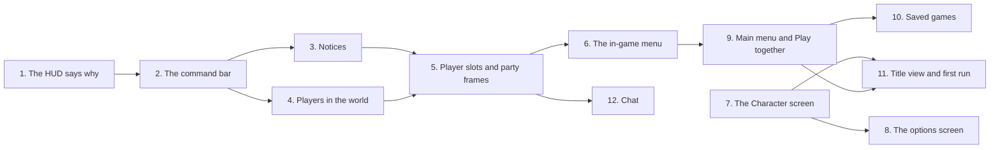

# UI revamp

Plan for rebuilding the game's three main screens on the design system:

- **The in-game HUD**, with the world UI that belongs to it.
- **The in-game menu**, with the options screen and a new Character screen.
- **The main menu**, with new Play together and Saved games screens.

Adopted on 2026-11-10 from three research proposals, one per screen. They are kept with their mockups in `Recordings/UiRevamp`, outside the repo. Each proposal offered three directions and recommended its middle one, and this plan takes those. [Architecture.md](Architecture.md) describes what exists today. Tick off the phase checklist as steps land, and move each settled behaviour into Architecture.md as its code arrives.

Every rule in [Multiplayer.md](Multiplayer.md#rules-for-new-code-starting-now) and in [DesignSystem.md](DesignSystem.md) applies: its foundations, components, patterns and accessibility baseline. This plan changes four of DesignSystem.md's patterns (Messages, Co-op, Menus and Feedback); see Removals and migrations.

## Where we start

The design system gave every screen one UI scale, a theme, a skin and shared components ([DesignSystem.md](DesignSystem.md), done on 2026-11-10). The screens themselves kept the layouts and flows they had before.

**The HUD**

- **Layout.** Health is a 140 x 18 bar reading "HP 72" at the top left, and the weapon is a 34 UI px slot at the top right. The abilities and statuses sit at the bottom centre. The camera centres the player, so health is about 400 UI px from the abilities and every corner is about 300 from the action.
- **The weapon slot** shows only an icon. Its two abilities are slots 5 and 6, at the other end of the screen.
- **Failures.** Every failed cast flashes the same red. `AbilityBarPresenter` drops the `CastOutcome`, so on cooldown, silenced and no target look alike.
- **Hidden state.** A stunned, silenced or rooted player's slots look ready. A cast in progress or a buffered cast shows nothing on the HUD.
- **Health** shows no maximum, no recent loss and no low state. Nothing explains death or the respawn delay.
- **Co-op.** No other player's health shows anywhere, nor who is who, nor whether they are down or in another world. Players have no world bar.
- **Statuses.** Buffs and debuffs share one row of eight and are told apart only by order. A ninth status is dropped.
- **Notices.** The one notice, "Waystone discovered", rises among the damage popups. Entering a world shows nothing, and a world has no display name.
- **Contrast.** `Health` on its translucent `HealthTrack` is 2.37:1, under the 3:1 a large shape that carries meaning needs. The theme tests check only text pairs, so nothing catches it.
- **Tooltips** give no numbers.

**The in-game menu**

- It looks the same paused (offline) and running (online), so a player can believe it pauses and die behind it.
- Opened in game, the options screen is opaque and full-screen. Online it hides the world and health while the player can be hit.
- It shows only buttons: no session, party, address to invite friends, save state or controls.
- **Saving is silent.** `GameSaveRecorder.Save()` returns a bool and raises nothing. A failed write is only logged, and Leave game and Quit go ahead regardless.
- **The host's confirmation** shows even with nobody connected, and does not say how many players it ends the game for.
- **The options screen** is one list of 41 items (736 UI px in a 288 UI px view at 640 x 360):
  - the 25 Character rows come first, so reaching Move from the Look row takes 27 presses of Down;
  - Reset shows on every row, and Reset all resets only the controls;
  - no option says what it does;
  - at 720p only Normal UI size fits, and its button does nothing without saying why.

**The main menu**

- **Look.** A flat panel with the name at `Title` size. Nothing of the game shows.
- **Host game** continues the latest save, or starts a new game when there is none. With a save on disk, nobody can host a new or older game.
- **Saves.** Continue does not say where or when. Older sessions stay on disk (`session-<id>.json`, `joined-<host>.json`), but the menu cannot reach them.
- **The join field** sits between Host game and Join game, prefilled with `127.0.0.1`. It takes no port, is neither remembered nor checked, and a gamepad cannot type into it.
- **Connecting** waits up to 10 s with no Cancel. After it connects, the fader stays black with no text, and a join lost before the player stands in a world returns to the menu without a word.
- **The status line** is one unwrapped line in a 160 UI px column. The host-gone text needs 334 UI px and a version refusal 527.
- **Inviting.** The host has no address to give friends: Multiplayer.md sends them to the Tailscale app.
- **Customization** is the first 24 rows of the options screen, with no preview.
- **Missing pieces:** no wrap-around navigation, no first run, and no build version on screen.

## Terms

| Term | Meaning |
|---|---|
| Command bar | The HUD's cluster at the bottom centre: the health bar over the ability row, buffs to its left, debuffs to its right, and the message line above |
| Message line | The line above the command bar that says why a press failed |
| Notice line | The line at the top centre where in-game notices queue |
| Player slot | A number from 1 to 4 that the host gives each player as they join, with a colour. Every machine agrees on it |
| Party frames | The HUD's frames for the other players, at the left edge |
| Chat | The HUD's window of the session's lines, under the party frames until the player moves it: players' messages and the party's comings and goings (Phase 12) |
| Vitals strip | The session line and the local player's health, shown on a full screen opened in game online |
| Party page | The in-game menu's page of the players online, and for the host the addresses friends join at (Phase 6) |
| Controls page | The in-game menu's page of the controls and their keys (Phase 6) |
| Preview stage | The local character drawn into a texture by a command buffer, with no camera or light, for the Character screen and the title view (Phase 7) |
| Title view | The still picture of the Overworld behind the main menu, rendered by a recipe |

## Goals

- Everything about the local player sits in one place, the command bar, near the player the camera centres.
- Every press is answered in words or a visible state on the frame it happens: why a cast failed, what is casting, what is queued, what is blocked.
- Players see each other: health, debuffs and casts over every player, party frames, and the same player numbers on every machine.
- The in-game menu says whether the game is paused, saves on request, keeps the HUD of a running game in view, and gives the host the addresses friends join with.
- Character customization has its own screen with a preview, reachable from the main menu and in game. The options screen gets short, described categories.
- The main menu shows the game, says what each choice will do, puts hosting and joining in one place, and reaches every saved game.
- Every screen fits 480 x 270 UI px and keeps DesignSystem.md's accessibility baseline.

## Non-goals (for now)

- **Player names.** Slots give every player a number, shape and colour. Names need a text field (which a gamepad cannot type into), a filter to the characters the Galmuri subsets hold, and one more field at join (Later).
- **Kicking a player**, and **pausing online** while every player has the menu open (Later).
- **A live title scene,** such as a lit campfire with the player beside it (Later). The title view is a still picture.
- **A tabbed game hub** (inventory, map, quests), until those features exist. The in-game menu's pages can become its first tabs then.
- **A minimap, an XP bar, audio and window or resolution settings.** The HUD keeps the top right free for a place name and a minimap. The chat, a non-goal at first, became Phase 12 when Phase 5 sent the party's notices to it.
- **Icon art** for abilities and statuses, which stays in DesignSystem.md's Later. Slots keep the ability names and statuses keep their abbreviations.
- **Join codes, a relay or lobbies,** and an on-screen keypad for gamepad players to type addresses. Recent hosts let a gamepad player rejoin with one press.
- **A HUD layout setting,** such as Diablo IV's choice of a centre or corner layout.

## Decisions

| Topic | Decision |
|---|---|
| Directions | **HUD:** the command bar, plus the world bars of the world-first direction. **In-game menu:** the side column and cards, which Phase 6's previews turned into one panel at the centre with pages. **Main menu:** the title view and full screens. Each proposal's text fixes ship first, where they stand on their own. |
| Screen regions | In game, each part of the screen has one owner, so nothing overlaps at 480 x 270: • the bottom centre: the command bar; • the top centre: a 24 UI px notice band; • the left edge: the party frames, and under them the chat's default place, 144 x 96 (Phase 12), which the player may move it from; • the top right: kept free for a place name and a minimap later. Online, menus opened in game stay clear of the command bar and the notice band. |
| Health | In the command bar: 242 x 13 (12 until Phase 3) over the ability row, reading "72 / 100". • **Ticks:** one every 10 HP, one Weasel hit ([Units.md](Generated/Units.md)), until Phase 3 took them out (`HudSettings.TickHealth` 0 draws none). • **Recent loss:** the part just lost shows pale for 0.4 s. • **Low:** at 30% or less, the frame turns `Danger` and pulses once a second, holding steady with Reduce flashing on. The numbers live in `HudSettings`. |
| Bar contrast | A bar's fill against its track is measured like a text pair and meets 3:1. `HealthTrack` becomes opaque, which takes today's red to 3.68:1. |
| Players' health colour | Players' bars fill in a new `HealthPlayer` role, green, on the HUD and in the world. Mobs keep `Health`, red. The slot badge and the bar's shape still tell them apart, so colour is never alone. The exact green is settled on Phase 2's previews. |
| Weapon | The weapon slot joins the ability row beside its two abilities: Q W E R, a gap, then the weapon, 1 and 2. Its tooltip gives its damage, type and range. |
| Failures | A failed press shows its reason on the message line for 1.2 s, beside today's flash: "On cooldown", "Already casting", "No target", "Stunned", "Silenced" or "Rooted". The texts sit in one table keyed by `CastOutcome`. A buffered cast that expires or is dropped by a newer order loses its brackets without a text. |
| Slot states | A slot is ready, cooling down (as today), casting (frame in `Accent`), queued (`Accent` corner brackets), disabled (a hatch) or failed (the flash). Disabled means every slot while stunned or silenced, and the slots whose cast moves the caster (`CastMovement.Ability`) while rooted. |
| Statuses | Buffs left of the abilities and debuffs right, each in a 3 x 2 grid filling outwards from the abilities. A seventh of a kind shows "+n" on the sixth icon. A debuff's frame is `Danger` with a notched corner, so both its side and its shape carry its kind. |
| Players in the world | Every player has a world bar with debuff pips and a cast bar under it, on every machine, the local player's own included. An ally under the pointer gets the enemy's hover marker in green (settled in Phase 4). |
| Player slots | The host gives itself slot 1 and each joining player the lowest free one, and a player who leaves frees theirs. A slot has: • a number; • a colour role (`Player1` to `Player4`): blue, violet, teal and orange; • a badge, a disc in that colour outlined in black, 5 px beside the world bar and 16 px with the number on it in a party frame. Every badge is a disc (settled in Phase 5, where shapes per slot were proposed), so in the world only its colour tells slots apart. It is a server-written network variable on the player, read by late joiners, which also says whether the player is still joining. Offline there is no slot and no badge. |
| Party frames | At the left edge, one 104 x 26 frame per other player. Each shows the badge, "Player 2", and a bar with debuff pips (unticked, as the command bar's since Phase 3), or else "Respawning in 2", "In another world" or "Joining". Playing alone, none show. |
| Notices | In-game notices queue on the notice line: Waystone discovered, the world entered, and while you are dead "You fell. Respawning in 3". This replaces the Messages pattern's "short notices float over the local player"; popups are left to hits and heals. A player joining, leaving or going down is a line in the chat (Phase 12), not a notice. |
| Chat | A window at the left edge under the party frames (Phase 12): the session's lines, newest at the bottom. • **Players' lines:** "Player 2: on my way", the name in its slot's colour. • **Party lines,** in `TextMuted`: "Player 2 joined", "Player 2 left" and "Player 2 is down", each machine raising its own from what it already knows. • **Typing:** the Chat key (Enter) opens the window, Enter sends and Escape cancels; gameplay input is off while it is open. A gamepad reads but cannot type (Later's on-screen keypad). • **Fading:** at rest a line shows for 10 s, then fades over 1 s; opening the window shows every line again. Nothing is saved. • **The window:** 144 x 96 UI px by default. While it is open the player moves it by its header and resizes it by its corner grip, from 104 x 52 to 240 x 160; it keeps its place by the nearest screen corner, on this machine, and the options put it back. • **Timestamps:** an option, off by default, puts the time each line arrived, "14:32", before it. |
| In-game menu | **One panel at the centre** of the space between the notice band and the command bar (settled in Phase 6; a side column and cards were proposed first): titled "Paused" offline and "Menu" online, then Resume, Character (Phase 7), Party (online), Controls, Options, Save game (offline and hosting), Leave game and Quit to desktop, looping. **Pages in its place:** Party and Controls each open a page where the panel stands, with Back. Nothing shows by default but the buttons. **Party frames and the chat** stay in view beside it. |
| Scrim | Offline, where time stands still, the menu dims the game with the `Scrim`. Online there is none: the panel is opaque, and the game stays live around it. The title carries the difference too, "Paused" or "Menu". |
| Saving | **Save game** (settled in Phase 6, in place of saving on open and a saved line) writes the game at once, offline and on the host, and answers on its own button: "Saved" or "Couldn't save" for 1.2 s. A joined client has none: the host saves the game, and the client's copy of its place keeps saving itself. Where nothing is written (an editor boot straight into a world) it cannot be pressed. |
| Confirmations | Leaving or quitting asks only when it loses something, each sentence on its own line: • as the host with others connected: "End the game for 2 other players?" ("1 other player"), then "The game is saved." or, after a failed save, "The game couldn't be saved."; • otherwise after a failed save: "The game couldn't be saved. Leave anyway?" ("Quit anyway?"), and joined "Your place couldn't be saved.". Offline, alone as the host, or joined, with the last save written, it goes ahead at once. |
| Full screens in game | Options and the Character screen stay opaque raised panels. Online, they show the vitals strip, and their notice line says "You're taking damage." when the local player is hit. |
| Options | **Layout:** a rail of categories beside a pane of rows (settled on Phase 8's previews). • **Accessibility:** UI size, Reduce flashing, Reduce motion. It was the Display section; the settings file is unchanged. • **Interface:** Allies' damage numbers, Chat timestamps and Chat window, the Display section's later rows (chosen in Phase 8 over Accessibility holding all six, or the chat's rows joining Controls). • **Controls:** the bindings. **Behaviour:** • Moving onto a category shows its rows. • The focused row's description, up to two lines, shows at the pane's foot, and a category's while its item is focused. • Reset shows only on a row that differs from its default. • The footer's reset is the category's ("Reset controls"), shown only while something in the category differs. • Opened in game, the screen returns to the category used last this session. |
| Character screen | **Layout** (settled on Phase 7's previews, where the plan's colour rows became chips): a full screen of its own, shared by the main menu and the in-game menu as the options screen is. The preview on the left, in a box of 80 x 80 art px at x3 on 640 x 360 and x2 on 480 x 270, with Turn left and Turn right, two arrow icons, either side of the pose's button; on the right **one row per part**, the option worn on its button, its colours as chips, and Reset. **Grouping:** read from the dyes, not from a hand-made list: a colour goes on the one part's row whose options carry it, else on Body. **Colours:** a chip opens a swatch picker, which shows the focused swatch on the preview before it is picked. **Foot line:** names the focused chip or turn button. The Character section leaves the options screen. This lifts PlayerCharacter.md's non-goal "An in-game character creator". |
| Main menu | **The panel:** raised, on the left, over the title view. It holds the logo, then: • Continue, with a line saying where, how long played and when saved; • New game, Saved games, Play together, Character, Options and Quit, looping. **Without a save,** Continue and Saved games hide. **The build version** shows at the bottom right. |
| Play together | One screen with two columns: • **Host:** Host and continue, Host a new game, Host another saved game, then the addresses friends join with, each with Copy, and the port. • **Join:** an address field taking `host` or `host:port`, checked before connecting and remembered; Join; and up to five recent hosts as buttons. **Connecting** shows a modal with a count and Cancel. |
| Host addresses | Shown openly on the Party page, two at most. They are read from this machine's network interfaces: the home network and a virtual LAN. None is the public internet address behind the router, and none is ever sent anywhere. |
| Saved games | A screen listing every session and joined copy, newest first. Each card shows the place, the time played and the last save, with Play, Host and Delete. Delete asks first and keeps one `.bak` copy. |
| Title view | A still picture of the Overworld at dusk, rendered by an editor recipe into a sprite of 768 x 432 art px, which covers every canvas in the Scale table. The local character stands in it, drawn by the preview stage. |
| First run | On the first launch, a Welcome panel offers UI size, Reduce flashing and Reduce motion before the menu. The first New game goes through the Character screen, whose Back reads "Start". Later New games do not. |
| Online pause | Kept as it is: the game never pauses online. |
| New art | From recipes: • **`UiSkinRecipe` gains:** a bar tick, slot corner brackets, a hatch, a debuff notch, the slot badge, a disc at 5 and 16 px, and a window's move and resize grips (Phase 12); • **a new title view recipe.** And two licensed icons: Pixelarticons' left and right arrows (MIT), the Character screen's turn buttons, which the user asked for in place of generated icons (Phase 7). CLAUDE.md's art rule allows licensed UI icons kept with their licence. No Aseprite work is needed. |
| New theme roles | `HealthPlayer`, `HealthLost`, and `Player1` to `Player4`. Each is measured in `UiTheme.md` like every other role. |

## Behaviour

### The command bar

Sizes are at 640 x 360 and 480 x 270 alike, anchored 8 UI px above the bottom edge.

| Part | Layout (UI px) | Behaviour |
|---|---|---|
| Ability row | Seven 32 px slots, 2 apart: Q W E R, an 8 px gap, then the weapon, 1 and 2. The row is 242 wide | Slot states and failures as in Decisions. The weapon slot shows the weapon's icon (or `IconMissing`) and has a tooltip |
| Health bar | 242 x 13, directly over the slots | "72 / 100" in `Body` outlined in `Outline`. Ticks, recent loss and the low state as in Decisions |
| Status groups | Two 3 x 2 grids of 20 px icons, 64 x 42 each, beside the slots | Buffs left, debuffs right, filling from the slots outwards |
| Message line | Centred 12 above the health bar, as wide as it | A failure's text for 1.2 s |

The cluster is 378 x 54 with statuses showing: 15% of the height at 640 x 360 and 20% at 480 x 270. Tooltips gain numbers: an ability's cooldown, cast time and range from its definition, and the weapon's damage, type and range.

### The notice line and moments

- **Layout.** A `NoticeLine` on a `Panel`, 8 below the top edge, sized to its text up to 240 UI px and wrapping to two lines.
- **Queue.** Each notice shows for its time from `HudSettings` (3 s), then the next shows. A notice repeated while it shows restarts it.
- **Notices:**
  - "Waystone discovered";
  - "Entering the Overworld", from the world's display name;
  - "You fell. Respawning in 3", counting down from `GameplaySettings.RespawnDelaySeconds`, then "Respawning..." until the player stands again.
  - "Player 2 joined", "Player 2 left" and "Player 2 is down" were planned here for Phase 5, and are the chat's party lines instead (Phase 12).
- **On this machine only.** Each machine raises its notices from state it already has.

### Player slots and party frames

- **Slots.** The host gives its own player slot 1 when it spawns, and each joining player the lowest slot no other player holds. A player who leaves takes its slot with it. The slot is a server-written network value on the player, so every machine reads the same one, a late joiner with each player's spawn.
- **Joining.** A client's player is joining from its spawn until the host hears its machine has the world around it loaded. The host writes that in the same value, so every machine knows.
- **Badges.** Beside each player's world bar, the 5 px badge in its slot's colour, while it has a slot and lives. Offline there is none.
- **Party frames.** At the left edge, 8 UI px from the left and top edges, one 104 x 26 frame per other player in slot order, 2 apart, up to three. Each holds:
  - the 16 px badge with the slot's number in `TextOnControl`;
  - "Player 2" in `Text`;
  - a 74 x 6 bar in `HealthPlayer` on `HealthTrack`, with up to four debuff pips in its top right corner;
  - or, in place of the bar, a line in `TextMuted`: "Joining", "In another world", "Respawning in 2" counting down from this machine's sight of the death, then "Respawning...".
  Playing alone, none show.

### Players in the world

- **The bar.** A player's world bar is the `WorldBar`'s 22 x 4 art px bar in `HealthPlayer`, centred 46 art px above the feet, with up to four debuff pips above it and the slot's 5 px badge to its left (from Phase 5). It stays put whether or not the player casts.
- **The cast bar** sits under the bar in `Accent`, 22 x 3 with a 1 px fill, sharing the bar's bottom border, and fills over the cast time:
  - the owner drives it from `CastStarted` and `CastEnded`;
  - every other machine drives it from `RemoteCastStarted`, `RemoteCastCompleted` and `RemoteCastCancelled`, filling from when the cast arrives and staying full until the completion or cancel arrives, or 0.5 s past the cast time.
  - A cast without a cast time never shows it, and a dead player's bar hides.
- **The local player's own bar and cast bar** show too. The camera centres it, so the eye is already there.
- **The ally hover marker** (`MarkerHoverAlly`) shows under the other player the pointer is over: the enemy's brackets in `Positive`. It never shows under the local player, where the pointer often rests. The attack cursor, which shows over enemies only, tells the two markers apart besides their colour.

### The chat

Settled on Phase 12's previews, where the chat also became a window the player moves and resizes, with timestamps as an option.

- **Place.** By default at the left edge under the party frames: 144 x 96 UI px, 8 from the left edge and 98 from the top, so 8 under the party frames' region and, at 480 x 270, 8 above the command bar's. It is as wide as the in-game menu's column.
- **At rest.** Only the lines show, outlined in `Outline` over the world, and nothing of the chat takes the pointer. A line shows for 10 s of game time, then fades over 1 s.
- **Lines.** Newest at the bottom, wrapping, as many whole ones as the window holds: six one-line ones in the default window, eleven in the largest.
  - A player's line reads "Player 2: on my way", the name in its slot's colour.
  - The party's lines are in `TextMuted`.
  - With the Chat timestamps option on, each line starts with the time it arrived on this machine, "14:32", in `TextMuted`.
- **Typing.** The Chat key (Enter, rebindable) opens the window:
  - a `Window` behind the lines, its header titled "Chat" with a move grip, and a resize grip in its bottom right corner;
  - every line at full again;
  - a dark `Field` at its foot, "Enter to send, Esc to cancel" while empty.
  Enter sends the line and closes the window, and on an empty line just closes it; Escape closes it. Gameplay input is off while it is open, and the chat is a layer on the menu stack, so Escape never opens the in-game menu then.
- **Text** is kept to the characters the UI's Galmuri atlases hold (`UiCharacters`) but the zero-width space, and to 80 of them. A typed tag shows as typed.
- **The window.** While it is open, its header moves it and its grip resizes it, from 104 x 52 (two lines) to 240 x 160, always wholly on the screen. Let go, it keeps its distance from the screen corner nearest it, so it holds its place at every UI size, saved on this machine in `settings.json`. A window dragged back to its default place counts as never moved. The options' Chat window row reads Default or Moved and puts it back.
- **Party lines.** "Player 2 joined" once its joining ends, "Player 2 left" when its player despawns, and "Player 2 is down" when it dies, raised on each machine from what it already knows. The local player's own and a player without a slot raise none.
- **Offline,** with nobody to talk to, the chat does not show.

### The in-game menu

Settled on Phase 6's previews, where the side column and cards became one panel at the centre, the Controls and Party cards pages behind buttons, and the saved line a Save game button.

- **Placement.** One raised panel, 160 UI px wide, centred across the canvas and down the space between the notice band (32 UI px from the top) and the command bar's region (68 from the bottom), on whole UI px; its pages stand in the same place. Online the game runs on around it, the local player under it, its health in the command bar below.
- **The panel.** Its title, "Paused" offline and "Menu" online, then its buttons, 144 x 16 UI px and 2 apart: Resume, Character (Phase 7), Party (online), Controls, Options, Save game (offline and hosting), Leave game and Quit to desktop. With Phase 7's button the host's eight fill 169 of the 170 UI px the space has at 480 x 270; a ninth would need Leave game and Quit to desktop to share a row.
- **Party page** (online). A row per player with a slot, in slot order, the local player's included:
  - its 5 px badge, "Player N", and "You" for the local player or "Host" for slot 1, the host's own player, on every other machine;
  - a 40 x 6 bar in `HealthPlayer` on `HealthTrack`, framed in `ControlSecondary` so the empty part shows on the dark panel; or "Down" in `Danger`; or "In another world" or "Joining" in `TextMuted`.
  - For the host, an invite block follows: "Friends join at" and the port, then up to two addresses, each with its network's name under it ("home network", "Tailscale") and a Copy button that puts "address:port" on the clipboard and reads "Copied" for 1.2 s; "No network found" without any.
  - Back.
- **Controls page.** Move / attack, Attack move, Stop, Class abilities and Weapon abilities, and online Chat, each with its keys in key caps framed in `ControlSecondary` with letters in `Accent`, the HUD's key colour. The labels come from `IInputBindingLabels` and follow `BindingsChanged`. Change keys opens the options screen at its first key binding, and Back.
- **Focus.**
  - Opening selects Resume, and the buttons loop, the hidden ones skipped.
  - A page's controls loop: the Party page's Copy buttons and Back, the Controls page's Change keys and Back. The Party page opens on its first Copy button or Back, the Controls page on Back.
  - Back on a page returns to the panel with the button that opened it selected; Back on the panel closes the menu; the options screen returns to the button or page it was opened from.

### The options screen

Settled on Phase 8's previews, where the Display section's later rows became a third category, Interface.

- **Layout.** A full raised panel titled "Options", its title centred, holding a 472 UI px block centred on the canvas on whole UI px, so it fits 480 x 270:
  - **the rail,** 104 wide, its items 16 tall and 2 apart, from 28 UI px below the top;
  - **the pane,** 8 to its right and 360 wide: the rows, which fill it but for 6 UI px kept for the scrollbar, shown only while they overflow, and under them **the description,** two lines;
  - **the notice line** under the block, and **the footer,** the category's reset and Back, centred at the bottom as on the Character screen; the reset hides, keeping its place, so Back never moves;
  - online, **the vitals strip** at the top right, its right edge on the pane's.
  The Controls' four headers and ten rows fit without scrolling at 640 x 360, 683 x 384, 512 x 384 and 560 x 350, and scroll at the smaller sizes.
- **The rail.** Accessibility, Interface and Controls. The current category is a raised button with a pip, and the others are flat, so shape and the pip mark it, not colour alone. Moving onto an item shows its category; Up and Down loop through the rail; Right or Submit enters the first row, and Left from any row returns to the rail.
- **Rows.** Reset shows only on a row that differs from its default, keeping its column, and is out of navigation while hidden; pressing it hides it and selects its row's button. Up and Down move to the same kind of control in the row above or below, and Down from the last row reaches the footer.
- **Descriptions.** The two lines at the pane's foot, in `TextMuted`, describe the focus:
  - a category's item its category ("How large the UI is drawn, and less flashing and motion.");
  - a binding's row the line from `RebindableActionList` ("Walk to the pointer and attack the first enemy on the way.");
  - a preference's row the controller's line; the UI size row adds "Larger sizes need a larger window." on the second line where none fits;
  - the footer nothing.
- **The category's reset.** "Reset accessibility", "Reset interface" or "Reset controls", shown while any of the category's rows differs from its default. It asks first ("Reset all controls to their defaults?"), puts back only its own category in one write, says so on the notice line ("All controls are back to their defaults.") and selects Back.
- **Opening.** From the main menu the screen opens on its first category, and in game on the category used last this session (Controls the first time), each with its item selected. The in-game menu's Change keys opens it on Controls with the first binding selected. Escape closes it from anywhere, as today.
- **Online.** The vitals strip shows, and a hit on the local player puts "You're taking damage." in `Accent` over the notice line for 3 s.

### The Character screen

Settled on Phase 7's previews, where the colour rows became chips on each part's row and the preview's buttons arrows around the pose's name.

- **Layout.** A full raised panel titled "Character", every part on whole UI px:
  - **The preview** on the left, in a box of 80 x 80 art px at the largest whole multiple that fits (`CharacterScreenView.MultipleFor`): x3 at 640 x 360, a box of 242 UI px with its frame, and x2 at 480 x 270. Every pose stays whole in it: the greatsword's cleave reaches 38 art px to a side and 23 under the feet. Under it, centred, Turn left and Turn right (24 x 18, Pixelarticons' arrows) either side of the pose's button (56 x 18).
  - **The rows** beside it, 340 UI px wide where the canvas has room (294 at 480 x 270), 16 tall and 2 apart, the box and the rows centred together.
  - **The foot line** over Reset all and Back.
  - Online, **the vitals strip** at the top right, its right edge on the rows'.
- **Preview.**
  - Turn left and Turn right go through the 8 directions toward the screen's left or right: from south, Turn left faces south-west.
  - The pose's button reads and cycles "Standing", "Running" (halfway between the run's and the sprint's speeds) and "Attacking": the shown weapon's attacks in turn, 0.5 s apart. In game the weapon is the local player's, its gear on the character; in the main menu the starting weapon.
  - It animates on an unscaled clock, so it moves while the game is paused, and it plays the idle animations as the player's character does.
- **Rows.** Look first (with more than one look), then:
  - **Body,** with the colours no single part owns: the skin (which tops, legs and bare hands all show), the eyes, the belt and the buckle;
  - **a row per part slot** a player picks (not the weapon's): the option worn on its button, and as chips the colours that option carries (Top: Tunic and Shirt; Cape: Cape and Lining; Bag: Strap and Pouch). A colour named after its part (Hair, Headwear, Cape, Boots) is that row's.
  - A part not worn shows no chips, and its picks stay in `settings.json`. A look without parts (the Bandit) shows only the Look row.
- **Swatch picker.** Submit on a chip opens a popover under it, or over it near the bottom: the choice's name in `Accent`, its swatches as 12 UI px chips 2 apart in rows of six, the one shown selected and framed in `Accent`, its name under the grid. Arrows move, wrapping in their row and column, and show each swatch on the preview; Submit keeps it and closes; Escape, or the selection leaving the picker, closes it and puts the colours back.
- **Foot line.** Names the focused chip ("Tunic: Blue") or turn button in `TextMuted`; online "You're taking damage." in `Accent` over it for 3 s after a hit.
- **Applying.** Changes apply and save at once, in game too. A row's Reset puts back its look, or its part and every colour of it, the hidden ones included; Reset all asks first, then puts back the look, every part and every colour.
- **Focus.** Opening selects the first row's button. Left and Right move along a row, Left from its first control to the pose's button; Up and Down move to the same kind of control in the row above or below (its nearest chip, else its button); Down from the last row reaches Reset all, and Right from Turn right the first row. Closing selects the button that opened it.

### The main menu and Play together

- **Continue's line.** It reads like "Clearing · 3 h 12 min · today 14:02": the nearest entry's display name, the time played, and when the game was saved.
- **Play together's focus.** Host and continue, Host a new game, Host another saved game, then the Copy buttons. Right moves to the Join column: the field, Join, then the recent hosts. Back is last.
- **Connecting.** A modal shows "Connecting to 100.101.102.103:7777 … 4 s of 10", with Cancel. Escape cancels too.
- **Joining.** After connecting, a line over the fader says "Joining 100.101.102.103's game…" until the fade in.
- **Errors.** Each one says what happened and what to do:

| Case | Message | Where |
|---|---|---|
| Empty or malformed address | "Type the host's address, like 192.168.1.20 or 100.101.102.103:7777." | Play together's notice line; the field stays selected |
| Timeout or unreachable | "Could not reach {address} in 10 s. Check the address, and that the host is in a game." | Play together's notice line |
| Refused: full | "{address} is full: 4 of 4 players." | Play together's notice line |
| Refused: other build | "The host runs {version} and you run {version}. Play together needs the same build." | Play together's notice line |
| Hosting fails | "Could not host on port 7777. Close any other copy of the game and try again." | Play together's notice line |
| Host left | "The host left the game. Continue carries on alone from where you were, in a saved game of your own." with Continue alone and Back | A dialog on the main menu, shown with or without another save |
| Lost while joining | "Lost the connection while joining {address}." with Play together and Back | A dialog on the main menu |

## Architecture

### Core

- **`HostAddresses`** (`Core/Network`): this machine's IPv4 addresses on interfaces that are up, each with a network name, two at most, read through `INetworkInterfaceSource` so tests can fake the interfaces. Used by the Party page and by Play together.
- **`JoinAddress`** (`Core/Network`): parses and checks `host` or `host:port`.
- **`NetworkSession.JoinAsync`** takes a port and ends cleanly when cancelled.
- **`MenuNotice`:** why the menu was reached (host gone, lost while joining). `NetworkSessionLifecycle` leaves it, and the main menu takes it, replacing `GameSave.TakeHostGoneNotice`'s line.
- **`GameSave`:**
  - `List()` returns a summary per save: id, `savedAt`, time played, the local player's world and place, and whether it is a joined copy;
  - `Delete(name)` keeps a `.bak` through a new `ISaveFolder.Delete`;
  - it keeps whether the last write failed, for the in-game menu's confirmations (Phase 6).
- **`UiCharacters`** (`Core/UI`, Phase 12): the characters the UI's fonts hold, which the font writer puts in the atlases and the chat keeps typed text to.
- **`UserSettingsData`** gains `recentHosts` and `firstRunDone`. A file from before reads them empty and false, or true when it already holds bindings or picks. The format version stays 1.
- **`WorldDefinition`** gains a display name for the world and for each entry (content rule 5, checked by `ContentTests`).
- **`UnscaledClock`** (`Core/Clock`, Phase 7): an `IClock` on unscaled time, for the preview stage.
- **`UserSettings.ResetCharacter`** (Phase 7): the look, every part and every colour forgotten in one write, for Reset all; **`UISelection.Current`**, the object selected, for the foot line.

### Gameplay

- **HUD:**
  - **`HudSettings`** (`Assets/Data/UI/HudSettings.asset`): the tick, the recent-loss time, the low threshold, and the message and notice times.
  - **`CastFailureMessages`:** the table of failure texts.
  - **Views:** `AbilitySlotView` gains the slot states; `PlayerHudView` and its prefab become the command bar; `StatusBarView` splits into two groups, with a `StatusIconDebuff` variant.
  - **Presenters:** `AbilityBarPresenter` keeps the outcome and reads the local player's controls; `PlayerOrders` raises an event when a cast is buffered and when the buffer clears.
- **Notices:** a `NoticePresenter` and the HUD's notice line (`NoticeView`). `WaystonePopupPresenter` moves onto them: since Phase 3 the presenter raises the waystone notice itself, and `WaystonePopupPresenter` is gone.
- **World:**
  - a `WorldBar` player variant (`WorldBarPlayer`) on the player prefab, with `WorldStatusIcons` and a new `WorldCastBar`;
  - `MarkerHoverAlly`, a variant of `MarkerHover`, in `PointerFeedbackLayer`.
- **Slots:**
  - `PlayerSlot`, a `NetworkBehaviour` on the player holding the server-written `PlayerSlotState` (its number and whether it is joining), with the host assigning it; `PlayerSlots`, the slots' count, roles and labels and the lowest free one;
  - `PlayerSlotBadge` on the `WorldBarPlayer` component;
  - `PartyFramesPresenter`, `PartyFramesView` and the `PartyFrame` component (`PartyFrameView`).
- **Chat (Phase 12):**
  - `ChatLog` and `ChatLine`: the session's lines on this machine;
  - `ChatText`: what a line may hold, cleaned and escaped;
  - `ChatPresenter`, the HUD's `ChatView` and `ChatWindowLayout`; the new `Window`, `ChatLine` and `Field` components, and `WindowDragHandle`;
  - `ChatPartyLines`: the party's lines on each machine;
  - `PlayerChat`, a `NetworkBehaviour` on the player: its owner's line to the host, the host's relay to every machine; `IChatSender` and `LocalChatSender` send through it;
  - the Chat action in the bindings (`RebindableActionList`), read through `IChatInput`;
  - `UserSettings`' chat timestamps and window place (`ChatWindowPlace`).
- **In-game menu (Phase 6):**
  - `GameMenuView` and `GameMenuCanvas` rebuilt: one centred panel and its pages;
  - `PartyPageView` and `PartyPagePresenter` (over a `PartyRoster`, which the party frames share), and `ControlsPageView` and `ControlsPagePresenter`;
  - `IGameSaving` (the save recorder), `IGameExit` and `IClipboard`, the menu's seams;
  - new components: `PartyRow`, `BarSmall` and `KeyCap`.
- **Options (Phase 8):** `OptionsMenuView` with the rail; new components `RailItem` (`RailItemView`) and `DescriptionLine`; a description per action on `RebindableActionList` (`InputBindings.GetDescription`), and `InputBindings.IsDefault` for the rows' Reset; `UserSettings.ResetAccessibility` and `ResetInterface`, each in one write; `IVitalsScreen`, which the options and Character screens' controllers implement, so one `VitalsStripPresenter` serves both.
- **Character (Phase 7):**
  - `CharacterScreenController` and `CharacterScreenView`, taking the Character section's rows from `OptionsMenuController`; `CharacterGroups` reads the rows from the dyes;
  - `CharacterPreviewStage` (`ICharacterPreview`), drawing the character into the texture the screen's box shows;
  - `VitalsStripPresenter` (Gameplay scope; serving the options screen too since Phase 8) and the `VitalsStrip` component;
  - new components: `RowChips`, `SwatchChip`, `SwatchPicker` and `ButtonIcon`.
- **Main menu:**
  - `MainMenuController` keeps `ContinueGame`, `StartNewGame`, `HostGame` and `JoinGame` as entry points, since the PlayMode tests drive them. Their logic moves into a plain `MenuSessionStarter` that the new screens share.
  - `PlayTogetherController` and `SavedGamesController`, with their views;
  - new components: `Field`, `SessionCard`, `DialogNotice` (a `Dialog` variant with a message and one or two plain buttons) and `TitleView`;
  - `LoadingLine`, on a canvas above the fader in `Main`. It is placed through the Main scope's auto-inject list, so Core stays free of TextMesh Pro.
- **`NoticeLine`** gains wrapping to two lines.

### Editor

- **`UiSkinRecipe`** appends its new pieces (tick, corners, hatch, notch, badges); the pieces are append-only, as before.
- **`TitleViewRecipe`** and its writer render the title view into `Assets/Sprites/UI/Title`, through the probe-render path the design system's previews used.

## Networking

- **New:**
  - the player slot, a server-written network variable on the player, read by late joiners at spawn, which since Phase 5 also says whether the player is still joining;
  - the chat's messages (Phase 12): a client sends its line to the host (`PlayerChat.SayRpc`), which checks its length and characters, names the sender's slot and relays it to every machine (`LineRpc`); the host's own goes out the same way. Lines are not saved, and a late joiner sees only those sent after it joined.
  Nothing else in this plan adds replicated state or messages. Phase 3 gave three existing host messages one more field: a heal, an immune hit and a blocked status name their source unit, as a hit already did, so a client's popups tell its own apart.
- **Already replicated, now shown:**
  - health (`NetworkHealth`) and statuses (`NetworkStatusEffects`) on the party frames, the world bars and the Party page;
  - casts (`RemoteCast*`) on the cast bars;
  - each player's world (`PlayerWorldSync`) for "In another world".
- **Unchanged:** look, colour and part picks stay owner-written network variables on `PlayerNetworkSync`, now edited from the Character screen. The join payload is unchanged.
- **Local only:**
  - the layout, failure texts, slot states and notices, and the allies' damage numbers preference;
  - the chat's party lines, its window's place and the timestamps option;
  - Save game's answer and the invite addresses;
  - the recent hosts, the first-run flag and the title view.
  The host's simulation never reads any of them.
- **The game never pauses online.** Kick, names and pings for every player are Later.

## Removals and migrations

- **DesignSystem.md**:
  - **Messages:** in-game notices move to the notice line, and the party's comings and goings to the chat (Phase 12).
  - **Co-op:** players get world bars and party frames; the HUD still shows only the local player's own controls.
  - **Menus:** the scrim marks a paused game.
  - **Feedback:** a failure is answered in words too.
  - **Components:** the new components join the table.
  - **Later:** "Co-op identity" and "players' world bars and status icons" are done.
- **KeyBindings.md:** the Chat key and the options screen's two chat rows (Phase 12); the options screen (rail, categories, the Character section gone, Display split into Accessibility and Interface), the in-game menu (the centred panel, its Party and Controls pages, Save game, confirmations) and the main menu (Play together in place of the Host and Join buttons and the join field).
- **PlayerCharacter.md:** its non-goal "An in-game character creator" is lifted, and its customization rows move to the Character screen. **AsepriteCharacters.md:** the Look row's home moves the same way.
- **Multiplayer.md:**
  - "the menu shows no slot list" becomes the Saved games screen;
  - the joining steps point to Play together's addresses instead of the Tailscale app;
  - the authority table gains the player slot.
- **Prefabs and scenes** are rebuilt through the editor, with `[FormerlySerializedAs]` on any kept field that moves: `PlayerHudCanvas.prefab`, `GameMenuCanvas.prefab`, `OptionsMenu.prefab` and `MainMenu.unity`. Each diff is checked for save churn.
- **The waystone notice** leaves the damage popup layer.
- **`RowSwatch`** goes with the options screen's colour rows (Phase 7): the Character screen shows colours as chips. `KeyBindingRowView` lost its swatch chip (`SetSwatch`) with it.
- **Tests** that count options rows (`OptionsMenuControllerTests`, `OptionsMenuPlayModeTests`, which count 41 items) or drive the old main menu buttons are updated in the phase that changes them.

## Phases

Each phase ships on its own, keeps the game playable offline and hosted, and comes with tests. A phase whose look can change settles it on previews first, signed off before its tests and docs. Previews show every state of what they change (ready, cooldown, casting, queued, failed, disabled, low, down, elsewhere, joining) at every display in the Scale table. An open question is settled with the user at the start of the phase named for it. Each phase updates Architecture.md and Roadmap.md as it lands.

The HUD comes first, because it is on screen the most. The menus follow, and the main menu last. Phases 7 to 11 do not depend on the HUD's phases, so the order can change. Phase 12, the chat, was added after Phase 5; it needs Phase 5's slots and can come any time after it.

### Phase 1: the HUD says why

Fixes on today's layout, before anything moves.

- [x] Previews of the slot states, the message line and the health text, signed off.
- [x] `HudSettings` with the message time.
- [x] `CastFailureMessages`, and `AbilityBarPresenter` keeping the outcome: the message line above the ability bar, beside the flash.
- [x] Slot states on `AbilitySlotView`:
  - [x] casting;
  - [x] queued, from `PlayerOrders`' new buffered event;
  - [x] disabled, from the local player's controls.
- [x] Skin: the corner brackets and the hatch.
- [x] Health reads "72 / 100".
- [x] Tooltips with numbers, and the weapon slot's tooltip.
- [x] `HealthTrack` opaque. The fill-on-track pairs (`Health` today, `HealthPlayer` from Phase 2) are measured in `UiThemeUsage` and checked at 3:1.

#### Phase 1 notes

- **Settled with the user on 2026-11-10,** on previews of today's layout at 640 x 360 and 480 x 270:
  - the slot states as built: the frame in `Accent` while casting, 1 px `Accent` corner brackets 1 UI px outside a queued slot, and the hatch in `ControlDisabled` (`Border` was previewed as a stronger alternative);
  - the message line 66 UI px up, just above the status row, which today sits directly on the bar (Phase 2 moves it to 12 above the health bar);
  - "72 / 100", the tooltip numbers below, and a tooltip with no room above its target shown below it.
- **The previews.** Written to the gitignored `Recordings/UiRevamp/Phase1` by a temporary tool, since removed: the real `PlayerHudCanvas` on a camera's canvas at x3 and x4 over Phase 5's capture of the Clearing, its themed components woken by reflection and its views set by hand. The camera had to sit at the origin: 5000 units away, float error in the world-space round trip of `ThemedText`'s snapping rounded neighbouring glyphs apart.
- **Failures.** `CastFailureMessages.For(outcome)` gives one of six constant strings, or null for an empty slot, death, and a buffered cast that expired or was dropped (`Expired`, `Cancelled`). Every failure still flashes its slot, as before; only the words depend on the outcome. A message shows for `HudSettings.MessageSeconds` (1.2 s), and a newer failure replaces it and restarts the time. The presenter hides it when its time is up in `Tick`, which allocates nothing.
- **Slot states.**
  - **Casting** follows `PlayerAbilities.CastStarted` and `CastEnded`. An instant cast starts and ends on one tick, so it never shows.
  - **Queued** follows `PlayerOrders.BufferedCastChanged`: the slot when a cast is buffered, -1 whenever the buffer clears (a newer press gives -1, then its slot). `PlayerController` passes it on as an event of its own, which subscribes to its orders, and exposes `BufferedSlot`.
  - **Disabled** follows `StatusEffects.Changed` and reads `Controls`. An empty slot is never hatched: there is nothing in it to block. The hatch sits under the name, so the name stays readable.
  - Binding a player shows its running cast, buffered slot and controls at once; `SetAbility` resets the three states and the presenter puts them back.
- **Co-op.** `PlayerOrders` and `PlayerAbilities` run on the machine that owns the player, a joined client's own included, and its statuses are the mirror of the host's, so the failure words, the casting, queued and disabled states all work on a client from its own events, with nothing sent. `NetworkHudPlayModeTests` binds a copy of the HUD's bar to the in-process client's player and checks each state there, and that the host's own bar shows none of it.
- **Tooltips.** `ITooltipSource.TryGetTooltip` gives a third string, the numbers, shown on a new line in `Text` between the title and the description; an empty line hides. `TooltipDetails` builds them when a slot shows another ability or weapon:
  - an ability: "Cooldown 2 s · Cast 0.25 s" ("Instant" for none), and "Range 6" on a second line when it is aimed at a point, a unit or along a line of some length. Sweep and Whirl (`None`) and Charge, Lunge and Roll (a 0-long line) show no range. One line of all three ran to 151 UI px, past the tooltip's 150.
  - a weapon: "20 Physical · Melee", or "24 Physical · Range 5" for the bow, its attack range rather than its arrow's 6.5.
  The weapon slot's icon moved from `PlayerHudView` into a new `WeaponSlotView`, the slot's `ITooltipSource`, beside a `TooltipTrigger`; the slot's image now takes the pointer, as the ability slots' do. The tooltip went below the slot, since above it there is no room in the top corner.
- **Health.** `PlayerHudView` builds "72 / 100" only when the current or maximum health it shows changes, and shows "-- / --" without a local player.
- **Contrast.**
  - `HealthTrack` is opaque: `Health` on it is 3.68:1, which `UiTheme.md` floors to 3.67.
  - A bar's fill names its track: `ThemedGraphic.Track`, set on the `Bar` component's fill (its root) and on the `WorldBar`'s fill (its frame).
  - `UiThemeUsage.CollectFills` and `MeasureFills` measure each pair once at 3:1, the fill drawn over the track and a translucent track over white and over black. `UiTheme.md` gains a Fills on tracks table, and `UiThemeTests` checks it.
- **Skin.** `SlotCorners` is 11 px, an L of 5 px arms 1 px thick in each corner, 9-sliced at the arm. `Hatch` is a 4 px tile of one diagonal, shown tiled. Both are greyscale, appended to `UiSkinPiece`, with three new settings on the recipe.
- **Left as they are.**
  - **The hatch is not measured.** `ControlDisabled` lines on a slot are 3.39:1 over a black world and 2.0:1 over a white one; `Border` would give 6.49 and 3.83. The hatch is a second cue beside the failure's words and the status icon, and it was settled on the previews.
  - **The `Accent` frame and brackets** sit on the world, so they are not measured either.
- **Tests.**
  - `AbilityBarPresenterTests` (18, new): each outcome's words or none, the message time, casting, queued and dropped brackets through real orders, the hatch per control, rebinding, no allocation.
  - `PlayerOrdersTests`: the buffered event.
  - `TooltipTests`: the numbers, the weapon slot, below a target at the top, and the HUD's weapon trigger.
  - `UiThemeTests`: `FillRatio`, `MeasureFills` and the project's fills at 3:1.
  - `UiContentTests`: the slot states and the message line.
  - `UiSkinWriterTests`: the corners and the hatch pixel by pixel.
  - `DesignTablesTests`: the fill table.
  - `NetworkHudPlayModeTests` (new).
  - `PlayerWeaponSystemTests` and `MobPlayModeBehaviorTests`: "72 / 100".

### Phase 2: the command bar

- [x] Previews at every display in the Scale table and at Large and Larger, signed off, settling the `HealthPlayer` green.
- [x] The screen regions, written into DesignSystem.md's Foundations, with a test that the HUD keeps to them at 480 x 270.
- [x] The command bar on `PlayerHudCanvas`:
  - [x] the ability row with the weapon slot;
  - [x] the health bar over it;
  - [x] the message line above.
  The top-left bar and the top-right weapon slot go.
- [x] Health:
  - [x] ticks, the recent loss (`HealthLost`) and the low state, steady with Reduce flashing on;
  - [x] `HealthPlayer` on the local bar.
- [x] Status groups:
  - [x] buffs left, debuffs right, with "+n";
  - [x] `StatusIconDebuff` with its notch;
  - [x] skin: the tick and the notch.

#### Phase 2 notes

- **Settled with the user on 2026-11-10,** on previews at every UI size of the Scale table (11 sizes, from 480 x 270 to 683 x 384) and at 640 x 360 and 480 x 270 in detail:
  - `HealthPlayer` is `#4CC25A`, the proposal's green, of three: `#38B54A`, deeper, and `#6FD36B`, lighter;
  - `HealthLost` is `#D6D6D6`, the debuff notch 5 px, and a low frame dims to 35% at the bottom of its pulse;
  - tooltips of the command bar show above the whole bar rather than just above their slot, which otherwise covered the health bar.
- **The previews.** Written to the gitignored `Recordings/UiRevamp/Phase2` by a temporary tool, since removed, as in Phase 1:
  - each size rendered at x2;
  - the details at x3 and x4, over Phase 5's capture of the Clearing, cropped to each size.
- **Layout.** A `CommandBar` rect, 378 x 60 UI px, 8 above the bottom edge, holds everything.
  - The ability row (the `AbilityBar`, its spacer now 4 px, so R and the weapon slot are 8 apart) at its bottom.
  - The health bar, a `Bar` resized to 242 x 12, 2 above the row.
  - The `MessageLine` 2 above the health bar.
  - The `StatusBar`, 378 x 42, holding a `Buffs` and a `Debuffs` grid at its two ends.
  The weapon slot moved into the row and shrank from 34 to 32 UI px. The slot sizes, gaps and fonts are unchanged, so the row is 242 wide.
- **Screen regions.** DesignSystem.md's Foundations gives each region's numbers. `HudLayoutTests` lays a copy of the HUD out at each size with every icon and the message line shown. Every graphic but the tooltip stays inside the command bar's region, 378 wide and 68 tall: the queued brackets reach 1 UI px below the row, inside it.
- **Health.**
  - `HealthBarView` on the `Bar` component replaces the fill and text fields of `PlayerHudView`. The HUD's previous health bar was the same `Bar`, its fill now `HealthPlayer`, so mobs keep `Health` only on the `WorldBar`.
  - Ticks are copies of a hidden template, anchored at their share of the bar, so they need no width; a spacing that falls between pixels lands where the canvas rounds it.
  - `PlayerHudPresenter` became an `ITickable`. Each tick it compares the health with what it showed, because a client's network sync sets health without an event (`Health.SyncTo`), as `WorldHealthBar` found. The events still update the bar at once.
  - The loss starts from the highest health of the hits within its time; a heal past that start hides it, and a change of maximum drops it.
  - The low state covers 0 HP too, so a dead player's frame stays `Danger` until the respawn.
- **Statuses.**
  - `StatusBarView` holds two arrays, `buffs` (formerly `icons`, kept with `FormerlySerializedAs`) and `debuffs`, of six each.
  - Each group is a `GridLayoutGroup` starting at the corner nearest the abilities, filling the bottom row outwards first. Hidden icons take no cell, so the shown ones always pack from that corner.
  - A seventh status of a kind turns the sixth icon into "+n" (n counting itself), on `Surface`, its tooltip "n more" with their names.
  - `StatusIconView` gained a theme for that `Surface`.
- **Theme and skin.** `UiColour` appends `HealthPlayer` and `HealthLost`, and `UiSkinPiece` appends `BarTick` (1 x 3) and `Notch` (5 px).
  - Both new roles are fills on `HealthTrack` in `UiTheme.md`, at 8.04:1 and 12.67:1.
  - The text on the bar is now `Text` on `Outline`, so the `Text` on `Health` pair left the table.
- **Found on the way.** The editor script moving the bar's parts into `CommandBar` re-parented it after the tooltip, which would have drawn the tooltip under the command bar; `TooltipTests` caught it and the tooltip is last again.
- **Tests.**
  - `HudLayoutTests` (2, new) and `PlayerHudPresenterTests` (6, new).
  - `StatusFeedbackTests`: the groups and "+n".
  - `UiContentTests`: the command bar's components and the debuff icon.
  - `UiSkinWriterTests`: the tick and the notch.
  - `UiThemeTests`: the new fill pairs.
  - `TooltipTests`: above the rect a trigger keeps clear, every HUD trigger keeping the command bar clear.
  - `DesignTablesTests`, with `TestThemes` gaining the two roles.
  - `PlayerControlsPlayModeTests`: statuses in their groups.
  - `PlayerWeaponSystemTests`: the HUD helper building a `HealthBarView`.

### Phase 3: notices and moments

- [x] Open question settled: other players' damage popups.
- [x] Previews of the notice line and the death notice, signed off.
- [x] `NoticePresenter` and the notice line, with its queue.
- [x] "Waystone discovered" moves to the notice line.
- [x] Display names on `WorldDefinition` and its entries, a content rule and a `ContentTests` case, and the world-entered notice.
- [x] The death notice and its countdown.
- [x] The damage popup policy, as settled.
- [x] DesignSystem.md's Messages pattern.

#### Phase 3 notes

- **Settled with the user on 2026-11-10:**
  - **Open question 1,** on previews of the three options over the Clearing with the host, an ally and Weasels: all three, as a preference. A Display row of the options screen, "Allies' damage numbers", reads Shown (the default, today's behaviour), Smaller or Hidden.
  - **The notice line,** on previews at 640 x 360, 480 x 270 and every UI size of the Scale table: `Accent` text on a `Panel` (`Surface`, framed in `Border`), 15 UI px tall for one line, with 2 UI px above and below. A 13 px panel was the alternative.
  - **"Respawning..."** is written with three full stops. Galmuri's ellipsis draws its dots at mid-height.
  - **Square corners** for the whole skin. Cut by 1 px, a 1 px frame met itself only at a diagonal and a square fill (a status icon's colour, a bar's fill) showed past it, so frames looked chipped. A 2 px bevel was the alternative. `UiSkinRecipe`'s corner cut is now 0 and every piece was written again: panels, frames and slots are 6 px with 2 px borders, the bar frame 3 px with 1 px borders, and the pip a 5 px square.
  - **Black frames and the key top left.** `Border`, every frame's role, is now black. It was `#9A9EB3`. The toggle row's box keeps a light frame in `ControlSecondary`, since a black one would vanish on the options screen's dark panel. On every ability slot the key moved to the top left corner and the cooldown seconds to the top right.
  - **The health bar** loses its ticks: `HudSettings.TickHealth` is 0, which draws none (the bar keeps the mechanism and its hidden template). Digits of our own (3 x 6 and 3 x 5 px, Galmuri having no smaller size) were previewed and read blockier once outlined.
  - **The health bar is 13 UI px tall,** where it was 12. Its outlined text is 9 px tall, and the bar's inside was 10 px, so the text sat half a pixel off centre: 1 px low at x3 and 1 px high at x4. Inside 11 px it centres at every zoom, with 1 px of fill above and below. The message line stays at 48, so the command bar keeps 60 and its region 68. Its text still clears the bar by 2 UI px, since its glyphs sit inside its 12 px rect. Scaling the text to 0.9, also tried, put each font pixel on 2.7 or 3.6 screen pixels, and was still 1 px off at x4.
  - **The health text draws smaller,** through `PixelTextScale` on the `Bar`'s text. A scale only keeps the pixel font crisp when each font pixel covers a whole number of display pixels, so it changes with the zoom: the whole number nearest three quarters of the zoom's, rounded half up and at least two. That gives 2/3 at x3, 3/4 at x4 and 5/6 at x6, and leaves x2 unchanged. `ThemedText` snaps such a text to whole display pixels rather than whole UI px. A fixed 0.9 scale, tried first, could not keep to the grid. At 1080p the digits are 14 px tall, under the 18 px minimum for text; this is an exception recorded in DesignSystem.md's Accessibility, since the bar's fill shows the health too. The text is centred to within 1 display pixel, the most these sizes allow.
  - **Wrapping stays on** the main menu's status line. Its long host-gone status now wraps to three lines in its 160 UI px column, and the buttons shrink 4 UI px while it shows, until Phase 9 rebuilds the menu.
- **The previews.** A temporary tool, since removed, wrote them to the gitignored `Recordings/UiRevamp/Phase3`, as in Phase 2:
  - the real `PlayerHudCanvas` on a camera's canvas at x3 and x4 over Phase 5's Clearing capture;
  - for the popups, the `PopupText` prefab placed over that capture with the adventurer's idle frames and the Weasel's added.
  - At 480 x 270 (Large at 1080p) the capture stays at x3 under a UI at x4, as in game.
- **Layout.** `Notice` is a `Panel` drawn before the tooltip, anchored at the top centre 8 UI px down, its image never taking the pointer.
  - It holds a `NoticeLine` instance (`Accent` on `Surface`, ending in an ellipsis past what fits).
  - `NoticeView.Show` lays the text out at 240 UI px less 4 a side, then shrinks the panel to its widest line, rounded to an even width so it stays centred, and to its lines at Galmuri7's 11 UI px line height plus 2 above and below.
  - Two lines take the band's 24 whole.
  - `NoticeLine` itself now wraps (`TextWrappingMode` Normal).
- **Queue.** `NoticePresenter.Show(notice)`:
  - shows a notice at once when none shows, restarts it when it already shows, and queues it once otherwise;
  - shows each for `HudSettings.NoticeSeconds` (3 s) of game time;
  - stops the time while `GameFlow.IsTransitioning`, so a notice raised as a trip starts shows its whole time after the fade in.
  The presenter is local to its machine, and `Tick` allocates nothing.
- **The notices.**
  - **"Waystone discovered":** on `WaystoneNotices.Discovered` for the local player. The `WaystonePopupPresenter` and `GameplaySettings`' waystone popup colour are gone, along with its `UiThemeTests` check. The text stays on `GameplaySettings`.
  - **"Entering the Overworld":** when `PlayerWorlds` puts the local player in another world than the one announced last: at a session's start, on joining (also when the player is bound already in a world), and after a trip to another world. A trip within the world, a respawn's included, announces nothing.
  - **The death notice:** from the local player's `Health.Died` on this machine, a client's own from the host's replicated hit. "You fell. Respawning in 3" counts whole seconds of game time down from the respawn delay, its texts built once. "Respawning..." then holds until `Health.Restored`, and shows at once for a player bound dead. The death notice holds the line, and the shown notice's time stands still behind it.
- **Display names.** `WorldDefinition.DisplayName` and `Entry.DisplayName`, without an article, since the notice reads "Entering the" and the name.
  - **Overworld:** the regions (Clearing, Village forest, Lakeside, Snowfield, Coast, Lava fields) and their gates ("Clearing, south road").
  - **Sandbox, Sandbox interior, Testlands and Stress test** name their own entries.
  - `ContentRules.World` checks a world's name is set, unique among worlds, and its entries' names are set and unique within the world.
  - The world generator's merge (`MergeEntries`) and `WorldAuthoring.SetEntry` keep an entry's display name, which is written by hand.
- **Allies' popups.** `DamagePopupPresenter` treats a hit, tick, heal or block as an ally's when it involves another registered player but not the local one. It shows it as `UserSettings.AllyPopups` asks: as before, at `CombatSettings.AllyPopupSize` (Caption, the ticks' size; Galmuri has nothing smaller), or not at all. Your own popups, and those no player is part of, always show at their own size.
  - **What a client knows.** It knows a hit's source already. In this phase `HealedRpc`, the immune `HitRpc` and `BlockedRpc` also name their source unit, so a heal you gave an ally is yours on a client too. No new state is replicated.
  - **Events.** `Health.Healed`, `DamageReceiver.ImmuneHit` and `StatusEffects.Blocked` gained the source.
- **Co-op.**
  - **Waystones:** a joined client learns of its own discoveries from `PlayerWorldSync.WaystoneDiscoveredRpc`, which raises its `WaystoneNotices`.
  - **Worlds:** it learns of its own world from `PlayerWorldSync`'s replicated state applied to its `PlayerWorlds`.
  - **Death:** it learns of its own death from `NetworkHealth`'s replayed hit, and of its restore from `RestoredRpc`.
  - So every notice is raised on its own machine, with nothing new on the wire. `NetworkNoticesPlayModeTests` drives a copy of the HUD's notice line on the in-process client.
- **Tests.**
  - `NoticePresenterTests` (9, new) and `NetworkNoticesPlayModeTests` (new).
  - `HudLayoutTests`: the notice line within the notice band at its widest and tallest.
  - `UiContentTests`: the notice line's components.
  - `ContentTests`: worlds' display names and a world breaking the rule.
  - `CombatComponentTests`: allies' popups in each setting.
  - `UserSettingsTests` and `OptionsMenuControllerTests`: the preference and its row. `OptionsMenuPlayModeTests` counts 42 items.
  - `WorldGenerationWriterTests`: display names kept by the merge.
  - `UiThemeTests`: without the waystone colour; `UiTheme.md` gains `Accent` on `Surface`, 7.44:1.
  - `WaystonePlayModeTests`: the discovery on the notice line.
  - `UiSkinWriterTests`: square corners by default, a cut one at a cut of 1.
  - `PlayerHudPresenterTests`: a tick spacing of 0 shows no ticks.
  - `UiContentTests`: the health bar 242 x 13, its text carrying `PixelTextScale` at 0.75.
  - `UiThemeTests`: `PixelTextScale`'s scale at each zoom, and a scaled text snapped to whole display pixels.
  - `UiScalePlayModeTests`: the hosted HUD's health text at the zoom's scale, 3/4 at Large.
  - `UiContentTests`: the key top left and the seconds top right, and the toggle box framed in `ControlSecondary` at 3:1 or more on the panel. `UiTheme.md`: `Border` black.

### Phase 4: players in the world

- [x] Previews of your own and an ally's bar, pips and cast bar, and the ally hover marker, signed off.
- [x] The `WorldBar` player variant on the player prefab, with `WorldStatusIcons` and `WorldCastBar`, on every machine.
- [x] `MarkerHoverAlly`, the enemy's shape in `Positive`, so no skin piece.
- [x] PlayMode, with the in-process host and client:
  - [x] the client sees the host's bar, pips and cast;
  - [x] a late joiner sees current health.
- [x] DesignSystem.md's Co-op pattern and Later.

#### Phase 4 notes

- **Settled with the user on 2026-11-11,** on previews at 640 x 360 (x2, x3 and x6) and 480 x 270 (x4), and on two comparison sheets at x6:
  - **The cast bar:** 22 x 3 art px with a 1 px fill, sharing the health bar's bottom border, so casting adds 2 px under the bar. The alternatives were a 22 x 4 bar with a 2 px fill sharing the border, and a 22 x 3 bar 1 px apart.
  - **The ally hover marker:** the enemy's brackets in green. The alternatives were square corners, arcs on the axes, and a whole ring. Since the two markers share a shape, the attack cursor, which shows over enemies only, is the cue besides colour.
  - **The height:** the bar's centre 46 art px above the feet, so the cast bar's bottom edge is at 42. The tallest look reaches 42 while it stands, idles, walks or runs: the longbow carried on the back, at 41, plus the outline. Casts that raise the arms or leap (Smite, Sweep, Charge, Leap, Volley) and the attacks reach into the bars for a moment, and the bars draw over them.
  - **Not under yourself:** the ally marker shows only under other players.
- **The previews.** A Python script, kept outside the repo, composed them in the gitignored `Recordings/UiRevamp/Phase4`:
  - the skin's sprites in the theme's colours, the adventurer's and the Weasel's baked frames, and the recipe's marker shapes ported;
  - over Phase 5's Clearing capture, with the Phase 3 HUD masked in from its own captures.
- **Layout.** `WorldBarPlayer` is a variant of `WorldBar`:
  - its fill is in `HealthPlayer`;
  - `CastFrame` (the skin's `BarFrame`, 22 x 3, `HealthTrack`) and `CastFill` (`BarFill`, 20 x 1, `Accent`, read against the cast frame) sit 2.5 art px below its centre, unlit on `Overlay` at orders 0 and 1, and are hidden until a cast;
  - `WorldCastBar` is on its root, beside `WorldHealthBar` and `WorldStatusIcons`.
  The player prefab holds an instance as `HealthBar`, its last child, 46 art px up, wired to the player's `Health`, `StatusEffects` and `PlayerAbilities`. Its root's `Overlay` sorting group sorts at the root, as the Weasel's does.
- **The cast bar.** `WorldCastBar` fills on the game clock (injected, as `CharacterVisuals` is), from the left, sizing its sliced fill as `WorldHealthBar` does.
  - On the owner it shows on `CastStarted` and hides on `CastEnded`, completed or cancelled. An instant cast starts and ends on one tick, so it never shows.
  - On a copy it shows on `RemoteCastStarted` and hides on `RemoteCastCompleted` or `RemoteCastCancelled`, or once `remoteHoldSeconds` (0.5 s) pass beyond the cast time, in case neither arrives.
  - It hides while the player is dead. `LateUpdate` allocates nothing.
- **The ally hover marker.** `MarkerHoverAlly` is a variant of `MarkerHover` with its role `Positive`. The Gameplay scene's `PointerFeedback` holds an instance, `AllyHoverMarker`, as `PointerFeedbackLayer.allyHoverRing`. `PointerFeedbackPresenter` shows it under a living player the picker finds, unless it is the local player, and hides it with the other feedback.
- **Found on the way.** The `WorldBar`'s four pips were scaled to 0.832, so they drew 4.16 art px off the pixel grid, though the docs said 5 px. They are unscaled now, on the Weasel too. The fourth pip still reaches 1 px past the bar's right end, as before.
- **Co-op.** Nothing new is sent: health comes from `NetworkHealth` (a late joiner's at spawn), the pips from `NetworkStatusEffects`, and the casts from `PlayerNetworkSync`'s cast messages. `NetworkWorldBarsPlayModeTests` checks them on the in-process client and host.
- **Tests.**
  - `WorldCastBarTests` (8, new) and `NetworkWorldBarsPlayModeTests` (2, new).
  - `WorldHealthBarTests`: the player prefab's bar, the cast bar clearing the tallest look read from the parts' layers, and the pips unscaled.
  - `PlayerFeedbackTests`: the ally marker under another player, never under the local player, a dead ally or with the enemy's.
  - `UiContentTests`: the player prefab read too, its bar's sprites and the ally marker themed, the ally marker a variant of the hover marker in `Positive` that the Gameplay scene uses.
  - `UiThemeTests`: the cast bar's `Accent` on `HealthTrack`, 13.48:1 in `UiTheme.md`.
  - `SpriteSortingTests`: the units it renders lose their world bars, which draw over every unit and prop by design.

### Phase 5: player slots and party frames

- [x] Previews of the badges and the party frames in each state, signed off.
- [x] `PlayerSlot`: the host assigns the lowest free slot, a leaver frees theirs, and late joiners read it.
- [x] Theme roles `Player1` to `Player4`. Skin: the badge, a disc at 5 and 16 px.
- [x] Badges on the players' world bars.
- [x] `PartyFrame` and `PartyFramesPresenter`: alive, respawning, in another world, joining.
- [x] The joined, left and down notices: moved to the chat, Phase 12.
- [x] PlayMode:
  - [x] slots agree on host and client;
  - [x] a late joiner reads them;
  - [x] a leaver's slot is reused.
- [x] Multiplayer.md's authority table.

#### Phase 5 notes

- **Settled with the user on 2026-11-11,** on previews at 640 x 360 (x2, x3 and x6) and 480 x 270 (x4), and on sheets of the badges, the frame's states and the notices:
  - **Every badge is a disc,** in its slot's colour: `Player1` blue `#4FA3FF`, `Player2` violet `#C084FC`, `Player3` teal `#2DD4BF` and `Player4` orange `#FB923C`. Circle, diamond, triangle and square per slot were previewed first. In the world only the colour tells slots apart, a choice against DesignSystem.md's "never colour alone" that is recorded there; a party frame's badge also carries its number.
  - **The badges are outlined in black,** which also sets the orange disc apart from an orange debuff pip.
  - **The party frame** as previewed, and no badge offline.
  - **The notices** "Player 2 joined", "Player 2 left" and "Player 2 is down" belong in a chat, which did not exist: they moved to a new Phase 12, the chat.
  - **Joining** needs the host to tell every machine when a player has loaded, so the slot's network value carries that flag too.
- **The previews.** The Phase 4 script, outside the repo, composed them in the gitignored `Recordings/UiRevamp/Phase5`, the text drawn from `Galmuri7.ttf` at 8 px; `engine_frames.png` is the real `PartyFrame` rendered in the editor in each state, its themed components woken by reflection, which matched them.
- **Slots.** `PlayerSlot` is a `NetworkBehaviour` on the player prefab holding a server-written `NetworkVariable<PlayerSlotState>` (a byte for the number, a bool for joining).
  - In `OnNetworkSpawn` the host gives the player the lowest slot no other registered player holds (`PlayerSlots.LowestFree`), so its own player, spawned first, has 1. A leaver's player despawns and leaves the registry, so its slot is the next one given. A fifth player, were `NetworkSettings.MaxPlayers` raised, would have none and show no badge or frame.
  - A client's player is joining from its spawn until `IClientReadiness.IsClientReady` (the client reported a chunk loaded for its current trip), which the host checks each frame while it is joining; the host's own player never is.
  - `Changed` is raised on every machine as the value replicates, and at spawn and despawn. Offline the player is never spawned, so it has no slot.
- **Badges.** The recipe's `Badge` and `BadgeLarge` are discs 5 and 16 px across, in sprites 7 and 18 px with a 1 px black outline (`Player slots` settings). `PlayerSlotBadge` on `WorldBarPlayer` shows the small one in its slot's colour, read from the theme, while the player has a slot and lives (polling health, as the bar does), on `Overlay` at order 2, its disc 1 px left of the bar's frame and standing on its bottom row.
- **Party frames.** `PartyFrame` is a variant of `Panel`, 104 x 26, with the large badge at (4, 4) holding its number, "Player 2" at (25, 3), the state line at (25, 14) and the bar at (25, 15), 74 x 6, its fill read against its track, and four pips from (95, 4) leftwards. Only the panel takes the pointer. `PartyFrameView` changes its graphics only when what it shows changed.
  - The HUD's `PartyFrames` holds three, 28 apart, at the left edge region, hidden, under the tooltip.
  - `PartyFramesPresenter` follows the registry, leaves out the local player (by its transform) and players without a slot, and orders the rest by slot each tick. A frame says "Joining" first, then "In another world" (its world in `PlayerWorlds` differs from the local player's), then counts a death down in whole seconds from the moment this machine saw it, then "Respawning...", and otherwise shows the player's health and up to four distinct debuffs. It polls health and statuses, allocating nothing.
- **Co-op.** Only the slot's value is new on the wire. Health, statuses, worlds and deaths come from what each machine already has. `NetworkPartyPlayModeTests` checks both machines.
- **Tests.**
  - `PartyFramesPresenterTests` (7, new) and `NetworkPartyPlayModeTests` (2, new).
  - `WorldHealthBarTests`: the player's badge left of its bar, and the badge following its slot and health.
  - `UiSkinWriterTests`: the badges pixel by pixel.
  - `UiThemeTests`: the four slot colours distinct and opaque, the number on each at 4.5:1 or more (6.61:1 on `Player1` in `UiTheme.md`).
  - `UiContentTests`: the player prefab's badge themed, the HUD's three party frames and the component's parts.
  - `HudLayoutTests`: the party frames, a bar with four pips and the longest lines, in the left edge region at every size.

### Phase 6: the in-game menu

The Character button arrived with Phase 7.

- [x] Previews offline, hosting and joined at every display in the Scale table, signed off.
- [x] The panel:
  - [x] titles and buttons per session kind;
  - [x] looping navigation;
  - [x] Save game, in place of the saved line.
- [x] `GameSave` keeps whether the last write failed. Saving on open went with the saved line.
- [x] Confirmations only when something is lost, and the failed-save confirmation.
- [x] The scrim offline only.
- [x] `HostAddresses`.
- [x] The Party page, with the host's invite block and Copy; `PartyRow` and `BarSmall`.
- [x] The Controls page and `KeyCap`.
- [x] The panel and its pages kept between the notice band and the command bar, with a test. The cards that dropped by height went with the side layout.
- [x] The party frames and the chat stay in view beside the centred panel; they hid only behind the side column.
- [x] PlayMode, with an in-process client:
  - [x] the host's dialog names one player;
  - [x] a joined client leaves without a dialog;
  - [x] both see one roster.
- [x] KeyBindings.md's In-game menu.

#### Phase 6 notes

- **Settled with the user on 2026-11-12,** in four rounds of previews at 640 x 360 (x3) and 480 x 270 (x4) and sheets of every display in the Scale table at x2:
  - **Round 1,** the plan's side column and cards: the Party bars framed in `ControlSecondary` (`HealthTrack` alone vanished on `SurfaceRaised`; the plain bar was the alternative) and key caps framed in `ControlSecondary` with `Accent` letters (filled caps were the alternative).
  - **Round 2,** asked for: a more central layout, and the controls not shown by default but in a menu of their own. One panel at the centre, the Controls card a page behind a button, the Party card docked to the panel's right.
  - **Round 3,** asked for: the Party card behind a button too, and no status line under the title. The buttons went 2 apart so seven fit 480 x 270 online.
  - **Round 4,** asked for: no saved line, and a Save game button. Claude's calls, accepted: none for a joined client, the press answered on the button, and no saving on open.
- **The previews.** A Python script outside the repo, built on Phase 4's, composed them in the gitignored `Recordings/UiRevamp/Phase6` (`central4` holds the final round), over the Clearing with the Phase 3 HUD. Once built, a temporary tool, since removed, rendered the real `GameMenuCanvas` in edit mode, its themed components woken by reflection, onto the same backdrop (`engine` there); it matched them, once the Controls page's footer stretched its buttons to their height.
- **Layout.** `GameMenu` holds the scrim (`Panel`, its image on offline only), and under it the panel (`Box`, a `PanelRaised`), the `PartyPage` and the `ControlsPage` (each a `PanelRaised` with its view), then the `ConfirmPanel`, so the dialog draws over them.
  - Each has its title, `Title` size, 4 UI px down, and a `Content` column at (8, 21), 144 wide.
  - `GameMenuView.Place` lays the shown one's column out, sizes it 160 wide and 21 + its column + 6 tall, and stands it on whole UI px at the centre of the space between 32 UI px from the top and 68 from the bottom. It runs on every page change, on a page's `Resized` (rows or addresses shown, the Chat row) and when the canvas changes size.
  - Party rows are 12 UI px, an address row 21 with 2 between, the invite's header 15; Controls rows are 14, then a 4 UI px gap and the footer's two 70 UI px buttons.
- **The panel.** `GameMenuController` sets the title, the scrim, the Party and Save game buttons and their loop (`SetButtons`, explicit navigation wrapping around) as it opens.
  - **Save game:** goes through `IGameSaving`, which `GameSaveRecorder` implements: `CanSave` (it decides game state, a world session runs and it is no throwaway), `Save()` and `LastWriteFailed` (`GameSave.LastWriteFailed`, set by every write, a joined client's copy included). Its answer shows for `HudSettings.MessageSeconds` of real time (`IWallClock`), since the game is paused offline.
  - **Leaving:** `Question(hosting, joined, others, saveFailed, quitting)` gives the confirmation's words or none; the others are the registered players but the local one. Leave and Quit go through `IGameExit` (`GameExit`: `GameFlow.ShowMainMenuAsync`, `ApplicationExit.Quit`), so tests leave without ending a session.
  - **Pages:** Party opens `PartyPagePresenter`, which fills its rows only while open; Controls shows its Chat row online; Change keys opens the options screen at its first key binding row (`OptionsMenuController.Open(closed, atControls)`).
- **Party page.** `PartyPagePresenter` lists the players from a `PartyRoster` (registry, slots, statuses and death times, in slot order, allocation-free), which `PartyFramesPresenter` now uses too.
  - **"Host":** slot 1, the host's own player, which takes the first slot as it spawns first (Phase 5).
  - **Addresses:** `HostAddresses` reads them as the page opens, through `SystemNetworkInterfaces`. A private address needs a default gateway, which leaves out Hyper-V's, WSL's and VirtualBox's virtual switches; Tailscale is known by its range, 100.64.0.0/10, or its interface's name, ZeroTier by its interface's name. Two at most: three made the host's page with four players 179 UI px tall, past the 170 the space has at 480 x 270.
  - **Copy:** puts "address:port" on the clipboard through `IClipboard` (`SystemClipboard`, `GUIUtility.systemCopyBuffer`).
- **Controls page.** `ControlsPagePresenter` sets the keys from `IInputBindingLabels`, which gains `GetActionKeyLabel(actionName)` for the `Player` map's other actions. A key cap is as wide as its label plus 3 UI px a side, 12 at least.
- **Co-op.** Nothing new is sent. The roster comes from each machine's registry and slots, the addresses from the host's own interfaces, and a client's menu asks its own session. `NetworkGameMenuPlayModeTests` builds a copy of the menu over the in-process client.
- **Found on the way.**
  - The Controls page's footer kept its buttons at their sprites' height until its layout group stretched them.
  - Key names follow the keyboard layout: the test machine's Enter key reads "Entrée", so the tests compare with the bindings' own labels.
- **Tests.**
  - `GameMenuControllerTests` (19, rebuilt), `PartyPagePresenterTests` (6, new), `HostAddressesTests` (3, new), `GameMenuLayoutTests` (1, new) and `NetworkGameMenuPlayModeTests` (2, new).
  - `GameMenuPlayModeTests`: a host alone leaves at once.
  - `UiContentTests`: the new components themed; `UiTheme.md` gains `Danger` on `SurfaceRaised`, 5.44:1, and `Accent` read at `Caption` on it.

### Phase 7: the Character screen

- [x] A spike of the preview stage: a character drawn off screen into a render texture, its outfit composed as in game, on an unscaled clock. A command buffer draws it, with no camera or light (Phase 7 notes).
- [x] Previews of the screen and the swatch picker, signed off.
- [x] `CharacterScreenController` and its view:
  - [x] the rows moved out of `OptionsMenuController`;
  - [x] grouped by part from the dyes;
  - [x] colours hidden for parts not worn.
- [x] `SwatchPicker`.
- [x] The preview, with turn and pose.
- [x] The Character button on the main menu and in the in-game menu, and the vitals strip online.
- [x] The Character section leaves the options screen.
- [x] PlayMode: a pick made on the screen in game reaches the client's copy.
- [x] PlayerCharacter.md's non-goal, AsepriteCharacters.md's Look row, KeyBindings.md's options screen.

#### Phase 7 notes

- **The spike** drew the adventurer off screen into a texture, in an outfit `CharacterOutfits` composed, on a manual clock:
  - **No camera or light is needed.** A command buffer draws the character's sprite renderer, which stays off, with the lit sprite shader's unlit pass. The idle's 597 texels match the sheet's exactly, and a red tunic recolours exactly the texels a camera's render recolours, at 0.015 ms of CPU a draw against 1.25 ms for a camera's render request. No light, sun shadow, lamp shadow or night reaches it.
  - **A camera and its light, the plan, cost three things:** a sorting layer no light targets (on the units' layer the world's night light darkened the character); a way out of `SunShadowFeature`, which builds a sun shadow mask for every game camera while the sun casts; and a preview camera type, which the editor draws unlit and a player lit. In the editor, a sorting layer added while scenes are open joins every enabled `Light2D`'s target layers (`Light2D.OnSortingLayerAdded`).
  - **Light later,** the title view's dusk (Phase 11), can be the renderer's tint: a global light only multiplies.
  - **The poses' reach,** in art px from the feet, to either side, under and over: standing and running 20, 11 and 42; the sword's attacks 27, 9 and 45; the longbow's 34, 10 and 44; the greatsword's 38, 23 and 52. The proposal's box at x4 (51 x 58 art px) cut every attack, so the box holds them all: 80 x 80 art px, at x3 on 640 x 360 and x2 on 480 x 270, where x4 would not fit.
  - **The outfit:** in game the preview wears the local player's picks and its weapon's gear on the same `CharacterOutfits`, so it shares the player's outfit and nothing more is composed. In the main menu the Menu scope composes its own: about a second off the main thread, and 14.5 to 16.7 MiB until the menu goes.
  - **The clock:** `CharacterVisuals` takes the injected clock, the Main scope's scaled `UnityClock`; the stage gives its visuals an `UnscaledClock` each time it shows.
- **Settled with the user on 2026-11-12,** on previews at 640 x 360 (x3) and 480 x 270 (x4) and sheets of every display in the Scale table at x2, composed in the gitignored `Recordings/UiRevamp/Phase7` from frames the stage drew in the engine:
  - **Round 1:** the plan's rows (a header per part, its part row and its colour rows, scrolling at every size) beside a compact layout of one row per part with its colours as chips. The user chose the compact one (`B`).
  - **Rounds 2 to 5,** asked for: icons on the preview's buttons, then standard icons rather than generated ones (`B2`, `B3`), then the pose's name back in words with Pixelarticons' arrows kept (`B4`), and the names "Standing", "Running" and "Attacking" (`B5`).
  - **Claude's calls, accepted:** the picker shows the focused swatch on the preview; the foot line names the focused chip or turn button; a colour goes on its one part's row, else on Body; the session line "Online · not paused"; the character facing south as the screen opens.
  - **Once built,** a temporary tool, since removed, rendered the real screen in edit mode, its themed components woken by reflection (`Phase7/engine`). It matched the previews once each row's `LayoutElement` held its height (below).
- **Layout.** `CharacterScreen.prefab` holds a full-screen `PanelRaised` and, beside it, the `Stage`. The panel holds the title, the `VitalsStrip` (hidden), the `PreviewBox` (a `Panel`, its `RawImage` inset by a pixel), the `Controls` row, the `Rows` column, the foot line's two lines (`FocusLine` in `TextMuted`, `WarningLine` in `Accent`), the footer, the `SwatchPicker` and the `Dialog` for Reset all.
  - `CharacterScreenView.Place` runs as the screen shows and when the canvas changes size: the multiple (`MultipleFor`: the box and the controls must fit between 28 UI px from the top and 44 from the bottom, the rows keeping 284), the box at it, the rows beside it at up to 340 wide, the two centred together, the controls centred under the box, the footer and the foot line centred, the value buttons 130 wide on wide rows and 112 on narrow ones, all on whole UI px.
  - The screen is an instance in `GameMenuCanvas` after the options screen, and in `MainMenu`'s canvas. The main menu's buttons went 2 apart to take the Character button before Options and still fit 480 x 270.
- **The stage.** `CharacterPreviewStage` holds the character, an inactive `Visuals` child (its renderer off, `CharacterVisuals`, `CharacterPalette`) and a `PlayerLook`, injected by the canvas's auto-injection in both scopes.
  - **Show** gives the visuals the unscaled clock, shows the weapon's gear (the starting sword in the main menu) and follows the local settings; **Hide** stops following.
  - **Each frame** while shown it sets the movement before the visuals animate (`Update`), and after them (`[DefaultExecutionOrder(100)]`) draws their sprite into its 80 x 80 texture (`ARGB32`, sRGB, point filtered): a command buffer sets a view of the stage's own space, so the canvas's scale and place above it are undone, and draws the renderer's material with its unlit pass, found by its light mode.
  - **Previews:** `PreviewColour` shows the settings' colours with one swatch changed, and `ShowPickedColours` the settings' again.
- **Components.**
  - **`RowChips`** (`RowChipsView`): a label, the value's column (a `Button`, kept as a column when hidden, as on Body), four `SwatchChip`s and Reset. Its `LayoutElement` holds 16 UI px with no flexible height: its layout group's forced height made the rows flexible, and the first build stretched them over the column.
  - **`SwatchChip`** (`SwatchChipView`): a 12 UI px button whose face shows the swatch, with no colour transition, framed in `Border`; selected, a frame in `Accent`, framed in `Border`, rings it in the 2 UI px between chips.
  - **`SwatchPicker`**, a variant of `PanelRaised` framed in `Accent` (`SwatchPickerView`): its title, twelve chips and the name line, placed on whole UI px and wiring its chips' grid.
  - **`ButtonIcon`**, a variant of `Button`: its text off, a 16 x 14 icon in `TextOnControl`.
  - **`VitalsStrip`** (`VitalsStripView`): the session line in `TextMuted` and an 84 x 12 `BarSmall` with "72 / 100" outlined over it.
- **The controller.** `CharacterScreenController`, in both scopes:
  - builds a row per `CharacterGroups` group as it starts, and on every change to the look, the parts or the colours shows each row for the look, its value and its chips, and wires the explicit navigation of the rows, the preview's controls and the footer;
  - opens the picker on a chip's swatches, previews the focused one, keeps a pressed one (the choice's own as no pick), and closes it on Back or when the selection leaves it, putting the colours back;
  - names the focus on the foot line from `UISelection.Current`, only when the selection moves.
  - `GameMenuController` opens it in the menu's place with the local player's weapon and selects Character when it closes; `MainMenuController.OpenCharacter` swaps the buttons for it as Options does.
- **The vitals strip.** `VitalsStripPresenter` (Gameplay scope) shows it while the screen is open online, with the local player's health, and puts "You're taking damage." on the foot line for `HudSettings.NoticeSeconds` of real time after a hit. The Phase 8 options screen can share it.
- **Co-op.** Nothing new is sent: a pick changes the local settings, which the local player's `PlayerLook` follows and its `PlayerNetworkSync` sends as before.
- **Art.** `Assets/Sprites/UI/Icons` holds Pixelarticons' `arrow-left` and `arrow-right`, drawn on a 24 grid in 2-unit pixels and kept at one UI px a pixel, 16 x 14, with `Pixelarticons - MIT.txt` beside them. Their figure, run and sword icons, tried for the pose, did not fit a 16 px button.
- **Found on the way.**
  - A `ShaderTagId` made in a `MonoBehaviour`'s static field initializer throws as Unity constructs the component (TagToID), so the stage makes its tags when it looks the pass up.
  - The options screen is one section shorter: 21 rows and headers where it had 46, the UI size row first.
- **Left as they are.**
  - **The chips have no hover state:** their button changes no colour, so the swatch always shows; the pointer selects one on press, which frames it.
  - **The arrow icons are 14 px tall in a 16 px face,** a pixel short of the text buttons' margins.
- **Tests.**
  - `CharacterScreenControllerTests` (9, new), `CharacterScreenLayoutTests` (1, new), `CharacterPreviewStageTests` (3, new) and `CharacterScreenPlayModeTests` (2, new).
  - `NetworkLooksPlayModeTests`: a pick on the host's screen, a swatch and a part, reaches the client's copy, and the preview wears the host player's outfit.
  - `UserSettingsTests`: Reset all in one write. `GameMenuControllerTests`: Character after Resume. `OptionsMenuControllerTests` and `OptionsMenuPlayModeTests`: 21 rows. `UiContentTests`: the licensed icons and their licence. `CharacterPrefabTests`: the screen's colours.

### Phase 8: the options screen

- [x] Previews of the rail and the description line, signed off.
- [x] The rail (Accessibility, Interface, Controls), `RailItem` and its navigation.
- [x] Descriptions for every row, from `RebindableActionList` and the controller, and the UI size explanation.
- [x] Reset shown only on changed rows, and out of navigation while hidden.
- [x] The category's reset in the footer.
- [x] Reopening on the last category in game.
- [x] The vitals strip and the "You're taking damage." notice online.
- [x] KeyBindings.md's options screen.

#### Phase 8 notes

- **Settled with the user on 2026-11-12,** in one round of previews at 640 x 360 (x3) and 480 x 270 (x4), with sheets of every display in the Scale table at x2, composed in the gitignored `Recordings/UiRevamp/Phase8` by a script built on Phase 6's and Phase 7's:
  - **Where the Display section's later rows go** (Allies' damage numbers, Chat timestamps, Chat window), which the plan's two categories predated: `A`, a third category, Interface; `B`, Accessibility holding all six; `C`, Allies' damage numbers in Accessibility and the chat's rows as a Chat section of Controls, which would have made the Controls scroll at 640 x 360 and "Reset controls" put the chat window back. The user chose `A`.
  - **Claude's calls, accepted:** the footer's reset hides while nothing in its category differs, keeping its place, so Back never moves; a category's item describes its category on the description line; the questions follow the old wording ("Reset all controls to their defaults?"); the descriptions' wording; the pane without a frame, the rows filling it.
  - **Once built,** a temporary tool, since removed, rendered the real prefab in edit mode, its themed components woken by reflection, in every previewed state (`Phase8/engine`, each beside its preview in `compare_*`). It matched them. Only the scrollbar differed, and only in edit mode, where a `ScrollRect` counts scrolling as needed whatever its rows, so the tool hid it where the rows fit.
- **Layout.** `OptionsMenu.prefab`'s `Panel` holds the title, the `VitalsStrip` (hidden), the `Rail` (a vertical layout, 2 apart, its items never stretched), the `List` (the `ScrollList`, its scrollbar shown only while the rows overflow, its viewport leaving it 6 UI px so the rows keep their width either way), the `Description` (a `DescriptionLine`), the `Notice` and the `Warning` over it (two `NoticeLine`s), the `Footer` (no layout group: the category's `ResetButton` anchored at its left and Back at its right), the listening panel and the `Dialog`.
  - `OptionsMenuView.Place` runs as the screen shows and when the canvas changes size: the block from `floor((width - 472) / 2)`, the rail 104 wide from 28 UI px below the top, the list 8 to its right, 360 wide, down to 6 above the description, the description 354 x 22 with its foot 44 above the bottom, the notice line and the warning centred 28 up, the footer centred 8 up, and the vitals strip's right edge on the pane's, 6 down, all on whole UI px.
  - The rows are 354 wide; the label's column takes the 14 UI px more than the old 340.
- **Rows.** `Row.prefab`'s Reset now stands in a `ResetSlot` (a `LayoutElement` 44 wide) that keeps the column while `KeyBindingRowView.SetResetShown` hides the button, as `RowChips` keeps its value's column; `RowToggle` inherits it.
- **The controller.** `OptionsMenuController` keeps a row per option with its category, and the action it binds or its preference's line and default test:
  - `ShowCategory` raises the category's rail item (`RailItemView.SetCurrent`: the raised panel, `ControlNormal` and the pip, the label kept on the face) and shows its rows and headers only;
  - every change (the bindings, the six preferences, the UI sizes that fit) refreshes the values, each row's Reset (a binding through `InputBindings.IsDefault`), the footer's reset and the explicit navigation, and moves the selection off a Reset that hid;
  - each tick, when the selection moves, an item it lands on shows its category, and the description follows. A change describes the selection again but never switches the category.
  - The category's reset calls `UserSettings.ResetAccessibility`, `ResetInterface` (one write each, raising each change once) or `InputBindings.ResetAll`.
  - `Open(closed, opening)`: `First` (the main menu), `Last` (the in-game Options: the category the screen had when it last closed, Controls the first time, kept for the Gameplay scope's life), `Controls` (Change keys, the first binding selected).
- **The vitals strip.** `IVitalsScreen` (`IsOpen`, `Vitals`, `SetWarning`) is implemented by both screens' controllers, and `VitalsStripPresenter` takes them as a list (each entry point is registered as its interfaces), with a strip and a warning per screen. On the options screen the warning stands over the notice line, which hides while it shows.
- **Found on the way.** A refresh first re-ran the focus logic on the last selection seen, so a change in the frame a rail item was pressed flipped the category back; `OptionsMenuControllerTests` caught it, and describing the selection is now apart from switching on it.
- **Co-op.** Nothing new is sent: the preferences and bindings stay on this machine, and each machine's strip shows its own player.
- **Tests.**
  - `OptionsMenuControllerTests` (rebuilt: the rail and its navigation, the descriptions, Reset only on changed rows and out of navigation while hidden, each category's reset putting back only its own, reopening on the last category in game, Change keys landing on Controls, the warning over the notice) and `OptionsMenuLayoutTests` (1, new: every category at every display size).
  - `OptionsMenuPlayModeTests`: the main menu opens on Accessibility with its item selected and moving onto Controls shows it; online, the strip and "You're taking damage." on the options screen, then on the Character screen.
  - `UiContentTests`: `RailItem` and `DescriptionLine`. `InputBindingsTests`: every action's description and `IsDefault`. `UserSettingsTests`: the two category resets in one write each. `GameMenuControllerTests`: Options opening on Controls the first time, and Change keys on Controls.

### Phase 9: the main menu and Play together

- [ ] Previews of the menu, Play together, the connecting modal and the dialogs, signed off.
- [ ] The left panel:
  - [ ] Continue's line;
  - [ ] looping;
  - [ ] the version.
  The logo is the game's name in `Display` until Phase 11.
- [ ] `MenuSessionStarter`, with the controller's entry points kept.
- [ ] Play together's host column, using `HostAddresses`.
- [ ] Its join column:
  - [ ] `JoinAddress` and the `Field` component;
  - [ ] the recent hosts in `settings.json`.
- [ ] The connecting modal with Cancel, and `JoinAsync` with a port and cancellation.
- [ ] `LoadingLine` over the fader.
- [ ] The error messages, and `NoticeLine` wrapping to two lines.
- [ ] `MenuNotice` and `DialogNotice` for a host gone and a join lost.
- [ ] PlayMode:
  - [ ] joining through the screen with an in-process host;
  - [ ] cancelling while connecting;
  - [ ] the host-gone dialog.
- [ ] KeyBindings.md's Main menu, Multiplayer.md's joining steps.

### Phase 10: saved games

- [ ] Previews of the screen and its cards, signed off.
- [ ] `GameSave.List()` and `Delete`, with `ISaveFolder.Delete` keeping a `.bak`.
- [ ] The Saved games screen and `SessionCard`: Play, Host, and Delete behind a confirmation.
- [ ] The Saved games button, and Play together's Host another saved game.
- [ ] PlayMode: hosting an older session.
- [ ] Multiplayer.md's and WorldStreaming.md's save decisions.

### Phase 11: the title view and the first run

- [ ] Open question settled: the game's name and logo.
- [ ] `TitleViewRecipe` and the title view sprite, with `UiContentTests` allowing the title sprites.
- [ ] `TitleView` behind the menu, with the local character standing in it.
- [ ] The logo.
- [ ] The Welcome panel and `firstRunDone`.
- [ ] The first New game going through the Character screen.

### Phase 12: the chat

Added on 2026-11-11, when Phase 5's joined, left and down notices moved to it. It needs Phase 5's slots.

- [x] Open question settled: the chat's place and size, and how long its lines stay.
- [x] Previews of the chat at rest, open for typing, and with players' and party lines, at every display in the Scale table, signed off.
- [x] `ChatLog` and the HUD's chat (`ChatPresenter`, `ChatView`): lines in their sender's colour, the party's in `TextMuted`, fading, and the screen region in DesignSystem.md's Foundations with `HudLayoutTests`.
- [x] The Chat key in the bindings, the `Field` for typing, gameplay input off while it is open, and the text kept to the font's characters and 80 of them.
- [x] The window, moved and resized while it is open, and the Chat timestamps option (asked for on the previews).
- [x] The messages: a client's line to the host, checked and relayed to every machine with the sender's slot.
- [x] The party lines: joined, left and down, on each machine.
- [x] PlayMode, with the in-process host and client:
  - [x] a client's line reaches the host, and the host's the client, each with its slot;
  - [x] the party lines show on each machine.
- [x] DesignSystem.md's Messages pattern and screen regions; KeyBindings.md's Chat key; Multiplayer.md's authority table.

#### Phase 12 notes

- **Settled with the user on 2026-11-11,** on previews at 640 x 360 (x3) and 480 x 270 (x4) and close-ups at x6:
  - **Open question 3:** the window is 144 x 96 UI px, as wide as the in-game menu's column. The alternatives were 104 x 96 (the party frames' width, where most lines wrapped), 176 x 96 and 144 x 64 (four lines).
  - **Fading:** a line shows for 10 s, then fades over 1 s. 6 s and 20 s were the alternatives.
  - **The field** is dark: `SurfaceRaised` framed in `Accent`, its text in `Text` and its placeholder in `TextMuted`. The join field's look, an `Accent` face while typing, was the alternative.
  - **At rest** the lines are outlined over the world with no panel; the panel shows only while the window is open.
  - **On those previews the user asked for more:** a window the player moves and resizes, and an option for timestamps. A second round of previews settled them: a header with a move grip and a corner resize grip shown only while open, sizes from 104 x 52 to 240 x 160, a place kept by the nearest corner, the Chat timestamps and Chat window rows, and the time in `TextMuted` and 24-hour format, as Phase 6's saved line was planned.
- **The previews.** The Phase 5 script, outside the repo, extended, composed them in the gitignored `Recordings/UiRevamp/Phase12`, with the text drawn from `Galmuri7.ttf` at 8 px. Once built, a temporary tool, since removed, rendered the real HUD's chat in edit mode, at rest and open, over the same capture (`engine_check.png` there), which matched them.
- **Layout.** `Chat` on `PlayerHudCanvas` sits after the command bar and before the notice line, so the notice line, the party frames and the tooltip draw over a moved window. It holds:
  - `ChatView` and a `CanvasGroup` that takes the pointer only while the window is open;
  - a `Window` stretched over it, hidden at rest;
  - `Lines`, 4 UI px in from the sides, 13 under the top (the header) and 17 over the bottom (the field), holding eleven `ChatLine`s, enough for the largest window;
  - a `Field`, 13 tall, 2 in from the bottom and the left and 10 from the right, which leaves the resize grip its corner.
  A line is 11 UI px, Galmuri7's line height. `ShowLines` lays the newest out from the bottom, each wrapped to its width and as tall as its lines, and stops at the first that does not fit whole. A line fades through its `CanvasRenderer`'s alpha, so its mesh is not built again.
- **Components.**
  - **`Window`,** a variant of `Panel`. Its `Header` is 13 px: `SurfaceRaised`, framed in `Border` over the panel's own frame, so its bottom edge is the line under it. It holds the title in `Accent` and the skin's new `GripMove` (8 x 5, six 2 px dots) in `ControlSecondary`, 3 px from the right. `ResizeGrip` is the skin's new `GripResize` (7 px, three diagonal strokes 3 apart) in `ControlSecondary`, 1 px inside the bottom right corner. Both handles are `WindowDragHandle`s.
  - **`ChatLine`,** a variant of `MessageLine`: left-aligned, with a 1 px top margin so a line's glyphs sit in the middle of its 11 px.
  - **`Field`:** a `TMP_InputField` on a `SurfaceRaised` face framed in `Accent`, its text and placeholder inside a `Text Area` (a `RectMask2D`) 3 px in from the sides and 1 from the top and bottom. One line, no rich text, and no transition, so its face stays dark while typing and its frame marks it; it does not select all its text when it takes the typing back. Phase 9's join field can be a variant in the control look.
- **The presenter.** `ChatPresenter` shows the chat only while `ISessionStatus.IsActive`.
  - **Opening.** The Chat key opens the window: a `GameplayInputGate` block, a layer on the `MenuStack`, the field selected through `UISelection`. `TMP_InputField` takes the typing only from its next update, so the key's own press is never typed.
  - **Enter.** The UI map's Submit can reach the field in the very frame the key opened it, so a submit in the tick the window opened is ignored; the key cannot open the window again in the tick after it closed.
  - **Focus.** While open, the field takes the typing back whenever it lost it, as a click on the window's header does.
  - **Lines.** They are formatted (`Format`: the name's colour as rich text, the message escaped) only when the log, the window's size or the timestamps change, and their opacity (`AlphaAt`) is set each tick, which allocates nothing.
- **The window.** `ChatWindowLayout`, from `HudSettings`, works in whole UI px from the canvas's top left corner, y going down.
  - **Dragging.** A `WindowDragHandle` reports how far the pointer has gone since it was pressed, so the window follows the drag from where it stood without drifting. Moving keeps the whole window on the canvas; resizing moves the bottom right corner, the size kept between the smallest and largest and the corner on the canvas.
  - **Keeping it.** When the drag ends the place is written to `settings.json` once (`UserSettings.SetChatWindow`): the corner nearest the window's centre, its distance from that corner's two edges, and its size. It is resolved again whenever the canvas changes size (a UI size step, the game's window) and kept on the canvas.
- **Text.** `UiCharacters` (Core) holds the atlases' 200 characters, which `UiFonts.Characters` now reads, so the font writer and the filter cannot drift apart.
  - `ChatText.Validate` is the field's `onValidateInput`, so a character the fonts lack is never typed, pasted text included.
  - `Clean` drops such characters, trims the ends and cuts to 80. The sender and the host both clean.
  - `Escape` puts a zero-width space after each '<' when a line is shown as rich text, so no TMP tag starts there. The space cannot be typed, so it cannot be used to undo the escape.
- **The Chat key** is the tenth rebindable action: `Chat` in the `Player` map, `<Keyboard>/enter` in the `Keyboard&Mouse` group, under a new "Other" section of the options. It is read through `IChatInput` (`PlayerInputService`). The `Player` map is off while the window is open, while the in-game menu is open and during transitions, so the key opens nothing then.
- **Options.** The Chat timestamps toggle row and the Chat window row follow the allies' damage numbers in the Display section. The Chat window row reads Default or Moved, and its button, like its reset, puts the window back. `settings.json` gains `chatTimestamps` and `chatWindow` (its corner, offset and size), and its format version stays 1. Phase 8 puts both rows in its categories.
- **Co-op.** `PlayerChat` on the player prefab sends a line as a string.
  - **`SayRpc`** (to the server, invoked by the owner): the host cleans the line again and reads the sender's slot from its own `PlayerSlot`, so a client can name neither.
  - **`LineRpc`** (to every machine, invoked by the server): each machine adds the line to its `ChatLog`, which keeps the newest 32.
  - **Party lines.** `ChatPartyLines` raises them on each machine from its registry, the slots and deaths it already knows. It keeps each player's last slot, since a despawning slot reads none. On a client, the host's leaving says "Player 1 left" as the session ends.
  - **Tests.** The in-process client's container registers a `ChatLog`, which the players' copies take. `NetworkChatPlayModeTests` checks both machines.
- **Found on the way.** A prefab built outside a canvas sizes `Image.SetNativeSize` at 100 pixels per unit, not the UI's 32, so the grips were first 25 px wide; `HudLayoutTests` caught them leaving the chat's region.
- **Left as they are.**
  - **The grips are not measured,** like the hatch: they mark where to drag, beside the header itself.
  - **The resize grip is 7 px,** under the 12 UI px a control needs. It is not a control: no keyboard or gamepad reaches it, and the options' Chat window row puts the window back from either.
  - **Lines sent before a player joined are not shown to it,** and none are kept past the session.
- **Tests.**
  - `ChatTextTests` (5, new), `ChatLogTests` (3, new), `ChatWindowLayoutTests` (3, new), `ChatPartyLinesTests` (3, new), `ChatPresenterTests` (10, new) and `NetworkChatPlayModeTests` (2, new).
  - `HudLayoutTests`: the open chat with every line in its region, and the regions apart, at every size.
  - `UiContentTests`: the chat and its `Window`, `ChatLine` and `Field` components.
  - `UiSkinWriterTests`: the grips pixel by pixel.
  - `UiThemeTests`: the slots' colours and `TextMuted` on `Outline`, which the lines show in rich text, at 4.5:1 or more.
  - `UserSettingsTests`: the chat's preferences, and their defaults from an older file.
  - `OptionsMenuControllerTests`: the two rows, and 46 rows on the screen, as `OptionsMenuPlayModeTests` counts.
  - `PlayerInputServiceTests` and `InputBindingsTests`: the Chat key.

### Later

- **Player names,** typed on the Character screen, filtered to the font's characters and sent at join.
- **Kick,** for the host, behind a confirmation, with the reason shown on the client's menu.
- **Pausing online** while every player has the menu open (Path of Exile 2's rule).
- **A live title scene,** lit, with the player's character by a campfire.
- **A tabbed game hub,** once inventory, map and quests exist.
- **Pings** for every player on the Party page.
- **Gamepad and lobbies:** an on-screen keypad for addresses, join codes once a relay exists, and a lobby on the Character screen before a session starts.
- **More than one character per install.**
- **The top right:** a place name and a minimap.
- **Settings:** strength steps for Reduce flashing and Reduce motion, and the Accessibility rows in DesignSystem.md's Later (high contrast, larger text, colour vision, cursor size).

## Testing

- **EditMode:**
  - **`AbilityBarPresenter`,** with fakes: a text per failure outcome, each slot state, and the disabled slots per control.
  - **`StatusBarPresenter` and `StatusFeedbackTests`:** the two groups, their order and "+n".
  - **The notices:** the queue, the countdown, and a repeated notice restarting.
  - **`PartyFramesPresenter`, `PartyPagePresenter` and `ControlsPagePresenter`,** with fakes for the registry, the session and the bindings.
  - **`GameMenuControllerTests`:** titles and buttons per session kind, the pages, Save game, and when each confirmation shows.
  - **`OptionsMenuControllerTests`:** categories, descriptions, Reset shown only when changed, and the last category.
  - **`CharacterScreenControllerTests`:** groups from the dyes, hidden rows, and the picker's navigation and names.
  - **Core:** `HostAddresses` and `JoinAddress`; `GameSave` listing (order, copies, unreadable files) and deleting (a `.bak` kept).
  - **`UserSettingsTests`:** recent hosts, and `firstRunDone` from older files.
  - **`ContentTests`:** display names for worlds and entries.
  - **`UiThemeTests`:** the new roles, and the fill-on-track pairs at 3:1.
  - **`UiSkinWriterTests`:** the new pieces, the badges discs outlined in black.
  - **The chat (Phase 12):** `ChatLog` and its presenter with fakes, the text filter, the field's input handling, the window's layout and the party lines.
  - **`UiContentTests`:** every new prefab themed, controls at least 12 UI px with navigation on; the title sprites excepted from "the skin or nothing".
  - **Layout:** the HUD's regions, the in-game menu and its pages, and every screen fitting 480 x 270 at every display in the Scale table.
- **PlayMode,** with the in-process host and client in Testlands:
  - world bars, pips and cast bars on both machines, and a late joiner's;
  - slots agreeing, and a leaver's slot reused;
  - notices raised on each machine only;
  - chat lines relayed with their slot, and party lines on each machine (Phase 12);
  - the in-game menu's confirmations and rosters;
  - a Character screen pick reaching the client;
  - joining through Play together, cancelling, the host-gone dialog, and hosting an older session.
- **Manual:** each phase's previews.
- **Before merging into `main`:** the full EditMode and PlayMode suites.

## Open questions

1. **Phase 3, other players' damage popups.** Settled on 2026-11-10: all three, as the player's choice. The "Allies' damage numbers" preference reads Shown (the default), Smaller (at `Caption`, the ticks' size: Galmuri has nothing smaller, so there is no third size) or Hidden (Phase 3 notes).
2. **Phase 11, the game's name and logo.** A placeholder made by a recipe from the name in Galmuri, doubled and outlined, or a logo drawn in Aseprite once the game is named?
3. **Phase 12, the chat's place, size and fading.** Settled on 2026-11-11: 144 x 96 UI px under the party frames by default, and a line stays 10 s, then fades over 1 s. The user also asked for a window to move and resize, and for timestamps as an option (Phase 12 notes).
