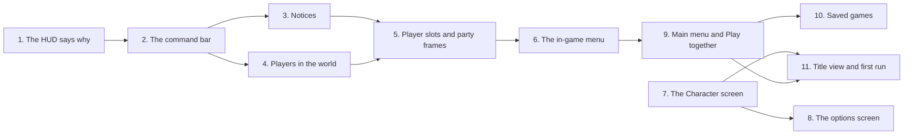

# UI revamp

Plan for rebuilding the game's three main screens on the design system:

- **The in-game HUD**, with the world UI that belongs to it.
- **The in-game menu**, with the options screen and a new Character screen.
- **The main menu**, with new Play together and Saved games screens.

Adopted on 2026-11-10 from three research proposals, one per screen. They are kept with their mockups in `Recordings/UiRevamp`, outside the repo. Each proposal offered three directions and recommended its middle one, and this plan takes those. [Architecture.md](Architecture.md) describes what exists today. Tick off the phase checklist as steps land, and move each settled behaviour into Architecture.md as its code arrives.

Every rule in [Multiplayer.md](Multiplayer.md#rules-for-new-code-starting-now) and in [DesignSystem.md](DesignSystem.md) applies: its foundations, components, patterns and accessibility baseline. This plan changes four of DesignSystem.md's patterns (Messages, Co-op, Menus and Feedback); see Removals and migrations.

## Where we start

The design system gave every screen one UI scale, a theme, a skin and shared components ([DesignSystem.md](DesignSystem.md), done on 2026-11-10). The screens themselves kept the layouts and flows they had before.

**The HUD**

- **Layout.** Health is a 140 x 18 bar reading "HP 72" at the top left, and the weapon is a 34 UI px slot at the top right. The abilities and statuses sit at the bottom centre. The camera centres the player, so health is about 400 UI px from the abilities and every corner is about 300 from the action.
- **The weapon slot** shows only an icon. Its two abilities are slots 5 and 6, at the other end of the screen.
- **Failures.** Every failed cast flashes the same red. `AbilityBarPresenter` drops the `CastOutcome`, so on cooldown, silenced and no target look alike.
- **Hidden state.** A stunned, silenced or rooted player's slots look ready. A cast in progress or a buffered cast shows nothing on the HUD.
- **Health** shows no maximum, no recent loss and no low state. Nothing explains death or the respawn delay.
- **Co-op.** No other player's health shows anywhere, nor who is who, nor whether they are down or in another world. Players have no world bar.
- **Statuses.** Buffs and debuffs share one row of eight and are told apart only by order. A ninth status is dropped.
- **Notices.** The one notice, "Waystone discovered", rises among the damage popups. Entering a world shows nothing, and a world has no display name.
- **Contrast.** `Health` on its translucent `HealthTrack` is 2.37:1, under the 3:1 a large shape that carries meaning needs. The theme tests check only text pairs, so nothing catches it.
- **Tooltips** give no numbers.

**The in-game menu**

- It looks the same paused (offline) and running (online), so a player can believe it pauses and die behind it.
- Opened in game, the options screen is opaque and full-screen. Online it hides the world and health while the player can be hit.
- It shows only buttons: no session, party, address to invite friends, save state or controls.
- **Saving is silent.** `GameSaveRecorder.Save()` returns a bool and raises nothing. A failed write is only logged, and Leave game and Quit go ahead regardless.
- **The host's confirmation** shows even with nobody connected, and does not say how many players it ends the game for.
- **The options screen** is one list of 41 items (736 UI px in a 288 UI px view at 640 x 360):
  - the 25 Character rows come first, so reaching Move from the Look row takes 27 presses of Down;
  - Reset shows on every row, and Reset all resets only the controls;
  - no option says what it does;
  - at 720p only Normal UI size fits, and its button does nothing without saying why.

**The main menu**

- **Look.** A flat panel with the name at `Title` size. Nothing of the game shows.
- **Host game** continues the latest save, or starts a new game when there is none. With a save on disk, nobody can host a new or older game.
- **Saves.** Continue does not say where or when. Older sessions stay on disk (`session-<id>.json`, `joined-<host>.json`), but the menu cannot reach them.
- **The join field** sits between Host game and Join game, prefilled with `127.0.0.1`. It takes no port, is neither remembered nor checked, and a gamepad cannot type into it.
- **Connecting** waits up to 10 s with no Cancel. After it connects, the fader stays black with no text, and a join lost before the player stands in a world returns to the menu without a word.
- **The status line** is one unwrapped line in a 160 UI px column. The host-gone text needs 334 UI px and a version refusal 527.
- **Inviting.** The host has no address to give friends: Multiplayer.md sends them to the Tailscale app.
- **Customization** is the first 24 rows of the options screen, with no preview.
- **Missing pieces:** no wrap-around navigation, no first run, and no build version on screen.

## Terms

| Term | Meaning |
|---|---|
| Command bar | The HUD's cluster at the bottom centre: the health bar over the ability row, buffs to its left, debuffs to its right, and the message line above |
| Message line | The line above the command bar that says why a press failed |
| Notice line | The line at the top centre where in-game notices queue |
| Player slot | A number from 1 to 4 that the host gives each player as they join, with a shape and a colour. Every machine agrees on it |
| Party frames | The HUD's frames for the other players, at the left edge |
| Vitals strip | The session line and the local player's health, shown on a full screen opened in game online |
| Preview stage | The local character drawn off screen into a render texture, for the Character screen and the title view |
| Title view | The still picture of the Overworld behind the main menu, rendered by a recipe |

## Goals

- Everything about the local player sits in one place, the command bar, near the player the camera centres.
- Every press is answered in words or a visible state on the frame it happens: why a cast failed, what is casting, what is queued, what is blocked.
- Players see each other: health, debuffs and casts over every player, party frames, and the same player numbers on every machine.
- The in-game menu says whether the game is paused and saved, keeps a running game in view, and gives the host the addresses friends join with.
- Character customization has its own screen with a preview, reachable from the main menu and in game. The options screen gets short, described categories.
- The main menu shows the game, says what each choice will do, puts hosting and joining in one place, and reaches every saved game.
- Every screen fits 480 x 270 UI px and keeps DesignSystem.md's accessibility baseline.

## Non-goals (for now)

- **Player names.** Slots give every player a number, shape and colour. Names need a text field (which a gamepad cannot type into), a filter to the characters the Galmuri subsets hold, and one more field at join (Later).
- **Kicking a player**, and **pausing online** while every player has the menu open (Later).
- **A live title scene,** such as a lit campfire with the player beside it (Later). The title view is a still picture.
- **A tabbed game hub** (inventory, map, quests), until those features exist. The in-game menu's column and cards can become its first tabs then.
- **A minimap, an XP bar, chat, audio and window or resolution settings.** The HUD keeps the top right free for a place name and a minimap.
- **Icon art** for abilities and statuses, which stays in DesignSystem.md's Later. Slots keep the ability names and statuses keep their abbreviations.
- **Join codes, a relay or lobbies,** and an on-screen keypad for gamepad players to type addresses. Recent hosts let a gamepad player rejoin with one press.
- **A HUD layout setting,** such as Diablo IV's choice of a centre or corner layout.

## Decisions

| Topic | Decision |
|---|---|
| Directions | **HUD:** the command bar, plus the world bars of the world-first direction. **In-game menu:** the side column and cards. **Main menu:** the title view and full screens. Each proposal's text fixes ship first, where they stand on their own. |
| Screen regions | In game, each part of the screen has one owner, so nothing overlaps at 480 x 270: • the bottom centre: the command bar; • the top centre: a 24 UI px notice band; • the left edge: the party frames; • the top right: kept free for a place name and a minimap later. Online, menus opened in game stay clear of the command bar and the notice band. |
| Health | In the command bar: 242 x 13 (12 until Phase 3) over the ability row, reading "72 / 100". • **Ticks:** one every 10 HP, one Weasel hit ([Units.md](Generated/Units.md)), until Phase 3 took them out (`HudSettings.TickHealth` 0 draws none). • **Recent loss:** the part just lost shows pale for 0.4 s. • **Low:** at 30% or less, the frame turns `Danger` and pulses once a second, holding steady with Reduce flashing on. The numbers live in `HudSettings`. |
| Bar contrast | A bar's fill against its track is measured like a text pair and meets 3:1. `HealthTrack` becomes opaque, which takes today's red to 3.68:1. |
| Players' health colour | Players' bars fill in a new `HealthPlayer` role, green, on the HUD and in the world. Mobs keep `Health`, red. The slot badge and the bar's shape still tell them apart, so colour is never alone. The exact green is settled on Phase 2's previews. |
| Weapon | The weapon slot joins the ability row beside its two abilities: Q W E R, a gap, then the weapon, 1 and 2. Its tooltip gives its damage, type and range. |
| Failures | A failed press shows its reason on the message line for 1.2 s, beside today's flash: "On cooldown", "Already casting", "No target", "Stunned", "Silenced" or "Rooted". The texts sit in one table keyed by `CastOutcome`. A buffered cast that expires or is dropped by a newer order loses its brackets without a text. |
| Slot states | A slot is ready, cooling down (as today), casting (frame in `Accent`), queued (`Accent` corner brackets), disabled (a hatch) or failed (the flash). Disabled means every slot while stunned or silenced, and the slots whose cast moves the caster (`CastMovement.Ability`) while rooted. |
| Statuses | Buffs left of the abilities and debuffs right, each in a 3 x 2 grid filling outwards from the abilities. A seventh of a kind shows "+n" on the sixth icon. A debuff's frame is `Danger` with a notched corner, so both its side and its shape carry its kind. |
| Players in the world | Every player has a world bar with debuff pips and a cast bar under it, on every machine, the local player's own included. An ally under the pointer gets the enemy's hover marker in green (settled in Phase 4). |
| Player slots | The host gives itself slot 1 and each joining player the lowest free one, and a player who leaves frees theirs. A slot has: • a number; • a shape (circle, diamond, triangle or square); • a colour role (`Player1` to `Player4`). It is a server-written network variable on the player, read by late joiners. |
| Party frames | At the left edge, one 104 x 26 frame per other player. Each shows the badge, "Player 2", and a bar with debuff pips (unticked, as the command bar's since Phase 3), or else "Respawning in 2", "In another world" or "Joining". Playing alone, none show. |
| Notices | In-game notices queue on the notice line: Waystone discovered, the world entered, a player joined, left or down, and while you are dead "You fell. Respawning in 3". This replaces the Messages pattern's "short notices float over the local player"; popups are left to hits and heals. |
| In-game menu | **A column on the left:** titled "Paused" offline and "Menu" online. Under the title, a status line ("Offline · paused", "Hosting · not paused" or "Joined · not paused") and a line saying whether the game waits or keeps running. Then Resume, Character, Options, Leave game and Quit to desktop, looping, and a saved line ("Saved at 14:32"). **Cards on the right:** Party (online) and Controls. A card that would reach the command bar or the notice band drops, Controls first. **Party frames** hide while the menu is open, since the Party card shows the same players. |
| Scrim | Offline, where time stands still, the menu dims the game with the `Scrim`. Online there is none: the column and cards are opaque, and the game stays live between them. Words carry the difference, not the dimming alone. |
| Saving on open | Opening the in-game menu saves, offline and on the host. A joined client writes its copy. The saved line shows the time just written. |
| Confirmations | Leaving or quitting asks only when it loses something: • as the host with others connected: "End the game for 2 other players? The game is saved."; • after a failed save: "The game couldn't be saved. Leave anyway?". Offline, alone as the host, or joined, it goes ahead at once. |
| Full screens in game | Options and the Character screen stay opaque raised panels. Online, they show the vitals strip, and their notice line says "You're taking damage." when the local player is hit. |
| Options | **Layout:** a rail of categories beside a pane of rows. • **Accessibility:** UI size, Reduce flashing, Reduce motion. It was the Display section; the settings file is unchanged. • **Controls:** the bindings. **Behaviour:** • Moving onto a category shows its rows. • The focused row's one-line description shows at the pane's foot. • Reset shows only on a row that differs from its default. • The footer's reset is the category's ("Reset controls"). • Opened in game, the screen returns to the category used last this session. |
| Character screen | **Layout:** a screen of its own, shared by the main menu and the in-game menu as the options screen is. A preview sits on the left (Turn left, Turn right and Pose), and rows on the right grouped by part, each part's colours under it. **Grouping:** read from the dyes the sheets and parts carry, not from a hand-made list. **Colours:** a colour row opens a swatch picker. The Character section leaves the options screen. This lifts PlayerCharacter.md's non-goal "An in-game character creator". |
| Main menu | **The panel:** raised, on the left, over the title view. It holds the logo, then: • Continue, with a line saying where, how long played and when saved; • New game, Saved games, Play together, Character, Options and Quit, looping. **Without a save,** Continue and Saved games hide. **The build version** shows at the bottom right. |
| Play together | One screen with two columns: • **Host:** Host and continue, Host a new game, Host another saved game, then the addresses friends join with, each with Copy, and the port. • **Join:** an address field taking `host` or `host:port`, checked before connecting and remembered; Join; and up to five recent hosts as buttons. **Connecting** shows a modal with a count and Cancel. |
| Host addresses | Shown openly. They are read from this machine's network interfaces: the home network and a virtual LAN. None is the public internet address behind the router, and none is ever sent anywhere. |
| Saved games | A screen listing every session and joined copy, newest first. Each card shows the place, the time played and the last save, with Play, Host and Delete. Delete asks first and keeps one `.bak` copy. |
| Title view | A still picture of the Overworld at dusk, rendered by an editor recipe into a sprite of 768 x 432 art px, which covers every canvas in the Scale table. The local character stands in it, drawn by the preview stage. |
| First run | On the first launch, a Welcome panel offers UI size, Reduce flashing and Reduce motion before the menu. The first New game goes through the Character screen, whose Back reads "Start". Later New games do not. |
| Online pause | Kept as it is: the game never pauses online. |
| New art | All from recipes: • **`UiSkinRecipe` gains:** a bar tick, slot corner brackets, a hatch, a debuff notch, and the four slot badges at 5 and 16 px; • **a new title view recipe.** No Aseprite work is needed. |
| New theme roles | `HealthPlayer`, `HealthLost`, and `Player1` to `Player4`. Each is measured in `UiTheme.md` like every other role. |

## Behaviour

### The command bar

Sizes are at 640 x 360 and 480 x 270 alike, anchored 8 UI px above the bottom edge.

| Part | Layout (UI px) | Behaviour |
|---|---|---|
| Ability row | Seven 32 px slots, 2 apart: Q W E R, an 8 px gap, then the weapon, 1 and 2. The row is 242 wide | Slot states and failures as in Decisions. The weapon slot shows the weapon's icon (or `IconMissing`) and has a tooltip |
| Health bar | 242 x 13, directly over the slots | "72 / 100" in `Body` outlined in `Outline`. Ticks, recent loss and the low state as in Decisions |
| Status groups | Two 3 x 2 grids of 20 px icons, 64 x 42 each, beside the slots | Buffs left, debuffs right, filling from the slots outwards |
| Message line | Centred 12 above the health bar, as wide as it | A failure's text for 1.2 s |

The cluster is 378 x 54 with statuses showing: 15% of the height at 640 x 360 and 20% at 480 x 270. Tooltips gain numbers: an ability's cooldown, cast time and range from its definition, and the weapon's damage, type and range.

### The notice line and moments

- **Layout.** A `NoticeLine` on a `Panel`, 8 below the top edge, sized to its text up to 240 UI px and wrapping to two lines.
- **Queue.** Each notice shows for its time from `HudSettings` (3 s), then the next shows. A notice repeated while it shows restarts it.
- **Notices:**
  - "Waystone discovered";
  - "Entering the Overworld", from the world's display name;
  - "Player 2 joined", "Player 2 left" and "Player 2 is down" (from Phase 5);
  - "You fell. Respawning in 3", counting down from `GameplaySettings.RespawnDelaySeconds`, then "Respawning..." until the player stands again.
- **On this machine only.** Each machine raises its notices from state it already has.

### Players in the world

- **The bar.** A player's world bar is the `WorldBar`'s 22 x 4 art px bar in `HealthPlayer`, centred 46 art px above the feet, with up to four debuff pips above it and the slot's 5 px badge to its left (from Phase 5). It stays put whether or not the player casts.
- **The cast bar** sits under the bar in `Accent`, 22 x 3 with a 1 px fill, sharing the bar's bottom border, and fills over the cast time:
  - the owner drives it from `CastStarted` and `CastEnded`;
  - every other machine drives it from `RemoteCastStarted`, `RemoteCastCompleted` and `RemoteCastCancelled`, filling from when the cast arrives and staying full until the completion or cancel arrives, or 0.5 s past the cast time.
  - A cast without a cast time never shows it, and a dead player's bar hides.
- **The local player's own bar and cast bar** show too. The camera centres it, so the eye is already there.
- **The ally hover marker** (`MarkerHoverAlly`) shows under the other player the pointer is over: the enemy's brackets in `Positive`. It never shows under the local player, where the pointer often rests. The attack cursor, which shows over enemies only, tells the two markers apart besides their colour.

### The in-game menu

- **Placement.**
  - **Column:** 144 UI px wide, 8 from the left edge, below the notice band.
  - **Cards:** 144 wide, 8 from the right edge, below the notice band, stacked.
  - **Fit:** online, both end above the command bar at every display in the Scale table. Offline, under the scrim, they may cover it.
- **Party card** (online). A row per player:
  - its badge, "Player N", and "You" or "Host";
  - a 40 x 6 bar, or "Down" or "In another world".
  - For the host, an invite block follows: each address with its network's name ("home network", "Tailscale") and a Copy button, then the port.
- **Controls card.** Move and attack, Attack move and Stop, with their keys, then the six ability keys as key caps. The labels come from `IInputBindingLabels` and follow `BindingsChanged`.
- **Focus.**
  - The column loops: Resume, Character, Options, Leave game, Quit to desktop.
  - Right from the column goes to the first control in the cards (the host's Copy buttons), and Left returns.
  - Offline and joined, the cards hold no controls.

### The options screen

- **Layout.** A 472 UI px block centred on the canvas: a 104-wide rail and a 360-wide pane holding today's rows and scrollbar, so it fits 480 x 270.
- **The rail.** The current category is a raised button with a pip, and the others are flat, so shape and the pip mark it, not colour alone. Right or Submit enters the first row, and Left from any row returns to the rail.
- **Descriptions.** The two lines at the pane's foot describe the focused row:
  - a binding's description comes from `RebindableActionList`;
  - the preferences' come from the controller;
  - the UI size row says "Larger sizes need a larger window." where none fits.
- **Opening.** From the main menu the screen opens on its first category, and in game on the category used last this session (Controls the first time). Escape closes it from anywhere, as today.

### The Character screen

- **Preview.** On the left, at a whole multiple of its art pixels (x4 at 640 x 360, x3 at 480 x 270).
  - Turn left and Turn right go through the 8 directions.
  - Pose cycles idle, run and the equipped weapon's attack.
  - It animates on an unscaled clock, so it moves while the game is paused.
- **Row groups.** Look first, then:
  - **Body,** with the dyes the base sheets carry (`CharacterAnimationSet.Dyes`: Skin, Eyes, Belt, Buckle);
  - **a group per part slot,** with its part row and the colours its worn option carries (`CharacterParts.Dyes`: Top with Tunic and Shirt, Cape with Cape and Lining, and so on).
  - The colour rows of a part not worn hide, and their picks stay in `settings.json`.
- **Swatch picker.** Submit on a colour row opens a popover of 12 UI px chips, 2 apart. The focused chip is framed in `Accent`, and its name shows under the grid. Arrows move, Submit picks and closes, and Escape closes.
- **Applying.** Changes apply and save at once, in game too. Each row has Reset, and Reset all asks first.

### The main menu and Play together

- **Continue's line.** It reads like "Clearing · 3 h 12 min · today 14:02": the nearest entry's display name, the time played, and when the game was saved.
- **Play together's focus.** Host and continue, Host a new game, Host another saved game, then the Copy buttons. Right moves to the Join column: the field, Join, then the recent hosts. Back is last.
- **Connecting.** A modal shows "Connecting to 100.101.102.103:7777 … 4 s of 10", with Cancel. Escape cancels too.
- **Joining.** After connecting, a line over the fader says "Joining 100.101.102.103's game…" until the fade in.
- **Errors.** Each one says what happened and what to do:

| Case | Message | Where |
|---|---|---|
| Empty or malformed address | "Type the host's address, like 192.168.1.20 or 100.101.102.103:7777." | Play together's notice line; the field stays selected |
| Timeout or unreachable | "Could not reach {address} in 10 s. Check the address, and that the host is in a game." | Play together's notice line |
| Refused: full | "{address} is full: 4 of 4 players." | Play together's notice line |
| Refused: other build | "The host runs {version} and you run {version}. Play together needs the same build." | Play together's notice line |
| Hosting fails | "Could not host on port 7777. Close any other copy of the game and try again." | Play together's notice line |
| Host left | "The host left the game. Continue carries on alone from where you were, in a saved game of your own." with Continue alone and Back | A dialog on the main menu, shown with or without another save |
| Lost while joining | "Lost the connection while joining {address}." with Play together and Back | A dialog on the main menu |

## Architecture

### Core

- **`HostAddresses`** (`Core/Network`): this machine's IPv4 addresses on interfaces that are up, each with a network name, behind an interface so tests can fake the interfaces. Used by the Party card and by Play together.
- **`JoinAddress`** (`Core/Network`): parses and checks `host` or `host:port`.
- **`NetworkSession.JoinAsync`** takes a port and ends cleanly when cancelled.
- **`MenuNotice`:** why the menu was reached (host gone, lost while joining). `NetworkSessionLifecycle` leaves it, and the main menu takes it, replacing `GameSave.TakeHostGoneNotice`'s line.
- **`GameSave`:**
  - `List()` returns a summary per save: id, `savedAt`, time played, the local player's world and place, and whether it is a joined copy;
  - `Delete(name)` keeps a `.bak` through a new `ISaveFolder.Delete`;
  - it keeps the time of the last write and whether it failed, for the saved line.
- **`UserSettingsData`** gains `recentHosts` and `firstRunDone`. A file from before reads them empty and false, or true when it already holds bindings or picks. The format version stays 1.
- **`WorldDefinition`** gains a display name for the world and for each entry (content rule 5, checked by `ContentTests`).
- **An unscaled `IClock`** for the preview stage.

### Gameplay

- **HUD:**
  - **`HudSettings`** (`Assets/Data/UI/HudSettings.asset`): the tick, the recent-loss time, the low threshold, and the message and notice times.
  - **`CastFailureMessages`:** the table of failure texts.
  - **Views:** `AbilitySlotView` gains the slot states; `PlayerHudView` and its prefab become the command bar; `StatusBarView` splits into two groups, with a `StatusIconDebuff` variant.
  - **Presenters:** `AbilityBarPresenter` keeps the outcome and reads the local player's controls; `PlayerOrders` raises an event when a cast is buffered and when the buffer clears.
- **Notices:** a `NoticePresenter` and the HUD's notice line (`NoticeView`). `WaystonePopupPresenter` moves onto them: since Phase 3 the presenter raises the waystone notice itself, and `WaystonePopupPresenter` is gone.
- **World:**
  - a `WorldBar` player variant (`WorldBarPlayer`) on the player prefab, with `WorldStatusIcons` and a new `WorldCastBar`;
  - `MarkerHoverAlly`, a variant of `MarkerHover`, in `PointerFeedbackLayer`.
- **Slots:**
  - `PlayerSlot`, a `NetworkBehaviour` on the player holding the server-written slot, with the host assigning it;
  - `PartyFramesPresenter` and the `PartyFrame` component.
- **In-game menu:**
  - `GameMenuView` and `GameMenuCanvas` rebuilt;
  - `PartyCardView` and its presenter (`IPlayerRegistry`, `ISessionStatus`), and `ControlsCardView`;
  - new components: `PartyRow`, `BarSmall` and `KeyCap`.
- **Options:** `OptionsMenuView` with the rail; new components `RailItem` and `DescriptionLine`; a description per action on `RebindableActionList`.
- **Character:**
  - `CharacterScreenController` and its view, taking the Character section's rows from `OptionsMenuController`;
  - `CharacterPreviewStage` and the `CharacterPreview` component;
  - the `SwatchPicker` component.
- **Main menu:**
  - `MainMenuController` keeps `ContinueGame`, `StartNewGame`, `HostGame` and `JoinGame` as entry points, since the PlayMode tests drive them. Their logic moves into a plain `MenuSessionStarter` that the new screens share.
  - `PlayTogetherController` and `SavedGamesController`, with their views;
  - new components: `Field`, `SessionCard`, `DialogNotice` (a `Dialog` variant with a message and one or two plain buttons) and `TitleView`;
  - `LoadingLine`, on a canvas above the fader in `Main`. It is placed through the Main scope's auto-inject list, so Core stays free of TextMesh Pro.
- **`NoticeLine`** gains wrapping to two lines.

### Editor

- **`UiSkinRecipe`** appends its new pieces (tick, corners, hatch, notch, badges); the pieces are append-only, as before.
- **`TitleViewRecipe`** and its writer render the title view into `Assets/Sprites/UI/Title`, through the probe-render path the design system's previews used.

## Networking

- **New:** the player slot, a server-written network variable on the player, read by late joiners at spawn. Nothing else in this plan adds replicated state or messages. Phase 3 gave three existing host messages one more field: a heal, an immune hit and a blocked status name their source unit, as a hit already did, so a client's popups tell its own apart.
- **Already replicated, now shown:**
  - health (`NetworkHealth`) and statuses (`NetworkStatusEffects`) on the party frames, the world bars and the Party card;
  - casts (`RemoteCast*`) on the cast bars;
  - each player's world (`PlayerWorldSync`) for "In another world".
- **Unchanged:** look, colour and part picks stay owner-written network variables on `PlayerNetworkSync`, now edited from the Character screen. The join payload is unchanged.
- **Local only:**
  - the layout, failure texts, slot states and notices, and the allies' damage numbers preference;
  - the saved line and the invite addresses;
  - the recent hosts, the first-run flag and the title view.
  The host's simulation never reads any of them.
- **The game never pauses online.** Kick, names and pings for every player are Later.

## Removals and migrations

- **DesignSystem.md**:
  - **Messages:** in-game notices move to the notice line.
  - **Co-op:** players get world bars and party frames; the HUD still shows only the local player's own controls.
  - **Menus:** the scrim marks a paused game.
  - **Feedback:** a failure is answered in words too.
  - **Components:** the new components join the table.
  - **Later:** "Co-op identity" and "players' world bars and status icons" are done.
- **KeyBindings.md:** the options screen (rail, categories, the Character section gone, Display renamed Accessibility), the in-game menu (column, cards, confirmations, saving on open) and the main menu (Play together in place of the Host and Join buttons and the join field).
- **PlayerCharacter.md:** its non-goal "An in-game character creator" is lifted, and its customization rows move to the Character screen. **AsepriteCharacters.md:** the Look row's home moves the same way.
- **Multiplayer.md:**
  - "the menu shows no slot list" becomes the Saved games screen;
  - the joining steps point to Play together's addresses instead of the Tailscale app;
  - the authority table gains the player slot.
- **Prefabs and scenes** are rebuilt through the editor, with `[FormerlySerializedAs]` on any kept field that moves: `PlayerHudCanvas.prefab`, `GameMenuCanvas.prefab`, `OptionsMenu.prefab` and `MainMenu.unity`. Each diff is checked for save churn.
- **The waystone notice** leaves the damage popup layer.
- **Tests** that count options rows (`OptionsMenuControllerTests`, `OptionsMenuPlayModeTests`, which count 41 items) or drive the old main menu buttons are updated in the phase that changes them.

## Phases

Each phase ships on its own, keeps the game playable offline and hosted, and comes with tests. A phase whose look can change settles it on previews first, signed off before its tests and docs. Previews show every state of what they change (ready, cooldown, casting, queued, failed, disabled, low, down, elsewhere, joining) at every display in the Scale table. An open question is settled with the user at the start of the phase named for it. Each phase updates Architecture.md and Roadmap.md as it lands.

The HUD comes first, because it is on screen the most. The menus follow, and the main menu last. Phases 7 to 11 do not depend on the HUD's phases, so the order can change.

### Phase 1: the HUD says why

Fixes on today's layout, before anything moves.

- [x] Previews of the slot states, the message line and the health text, signed off.
- [x] `HudSettings` with the message time.
- [x] `CastFailureMessages`, and `AbilityBarPresenter` keeping the outcome: the message line above the ability bar, beside the flash.
- [x] Slot states on `AbilitySlotView`:
  - [x] casting;
  - [x] queued, from `PlayerOrders`' new buffered event;
  - [x] disabled, from the local player's controls.
- [x] Skin: the corner brackets and the hatch.
- [x] Health reads "72 / 100".
- [x] Tooltips with numbers, and the weapon slot's tooltip.
- [x] `HealthTrack` opaque. The fill-on-track pairs (`Health` today, `HealthPlayer` from Phase 2) are measured in `UiThemeUsage` and checked at 3:1.

#### Phase 1 notes

- **Settled with the user on 2026-11-10,** on previews of today's layout at 640 x 360 and 480 x 270:
  - the slot states as built: the frame in `Accent` while casting, 1 px `Accent` corner brackets 1 UI px outside a queued slot, and the hatch in `ControlDisabled` (`Border` was previewed as a stronger alternative);
  - the message line 66 UI px up, just above the status row, which today sits directly on the bar (Phase 2 moves it to 12 above the health bar);
  - "72 / 100", the tooltip numbers below, and a tooltip with no room above its target shown below it.
- **The previews.** Written to the gitignored `Recordings/UiRevamp/Phase1` by a temporary tool, since removed: the real `PlayerHudCanvas` on a camera's canvas at x3 and x4 over Phase 5's capture of the Clearing, its themed components woken by reflection and its views set by hand. The camera had to sit at the origin: 5000 units away, float error in the world-space round trip of `ThemedText`'s snapping rounded neighbouring glyphs apart.
- **Failures.** `CastFailureMessages.For(outcome)` gives one of six constant strings, or null for an empty slot, death, and a buffered cast that expired or was dropped (`Expired`, `Cancelled`). Every failure still flashes its slot, as before; only the words depend on the outcome. A message shows for `HudSettings.MessageSeconds` (1.2 s), and a newer failure replaces it and restarts the time. The presenter hides it when its time is up in `Tick`, which allocates nothing.
- **Slot states.**
  - **Casting** follows `PlayerAbilities.CastStarted` and `CastEnded`. An instant cast starts and ends on one tick, so it never shows.
  - **Queued** follows `PlayerOrders.BufferedCastChanged`: the slot when a cast is buffered, -1 whenever the buffer clears (a newer press gives -1, then its slot). `PlayerController` passes it on as an event of its own, which subscribes to its orders, and exposes `BufferedSlot`.
  - **Disabled** follows `StatusEffects.Changed` and reads `Controls`. An empty slot is never hatched: there is nothing in it to block. The hatch sits under the name, so the name stays readable.
  - Binding a player shows its running cast, buffered slot and controls at once; `SetAbility` resets the three states and the presenter puts them back.
- **Co-op.** `PlayerOrders` and `PlayerAbilities` run on the machine that owns the player, a joined client's own included, and its statuses are the mirror of the host's, so the failure words, the casting, queued and disabled states all work on a client from its own events, with nothing sent. `NetworkHudPlayModeTests` binds a copy of the HUD's bar to the in-process client's player and checks each state there, and that the host's own bar shows none of it.
- **Tooltips.** `ITooltipSource.TryGetTooltip` gives a third string, the numbers, shown on a new line in `Text` between the title and the description; an empty line hides. `TooltipDetails` builds them when a slot shows another ability or weapon:
  - an ability: "Cooldown 2 s · Cast 0.25 s" ("Instant" for none), and "Range 6" on a second line when it is aimed at a point, a unit or along a line of some length. Sweep and Whirl (`None`) and Charge, Lunge and Roll (a 0-long line) show no range. One line of all three ran to 151 UI px, past the tooltip's 150.
  - a weapon: "20 Physical · Melee", or "24 Physical · Range 5" for the bow, its attack range rather than its arrow's 6.5.
  The weapon slot's icon moved from `PlayerHudView` into a new `WeaponSlotView`, the slot's `ITooltipSource`, beside a `TooltipTrigger`; the slot's image now takes the pointer, as the ability slots' do. The tooltip went below the slot, since above it there is no room in the top corner.
- **Health.** `PlayerHudView` builds "72 / 100" only when the current or maximum health it shows changes, and shows "-- / --" without a local player.
- **Contrast.**
  - `HealthTrack` is opaque: `Health` on it is 3.68:1, which `UiTheme.md` floors to 3.67.
  - A bar's fill names its track: `ThemedGraphic.Track`, set on the `Bar` component's fill (its root) and on the `WorldBar`'s fill (its frame).
  - `UiThemeUsage.CollectFills` and `MeasureFills` measure each pair once at 3:1, the fill drawn over the track and a translucent track over white and over black. `UiTheme.md` gains a Fills on tracks table, and `UiThemeTests` checks it.
- **Skin.** `SlotCorners` is 11 px, an L of 5 px arms 1 px thick in each corner, 9-sliced at the arm. `Hatch` is a 4 px tile of one diagonal, shown tiled. Both are greyscale, appended to `UiSkinPiece`, with three new settings on the recipe.
- **Left as they are.**
  - **The hatch is not measured.** `ControlDisabled` lines on a slot are 3.39:1 over a black world and 2.0:1 over a white one; `Border` would give 6.49 and 3.83. The hatch is a second cue beside the failure's words and the status icon, and it was settled on the previews.
  - **The `Accent` frame and brackets** sit on the world, so they are not measured either.
- **Tests.**
  - `AbilityBarPresenterTests` (18, new): each outcome's words or none, the message time, casting, queued and dropped brackets through real orders, the hatch per control, rebinding, no allocation.
  - `PlayerOrdersTests`: the buffered event.
  - `TooltipTests`: the numbers, the weapon slot, below a target at the top, and the HUD's weapon trigger.
  - `UiThemeTests`: `FillRatio`, `MeasureFills` and the project's fills at 3:1.
  - `UiContentTests`: the slot states and the message line.
  - `UiSkinWriterTests`: the corners and the hatch pixel by pixel.
  - `DesignTablesTests`: the fill table.
  - `NetworkHudPlayModeTests` (new).
  - `PlayerWeaponSystemTests` and `MobPlayModeBehaviorTests`: "72 / 100".

### Phase 2: the command bar

- [x] Previews at every display in the Scale table and at Large and Larger, signed off, settling the `HealthPlayer` green.
- [x] The screen regions, written into DesignSystem.md's Foundations, with a test that the HUD keeps to them at 480 x 270.
- [x] The command bar on `PlayerHudCanvas`:
  - [x] the ability row with the weapon slot;
  - [x] the health bar over it;
  - [x] the message line above.
  The top-left bar and the top-right weapon slot go.
- [x] Health:
  - [x] ticks, the recent loss (`HealthLost`) and the low state, steady with Reduce flashing on;
  - [x] `HealthPlayer` on the local bar.
- [x] Status groups:
  - [x] buffs left, debuffs right, with "+n";
  - [x] `StatusIconDebuff` with its notch;
  - [x] skin: the tick and the notch.

#### Phase 2 notes

- **Settled with the user on 2026-11-10,** on previews at every UI size of the Scale table (11 sizes, from 480 x 270 to 683 x 384) and at 640 x 360 and 480 x 270 in detail:
  - `HealthPlayer` is `#4CC25A`, the proposal's green, of three: `#38B54A`, deeper, and `#6FD36B`, lighter;
  - `HealthLost` is `#D6D6D6`, the debuff notch 5 px, and a low frame dims to 35% at the bottom of its pulse;
  - tooltips of the command bar show above the whole bar rather than just above their slot, which otherwise covered the health bar.
- **The previews.** Written to the gitignored `Recordings/UiRevamp/Phase2` by a temporary tool, since removed, as in Phase 1:
  - each size rendered at x2;
  - the details at x3 and x4, over Phase 5's capture of the Clearing, cropped to each size.
- **Layout.** A `CommandBar` rect, 378 x 60 UI px, 8 above the bottom edge, holds everything.
  - The ability row (the `AbilityBar`, its spacer now 4 px, so R and the weapon slot are 8 apart) at its bottom.
  - The health bar, a `Bar` resized to 242 x 12, 2 above the row.
  - The `MessageLine` 2 above the health bar.
  - The `StatusBar`, 378 x 42, holding a `Buffs` and a `Debuffs` grid at its two ends.
  The weapon slot moved into the row and shrank from 34 to 32 UI px. The slot sizes, gaps and fonts are unchanged, so the row is 242 wide.
- **Screen regions.** DesignSystem.md's Foundations gives each region's numbers. `HudLayoutTests` lays a copy of the HUD out at each size with every icon and the message line shown. Every graphic but the tooltip stays inside the command bar's region, 378 wide and 68 tall: the queued brackets reach 1 UI px below the row, inside it.
- **Health.**
  - `HealthBarView` on the `Bar` component replaces the fill and text fields of `PlayerHudView`. The HUD's previous health bar was the same `Bar`, its fill now `HealthPlayer`, so mobs keep `Health` only on the `WorldBar`.
  - Ticks are copies of a hidden template, anchored at their share of the bar, so they need no width; a spacing that falls between pixels lands where the canvas rounds it.
  - `PlayerHudPresenter` became an `ITickable`. Each tick it compares the health with what it showed, because a client's network sync sets health without an event (`Health.SyncTo`), as `WorldHealthBar` found. The events still update the bar at once.
  - The loss starts from the highest health of the hits within its time; a heal past that start hides it, and a change of maximum drops it.
  - The low state covers 0 HP too, so a dead player's frame stays `Danger` until the respawn.
- **Statuses.**
  - `StatusBarView` holds two arrays, `buffs` (formerly `icons`, kept with `FormerlySerializedAs`) and `debuffs`, of six each.
  - Each group is a `GridLayoutGroup` starting at the corner nearest the abilities, filling the bottom row outwards first. Hidden icons take no cell, so the shown ones always pack from that corner.
  - A seventh status of a kind turns the sixth icon into "+n" (n counting itself), on `Surface`, its tooltip "n more" with their names.
  - `StatusIconView` gained a theme for that `Surface`.
- **Theme and skin.** `UiColour` appends `HealthPlayer` and `HealthLost`, and `UiSkinPiece` appends `BarTick` (1 x 3) and `Notch` (5 px).
  - Both new roles are fills on `HealthTrack` in `UiTheme.md`, at 8.04:1 and 12.67:1.
  - The text on the bar is now `Text` on `Outline`, so the `Text` on `Health` pair left the table.
- **Found on the way.** The editor script moving the bar's parts into `CommandBar` re-parented it after the tooltip, which would have drawn the tooltip under the command bar; `TooltipTests` caught it and the tooltip is last again.
- **Tests.**
  - `HudLayoutTests` (2, new) and `PlayerHudPresenterTests` (6, new).
  - `StatusFeedbackTests`: the groups and "+n".
  - `UiContentTests`: the command bar's components and the debuff icon.
  - `UiSkinWriterTests`: the tick and the notch.
  - `UiThemeTests`: the new fill pairs.
  - `TooltipTests`: above the rect a trigger keeps clear, every HUD trigger keeping the command bar clear.
  - `DesignTablesTests`, with `TestThemes` gaining the two roles.
  - `PlayerControlsPlayModeTests`: statuses in their groups.
  - `PlayerWeaponSystemTests`: the HUD helper building a `HealthBarView`.

### Phase 3: notices and moments

- [x] Open question settled: other players' damage popups.
- [x] Previews of the notice line and the death notice, signed off.
- [x] `NoticePresenter` and the notice line, with its queue.
- [x] "Waystone discovered" moves to the notice line.
- [x] Display names on `WorldDefinition` and its entries, a content rule and a `ContentTests` case, and the world-entered notice.
- [x] The death notice and its countdown.
- [x] The damage popup policy, as settled.
- [x] DesignSystem.md's Messages pattern.

#### Phase 3 notes

- **Settled with the user on 2026-11-10:**
  - **Open question 1,** on previews of the three options over the Clearing with the host, an ally and Weasels: all three, as a preference. A Display row of the options screen, "Allies' damage numbers", reads Shown (the default, today's behaviour), Smaller or Hidden.
  - **The notice line,** on previews at 640 x 360, 480 x 270 and every UI size of the Scale table: `Accent` text on a `Panel` (`Surface`, framed in `Border`), 15 UI px tall for one line, with 2 UI px above and below. A 13 px panel was the alternative.
  - **"Respawning..."** is written with three full stops. Galmuri's ellipsis draws its dots at mid-height.
  - **Square corners** for the whole skin. Cut by 1 px, a 1 px frame met itself only at a diagonal and a square fill (a status icon's colour, a bar's fill) showed past it, so frames looked chipped. A 2 px bevel was the alternative. `UiSkinRecipe`'s corner cut is now 0 and every piece was written again: panels, frames and slots are 6 px with 2 px borders, the bar frame 3 px with 1 px borders, and the pip a 5 px square.
  - **Black frames and the key top left.** `Border`, every frame's role, is now black. It was `#9A9EB3`. The toggle row's box keeps a light frame in `ControlSecondary`, since a black one would vanish on the options screen's dark panel. On every ability slot the key moved to the top left corner and the cooldown seconds to the top right.
  - **The health bar** loses its ticks: `HudSettings.TickHealth` is 0, which draws none (the bar keeps the mechanism and its hidden template). Digits of our own (3 x 6 and 3 x 5 px, Galmuri having no smaller size) were previewed and read blockier once outlined.
  - **The health bar is 13 UI px tall,** where it was 12. Its outlined text is 9 px tall, and the bar's inside was 10 px, so the text sat half a pixel off centre: 1 px low at x3 and 1 px high at x4. Inside 11 px it centres at every zoom, with 1 px of fill above and below. The message line stays at 48, so the command bar keeps 60 and its region 68. Its text still clears the bar by 2 UI px, since its glyphs sit inside its 12 px rect. Scaling the text to 0.9, also tried, put each font pixel on 2.7 or 3.6 screen pixels, and was still 1 px off at x4.
  - **The health text draws smaller,** through `PixelTextScale` on the `Bar`'s text. A scale only keeps the pixel font crisp when each font pixel covers a whole number of display pixels, so it changes with the zoom: the whole number nearest three quarters of the zoom's, rounded half up and at least two. That gives 2/3 at x3, 3/4 at x4 and 5/6 at x6, and leaves x2 unchanged. `ThemedText` snaps such a text to whole display pixels rather than whole UI px. A fixed 0.9 scale, tried first, could not keep to the grid. At 1080p the digits are 14 px tall, under the 18 px minimum for text; this is an exception recorded in DesignSystem.md's Accessibility, since the bar's fill shows the health too. The text is centred to within 1 display pixel, the most these sizes allow.
  - **Wrapping stays on** the main menu's status line. Its long host-gone status now wraps to three lines in its 160 UI px column, and the buttons shrink 4 UI px while it shows, until Phase 9 rebuilds the menu.
- **The previews.** A temporary tool, since removed, wrote them to the gitignored `Recordings/UiRevamp/Phase3`, as in Phase 2:
  - the real `PlayerHudCanvas` on a camera's canvas at x3 and x4 over Phase 5's Clearing capture;
  - for the popups, the `PopupText` prefab placed over that capture with the adventurer's idle frames and the Weasel's added.
  - At 480 x 270 (Large at 1080p) the capture stays at x3 under a UI at x4, as in game.
- **Layout.** `Notice` is a `Panel` drawn before the tooltip, anchored at the top centre 8 UI px down, its image never taking the pointer.
  - It holds a `NoticeLine` instance (`Accent` on `Surface`, ending in an ellipsis past what fits).
  - `NoticeView.Show` lays the text out at 240 UI px less 4 a side, then shrinks the panel to its widest line, rounded to an even width so it stays centred, and to its lines at Galmuri7's 11 UI px line height plus 2 above and below.
  - Two lines take the band's 24 whole.
  - `NoticeLine` itself now wraps (`TextWrappingMode` Normal).
- **Queue.** `NoticePresenter.Show(notice)`:
  - shows a notice at once when none shows, restarts it when it already shows, and queues it once otherwise;
  - shows each for `HudSettings.NoticeSeconds` (3 s) of game time;
  - stops the time while `GameFlow.IsTransitioning`, so a notice raised as a trip starts shows its whole time after the fade in.
  The presenter is local to its machine, and `Tick` allocates nothing.
- **The notices.**
  - **"Waystone discovered":** on `WaystoneNotices.Discovered` for the local player. The `WaystonePopupPresenter` and `GameplaySettings`' waystone popup colour are gone, along with its `UiThemeTests` check. The text stays on `GameplaySettings`.
  - **"Entering the Overworld":** when `PlayerWorlds` puts the local player in another world than the one announced last: at a session's start, on joining (also when the player is bound already in a world), and after a trip to another world. A trip within the world, a respawn's included, announces nothing.
  - **The death notice:** from the local player's `Health.Died` on this machine, a client's own from the host's replicated hit. "You fell. Respawning in 3" counts whole seconds of game time down from the respawn delay, its texts built once. "Respawning..." then holds until `Health.Restored`, and shows at once for a player bound dead. The death notice holds the line, and the shown notice's time stands still behind it.
- **Display names.** `WorldDefinition.DisplayName` and `Entry.DisplayName`, without an article, since the notice reads "Entering the" and the name.
  - **Overworld:** the regions (Clearing, Village forest, Lakeside, Snowfield, Coast, Lava fields) and their gates ("Clearing, south road").
  - **Sandbox, Sandbox interior, Testlands and Stress test** name their own entries.
  - `ContentRules.World` checks a world's name is set, unique among worlds, and its entries' names are set and unique within the world.
  - The world generator's merge (`MergeEntries`) and `WorldAuthoring.SetEntry` keep an entry's display name, which is written by hand.
- **Allies' popups.** `DamagePopupPresenter` treats a hit, tick, heal or block as an ally's when it involves another registered player but not the local one. It shows it as `UserSettings.AllyPopups` asks: as before, at `CombatSettings.AllyPopupSize` (Caption, the ticks' size; Galmuri has nothing smaller), or not at all. Your own popups, and those no player is part of, always show at their own size.
  - **What a client knows.** It knows a hit's source already. In this phase `HealedRpc`, the immune `HitRpc` and `BlockedRpc` also name their source unit, so a heal you gave an ally is yours on a client too. No new state is replicated.
  - **Events.** `Health.Healed`, `DamageReceiver.ImmuneHit` and `StatusEffects.Blocked` gained the source.
- **Co-op.**
  - **Waystones:** a joined client learns of its own discoveries from `PlayerWorldSync.WaystoneDiscoveredRpc`, which raises its `WaystoneNotices`.
  - **Worlds:** it learns of its own world from `PlayerWorldSync`'s replicated state applied to its `PlayerWorlds`.
  - **Death:** it learns of its own death from `NetworkHealth`'s replayed hit, and of its restore from `RestoredRpc`.
  - So every notice is raised on its own machine, with nothing new on the wire. `NetworkNoticesPlayModeTests` drives a copy of the HUD's notice line on the in-process client.
- **Tests.**
  - `NoticePresenterTests` (9, new) and `NetworkNoticesPlayModeTests` (new).
  - `HudLayoutTests`: the notice line within the notice band at its widest and tallest.
  - `UiContentTests`: the notice line's components.
  - `ContentTests`: worlds' display names and a world breaking the rule.
  - `CombatComponentTests`: allies' popups in each setting.
  - `UserSettingsTests` and `OptionsMenuControllerTests`: the preference and its row. `OptionsMenuPlayModeTests` counts 42 items.
  - `WorldGenerationWriterTests`: display names kept by the merge.
  - `UiThemeTests`: without the waystone colour; `UiTheme.md` gains `Accent` on `Surface`, 7.44:1.
  - `WaystonePlayModeTests`: the discovery on the notice line.
  - `UiSkinWriterTests`: square corners by default, a cut one at a cut of 1.
  - `PlayerHudPresenterTests`: a tick spacing of 0 shows no ticks.
  - `UiContentTests`: the health bar 242 x 13, its text carrying `PixelTextScale` at 0.75.
  - `UiThemeTests`: `PixelTextScale`'s scale at each zoom, and a scaled text snapped to whole display pixels.
  - `UiScalePlayModeTests`: the hosted HUD's health text at the zoom's scale, 3/4 at Large.
  - `UiContentTests`: the key top left and the seconds top right, and the toggle box framed in `ControlSecondary` at 3:1 or more on the panel. `UiTheme.md`: `Border` black.

### Phase 4: players in the world

- [x] Previews of your own and an ally's bar, pips and cast bar, and the ally hover marker, signed off.
- [x] The `WorldBar` player variant on the player prefab, with `WorldStatusIcons` and `WorldCastBar`, on every machine.
- [x] `MarkerHoverAlly`, the enemy's shape in `Positive`, so no skin piece.
- [x] PlayMode, with the in-process host and client:
  - [x] the client sees the host's bar, pips and cast;
  - [x] a late joiner sees current health.
- [x] DesignSystem.md's Co-op pattern and Later.

#### Phase 4 notes

- **Settled with the user on 2026-11-11,** on previews at 640 x 360 (x2, x3 and x6) and 480 x 270 (x4), and on two comparison sheets at x6:
  - **The cast bar:** 22 x 3 art px with a 1 px fill, sharing the health bar's bottom border, so casting adds 2 px under the bar. The alternatives were a 22 x 4 bar with a 2 px fill sharing the border, and a 22 x 3 bar 1 px apart.
  - **The ally hover marker:** the enemy's brackets in green. The alternatives were square corners, arcs on the axes, and a whole ring. Since the two markers share a shape, the attack cursor, which shows over enemies only, is the cue besides colour.
  - **The height:** the bar's centre 46 art px above the feet, so the cast bar's bottom edge is at 42. The tallest look reaches 42 while it stands, idles, walks or runs: the longbow carried on the back, at 41, plus the outline. Casts that raise the arms or leap (Smite, Sweep, Charge, Leap, Volley) and the attacks reach into the bars for a moment, and the bars draw over them.
  - **Not under yourself:** the ally marker shows only under other players.
- **The previews.** A Python script, kept outside the repo, composed them in the gitignored `Recordings/UiRevamp/Phase4`:
  - the skin's sprites in the theme's colours, the adventurer's and the Weasel's baked frames, and the recipe's marker shapes ported;
  - over Phase 5's Clearing capture, with the Phase 3 HUD masked in from its own captures.
- **Layout.** `WorldBarPlayer` is a variant of `WorldBar`:
  - its fill is in `HealthPlayer`;
  - `CastFrame` (the skin's `BarFrame`, 22 x 3, `HealthTrack`) and `CastFill` (`BarFill`, 20 x 1, `Accent`, read against the cast frame) sit 2.5 art px below its centre, unlit on `Overlay` at orders 0 and 1, and are hidden until a cast;
  - `WorldCastBar` is on its root, beside `WorldHealthBar` and `WorldStatusIcons`.
  The player prefab holds an instance as `HealthBar`, its last child, 46 art px up, wired to the player's `Health`, `StatusEffects` and `PlayerAbilities`. Its root's `Overlay` sorting group sorts at the root, as the Weasel's does.
- **The cast bar.** `WorldCastBar` fills on the game clock (injected, as `CharacterVisuals` is), from the left, sizing its sliced fill as `WorldHealthBar` does.
  - On the owner it shows on `CastStarted` and hides on `CastEnded`, completed or cancelled. An instant cast starts and ends on one tick, so it never shows.
  - On a copy it shows on `RemoteCastStarted` and hides on `RemoteCastCompleted` or `RemoteCastCancelled`, or once `remoteHoldSeconds` (0.5 s) pass beyond the cast time, in case neither arrives.
  - It hides while the player is dead. `LateUpdate` allocates nothing.
- **The ally hover marker.** `MarkerHoverAlly` is a variant of `MarkerHover` with its role `Positive`. The Gameplay scene's `PointerFeedback` holds an instance, `AllyHoverMarker`, as `PointerFeedbackLayer.allyHoverRing`. `PointerFeedbackPresenter` shows it under a living player the picker finds, unless it is the local player, and hides it with the other feedback.
- **Found on the way.** The `WorldBar`'s four pips were scaled to 0.832, so they drew 4.16 art px off the pixel grid, though the docs said 5 px. They are unscaled now, on the Weasel too. The fourth pip still reaches 1 px past the bar's right end, as before.
- **Co-op.** Nothing new is sent: health comes from `NetworkHealth` (a late joiner's at spawn), the pips from `NetworkStatusEffects`, and the casts from `PlayerNetworkSync`'s cast messages. `NetworkWorldBarsPlayModeTests` checks them on the in-process client and host.
- **Tests.**
  - `WorldCastBarTests` (8, new) and `NetworkWorldBarsPlayModeTests` (2, new).
  - `WorldHealthBarTests`: the player prefab's bar, the cast bar clearing the tallest look read from the parts' layers, and the pips unscaled.
  - `PlayerFeedbackTests`: the ally marker under another player, never under the local player, a dead ally or with the enemy's.
  - `UiContentTests`: the player prefab read too, its bar's sprites and the ally marker themed, the ally marker a variant of the hover marker in `Positive` that the Gameplay scene uses.
  - `UiThemeTests`: the cast bar's `Accent` on `HealthTrack`, 13.48:1 in `UiTheme.md`.
  - `SpriteSortingTests`: the units it renders lose their world bars, which draw over every unit and prop by design.

### Phase 5: player slots and party frames

- [ ] Previews of the badges and the party frames in each state, signed off.
- [ ] `PlayerSlot`: the host assigns the lowest free slot, a leaver frees theirs, and late joiners read it.
- [ ] Theme roles `Player1` to `Player4`. Skin: the badges at 5 and 16 px.
- [ ] Badges on the players' world bars.
- [ ] `PartyFrame` and `PartyFramesPresenter`: alive, respawning, in another world, joining.
- [ ] The joined, left and down notices.
- [ ] PlayMode:
  - [ ] slots agree on host and client;
  - [ ] a late joiner reads them;
  - [ ] a leaver's slot is reused.
- [ ] Multiplayer.md's authority table.

### Phase 6: the in-game menu

The Character button arrives with Phase 7.

- [ ] Previews offline, hosting and joined at every display in the Scale table, signed off.
- [ ] The column:
  - [ ] titles, status lines and labels;
  - [ ] looping navigation;
  - [ ] the saved line.
- [ ] Saving on open. `GameSave` keeps the last write's time and failure.
- [ ] Confirmations only when something is lost, and the failed-save confirmation.
- [ ] The scrim offline only.
- [ ] `HostAddresses`.
- [ ] The Party card, with the host's invite block and Copy.
- [ ] The Controls card and `KeyCap`.
- [ ] Cards that drop by height, with a test.
- [ ] The party frames hiding while the menu is open.
- [ ] PlayMode, with an in-process client:
  - [ ] the host's dialog names one player;
  - [ ] a joined client leaves without a dialog;
  - [ ] both see one roster.
- [ ] KeyBindings.md's In-game menu.

### Phase 7: the Character screen

- [ ] A spike of the preview stage: a character drawn off screen with its own camera and light into a render texture, its outfit composed as in game, on an unscaled clock. Its findings go in Phase 7 notes.
- [ ] Previews of the screen and the swatch picker, signed off.
- [ ] `CharacterScreenController` and its view:
  - [ ] the rows moved out of `OptionsMenuController`;
  - [ ] grouped by part from the dyes;
  - [ ] colour rows hidden for parts not worn.
- [ ] `SwatchPicker`.
- [ ] The preview, with turn and pose.
- [ ] The Character button on the main menu and in the in-game menu, and the vitals strip online.
- [ ] The Character section leaves the options screen.
- [ ] PlayMode: a pick made on the screen in game reaches the client's copy.
- [ ] PlayerCharacter.md's non-goal, AsepriteCharacters.md's Look row, KeyBindings.md's options screen.

### Phase 8: the options screen

- [ ] Previews of the rail and the description line, signed off.
- [ ] The rail (Accessibility, Controls), `RailItem` and its navigation.
- [ ] Descriptions for every row, from `RebindableActionList` and the controller, and the UI size explanation.
- [ ] Reset shown only on changed rows, and out of navigation while hidden.
- [ ] The category's reset in the footer.
- [ ] Reopening on the last category in game.
- [ ] The vitals strip and the "You're taking damage." notice online.
- [ ] KeyBindings.md's options screen.

### Phase 9: the main menu and Play together

- [ ] Previews of the menu, Play together, the connecting modal and the dialogs, signed off.
- [ ] The left panel:
  - [ ] Continue's line;
  - [ ] looping;
  - [ ] the version.
  The logo is the game's name in `Display` until Phase 11.
- [ ] `MenuSessionStarter`, with the controller's entry points kept.
- [ ] Play together's host column, using `HostAddresses`.
- [ ] Its join column:
  - [ ] `JoinAddress` and the `Field` component;
  - [ ] the recent hosts in `settings.json`.
- [ ] The connecting modal with Cancel, and `JoinAsync` with a port and cancellation.
- [ ] `LoadingLine` over the fader.
- [ ] The error messages, and `NoticeLine` wrapping to two lines.
- [ ] `MenuNotice` and `DialogNotice` for a host gone and a join lost.
- [ ] PlayMode:
  - [ ] joining through the screen with an in-process host;
  - [ ] cancelling while connecting;
  - [ ] the host-gone dialog.
- [ ] KeyBindings.md's Main menu, Multiplayer.md's joining steps.

### Phase 10: saved games

- [ ] Previews of the screen and its cards, signed off.
- [ ] `GameSave.List()` and `Delete`, with `ISaveFolder.Delete` keeping a `.bak`.
- [ ] The Saved games screen and `SessionCard`: Play, Host, and Delete behind a confirmation.
- [ ] The Saved games button, and Play together's Host another saved game.
- [ ] PlayMode: hosting an older session.
- [ ] Multiplayer.md's and WorldStreaming.md's save decisions.

### Phase 11: the title view and the first run

- [ ] Open question settled: the game's name and logo.
- [ ] `TitleViewRecipe` and the title view sprite, with `UiContentTests` allowing the title sprites.
- [ ] `TitleView` behind the menu, with the local character standing in it.
- [ ] The logo.
- [ ] The Welcome panel and `firstRunDone`.
- [ ] The first New game going through the Character screen.

### Later

- **Player names,** typed on the Character screen, filtered to the font's characters and sent at join.
- **Kick,** for the host, behind a confirmation, with the reason shown on the client's menu.
- **Pausing online** while every player has the menu open (Path of Exile 2's rule).
- **A live title scene,** lit, with the player's character by a campfire.
- **A tabbed game hub,** once inventory, map and quests exist.
- **Pings** for every player on the Party card.
- **Gamepad and lobbies:** an on-screen keypad for addresses, join codes once a relay exists, and a lobby on the Character screen before a session starts.
- **More than one character per install.**
- **The top right:** a place name and a minimap.
- **Settings:** strength steps for Reduce flashing and Reduce motion, and the Accessibility rows in DesignSystem.md's Later (high contrast, larger text, colour vision, cursor size).

## Testing

- **EditMode:**
  - **`AbilityBarPresenter`,** with fakes: a text per failure outcome, each slot state, and the disabled slots per control.
  - **`StatusBarPresenter` and `StatusFeedbackTests`:** the two groups, their order and "+n".
  - **The notices:** the queue, the countdown, and a repeated notice restarting.
  - **`PartyFramesPresenter`, `PartyCardView` and `ControlsCardView`,** with fakes for the registry, the session and the bindings.
  - **`GameMenuControllerTests`:** titles and lines per session kind, saving on open, and when each confirmation shows.
  - **`OptionsMenuControllerTests`:** categories, descriptions, Reset shown only when changed, and the last category.
  - **`CharacterScreenControllerTests`:** groups from the dyes, hidden rows, and the picker's navigation and names.
  - **Core:** `HostAddresses` and `JoinAddress`; `GameSave` listing (order, copies, unreadable files) and deleting (a `.bak` kept).
  - **`UserSettingsTests`:** recent hosts, and `firstRunDone` from older files.
  - **`ContentTests`:** display names for worlds and entries.
  - **`UiThemeTests`:** the new roles, and the fill-on-track pairs at 3:1.
  - **`UiSkinWriterTests`:** the new pieces, the badges different shapes on one canvas.
  - **`UiContentTests`:** every new prefab themed, controls at least 12 UI px with navigation on; the title sprites excepted from "the skin or nothing".
  - **Layout:** the HUD's regions, the in-game menu's cards and every screen fitting 480 x 270 at every display in the Scale table.
- **PlayMode,** with the in-process host and client in Testlands:
  - world bars, pips and cast bars on both machines, and a late joiner's;
  - slots agreeing, and a leaver's slot reused;
  - notices raised on each machine only;
  - the in-game menu's confirmations and rosters;
  - a Character screen pick reaching the client;
  - joining through Play together, cancelling, the host-gone dialog, and hosting an older session.
- **Manual:** each phase's previews.
- **Before merging into `main`:** the full EditMode and PlayMode suites.

## Open questions

1. **Phase 3, other players' damage popups.** Settled on 2026-11-10: all three, as the player's choice. The "Allies' damage numbers" preference reads Shown (the default), Smaller (at `Caption`, the ticks' size: Galmuri has nothing smaller, so there is no third size) or Hidden (Phase 3 notes).
2. **Phase 11, the game's name and logo.** A placeholder made by a recipe from the name in Galmuri, doubled and outlined, or a logo drawn in Aseprite once the game is named?
